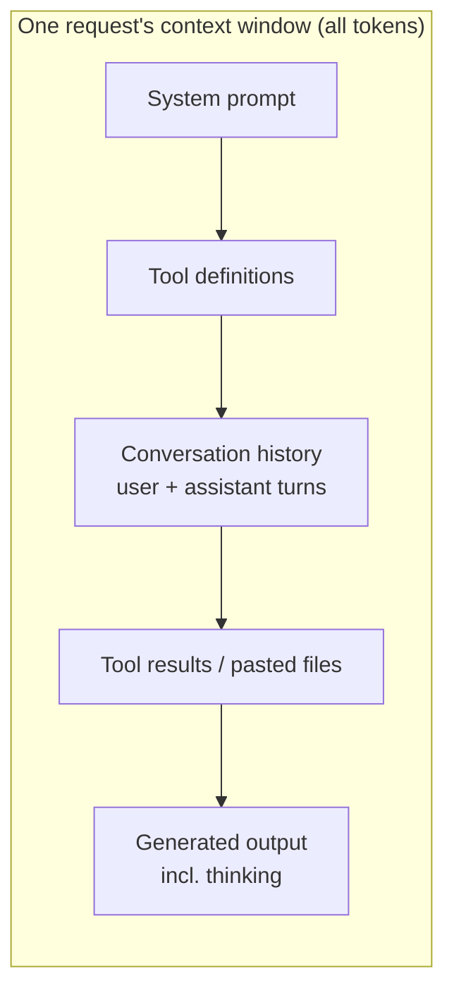
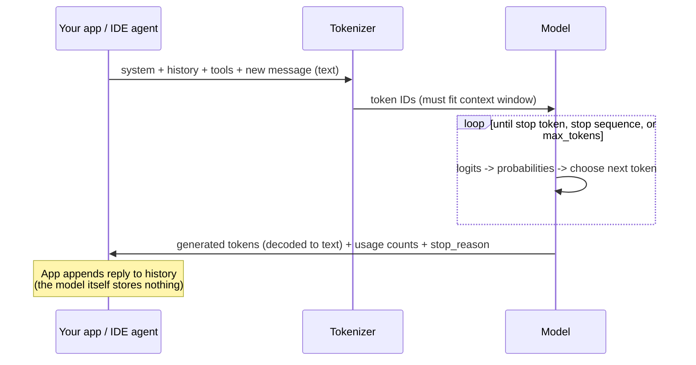

# 01 · What an LLM Actually Is (for People Who Build With It)

> Level: Beginner · Time: 2–3 hours · Prereqs: basic Python, the idea of a probability
> Tool-specific facts in this lesson were checked against official docs and are stamped **(as of Nov 2026)**.

---

## 1. Why this lesson exists

Every tool in this track (Claude Code, Cursor, Codex, MCP servers, LangGraph agents, Ollama) is a wrapper around one strange machine: a function that reads a sequence of tokens and outputs a probability for every possible next token. If you treat that machine as "a smart person in a box", you will be surprised constantly: it forgets things you told it an hour ago, it confidently invents a library that does not exist, it counts letters badly, it costs more when you paste a big log, and it gives a different answer when you ask twice.

None of those surprises are mysterious once you know five ideas: **tokens, the context window, next-token prediction, sampling, and statelessness**. This lesson builds those five ideas from zero, with runnable code, so that every later lesson ("why is my CLAUDE.md being ignored?", "why did my RAG answer miss the obvious paragraph?") has a mechanical explanation instead of a superstition.

## 2. Intuition: the world's most well-read autocomplete

Think of the predictive keyboard on your phone. You type "see you" and it suggests "tomorrow", "soon", "later". It has learned, from lots of text, which words tend to follow which. A large language model (LLM) is the same idea scaled up enormously: trained on a huge amount of text and code, with a neural network (the Transformer, Vaswani et al., 2017) that can look at *everything* you have typed so far, not just the last two words.

Three consequences fall out of this picture immediately:

1. **It only ever does one thing**: predict the next piece of text. Chatting, coding, calling tools, writing JSON: all of these are "predict the next piece" repeated many times. The product around the model turns that into a conversation.
2. **It only knows what is in front of it right now**, plus whatever patterns it absorbed during training. There is no hidden notebook where it remembers your last session. If a tool "remembers", the tool is pasting old text back in front of it.
3. **Its output is a choice from a probability distribution**, so the same input can produce different outputs unless something forces a single choice.

An analogy that maps well onto everything later: the model is a brilliant new colleague with **total amnesia between meetings**. Every meeting (every API call), you must hand them a folder (the context) containing everything they need. They read the whole folder, then speak one word at a time. Prompt engineering is "how to prepare the folder". Context engineering is "what to leave out of the folder". Tools and MCP are "giving them a phone to call for more information during the meeting".

## 3. Precise definitions

| Term | Plain meaning | Precise meaning |
|---|---|---|
| **Token** | A chunk of text, often a word piece | An integer ID from the model's fixed vocabulary; text is converted to a sequence of IDs by a tokenizer (commonly a byte-pair-encoding variant) |
| **Tokenizer** | The text-to-chunks converter | A deterministic algorithm + learned merge table mapping bytes ↔ token IDs; specific to a model family |
| **Context window** | How much the model can "see" at once | The maximum number of tokens (input + generated output) one request may involve |
| **Logits** | Raw scores for each possible next token | A real-valued vector of length = vocabulary size, output by the network |
| **Softmax** | Turns scores into probabilities | p_i = exp(z_i / T) / Σ_j exp(z_j / T), where T is temperature |
| **Sampling** | Picking the next token | Drawing a token from the (possibly truncated, rescaled) distribution |
| **Autoregressive generation** | Write one token, append it, repeat | Repeatedly sample token t_{n+1} from p(· \| t_1 … t_n) and append it |
| **Stateless API** | The server forgets you after each call | Each request must contain the full conversation so far; nothing persists server-side by default |

Anthropic's documentation defines the context window as "all the text a language model can reference when generating a response, including the response itself" and notes that "as token count grows, accuracy and recall degrade, a phenomenon known as context rot" (context-windows docs, as of Nov 2026).

## 4. Step by step

### 4.1 Tokens: why not just use characters or words?

**Dumbest approach: one token per character.** The vocabulary is tiny (a few hundred symbols), and any text is representable. The wall: sequences become very long. A 2,000-word document is roughly 12,000 characters. Every extra position costs computation (attention compares positions with each other), and the model must learn spelling from scratch before it can learn meaning.

**Next idea: one token per word.** Sequences are short. The wall: the vocabulary explodes ("run", "runs", "running", "rerun", every variable name in every codebase, every typo). Any word not seen in training becomes an "unknown" token and its information is lost.

**The idea that survived: subword units.** Byte-Pair Encoding (BPE), adapted for neural machine translation by Sennrich, Haddow and Birch (2016), starts from characters and repeatedly **merges the most frequent adjacent pair** into a new symbol. Frequent words end up as a single token; rare words get split into a few meaningful pieces; nothing is ever "unknown" because you can always fall back to single characters (modern tokenizers fall back to raw bytes).

Let us build one. This trains BPE merges on a 12-word corpus and then tokenizes words it never saw.

```python
# toy_bpe.py - learn byte-pair-encoding merges from a tiny corpus, then tokenize new text.
# Pure Python 3 standard library. Real tokenizers work on bytes and learn ~100k+ merges.
from collections import Counter              # Counter = dict that counts things


def train_bpe(corpus: str, num_merges: int) -> list[tuple[str, str]]:
    """Return the list of merges, most frequent pair first (Sennrich et al., 2016)."""
    # Each word starts as a tuple of single characters plus an end-of-word marker.
    words = Counter(tuple(w) + ("</w>",) for w in corpus.split())
    merges = []
    for _ in range(num_merges):
        pairs = Counter()                        # count every adjacent symbol pair
        for word, freq in words.items():
            for a, b in zip(word, word[1:]):     # zip(word, word[1:]) yields neighbours
                pairs[a, b] += freq
        if not pairs:
            break
        best = max(pairs, key=pairs.get)         # the most frequent pair wins this round
        merges.append(best)
        new_words = Counter()
        for word, freq in words.items():         # rewrite every word with the pair fused
            out, i = [], 0
            while i < len(word):
                if i + 1 < len(word) and (word[i], word[i + 1]) == best:
                    out.append(word[i] + word[i + 1]); i += 2
                else:
                    out.append(word[i]); i += 1
            new_words[tuple(out)] += freq
        words = new_words
    return merges


def tokenize(word: str, merges: list[tuple[str, str]]) -> list[str]:
    """Apply learned merges, in learned order, to one new word."""
    syms = list(word) + ["</w>"]
    for a, b in merges:                          # same order as training
        i = 0
        while i < len(syms) - 1:
            if syms[i] == a and syms[i + 1] == b:
                syms[i:i + 2] = [a + b]          # slice assignment fuses two symbols into one
            else:
                i += 1
    return syms


corpus = "low lower lowest low low newer newest new new wider widest wide"
merges = train_bpe(corpus, num_merges=10)
print("first merges:", merges[:5])
for w in ["lowest", "newest", "slowly", "widow"]:     # "slowly" and "widow" never appeared
    print(f"{w!r:10} -> {tokenize(w, merges)}")
```

Output:

```text
first merges: [('l', 'o'), ('lo', 'w'), ('n', 'e'), ('ne', 'w'), ('low', '</w>')]
'lowest'   -> ['low', 'est</w>']
'newest'   -> ['new', 'est</w>']
'slowly'   -> ['s', 'low', 'l', 'y', '</w>']
'widow'    -> ['w', 'i', 'd', 'o', 'w', '</w>']
```

**Line-by-line walkthrough (syntax and logic):**

- `from collections import Counter`: imports `Counter`, a dictionary subclass whose missing keys default to 0, so `pairs[a, b] += freq` works without first checking whether the key exists.
- `def train_bpe(corpus: str, num_merges: int) -> list[tuple[str, str]]:`: defines a function. The `: str` and `-> list[...]` parts are **type hints**; Python does not enforce them at runtime, they document intent and let tools check you.
- `words = Counter(tuple(w) + ("</w>",) for w in corpus.split())`: `corpus.split()` splits on whitespace. `tuple(w)` turns `"low"` into `('l','o','w')`. `("</w>",)` is a one-element tuple (the trailing comma is what makes it a tuple, not just parentheses). Adding tuples concatenates them. The whole expression inside `Counter(...)` is a **generator expression**, so the Counter counts how many times each spelled-out word occurs. The `</w>` marker lets the algorithm learn that "est" at the end of a word differs from "est" in the middle.
- `for a, b in zip(word, word[1:]):`: `word[1:]` is a slice starting at index 1; `zip` pairs element i of `word` with element i of `word[1:]`, which yields every adjacent pair. `a, b` unpacks each pair.
- `best = max(pairs, key=pairs.get)`: iterating a dict yields its keys; `key=pairs.get` tells `max` to compare keys by their counts. This is the core BPE step: pick the most frequent neighbour pair.
- The inner `while` loop rewrites each word, fusing every occurrence of `best` into a single string `word[i] + word[i + 1]`. `i += 2` skips the second half of a fused pair.
- `tokenize` replays merges **in the order they were learned**. `syms[i:i + 2] = [a + b]` is **slice assignment**: it replaces two list elements with one. Order matters because later merges are built on earlier ones (`('lo','w')` only exists after `('l','o')`).
- The `f"{w!r:10}"` in the print uses an f-string: `!r` formats with `repr()` (adds quotes), `:10` pads to width 10.

**What the output teaches.** `"lowest"` became `['low', 'est</w>']`: two tokens, both meaningful. `"slowly"` was never in the corpus, yet it tokenizes into `['s', 'low', 'l', 'y', '</w>']`, reusing the learned piece `low`. `"widow"` stays as characters because no useful merges cover it. This is exactly why real models handle unseen variable names gracefully but spend more tokens on unusual text.

### 4.2 Why tokens matter to you as a builder

1. **Cost and limits are in tokens, not characters or words.** API pricing is "per million tokens" and the context window is a token count. A rough rule many people use for English prose is about four characters per token, but code, non-English text and long numbers often tokenize less efficiently. Do not estimate; count. Anthropic exposes a free token-counting endpoint, `/v1/messages/count_tokens`, and states the count is "an estimate" that "might differ by a small amount" (as of Nov 2026).
2. **Tokenizers differ between models, even from the same vendor.** Anthropic's docs state that "Claude 4.7 and later models … use a newer tokenizer" and that "the same input text produces approximately 30 percent more tokens than on earlier models" (token-counting docs, as of Nov 2026). Never reuse token counts measured on one model to budget another.
3. **Character-level tasks are hard.** Asking "how many r's in strawberry?" asks the model about characters it never sees directly; it sees token IDs. If you need exact character operations, have the model call code (a tool) instead.

### 4.3 The context window: the folder you hand over every meeting

Everything in a request counts toward the window. Anthropic's docs list it explicitly: "the system prompt, every message in `messages` (including tool results, images, and documents), and your tool definitions. The output Claude generates for the turn, including its extended thinking, counts too" (as of Nov 2026).



Three facts to internalise:

- **Bigger is not free.** As of Nov 2026 the current Claude models list a 1M-token context window and up to 128K output tokens (models overview). But the same docs warn about *context rot*: recall degrades as the window fills. Research showed this earlier too: Liu et al. (2023), "Lost in the Middle", found that "performance is often highest when relevant information occurs at the beginning or end of the input context".
- **Overflow behaviour is defined.** If the input alone exceeds the window, the API returns a 400 "prompt is too long" error. On Claude 4.5 and newer, if generation runs into the window limit, it stops with `stop_reason: "model_context_window_exceeded"` (as of Nov 2026).
- **Your tools manage this for you, imperfectly.** Claude Code, Cursor and Codex all decide what goes into the window: your instruction files, the files they read, command outputs. Later lessons are largely about controlling that.

### 4.4 Next-token prediction and sampling

At each step the network outputs **logits**, one score per vocabulary entry. Softmax turns scores into probabilities. Then something must **choose** one token.

**Dumbest approach: always pick the highest-probability token (greedy decoding).** Deterministic for a fixed model and input, which sounds ideal. The wall: for open-ended text, greedy decoding tends to produce bland, repetitive loops. Holtzman et al. (2019), "The Curious Case of Neural Text Degeneration", documented this and proposed nucleus (top-p) sampling.

**Next idea: sample from the full distribution.** Now you get variety, but occasionally the sampler picks a very unlikely token ("banana" as the capital of France), and one bad token can derail everything after it, because each new token is conditioned on all previous ones.

**The compromise knobs:**

- **Temperature T**: divide logits by T before softmax. T < 1 sharpens (more deterministic), T > 1 flattens (more random).
- **Top-k**: keep only the k most likely tokens, renormalise.
- **Top-p (nucleus)**: keep the smallest set of tokens whose probabilities add up to at least p, renormalise.

```python
# sampling.py - how temperature, top-k and top-p reshape a next-token distribution.
# Needs numpy (pip install numpy). Tested with numpy 2.5.4, Python 3.13.
import numpy as np                                    # np = numerical arrays

vocab = np.array(["Paris", "London", "Rome", "pizza", "the", "banana"])
logits = np.array([6.0, 3.5, 3.0, 1.0, 0.5, -2.0])  # raw scores a model might output


def softmax(z: np.ndarray, temperature: float = 1.0) -> np.ndarray:
    """Turn scores into probabilities. Dividing by T<1 sharpens, T>1 flattens."""
    z = z / temperature
    z = z - z.max()                                   # subtract max for numerical stability
    e = np.exp(z)
    return e / e.sum()


def top_k(p: np.ndarray, k: int) -> np.ndarray:
    """Keep the k most likely tokens, renormalise the rest to zero."""
    keep = np.argsort(p)[-k:]                         # indices of the k largest probabilities
    q = np.zeros_like(p); q[keep] = p[keep]
    return q / q.sum()


def top_p(p: np.ndarray, threshold: float) -> np.ndarray:
    """Nucleus sampling: smallest set of tokens whose cumulative probability >= threshold."""
    order = np.argsort(p)[::-1]                       # most likely first
    cum = np.cumsum(p[order])
    cutoff = np.searchsorted(cum, threshold) + 1      # how many tokens we need
    q = np.zeros_like(p); q[order[:cutoff]] = p[order[:cutoff]]
    return q / q.sum()


def show(p: np.ndarray) -> dict:
    """Plain-Python dict for readable printing (numpy 2 prints np.float64(...) otherwise)."""
    return {str(v): round(float(x), 3) for v, x in zip(vocab, p)}


for T in (0.2, 1.0, 2.0):
    print(f"T={T}:", show(softmax(logits, T)))
p = softmax(logits, 1.0)
print("top_k=2  :", show(top_k(p, 2)))
print("top_p=0.9:", show(top_p(p, 0.9)))
rng = np.random.default_rng(0)                        # seeded so the demo is reproducible
print("10 samples at T=2.0:", [str(x) for x in rng.choice(vocab, size=10, p=softmax(logits, 2.0))])
print("greedy (argmax)    :", str(vocab[np.argmax(logits)]))
```

Output:

```text
T=0.2: {'Paris': 1.0, 'London': 0.0, 'Rome': 0.0, 'pizza': 0.0, 'the': 0.0, 'banana': 0.0}
T=1.0: {'Paris': 0.875, 'London': 0.072, 'Rome': 0.044, 'pizza': 0.006, 'the': 0.004, 'banana': 0.0}
T=2.0: {'Paris': 0.597, 'London': 0.171, 'Rome': 0.133, 'pizza': 0.049, 'the': 0.038, 'banana': 0.011}
top_k=2  : {'Paris': 0.924, 'London': 0.076, 'Rome': 0.0, 'pizza': 0.0, 'the': 0.0, 'banana': 0.0}
top_p=0.9: {'Paris': 0.924, 'London': 0.076, 'Rome': 0.0, 'pizza': 0.0, 'the': 0.0, 'banana': 0.0}
10 samples at T=2.0: ['London', 'Paris', 'Paris', 'Paris', 'Rome', 'pizza', 'London', 'London', 'Paris', 'pizza']
greedy (argmax)    : Paris
```

**Line-by-line walkthrough (syntax and logic):**

- `import numpy as np`: imports the NumPy array library under the conventional short name `np`.
- `vocab = np.array([...])` / `logits = np.array([...])`: two parallel arrays; `logits[i]` is the score of `vocab[i]`. Real vocabularies have on the order of 100,000 entries; we use six.
- In `softmax`: `z / temperature` divides **every element** at once (NumPy broadcasting). `z - z.max()` subtracts the maximum, which does not change the softmax result mathematically but prevents `exp()` overflow for large scores. `np.exp(z)` exponentiates elementwise; dividing by `e.sum()` normalises to probabilities summing to 1.
- In `top_k`: `np.argsort(p)` returns indices that would sort `p` ascending; `[-k:]` takes the last k, i.e. the k largest. `np.zeros_like(p)` makes an all-zero array of the same shape; we copy the kept probabilities in and renormalise.
- In `top_p`: `[::-1]` reverses (descending order). `np.cumsum` gives running totals. `np.searchsorted(cum, threshold)` finds the first index where the running total reaches the threshold; `+ 1` converts an index into a count.
- `show(...)`: a dict comprehension `{key: value for ... in ...}` that converts NumPy scalars into plain Python `str`/`float` for clean printing (NumPy 2 otherwise prints `np.float64(...)`).
- `rng = np.random.default_rng(0)`: a seeded random generator, so the "random" samples are reproducible. `rng.choice(vocab, size=10, p=...)` draws 10 items using the given probabilities.

**What the output teaches.** At T=0.2 "Paris" has probability 1.0 (rounded): effectively greedy. At T=2.0 even "banana" gets 1.1%, and in 10 draws we got "pizza" twice. Top-k=2 and top-p=0.9 both cut the tail entirely here, because Paris and London already hold more than 90% of the mass.

### 4.5 A crucial Nov 2026 reality check about these knobs

Older tutorials tell you to "set temperature to 0 for deterministic output". As of Nov 2026, that advice does not transfer to every API:

- Anthropic's migration guide for Claude Opus 5.5 says: "Omit `temperature`, `top_p`, and `top_k`. Use prompting to guide the model's behavior", and adds: "If you were using `temperature = 0` for determinism, note that it never guaranteed identical outputs on prior models." The installed Python SDK (`anthropic` 2.8.0) does not even list these parameters on `messages.create`.
- Local runtimes still expose them. Ollama's Modelfile documentation lists `temperature` (default 0.8), `top_k` (default 40) and `top_p` (default 0.9) as tunable parameters (as of Nov 2026).

So learn the mechanism (it explains behaviour everywhere), but check each API before reaching for the knob. When you need reliable structure rather than "less randomness", the modern answer is **structured outputs / constrained decoding**, covered in the intermediate tier.

### 4.6 Statelessness: who remembers the conversation?

```text
Call 1:  [system] [user: "My name is Prahalya"]                      -> "Nice to meet you!"
Call 2:  [system] [user: "What is my name?"]                          -> "I don't know your name."
Call 2': [system] [user: "My name is Prahalya"] [assistant: "Nice..."]
                  [user: "What is my name?"]                          -> "Prahalya."
```

The API does not remember Call 1. A chat app "remembers" by resending the whole history (Call 2'). This is why long conversations get slower and more expensive (the history is re-read every turn), why tools invent mechanisms like `CLAUDE.md` files and "memory" folders (they paste saved text into every new session), and why "compaction" (summarising old turns) exists. Anthropic's docs say it directly: "each user message and assistant response accumulates within the context window, and previous turns are preserved completely" (as of Nov 2026).

### 4.7 Putting it together: the whole pipeline



## 5. Common mistakes

1. **"The model remembers what I said yesterday."** It does not. Something pasted it back in, or it guessed.
2. **Estimating cost by characters or words.** Count tokens with the provider's counter, for the model you will actually use.
3. **Pasting entire logs "just in case".** It costs money, crowds out instructions, and triggers context rot. Filter first (grep the errors, keep the last N lines).
4. **Using temperature 0 as a determinism guarantee.** Anthropic explicitly says it never guaranteed identical outputs, and current Claude models reject the parameter. Design for variation: validate outputs, run evals with multiple trials.
5. **Asking for character-exact operations.** Counting letters, reversing strings, exact arithmetic on long numbers: delegate to code via a tool.
6. **Believing confident output.** Fluency comes from next-token prediction, not from fact-checking. Confidence of tone is not evidence.

## 6. Connections to other tracks

- **Math for CS**: softmax, probability distributions, `exp`/`log` numerical stability (the `z - z.max()` trick is the same log-sum-exp stabilisation used throughout ML).
- **DSA**: BPE training is greedy pair counting with hash maps; tokenization is repeated linear scans. Top-k is a partial sort (a heap gives O(n log k)).
- **Compilers**: a tokenizer is a lexer. BPE is a *learned* lexer; your C lexer is a hand-written one. Both turn a character stream into a token stream before anything smarter happens.
- **ML/LLM agents track**: the Transformer internals (attention, embeddings) that produce the logits live there.
- **Networks**: statelessness is the same design choice as HTTP: every request carries what the server needs; sessions are layered on top.

## 7. Where this shows up in my projects

- **QiskitSage** runs multi-agent review on **local Ollama models**, so every concept here is directly visible: local models have their own tokenizers and a default context length you must configure (Ollama's FAQ: "By default, Ollama uses a context window size of 4096 tokens", as of Nov 2026); a large PR diff can silently overflow a small window. The local-models lesson (03-advanced/05) goes deeper.
- **Nidhogg / Logly** turns natural-language questions into log searches: the model never "sees" your Elasticsearch cluster, only the tokens you put in its window (schema hints, examples). That is statelessness and context in practice.

## 8. Self-check questions

1. Why does BPE never produce an "unknown word" token?
2. A prompt is 950,000 tokens and you set `max_tokens` to 128,000 on a 1M-window Claude 5.x model. Input + max_tokens is 1,078,000. What happens?
3. You set temperature to 0 on a provider that still supports it. Why might two runs still differ?
4. Why does a chat that has gone on for two hours get slower and more expensive per message?
5. Top-k=50 and top-p=0.9 are both set. Describe a distribution where top-p keeps far fewer than 50 tokens.

<details><summary>Answers</summary>

1. Because it starts from single characters (in production, single bytes) and only *adds* merged symbols. Anything can always be spelled out from the base alphabet, at the cost of more tokens.
2. Per the docs (as of Nov 2026), on Claude 4.5 and newer the request is **accepted** because the input alone (950K) fits. Generation proceeds; if it reaches the 1M limit (after about 50K output tokens) it stops with `stop_reason: "model_context_window_exceeded"`, and you must treat the output as truncated. On earlier models the same request would have been rejected with a validation error. If the input alone exceeded 1M, every model returns a 400 "prompt is too long".
3. Greedy decoding is deterministic only if the logits are bit-identical. Serving infrastructure can batch requests differently, use different hardware or numeric kernels, and floating-point addition is not associative, so tiny differences can flip a near-tie, after which the continuation diverges. Anthropic also notes temperature 0 "never guaranteed identical outputs".
4. The API is stateless, so every turn resends the entire history; input tokens per call grow with the conversation length.
5. A very peaked distribution: if the top token has probability 0.95, top-p=0.9 keeps exactly one token, while top-k=50 would keep 50.

</details>

## 9. Mnemonic (Tamil + English)

**"TOKEN-a KAASU, CONTEXT-a KAN, SAMPLE-a SANDHEGAM, STATE-a SUNYAM."**
- **Token = kaasu** (காசு, money): you are billed per token.
- **Context = kan** (கண், eye): the model only sees what is in its window.
- **Sampling = sandhegam** (சந்தேகம், doubt): every output is a draw, so doubt it and verify.
- **State = sunyam** (சூன்யம், zero): the API remembers nothing between calls.

## Sources

- Vaswani et al., "Attention Is All You Need" (2017): https://arxiv.org/abs/1706.03762
- Sennrich, Haddow, Birch, "Neural Machine Translation of Rare Words with Subword Units" (2016): https://arxiv.org/abs/1508.07909
- Holtzman et al., "The Curious Case of Neural Text Degeneration" (2019): https://arxiv.org/abs/1904.09751
- Liu et al., "Lost in the Middle: How Language Models Use Long Contexts" (2023): https://arxiv.org/abs/2307.03172
- Anthropic, Context windows (as of Nov 2026): https://platform.claude.com/docs/en/build-with-claude/context-windows
- Anthropic, Token counting (as of Nov 2026): https://platform.claude.com/docs/en/build-with-claude/token-counting
- Anthropic, Models overview (as of Nov 2026): https://platform.claude.com/docs/en/about-claude/models/overview
- Anthropic, Claude Opus 5.5 migration guide (sampling parameters) (as of Nov 2026): https://platform.claude.com/docs/en/models/opus-5-5/migration-guide
- Ollama, Modelfile reference (as of Nov 2026): https://docs.ollama.com/modelfile
- Ollama, FAQ (context length default) (as of Nov 2026): https://docs.ollama.com/faq

## Verify yourself

1. Run `python3 toy_bpe.py` (stdlib only). Change `num_merges` to 3 and to 30 and watch `"slowly"` change. Expected with 10 merges: exactly the output shown above.
2. `pip install numpy` then run `python3 sampling.py`. Change the seed in `default_rng(0)` and confirm only the sampled list changes, not the probabilities.
3. Open the Anthropic context-windows page and confirm the exact wording of the overflow rules (400 vs `model_context_window_exceeded`).
4. Open the Opus 5.5 migration guide and confirm the sampling-parameter guidance; then `pip install anthropic` and run `python3 -c "import inspect, anthropic; from anthropic.resources.messages import Messages; print('temperature' in inspect.signature(Messages.create).parameters)"` (it printed `False` with SDK 2.8.0 in Nov 2026).
5. Note the Ollama inconsistency yourself: the Modelfile page lists `num_ctx` default 2048 while the FAQ says 4096. If you run Ollama, check what your version actually uses with `ollama show <model>` and `ollama ps` before trusting either number.
