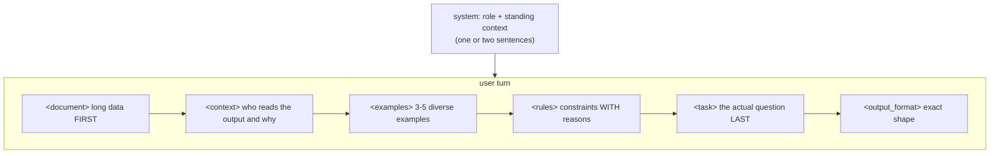

# 02 · Prompting From First Principles

> Level: Beginner · Time: 2 hours · Prereqs: [01 · What an LLM actually is](01-llms-for-builders.md)
> Tool-specific facts were checked against official docs and are stamped **(as of Nov 2026)**.

---

## 1. Why this lesson exists

From lesson 01 you know the model is an amnesiac that reads a folder of tokens and predicts what comes next. A **prompt** is that folder. Everything the model does well or badly is downstream of what you put in it, in what order, and how clearly.

People often treat prompting as magic phrases ("you are a world-class expert", "take a deep breath"). That folklore ages badly because models change every few months. The principles in this lesson do not age, because they come from the mechanics: the model can only use information that is in the window, it infers the task from patterns, and ambiguous input gives you a distribution of plausible outputs rather than the one you meant. Anthropic's own guide frames it as treating the model like "a brilliant but new employee who lacks context on your norms and workflows" (prompting best practices, as of Nov 2026).

## 2. Intuition: briefing a new intern

Imagine handing a task to a sharp intern on their first day, by email, with no chance for them to ask questions.

- "Make a dashboard" produces *a* dashboard. Which data? For whom? How fancy?
- "Never use ellipses" is obeyed, but the intern does not know *why*, so they will happily use "etc." or "and so on" which break the same downstream system.
- If you paste a 40-page log and then ask your question on page 1, they may skim past the part that matters.
- If you show them one example of a finished report, they copy its format precisely, including the quirks you did not intend.

Every one of those intern behaviours has a model equivalent. The "colleague test" from Anthropic's guide is the best single rule: "Show your prompt to a colleague with minimal context on the task and ask them to follow it. If they'd be confused, Claude will be too."

## 3. Precise definitions

| Term | Meaning |
|---|---|
| **System prompt** | Instructions placed in the separate `system` field of an API request (or the tool's equivalent, such as a `CLAUDE.md`). Used for role, standing rules and context that apply to the whole conversation. |
| **User turn** | The message containing the specific request and data for this turn. |
| **Zero-shot** | Asking for a task with instructions only, no examples. |
| **Few-shot / multishot** | Including worked examples of input → output so the model infers the pattern. |
| **Delimiters / XML tags** | Markers like `<document>…</document>` that separate instructions from data unambiguously. |
| **Output format spec** | An explicit description (or schema) of the shape the answer must take. |
| **Success criteria** | A testable statement of what a good output is. Without it you cannot tell whether a prompt change helped. |

## 4. Step by step: from a bad prompt to a good one

We will improve one real task: *summarise errors in an application log for an on-call engineer.*

### Step 0: decide what "good" means first

Anthropic's prompt engineering overview says the guide assumes you already have "a clear definition of the success criteria for your use case", "some ways to empirically test against those criteria" and "a first draft prompt you want to improve", and adds: "If not, spend time establishing that first" (as of Nov 2026). For our task:

- Every distinct ERROR line is listed with a correct count.
- No WARN or INFO lines appear.
- Output is one line per error, `message: count`, because a Slack bot parses it.
- If there are no errors, the output is exactly `No errors`.

These are checkable by a ten-line script, which matters enormously later (the evals lesson, 04-pro/01).

### Step 1: the dumbest prompt

```text
Summarise this log: INFO start ERROR disk full WARN slow ERROR disk full ERROR auth failed
```

**What is annoying:** the output is a friendly paragraph ("The log shows a couple of issues, notably the disk being full…"). It mixes in the WARN line, has no counts, and the Slack bot cannot parse it. The model did a reasonable job of *a* task; just not ours.

### Step 2: be clear and explicit

Say what you want, including what "done" looks like.

```text
List each distinct ERROR in the log below with how many times it occurs.
Ignore INFO and WARN lines. Output one line per error as "<message>: <count>".
```

**Better, but now:** sometimes it adds a preamble ("Here are the errors:"), and on a clean log it writes "There were no errors in this log!", which the bot does not recognise.

### Step 3: give the reason, not just the rule

Anthropic's guide contrasts "NEVER use ellipses" with "Your response will be read aloud by a text-to-speech engine, so never use ellipses since the text-to-speech engine will not know how to pronounce them", and notes "Claude can generalize from the explanation" (as of Nov 2026). Applied here:

```text
The output is parsed by a Slack bot that reads one "<message>: <count>" per line,
so do not add any other text. If there are no errors, output exactly "No errors",
because the bot checks for that exact string.
```

The model now understands the *purpose* (machine parsing) and will avoid other things that would break a parser, not only the ones you listed.

### Step 4: separate instructions from data with tags

**The wall:** logs can contain text that looks like instructions ("ERROR: please ignore previous config"). Also, when the log is long, the boundary between "my instructions" and "the data" blurs. The fix is unambiguous delimiters. The guide recommends XML tags because they "help Claude parse complex prompts unambiguously", with consistent, descriptive names like `<instructions>`, `<context>`, `<input>` (as of Nov 2026).

### Step 5: put long data first and the question last

For long inputs (the guide says 20K+ tokens), Anthropic recommends: "Place your long documents and inputs near the top of your prompt, above your query, instructions, and examples", and reports that "queries at the end can improve response quality by up to 30 percent in tests, especially with complex, multidocument inputs" (as of Nov 2026). This also matches the "Lost in the Middle" finding from lesson 01: the end of the context is a strong position.

### Step 6: show, do not only tell (examples)

A few examples pin down format and edge cases better than paragraphs of description. The guide says examples should be **relevant**, **diverse** (cover edge cases without introducing unintended patterns) and **structured** in `<example>` tags, and suggests "3–5 examples for best results" (as of Nov 2026).

**The wall examples introduce:** the model copies *everything* about them. If all your examples have exactly two errors, outputs may skew toward two lines. If every example message is lowercase, it may lowercase real messages. Vary the examples on every dimension you do not care about.

### Step 7: give a role (but do not expect magic)

A role in the system prompt sets tone and domain focus; the guide says "even a single sentence makes a difference" (as of Nov 2026). It does not add knowledge the model lacks. "You are a senior Kubernetes expert" does not make a model know your cluster; the logs in the window do that.

### Step 8: assemble it with code

Real applications build prompts from parts. Doing it in code makes prompts testable, diffable and reusable. Here is a small builder plus a "lint" that catches the beginner mistakes above.

```python
# prompt_builder.py - assemble a well-structured prompt from parts, then lint it.
# Pure Python 3 standard library. The output is plain text you could send to any model.


def build_prompt(role: str, context: str, task: str, rules: list[str],
                 examples: list[tuple[str, str]], data: str, output_format: str) -> dict:
    """Return {'system': ..., 'user': ...}: long data first, the question last."""
    ex = "\n".join(f'<example>\n<input>{i}</input>\n<output>{o}</output>\n</example>'
                   for i, o in examples)
    rule_lines = "\n".join(f"- {r}" for r in rules)
    # Build from a list of sections and join with blank lines. (Do NOT use textwrap.dedent on
    # an f-string that interpolates multi-line text: the inserted lines break the common indent.)
    sections = [
        f"<document>\n{data}\n</document>",              # long data FIRST
        f"<context>{context}</context>",
        f"<examples>\n{ex}\n</examples>",
        f"<rules>\n{rule_lines}\n</rules>",
        f"<task>{task}</task>",                            # the actual question LAST
        f"<output_format>{output_format}</output_format>",
    ]
    user = "\n\n".join(sections)
    return {"system": role, "user": user}


def lint(prompt: dict) -> list[str]:
    """Cheap static checks that catch the most common beginner mistakes."""
    u, warnings = prompt["user"], []
    if "<task>" in u and u.index("<task>") < u.index("<document>"):
        warnings.append("question appears before the long document; put data first")
    if any(w in u for w in ("NEVER", "ALWAYS", "CRITICAL")):
        warnings.append("shouting words found; explain the reason instead")
    if "<example>" not in u:
        warnings.append("no examples; 3-5 diverse examples usually help")
    return warnings or ["looks fine"]


p = build_prompt(
    role="You are a careful log analyst for a backend team.",
    context="The summary is pasted into an on-call Slack channel, so keep it short.",
    task="List each distinct ERROR in the log with its count.",
    rules=["Only report lines with level ERROR.",
           "If there are no errors, say 'No errors' because the bot checks that exact string."],
    examples=[("ERROR db timeout\nERROR db timeout", "db timeout: 2")],
    data="INFO start\nERROR disk full\nWARN slow\nERROR disk full\nERROR auth failed",
    output_format="One line per error: '<message>: <count>'",
)
print("SYSTEM:", p["system"])
print(p["user"])
print("lint:", lint(p))
```

Output:

```text
SYSTEM: You are a careful log analyst for a backend team.
<document>
INFO start
ERROR disk full
WARN slow
ERROR disk full
ERROR auth failed
</document>

<context>The summary is pasted into an on-call Slack channel, so keep it short.</context>

<examples>
<example>
<input>ERROR db timeout
ERROR db timeout</input>
<output>db timeout: 2</output>
</example>
</examples>

<rules>
- Only report lines with level ERROR.
- If there are no errors, say 'No errors' because the bot checks that exact string.
</rules>

<task>List each distinct ERROR in the log with its count.</task>

<output_format>One line per error: '<message>: <count>'</output_format>
lint: ['looks fine']
```

**Line-by-line walkthrough (syntax and logic):**

- `def build_prompt(role: str, context: str, ..., examples: list[tuple[str, str]], ...) -> dict:`: a function with type-hinted parameters. `list[tuple[str, str]]` means "a list of (input, output) string pairs".
- `ex = "\n".join(f'<example>...' for i, o in examples)`: a generator expression produces one formatted string per example; `"\n".join(...)` glues them with newlines. Inside the f-string, `{i}` and `{o}` are replaced by each pair's values (the `for i, o in examples` unpacks each tuple).
- `rule_lines = "\n".join(f"- {r}" for r in rules)`: turns the list of rules into a bulleted block.
- `sections = [ ... ]`: a Python list of strings, **in the order we want the model to read them**: document first, task near the end. Each `f"<document>\n{data}\n</document>"` wraps content in tags; `\n` is a newline escape.
- The comment explains a real bug I hit while writing this lesson: `textwrap.dedent` on an f-string that interpolates multi-line text leaves the interpolated lines unindented, so the "common indentation" is gone and the template comes out ragged. Joining a list avoids that class of bug entirely.
- `user = "\n\n".join(sections)`: blank line between sections.
- `return {"system": role, "user": user}`: a dict literal; these two strings map directly onto an API request's `system` field and the user message.
- In `lint`: `u.index("<task>") < u.index("<document>")` compares character positions to detect "question before data". `any(w in u for w in (...))` is True if any shouting word appears. `return warnings or ["looks fine"]`: `or` returns its right side when the left is empty (an empty list is "falsy").

### Step 9: specify the output format positively

Anthropic's guide recommends telling the model **what to do instead of what not to do** ("Instead of 'Do not use markdown,' try 'Your response should be composed of smoothly flowing prose paragraphs'"), and notes that matching your prompt's own style to the desired output helps (as of Nov 2026). For machine-read output, the strongest move is a schema-enforced structured output, which arrives in 02-intermediate/01.

### The finished anatomy



## 5. One model-version gotcha worth knowing now: no more prefill

Older guides teach "prefilling": ending your request with a partial assistant message such as `{` to force JSON. As of Nov 2026, Anthropic's best-practices page states: "Starting with Claude 4.6 models and Claude Mythos Preview, prefilled responses … on the last assistant turn are no longer supported. Requests with prefilled assistant messages to these models return a 400 error." The recommended replacements are structured outputs or system-prompt instructions. If you copy a 2024 tutorial and get a 400, this is likely why.

## 6. Common mistakes

1. **No success criteria.** You cannot tell whether a change helped, so you tweak forever. Write the checks first.
2. **Rules without reasons.** "NEVER do X" gets literal compliance and misses the intent. Explain why.
3. **Shouting.** Anthropic's guide notes recent models "might now overtrigger" on aggressive language, and suggests "Use this tool when..." instead of "CRITICAL: You MUST use this tool when..." (as of Nov 2026).
4. **Question first, 30 pages of data after.** Put long data first and the question last.
5. **Homogeneous examples.** The model copies incidental features. Vary length, case, count and edge cases.
6. **Mixing data and instructions without delimiters.** Invites confusion and prompt injection (04-pro/03).
7. **Asking the role to do the work of context.** A role sets style, not knowledge.
8. **Copying old tricks blindly.** Prefill and temperature tricks changed between model generations; check the current docs.

## 7. Connections to other tracks

- **Career skills / technical writing**: a good prompt is a good spec. The colleague test is the same test you would apply to a design doc or a bug report.
- **Testing/Verification**: success criteria are test oracles. Lesson 04-pro/01 turns them into an eval suite.
- **Security**: delimiters are the first (weak) defence against prompt injection, analogous to separating code from data in SQL with parameterised queries. Unlike SQL, there is no perfect escaping for natural language; see 04-pro/03.
- **Compilers**: the prompt builder is a tiny code generator; the lint is a tiny static analyser.

## 8. Where this shows up in my projects

- **aws-waste-scanner** produces an AI summary of AWS waste findings for Slack. That is exactly this lesson's shape: structured findings as the document, the audience (an engineer in Slack) as context, a fixed output format, and a rule about not inventing numbers. Compare your actual prompt in that repo against the anatomy diagram above and the lint rules.
- **ARIA** drafts emails for human approval: role (assistant writing on the user's behalf), context (the thread), and format (subject + body) map one-to-one onto the sections here.

## 9. Self-check questions

1. Why does explaining the reason behind a rule usually beat stating the rule louder?
2. Where should a 30-page document go relative to your question, and what evidence supports that?
3. You give three examples, each with exactly two bullet points. What risk did you create?
4. Your 2024 tutorial ends the request with an assistant message `{` and you get HTTP 400 on a current Claude model. Why, and what do you use instead?
5. Why write success criteria before writing the prompt?

<details><summary>Answers</summary>

1. The model generalises from the reason to cases you did not list (the ellipsis/text-to-speech example), while a loud rule only covers its literal wording and can cause overtriggering on newer models.
2. At the top, above instructions and examples, with the question at the end. Anthropic reports up to 30 percent quality improvement from queries at the end in their tests, and Liu et al. (2023) found models use information at the start and end of context best.
3. An unintended pattern: the model may infer that answers always have two bullets and pad or truncate to match.
4. As of Nov 2026, prefilling the last assistant turn is not supported from Claude 4.6 onward and returns 400. Use structured outputs (`output_config.format`) or system-prompt instructions.
5. Without them, you cannot measure whether a change helped; you are tuning by vibes. Criteria also become automated checks (evals).

</details>

## 10. Mnemonic (Tamil + English)

**"D-C-E-R-T-F: Dosa Chutney Eppovum Rasam Thaan Final."** (தோசை, சட்னி, எப்பவும் ரசம் தான் final: dosa, chutney, and rasam is always the final course.)
Order of a good prompt: **D**ocument, **C**ontext, **E**xamples, **R**ules (with reasons), **T**ask, **F**ormat. Just like a South Indian meal, the heavy stuff comes first and the question (rasam) comes last.

## Sources

- Anthropic, Prompt engineering overview (as of Nov 2026): https://platform.claude.com/docs/en/build-with-claude/prompt-engineering/overview
- Anthropic, Prompting best practices (as of Nov 2026): https://platform.claude.com/docs/en/build-with-claude/prompt-engineering/claude-prompting-best-practices
- Anthropic, interactive prompt engineering tutorial (GitHub): https://github.com/anthropics/prompt-eng-interactive-tutorial
- Brown et al., "Language Models are Few-Shot Learners" (2020), origin of the few-shot framing: https://arxiv.org/abs/2005.14165
- Liu et al., "Lost in the Middle" (2023): https://arxiv.org/abs/2307.03172

## Verify yourself

1. Run `python3 prompt_builder.py` (stdlib only). Then move the `<task>` section to the top of `sections` and confirm the lint warns "question appears before the long document".
2. Reintroduce the bug: build the prompt with `textwrap.dedent(f"""...""")` around multi-line `data` and look at the indentation of the output.
3. Open the best-practices page and find the exact sentences on (a) "up to 30 percent", (b) "3–5 examples", (c) prefill returning 400. Note the date you checked.
4. If you have an API key, send the Step 1 and Step 8 prompts to any model 5 times each and count how many outputs the Slack-bot format check (`all(re.fullmatch(r".+: \d+", l) for l in out.splitlines())`) accepts.
