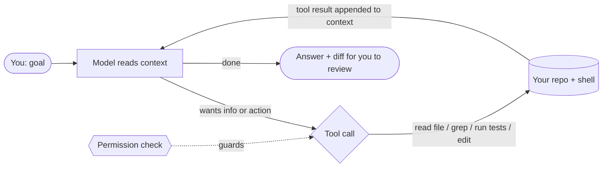

# 03 · Meet Your AI Coding Tools: Chat, Autocomplete, and Agents

> Level: Beginner · Time: 2 hours · Prereqs: lessons [01](01-llms-for-builders.md) and [02](02-prompting-first-principles.md); comfortable with a terminal and git
> Every product fact here is stamped **(as of Nov 2026)**. These products change monthly; re-check the linked docs.

---

## 1. Why this lesson exists

"AI coding tool" covers three very different things: a chat window you paste code into, an editor that completes the line you are typing, and an **agent** that reads your repository, runs commands and edits files on its own. They fail in different ways and need different habits. Before learning the details of Claude Code, Cursor and Codex (advanced tier), you need a map of the territory and one safe first workflow, so that you never give an agent more power than you understand.

## 2. Intuition: three kinds of help

- **Chat** is a *consultant on the phone*. You describe the problem, paste snippets, get advice. They never touch your machine. Everything they know about your code is what you pasted.
- **Autocomplete** is a *pair programmer finishing your sentence*. Fast, tiny, constant. Great for boilerplate; dangerous when you accept without reading.
- **An agent** is a *contractor with keys to your house*. You give a goal; they look around, run tools, make changes, and report back. Hugely productive, and the keys are the whole risk.

The agent pattern is just lesson 01's model plus a loop:



The model never touches your disk directly. It *asks* for tool calls; the harness (Claude Code, Cursor, Codex) executes them, subject to a **permission system**, and feeds results back. That loop is the subject of 02-intermediate/01; the permission systems are 03-advanced/01 and 02.

## 3. Precise definitions

| Term | Meaning |
|---|---|
| **Harness / scaffold** | The program around the model that builds the context, exposes tools, executes tool calls and enforces permissions (e.g. Claude Code). |
| **Agentic coding tool** | A harness whose tools include reading/searching files, editing files and running shell commands, operating in a loop until the task is done. |
| **Instruction file** | A Markdown file the harness automatically loads into every session: `CLAUDE.md` for Claude Code, `AGENTS.md` for Codex and many others, `.cursor/rules/*.mdc` or `AGENTS.md` for Cursor. |
| **Permission mode / sandbox** | The policy deciding which tool calls run automatically, which need your approval, and what the process can physically touch. |
| **Plan mode** | A mode where the agent explores read-only and proposes a plan before editing. |
| **Checkpoint** | A saved snapshot of files that lets you roll back an agent's edits. |

## 4. The three tools in this track (as of Nov 2026)

These are not the only options (many others exist), but they cover the main design points and are the ones the track goes deep on.

### Claude Code (Anthropic)

Anthropic describes it as "an agentic coding tool that reads your codebase, edits files, runs commands, and integrates with your development tools", available in the terminal, IDE extensions (VS Code, JetBrains), a desktop app and the browser (overview docs, as of Nov 2026). The recommended install on macOS/Linux/WSL is:

```bash
curl -fsSL https://claude.ai/install.sh | bash
```

Then `cd your-project && claude`. It reads `CLAUDE.md` instruction files, supports skills, subagents, hooks and MCP servers (all covered later), and has a non-interactive mode, `claude -p "..."`, for scripts and CI.

### Cursor

An AI-first code editor. Its **Agent** "searches your codebase, edits multiple files, runs terminal commands, and fixes errors on its own", with modes **Agent**, **Ask** (read-only), **Plan** (edits only after you approve the plan) and **Debug** (help docs, as of Nov 2026). It supports project rules in `.cursor/rules`, `AGENTS.md`, MCP servers, checkpoints you can restore, and a CLI invoked as `agent` (install: `curl https://cursor.com/install -fsS | bash`).

### Codex (OpenAI)

The Codex CLI is "a coding agent from OpenAI that runs locally on your computer" (GitHub README, as of Nov 2026), open source under Apache-2.0, installed with `npm install -g @openai/codex` or `brew install --cask codex`. Codex also has an IDE extension and a cloud surface. It reads `AGENTS.md`, configures itself through `~/.codex/config.toml`, and enforces an OS-level sandbox with modes `read-only`, `workspace-write` and `danger-full-access`.

### How they compare at a glance

| | Claude Code | Cursor | Codex CLI |
|---|---|---|---|
| Primary surface | Terminal (plus IDE, desktop, web) | Editor (plus CLI, cloud agents) | Terminal (plus IDE, cloud) |
| Instruction file | `CLAUDE.md` (can import `AGENTS.md`) | `.cursor/rules/*.mdc`, `AGENTS.md` | `AGENTS.md` |
| Non-interactive mode | `claude -p` | `agent -p` | `codex exec` |
| Extensibility | Skills, subagents, hooks, plugins, MCP | Rules, MCP, subagents | MCP, AGENTS.md, config profiles |
| Safety model | Permission modes + rules + optional sandbox | Run modes / approvals, checkpoints | OS sandbox + approval policy |

## 5. Step by step: your first safe agent session

### Step 1: the dumbest approach

Open the agent in your home directory and type "clean up my project". **The wall:** it does not know which project, what "clean" means, or what it must not touch; it may read files you never meant to share, and if it is in a permissive mode it may delete things. Agents amplify vague instructions.

### Step 2: scope the blast radius

- Work inside a **git repository** with a clean working tree (`git status` shows nothing to commit). Git is your universal undo.
- Start the tool **in the project directory**, not `~`.
- Use the default permission mode (it asks before edits and most commands). Do not start with "skip all permissions".

### Step 3: ask before you act

Begin read-only. In Claude Code you can use plan mode; in Cursor, Ask or Plan mode; in Codex, the `read-only` sandbox. Ask: "Explain the structure of this repo and how to run its tests." You learn whether the agent understands the codebase *before* it changes anything.

### Step 4: a small, verifiable task

"Add a unit test for `parse_config` covering an empty file, run the tests, and show me the diff." Small, testable, reviewable. Then **read the diff** (`git diff`) yourself. Lesson 04-pro/02 is entirely about how to review AI-written code.

### Step 5: write an instruction file so you stop repeating yourself

Every new session starts with amnesia (lesson 01). Instruction files are the fix: the harness pastes them into context at the start of each session. A minimal one:

```markdown
# Project: study-notes-api

## Commands
- Install: `pip install -e .[dev]`
- Test: `pytest -q` (must pass before you say a task is done)
- Lint: `ruff check .`

## Conventions
- Python 3.12, type hints on public functions, snake_case.
- Never edit files under `migrations/` by hand; generate them with `alembic revision`.

## Gotchas
- Integration tests need `DATABASE_URL`; skip them locally with `-m "not integration"`.
```

Save it as `CLAUDE.md` for Claude Code or `AGENTS.md` for Codex and Cursor. Claude Code's docs say it "reads `CLAUDE.md`, not `AGENTS.md`", and recommend a `CLAUDE.md` containing `@AGENTS.md` to import a shared file if your repo already has one (memory docs, as of Nov 2026). Keep it short: Claude Code's docs recommend "under 200 lines per CLAUDE.md file. Longer files consume more context and reduce adherence."

### Step 6: understand how instruction files stack

Tools load several instruction files and combine them. Claude Code walks **up** the directory tree from where you started it and **concatenates** every `CLAUDE.md` and `CLAUDE.local.md` it finds, "ordered from the filesystem root down to your working directory", with `CLAUDE.local.md` appended after `CLAUDE.md` in the same directory (memory docs, as of Nov 2026). Here is a simulation of that rule so you can predict what your agent sees.

```python
# memory_discovery.py - simulate how Claude Code finds CLAUDE.md files (per its docs, Nov 2026):
# walk UP from the working directory, collect CLAUDE.md then CLAUDE.local.md in each directory,
# and concatenate from the filesystem root DOWN to the working directory (no overriding).
from pathlib import Path           # object-oriented paths
import tempfile                    # build a throwaway directory tree for the demo


def discover(cwd: Path, user_home: Path) -> list[Path]:
    found = []
    user_file = user_home / ".claude" / "CLAUDE.md"           # user scope loads before project
    if user_file.exists():
        found.append(user_file)
    chain = [cwd, *cwd.parents]                                # cwd, its parent, ..., /
    for d in reversed(chain):                                  # root first, cwd last
        for name in ("CLAUDE.md", "CLAUDE.local.md"):          # local is appended after shared
            f = d / name
            if f.exists():
                found.append(f)
    return found


root = Path(tempfile.mkdtemp())
home = root / "home"; (home / ".claude").mkdir(parents=True)
(home / ".claude" / "CLAUDE.md").write_text("Prefer snake_case.")
repo = root / "repo"; svc = repo / "services" / "payments"; svc.mkdir(parents=True)
(repo / "CLAUDE.md").write_text("Run tests with `make test`.")
(repo / "CLAUDE.local.md").write_text("My sandbox DB is on port 5433.")
(svc / "CLAUDE.md").write_text("Money is integer paise, never float.")

for i, f in enumerate(discover(svc, home), 1):
    print(i, f.relative_to(root), "->", f.read_text())
```

Output:

```text
1 home/.claude/CLAUDE.md -> Prefer snake_case.
2 repo/CLAUDE.md -> Run tests with `make test`.
3 repo/CLAUDE.local.md -> My sandbox DB is on port 5433.
4 repo/services/payments/CLAUDE.md -> Money is integer paise, never float.
```

**Line-by-line walkthrough (syntax and logic):**

- `from pathlib import Path`: `Path` objects represent filesystem paths; the `/` operator joins them (`home / ".claude"`), which is cleaner than string concatenation.
- `def discover(cwd: Path, user_home: Path) -> list[Path]:`: returns the files in the order the tool would load them.
- `user_file = user_home / ".claude" / "CLAUDE.md"`: the user-level file (`~/.claude/CLAUDE.md`), which the docs list before project files.
- `chain = [cwd, *cwd.parents]`: `cwd.parents` is a sequence of all ancestors (parent, grandparent, ..., `/`). The `*` unpacks it into the new list, giving `[cwd, parent, ..., /]`.
- `for d in reversed(chain):` walks root-first, so the most specific directory (your working directory) is read **last**. That ordering is the whole point: later text tends to dominate when instructions conflict, and nothing is overridden or deleted, it is all concatenated.
- `for name in ("CLAUDE.md", "CLAUDE.local.md"):` checks the shared file, then your personal git-ignored file, in the same directory.
- `tempfile.mkdtemp()` creates a fresh empty directory; `mkdir(parents=True)` creates intermediate folders; `write_text` writes a whole file.
- `enumerate(..., 1)` yields `(1, first), (2, second), ...` so we can print the load order; `relative_to(root)` shortens the paths for display.

What the output shows: four files, broadest first, the payments-service rule ("Money is integer paise, never float") last. If a parent file said "use floats for prices", both instructions would be in context and the model would have to resolve the conflict. **Lesson: avoid contradictions across levels; do not rely on "the closer one wins".** (Codex's documented rule is different: files closer to the working directory "override earlier guidance because they appear later in the combined prompt", and it picks at most one file per directory. We simulate it in 03-advanced/02.)

### Step 7: know when NOT to use an agent

- You do not understand the code area yet and cannot judge the diff: use chat or Ask mode to learn first.
- The task is security-critical (auth, crypto, payments) and you cannot write strong tests: do it yourself with AI as a reviewer.
- The change is tiny and you know exactly what to type: just type it.

Evidence that this matters: a randomised controlled trial by METR (Becker et al., 2025) with 16 experienced open-source developers on 246 tasks found that "allowing AI actually increases completion time by 19%", while the developers themselves estimated a 20% speedup. Early-2025 tools, experienced developers on their own large repos: the result is specific, but it is a strong reason to **measure** rather than assume.

## 6. Common mistakes

1. **Starting an agent in your home directory** or in a repo with uncommitted work. No undo.
2. **Turning off permission prompts on day one.** Learn what the agent does first; loosen later, in containers.
3. **Giant instruction files.** Every line costs context on every session and dilutes adherence. Keep them short; move detail into skills (02-intermediate/05).
4. **Contradictory instructions across files.** Concatenation means both rules are present.
5. **Accepting diffs unread.** The METR result is a warning that "feeling faster" and "being faster" differ.
6. **Pasting secrets into chat or letting agents read `.env`.** Use deny rules (03-advanced/01).

## 7. Connections to other tracks

- **Git**: commits, branches and `git diff` are the safety net for every agent session. Worktrees (Git track) let multiple agents work in parallel without colliding.
- **Linux**: agents run shell commands; understanding `PATH`, permissions and processes tells you what an approved command can do.
- **OS**: sandboxes (Seatbelt on macOS, bubblewrap on Linux for Codex) are OS isolation features from the OS track.
- **Security**: an agent with shell access is a privileged process acting on untrusted input; 04-pro/03 covers prompt injection.
- **Career skills**: being fluent with these tools, and knowing their limits, is now an interview topic.

## 8. Where this shows up in my projects

- **compiler-fuzz** is a good first agent target: it has a clear test command (pytest with UBSan), so an agent can verify its own changes. An `AGENTS.md`/`CLAUDE.md` listing "how to run the test suite, the compilers in use (GCC 15.2, Clang 21.1), and that the generator must stay UB-free" turns every future session from re-explaining into working.

## 9. Self-check questions

1. What is the difference between the model and the harness?
2. Why should your first session with a new agent be read-only?
3. In Claude Code, a parent directory's `CLAUDE.md` says "use tabs" and the subdirectory's says "use spaces". What does the model see?
4. Name the instruction file each of Claude Code, Cursor and Codex reads natively.
5. What did the METR 2025 study measure, and what is the honest takeaway?

<details><summary>Answers</summary>

1. The model only generates text (including requests for tool calls). The harness builds the context, exposes tools, executes approved calls, enforces permissions and loops.
2. To check the agent understands the codebase and your intent before it has any ability to cause damage, and to learn how the tool behaves.
3. Both instructions, concatenated root-first, with the subdirectory text later. Nothing is overridden; the model must reconcile a contradiction, so remove it.
4. Claude Code: `CLAUDE.md` (import `AGENTS.md` with `@AGENTS.md`). Cursor: `.cursor/rules/*.mdc` and `AGENTS.md`. Codex: `AGENTS.md`.
5. An RCT where 16 experienced open-source developers did 246 real tasks with and without AI tools (early 2025). Allowing AI increased completion time by 19% while developers believed it saved 20%. Takeaway: measure your own productivity; perception is unreliable; results depend on tools, people and codebases.

</details>

## 10. Mnemonic (Tamil + English)

**"Git-a POTTU, Folder-a VEETTU, Plan-a PAARTHU, Diff-a PADICHU."**
(கிட்-அ போட்டு, ஃபோல்டர்-அ வீட்டு, ப்ளான்-அ பார்த்து, டிஃப்-அ படிச்சு)
- **Git pottu**: commit first so you can undo.
- **Folder veettu**: start the agent inside the project folder (its "house"), not your whole home.
- **Plan paarthu**: look at the plan in read-only mode before edits.
- **Diff padichu**: read the diff before you accept it.

## Sources

- Claude Code overview and install (as of Nov 2026): https://code.claude.com/docs/en/overview
- Claude Code memory / CLAUDE.md (as of Nov 2026): https://code.claude.com/docs/en/memory
- Cursor Agent help page (as of Nov 2026): https://cursor.com/help/ai-features/agent
- Cursor rules (as of Nov 2026): https://cursor.com/docs/context/rules
- Cursor CLI overview (as of Nov 2026): https://cursor.com/docs/cli/overview
- OpenAI Codex CLI repository (as of Nov 2026): https://github.com/openai/codex
- Codex AGENTS.md discovery (as of Nov 2026): https://learn.chatgpt.com/codex/agent-configuration/agents-md
- Codex sandboxing (as of Nov 2026): https://learn.chatgpt.com/codex/sandboxing
- AGENTS.md format: https://agents.md/
- Becker et al., "Measuring the Impact of Early-2025 AI on Experienced Open-Source Developer Productivity" (2025): https://arxiv.org/abs/2507.09089

## Verify yourself

1. Run `python3 memory_discovery.py` (stdlib only). Add a `CLAUDE.md` in `repo/services/` and predict its position in the output before running.
2. If you have Claude Code installed, start it in a nested directory and run `/memory`; the docs say it "lists all CLAUDE.md, CLAUDE.local.md, and rules files loaded in your current session". Compare with your prediction.
3. Check the current install commands on each vendor page; they are the facts most likely to have changed since Nov 2026.
4. Read the METR paper's abstract and limitations section; write two sentences on what it does and does not show.
