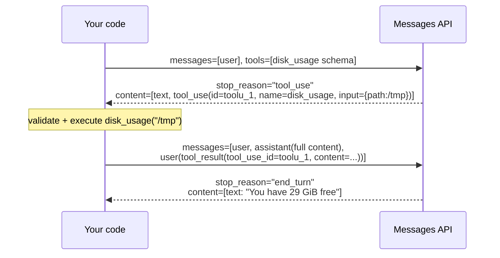

# 01 · Tool Calling and Structured Output

> Level: Intermediate · Time: 3–4 hours · Prereqs: all of [01-beginner](../01-beginner/), Python functions, JSON, HTTP basics
> API facts checked against Anthropic and Ollama docs, stamped **(as of Nov 2026)**. Code tested with `anthropic` 2.8.0, `pydantic` 2.14.3, Python 3.13.

---

## 1. Why this lesson exists

A model on its own can only emit text. To be useful in software it must (a) **act**: look something up, run a command, call an API; and (b) **hand data to code**: produce output that a program can parse without guessing. Tool calling solves (a); structured output solves (b). Every agent in this track, from Claude Code to your own LangGraph graph to an MCP server, is built on these two mechanisms. If you understand the exact message shapes and the loop, nothing later is magic.

## 2. Intuition

**Tool calling** is like a manager who cannot leave their office but can send typed request slips. The manager (model) writes "Please run `disk_usage` with `path=/tmp`" on a standard form. An assistant (your code) actually runs it and slides the result back under the door, labelled with the slip's number. The manager reads the result and either sends another slip or writes the final answer. The manager never touches the filing cabinet; your code decides whether to honour each slip.

**Structured output** is giving that manager a pre-printed form with boxes instead of blank paper. Free text is a letter you have to read and interpret. A form with fields `category`, `priority`, `summary` can be processed by a machine.

## 3. Precise definitions (Anthropic Messages API, as of Nov 2026)

- **Tool definition**: an object with `name`, `description` and `input_schema` (a JSON Schema). Names must match `^[a-zA-Z0-9_-]{1,128}$`.
- **`tool_use` block**: part of the model's reply: `{"type": "tool_use", "id": "toolu_…", "name": "...", "input": {...}}`. When the model wants tools, the response has `stop_reason: "tool_use"` and "one or more `tool_use` blocks".
- **`tool_result` block**: what *you* send back in the next user message: `{"type": "tool_result", "tool_use_id": "<same id>", "content": "...", "is_error": false}`. `content` may be a string or a list of content blocks; `is_error` marks failures.
- **`tool_choice`**: `auto` (model decides; default when tools are provided), `any` (must use some tool), `tool` (must use a named tool), `none` (no tools). **Important (as of Nov 2026):** for Claude Fable 5.2, Mythos 5.2, Opus 5.5, Sonnet 5.5, Fable 5.1 and Mythos 5.1, `any` and `tool` "return a 400 error"; the docs recommend `auto` with strict tool use, or structured outputs.
- **Client tools vs server tools**: client tools run in your application; server tools (such as `web_search`, `code_execution`) "run on Anthropic's infrastructure".
- **Strict tool use**: add `"strict": true` to a tool definition "to ensure Claude's tool calls always match your schema exactly".
- **Structured outputs (JSON outputs)**: `output_config.format` with `{"type": "json_schema", "schema": {...}}` constrains the final answer to a schema. The older `output_format` parameter "is deprecated" and beta headers "are no longer required" for the new parameter (as of Nov 2026).
- **Constrained decoding**: the server-side technique that makes structured outputs "always valid": at each step, tokens that would break the schema are given zero probability (internals in 04-pro/03).

## 4. Step by step

### 4.1 The dumbest approach: parse prose

You ask "What's the free disk space in /tmp? If you need to run a command, write RUN: <command>". You regex the reply for `RUN:`, execute it, paste the output back.

**Walls:** the model writes "I would run: `df -h`" instead of `RUN:`; it invents command flags; it adds a second command in the same line; your regex executes something harmful because the format is unconstrained; and you have no way to match a result to the request if there are several. You have built a fragile, unsafe ad-hoc protocol.

### 4.2 The idea that fixes it: a typed protocol

Tool calling formalises exactly that conversation: tools are declared with schemas; requests come back as structured blocks with IDs; results go back tagged with the same ID. Your code, not a regex, decides what to execute.



### 4.3 The loop, in real SDK code

The following uses the official `anthropic` Python SDK. To make it **run offline and deterministically** (no API key, no cost), it points `base_url` at a tiny local server that replays canned responses in the documented Messages API shape. This is also a real testing technique: your agent loop is code and deserves unit tests with a fake model.

The fake endpoint:

```python
# fake_messages_api.py - a scripted stand-in for POST /v1/messages, for OFFLINE tests only.
# It replays canned responses in the documented Messages API shape so the real `anthropic`
# SDK (v2.8.0) and our agent loop can run without a key or network. Not a model!
import json                                                    # parse/emit JSON bodies
import threading                                               # run the server in the background
from http.server import BaseHTTPRequestHandler, HTTPServer     # stdlib HTTP server


def scripted_reply(body: dict) -> dict:
    """Decide the canned reply by looking at the conversation so far."""
    last = body["messages"][-1]
    has_tool_result = isinstance(last["content"], list) and any(
        b.get("type") == "tool_result" for b in last["content"])
    base = {"id": "msg_fake", "type": "message", "role": "assistant", "model": body["model"],
            "stop_sequence": None,
            "usage": {"input_tokens": 50, "output_tokens": 20}}
    if not has_tool_result:                                    # turn 1: ask to call the tool
        return {**base, "stop_reason": "tool_use", "content": [
            {"type": "text", "text": "Let me check the disk usage."},
            {"type": "tool_use", "id": "toolu_fake_1", "name": "disk_usage",
             "input": {"path": "/tmp"}}]}
    result_text = last["content"][0]["content"]                # turn 2: answer using the result
    return {**base, "stop_reason": "end_turn", "content": [
        {"type": "text", "text": f"Done. The tool reported: {result_text}"}]}


class Handler(BaseHTTPRequestHandler):
    def do_POST(self):                                         # the SDK POSTs to /v1/messages
        body = json.loads(self.rfile.read(int(self.headers["Content-Length"])))
        payload = json.dumps(scripted_reply(body)).encode()
        self.send_response(200)
        self.send_header("Content-Type", "application/json")
        self.send_header("Content-Length", str(len(payload)))
        self.end_headers()
        self.wfile.write(payload)

    def log_message(self, *args):                              # silence per-request logging
        pass


def start() -> str:
    """Start on a free port in a daemon thread and return the base URL."""
    srv = HTTPServer(("127.0.0.1", 0), Handler)                # port 0 = let the OS pick
    threading.Thread(target=srv.serve_forever, daemon=True).start()
    return f"http://127.0.0.1:{srv.server_address[1]}"
```

The agent loop:

```python
# tool_loop.py - the agentic tool-use loop with the official anthropic SDK (v2.8.0).
# Runs offline against fake_messages_api.py; point base_url at the real API to go live.
import shutil                                   # stdlib: disk_usage() is our real "tool"

import anthropic                                # official SDK: pip install anthropic
import fake_messages_api                        # local scripted endpoint (offline testing only)

TOOLS = [{
    "name": "disk_usage",
    "description": ("Report total, used and free bytes for the filesystem containing `path`. "
                    "Use when the user asks about disk space. Read-only; never deletes anything. "
                    "Returns a short human-readable string."),
    "input_schema": {
        "type": "object",
        "properties": {"path": {"type": "string", "description": "Absolute path, e.g. /tmp"}},
        "required": ["path"],
        "additionalProperties": False,
    },
}]


def run_tool(name: str, args: dict) -> tuple[str, bool]:
    """Execute one tool call. Returns (content, is_error). Never raises into the loop."""
    try:
        if name != "disk_usage":
            return f"Unknown tool {name!r}. Available: disk_usage.", True
        total, used, free = shutil.disk_usage(args["path"])
        return f"total={total // 2**30} GiB, used={used // 2**30} GiB, free={free // 2**30} GiB", False
    except (KeyError, FileNotFoundError) as e:          # instructive error text helps the model retry
        return f"Bad input: {e!r}. Pass an existing absolute path in 'path'.", True


def agent(user_msg: str, client: anthropic.Anthropic, max_turns: int = 5) -> str:
    messages = [{"role": "user", "content": user_msg}]
    for _ in range(max_turns):                          # hard cap: never loop forever
        resp = client.messages.create(model="claude-opus-5-5", max_tokens=1024,
                                      tools=TOOLS, messages=messages)
        if resp.stop_reason != "tool_use":              # end_turn, max_tokens, refusal, ...
            return "".join(b.text for b in resp.content if b.type == "text")
        messages.append({"role": "assistant", "content": resp.content})   # echo the WHOLE turn back
        results = []
        for block in resp.content:
            if block.type == "tool_use":                # there may be several (parallel tool use)
                out, is_err = run_tool(block.name, block.input)
                results.append({"type": "tool_result", "tool_use_id": block.id,
                                "content": out, "is_error": is_err})
        messages.append({"role": "user", "content": results})  # tool_result blocks come FIRST
    return "Stopped: turn limit reached."


if __name__ == "__main__":
    client = anthropic.Anthropic(api_key="offline-test", base_url=fake_messages_api.start())
    print(agent("How much free space is in /tmp?", client))
```

Output (run with the fake endpoint):

```text
Done. The tool reported: total=251 GiB, used=13 GiB, free=28 GiB
```

**Line-by-line walkthrough of `tool_loop.py` (syntax and logic):**

- `import shutil`: standard library; `shutil.disk_usage(path)` returns a named tuple `(total, used, free)` in bytes. This is our real tool.
- `TOOLS = [{...}]`: a list holding one dict, exactly the JSON the API expects. The `description` is long on purpose: Anthropic's docs call detailed descriptions "by far the most important factor in tool performance" and suggest "at least 3–4 sentences" (as of Nov 2026). It says what the tool does, when to use it, that it is read-only, and what it returns. `"additionalProperties": False` rejects unexpected keys.
- `def run_tool(name: str, args: dict) -> tuple[str, bool]:`: returns a pair. The `try/except` ensures **no exception escapes into the loop**; instead, errors become text the model can read. `except (KeyError, FileNotFoundError) as e:` catches either type and binds it to `e`; `{e!r}` formats it with `repr`.
- `total // 2**30`: `//` is integer division, `2**30` is 2 to the power 30 (bytes per GiB).
- In `agent`: `messages = [{"role": "user", "content": user_msg}]` starts the history. `for _ in range(max_turns):` loops at most 5 times; `_` is the conventional name for an unused variable. A turn cap is essential: an agent that keeps calling tools forever burns money.
- `client.messages.create(model=..., max_tokens=1024, tools=TOOLS, messages=messages)`: one stateless API call with the full history (lesson 01).
- `if resp.stop_reason != "tool_use": return "".join(b.text for b in resp.content if b.type == "text")`: if the model is not asking for a tool, collect all text blocks and finish. (Production code should also branch on `max_tokens`, `refusal`, `pause_turn` and `model_context_window_exceeded`; the stop-reasons table is below.)
- `messages.append({"role": "assistant", "content": resp.content})`: echo back the **entire** assistant content (text and tool_use blocks), unchanged.
- The inner `for block in resp.content:` handles **parallel tool use**: one reply may contain several `tool_use` blocks; each gets its own `tool_result` with the matching `tool_use_id`.
- `messages.append({"role": "user", "content": results})`: tool results go in a **user** message. The docs are strict: results "must immediately follow" the tool-use message, and "the `tool_result` blocks must come FIRST in the content array. Any text must come AFTER all tool results" (as of Nov 2026).
- `if __name__ == "__main__":` runs only when the file is executed directly, not when imported. `anthropic.Anthropic(api_key="offline-test", base_url=...)` constructs a client pointed at the fake server; for real use, drop `base_url` and set the `ANTHROPIC_API_KEY` environment variable.

**Walkthrough of `fake_messages_api.py` (briefly):** `BaseHTTPRequestHandler.do_POST` handles POSTs; we read `Content-Length` bytes, parse JSON, and choose a reply: if the last user message contains a `tool_result`, answer; otherwise request the tool. `HTTPServer(("127.0.0.1", 0), Handler)` binds to port 0, meaning "any free port"; a daemon thread serves it in the background so the main program can continue.

### 4.4 Stop reasons you must handle (as of Nov 2026)

| `stop_reason` | Meaning (docs) | What your loop should do |
|---|---|---|
| `end_turn` | "Claude completed its response naturally." | Return the text. |
| `tool_use` | "Claude is calling a tool." | Execute, send `tool_result`s, loop. |
| `max_tokens` | "The response reached your max_tokens limit." | Raise `max_tokens` or continue; an incomplete `tool_use` must be retried with more tokens. |
| `stop_sequence` | "Claude emitted one of your stop_sequences." | Handle per your design. |
| `pause_turn` | "A server-tool loop reached its iteration limit." | Send the assistant content back unchanged to continue. |
| `refusal` | "Claude declined to respond." | Read `stop_details`; the docs suggest retrying on a fallback model. |
| `model_context_window_exceeded` | "The response filled the model's context window." | Treat as truncated; compact or trim context. |

### 4.5 Tool errors: tell the model how to fix it

When a tool fails, return `is_error: true` with an **instructive** message. The docs recommend text like "Rate limit exceeded. Retry after 60 seconds." instead of "failed", and note that for invalid or missing parameters Claude "will retry 2–3 times with corrections before apologizing to the user" (as of Nov 2026). Our `run_tool` does this: "Bad input: ... Pass an existing absolute path in 'path'." The docs also advise treating tool results as **untrusted** and keeping them inside `tool_result` blocks rather than system prompts, to reduce indirect prompt injection risk.

### 4.6 Structured output, the dumbest way and its walls

Goal: classify a support email into `{category, priority, summary}`.

**Dumbest:** "Reply in JSON." The model replies `Sure! Here is the JSON: {"category": "Billing", "priority": 7}`. Walls: chatter around the JSON, wrong case (`Billing` vs `billing`), out-of-range values (7 on a 1–4 scale), missing fields.

**Better: validate and retry.** Extract the JSON span, validate it against a schema, and if it fails, send the validation errors back and ask again. This works with *any* model, including small local ones, and is worth knowing even when you have constrained decoding.

```python
# structured_retry.py - validate model JSON against a schema, feed errors back, retry.
# Needs pydantic v2 (tested 2.14.3). The "model" is a stub that fails once, then complies.
import json                                         # parse the raw model text
from pydantic import BaseModel, Field, ValidationError   # schema + validation


class Ticket(BaseModel):                            # the shape we demand from the model
    category: str = Field(pattern="^(billing|bug|feature)$")   # closed set of labels
    priority: int = Field(ge=1, le=4)               # 1..4 inclusive
    summary: str = Field(max_length=80)


_replies = iter([                                   # canned outputs: bad, then good
    'Sure! Here is the JSON: {"category": "Billing", "priority": 7}',
    '{"category": "billing", "priority": 2, "summary": "Charged twice for November"}',
])


def fake_model(prompt: str) -> str:
    return next(_replies)


def extract_json(text: str) -> str:
    """Dumbest-useful extraction: from the first '{' to the last '}'."""
    return text[text.find("{"): text.rfind("}") + 1]


def get_ticket(email: str, max_attempts: int = 3) -> Ticket:
    prompt = (f"Classify this email.\n<email>{email}</email>\n"
              f"Reply with JSON matching this schema:\n{json.dumps(Ticket.model_json_schema())}")
    for attempt in range(1, max_attempts + 1):
        raw = fake_model(prompt)
        try:
            t = Ticket.model_validate_json(extract_json(raw))   # parse + validate in one step
            print(f"attempt {attempt}: valid")
            return t
        except ValidationError as e:
            errs = "; ".join(f"{'.'.join(map(str, x['loc']))}: {x['msg']}" for x in e.errors())
            print(f"attempt {attempt}: invalid -> {errs}")
            prompt += f"\n\nYour last reply was invalid ({errs}). Return corrected JSON only."
    raise RuntimeError("model never produced valid JSON")


print(get_ticket("Hi, I was charged twice this month!"))
```

Output:

```text
attempt 1: invalid -> category: String should match pattern '^(billing|bug|feature)$'; priority: Input should be less than or equal to 4; summary: Field required
attempt 2: valid
category='billing' priority=2 summary='Charged twice for November'
```

**Line-by-line walkthrough (syntax and logic):**

- `from pydantic import BaseModel, Field, ValidationError`: Pydantic turns a Python class with type hints into a runtime validator and a JSON Schema generator.
- `class Ticket(BaseModel):` defines the schema. `category: str = Field(pattern="^(billing|bug|feature)$")` constrains a string to a regex (a closed set of labels). `priority: int = Field(ge=1, le=4)` means greater-or-equal 1, less-or-equal 4. `summary: str = Field(max_length=80)` caps length.
- `_replies = iter([...])` makes an iterator; each `next(_replies)` returns the next canned reply. The leading underscore signals "module-private".
- `extract_json` slices from the first `{` to the last `}`: crude, but it strips the chatty prefix. (`text.rfind("}") + 1` includes the closing brace because slice ends are exclusive.)
- `json.dumps(Ticket.model_json_schema())`: Pydantic generates the JSON Schema, which we paste into the prompt so the model sees the exact contract.
- `Ticket.model_validate_json(...)` parses and validates in one call, raising `ValidationError` with a structured list of problems.
- `e.errors()` returns a list of dicts; `x['loc']` is the field path (a tuple), `x['msg']` the message. `'.'.join(map(str, x['loc']))` turns `('priority',)` into `priority`. The errors are appended to the prompt so the retry is *informed*, not random.
- `raise RuntimeError(...)` after the loop: never return unvalidated data downstream.

### 4.7 Best: schema-constrained generation (structured outputs)

Validate-and-retry still wastes calls and can fail. If the provider supports **constrained decoding**, the output is guaranteed to parse. On Anthropic's API (as of Nov 2026):

```python
# Not run in the sandbox (needs ANTHROPIC_API_KEY). Shape per Anthropic structured-outputs docs, Nov 2026.
import anthropic
from pydantic import BaseModel

class Ticket(BaseModel):
    category: str
    priority: int
    summary: str

client = anthropic.Anthropic()                       # reads ANTHROPIC_API_KEY from the environment
resp = client.messages.parse(                        # SDK helper: Pydantic model in, parsed object out
    model="claude-opus-5-5",
    max_tokens=1024,
    messages=[{"role": "user", "content": "Classify: 'I was charged twice this month!'"}],
    output_format=Ticket,                            # the SDK sends this as output_config.format
)
print(resp.parsed_output)                            # a Ticket instance

# Equivalent raw form (any HTTP client):
raw = client.messages.create(
    model="claude-opus-5-5", max_tokens=1024,
    messages=[{"role": "user", "content": "Classify: 'I was charged twice this month!'"}],
    output_config={"format": {"type": "json_schema", "schema": {
        "type": "object",
        "properties": {"category": {"type": "string", "enum": ["billing", "bug", "feature"]},
                       "priority": {"type": "integer"}, "summary": {"type": "string"}},
        "required": ["category", "priority", "summary"],
        "additionalProperties": False}}},
)
```

Syntax notes: `client.messages.parse(...)` is the SDK's helper that accepts a Pydantic class via `output_format=` and returns `parsed_output`; per the docs, passing a *dict* to `output_format` "raises a `TypeError`" in SDK v1.0+, so raw schemas go through `output_config`. I checked that `anthropic` 2.8.0 exposes `messages.parse` with an `output_format` parameter and `messages.create` with `output_config` (whose keys are `effort` and `format`).

**Limits to remember (as of Nov 2026, structured-outputs docs):** `additionalProperties` must be `false`; some constraints (e.g. `minimum`, `maximum`, `minLength`, `maxLength`) are stripped from the sent schema by the SDK and moved into descriptions, so **still validate on your side**; enum casing "is not guaranteed" so compare case-insensitively; it is incompatible with citations and prefilling; and `refusal` or `max_tokens` stops can still yield non-conforming output. Complexity limits include 20 strict tools per request and 24 optional parameters.

**Strict tools** apply the same guarantee to tool *inputs*: "JSON outputs control Claude's response format (what Claude says). Strict tool use validates tool parameters (how Claude calls your functions)."

### 4.8 The same ideas on a local model (Ollama)

Ollama's native `/api/chat` uses a different shape (as of Nov 2026): tools are `{"type": "function", "function": {name, description, parameters}}`, the reply carries `message.tool_calls` whose `function.arguments` is a JSON object, results go back as `{"role": "tool", "tool_name": "...", "content": "..."}`, and structured output is requested with `format` set to `"json"` or a JSON schema. Full runnable client in 03-advanced/05. The *protocol idea* is identical; only field names differ. This is why abstraction layers (LangGraph, MCP) exist.

## 5. Designing good tools

Anthropic's guidance (tool definition docs and the "Writing effective tools for agents" post, Sept 2025) boils down to:

1. **Descriptions are the interface.** What it does, when to use it, when not to, each parameter's meaning, what it does not return.
2. **Fewer, higher-level tools.** "More tools don't always lead to better outcomes"; prefer `search_contacts` over `list_contacts` so the agent does not page through everything.
3. **Namespace related tools** (`github_list_prs`, `slack_send_message`).
4. **Return high-signal, token-efficient results**: human-readable names over opaque IDs; paginate, filter or truncate large outputs. (Claude Code caps tool responses at 25,000 tokens by default, per that post.)
5. **Make mistakes hard** ("poka-yoke"): Anthropic's SWE-bench agent kept breaking with relative paths, so they changed the tool to require absolute paths, after which the model "used them without error" (Building effective agents, Dec 2024).
6. **Use `input_examples`** for complex inputs (each must validate against the schema; costs roughly 20–200 tokens each, per the docs).

## 6. Common mistakes

1. **No turn cap** on the loop. Always bound it.
2. **Dropping the assistant's tool_use turn** before sending results, or putting text before `tool_result` blocks: both cause API errors.
3. **Letting exceptions crash the loop** instead of returning `is_error: true` with a helpful message.
4. **Trusting tool inputs.** The model can request `rm -rf` as easily as `ls`. Validate and authorise in code.
5. **Trusting tool outputs.** A fetched web page can contain instructions. Keep it in `tool_result`, never in the system prompt.
6. **Using forced `tool_choice` on current Claude models.** As of Nov 2026, `any`/`tool` return 400 on the 5.x flagship models; use `auto` + strict tools or structured outputs.
7. **Assuming structured output removes the need to validate.** Constraints may be stripped; refusals and truncation still happen.
8. **Vague one-line tool descriptions.** The model guesses, badly.

## 7. Connections to other tracks

- **Networks / System Design**: tool calls are RPC; `tool_use_id` is a correlation ID, like a JSON-RPC `id` or a request ID in distributed tracing.
- **DBMS**: structured output is schema-on-write; validate-and-retry is like rejecting a row that violates a CHECK constraint.
- **Compilers**: JSON Schema is a grammar for data; constrained decoding is parsing *while* generating (04-pro/03).
- **Security**: tool execution is privilege; never let the model's text become an unchecked shell command (command injection, Security track).
- **Testing/Verification**: the fake endpoint is a test double; you can unit-test agent loops deterministically.

## 8. Where this shows up in my projects

- **Nidhogg / Logly** (natural-language log search): the model's job is to produce a *query*, which is structured output in its purest form. A schema for the query (fields, time range, filters) plus validation before it touches Elasticsearch is exactly sections 4.6–4.7.
- **AURIXA** (ERP demand-spike agent on Gemini + LangGraph): planning steps that downstream code consumes need schema-validated outputs; the validate-and-retry pattern is provider-agnostic, so it applies to Gemini as well.
- **aws-waste-scanner** has a hallucination guard around its AI summary: that is the same instinct as section 4.6, never pass unvalidated model output downstream.

## 9. Self-check questions

1. Which message role carries `tool_result` blocks, and where in its content array must they appear?
2. Why does the loop echo `resp.content` back unchanged rather than just the text?
3. Your model returns two `tool_use` blocks in one reply. What do you send back?
4. You need guaranteed JSON from Claude Opus 5.5 and try `tool_choice={"type": "tool", ...}` to force a "fake tool". What happens (as of Nov 2026) and what should you use?
5. Why keep validating even with constrained decoding?

<details><summary>Answers</summary>

1. A `user` message; the `tool_result` blocks must come first, and any text only after all of them.
2. The API requires that each `tool_result` follow its corresponding `tool_use` block in the history; the IDs must match, so the full assistant content (including `tool_use` blocks) must be present.
3. One user message containing two `tool_result` blocks, each with the matching `tool_use_id`.
4. A 400 error: forced tool choice (`any`/`tool`) is rejected on that model per the docs. Use structured outputs (`output_config.format` or `messages.parse`) or `auto` with strict tools.
5. Because the SDK strips some constraints (min/max/length) from the sent schema, enum casing is not guaranteed, and `refusal`/`max_tokens` stops can produce non-conforming output; also business rules often go beyond JSON Schema.

</details>

## 10. Mnemonic (Tamil + English)

**"ID kudu, ID vaangu, Result-a MUNNADI vei."** (ஐடி குடு, ஐடி வாங்கு, ரிசல்ட்-அ முன்னாடி வை: give the ID, take the ID back, put the result in FRONT.)
Every `tool_use` id comes back as a `tool_use_id`, and `tool_result` blocks go first in the user message.

**Stop reasons, "ET-TU-MT-SS-PT-RE-MC": "Ellarum Theatre-ku Uthavi Maadri Thaan; Seat Sariya Paathu Thaan; REal Movie Climax."** End_Turn, Tool_Use, Max_Tokens, Stop_Sequence, Pause_Turn, REfusal, Model_Context_window_exceeded. Silly sentences stick.

## Sources

- Anthropic, Tool use overview (as of Nov 2026): https://platform.claude.com/docs/en/agents-and-tools/tool-use/overview
- Anthropic, Define tools (tool_choice, descriptions, naming regex) (as of Nov 2026): https://platform.claude.com/docs/en/agents-and-tools/tool-use/define-tools
- Anthropic, Handle tool calls (tool_result rules, errors) (as of Nov 2026): https://platform.claude.com/docs/en/agents-and-tools/tool-use/handle-tool-calls
- Anthropic, Structured outputs (as of Nov 2026): https://platform.claude.com/docs/en/build-with-claude/structured-outputs
- Anthropic, Handling stop reasons (as of Nov 2026): https://platform.claude.com/docs/en/build-with-claude/handling-stop-reasons
- Anthropic, "Building effective agents" (Dec 19, 2024): https://www.anthropic.com/engineering/building-effective-agents
- Anthropic, "Writing effective tools for agents" (Sept 11, 2025): https://www.anthropic.com/engineering/writing-tools-for-agents
- Ollama, Tool calling (as of Nov 2026): https://docs.ollama.com/capabilities/tool-calling
- Ollama, Structured outputs (as of Nov 2026): https://docs.ollama.com/capabilities/structured-outputs
- Schick et al., "Toolformer" (2023), early research on models learning to call tools: https://arxiv.org/abs/2302.04761
- Pydantic documentation: https://docs.pydantic.dev/

## Verify yourself

1. `pip install anthropic pydantic`, save `fake_messages_api.py` and `tool_loop.py` side by side, run `python3 tool_loop.py`. Make `fake_messages_api.scripted_reply` return *two* `tool_use` blocks and confirm the loop answers both.
2. Run `python3 structured_retry.py`; change the second canned reply to `"priority": 5` and watch it raise after three attempts.
3. With an API key, replace `base_url=fake_messages_api.start()` with nothing and run against the real API; compare the `stop_reason` sequence.
4. Read the define-tools page and confirm the list of models on which forced `tool_choice` returns 400 (it changes as models ship).
5. `python3 -c "import inspect, anthropic; from anthropic.resources.messages import Messages; print(list(inspect.signature(Messages.parse).parameters))"` to confirm `output_format` and `output_config` exist in your SDK version.
