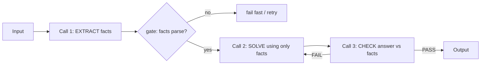

# 02 · Prompt Techniques: Examples, Reasoning, Chaining, and Voting

> Level: Intermediate · Time: 3 hours · Prereqs: [01-beginner/02](../01-beginner/02-prompting-first-principles.md), [01 · Tool calling](01-tool-calling-and-structured-output.md)
> Model-behaviour facts are stamped **(as of Nov 2026)** and change with each model generation.

---

## 1. Why this lesson exists

The beginner lesson gave you the anatomy of a clear prompt. This lesson covers the **standard techniques** that measurably change results on harder tasks: few-shot examples done properly, eliciting reasoning (chain-of-thought and its modern replacement, model "thinking"), **prompt chaining** (splitting work across calls), and **self-consistency** (sampling several answers and voting). Each exists because a simpler approach hit a specific wall. Knowing the wall tells you when the technique is worth its cost.

## 2. Intuition

- **Few-shot** is showing a new cook three finished plates before service: they match presentation exactly, including mistakes in your samples.
- **Reasoning before answering** is the difference between blurting an answer in a viva and writing your working first. The model produces each token conditioned on previous tokens, so tokens spent working through intermediate steps give later tokens more to build on.
- **Chaining** is an assembly line: each station does one job, and a supervisor can inspect the part between stations.
- **Self-consistency** is asking five classmates independently and going with the majority: individual mistakes are often uncorrelated, so the majority is right more often than any one person.

## 3. Precise definitions

| Technique | Definition | Key reference |
|---|---|---|
| Few-shot prompting | Including k input→output demonstrations in the prompt; the model infers the task in-context | Brown et al., 2020 (GPT-3) |
| Chain-of-thought (CoT) | Prompting the model to produce intermediate reasoning steps before the answer | Wei et al., 2022; zero-shot variant "Let's think step by step", Kojima et al., 2022 |
| Extended / adaptive thinking | Provider feature where the model reasons in dedicated thinking blocks before answering; on current Claude models depth is controlled by an `effort` parameter | Anthropic docs (as of Nov 2026) |
| Prompt chaining | Decomposing a task into sequential calls where each consumes the previous output | Anthropic "Building effective agents" |
| Self-consistency | Sample N reasoning paths, take the majority final answer | Wang et al., 2022 |
| ReAct | Interleaving reasoning with tool actions in a loop | Yao et al., 2022 |

## 4. Step by step

### 4.1 Few-shot, done properly

**Dumbest:** one example. **Wall:** the model overfits to it (same length, same structure, same number of items).

**Next:** several examples. **Wall:** if they all share an incidental feature, the model copies that feature.

**What works:** 3–5 examples that are *relevant* (match the real distribution), *diverse* (vary everything you do not care about, include edge cases such as empty input), and *structured* in `<example>` tags (Anthropic best practices, as of Nov 2026). For reasoning tasks with thinking enabled, the same page suggests presenting each example "as a problem, the method to apply, and the expected answer".

A useful mental model: examples are **training data you supply at inference time**. Bad training data, bad model.

### 4.2 Reasoning: from "show your work" to thinking budgets

**Dumbest:** ask for the answer directly. On multi-step problems (arithmetic word problems, debugging, planning) the model often commits to an answer in its first tokens and then rationalises it.

**CoT prompting (2022):** Wei et al. showed that prompting with worked reasoning examples improved multi-step reasoning in large models; Kojima et al. showed that even appending "Let's think step by step" helped. The mechanism follows from lesson 01: generation is left-to-right, and intermediate tokens become context for the answer.

**Wall:** manual CoT is verbose, mixes reasoning into the output you must parse, and you have to separate it (e.g. "put the final answer in `<answer>` tags").

**Modern answer: built-in thinking with an effort control.** As of Nov 2026, Anthropic documents:

- "Claude 4.6 and later models … use adaptive thinking (`thinking: {type: "adaptive"}`), where Claude dynamically determines when and how much to think", and "adaptive thinking reliably drives better performance than extended thinking" in internal evaluations.
- On Claude Opus 5.5, adaptive thinking is always on; `thinking: {"type": "disabled"}` and manual `budget_tokens` are rejected. "Effort is the only request parameter that controls thinking depth", with levels `low`, `medium`, `high`, `xhigh`, `max` and default `medium` (Opus 5.5 migration guide).
- For several current models, "a prompt that asks the model to write out its reasoning, for example in `<thinking>` tags, might be declined"; rely on the thinking feature instead.
- General instructions beat scripts: "A prompt such as 'think thoroughly' often produces better reasoning than a hand-written step-by-step plan."

So the technique survives, but **where** it lives changed: on frontier APIs, ask for effort, not for visible reasoning text. On small local models without a thinking mode (03-advanced/05), classic CoT with `<answer>` tags is still the tool.

```python
# Not run in the sandbox (needs ANTHROPIC_API_KEY). Parameter names checked in anthropic SDK 2.8.0.
resp = client.messages.create(
    model="claude-opus-5-5",
    max_tokens=4096,
    output_config={"effort": "high"},    # thinking depth control on current Claude models (Nov 2026)
    messages=[{"role": "user", "content": "Find the race condition in this code: <code>...</code>"}],
)
```

**Cost reality:** thinking tokens are billed as output tokens and count toward `max_tokens` and the context window (context-windows docs). Spend effort where reasoning matters, not on "format this date".

### 4.3 Self-check instructions

Anthropic suggests ending with "Before you finish, verify your answer against [test criteria]", "especially useful for coding and math" (as of Nov 2026; the page notes one model, Opus 5, as an exception). In agentic coding the best version of this is not a sentence but a **tool**: "run the tests" is a self-check whose result cannot be hallucinated.

### 4.4 Prompt chaining

**Dumbest:** one giant prompt: "Read this contract, extract obligations, assess risk, draft an email to legal, and format it as HTML."

**Walls:** when output is wrong you cannot tell which sub-step failed; one weak step contaminates the rest; you cannot test steps independently; you cannot branch (e.g. skip the email if risk is low).

**Chaining** splits it: each call has one job and a checkable output. Anthropic's best-practices page notes that with adaptive thinking and subagents, "Claude handles most multistep reasoning internally", but "explicit prompt chaining … is still useful when you need to inspect intermediate outputs or enforce a specific pipeline structure", and names **self-correction** (draft → review against criteria → refine) as the most common pattern (as of Nov 2026). "Building effective agents" lists chaining as the first workflow: use it when the task "can be easily and cleanly decomposed into fixed subtasks".



### 4.5 Self-consistency (voting)

**Wall it fixes:** a single sampled reasoning path can go wrong at one step. If errors are somewhat independent across samples, the majority answer is more reliable than any single sample. Wang et al. (2022) showed this with CoT: sample diverse reasoning paths, pick the most consistent answer. "Building effective agents" calls this pattern **parallelization: voting**.

**Its walls:** N times the cost and latency; it only works when answers can be compared (a number, a label, a test verdict), not for free-form essays; and correlated errors (every sample makes the same misconception) do not vote away.

Both techniques, with a stub model so the statistics are visible:

```python
# chain_vote.py - two techniques with a stub model: (1) prompt chaining, (2) self-consistency vote.
# Pure Python 3 standard library. Replace `model()` with a real API call to use it for real.
import random                                    # stub randomness
from collections import Counter                  # majority vote

rng = random.Random(42)                          # seeded => reproducible demo


def model(prompt: str) -> str:
    """Stub LLM. Arithmetic answers are right 70% of the time, like a noisy sampler."""
    if prompt.startswith("EXTRACT"):
        return "17 apples, gave away 5, bought 8"
    if prompt.startswith("SOLVE"):
        return rng.choices(["20", "12", "25"], weights=[0.7, 0.2, 0.1])[0]
    if prompt.startswith("CHECK"):
        return "PASS" if "answer=20" in prompt else "FAIL"
    return ""


# (1) Chaining: each step is a separate call whose output we can log, test and branch on.
facts = model("EXTRACT the quantities from: 'I had 17 apples, gave 5 away, then bought 8.'")
answer = model(f"SOLVE using only these facts: {facts}")
verdict = model(f"CHECK facts={facts} answer={answer}")
print(f"chain: facts={facts!r} answer={answer} verdict={verdict}")

# (2) Self-consistency (Wang et al., 2022): sample N answers, return the most common one.
def self_consistent(prompt: str, n: int) -> tuple[str, float]:
    votes = Counter(model(prompt) for _ in range(n))
    best, count = votes.most_common(1)[0]
    return best, count / n                        # answer + agreement ratio (a confidence signal)

for n in (1, 5, 15):
    trials = [self_consistent(f"SOLVE {facts}", n)[0] == "20" for _ in range(200)]
    print(f"n={n:2}: correct in {sum(trials) / len(trials):.0%} of 200 trials")
```

Output:

```text
chain: facts='17 apples, gave away 5, bought 8' answer=20 verdict=PASS
n= 1: correct in 72% of 200 trials
n= 5: correct in 90% of 200 trials
n=15: correct in 98% of 200 trials
```

**Line-by-line walkthrough (syntax and logic):**

- `rng = random.Random(42)`: a private random generator with a fixed seed, so results are reproducible and do not depend on global state.
- `def model(prompt: str) -> str:` is the stub. `prompt.startswith("EXTRACT")` dispatches on the step. `rng.choices(["20", "12", "25"], weights=[0.7, 0.2, 0.1])[0]` draws one item with those probabilities (`choices` returns a list, hence `[0]`). So a single "SOLVE" is right 70% of the time.
- The chain: three calls, each with its own prompt; `f"SOLVE using only these facts: {facts}"` feeds the previous step's output into the next. `{facts!r}` in the print shows the string with quotes.
- `def self_consistent(prompt, n)`: `Counter(model(prompt) for _ in range(n))` counts answers from n samples. `votes.most_common(1)[0]` returns the top `(answer, count)` pair; we also return `count / n`, the **agreement ratio**, a cheap confidence signal (low agreement means "escalate to a human or a stronger model").
- The experiment: for n in 1, 5, 15, run 200 independent trials and measure how often the majority is correct. `sum(trials) / len(trials)` works because `True` counts as 1.

**What the output shows:** single-sample accuracy about 72% (close to the stub's 70%), majority of 5 about 90%, majority of 15 about 98%. That improvement relies on the stub's samples being *independent*. Real model samples are correlated, so expect smaller gains, and measure on your own eval set (04-pro/01).

### 4.6 Long-context and document techniques

From Anthropic's best practices (as of Nov 2026), for 20K+ token inputs: put documents at the top and the query at the end; wrap multiple documents in `<document>` tags with `<document_content>` and `<source>` subtags; and for long-document tasks, "ask Claude to quote relevant parts of the documents first before carrying out its task". Quoting first grounds the answer in the text and gives you something verifiable.

### 4.7 Techniques that changed with model generations

| Older technique | Status (as of Nov 2026) | Replacement |
|---|---|---|
| Prefilling the assistant turn (e.g. `{`) | Returns 400 on Claude 4.6+ | Structured outputs or system-prompt instructions |
| `temperature=0` for consistency | Sampling params removed on Opus 5.5 | Prompting + validation + evals |
| Manual `budget_tokens` thinking | Rejected on Claude 4.7+ | `effort` |
| "Write your reasoning in `<thinking>` tags" | May be declined on several current models | Built-in thinking |
| Forcing a tool with `tool_choice` | 400 on several 5.x models | `auto` + strict tools, or structured outputs |

The lesson is meta: **techniques are tied to model versions; principles are not.** Clarity, examples, decomposition and verification survive every generation.

## 5. Common mistakes

1. **Using CoT/thinking for trivial tasks.** It adds latency and cost. Anthropic's own sample guidance: "When in doubt, respond directly."
2. **Parsing reasoning text as if it were the answer.** Always separate the final answer (tags or structured output).
3. **Chaining without gates.** The value of a chain is inspecting intermediate outputs; if you never check them, you only added latency.
4. **Voting on free-form text.** Majority vote needs comparable answers; normalise first (extract the number, the label).
5. **Assuming independence.** Self-consistency gains shrink when samples share the same misconception.
6. **Carrying 2023 tricks into 2026 APIs.** Check the current model's migration guide.

## 6. Connections to other tracks

- **DSA**: chaining is a pipeline/DAG; self-consistency is majority vote (Boyer–Moore majority is the streaming version).
- **Math for CS**: voting accuracy for independent voters follows the binomial distribution (Condorcet's jury theorem); correlation breaks the assumption.
- **Parallel/CUDA**: sectioning and voting are embarrassingly parallel; send the N samples concurrently.
- **System Design**: chains are synchronous pipelines; gates are circuit breakers.
- **ML/LLM agents**: ReAct-style reasoning + acting is the conceptual ancestor of every agent loop in 03-advanced.

## 7. Where this shows up in my projects

- **QiskitSage** is a multi-agent reviewer (separate syntax, performance, semantics and FFI agents). That is *sectioning*: independent specialised calls whose outputs are merged. A natural extension from this lesson is a final "verifier" call that checks each finding against the diff before it is posted (self-correction chain), and an agreement-based confidence when several agents flag the same line.
- **AURIXA**'s plan-then-act LangGraph flow is prompt chaining with gates implemented as graph edges (03-advanced/04).

## 8. Self-check questions

1. Why can reasoning tokens improve the final answer of a left-to-right generator?
2. On Claude Opus 5.5 (Nov 2026), how do you ask for deeper reasoning?
3. Give two conditions under which self-consistency helps and one under which it does not.
4. What is the main engineering benefit of chaining over one big prompt, given models already reason internally?
5. Your few-shot examples are all one-line answers; real inputs need multi-line answers. Predict the failure.

<details><summary>Answers</summary>

1. Each output token is conditioned on all previous tokens; intermediate steps written earlier become context that later tokens (the answer) can use, instead of the model committing to an answer in its first few tokens.
2. Use the `effort` parameter (`output_config={"effort": "high"}` etc.); adaptive thinking is always on and manual budgets/disabled thinking are rejected.
3. Helps: answers are comparable (numbers/labels), and sample errors are reasonably independent. Does not help: free-form outputs with no canonical form, or systematic errors shared across samples.
4. Inspectability and control: you can log, test and gate each step, branch on intermediate results, and localise failures.
5. The model imitates the examples' length and truncates or compresses answers to one line.

</details>

## 9. Mnemonic (Tamil + English)

**"Kaattu, Yosi, Pirichu, Vote-u."** (காட்டு, யோசி, பிரிச்சு, வோட்டு: show, think, split, vote.)
- **Kaattu** (show) = few-shot examples.
- **Yosi** (think) = reasoning / effort.
- **Pirichu** (split) = chaining.
- **Vote-u** = self-consistency.
Like a Tamil family deciding a wedding date: show horoscopes, think, split the tasks among uncles, then vote.

## Sources

- Brown et al., "Language Models are Few-Shot Learners" (2020): https://arxiv.org/abs/2005.14165
- Wei et al., "Chain-of-Thought Prompting Elicits Reasoning in Large Language Models" (2022): https://arxiv.org/abs/2201.11903
- Kojima et al., "Large Language Models are Zero-Shot Reasoners" (2022): https://arxiv.org/abs/2205.11916
- Wang et al., "Self-Consistency Improves Chain of Thought Reasoning in Language Models" (2022): https://arxiv.org/abs/2203.11171
- Yao et al., "ReAct: Synergizing Reasoning and Acting in Language Models" (2022): https://arxiv.org/abs/2210.03629
- Anthropic, Prompting best practices (as of Nov 2026): https://platform.claude.com/docs/en/build-with-claude/prompt-engineering/claude-prompting-best-practices
- Anthropic, Claude Opus 5.5 migration guide (effort, thinking, prefill, sampling) (as of Nov 2026): https://platform.claude.com/docs/en/models/opus-5-5/migration-guide
- Anthropic, "Building effective agents" (Dec 19, 2024): https://www.anthropic.com/engineering/building-effective-agents

## Verify yourself

1. Run `python3 chain_vote.py`. Change the weights to `[0.4, 0.35, 0.25]` (correct answer still the plurality) and then to `[0.3, 0.5, 0.2]` (a wrong answer is the plurality). Explain why voting now *hurts*.
2. Make the stub's errors correlated: with probability 0.5 per *trial* (not per sample), return "12" for every sample in that trial. Re-measure n=15.
3. On the Anthropic best-practices page, find the sentence about prompts asking for `<thinking>` tags being declined and note which models it lists today.
4. Read the abstract of Wang et al. (2022) and identify which benchmarks they reported gains on.
