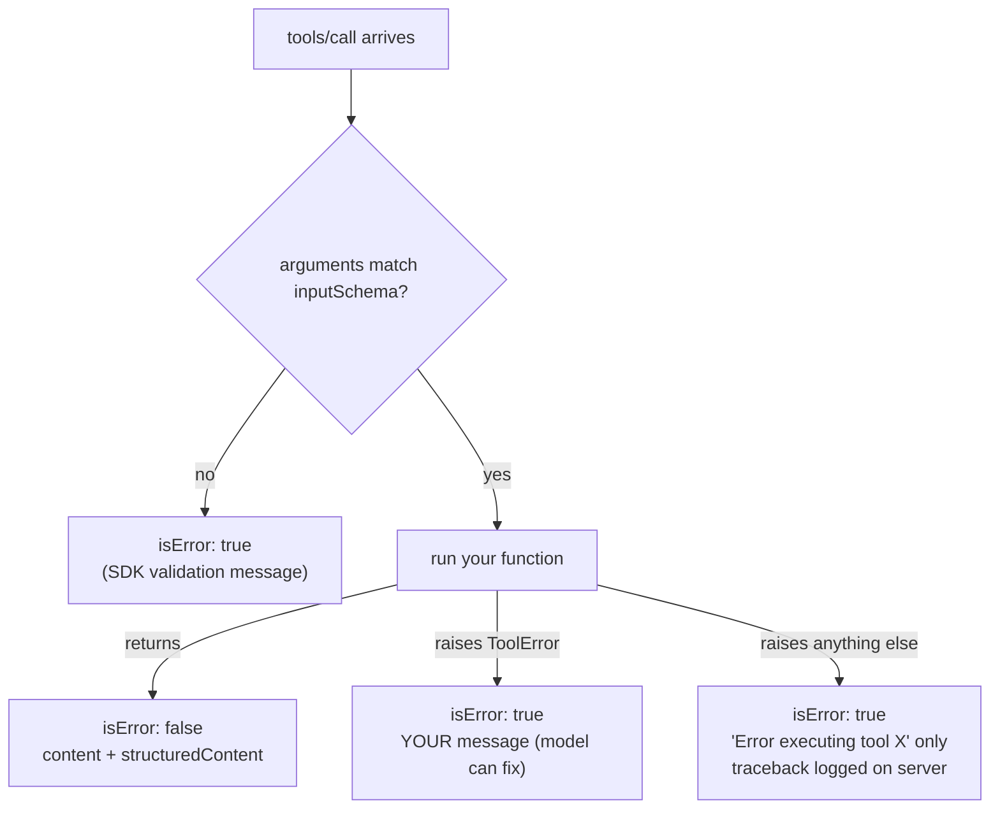

# 04 · Build, Test, and Plug In an MCP Server (Python)

> Level: Intermediate · Time: 3–4 hours · Prereqs: [03 · MCP spec](03-mcp-why-and-the-spec.md), Python functions, decorators explained below, `async` explained below
> Built and run with the official MCP Python SDK **v2.3.0** (`pip install mcp`) on Python 3.13, **Nov 2026**. Client config formats are stamped **(as of Nov 2026)**.

---

## 1. Why this lesson exists

You now know what MCP is on the wire. This lesson makes you a producer: you will build a small but real server ("study-notes") exposing two tools, a resource and a prompt; drive it from a test client exactly as a host would; and register it with Claude Code, Cursor and Codex. Along the way you will hit the practical details that tutorials skip: how type hints become schemas, how errors reach the model, why stdout is sacred, and what changed between SDK v1 and v2.

## 2. Intuition

Writing an MCP server with the Python SDK feels like writing a small web API with a framework like FastAPI: you write ordinary functions, decorate them, and the framework handles the protocol. The difference is the audience. A web API's caller is a programmer who reads docs once. An MCP tool's caller is a **model that reads your docstring every time it decides what to do**. Your docstrings are prompts.

## 3. Precise definitions

- **`MCPServer`**: the SDK v2 high-level server class (`from mcp.server.mcpserver import MCPServer`). In SDK v1 it was called `FastMCP`; v2 raises `ModuleNotFoundError` on the old import with a pointer to the migration guide.
- **Decorator**: Python syntax `@something` placed above a function. `@mcp.tool()` calls `mcp.tool()`, which returns a function that receives your function, registers it, and returns it. Net effect: "register this function as a tool".
- **Type hints → `inputSchema`**: the SDK inspects parameter names, types and defaults (`query: str, limit: int = 5`) and generates the JSON Schema; the docstring becomes the `description`.
- **Return annotation → `outputSchema`**: a return type such as `list[dict]` produces an `outputSchema` and the result is also sent as `structuredContent`.
- **`ToolError`**: the SDK v2 exception for *anticipated* tool failures; its message reaches the model with `isError: true`. Any other exception is treated as a crash: the model sees only "Error executing tool <name>".
- **`async` / `await`**: Python's syntax for cooperative concurrency. An `async def` function returns a coroutine; `await` pauses it until a result is ready; `asyncio.run(main())` runs the top-level coroutine. The MCP client is async because it waits on I/O (pipes, sockets).

## 4. Step by step

### 4.1 Dumbest approach: write the JSON-RPC yourself

You could extend `raw_wire.py` from the last lesson into a server: read lines from stdin, dispatch on `method`, hand-write schemas. **Walls:** you must implement `server/discover`, `_meta` validation, every list/call/read method, error codes, schema generation, both legacy and modern protocol revisions, and keep up with spec changes. That is the SDK's job.

### 4.2 The server

```python
# notes_server.py - a tiny MCP server exposing a study-notes store.
# Tested with the official MCP Python SDK v2.3.0 (pip package "mcp"), Nov 2026.
import json                                   # stdlib JSON, used to persist notes
import os                                     # stdlib, read an env var for the data path
from pathlib import Path                      # stdlib, object-oriented file paths

from mcp.server.mcpserver import MCPServer    # v2 name of the class v1 called FastMCP
from mcp.server.mcpserver.exceptions import ResourceNotFoundError, ToolError  # anticipated failures

# Where notes live on disk. An env var lets the client choose; default is next to this file.
DATA_FILE = Path(os.environ.get("NOTES_FILE", Path(__file__).with_name("notes.json")))

# The server object. The string is the server's name, reported to clients in serverInfo.
mcp = MCPServer("study-notes")


def _load() -> dict[str, str]:
    """Read the whole notes dict from disk; an absent file means no notes yet."""
    if DATA_FILE.exists():                                   # file may not exist on first run
        return json.loads(DATA_FILE.read_text(encoding="utf-8"))
    return {}


def _save(notes: dict[str, str]) -> None:
    """Write the whole notes dict back to disk (small data, so rewrite-all is fine)."""
    DATA_FILE.write_text(json.dumps(notes, indent=2, sort_keys=True), encoding="utf-8")


@mcp.tool()
def add_note(topic: str, text: str) -> str:
    """Save or overwrite a study note under a short topic name.

    Use this when the user asks to remember, save, or record something about a topic.
    `topic` is a short lowercase key such as "tcp-handshake"; `text` is the note body.
    Overwrites any existing note with the same topic. Returns a confirmation sentence.
    """
    key = topic.strip().lower()                              # normalise the key
    if not key:                                              # anticipated bad input -> ToolError,
                                                             # whose message the model can read and fix
        raise ToolError("topic must be a non-empty string, e.g. 'tcp-handshake'")
    notes = _load()
    notes[key] = text
    _save(notes)
    return f"Saved note '{key}' ({len(text)} characters)."


@mcp.tool()
def search_notes(query: str, limit: int = 5) -> list[dict]:
    """Search saved notes by case-insensitive substring match on topic and text.

    Use this before answering a question the user may already have notes on.
    Returns at most `limit` matches (1-20) as objects with `topic` and `snippet`
    (first 120 characters). Returns an empty list when nothing matches.
    """
    limit = max(1, min(limit, 20))                           # clamp so the model cannot ask for 10,000
    q = query.lower()
    hits = []
    for topic, text in sorted(_load().items()):              # sorted gives deterministic output
        if q in topic or q in text.lower():
            hits.append({"topic": topic, "snippet": text[:120]})
        if len(hits) == limit:
            break
    return hits


@mcp.resource("notes://{topic}")
def read_note(topic: str) -> str:
    """Full text of one note, addressed by URI, e.g. notes://tcp-handshake."""
    notes = _load()
    if topic not in notes:
        raise ResourceNotFoundError(f"No note named '{topic}'")
    return notes[topic]


@mcp.prompt()
def quiz_me(topic: str) -> str:
    """A reusable prompt template: ask the model to quiz the user on one note."""
    return (
        f"Read the note at notes://{topic}. Ask me three short questions about it, "
        "one at a time, and wait for my answer before revealing the next question."
    )


if __name__ == "__main__":
    # stdio transport: the client launches this file as a subprocess and talks JSON-RPC
    # over its stdin/stdout. Never print() to stdout in a stdio server - it corrupts the stream.
    mcp.run(transport="stdio")
```

**Line-by-line walkthrough (syntax and logic):**

- `from pathlib import Path` and `os.environ.get("NOTES_FILE", default)`: the data path comes from an environment variable if set (hosts pass env vars to stdio servers), else defaults to `notes.json` next to the script. `Path(__file__).with_name("notes.json")` replaces the filename part of this script's path.
- `from mcp.server.mcpserver import MCPServer`: the v2 class. The next import brings `ResourceNotFoundError` and `ToolError` for anticipated failures.
- `mcp = MCPServer("study-notes")`: creates the server; the name is reported as `serverInfo.name`.
- `_load` / `_save`: tiny persistence helpers. `json.loads(DATA_FILE.read_text(encoding="utf-8"))` reads and parses; `json.dumps(..., indent=2, sort_keys=True)` writes deterministic, readable JSON. The leading underscore marks them as internal (not tools).
- `@mcp.tool()` above `def add_note(topic: str, text: str) -> str:` registers a tool named `add_note` whose schema requires two strings. The **docstring** says what it does, when to use it, what each argument means, and what it returns: it is the tool description the model reads.
- `key = topic.strip().lower()`: normalise. `if not key: raise ToolError(...)`: an empty string is "falsy", so whitespace-only topics are rejected with an **instructive** message ("e.g. 'tcp-handshake'") the model can act on.
- `def search_notes(query: str, limit: int = 5) -> list[dict]:`: `limit` has a default, so it is optional in the schema (`required: ["query"]`). `limit = max(1, min(limit, 20))` clamps it: never trust a model-supplied size. `sorted(_load().items())` iterates `(topic, text)` pairs in key order so results are deterministic. `text[:120]` slices the first 120 characters, keeping results token-efficient.
- `@mcp.resource("notes://{topic}")`: registers a **resource template**; `{topic}` in the URI is bound to the function parameter. A missing note raises `ResourceNotFoundError`, which SDK v2 maps to error `-32602`, matching the 2026-07-28 change of "resource not found" from `-32002` to `-32602`.
- `@mcp.prompt()`: registers a user-invocable prompt template; hosts often surface prompts as slash commands.
- `if __name__ == "__main__": mcp.run(transport="stdio")`: start serving over stdin/stdout when executed directly. The comment states the golden rule: **never print to stdout in a stdio server**.

### 4.3 What the SDK generated from your Python

Captured from `tools/list` on this server (SDK v2.3.0):

```json
{
  "name": "search_notes",
  "description": "Search saved notes by case-insensitive substring match on topic and text.\n\nUse this before answering a question the user may already have notes on.\nReturns at most `limit` matches (1-20) as objects with `topic` and `snippet`\n(first 120 characters). Returns an empty list when nothing matches.\n",
  "inputSchema": {
    "type": "object",
    "properties": {
      "query": {"title": "Query", "type": "string"},
      "limit": {"default": 5, "title": "Limit", "type": "integer"}
    },
    "required": ["query"],
    "title": "search_notesArguments"
  },
  "outputSchema": {
    "properties": {"result": {"items": {"additionalProperties": true, "type": "object"},
                              "title": "Result", "type": "array"}},
    "required": ["result"], "title": "search_notesOutput", "type": "object"
  }
}
```

Two things to notice: the docstring became the description verbatim, and because the function returns a **list**, the SDK wrapped it in an object `{"result": [...]}` for the output schema. Clients reading `structuredContent` will see `{"result": [...]}`, not a bare list.

### 4.4 Test it like a host would

Never wire an untested server into your editor and debug through the model. Drive it from code first.

```python
# notes_client.py - drive notes_server.py the way a host (Claude Code, Cursor...) would.
# Tested with MCP Python SDK v2.3.0, Nov 2026.
import asyncio                                          # the SDK is async, so we need an event loop
import os                                               # to pass an env var to the child process
import sys                                              # sys.executable = the current python binary
import tempfile                                         # a throwaway notes file for the demo

from mcp import Client                                  # high-level client (v2)
from mcp.client.stdio import StdioServerParameters      # "launch this command as a stdio server"


async def main() -> None:
    notes_path = os.path.join(tempfile.mkdtemp(), "notes.json")
    params = StdioServerParameters(
        command=sys.executable,                          # run the server with this same python
        args=["notes_server.py"],
        env={**os.environ, "NOTES_FILE": notes_path},    # child sees the temp notes path
    )
    # "async with" opens the transport (spawns the subprocess) and closes it at the end.
    async with Client(params) as client:
        print("protocol version:", client.protocol_version)
        print("server info     :", client.server_info.name if client.server_info else None)

        tools = await client.list_tools()               # MCP method: tools/list
        for t in tools.tools:
            print("tool:", t.name, "| required args:", t.input_schema.get("required"))

        r = await client.call_tool("add_note", {"topic": "tcp-handshake",
                                                "text": "SYN, SYN-ACK, ACK. Three segments."})
        print("add_note ->", r.content[0].text, "| isError:", r.is_error)

        r = await client.call_tool("search_notes", {"query": "syn"})
        print("search_notes structured ->", r.structured_content)

        r = await client.call_tool("add_note", {"topic": "   ", "text": "x"})
        print("bad call isError:", r.is_error, "|", r.content[0].text)

        res = await client.read_resource("notes://tcp-handshake")   # resources/read
        print("resource ->", res.contents[0].text)

        p = await client.get_prompt("quiz_me", {"topic": "tcp-handshake"})  # prompts/get
        print("prompt ->", p.messages[0].content.text[:60], "...")


if __name__ == "__main__":
    asyncio.run(main())
```

Output:

```text
protocol version: 2026-07-28
server info     : study-notes
tool: add_note | required args: ['topic', 'text']
tool: search_notes | required args: ['query']
add_note -> Saved note 'tcp-handshake' (34 characters). | isError: False
search_notes structured -> {'result': [{'topic': 'tcp-handshake', 'snippet': 'SYN, SYN-ACK, ACK. Three segments.'}]}
bad call isError: True | Error executing tool add_note: topic must be a non-empty string, e.g. 'tcp-handshake'
resource -> SYN, SYN-ACK, ACK. Three segments.
prompt -> Read the note at notes://tcp-handshake. Ask me three short q ...
```

(The server also wrote one line to **stderr** for the failed call: `Tool 'add_note' failed: "Error executing tool add_note: topic must be a non-empty string, e.g. 'tcp-handshake'"`. stderr is the right place for logs.)

**Line-by-line walkthrough (syntax and logic):**

- `import asyncio`: the event loop. `async def main() -> None:` defines a coroutine.
- `from mcp import Client` and `StdioServerParameters`: SDK v2's high-level client; giving it `StdioServerParameters` means "spawn this command and speak stdio".
- `StdioServerParameters(command=sys.executable, args=["notes_server.py"], env={**os.environ, "NOTES_FILE": notes_path})`: `{**os.environ, ...}` copies the current environment and overrides one variable, so the server writes to a temp file rather than your real notes.
- `async with Client(params) as client:` opens the connection (spawns the process, negotiates the protocol) and guarantees cleanup at the end of the block, even on errors.
- `client.protocol_version` printed `2026-07-28`: the default `mode="auto"` probed `server/discover` and adopted the modern revision.
- `await client.list_tools()` → `tools/list`. In SDK v2 the Python attributes are **snake_case** (`t.input_schema`, `r.is_error`, `r.structured_content`) even though the wire JSON is camelCase (`inputSchema`, `isError`). I first wrote `t.inputSchema` and got `AttributeError: 'Tool' object has no attribute 'inputSchema'. Did you mean: 'input_schema'?`; v1-era tutorials will trip you here.
- `await client.call_tool("add_note", {...})` → `tools/call`; `r.content[0].text` is the first text block.
- The deliberately bad call (`topic="   "`) shows the anticipated-error path: `is_error: True` and the model-readable message.
- `await client.read_resource("notes://tcp-handshake")` → `resources/read`; `res.contents[0].text` is the note.
- `await client.get_prompt("quiz_me", {"topic": ...})` → `prompts/get`; the result is a list of messages.
- `asyncio.run(main())` starts the event loop and runs `main` to completion.

### 4.5 The error-handling lesson I learned by running it

My first version raised `ValueError` for an empty topic. The model would have received only: **"Error executing tool add_note"**. Reading the SDK source explained why: `ToolError` is "a tool failure you anticipated" whose message reaches the model with `is_error=True`; "any other exception … is treated as a crash: the model sees only `Error executing tool <name>`, and the server logs the traceback". This is a deliberate security choice (crash messages can leak internals), and it means **you must raise `ToolError` for anything the model should be able to fix.**



### 4.6 Inspect it interactively

The official **MCP Inspector** is an npm package (`@modelcontextprotocol/inspector`, version 2.15.0 on npm in Nov 2026) that gives you a UI for listing and calling a server's tools, resources and prompts:

```bash
# Not run in the sandbox (opens a local web UI). Command per the MCP docs.
npx @modelcontextprotocol/inspector python3 notes_server.py
```

### 4.7 Plug it into hosts (as of Nov 2026)

**Claude Code** (stdio; everything after `--` is the server command):

```bash
claude mcp add --transport stdio --env NOTES_FILE=$HOME/notes.json study-notes -- python3 /abs/path/notes_server.py
claude mcp list            # confirm it is registered
# inside a session: /mcp   shows status
```

Scopes: `local` (default, just you in this project), `project` (written to `.mcp.json` at the repo root to share with the team), `user` (all your projects). Claude Code "asks for approval in interactive sessions before using project-scoped servers from `.mcp.json`". A shared `.mcp.json` looks like:

```json
{
  "mcpServers": {
    "study-notes": {
      "type": "stdio",
      "command": "python3",
      "args": ["/abs/path/notes_server.py"],
      "env": {"NOTES_FILE": "/abs/path/notes.json"}
    }
  }
}
```

Claude Code warns when MCP tool output exceeds 10,000 tokens and limits it to 25,000 by default (`MAX_MCP_OUTPUT_TOKENS` changes it): another reason `search_notes` truncates snippets and caps `limit`.

**Cursor** reads `.cursor/mcp.json` (project) or `~/.cursor/mcp.json` (global) with a top-level `mcpServers` object using `command`/`args`/`env` for local servers or `url` for remote ones; it "asks for approval before using MCP tools by default".

```json
{
  "mcpServers": {
    "study-notes": {
      "command": "python3",
      "args": ["/abs/path/notes_server.py"],
      "env": {"NOTES_FILE": "/abs/path/notes.json"}
    }
  }
}
```

**Codex** uses TOML in `~/.codex/config.toml` (or a trusted project's `.codex/config.toml`), one `[mcp_servers.<name>]` table per server:

```toml
[mcp_servers.study-notes]
command = "python3"
args = ["/abs/path/notes_server.py"]

[mcp_servers.study-notes.env]
NOTES_FILE = "/abs/path/notes.json"
```

Note the pattern: **same server, three config dialects**. That is M + N in practice: the server code did not change at all.

### 4.8 Going remote: Streamable HTTP

For a shared server, switch transport. In SDK v2, transport options moved from the constructor to `run()`:

```python
# Shape per the SDK v2 migration guide (not run here as a long-lived server).
mcp.run(transport="streamable-http", host="127.0.0.1", port=9000)
```

Then `claude mcp add --transport http study-notes http://127.0.0.1:9000/mcp` (Claude Code) or `url = "http://127.0.0.1:9000/mcp"` (Codex). Remote servers need authentication: the spec's authorization framework (OAuth-based) applies to HTTP transports, while stdio servers "SHOULD NOT follow this specification, and instead retrieve credentials from the environment".

### 4.9 Design checklist for a server you would ship

1. Few, task-shaped tools with 3–4 sentence descriptions (when to use, when not, args, returns).
2. Clamp sizes, paginate, truncate; return human-readable fields.
3. `ToolError` with fix-it messages for anticipated failures; nothing sensitive in messages.
4. Read-only by default; mutating tools separate, clearly named, and validated.
5. Deterministic ordering in lists (the spec says servers "SHOULD return tools from `tools/list` in a deterministic order" to help caching).
6. No stdout writes; logs to stderr.
7. A test client in CI (like `notes_client.py`) so protocol upgrades do not silently break you.

## 5. Common mistakes

1. **`from mcp.server.fastmcp import FastMCP`** with SDK 2.x: it raises `ModuleNotFoundError`. Use `MCPServer`, or pin `mcp<2` for old code.
2. **camelCase attribute access in Python** (`result.isError`): v2 models use snake_case.
3. **Raising generic exceptions** and wondering why the model cannot recover.
4. **Relative paths in host configs.** Hosts launch servers from their own working directory; use absolute paths.
5. **Returning huge blobs.** Hosts truncate (Claude Code: 25,000 tokens default), and the model drowns.
6. **Committing secrets in `.mcp.json`.** Use `--env` with environment variables or local scope.
7. **Testing only through the chat UI.** Write a client test.

## 6. Connections to other tracks

- **Python**: decorators, type hints, `async`/`await`, context managers (`async with`): this lesson is a tour of modern Python.
- **OS**: stdio servers are child processes connected by pipes; environment variables are inherited and overridden.
- **Testing/Verification**: the client script is an integration test; the fake-endpoint idea from 02-intermediate/01 generalises to MCP.
- **Cloud/DevOps**: a Streamable HTTP server is a normal web service: containerise, put behind TLS and auth, health-check.
- **DBMS**: if the notes moved to SQLite/Postgres, tool arguments must never be concatenated into SQL (parameterise).

## 7. Where this shows up in my projects

- **aws-waste-scanner** is a natural MCP server: read-only tools like "list idle resources for account X" and "estimated monthly waste by service" would let an IDE agent answer cost questions using the scanner's existing logic. The multi-account design maps to a tool argument (account ID) validated against an allowlist.
- **compiler-fuzz** could expose `reduce_testcase(path)` and `run_differential(seed)` as tools, letting an agent triage a miscompilation; mark them as long-running and clamp resource usage.

## 8. Self-check questions

1. What becomes the tool's `description`, and what becomes its `inputSchema`?
2. Why did raising `ValueError` give the model a useless message?
3. Why must a stdio server never `print()` to stdout?
4. You return a `list[dict]`. What does a client see in `structured_content`?
5. Write the Claude Code command to add a stdio server shared with your team via the repo.

<details><summary>Answers</summary>

1. The docstring becomes the description; parameter names, type hints and defaults become the JSON Schema.
2. SDK v2 treats non-`ToolError` exceptions as crashes and sends only "Error executing tool <name>" to avoid leaking internals; anticipated failures must raise `ToolError`.
3. stdout carries the newline-delimited JSON-RPC messages; any other output corrupts the stream and breaks parsing.
4. An object wrapping it: `{"result": [ ... ]}` (as observed with SDK v2.3.0), matching the generated `outputSchema`.
5. `claude mcp add --scope project --transport stdio study-notes -- python3 /abs/path/notes_server.py` (writes `.mcp.json`; teammates approve it on first use).

</details>

## 9. Mnemonic (Tamil + English)

**"Docstring-ey Description, Type-ey Schema, ToolError-ey Thiruthal."**
(டாக்ஸ்ட்ரிங்-ஏ டிஸ்கிரிப்ஷன், டைப்-ஏ ஸ்கீமா, டூல்எரர்-ஏ திருத்தல்: the docstring IS the description, the types ARE the schema, ToolError IS the correction path.)
And for stdio: **"stdout-la pesaadhe, stderr-la pesu"** (don't talk on stdout, talk on stderr).

## Sources

- MCP Python SDK repository: https://github.com/modelcontextprotocol/python-sdk
- MCP Python SDK v2 migration guide (FastMCP → MCPServer, run() options) (as of Nov 2026): https://py.sdk.modelcontextprotocol.io/v2/migration/
- MCP 2026-07-28 tools specification: https://modelcontextprotocol.io/specification/2026-07-28/server/tools
- MCP 2026-07-28 changelog (resource-not-found code change, deterministic ordering): https://modelcontextprotocol.io/specification/2026-07-28/changelog
- MCP Inspector: https://github.com/modelcontextprotocol/inspector
- Claude Code, Connect tools via MCP (as of Nov 2026): https://code.claude.com/docs/en/mcp
- Cursor, MCP (as of Nov 2026): https://cursor.com/docs/context/mcp
- Codex, MCP configuration (as of Nov 2026): https://learn.chatgpt.com/codex/extend/mcp
- Python docs, `asyncio`: https://docs.python.org/3/library/asyncio.html

## Verify yourself

1. `python3 -m venv .venv && . .venv/bin/activate && pip install "mcp==2.3.0"`; save `notes_server.py` and `notes_client.py`; run `python3 notes_client.py`. Your output should match the block above.
2. Change `raise ToolError(...)` back to `raise ValueError(...)` and observe the message degrade to "Error executing tool add_note".
3. Add a `print("debug")` at the top of `add_note`, rerun the client, and observe what breaks; then switch it to `print("debug", file=sys.stderr)`.
4. If you use Claude Code, register the server and ask "search my notes for syn"; confirm via `/mcp` that it connected.
5. Check the Inspector's current version with `npm view @modelcontextprotocol/inspector version`.
