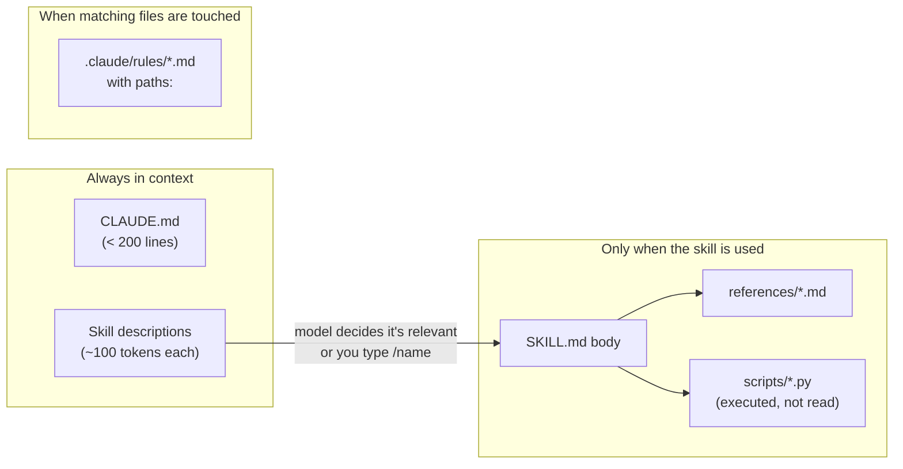

# 05 · Claude Code: CLAUDE.md, Rules, and Skills

> Level: Intermediate · Time: 3 hours · Prereqs: [01-beginner/03](../01-beginner/03-meet-your-ai-coding-tools.md), [04 · MCP server](04-build-an-mcp-server-in-python.md)
> All Claude Code facts are from code.claude.com docs and agentskills.io, stamped **(as of Nov 2026)**.

---

## 1. Why this lesson exists

An agent session starts with amnesia (lesson 01). You will want it to know your build commands, your conventions, and a few repeatable procedures ("review this PR the way our team does", "cut a release"). Claude Code offers several mechanisms for this, and choosing the wrong one costs you either **context** (everything loaded every session, crowding out real work) or **reliability** (the agent never finds the instructions when it needs them). This lesson teaches the always-loaded layer (CLAUDE.md and rules) and the load-on-demand layer (skills), and the principle that connects them: **progressive disclosure**.

## 2. Intuition

Think of a hospital.

- **CLAUDE.md** is the notice board at the ward entrance: short, always visible, read by everyone every shift. "Hand hygiene. Fire exits. On-call number." If you pin 40 pages there, nobody reads any of it.
- **Rules with path scopes** are signs on specific rooms: "Radiology: remove metal". You only see them when you walk into that room.
- **Skills** are the procedure binders on the shelf. The shelf labels (one line each) are visible all the time; you open the "central line insertion" binder only when you are about to do one. A binder can have appendices you consult only if needed.

The notice board costs attention every shift; the binders cost almost nothing until used. That economics drives every design choice below.

## 3. Precise definitions (as of Nov 2026)

**Memory files** (Claude Code memory docs):

| Scope | Location | Shared with |
|---|---|---|
| Managed policy | Linux/WSL: `/etc/claude-code/CLAUDE.md` (macOS and Windows paths differ) | All users in the organisation |
| User | `~/.claude/CLAUDE.md` | Just you, all projects |
| Project | `./CLAUDE.md` or `./.claude/CLAUDE.md` | Team, via git |
| Local | `./CLAUDE.local.md` (git-ignore it) | Just you, this project |

- Files are found "by walking up the directory tree from your current working directory" and "concatenated into context rather than overriding each other", root first. Subdirectory files load when Claude reads files there.
- **Imports**: `@path/to/file` inside a CLAUDE.md pulls in another file; relative paths resolve from the importing file; "maximum depth of four hops".
- **Rules**: Markdown files in `.claude/rules/` (project) or `~/.claude/rules/` (user). Without frontmatter they always load; with a `paths:` list of globs they load only for matching files.
- **Auto memory**: Claude Code saves its own learnings to `~/.claude/projects/<project>/memory/`; "the first 200 lines of `MEMORY.md`, or the first 25KB, whichever comes first, are loaded at the start of every conversation" (requires v2.1.59+).
- **Commands**: `/memory` lists loaded files; `/init` generates a starter CLAUDE.md (or suggests improvements to an existing one).

**Skills** (Claude Code skills docs + Agent Skills spec):

- A **skill** is a directory containing `SKILL.md`: YAML frontmatter plus Markdown instructions, optionally with supporting files (`scripts/`, `references/`, `assets/`).
- "Claude uses skills when relevant, or you can invoke one directly with `/skill-name`."
- "Unlike CLAUDE.md content, a skill's body loads only when it's used."
- "Custom commands have been merged into skills": `.claude/commands/deploy.md` and `.claude/skills/deploy/SKILL.md` both create `/deploy`.
- Claude Code skills "follow the Agent Skills open standard, which works across multiple AI tools" (agentskills.io). Anthropic published it as an open standard in December 2025 (press coverage, e.g. The Decoder).

## 4. Step by step

### 4.1 Dumbest approach: put everything in CLAUDE.md

Build commands, style guide, the 30-step release checklist, the API conventions, the incident runbook. **Walls:** CLAUDE.md is "loaded in full regardless of length", every session pays for it, and the docs warn "Longer files consume more context and reduce adherence", recommending **under 200 lines per file**. The release checklist matters once a week, yet it dilutes every conversation.

### 4.2 Fix 1: keep CLAUDE.md for universal, short facts

What belongs there: commands to build/test/lint, the 5–10 conventions that apply everywhere, known gotchas, pointers to where detail lives. Write them as instructions with reasons (lesson 01-beginner/02). Example:

```markdown
# compiler-fuzz

## Commands
- Test: `pytest -q` (UBSan builds; must be green before you claim done)
- Single test: `pytest -q tests/test_reducer.py -k ddmin`

## Invariants
- Generated C must stay free of undefined behaviour: a UB program makes
  GCC-vs-Clang differences meaningless, so every generator change needs a UBSan run.

## Pointers
- Reducer design notes: @docs/reducer.md
```

### 4.3 Fix 2: scope what only applies to some files

API rules only matter when editing API code, so make them a path-scoped rule:

```markdown
---
paths:
  - "src/api/**/*.py"
---
# API rules
- Every endpoint validates input with a Pydantic model (clients send garbage).
- Errors use the shared `ErrorResponse` shape so the frontend can render them.
```

Save as `.claude/rules/api.md`. It loads only when Claude works on matching files.

### 4.4 Fix 3: move procedures into skills

The release checklist becomes a skill. Only its name and description sit in context; the body loads on use. The Agent Skills spec calls this **progressive disclosure** and gives the budget:

1. **Metadata (~100 tokens)**: `name` and `description`, "loaded at startup for all skills".
2. **Instructions (< 5000 tokens recommended)**: the `SKILL.md` body, "loaded when the skill is activated".
3. **Resources (as needed)**: files in `scripts/`, `references/`, `assets/` "loaded only when required".



### 4.5 Anatomy of a SKILL.md

Spec rules (agentskills.io, as of Nov 2026): `name` is required, 1–64 characters, lowercase letters, digits and hyphens, no leading/trailing or consecutive hyphens, and "must match the parent directory name"; `description` is required, 1–1024 characters, and "should describe both what the skill does and when to use it". Optional: `license`, `compatibility`, `metadata`, and the experimental `allowed-tools`. Keep `SKILL.md` "under 500 lines" and file references "one level deep".

Claude Code accepts extra frontmatter (all optional; "only `description` is recommended"), including:

| Field | Effect |
|---|---|
| `disable-model-invocation: true` | Only you can invoke it (`/name`); its description is not in context. Use for side effects like `/deploy`. |
| `user-invocable: false` | Only Claude invokes it; hidden from the `/` menu. Use for background knowledge. |
| `allowed-tools` | Tools usable without a permission prompt during the turn that invokes the skill. |
| `context: fork` (+ `agent`) | Run the skill in a forked subagent; "the subagent doesn't see your conversation history". |
| `paths` | Globs limiting when the skill activates. |
| `model`, `effort` | Override model/effort while active. |
| `argument-hint`, `arguments` | Argument UX and `$name` substitution. |

Substitutions inside the body: `$ARGUMENTS` (all arguments), `$0`, `$1`… (positional), `${CLAUDE_SKILL_DIR}`, `${CLAUDE_PROJECT_DIR}`, and dynamic context injection: a line `` !`git diff HEAD` `` is replaced by the command's output "before Claude sees the skill content". Claude Code "ignores a field it doesn't recognize without reporting an error", so a typo like `disable_model_invocation` silently does nothing.

A complete example skill, `.claude/skills/pr-review/SKILL.md`:

```markdown
---
name: pr-review
description: Reviews a git diff for bugs, missing tests and risky changes. Use when the user asks to review a PR, a diff, or staged changes.
allowed-tools: Bash(git diff *) Read Grep
---

## Diff under review
!`git diff --staged`

## How to review
1. For each changed function, state what it now does in one sentence.
2. List bugs as a numbered list of short NAMES first, then one line each: where, why it breaks, fix.
3. Flag missing tests for every changed branch.
4. Check new imports exist in our lockfile (see references/supply-chain.md) because
   assistants sometimes suggest packages that do not exist.
5. If the diff is empty, say "Nothing staged" and stop.
```

### 4.6 Validate before you trust

Because unknown fields are silently ignored and a bad `name` can stop a skill loading in other tools, check skills mechanically. The spec points to the `skills-ref` reference library (`skills-ref validate ./my-skill`). Here is a small validator implementing the spec rules so you can see them as code:

```python
# validate_skill.py - check a SKILL.md against the Agent Skills spec rules (agentskills.io, Nov 2026).
# Needs PyYAML (pip install pyyaml). Exit code 0 = valid, 1 = problems found.
import re                    # regular expressions for the name rule
import sys                   # argv and exit codes
from pathlib import Path     # paths

import yaml                  # parse the YAML frontmatter

NAME_RE = re.compile(r"^[a-z0-9]+(-[a-z0-9]+)*$")   # lowercase words joined by single hyphens


def validate(skill_dir: Path) -> list[str]:
    problems = []
    md = skill_dir / "SKILL.md"
    if not md.exists():
        return ["SKILL.md is missing"]
    text = md.read_text(encoding="utf-8")
    m = re.match(r"^---\n(.*?)\n---\n(.*)$", text, re.S)   # frontmatter between --- lines
    if not m:
        return ["no YAML frontmatter between --- markers"]
    meta, body = yaml.safe_load(m.group(1)) or {}, m.group(2)
    name, desc = meta.get("name", ""), meta.get("description", "")
    if not (1 <= len(name) <= 64) or not NAME_RE.match(name):
        problems.append(f"name {name!r}: 1-64 chars, a-z 0-9 and single inner hyphens only")
    if name and name != skill_dir.name:
        problems.append(f"name {name!r} must match directory name {skill_dir.name!r}")
    if not (1 <= len(desc) <= 1024):
        problems.append(f"description length {len(desc)}: must be 1-1024 chars")
    if "use when" not in desc.lower():
        problems.append("description should say WHEN to use the skill (agents match on it)")
    if len(body.splitlines()) > 500:
        problems.append("body over 500 lines; move detail into references/")
    return problems


if __name__ == "__main__":
    import tempfile
    root = Path(tempfile.mkdtemp())
    good = root / "pr-review"; good.mkdir()
    (good / "SKILL.md").write_text(
        "---\nname: pr-review\ndescription: Reviews a git diff for bugs, missing tests and "
        "risky changes. Use when the user asks to review a PR, a diff, or staged changes.\n---\n"
        "1. Run `git diff --staged`.\n2. Report issues as a numbered list.\n")
    bad = root / "PR_Review"; bad.mkdir()
    (bad / "SKILL.md").write_text("---\nname: PR_Review\ndescription: Helps with PRs.\n---\nDo it.\n")
    for d in (good, bad):
        print(d.name, "->", validate(d) or "valid")
```

Output:

```text
pr-review -> valid
PR_Review -> ["name 'PR_Review': 1-64 chars, a-z 0-9 and single inner hyphens only", 'description should say WHEN to use the skill (agents match on it)']
```

**Line-by-line walkthrough (syntax and logic):**

- `NAME_RE = re.compile(r"^[a-z0-9]+(-[a-z0-9]+)*$")`: a raw string (`r"..."`, backslashes kept literally) compiled once. It means "one or more lowercase alphanumerics, then zero or more groups of hyphen + alphanumerics", which forbids leading, trailing and doubled hyphens in one pattern.
- `re.match(r"^---\n(.*?)\n---\n(.*)$", text, re.S)`: captures the YAML between `---` lines (group 1) and the body (group 2). `.*?` is non-greedy (stop at the first closing `---`); `re.S` lets `.` match newlines.
- `yaml.safe_load(...) or {}`: parse YAML safely (no arbitrary object construction); empty frontmatter becomes `{}`.
- `meta.get("name", "")`: dictionary lookup with a default.
- `if not (1 <= len(name) <= 64) or not NAME_RE.match(name):` uses Python's chained comparison `1 <= x <= 64`.
- `if name and name != skill_dir.name:` enforces "must match the parent directory name".
- The `"use when" not in desc.lower()` check is my heuristic, not a spec rule: descriptions are what the model matches against, so they should state *when*.
- `len(body.splitlines()) > 500` enforces the size guidance.
- In the demo, `tempfile.mkdtemp()` makes a scratch folder with one good and one bad skill; `validate(d) or "valid"` prints `"valid"` when the list of problems is empty.

### 4.7 Choosing the right mechanism

| You want | Use | Why |
|---|---|---|
| Facts needed in nearly every session | CLAUDE.md | Always loaded; keep short |
| Conventions for some directories/file types | `.claude/rules/` with `paths:` | Loaded only when relevant |
| A repeatable procedure or domain reference | Skill | Description always visible, body on demand |
| A procedure with side effects | Skill + `disable-model-invocation: true` | Only you trigger it |
| Access to an external system | MCP server (lesson 04) | Tools, not instructions |
| Isolated heavy work | Subagent (03-advanced/01) | Separate context window |
| Something that MUST happen every time | Hook (03-advanced/01) | Deterministic code, not a suggestion |

The last row is crucial: everything in this lesson is **guidance the model may follow**. If a rule must never be broken (never edit `.env`), enforce it with permissions or hooks, not prose.

## 5. Common mistakes

1. **A 600-line CLAUDE.md.** Move procedures to skills, conditional rules to `.claude/rules/`.
2. **Vague skill descriptions** ("Helps with PRs"). The model cannot tell when to use it. Say what and when, with trigger words.
3. **Typos in frontmatter keys.** Silently ignored. Validate.
4. **Side-effecting skills the model can trigger on its own.** Use `disable-model-invocation: true` for deploys, commits, messages.
5. **Forked skills that assume conversation history.** A `context: fork` skill must stand alone.
6. **Using prose for hard rules.** Prose is advisory; use deny rules or hooks.
7. **Contradictions between user, project and local files.** All are concatenated; resolve them.
8. **Expecting AGENTS.md to load natively in Claude Code.** Per the memory docs, add a CLAUDE.md containing `@AGENTS.md` (or a symlink on macOS/Linux).

## 6. Connections to other tracks

- **OS / Computer Architecture**: progressive disclosure is demand paging: keep a small resident set (descriptions), fault in pages (skill bodies) on use, and avoid thrashing the working set (the context window).
- **System Design**: caching tiers (always-hot, conditionally-loaded, cold storage).
- **Git**: project memory and skills are versioned with the code; review them in PRs like code.
- **Career skills / documentation**: a good skill is a good runbook.

## 7. Where this shows up in my projects

- **QiskitSage** and **compiler-fuzz** each have a distinct "how we review/triage" procedure. Turning them into skills (`qiskit-pr-review`, `triage-miscompile`) keeps CLAUDE.md small and makes the procedures reusable across Claude Code and any other Agent-Skills-compatible tool. (This knowledge base itself was built with project skills for these repos, which is the pattern in action.)

## 8. Self-check questions

1. Why does the docs' 200-line guidance for CLAUDE.md exist, given the model can technically read more?
2. What is loaded at startup for a skill, and what is loaded later?
3. Which frontmatter would you use for a `/release` skill, and why?
4. A skill has `disable_model_invocation: true`. What happens?
5. When should a rule be a hook instead of a CLAUDE.md line?

<details><summary>Answers</summary>

1. Every line is loaded every session; longer files cost context and "reduce adherence", so important instructions get diluted.
2. Startup: `name` and `description` (~100 tokens per skill). On activation: the `SKILL.md` body. Later still, on demand: referenced files and script outputs.
3. `disable-model-invocation: true` so only a human can trigger it (side effects), possibly with `context: fork` to keep its work out of the main context and `allowed-tools` limited to what releasing needs.
4. Nothing: the key uses underscores, Claude Code ignores unrecognised fields without an error, so the model can still invoke the skill automatically.
5. When it must hold deterministically every time (security, compliance, destructive operations); CLAUDE.md is guidance the model may not follow.

</details>

## 9. Mnemonic (Tamil + English)

**"Notice board-la CHINNA, Binder-la PERUSU, Kattayam-na HOOK-u."**
(நோட்டீஸ் போர்டுல சின்ன, பைண்டர்ல பெருசு, கட்டாயம்-னா ஹூக்கு)
- Notice board (CLAUDE.md): keep it **chinna** (small).
- Binder (skill): the **perusu** (big) detail goes there, opened on demand.
- If it is **kattayam** (mandatory), make it a **hook**, not a sentence.

## Sources

- Claude Code, Memory (CLAUDE.md, rules, auto memory, imports) (as of Nov 2026): https://code.claude.com/docs/en/memory
- Claude Code, Skills (as of Nov 2026): https://code.claude.com/docs/en/skills
- Agent Skills specification (as of Nov 2026): https://agentskills.io/specification
- skills-ref validator: https://github.com/agentskills/agentskills/tree/main/skills-ref
- The Decoder, "Anthropic publishes Agent Skills as an open standard for AI platforms" (Dec 2025): https://the-decoder.com/anthropic-publishes-agent-skills-as-an-open-standard-for-ai-platforms/
- Anthropic, "Effective context engineering for AI agents" (Sept 29, 2025): https://www.anthropic.com/engineering/effective-context-engineering-for-ai-agents

## Verify yourself

1. `pip install pyyaml`, run `python3 validate_skill.py`; then rename the good skill's directory to `pr_review` and confirm it fails the name-match rule.
2. In Claude Code, create the `pr-review` skill, stage a change, type `/pr-review`, and check that the `!` line was replaced by the diff.
3. Run `/memory` in a nested directory and compare the loaded files with the simulation in 01-beginner/03.
4. Re-read the skills docs' frontmatter table: the field list grows over time; note any field added since Nov 2026.
