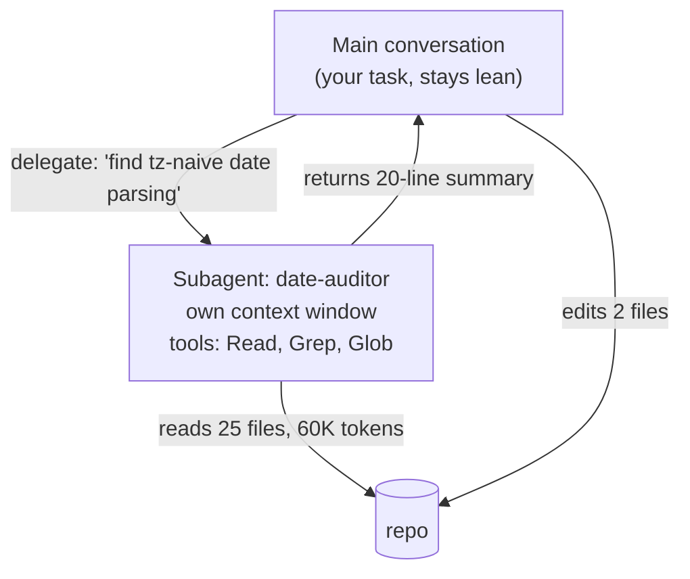

# 01 · Claude Code Internals for Power Users: Subagents, Hooks, Permissions

> Level: Advanced · Time: 3–4 hours · Prereqs: [02-intermediate/05](../02-intermediate/05-claude-code-memory-and-skills.md), shell scripting, JSON
> Facts from code.claude.com docs, stamped **(as of Nov 2026)**. Hook script tested with Python 3.13 by piping JSON events to it.

---

## 1. Why this lesson exists

The intermediate tier gave the agent knowledge (CLAUDE.md, skills) and capabilities (MCP). Real use exposes three harder problems:

1. **Context exhaustion.** A long investigation (grep 40 files, read logs) fills the main context window with material you will never reference again, and quality drops (context rot).
2. **Guidance is not guarantee.** "Never edit `.env`" in CLAUDE.md is a request. You need deterministic enforcement and automation that runs every time.
3. **Autonomy vs safety.** Approving every command is slow; approving nothing is dangerous.

Claude Code's answers are **subagents** (separate context windows), **hooks** (deterministic code at lifecycle events) and the **permission system** (rules, modes, sandbox). Together they are a small operating system around the model, and understanding them is how you go from "chatting with an agent" to engineering one.

## 2. Intuition

- **Subagent** = sending a junior to the library with a specific question. They read 30 books in their own notebook and come back with one page of findings. Your desk stays clean.
- **Hook** = a turnstile with a card reader. It does not care how persuasive you are; the card either works or it does not.
- **Permissions** = the building's access policy: some doors open freely (reading), some need a badge swipe each time (running commands), some are locked for everyone (secrets), and some buildings are in a fenced compound (sandbox) so even a bad actor inside cannot reach the street.

## 3. Precise definitions (as of Nov 2026)

**Subagents.** "Specialized AI assistants that handle specific types of tasks", each running "in its own context window with a custom system prompt, specific tool access, and independent permissions"; the subagent "does that work in its own context and returns only the summary". Built-ins include **Explore** ("a fast, read-only agent optimized for searching and analyzing codebases"), **Plan** (gathers context in plan mode) and **general-purpose**. Custom subagents are Markdown files with YAML frontmatter in `.claude/agents/` (project) or `~/.claude/agents/` (user); priority order is managed settings > `--agents` CLI flag > project > user > plugin. "Only `name` and `description` are required"; other fields include `tools`, `disallowedTools`, `model`, `permissionMode`, `skills`, `hooks`, `memory`, `maxTurns`, `mcpServers`. Claude "uses each subagent's description to decide when to delegate". "By default, a subagent can spawn subagents of its own, up to three layers below the main conversation" (`CLAUDE_CODE_MAX_SUBAGENT_SPAWN_DEPTH` changes this).

**Hooks.** User-defined handlers that run at lifecycle events, configured in settings JSON (`~/.claude/settings.json`, `.claude/settings.json`, `.claude/settings.local.json`, managed policy, plugins, or skill/subagent frontmatter). Structure: event → matcher group → list of handlers. Handler types: `command` (shell; event JSON on stdin), `http`, `mcp_tool`, `prompt` (single-turn model evaluation) and `agent` (experimental). Key events: `SessionStart`, `UserPromptSubmit`, `PreToolUse` ("Before a tool call executes. Can block it"), `PermissionRequest`, `PostToolUse`, `PostToolUseFailure`, `Stop`, `SubagentStart`/`SubagentStop`, `PreCompact`/`PostCompact`, `SessionEnd`, and more.

**Exit codes for command hooks:** 0 = success (JSON on stdout is applied); **2 = blocking error** ("On events that can block, Claude Code stops the action"); any other code = non-blocking error (the action goes ahead). The docs warn: "Exit code 1 without valid JSON output is a non-blocking error... If your hook is meant to enforce a policy, use `exit 2`."

**Permissions.** Rules in settings under `permissions.allow`, `ask`, `deny`, e.g. `Bash(npm run test *)`, `Read(./.env)`, `WebFetch(domain:github.com)`. "Rules are evaluated in order: deny, then ask, then allow. The first match in that order determines the outcome, and rule specificity doesn't change the order." Modes: `default` (prompts on first use; labelled Manual), `acceptEdits`, `plan`, `auto` (a background classifier reviews actions), `dontAsk`, `bypassPermissions` (only "in isolated environments like containers or VMs").

## 4. Step by step

### 4.1 Subagents: from "do it all in one context" to delegation

**Dumbest:** ask the main agent "find every place we parse dates and tell me which ones ignore time zones". It greps, opens 25 files, reads hundreds of lines. Afterwards your context holds ~60K tokens of file contents, and your real task (fix two of them) runs in a cluttered, degraded window.

**Delegation:** a subagent does the search in its own window and returns a 20-line summary. Anthropic's context-engineering post describes the same architecture: "specialized sub-agents can handle focused tasks with clean context windows", returning condensed summaries to a lead agent.



A custom read-only reviewer, `.claude/agents/security-reviewer.md`:

```markdown
---
name: security-reviewer
description: Reviews changed code for injection, authz gaps, secret leaks and unsafe deserialization. Use proactively after edits to auth, API handlers, or anything touching user input.
tools: Read, Grep, Glob
model: inherit
---

You are a security reviewer. You cannot edit files.
For each finding give: file:line, the vulnerability class, a concrete exploit
input, and the minimal fix. If you find nothing, say so explicitly and list
what you checked. Never speculate about code you have not opened.
```

Design notes: the tool list excludes `Edit`, `Write` and `Bash`, so the reviewer *cannot* change anything (enforced, not requested). "Use proactively" in the description is the docs' suggested phrasing to encourage automatic delegation.

**Walls of subagents:** they cost tokens (a whole extra context), add latency, and the summary is lossy: if the subagent misses something, the main agent never sees the raw evidence. Anthropic's best-practices page notes Claude "may overuse them" and suggests delegating only "when tasks can run in parallel, require isolated context, or involve independent workstreams". Subagents also do not see your conversation, so their prompt (the delegation message plus their system prompt) must be self-contained.

### 4.2 Hooks: from "please don't" to "cannot"

**Dumbest:** CLAUDE.md says "Never run `rm -rf`". Usually obeyed. "Usually" is not a security property.

**Hook:** a `PreToolUse` command hook inspects every Bash call before it runs and denies dangerous ones. Configuration (`.claude/settings.json`):

```json
{
  "hooks": {
    "PreToolUse": [
      {
        "matcher": "Bash|Edit|Write",
        "hooks": [
          { "type": "command", "command": "${CLAUDE_PROJECT_DIR}/.claude/hooks/guard_hook.py" }
        ]
      }
    ]
  }
}
```

The hook script:

```python
#!/usr/bin/env python3
# guard_hook.py - a Claude Code PreToolUse hook (format per code.claude.com/docs/en/hooks, Nov 2026).
# Reads the event JSON on stdin; denies destructive shell commands and edits to secret files.
import json                 # parse stdin, print the decision
import re                   # pattern match on commands
import sys                  # stdin / exit codes

DANGEROUS = [r"\brm\s+-[a-zA-Z]*r[a-zA-Z]*f", r"\bgit\s+push\s+.*--force", r"\bmkfs\.", r"\bdd\s+if="]
SECRET_FILES = re.compile(r"(^|/)(\.env(\..*)?|id_rsa|.*\.pem)$")


def decide(event: dict) -> tuple[str, str] | None:
    """Return (decision, reason) or None for 'no opinion, use the normal permission flow'."""
    tool, args = event.get("tool_name"), event.get("tool_input", {})
    if tool == "Bash":
        cmd = args.get("command", "")
        for pat in DANGEROUS:
            if re.search(pat, cmd):
                return "deny", f"Blocked by guard_hook: command matches {pat!r}. Ask the human."
    if tool in ("Edit", "Write") and SECRET_FILES.search(args.get("file_path", "")):
        return "deny", "Blocked by guard_hook: secrets files are human-edited only."
    return None


def main() -> int:
    event = json.load(sys.stdin)                      # Claude Code sends one JSON object
    verdict = decide(event)
    if verdict is None:
        return 0                                      # exit 0, no JSON: normal flow continues
    decision, reason = verdict
    print(json.dumps({"hookSpecificOutput": {
        "hookEventName": "PreToolUse",
        "permissionDecision": decision,
        "permissionDecisionReason": reason}}))
    return 0                                          # JSON on stdout carries the decision


if __name__ == "__main__":
    sys.exit(main())
```

Testing it by piping events the way Claude Code would:

```text
$ echo '{"hook_event_name":"PreToolUse","tool_name":"Bash","tool_input":{"command":"rm -rf build/"}}' | ./guard_hook.py
{"hookSpecificOutput": {"hookEventName": "PreToolUse", "permissionDecision": "deny", "permissionDecisionReason": "Blocked by guard_hook: command matches '\\\\brm\\\\s+-[a-zA-Z]*r[a-zA-Z]*f'. Ask the human."}}
[exit code 0]
$ echo '{"hook_event_name":"PreToolUse","tool_name":"Bash","tool_input":{"command":"npm test"}}' | ./guard_hook.py
[exit code 0]
$ echo '{"hook_event_name":"PreToolUse","tool_name":"Edit","tool_input":{"file_path":"/repo/.env"}}' | ./guard_hook.py
{"hookSpecificOutput": {"hookEventName": "PreToolUse", "permissionDecision": "deny", "permissionDecisionReason": "Blocked by guard_hook: secrets files are human-edited only."}}
[exit code 0]
```

**Line-by-line walkthrough (syntax and logic):**

- `#!/usr/bin/env python3`: the shebang line lets the OS run the file directly (after `chmod +x`) using whichever `python3` is on `PATH`.
- `DANGEROUS = [r"\brm\s+-[a-zA-Z]*r[a-zA-Z]*f", ...]`: raw-string regexes. `\b` is a word boundary, `\s+` one or more spaces, `[a-zA-Z]*` any letters. So the first pattern means "`rm`, spaces, a dash, letters, an `r`, letters, an `f`".
- `SECRET_FILES = re.compile(r"(^|/)(\.env(\..*)?|id_rsa|.*\.pem)$")`: matches `.env`, `.env.local`, `id_rsa` or any `.pem` as the final path component.
- `def decide(event: dict) -> tuple[str, str] | None:`: the `|` in a type hint means "either type"; returning `None` means "no opinion".
- `event.get("tool_name")` / `event.get("tool_input", {})`: the documented stdin fields; `.get` avoids `KeyError` if a field is absent.
- `re.search(pat, cmd)` finds the pattern anywhere in the command (including inside `bash -c '...'`, as the test with `bash -c 'rm -rf build'` showed).
- `json.load(sys.stdin)`: parse the event from standard input.
- `return 0` with no output: "no decision; normal permission flow applies" (the docs' own example does this).
- For a denial we print `{"hookSpecificOutput": {"hookEventName": "PreToolUse", "permissionDecision": "deny", "permissionDecisionReason": ...}}` and exit 0: the documented JSON channel. (Alternatively, exit 2 with a reason on stderr blocks the action.) The reason text is shown to Claude, so make it actionable.
- `sys.exit(main())` passes `main`'s return value to the OS as the exit code.

### 4.3 The wall: blocklists are bypassable

I probed my own hook. Results:

```text
rm -fr build               ALLOWED (bypass)
rm -r -f build             ALLOWED (bypass)
bash -c 'rm -rf build'     DENIED
find . -delete             ALLOWED (bypass)
```

Flag reordering, split flags and a different deletion command all slip through. This is the general problem with **denylists over a Turing-complete language** (the shell): there are infinitely many ways to express an action. The Claude Code docs say the same about their own rule matching: a deny rule "doesn't match the same program by path or inside `sh -c`", and for hard guarantees point you to the **sandbox**, which enforces filesystem and network limits at the OS level for every process, not by parsing command strings. They also note Read/Edit deny rules don't apply to "arbitrary subprocesses that read or write files indirectly, like a Python or Node script".

So the layered design is:

| Layer | Strength | Use for |
|---|---|---|
| CLAUDE.md prose | Advisory | Preferences, conventions |
| Permission rules (`deny` first) | Enforced on recognised tool calls; pattern-based | Removing whole tools, protecting known paths |
| Hooks | Deterministic code you write; only as good as your parsing | Formatting, test gates, logging, policy checks |
| Sandbox / container / VM | OS-enforced for all processes | Hard limits on files and network |

### 4.4 Hooks are also for automation, not just blocking

Common, high-value hooks:

- `PostToolUse` on `Edit|Write`: run the formatter/linter on the edited file (deterministic style, zero tokens).
- `Stop`: run the fast test suite; if it fails, return `{"decision": "block", "reason": "tests failing: ..."}` so Claude continues fixing instead of declaring victory (top-level `decision: "block"` is documented for `Stop`).
- `SessionStart`: inject dynamic context (current branch, open ticket) so the agent starts oriented.
- `UserPromptSubmit`: block prompts containing secrets before they reach the model.

### 4.5 Permissions configuration that scales

A team `.claude/settings.json` sketch:

```json
{
  "permissions": {
    "allow": ["Bash(npm run test *)", "Bash(npm run lint)", "Bash(git diff *)"],
    "ask":   ["Bash(git push *)"],
    "deny":  ["Read(./.env)", "Read(./secrets/**)", "Bash(curl *)", "WebFetch"]
  }
}
```

Reasoning for each list: tests and lint are safe and frequent (allow); pushing is visible to others (ask); secrets and arbitrary network egress are denied. Because evaluation is deny → ask → allow, "an allow rule can't carve an exception out of a deny rule". A bare tool name in `deny` (here `WebFetch`) "removes the tool from Claude's context entirely".

Modes in practice: **plan** for exploring unfamiliar code; **default** for daily work; **acceptEdits** when you are reviewing the diff anyway; **auto** when a classifier review is acceptable; **bypassPermissions** only in disposable containers. Organisations can disable `bypassPermissions` and `auto` through managed settings.

### 4.6 Headless mode and CI

`claude -p "<task>"` runs non-interactively (print mode), which composes with Unix pipes: the docs' examples include `tail -200 app.log | claude -p "Slack me if you see any anomalies"` and `git diff main --name-only | claude -p "review these changed files for security issues"`. In CI there is no human to approve prompts, so permissions must be fully specified up front (allow exactly what the job needs, deny the rest) and the job should run inside a sandboxed runner. Claude Code also documents GitHub Actions and GitLab CI/CD integrations.

## 5. Common mistakes

1. **Hook exits 1 to "block".** Exit 1 is non-blocking; the action proceeds. Use exit 2 or JSON `permissionDecision: "deny"`.
2. **Treating a regex hook as a security boundary.** Bypassable; pair with sandboxing.
3. **Slow hooks on every tool call.** A 3-second hook on every `Read` makes the agent crawl. Narrow the `matcher`.
4. **Subagents with all tools inherited.** If omitted, `tools` "inherits every tool available to subagents". A reviewer should be read-only.
5. **Vague subagent descriptions.** Delegation is description-driven; say exactly when.
6. **Expecting subagents to know the conversation.** They start fresh; brief them fully.
7. **`bypassPermissions` on your laptop.** The docs restrict it to isolated environments.
8. **Allow rules you think override deny.** They never do.

## 6. Connections to other tracks

- **OS**: subagents ≈ processes with separate address spaces communicating by message (the summary); hooks ≈ syscall interception (seccomp filters); the sandbox ≈ namespaces/Seatbelt; permission precedence ≈ firewall rule ordering.
- **Security**: defence in depth; denylist vs allowlist; confused-deputy risk when an agent acts on untrusted input with your privileges.
- **Linux**: shebangs, exit codes, stdin/stdout piping, `chmod +x`.
- **Cloud/DevOps**: hooks are CI gates moved left into the editor; headless mode runs in pipelines.
- **Compilers**: shell command parsing is exactly why denylists fail; quoting and expansion change meaning.

## 7. Where this shows up in my projects

- **ARIA** is a human-in-the-loop email agent: its approval step is the application-level equivalent of `permissionDecision: "ask"`, and the same lesson applies: the approval must be enforced in code (a graph interrupt), not requested in a prompt.
- **aws-waste-scanner** touches multiple AWS accounts; when using an agent on that repo, a deny rule on `Bash(aws *)` plus a sandboxed shell prevents an agent from "helpfully" deleting the idle resources it was asked to *report*.

## 8. Self-check questions

1. What problem do subagents solve that a bigger context window does not?
2. Your `PreToolUse` hook prints an error and exits 1. Does the tool call run?
3. Give two commands that bypass a regex blocking `rm -rf`, and the stronger control the docs recommend.
4. Settings have `allow: ["Bash(git *)"]` and `deny: ["Bash(git push *)"]`. What happens to `git push origin main`?
5. Why should a CI job using `claude -p` specify permissions explicitly?

<details><summary>Answers</summary>

1. Context pollution and rot: the bulk of exploratory material stays in the subagent's window and only a summary returns, keeping the main window focused. A bigger window still degrades as it fills.
2. Yes. Exit code 1 is a non-blocking error; use exit 2 or a JSON deny decision.
3. `rm -fr dir`, `rm -r -f dir`, `find . -delete` (also scripts in other languages). Use the OS-level sandbox (and deny rules where they apply).
4. Denied: deny is evaluated first and allow cannot carve exceptions out of deny.
5. There is no human to answer prompts; anything not pre-allowed is blocked or, worse, a permissive mode allows too much. Explicit least-privilege rules plus a sandboxed runner make the job predictable and safe.

</details>

## 9. Mnemonic (Tamil + English)

**"Zero-na Ok, Rendu-na Thadai, Onnu-na Oyyaaram."**
(ஜீரோ-னா ஓகே, ரெண்டு-னா தடை, ஒண்ணு-னா ஒய்யாரம்)
Hook exit codes: **0** = okay (apply JSON), **2** = *thadai* (block), **1/other** = just showing off (*oyyaaram*), nothing is blocked.

**"Deny-ku Daan Mudhal Mariyaadhai."** (டினைக்கு தான் முதல் மரியாதை: deny gets the first honour.) Evaluation order deny → ask → allow.

## Sources

- Claude Code, Subagents (as of Nov 2026): https://code.claude.com/docs/en/sub-agents
- Claude Code, Hooks reference (as of Nov 2026): https://code.claude.com/docs/en/hooks
- Claude Code, Permissions (as of Nov 2026): https://code.claude.com/docs/en/permissions
- Claude Code, Sandboxing (as of Nov 2026): https://code.claude.com/docs/en/sandboxing
- Claude Code, Overview (headless `-p` examples) (as of Nov 2026): https://code.claude.com/docs/en/overview
- Anthropic, "Effective context engineering for AI agents" (Sept 29, 2025): https://www.anthropic.com/engineering/effective-context-engineering-for-ai-agents
- Anthropic, Prompting best practices (subagent overuse guidance) (as of Nov 2026): https://platform.claude.com/docs/en/build-with-claude/prompt-engineering/claude-prompting-best-practices

## Verify yourself

1. Save `guard_hook.py`, `chmod +x` it, and pipe the three sample events shown above into it; confirm the outputs.
2. Extend `DANGEROUS` to catch `rm -fr` and `rm -r -f`, then find a new bypass (there always is one). Write down why the sandbox does not have this problem.
3. In a Claude Code project, register the hook, ask Claude to "delete the build folder with rm -rf", and confirm the denial reason appears.
4. Create the `security-reviewer` subagent, ask for a review, and verify in the transcript that it never attempted an edit.
5. Check the hooks reference for the current list of events; it has grown over time.
