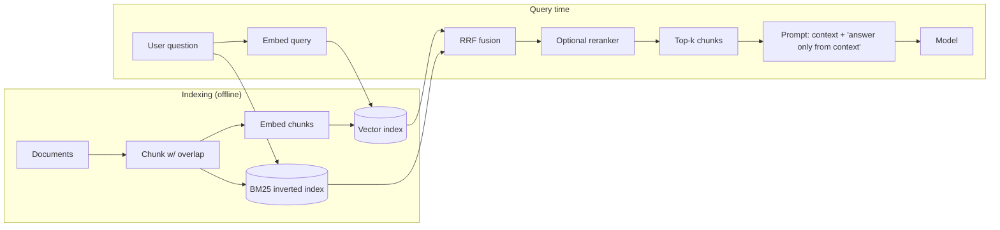

# 03 · RAG and Embeddings: Retrieval You Can Measure

> Level: Advanced · Time: 4 hours · Prereqs: [02-intermediate/01](../02-intermediate/01-tool-calling-and-structured-output.md), vectors and dot products, NumPy basics
> Code tested with NumPy 2.5.4 / Python 3.13. Tool facts stamped **(as of Nov 2026)**.

---

## 1. Why this lesson exists

Models know only what was in their training data (up to a cutoff) plus what is in the context window (lesson 01). Your company wiki, your codebase, last week's incident report: none of it is "known". Two options: put everything in the window (expensive, slow, context rot) or **retrieve the few relevant pieces and put only those in the window**. That second option is **Retrieval-Augmented Generation (RAG)**, introduced under that name by Lewis et al. (2020).

RAG is also where many AI features silently fail: the model answers fluently from the *wrong* chunk, or from no chunk at all. The fix is not a better prompt; it is better retrieval, **measured**. This lesson builds retrieval from scratch (chunking, BM25, dense vectors, hybrid fusion) and evaluates it, so you learn to debug the retrieval half separately from the generation half.

## 2. Intuition

An open-book exam. You are allowed to bring any book, but you can only open **five pages** at the table. Your score depends on two skills: **finding** the right five pages quickly (retrieval) and **answering** from them (generation). Most failures students blame on "not understanding" are actually "opened the wrong pages".

Two ways to find pages:
- **The index at the back of the book** (keywords → pages). Precise for exact terms ("port 53"), useless for synonyms or typos. That is **sparse / lexical retrieval (BM25)**.
- **A friend who has read everything and says "that sounds like chapter 4"**. Handles paraphrases and typos, but can be confidently vague. That is **dense / semantic retrieval (embeddings)**.

Good systems ask both and merge the answers (**hybrid**).

## 3. Precise definitions

- **Chunk**: a contiguous piece of a document stored and retrieved as a unit.
- **Embedding**: a function mapping text to a fixed-length vector so that semantically similar texts have nearby vectors. Learned by neural networks (e.g. Sentence-BERT, Reimers & Gurevych 2019).
- **Cosine similarity**: cos(a, b) = a·b / (‖a‖‖b‖). For **unit-length** vectors it equals the dot product. Ollama's docs state its `/api/embed` endpoint "returns L2‑normalized (unit‑length) vectors" and recommend cosine similarity "for most semantic search use cases" (as of Nov 2026).
- **BM25**: a lexical ranking function scoring documents by term frequency (saturating via k1), inverse document frequency, and document-length normalisation (b) (Robertson & Zaragoza, 2009).
- **Hybrid retrieval**: combining sparse and dense rankings, commonly with **Reciprocal Rank Fusion** (RRF): score(d) = Σ 1/(k + rank_i(d)), with k = 60 in the original paper (Cormack, Clarke & Büttcher, 2009).
- **Reranker**: a slower, more accurate model that re-scores the top N candidates.
- **recall@k**: fraction of queries whose relevant document appears in the top k results. The primary retrieval metric, because the generator cannot use what was not retrieved.
- **ANN index**: approximate nearest-neighbour structure (e.g. HNSW, Malkov & Yashunin) that finds near vectors in sub-linear time at large scale.

## 4. Step by step

### 4.1 Dumbest approach: paste everything

Concatenate all documents into the prompt. Walls: cost scales with corpus size per question; context windows end (even 1M tokens); "Lost in the Middle" (Liu et al., 2023) and context rot mean relevant facts buried mid-context get used less. Works for 3 documents; dies at 3,000.

### 4.2 Next: keyword search

Grep-like matching. Walls: no ranking (which match is best?), common words dominate, and synonyms/typos miss entirely ("hostname" vs "names").

### 4.3 Fix ranking: BM25

BM25 adds three ideas: rare terms matter more (IDF), repeating a term helps with diminishing returns (k1), and long documents should not win just for being long (b). Still lexical: zero overlap means zero score.

### 4.4 Fix meaning: dense embeddings

Embed every chunk once; embed the query; rank by cosine. Paraphrases and typos can now match. Walls: exact identifiers (error codes, port numbers, function names) can be fuzzed away; the embedding model is a black box; and everything depends on **using the same embedding model for indexing and querying** (Ollama's docs say exactly this).

### 4.5 Fix both: hybrid with RRF

RRF uses only **ranks**, so you do not need to calibrate BM25 scores against cosine scores (different scales). Each retriever votes 1/(k+rank) for the items it found.

### 4.6 The pipeline



### 4.7 Build it and measure it

The embedding here is a **hashed character-trigram vector**, a stand-in so the code runs offline with no model download. It captures spelling similarity (which is why it handles typos), not meaning. In production, replace `embed()` with a real embedding model, e.g. a call to Ollama's `/api/embed` (03-advanced/05).

```python
# mini_rag.py - retrieval for RAG from scratch: chunking, BM25, dense vectors, hybrid fusion, recall@k.
# Needs numpy (tested 2.5.4). The "embedding" is a hashed character-trigram vector, a stand-in for a
# real embedding model (e.g. Ollama's /api/embed) so this runs offline.
import math                                   # log for BM25 idf
import re                                     # tokenising
import zlib                                   # crc32: a hash that is stable across runs
from collections import Counter               # term frequencies

import numpy as np                            # vectors and dot products

DOCS = {
    "tcp": "TCP opens a connection with a three-way handshake: SYN, SYN-ACK, ACK. "
           "It guarantees ordered delivery and retransmits lost segments.",
    "udp": "UDP sends datagrams without a handshake. There is no delivery guarantee, "
           "which makes it fast for DNS lookups and live video.",
    "tls": "TLS encrypts traffic on top of TCP. The TLS 1.3 handshake needs one round trip "
           "and authenticates the server with a certificate.",
    "dns": "DNS resolves names like example.com to IP addresses, usually over UDP port 53.",
}


def chunk(text: str, size: int = 12, overlap: int = 4) -> list[str]:
    """Fixed-size word windows with overlap, so a fact split across a boundary survives."""
    w = text.split()
    step = size - overlap
    return [" ".join(w[i:i + size]) for i in range(0, max(len(w) - overlap, 1), step)]


CHUNKS = [(doc_id, c) for doc_id, t in DOCS.items() for c in chunk(t)]
tok = lambda s: re.findall(r"[a-z0-9]+", s.lower())      # lowercase alphanumeric words


# ---- sparse retrieval: BM25 (Robertson & Zaragoza) ----
def bm25_scores(query: str, k1: float = 1.5, b: float = 0.75) -> np.ndarray:
    docs = [tok(c) for _, c in CHUNKS]
    avgdl = sum(map(len, docs)) / len(docs)
    df = Counter(t for d in docs for t in set(d))         # in how many chunks each term appears
    N, scores = len(docs), np.zeros(len(docs))
    for i, d in enumerate(docs):
        tf = Counter(d)
        for t in tok(query):
            if t in tf:
                idf = math.log(1 + (N - df[t] + 0.5) / (df[t] + 0.5))
                scores[i] += idf * tf[t] * (k1 + 1) / (tf[t] + k1 * (1 - b + b * len(d) / avgdl))
    return scores


# ---- dense retrieval: unit vectors + cosine similarity ----
def embed(text: str, dim: int = 512) -> np.ndarray:
    v = np.zeros(dim)
    s = f"  {text.lower()}  "
    for i in range(len(s) - 2):
        # NOT Python's hash(): it is salted per process, so vectors would change every run.
        v[zlib.crc32(s[i:i + 3].encode()) % dim] += 1     # hashed char trigram counts
    return v / np.linalg.norm(v)                          # L2-normalise: dot product == cosine


MATRIX = np.stack([embed(c) for _, c in CHUNKS])          # one row per chunk


def dense_scores(query: str) -> np.ndarray:
    return MATRIX @ embed(query)                          # all cosines in one matrix-vector product


# ---- hybrid: reciprocal rank fusion (Cormack et al., 2009) ----
def rrf(*score_lists: np.ndarray, k: int = 60) -> np.ndarray:
    fused = np.zeros(len(CHUNKS))
    for s in score_lists:
        ranks = np.argsort(np.argsort(-s))                # rank 0 = best
        hit = s > 0                                       # only items this retriever actually found
        fused[hit] += 1.0 / (k + ranks[hit] + 1)
    return fused


def top_docs(scores: np.ndarray, k: int) -> list[str]:
    seen = []
    if scores.max() <= 0:                                 # nothing matched at all: retrieve nothing
        return ["(none)"]
    for i in np.argsort(-scores):
        if CHUNKS[i][0] not in seen:
            seen.append(CHUNKS[i][0])
        if len(seen) == k:
            break
    return seen


# ---- evaluation: recall@1 on a labelled query set ----
EVAL = [("how does the three way handshake work", "tcp"), ("encrypt traffic certificate", "tls"),
        ("which protocol has no delivery guarantee", "udp"), ("resolve a hostname to an IP", "dns"),
        ("port 53", "dns"), ("retransmit lost segments ordered", "tcp"),
        ("handshak sequense", "tcp"), ("certficate encryptoin", "tls"),   # typos: words don't match
        ("datagram speed for live streaming", "udp"), ("name lookup", "dns")]
for name, fn in [("bm25", bm25_scores), ("dense", dense_scores),
                 ("hybrid", lambda q: rrf(bm25_scores(q), dense_scores(q)))]:
    hits = sum(top_docs(fn(q), 1)[0] == gold for q, gold in EVAL)
    print(f"{name:6} recall@1 = {hits}/{len(EVAL)}")

q = "which protocol has no delivery guarantee"
best = int(np.argmax(rrf(bm25_scores(q), dense_scores(q))))
print("\nprompt sent to the LLM:\n" +
      f"<context source='{CHUNKS[best][0]}'>{CHUNKS[best][1]}</context>\n"
      f"Answer using only the context. If it is not there, say so.\nQuestion: {q}")
```

Output:

```text
bm25   recall@1 = 7/10
dense  recall@1 = 7/10
hybrid recall@1 = 8/10

prompt sent to the LLM:
<context source='udp'>no delivery guarantee, which makes it fast for DNS lookups and live</context>
Answer using only the context. If it is not there, say so.
Question: which protocol has no delivery guarantee
```

Per-query detail (same code, printed per query):

```text
how does the three way handshake work      gold=tcp  bm25=tcp    dense=tls  hybrid=tcp
encrypt traffic certificate                gold=tls  bm25=tls    dense=tls  hybrid=tls
which protocol has no delivery guarantee   gold=udp  bm25=udp    dense=udp  hybrid=udp
resolve a hostname to an IP                gold=dns  bm25=dns    dense=dns  hybrid=dns
port 53                                    gold=dns  bm25=dns    dense=dns  hybrid=dns
retransmit lost segments ordered           gold=tcp  bm25=tcp    dense=tcp  hybrid=tcp
handshak sequense                          gold=tcp  bm25=(none) dense=tls  hybrid=tls
certficate encryptoin                      gold=tls  bm25=(none) dense=tls  hybrid=tls
datagram speed for live streaming          gold=udp  bm25=udp    dense=udp  hybrid=udp
name lookup                                gold=dns  bm25=(none) dense=udp  hybrid=udp
```

**Line-by-line walkthrough (syntax and logic):**

- `DOCS = {...}`: four tiny "documents" keyed by ID; adjacent string literals inside parentheses are concatenated by Python automatically.
- `def chunk(text, size=12, overlap=4)`: `step = size - overlap` moves the window 8 words at a time so consecutive chunks share 4 words, protecting facts that straddle a boundary. `range(0, max(len(w) - overlap, 1), step)` yields start positions; `" ".join(w[i:i + size])` rebuilds the chunk text.
- `CHUNKS = [(doc_id, c) for doc_id, t in DOCS.items() for c in chunk(t)]`: a nested list comprehension (outer loop over documents, inner over their chunks), remembering which document each chunk came from.
- `tok = lambda s: re.findall(r"[a-z0-9]+", s.lower())`: a `lambda` is a one-expression anonymous function; `findall` returns all lowercase alphanumeric runs.
- `bm25_scores`: `df = Counter(t for d in docs for t in set(d))` counts in how many chunks each term appears (`set(d)` so a term counts once per chunk). The IDF line `math.log(1 + (N - df[t] + 0.5) / (df[t] + 0.5))` gives rare terms large weights. The term-frequency fraction saturates: doubling occurrences does not double the score. `len(d) / avgdl` penalises long chunks via `b`.
- `embed`: `np.zeros(dim)` creates a 512-length vector; for each 3-character window we increment a bucket chosen by `zlib.crc32(...) % dim`. The comment documents a bug I hit: Python's built-in `hash()` on strings is **salted per process**, so my first version gave different vectors (and different recall numbers: 6/6 vs 5/6) on different runs. `v / np.linalg.norm(v)` normalises to unit length, making dot product equal cosine.
- `MATRIX = np.stack([...])`: stacks chunk vectors into a 2-D array (rows = chunks). `MATRIX @ embed(query)` is matrix-vector multiplication: all cosine similarities in one operation.
- `rrf`: `np.argsort(np.argsort(-s))` is the standard trick to convert scores into ranks (0 = best). `hit = s > 0` is a boolean mask; `fused[hit] += ...` updates only items this retriever actually retrieved. My first version gave every chunk a vote even when BM25 scored all zeros, which let ties masquerade as matches; a real sparse retriever returns nothing in that case.
- `top_docs`: returns `["(none)"]` when nothing scored above zero, else the first k distinct document IDs in score order.
- The evaluation loop computes **recall@1** over 10 labelled queries for each method. `sum(... == gold for ...)` counts `True`s.
- The final print shows the prompt a generator would receive: retrieved context, an instruction to answer only from it, and the question last.

### 4.8 Reading the results honestly

- **BM25 7/10**: perfect on exact terms (`port 53`), returns nothing for typos and for "name lookup" (the corpus says "resolves names"/"lookups", different tokens).
- **Dense 7/10**: rescues the typos (character trigrams overlap), but confuses "three way handshake" with TLS (whose chunk also says "handshake").
- **Hybrid 8/10**: gets the best of both on this set, and is not magic: "name lookup" fails everywhere.
- **The prompt chunk** reads "no delivery guarantee, which makes it fast for DNS lookups and live": it **lost its subject**, the word "UDP" is in the previous chunk. Generation might still answer correctly from the `source='udp'` label, but a chunk without its subject is a classic RAG failure.

That last point is exactly what **Contextual Retrieval** (Anthropic, Sept 19, 2024) addresses: before indexing, a model writes a short chunk-specific context ("This chunk is from the UDP section and describes...") that is prepended to each chunk before embedding and BM25 indexing. Anthropic reported top-20 retrieval failure falling from 5.7% to 3.7% with contextual embeddings (−35%), to 2.9% with contextual embeddings + contextual BM25 (−49%), and to 1.9% with reranking added (−67%), with a one-time cost of "$1.02 per million document tokens" using prompt caching.

### 4.9 Engineering decisions at scale

| Decision | Options | Trade-off |
|---|---|---|
| Chunk size | 100–1000 tokens | Small = precise but loses context; large = context but dilutes the embedding |
| Overlap | 0–20% | Protects boundary facts; costs index size |
| Chunk boundaries | Fixed windows vs structure-aware (headings, functions) | Structure-aware keeps meaning intact; code should chunk by function/class |
| Index | Brute force (`MATRIX @ q`) vs ANN (HNSW) | Brute force is exact and fine to ~10^5 vectors on a laptop; ANN trades a little recall for speed at scale |
| Retrieval | Sparse / dense / hybrid | Hybrid is a strong default |
| Rerank | None / cross-encoder / LLM | Better precision at top-k, extra latency |
| k | 3–20 | More recall vs more noise and cost in the prompt |

### 4.10 When NOT to use RAG

- The corpus fits comfortably in context and changes rarely: just include it (with prompt caching for cost).
- The question needs **aggregation** across all data ("how many incidents last month?"): that is a database query (a tool), not retrieval.
- Code navigation: agentic tools like Claude Code mostly use **just-in-time** retrieval (grep, glob, read file) rather than a vector index; Anthropic's context-engineering post describes agents keeping lightweight identifiers ("file paths, stored queries, web links") and loading data at runtime with tools.

## 5. Common mistakes

1. **Evaluating only final answers.** Measure recall@k separately; otherwise you cannot tell retrieval failures from generation failures.
2. **Different embedding models for index and query.** Vectors become incomparable.
3. **Non-deterministic pipelines** (salted hashes, unseeded sampling) that make evals unrepeatable.
4. **Chunks that lose their subject.** Use structure-aware chunking or contextual retrieval.
5. **Dense-only retrieval for identifiers.** Error codes and names need lexical matching too.
6. **Huge k.** Stuffing 50 chunks re-creates the "paste everything" problem.
7. **No "not found" path.** Instruct the model to say when the context lacks the answer, and test that it does.
8. **Treating retrieved text as trusted.** A document can contain injected instructions (04-pro/03).

## 6. Connections to other tracks

- **DBMS**: inverted indexes, BM25 vs SQL `LIKE`; vector indexes as a new index type; hybrid search is a query planner choosing two access paths.
- **Math for CS**: dot products, norms, cosine; IDF is log-scaled information content.
- **DSA**: top-k via `argsort` or heaps; HNSW is a layered proximity graph; RRF is rank aggregation.
- **Parallel/CUDA**: `MATRIX @ q` is a GEMV, the textbook GPU-accelerated kernel; batching queries makes it GEMM.
- **System Design**: index freshness, re-embedding costs, caching.

## 7. Where this shows up in my projects

- **Nidhogg / Logly**: natural-language log search sits on Elasticsearch, which is a BM25 engine at heart. This lesson's results argue for keeping lexical search for exact tokens (error codes, hostnames, trace IDs) and adding semantic matching only where paraphrase matters, combined by rank fusion; recall@k on a labelled set of real queries is the way to decide.
- **QiskitSage** reviewing a PR needs relevant repository context; for code, structure-aware chunks (per function/class) or just-in-time tool reads beat fixed word windows.

## 8. Self-check questions

1. Why measure recall@k separately from answer quality?
2. Why does RRF not need score normalisation?
3. Give one query type where BM25 beats dense retrieval and one where dense wins.
4. Why did using Python's `hash()` make the experiment unrepeatable?
5. What problem does contextual retrieval solve, and what numbers did Anthropic report?

<details><summary>Answers</summary>

1. The generator can only use retrieved text; if the right chunk is missing, no prompt fixes it. Separate metrics localise failures.
2. It combines ranks, not scores, so sparse and dense scales never mix.
3. BM25: exact identifiers like "port 53" or an error code. Dense: paraphrases and typos ("certficate encryptoin").
4. String hashing is randomised per process (hash seed), so trigram buckets, vectors and rankings changed between runs.
5. Chunks lose document-level context (e.g. the subject). Prepending generated chunk-specific context before embedding and BM25 reduced top-20 retrieval failures by 35% (contextual embeddings), 49% (plus contextual BM25) and 67% (plus reranking), from a 5.7% baseline.

</details>

## 9. Mnemonic (Tamil + English)

**"Vetti, Ennu, Thedu, Kalandhu, Alandhu."** (வெட்டி, எண்ணு, தேடு, கலந்து, அளந்து: cut, number, search, mix, measure.)
- **Vetti**: chunk (cut) with overlap.
- **Ennu**: embed (turn into numbers).
- **Thedu**: search, both BM25 and dense.
- **Kalandhu**: fuse with RRF.
- **Alandhu**: measure recall@k.

## Sources

- Lewis et al., "Retrieval-Augmented Generation for Knowledge-Intensive NLP Tasks" (2020): https://arxiv.org/abs/2005.11401
- Robertson & Zaragoza, "The Probabilistic Relevance Framework: BM25 and Beyond" (2009), Foundations and Trends in IR: https://dl.acm.org/doi/10.1561/1500000019
- Cormack, Clarke, Büttcher, "Reciprocal Rank Fusion outperforms Condorcet and individual Rank Learning Methods" (SIGIR 2009): https://dl.acm.org/doi/10.1145/1571941.1572114
- Reimers & Gurevych, "Sentence-BERT" (2019): https://arxiv.org/abs/1908.10084
- Malkov & Yashunin, "Efficient and robust approximate nearest neighbor search using HNSW graphs" (2016): https://arxiv.org/abs/1603.09320
- Liu et al., "Lost in the Middle" (2023): https://arxiv.org/abs/2307.03172
- Anthropic, "Introducing Contextual Retrieval" (Sept 19, 2024): https://www.anthropic.com/news/contextual-retrieval
- Anthropic, "Effective context engineering for AI agents" (Sept 29, 2025): https://www.anthropic.com/engineering/effective-context-engineering-for-ai-agents
- Ollama, Embeddings (as of Nov 2026): https://docs.ollama.com/capabilities/embeddings
- Manning, Raghavan, Schütze, *Introduction to Information Retrieval* (free online): https://nlp.stanford.edu/IR-book/

## Verify yourself

1. `pip install numpy`, run `python3 mini_rag.py`, and confirm 7/7/8 out of 10.
2. Replace `zlib.crc32(...)` with `hash(...)` and run twice with different `PYTHONHASHSEED` values to reproduce the instability.
3. Implement "contextual chunks": prepend `f"[{doc_id.upper()}] "` to each chunk before indexing (a crude stand-in for generated context) and re-measure; explain any change.
4. With Ollama running, replace `embed()` with a call to `/api/embed` (see 03-advanced/05) and compare dense recall.
5. Re-derive the 35/49/67% figures from the 5.7 → 3.7/2.9/1.9 numbers in Anthropic's post.
