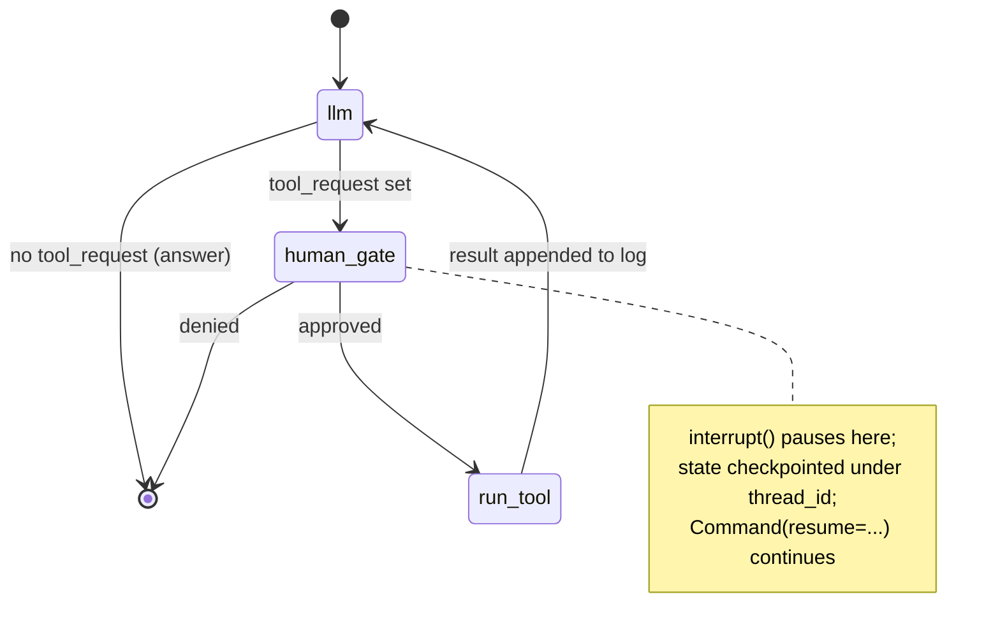

# 04 · Agents as Graphs: LangGraph, State, Checkpoints, and Human Approval

> Level: Advanced · Time: 4 hours · Prereqs: [02-intermediate/01](../02-intermediate/01-tool-calling-and-structured-output.md) (the agent loop), [02-intermediate/02](../02-intermediate/02-prompt-techniques-and-chaining.md) (chaining), Python `TypedDict`
> Tested with **langgraph 1.2.22** (langchain-core 1.8.0), Python 3.13, Nov 2026. Docs facts stamped **(as of Nov 2026)**.

---

## 1. Why this lesson exists

In 02-intermediate/01 you wrote an agent as a `for` loop: call model, run tools, repeat. That loop is the right place to start; Anthropic's "Building effective agents" even recommends starting "with LLM APIs directly" because "many patterns can be implemented in a few lines of code". But production agents need things a bare loop makes painful:

- **Pause and resume**: wait hours for a human to approve an email, survive a server restart, continue exactly where you stopped.
- **Explicit control flow**: "after the planner, go to the human gate if the plan touches money, else straight to execution".
- **Inspectable state**: see and edit what the agent knew at step 7.
- **Many conversations at once**, each with its own saved progress.

LangGraph describes itself as "a low-level orchestration framework and runtime for long-running, stateful agents", with persistence ("Checkpoint state and resume after failures or pauses"), human-in-the-loop ("Pause execution, inspect or edit state, then continue") and memory (as of Nov 2026). This lesson rebuilds our agent as a graph and adds a real human approval gate.

## 2. Intuition

A bare loop is a person working from memory. A graph is a **flowchart pinned to the wall plus a logbook**:

- **Nodes** are the boxes (call the model, run a tool, ask a human).
- **Edges** are the arrows, some conditional ("if a tool is requested → human gate").
- **State** is the logbook every box reads from and writes to.
- **Checkpointer** photocopies the logbook after every box, filed under a **thread ID** (one folder per conversation).
- **Interrupt** is a box that says "stop here, ask a human, file the logbook"; when the human answers, work resumes from the photocopy.

## 3. Precise definitions (LangGraph 1.x)

- **`StateGraph(State)`**: a graph builder whose shared state has the schema `State` (often a `TypedDict`).
- **Node**: a function `state -> partial update dict`. It returns only the keys it changes.
- **Reducer**: how an update merges into state. Default: overwrite. With `Annotated[list, operator.add]`, updates are **appended**.
- **Edge / conditional edge**: `add_edge(a, b)` always goes a→b; `add_conditional_edges(a, router, [targets])` calls `router(state)` to choose.
- **`START`, `END`**: sentinel entry and exit nodes.
- **Checkpointer**: persists state after each step (`InMemorySaver` for demos; a durable database-backed saver in production, which the docs recommend).
- **Thread ID**: `config={"configurable": {"thread_id": ...}}`; the docs call it "effectively your persistent cursor".
- **`interrupt(value)`**: "pauses graph execution and returns a value to the caller"; on resume, "the value passed to `Command(resume=...)` becomes the return value of the `interrupt` call". With `invoke()`, pending interrupts appear "under `__interrupt__`".

## 4. Step by step

### 4.1 Dumbest approach: the loop with `input()`

Put `input("approve? ")` inside the tool loop. **Walls:** the process must stay alive while the human is away (hours?); a deploy or crash loses everything; a web server cannot block a request thread on `input()`; you cannot serve two users' approvals concurrently.

### 4.2 Next: save state yourself

Serialise the messages list to a database before asking, reload it on approval, and re-enter the loop at the right place. **Walls:** "the right place" is now hand-written resumption logic; every new branch multiplies the cases; bugs appear in exactly the code paths you rarely test.

### 4.3 The graph idea

Make control flow explicit (nodes and edges) and let a runtime checkpoint state after every node. Pausing becomes "stop after this node"; resuming becomes "load the checkpoint for this thread and continue". This is the same move as going from ad-hoc callbacks to a state machine.



### 4.4 The code

The model is a deterministic stub so the graph runs offline; replace `fake_llm` with a real model call that returns a tool request (02-intermediate/01) to make it live.

```python
# lg_agent.py - a LangGraph agent loop with a tool node and a human approval gate.
# Tested with langgraph 1.2.22 (langchain-core 1.8.0), Python 3.13, Nov 2026.
# The "LLM" is a deterministic stub so the graph runs offline; swap in a real model later.
import operator                                    # operator.add concatenates lists (our reducer)
from typing import Annotated, TypedDict            # typing helpers for the state schema

from langgraph.checkpoint.memory import InMemorySaver   # keeps checkpoints in RAM (demo only)
from langgraph.graph import END, START, StateGraph      # graph builder + sentinel node names
from langgraph.types import Command, interrupt          # human-in-the-loop primitives


class State(TypedDict):
    # Annotated[list, operator.add] = "when a node returns `log`, APPEND it, don't overwrite".
    log: Annotated[list[str], operator.add]
    question: str
    tool_request: dict | None      # what the "model" wants to run next (None = done)
    answer: str | None


TOOLS = {  # the only actions this agent may take; anything else is rejected
    "lookup_port": lambda svc: {"ssh": 22, "http": 80, "https": 443}.get(svc, "unknown"),
}


def fake_llm(state: State) -> dict:
    """Stand-in for a model call: decide to call a tool once, then answer."""
    if not any(line.startswith("tool:") for line in state["log"]):          # no tool result yet
        return {"tool_request": {"name": "lookup_port", "arg": "https"},
                "log": ["llm: I should look up the port for https"]}
    result = [l for l in state["log"] if l.startswith("tool:")][-1]
    return {"tool_request": None, "answer": f"HTTPS uses port {result.split('=')[1]}",
            "log": ["llm: answering"]}


def human_gate(state: State) -> dict:
    """Pause the graph and ask a human to approve the pending tool call."""
    decision = interrupt({"approve?": state["tool_request"]})   # graph stops here, state is saved
    # On resume, the node RE-RUNS from the top and interrupt() returns the resume value.
    if decision != "yes":
        return {"tool_request": None, "answer": "Cancelled by human.", "log": ["human: denied"]}
    return {"log": ["human: approved"]}


def run_tool(state: State) -> dict:
    """Execute the approved tool and append its result to the log."""
    req = state["tool_request"]
    out = TOOLS[req["name"]](req["arg"])
    return {"tool_request": None, "log": [f"tool: {req['name']}({req['arg']})={out}"]}


def after_llm(state: State) -> str:
    """Conditional edge: route to the human gate if a tool is requested, else finish."""
    return "human_gate" if state["tool_request"] else END


def after_gate(state: State) -> str:
    """If the human cancelled, tool_request was cleared, so stop; else run the tool."""
    return "run_tool" if state["tool_request"] else END


builder = StateGraph(State)
builder.add_node("llm", fake_llm)
builder.add_node("human_gate", human_gate)
builder.add_node("run_tool", run_tool)
builder.add_edge(START, "llm")
builder.add_conditional_edges("llm", after_llm, ["human_gate", END])
builder.add_conditional_edges("human_gate", after_gate, ["run_tool", END])
builder.add_edge("run_tool", "llm")                     # the loop: tool result goes back to the model
graph = builder.compile(checkpointer=InMemorySaver())   # interrupts REQUIRE a checkpointer

cfg = {"configurable": {"thread_id": "demo-1"}}         # the thread id names the saved conversation
out = graph.invoke({"question": "Which port does HTTPS use?", "log": [],
                    "tool_request": None, "answer": None}, cfg)
print("paused with:", out["__interrupt__"][0].value)

out = graph.invoke(Command(resume="yes"), cfg)          # same thread id -> continue where we stopped
print("answer:", out["answer"])
print("log:", *out["log"], sep="\n  ")

# Second thread: a human who says no.
cfg2 = {"configurable": {"thread_id": "demo-2"}}
graph.invoke({"question": "q", "log": [], "tool_request": None, "answer": None}, cfg2)
print("denied run ->", graph.invoke(Command(resume="no"), cfg2)["answer"])
```

Output:

```text
paused with: {'approve?': {'name': 'lookup_port', 'arg': 'https'}}
answer: HTTPS uses port 443
log:
  llm: I should look up the port for https
  human: approved
  tool: lookup_port(https)=443
  llm: answering
denied run -> Cancelled by human.
```

**Line-by-line walkthrough (syntax and logic):**

- `from typing import Annotated, TypedDict`: `TypedDict` declares a dict with known keys and types; `Annotated[T, x]` attaches extra metadata `x` to a type `T`, which LangGraph reads as the reducer.
- `class State(TypedDict): log: Annotated[list[str], operator.add]`: when a node returns `{"log": ["..."]}`, LangGraph computes `old_log + new_items` (`operator.add` on lists concatenates). Other keys (`question`, `tool_request`, `answer`) use the default overwrite reducer.
- `TOOLS = {"lookup_port": lambda svc: {...}.get(svc, "unknown")}`: a dict mapping tool names to functions; the lambda looks up a port with a default. A dict of allowed tools is an **allowlist**: anything else cannot run.
- `fake_llm(state)`: `any(line.startswith("tool:") for line in state["log"])` checks whether a tool result exists yet. First visit: request a tool. Second visit: read the last tool line (`[... ][-1]`), split on `=` and answer. It returns a **partial** update dict.
- `human_gate(state)`: `decision = interrupt({"approve?": state["tool_request"]})`: the first time this runs, `interrupt` raises a special signal, the runtime saves state and returns control to the caller with the payload. On resume, the **node re-runs from the top** and `interrupt(...)` now returns the resume value. If not `"yes"`, it clears the request and sets an answer.
- `run_tool(state)`: looks up and executes the allowlisted function, appends a log line, clears `tool_request`.
- `after_llm` / `after_gate`: router functions returning the next node's name or `END`.
- `builder = StateGraph(State)`, `add_node(...)`, `add_edge(START, "llm")`, `add_conditional_edges("llm", after_llm, ["human_gate", END])`: wiring. The list declares possible targets (useful for validation and visualisation).
- `builder.add_edge("run_tool", "llm")`: **the loop**: tool results go back to the model.
- `graph = builder.compile(checkpointer=InMemorySaver())`: compile validates the graph and attaches persistence; the comment notes interrupts **require** a checkpointer.
- `cfg = {"configurable": {"thread_id": "demo-1"}}`: names this conversation's checkpoint folder.
- `out = graph.invoke({...initial state...}, cfg)`: runs until the interrupt. `out["__interrupt__"][0].value` is the payload passed to `interrupt()`.
- `graph.invoke(Command(resume="yes"), cfg)`: same thread ID, so execution continues from the checkpoint; `Command(resume=...)` is "the only `Command` pattern intended as input" to invoke/stream.
- The second thread (`demo-2`) shows isolation: a separate conversation, a "no" answer, a different ending, with no interference.
- `print("log:", *out["log"], sep="\n  ")`: `*` unpacks the list into separate print arguments, `sep` puts each on its own indented line.

### 4.5 Rules of interrupts (from the docs) and why they exist

1. **Do not wrap `interrupt()` in a bare `try/except`.** Interrupts pause "by raising a special exception"; catching everything swallows it.
2. **Code before `interrupt()` runs again on resume** ("the runtime restarts the entire node from the beginning"). So side effects before the interrupt (sending an email!) would happen twice. Put side effects in a separate node after approval, as `run_tool` does here.
3. **Keep interrupt order deterministic within a node.** Matching is "strictly index-based"; do not conditionally skip interrupts or loop over non-deterministic data.

These are the same constraints as any replay-based durable execution system: deterministic re-execution up to the pause point.

### 4.6 Loop vs graph vs higher-level agent

| Need | Bare loop | LangGraph | Higher-level agent API |
|---|---|---|---|
| Learn / prototype | Best | Overkill | Fine |
| Durable pause/resume, HITL | Hand-rolled | Built-in | Depends |
| Explicit branching | `if`s in a loop | Edges | Hidden |
| Debuggability of prompts | Full | Full (you write nodes) | Varies |

The LangGraph docs themselves recommend LangChain agents or "Deep Agents" for a higher-level loop and LangGraph "when you need explicit control over state and control flow", noting "LangGraph does not require LangChain". Anthropic's caution applies to all frameworks: abstraction layers "can obscure the underlying prompts and responses, making them harder to debug". Our graph has no hidden prompts: every node is your code.

### 4.7 Production notes

- Swap `InMemorySaver` for a durable checkpointer; in-memory state dies with the process.
- Store **thread IDs** with your domain objects (email draft ID ↔ thread ID).
- Put approval UIs on top of `__interrupt__` payloads; make payloads self-explanatory (what, why, risk).
- Cap loop iterations (a recursion/step limit) exactly as in the bare loop.
- Trace runs (LangSmith or OpenTelemetry) so you can replay what happened.

## 5. Common mistakes

1. **No checkpointer** (or a different thread ID on resume): the interrupt cannot resume.
2. **Side effects before `interrupt()`** in the same node: executed twice.
3. **Bare `except:` around `interrupt()`**: the pause never happens.
4. **Returning the whole state from nodes** and accidentally overwriting append-only fields; return partial updates.
5. **Forgetting the reducer** on a list field: each update overwrites instead of appending.
6. **InMemorySaver in production.**
7. **Using a framework before understanding the loop.** Build the bare loop once first.

## 6. Connections to other tracks

- **Compilers / DSA**: a state graph is a control-flow graph; routers are branch conditions; reducers are like SSA φ-functions merging values.
- **OS**: checkpoint/restore of process state (CRIU), replay-based recovery.
- **DBMS**: checkpoints are write-ahead persistence; thread IDs are keys; durable savers need transactions.
- **System Design**: workflow engines (Temporal-style deterministic replay), sagas, human tasks.
- **Testing/Verification**: deterministic stub nodes make graphs unit-testable.

## 7. Where this shows up in my projects

- **ARIA** (LangGraph + FastAPI human-in-the-loop email agent) is this lesson exactly: the "approve this draft" step should be an `interrupt()` in a gate node, the send should live in a *separate* node after approval (rule 2), each email thread maps to a LangGraph `thread_id`, and FastAPI endpoints call `invoke(Command(resume=...))` when the user clicks approve. Check your implementation against the three interrupt rules.
- **AURIXA** (ERP demand-spike detection + planning on LangGraph): detection → planning → (approval for large orders) → action is a natural graph; conditional edges encode "spike above threshold" routing, and the plan's structured output feeds the next node.

## 8. Self-check questions

1. Why does `interrupt()` need a checkpointer and a thread ID?
2. What does `Annotated[list[str], operator.add]` change?
3. A node calls `send_email()` and then `interrupt("confirm?")`. What goes wrong on resume?
4. How would you support 1,000 concurrent pending approvals?
5. When is a bare loop the better choice?

<details><summary>Answers</summary>

1. Pausing means persisting state somewhere (checkpointer) and resuming means finding that state again (thread ID as the key).
2. The reducer: updates to `log` are appended to the existing list instead of replacing it.
3. On resume the node restarts from the top, so `send_email()` runs a second time. Move side effects into a node after the approval.
4. One thread ID per approval, a durable checkpointer, and a stateless API that resumes the right thread when each human answers; no process waits.
5. Prototyping, learning, simple short-lived agents with no need for durable pauses or complex branching.

</details>

## 9. Mnemonic (Tamil + English)

**"Node-u Velai, Edge-u Vazhi, State-u Kanakku, Checkpoint-u Xerox, Interrupt-u Kaathiru."**
(நோடு வேலை, எட்ஜு வழி, ஸ்டேட்டு கணக்கு, செக்பாயிண்ட்டு ஜெராக்ஸ், இன்டரப்ட்டு காத்திரு)
Node = work, Edge = path, State = account book, Checkpoint = photocopy of the book, Interrupt = wait for the human.

## Sources

- LangGraph overview (as of Nov 2026): https://docs.langchain.com/oss/python/langgraph/overview
- LangGraph interrupts (as of Nov 2026): https://docs.langchain.com/oss/python/langgraph/interrupts
- LangGraph persistence: https://docs.langchain.com/oss/python/langgraph/persistence
- LangGraph source: https://github.com/langchain-ai/langgraph
- Anthropic, "Building effective agents" (Dec 19, 2024): https://www.anthropic.com/engineering/building-effective-agents
- Yao et al., "ReAct" (2022), the reasoning+acting loop that graph agents generalise: https://arxiv.org/abs/2210.03629

## Verify yourself

1. `pip install "langgraph==1.2.22"`, run `python3 lg_agent.py`, confirm the output above.
2. Add `print("gate entered")` at the top of `human_gate` and observe it printed twice for one approval (rule 2 in action; I confirmed this with langgraph 1.2.22).
3. Remove `checkpointer=InMemorySaver()` and run again. With langgraph 1.2.22 the resume fails with `RuntimeError: Cannot use Command(resume=...) without checkpointer`.
4. Use `graph.get_state(cfg)` after the first invoke to inspect the saved state and `next` node.
5. Re-read the interrupts page and check whether newer LangGraph versions changed the resume API (the docs show a `stream_events(..., version="v3")` style alongside `invoke`).
