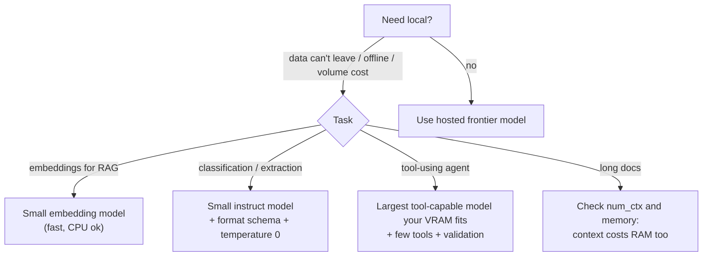

# 05 · Local Models with Ollama: Private, Cheap, and Full of Sharp Edges

> Level: Advanced · Time: 3 hours · Prereqs: [02-intermediate/01](../02-intermediate/01-tool-calling-and-structured-output.md), [03 · RAG](03-rag-and-embeddings.md), HTTP/JSON
> Ollama facts from docs.ollama.com, stamped **(as of Nov 2026)**. The client code is stdlib-only Python 3.13. **Honesty note:** the sandbox used to write this track could not download Ollama or model weights (network-restricted), so the client was tested against a scripted stub that returns the documented JSON shapes. The stub proves the client logic; it does not prove any model's behaviour.

---

## 1. Why this lesson exists

Hosted frontier models are the strongest, but sometimes you cannot or should not send data to them: proprietary code under NDA, offline environments, per-token cost at high volume, or the need to pin an exact model forever for reproducible research. Running **open-weight models locally** solves those, and Ollama is a popular way to do it: a local server with a simple HTTP API, a model library, and compatibility layers for OpenAI- and Anthropic-style clients.

Local models also behave differently in ways that silently break agents: smaller context defaults, weaker tool calling, quantisation artefacts, and different sampling defaults. This lesson covers the API you will actually program against and the pitfalls that matter.

## 2. Intuition

A hosted model is a restaurant: excellent food, you pay per plate, and your order (data) leaves your house. A local model is cooking at home: total privacy, near-zero marginal cost, but your kitchen (GPU/RAM) limits what you can make, and you are responsible for the recipe settings (context length, temperature) that the restaurant used to handle.

**Quantisation** is the key trick that makes home cooking possible: storing model weights in fewer bits (e.g. 4-bit instead of 16-bit) so a model fits in consumer memory, at some quality cost. Think JPEG compression for weights.

## 3. Precise definitions (as of Nov 2026)

- **Ollama server**: listens on `127.0.0.1:11434` by default ("Change the bind address with the `OLLAMA_HOST` environment variable").
- **Native API** base: `http://localhost:11434/api` (e.g. `/api/chat`, `/api/embed`). **OpenAI compatibility**: `http://localhost:11434/v1`. **Anthropic compatibility**: base `http://localhost:11434` (the Anthropic client "appends `/v1/messages`").
- **`/api/chat` request fields**: `model`, `messages`, `tools`, `format` ("`json` or a JSON schema"), `options` (runtime options such as `temperature`, `seed`, `top_k`, `top_p`, `num_ctx`, `num_predict`), `stream` (**default `true`**), `keep_alive`, `think`.
- **Tool calls**: response `message.tool_calls[].function.{name, arguments}` with `arguments` a JSON object; results go back as `{"role": "tool", "tool_name": ..., "content": ...}` (tool-calling page example).
- **Embeddings**: `POST /api/embed` with `model` and `input` (string or array); vectors are returned under `embeddings` and are "L2‑normalized (unit‑length)".
- **Context length**: the FAQ says "By default, Ollama uses a context window size of 4096 tokens", overridable with `OLLAMA_CONTEXT_LENGTH`, `/set parameter num_ctx` or `num_ctx` in requests. (The Modelfile reference lists a `num_ctx` default of 2048. The two pages disagree; check your version with `ollama show`.)
- **`keep_alive`**: "By default models are kept in memory for 5 minutes before being unloaded."
- **Modelfile**: a recipe for a derived model with instructions such as `FROM`, `PARAMETER`, `TEMPLATE`, `SYSTEM`, `MESSAGE`, `LICENSE`; built with `ollama create <name> -f ./Modelfile`. Documented parameter defaults include `temperature` 0.8, `top_k` 40, `top_p` 0.9.
- **`ollama ps`**: lists loaded models; the Processor column shows "100% GPU", "100% CPU" or a split.

## 4. Step by step

### 4.1 Getting a model running (commands per the docs)

```bash
# Not run in the sandbox (no network to ollama.com). Commands as documented.
ollama pull qwen3            # download a model (pick one whose library page lists "tools" if you need tool calling)
ollama run qwen3 "Explain TCP slow start in two sentences."
ollama ps                    # is it on GPU or CPU?
```

### 4.2 Dumbest approach: treat it exactly like a hosted model

Point your agent at it with no other changes. Typical walls, in the order people hit them:

1. **Streaming surprise.** `/api/chat` streams by default; code that expects one JSON object gets a sequence of lines. Set `"stream": false` or handle NDJSON.
2. **Silent truncation.** Your 20K-token RAG prompt goes to a model running with a 4096-token (or 2048) context; the beginning is lost and answers degrade with no error. Set `num_ctx` explicitly and size your prompts.
3. **Sampling defaults.** Default temperature 0.8 makes extraction and tool arguments flaky; set `temperature` low for structured tasks (the structured-outputs docs suggest 0).
4. **Weaker tool calling.** Small models call the wrong tool, invent arguments, or answer without calling. Fewer, simpler tools; validate arguments; cap the loop.
5. **Cold starts.** First request after 5 idle minutes reloads the model (`keep_alive`).
6. **Memory spill.** If the model does not fit in VRAM it runs partly on CPU (`ollama ps` shows a split) and slows dramatically.

### 4.3 Fixes as code: tools + structured output + embeddings

```python
# ollama_agent.py - tool-calling loop + structured output against Ollama's native /api/chat.
# Stdlib only (urllib). Request/response shapes follow docs.ollama.com (Nov 2026).
# With a real Ollama running:  OLLAMA_URL=http://localhost:11434 python ollama_agent.py
# Without one, it starts fake_ollama.py (a scripted stub with the same JSON shapes).
import json                     # encode/decode bodies
import os                       # read OLLAMA_URL
import urllib.request           # minimal HTTP client from the standard library

MODEL = os.environ.get("OLLAMA_MODEL", "qwen3")   # any local model whose card lists "tools"


def post(base: str, path: str, body: dict) -> dict:
    req = urllib.request.Request(base + path, data=json.dumps(body).encode(),
                                 headers={"Content-Type": "application/json"})
    with urllib.request.urlopen(req, timeout=120) as r:
        return json.loads(r.read())


def get_temperature(city: str) -> str:
    return {"chennai": "33C", "coimbatore": "29C"}.get(city.lower(), "unknown city")


TOOLS = [{"type": "function", "function": {
    "name": "get_temperature",
    "description": "Current temperature for a city. Use for any weather/temperature question.",
    "parameters": {"type": "object", "properties": {"city": {"type": "string"}},
                   "required": ["city"]}}}]


def chat_with_tools(base: str, question: str) -> str:
    messages = [{"role": "user", "content": question}]
    for _ in range(5):                                         # hard cap on loop turns
        resp = post(base, "/api/chat", {"model": MODEL, "messages": messages,
                                         "tools": TOOLS, "stream": False})   # stream defaults to true
        msg = resp["message"]
        messages.append(msg)                                   # keep the assistant turn (with tool_calls)
        if not msg.get("tool_calls"):
            return msg["content"]
        for call in msg["tool_calls"]:
            fn = call["function"]
            result = get_temperature(**fn["arguments"])        # arguments arrive as a dict
            messages.append({"role": "tool", "tool_name": fn["name"], "content": result})
    return "turn limit reached"


def structured(base: str, text: str) -> dict:
    schema = {"type": "object", "properties": {"city": {"type": "string"},
              "temp_c": {"type": "integer"}}, "required": ["city", "temp_c"]}
    resp = post(base, "/api/chat", {"model": MODEL, "stream": False, "format": schema,
                                     "options": {"temperature": 0},     # docs suggest 0 here
                                     "messages": [{"role": "user",
                                                   "content": f"Extract as JSON {json.dumps(schema)}: {text}"}]})
    return json.loads(resp["message"]["content"])              # content is a JSON string


if __name__ == "__main__":
    base = os.environ.get("OLLAMA_URL")
    if not base:
        import fake_ollama
        base = fake_ollama.start()
        print("(using scripted stub at", base + ")")
    print("tools      ->", chat_with_tools(base, "How hot is it in Chennai?"))
    print("structured ->", structured(base, "It is 29 degrees in Coimbatore today."))
    emb = post(base, "/api/embed", {"model": "embeddinggemma", "input": ["hello", "world"]})
    v = emb["embeddings"][0]
    print("embed      ->", len(emb["embeddings"]), "vectors; |v| =", round(sum(x * x for x in v) ** 0.5, 3))
```

The stub server used for offline testing (documented shapes, no model):

```python
# fake_ollama.py - scripted stub of three Ollama endpoints, for OFFLINE testing of client code.
# Shapes follow docs.ollama.com (Nov 2026). It does not run any model.
import json, math, threading                                   # stdlib only
from http.server import BaseHTTPRequestHandler, HTTPServer


def reply(path: str, body: dict) -> dict:
    if path == "/api/embed":                                   # unit-length vectors, one per input
        return {"model": body["model"], "embeddings": [[1 / math.sqrt(4)] * 4 for _ in body["input"]]}
    msgs = body["messages"]
    if "format" in body:                                       # structured output request
        return {"message": {"role": "assistant", "content": '{"city": "Coimbatore", "temp_c": 29}'},
                "done": True}
    if msgs[-1]["role"] == "tool":                             # second turn: answer from tool result
        return {"message": {"role": "assistant",
                            "content": f"It is {msgs[-1]['content']} in Chennai right now."}, "done": True}
    return {"message": {"role": "assistant", "content": "",     # first turn: request the tool
                        "tool_calls": [{"function": {"name": "get_temperature",
                                                     "arguments": {"city": "Chennai"}}}]}, "done": True}


class H(BaseHTTPRequestHandler):
    def do_POST(self):
        body = json.loads(self.rfile.read(int(self.headers["Content-Length"])))
        out = json.dumps(reply(self.path, body)).encode()
        self.send_response(200); self.send_header("Content-Type", "application/json")
        self.send_header("Content-Length", str(len(out))); self.end_headers(); self.wfile.write(out)

    def log_message(self, *a):
        pass


def start() -> str:
    s = HTTPServer(("127.0.0.1", 0), H)
    threading.Thread(target=s.serve_forever, daemon=True).start()
    return f"http://127.0.0.1:{s.server_address[1]}"
```

Output (against the stub):

```text
(using scripted stub at http://127.0.0.1:<port>)
tools      -> It is 33C in Chennai right now.
structured -> {'city': 'Coimbatore', 'temp_c': 29}
embed      -> 2 vectors; |v| = 1.0
```

**Line-by-line walkthrough of `ollama_agent.py` (syntax and logic):**

- `import urllib.request`: the standard-library HTTP client, so there are no dependencies. `urllib.request.Request(url, data=bytes, headers=...)` with `data` set makes it a POST.
- `MODEL = os.environ.get("OLLAMA_MODEL", "qwen3")`: configurable model name; the comment reminds you to pick a tool-capable model.
- `def post(base, path, body) -> dict:` encodes the body with `json.dumps(...).encode()` (str → bytes), sends it, and parses the reply. `with urllib.request.urlopen(req, timeout=120) as r:` is a context manager that closes the connection; local models can be slow, hence a generous timeout.
- `TOOLS = [{"type": "function", "function": {...}}]`: Ollama's tool format (OpenAI-style wrapper) with `parameters` as JSON Schema; compare with Anthropic's `input_schema`.
- `chat_with_tools`: the same bounded loop as 02-intermediate/01. Differences: `"stream": False` is set explicitly; the assistant `msg` (containing `tool_calls`) is appended as-is; `msg.get("tool_calls")` is falsy when absent or empty; `get_temperature(**fn["arguments"])` uses `**` to unpack the arguments dict into keyword arguments (so `{"city": "Chennai"}` becomes `city="Chennai"`); results go back with `role: "tool"`.
- `structured`: `format` carries a JSON Schema (constrained output); `"options": {"temperature": 0}` per the docs' recommendation; the schema is also pasted into the prompt, which the docs say is "ideal ... to ground the model's response". `json.loads(resp["message"]["content"])` because the content is a JSON *string*. Still validate it in real code (02-intermediate/01).
- The embed call sends a list of two strings and checks the first vector's length: `sum(x * x for x in v) ** 0.5` is the Euclidean norm, which should be 1.0 for L2-normalised vectors.
- `if not base: import fake_ollama ...`: an import inside a function body runs only when needed; with `OLLAMA_URL` set, the stub is never imported.

### 4.4 A Modelfile for a reproducible project model

```text
FROM qwen3
PARAMETER num_ctx 16384
PARAMETER temperature 0.2
SYSTEM You are a code reviewer. Report bugs as a numbered list of names, then one line each.
```

`ollama create reviewer -f ./Modelfile` then `ollama run reviewer`. Baking `num_ctx` and `temperature` into a named model means every client gets the same settings: fewer "works on my machine" surprises across your team and CI.

### 4.5 Using familiar clients against local models

- **OpenAI-style clients**: point the base URL at `http://localhost:11434/v1`.
- **Anthropic-style clients and Claude Code**: Ollama's Anthropic-compatibility page documents `export ANTHROPIC_BASE_URL=http://localhost:11434` and `export ANTHROPIC_AUTH_TOKEN=ollama  # required but ignored`. It supports a subset of the Messages API (messages, streaming, system prompts, vision, tools, tool results, thinking); unsupported items include `tool_choice`, the token-counting endpoint, prompt caching (`cache_control`), batches and citations, and `budget_tokens` "is accepted but not enforced".

Practical warning: Claude Code's prompts, tools and context management are designed around frontier models with very large windows; a small local model with a 4K–16K window will struggle with agentic coding even if the API shape is compatible. Compatibility of the *protocol* says nothing about *capability*.

### 4.6 Choosing a local model (decision guide)



## 5. Common mistakes

1. **Not setting `stream: false`** when your code expects one JSON object.
2. **Assuming a large context.** Set `num_ctx`; measure prompt tokens.
3. **Leaving temperature at 0.8** for structured tasks.
4. **Picking a model without tool support** for an agent.
5. **Mixing embedding models** between indexing and querying.
6. **Exposing Ollama on `0.0.0.0`** without auth: anyone on the network can use (or abuse) it. Keep the default localhost bind or put it behind an authenticating proxy.
7. **Believing compatibility layers make a small model a drop-in for a frontier one.**
8. **Benchmarking on CPU spill** and concluding the model is slow; check `ollama ps`.

## 6. Connections to other tracks

- **Computer Architecture / Parallel-CUDA**: inference is memory-bandwidth bound; quantisation trades precision for bandwidth and capacity; VRAM vs system RAM explains the CPU/GPU split.
- **Math for CS**: quantisation is lossy number representation, the same story as floating point from the C track.
- **Networks / Security**: binding to localhost vs all interfaces; auth proxies.
- **Cloud/DevOps**: running a local model server in a container with GPU passthrough for CI.
- **Research skills**: pinning model + Modelfile parameters makes experiments reproducible.

## 7. Where this shows up in my projects

- **QiskitSage** runs its multi-agent review on local Ollama. The checklist from this lesson applies directly: set `num_ctx` large enough for the diff plus context (or chunk the diff), use `stream: false` or proper NDJSON handling, keep temperature low for structured findings, validate every agent's JSON against a schema, and record the exact model tag and Modelfile parameters alongside results so reviews are reproducible.

## 8. Self-check questions

1. Your RAG answers from a local model ignore the first half of the retrieved context. What is the most likely cause?
2. Why did the client set `stream: false`?
3. What two environment variables let an Anthropic-style client talk to Ollama, and what is one unsupported feature?
4. Why bake `num_ctx` into a Modelfile?
5. The structured-output response's `content` is a string. What do you still need to do?

<details><summary>Answers</summary>

1. The context window (`num_ctx`) is smaller than the prompt, so tokens are dropped; set `num_ctx` explicitly and size the prompt.
2. `/api/chat` streams by default (NDJSON chunks); the simple client expects one JSON object.
3. `ANTHROPIC_BASE_URL=http://localhost:11434` and `ANTHROPIC_AUTH_TOKEN=ollama`. Unsupported: `tool_choice`, token counting, prompt caching, batches, citations (any one).
4. So every client and teammate gets the same context length (and other parameters) without remembering to pass options; reproducibility.
5. Parse it (`json.loads`) and validate it against the schema/business rules before use.

</details>

## 9. Mnemonic (Tamil + English)

**"Stream-a Niruthu, Context-a Koottu, Temperature-a Kurai, Tools-a Sari Paaru."**
(ஸ்ட்ரீம்-அ நிறுத்து, கான்டெக்ஸ்ட்-அ கூட்டு, டெம்பரேச்சர்-அ குறை, டூல்ஸ்-அ சரி பாரு)
Stop streaming (`stream: false`), increase context (`num_ctx`), lower temperature, check tool support.

## Sources

- Ollama API introduction (as of Nov 2026): https://docs.ollama.com/api/introduction
- Ollama `/api/chat` reference (as of Nov 2026): https://docs.ollama.com/api/chat
- Ollama tool calling (as of Nov 2026): https://docs.ollama.com/capabilities/tool-calling
- Ollama structured outputs (as of Nov 2026): https://docs.ollama.com/capabilities/structured-outputs
- Ollama embeddings (as of Nov 2026): https://docs.ollama.com/capabilities/embeddings
- Ollama Anthropic compatibility (as of Nov 2026): https://docs.ollama.com/api/anthropic-compatibility
- Ollama Modelfile reference (as of Nov 2026): https://docs.ollama.com/modelfile
- Ollama FAQ (context length, keep_alive, OLLAMA_HOST, ollama ps) (as of Nov 2026): https://docs.ollama.com/faq
- Ollama source: https://github.com/ollama/ollama

## Verify yourself

1. Run `python3 ollama_agent.py` with no Ollama: it uses the stub and prints the output above.
2. With Ollama installed: `ollama pull qwen3 && OLLAMA_URL=http://localhost:11434 python3 ollama_agent.py`. Compare the real model's behaviour with the stub; note any failed tool calls.
3. Send a 10,000-token prompt with and without `"options": {"num_ctx": 16384}` and compare answers to a question about its first paragraph.
4. Check `ollama show qwen3` for the actual context length and resolve the 2048-vs-4096 doc inconsistency for your version.
5. Run `ollama ps` during a request and record the Processor column.
