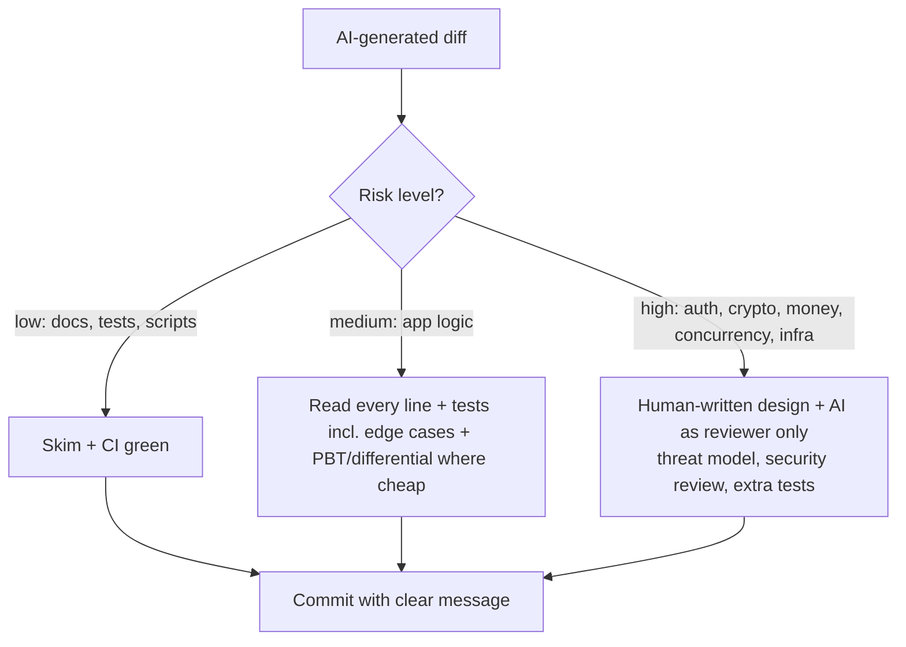

# 02 · AI-Assisted Engineering Discipline: Reviewing and Testing Code You Did Not Write

> Level: Pro · Time: 4 hours · Prereqs: [01 · Evals](01-evals-for-prompts-and-agents.md), pytest basics, git
> Tested with hypothesis 6.170.15 and pytest on Python 3.13 (Nov 2026). Research numbers quoted from the papers' abstracts.

---

## 1. Why this lesson exists

An agent can produce a 400-line diff in a minute. Reviewing it properly can take longer than writing it would have. That asymmetry is the central engineering problem of AI-assisted development: **generation got cheap; verification did not.** The failure modes are specific and documented:

- **Plausible but wrong code.** It compiles, passes the one example in the docstring, and fails on edge cases.
- **Security weaknesses.** Pearce et al. ("Asleep at the Keyboard?", IEEE S&P 2022) generated 1,689 programs across 89 security-relevant scenarios with GitHub Copilot and "found approximately 40% to be vulnerable".
- **Hallucinated dependencies.** Spracklen et al. (USENIX Security 2025) analysed 576,000 code samples from 16 LLMs: "the average percentage of hallucinated packages is at least 5.2% for commercial models and 21.7% for open-source models", with "205,474 unique examples of hallucinated package names". An attacker can register those names ("slopsquatting").
- **Perceived vs actual productivity.** METR's 2025 RCT: experienced developers were 19% slower with AI allowed, while believing they were 20% faster.

None of this means "don't use AI". It means you need a **discipline** whose cost scales with risk, and that uses the machine to check the machine.

## 2. Intuition

Treat AI output like a pull request from a brilliant, fast, overconfident new hire who has never seen your production incidents. You would not merge their PR on vibes; you would read it with specific questions, and you would trust the **tests** more than the author's description. The best reviewers do not read harder; they make the computer do the checking (types, tests, fuzzing, static analysis), and spend human attention on intent, design and risk.

## 3. Precise definitions

- **Oracle**: anything that decides whether an output is correct (expected values, a reference implementation, a property).
- **Example-based test**: a fixed input with a fixed expected output.
- **Property-based testing (PBT)**: state a property that must hold for *all* inputs ("output is sorted", "input is not mutated"); a library generates many inputs and **shrinks** failures to a minimal counterexample. Hypothesis is the standard Python library; QuickCheck (Claessen & Hughes, 2000) is the origin.
- **Differential testing**: run two implementations on the same inputs and flag disagreements; the oracle is "they should agree" (McKeeman, 1998, introduced the term for compiler testing).
- **Test oracle problem**: for complex code, knowing the right answer is hard; differential testing and properties sidestep it.
- **Slopsquatting**: registering package names that models hallucinate, so that "pip install" of a suggested name installs malware.

## 4. Step by step

### 4.1 Dumbest approach: run it once, it works, merge

The assistant's demo passes. Walls: AI code is optimised to *look* right on the visible example; bugs hide in edge cases (empty input, boundaries, aliasing), which a single run never exercises.

### 4.2 Next: ask the AI to write tests too

Walls: the same model shares the same blind spots; it writes tests that confirm the code it wrote (including its bugs) or tests that assert the current (wrong) behaviour. AI-written tests are fine as a draft, but **the oracle must come from somewhere independent**: the spec, a reference implementation, or a property.

### 4.3 Next: independent oracles that scale

Let us test a realistic assistant output, an interval merger. It looks clean and passes its own docstring example. We test it three ways: the docstring example, a **differential test** against a dumb-but-obviously-correct reference, and a **property** (no mutation of input).

```python
# test_ai_code.py - checking "AI-written" code with property-based and differential tests.
# Needs hypothesis + pytest (tested hypothesis 6.170.15). Run: python -m pytest -q test_ai_code.py
from hypothesis import given, strategies as st   # generate many random inputs automatically


def merge_intervals_ai(intervals: list[list[int]]) -> list[list[int]]:
    """Plausible-looking assistant output. It passes the 'happy path' example in its docstring:
    [[1,3],[2,6],[8,10]] -> [[1,6],[8,10]]."""
    intervals.sort()                                   # BUG 1: mutates the caller's list
    out = [intervals[0]]                               # BUG 2: IndexError on []
    for s, e in intervals[1:]:
        if s < out[-1][1]:                             # BUG 3: touching intervals [1,2],[2,3] not merged
            out[-1][1] = e                             # BUG 4: should be max(), [1,10],[2,3] shrinks
        else:
            out.append([s, e])
    return out


def merge_reference(intervals: list[list[int]]) -> list[list[int]]:
    """Dumb, obviously-correct oracle: mark every covered half-step on a number line."""
    covered = set()
    for s, e in intervals:
        covered.update(x / 2 for x in range(2 * s, 2 * e + 1))   # include half-points so [1,2],[2,3] join
    out, pts = [], sorted(covered)
    for p in pts:
        if out and p - out[-1][1] <= 0.5:
            out[-1][1] = p
        else:
            out.append([p, p])
    return [[int(a), int(b)] for a, b in out]


def test_docstring_example():                          # the only test the assistant wrote: passes
    assert merge_intervals_ai([[1, 3], [2, 6], [8, 10]]) == [[1, 6], [8, 10]]


interval = st.tuples(st.integers(0, 20), st.integers(0, 5)).map(lambda t: [t[0], t[0] + t[1]])


@given(st.lists(interval, max_size=6))
def test_differential_against_oracle(xs):             # same inputs, two implementations, must agree
    assert merge_intervals_ai([list(x) for x in xs]) == merge_reference(xs)


@given(st.lists(interval, min_size=1, max_size=6))
def test_does_not_mutate_input(xs):                    # property: caller's data is untouched
    before = [list(x) for x in xs]
    merge_intervals_ai(xs)
    assert xs == before
```

Result:

```text
FAILED test_ai_code.py::test_differential_against_oracle - ExceptionGroup: Hy...
FAILED test_ai_code.py::test_does_not_mutate_input - assert [[0, 0], [0, 1]] ...
2 failed, 1 passed in 0.26s
```

Hypothesis's shrunk counterexamples (from the full run):

```text
assert [[0, 0], [0, 0]] == [[0, 0]]          # xs=[[0, 0], [0, 0]]: touching/duplicate intervals not merged (bug 3)
xs=[]                                         # IndexError on empty input (bug 2)
assert [[0, 0], [0, 1]] == [[0, 1], [0, 0]]  # test_does_not_mutate_input: caller's list was sorted in place (bug 1)
```

And bug 4, checked directly: `merge_intervals_ai([[1, 10], [2, 3]])` returns `[[1, 3]]`, shrinking a containing interval.

**Line-by-line walkthrough (syntax and logic):**

- `from hypothesis import given, strategies as st`: `given` is a decorator that runs a test many times with generated arguments; `st` holds input generators.
- `merge_intervals_ai`: `intervals.sort()` sorts **in place**, mutating the caller's list (bug 1). `out = [intervals[0]]` crashes on `[]` (bug 2). `if s < out[-1][1]` uses `<` so `[1,2],[2,3]` are not merged (bug 3; whether touching intervals merge is a spec decision, and our oracle says they do). `out[-1][1] = e` overwrites the end instead of taking `max`, so a contained interval shrinks the container (bug 4). `out[-1]` is the last element (negative indexing).
- `merge_reference`: deliberately dumb. It marks every half-step point covered by any interval in a `set` (`x / 2 for x in range(2 * s, 2 * e + 1)` enumerates s, s+0.5, ..., e so touching intervals share a point), then sweeps the sorted points and groups consecutive ones (gap ≤ 0.5). Slow and obviously correct for small integers: a perfect oracle.
- `interval = st.tuples(st.integers(0, 20), st.integers(0, 5)).map(lambda t: [t[0], t[0] + t[1]])`: generate (start, length) and map to `[start, start+length]`, guaranteeing start ≤ end.
- `@given(st.lists(interval, max_size=6))`: each run gets a list of up to 6 intervals; Hypothesis tries many, including edge cases like `[]`, and shrinks failures.
- `merge_intervals_ai([list(x) for x in xs])` passes a **copy** so the differential test is not confused by mutation; mutation is tested separately in `test_does_not_mutate_input`, which snapshots `before` and compares after the call.

### 4.4 The fix, held to the same standard

```python
# test_ai_code_fixed.py - the repaired function must pass the SAME property and differential tests.
from hypothesis import given, strategies as st
from test_ai_code import merge_reference, interval      # reuse the oracle and input generator


def merge_intervals(intervals: list[list[int]]) -> list[list[int]]:
    out: list[list[int]] = []
    for s, e in sorted(intervals):            # sorted() returns a NEW list: no mutation (fixes 1)
        if out and s <= out[-1][1]:           # <= merges touching intervals (fixes 3); empty input is fine (fixes 2)
            out[-1][1] = max(out[-1][1], e)   # max() never shrinks an interval (fixes 4)
        else:
            out.append([s, e])
    return out


@given(st.lists(interval, max_size=6))
def test_fixed_matches_oracle(xs):
    assert merge_intervals([list(x) for x in xs]) == merge_reference(xs)


@given(st.lists(interval, max_size=6))
def test_fixed_does_not_mutate(xs):
    before = [list(x) for x in xs]
    merge_intervals(xs)
    assert xs == before


def test_containment_case():                  # bug 4's witness, pinned as a regression test
    assert merge_intervals([[1, 10], [2, 3]]) == [[1, 10]]
```

```text
3 passed in 0.28s
```

Walkthrough: `sorted(intervals)` returns a **new** list (fixes 1); iterating an empty list simply produces `[]` (fixes 2); `s <= out[-1][1]` merges touching intervals (fixes 3); `max(out[-1][1], e)` never shrinks (fixes 4). `test_containment_case` pins bug 4's witness as a permanent regression test: every bug you find should leave a test behind.

### 4.5 A review checklist that scales with risk



For every medium/high-risk AI diff, ask:

1. **Intent**: does it solve the actual problem, or a nearby easier one? (Agents sometimes "fix" a failing test by weakening it; Anthropic's best-practices page includes the instruction "Do not hard-code values or create solutions that only work for specific test inputs", and "It is unacceptable to remove or edit tests".)
2. **Dependencies**: does every new import exist, is it the package you think it is, and is it pinned? Check the registry and your lockfile; never `pip install` a name only because a model suggested it.
3. **Inputs and boundaries**: empty, one, max, negative, unicode, None, concurrent calls.
4. **Aliasing and side effects**: in-place mutation, global state, shared mutable defaults.
5. **Errors**: are exceptions swallowed? Are error messages leaking secrets?
6. **Security**: injection (SQL, shell, path traversal), authz checks, secrets in code or logs, unsafe deserialisation. The Pearce et al. ~40% figure is your prior.
7. **Tests**: are there independent oracles (spec values, properties, reference implementations), or only tests the same model wrote to match its code?
8. **Diff hygiene**: unrelated changes, reformatting noise, deleted comments, "while I was here" refactors. Small diffs get better reviews.

### 4.6 Process habits that work

- **Tests first (or at least oracles first).** Write or approve the acceptance tests, then let the agent implement until they pass. The tests are your spec; the agent cannot quietly redefine "done".
- **Small slices.** One concern per diff; commit frequently so you can bisect and revert.
- **Make the computer review first.** Type checker, linters, tests, security scanners and dependency checks in CI or as hooks (03-advanced/01) before human eyes.
- **AI as reviewer, not only author.** A second model or a reviewer subagent with a security rubric catches different things; still not a substitute for an independent oracle.
- **Measure your own productivity** occasionally (time a few comparable tasks with and without the agent). The METR result says your intuition is not enough.
- **Own the code.** If you cannot explain a line in a code review or an interview, you do not own it yet.

## 5. Common mistakes

1. **Merging because the demo worked.**
2. **AI-written tests as the only oracle.** Shared blind spots.
3. **Installing suggested packages without checking they exist and are the right ones.**
4. **Huge AI diffs** that no one can review well.
5. **Letting agents edit or delete failing tests** to get green.
6. **Treating AI review as review.** It is an extra signal.
7. **Skipping threat modelling for "small" auth or payment changes.**
8. **Not leaving regression tests behind** after finding bugs.

## 6. Connections to other tracks

- **Testing/Verification**: PBT, differential testing, oracles, shrinking, mutation testing. This lesson is that track applied to AI output.
- **Compilers**: differential testing originated in compiler testing (McKeeman, 1998) and powers tools like Csmith; Hypothesis's shrinking is cousin to delta debugging (Zeller's ddmin).
- **Security**: injection classes, supply-chain attacks (typosquatting → slopsquatting), secure code review.
- **Git**: small commits, bisect, revert; reviewing diffs.
- **DSA**: interval merging is a classic; the oracle trick (brute force as reference for the optimised version) is the standard way to stress-test DSA solutions.

## 7. Where this shows up in my projects

- **compiler-fuzz** is literally this lesson's technique at scale: a random program generator (like Hypothesis's strategies), a differential oracle (GCC vs Clang across optimisation levels), and a ddmin reducer (like Hypothesis's shrinking) to produce minimal counterexamples. The same mindset applies to reviewing AI-generated code: generate inputs, compare against an independent implementation, shrink failures.
- **aws-waste-scanner**'s hallucination guard on its AI summary is the runtime version of this discipline: never let model output (numbers, resource IDs) through without checking it against ground truth the code already has.

## 8. Self-check questions

1. Why is "ask the same model to write tests" weak as verification?
2. What makes `merge_reference` a good oracle even though it is slow?
3. Which of the four bugs would the docstring example never catch, and why?
4. What is slopsquatting, and what evidence suggests it is a real risk?
5. Describe a review process whose cost scales with risk.

<details><summary>Answers</summary>

1. The tests share the model's assumptions and blind spots; they tend to confirm the implementation (including its bugs) rather than an independent specification.
2. It is simple enough to be obviously correct by inspection, and independent of the implementation under test, so disagreements reveal bugs.
3. All four: the example has no empty input, no touching intervals, no containment, and does not check mutation. Plausible code optimised to the visible example.
4. Registering package names that LLMs hallucinate so developers install malware. Spracklen et al. found at least 5.2% (commercial) and 21.7% (open-source) of generated packages were hallucinated, with 205,474 unique names across 576,000 samples.
5. Low risk: skim + CI. Medium: line-by-line read, edge-case tests, PBT/differential where cheap. High (auth, crypto, money, concurrency, infra): human-led design and threat model, AI as reviewer only, extra security review and tests.

</details>

## 9. Mnemonic (Tamil + English)

**"Demo jeyichaa podhaadhu; Oracle sonnaa thaan nambu."**
(டெமோ ஜெயிச்சா போதாது; ஆரக்கிள் சொன்னா தான் நம்பு: a passing demo is not enough; trust it only when an independent oracle says so.)

Review checklist, **"I-D-I-A-E-S-T-D": "Idli Dosa Idiyappam Appam, Ellam Saapittu Thoongu Da."** Intent, Dependencies, Inputs, Aliasing, Errors, Security, Tests, Diff hygiene.

## Sources

- Pearce et al., "Asleep at the Keyboard? Assessing the Security of GitHub Copilot's Code Contributions" (IEEE S&P 2022): https://arxiv.org/abs/2108.09293
- Spracklen et al., "We Have a Package for You! A Comprehensive Analysis of Package Hallucinations by Code Generating LLMs" (USENIX Security 2025): https://arxiv.org/abs/2406.10279
- Becker et al. (METR), "Measuring the Impact of Early-2025 AI on Experienced Open-Source Developer Productivity" (2025): https://arxiv.org/abs/2507.09089
- Hypothesis documentation: https://hypothesis.readthedocs.io/
- Claessen & Hughes, "QuickCheck: A Lightweight Tool for Random Testing of Haskell Programs" (ICFP 2000): https://dl.acm.org/doi/10.1145/351240.351266
- McKeeman, "Differential Testing for Software", *Digital Technical Journal* 10(1), 1998 (journal article; no stable official URL verified, search the title)
- Zeller & Hildebrandt, "Simplifying and Isolating Failure-Inducing Input" (IEEE TSE 2002): https://doi.org/10.1109/32.988498
- Anthropic, Prompting best practices (hard-coding and test-editing guidance) (as of Nov 2026): https://platform.claude.com/docs/en/build-with-claude/prompt-engineering/claude-prompting-best-practices

## Verify yourself

1. `pip install hypothesis pytest`, save both test files, run `python -m pytest -q test_ai_code.py` (expect 2 failed, 1 passed) and `python -m pytest -q test_ai_code_fixed.py` (expect 3 passed).
2. Fix only bug 1 in `merge_intervals_ai` and re-run: which test still fails, with what shrunk input?
3. Take the last AI-generated function you accepted in any project and write one property and one reference-implementation test for it.
4. For a dependency an assistant suggested recently, verify on PyPI or npm that the package exists, who publishes it, and when it was created.
5. Read the results section of Pearce et al. to see which CWE categories were most often vulnerable.
