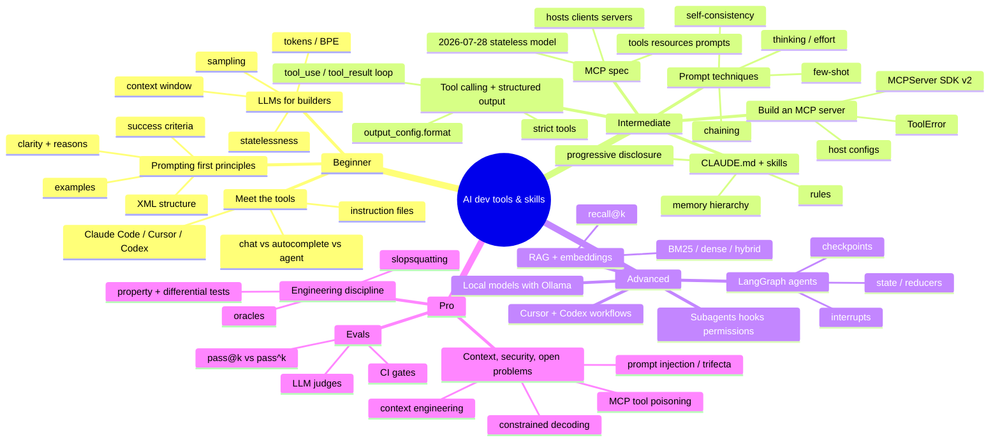

# AI Developer Tools & Skills

> A complete learning track, from "what is a token?" to designing secure, evaluated agent systems.
> Every tool-specific fact is checked against official documentation and stamped **(as of Nov 2026)**. This field changes monthly: each lesson ends with **Sources** and a **Verify yourself** section so you can re-check anything before relying on it.
> Every code example was run before publishing (Python 3.13; MCP Python SDK 2.3.0; langgraph 1.2.22; anthropic SDK 2.8.0; numpy 2.5.4; hypothesis 6.170.15). Examples that need an API key or a local Ollama install are clearly marked and were tested offline against stubs that return the documented response shapes.

---

## What this track is for

AI coding tools went from autocomplete to autonomous agents in about three years. Using them well is now a core engineering skill, and building with them (tool calling, MCP servers, agents, retrieval, evals) is a job description in its own right. This track teaches both, with one guiding principle: **understand the mechanism, then the product**. Products change every month; tokens, context windows, tool-calling protocols, retrieval metrics and threat models do not.

By the end you will be able to:

- explain what an LLM is doing mechanically, and predict its failure modes;
- write prompts and prompt pipelines whose quality you can measure;
- implement the tool-use loop and structured outputs against real SDKs;
- read the MCP specification and build, test and ship an MCP server;
- configure Claude Code (CLAUDE.md, skills, subagents, hooks, permissions), Cursor and Codex, and keep one repo portable across all three;
- build RAG with measured retrieval, LangGraph agents with human approval, and local-model pipelines with Ollama;
- build eval suites (pass@k, pass^k, confidence intervals), review and test AI-written code, and threat-model agents against prompt injection.

## Prerequisites

- Comfortable programming in at least one language (this track's code is Python; every Python block is explained line by line, syntax and logic, so basic Python is enough).
- Terminal and git basics.
- High-school probability (for sampling and eval metrics) and vectors/dot products (for embeddings).
- No prior ML knowledge is assumed.

Related tracks in this knowledge base that pair well (refer to them by name; each is its own repository): **Python**, **Git**, **Linux**, **OS**, **Networks**, **Security**, **Testing/Verification**, **ML/LLM agents**, **System Design**, **Compilers**, **Math for CS**.

## Roadmap

## Lessons and time estimates

| # | Lesson | Level | Time |
|---|---|---|---|
| 1 | [What an LLM actually is (for builders)](01-beginner/01-llms-for-builders.md) | Beginner | 2–3 h |
| 2 | [Prompting from first principles](01-beginner/02-prompting-first-principles.md) | Beginner | 2 h |
| 3 | [Meet your AI coding tools](01-beginner/03-meet-your-ai-coding-tools.md) | Beginner | 2 h |
| 4 | [Tool calling and structured output](02-intermediate/01-tool-calling-and-structured-output.md) | Intermediate | 3–4 h |
| 5 | [Prompt techniques: examples, reasoning, chaining, voting](02-intermediate/02-prompt-techniques-and-chaining.md) | Intermediate | 3 h |
| 6 | [MCP: why it exists and what the spec says](02-intermediate/03-mcp-why-and-the-spec.md) | Intermediate | 3 h |
| 7 | [Build, test and plug in an MCP server (Python)](02-intermediate/04-build-an-mcp-server-in-python.md) | Intermediate | 3–4 h |
| 8 | [Claude Code: CLAUDE.md, rules and skills](02-intermediate/05-claude-code-memory-and-skills.md) | Intermediate | 3 h |
| 9 | [Subagents, hooks and permissions](03-advanced/01-claude-code-subagents-hooks-permissions.md) | Advanced | 3–4 h |
| 10 | [Cursor and Codex workflows (portable setup)](03-advanced/02-cursor-and-codex-workflows.md) | Advanced | 3 h |
| 11 | [RAG and embeddings: retrieval you can measure](03-advanced/03-rag-and-embeddings.md) | Advanced | 4 h |
| 12 | [Agents as graphs: LangGraph](03-advanced/04-agents-with-langgraph.md) | Advanced | 4 h |
| 13 | [Local models with Ollama](03-advanced/05-local-models-with-ollama.md) | Advanced | 3 h |
| 14 | [Evals for prompts and agents](04-pro/01-evals-for-prompts-and-agents.md) | Pro | 4 h |
| 15 | [AI-assisted engineering discipline](04-pro/02-ai-assisted-engineering-discipline.md) | Pro | 4 h |
| 16 | [Context engineering, agent security, open problems](04-pro/03-context-security-and-open-problems.md) | Pro | 5 h |
| | [Exercises and mini projects](exercises.md) | All | 15–25 h |
| | **Total** | | **~55–70 h** |

Support files: [glossary](glossary.md) · [appendix: cheat sheets, references, tools, papers](appendix.md) · [interview questions](interview-questions.md) · [connections](connections.md) · [common mistakes](common-mistakes.md).

**Suggested pace:** one lesson every two days plus its exercises gives about five weeks. Do the mini projects in [exercises.md](exercises.md) after the advanced tier.

## How each lesson is structured

Why it exists → intuition/analogy → precise definitions → step by step (dumbest approach → what breaks → the idea that fixes it) → diagrams → commented, tested code with line-by-line walkthrough → common mistakes → connections to other tracks → where it shows up in my projects (only when genuine) → self-check questions with answers → a Tamil + English mnemonic → Sources → Verify yourself.

## Coverage check

### Against a university course: Stanford CS146S, "The Modern Software Developer"

The Stanford Bulletin describes CS146S as exploring how AI tools ("new-age IDEs and terminals like Cursor and Warp", "code review and testing platforms") are reshaping software engineering, learning "not just how to use the latest AI-powered workflows, but also when and why to trust them". The course site (Nov 2026) names its topics as "MCP, agent skills, spec-driven development, loop engineering, and the software factory". I verified the description and topic list, not the week-by-week syllabus, so the mapping below is my interpretation of those topic names.

| CS146S topic (as named by the course) | Where covered here |
|---|---|
| AI-native IDEs and terminals (Cursor, terminal agents) | Lessons 3, 9, 10 |
| MCP | Lessons 6, 7; MCP security in 16 |
| Agent skills | Lesson 8 (Claude Code + Agent Skills spec); Codex skills in 10 |
| Spec-driven development | Lesson 2 (success criteria first), 10 (AGENTS.md as spec), 15 (tests/oracles first) |
| Loop engineering (agent loops and their control) | Lessons 4 (tool loop), 9 (hooks, permissions), 12 (graphs), 14 (evals) |
| Software factory (automated pipelines with agents) | Lesson 9 (`claude -p` in CI), 10 (`codex exec --output-schema`), 14 (CI eval gates) |
| Code review and testing of AI output; "when and why to trust" | Lessons 14, 15, 16 |

### Against an industry reference: Chip Huyen, *AI Engineering* (O'Reilly, Dec 2024)

| Book chapter | Where covered here | Notes |
|---|---|---|
| 1. Introduction to Building AI Applications with Foundation Models | Lessons 1, 3 | |
| 2. Understanding Foundation Models | Lesson 1 (tokens, sampling, context) | Transformer internals belong to the **ML/LLM agents** track |
| 3. Evaluation Methodology | Lesson 14 | |
| 4. Evaluate AI Systems | Lessons 11 (retrieval metrics), 14 | |
| 5. Prompt Engineering | Lessons 2, 5; prompt security in 16 | |
| 6. RAG and Agents | Lessons 4, 11, 12, 13 | |
| 7. Finetuning | **Excluded** | Training models is out of scope for a *tools* track; see the **ML/LLM agents** track |
| 8. Dataset Engineering | **Excluded** (eval datasets covered in 14) | Training-data work belongs to the ML track |
| 9. Inference Optimization | Partially: quantisation and local serving in 13 | Kernel-level optimisation belongs to **Parallel/CUDA** |
| 10. AI Engineering Architecture and User Feedback | Lessons 12 (architecture), 14 (feedback via evals), 16 (guardrails) | |

### Also checked against vendor documentation

Anthropic's prompt-engineering guide (clarity, examples, XML, roles, thinking, chaining) → lessons 2 and 5; Anthropic tool-use and structured-outputs docs → lesson 4; the MCP 2026-07-28 specification → lessons 6, 7, 16; Claude Code docs (memory, skills, subagents, hooks, permissions, MCP) → lessons 3, 7, 8, 9; Cursor and Codex docs → lessons 3, 10; LangGraph docs → lesson 12; Ollama docs → lesson 13.

## Big changes as of Nov 2026 that make older tutorials wrong

1. **MCP 2026-07-28 is stateless**: no `initialize` handshake, no sessions; every request carries `_meta`; sampling, roots and logging deprecated (lesson 6).
2. **MCP Python SDK v2** renamed `FastMCP` to `MCPServer` and uses snake_case attributes (lesson 7).
3. **Current Claude models reject** assistant prefill (since 4.6), sampling parameters (`temperature`, `top_p`, `top_k` on Opus 5.5), manual thinking budgets, and forced `tool_choice` on several 5.x models; use structured outputs and `effort` (lessons 1, 4, 5).
4. **Structured outputs** moved to `output_config.format` without beta headers (lesson 4).
5. **Claude Code custom commands merged into skills**; skills follow the Agent Skills open standard, which Codex also supports (lessons 8, 10).
6. **Codex**: `--full-auto` is no longer supported; `untrusted` is no longer a selectable approval policy (lesson 10).

## Sources

- Stanford Bulletin, CS146S The Modern Software Developer: https://bulletin.stanford.edu/courses/2274401
- CS146S course site (as of Nov 2026): https://themodernsoftware.dev/
- Chip Huyen, *AI Engineering* (O'Reilly, Dec 2024), table of contents: https://www.oreilly.com/library/view/ai-engineering/9781098166298/
- Anthropic docs (platform): https://platform.claude.com/docs/
- Claude Code docs: https://code.claude.com/docs/
- MCP specification: https://modelcontextprotocol.io/specification/latest
- Cursor docs: https://cursor.com/docs
- OpenAI Codex: https://github.com/openai/codex
- LangGraph docs: https://docs.langchain.com/oss/python/langgraph/overview
- Ollama docs: https://docs.ollama.com/
- Per-lesson sources are listed at the end of each lesson.

## Verify yourself

1. Re-open the "Big changes" list's sources (MCP changelog, Opus 5.5 migration guide, structured-outputs page, Codex non-interactive docs) and confirm each item still holds on the day you read this.
2. Set up the environment and run every example: `python3 -m venv .venv && . .venv/bin/activate && pip install "mcp==2.3.0" "langgraph==1.2.22" "anthropic==2.8.0" numpy pydantic pyyaml hypothesis pytest`. Each lesson's "Verify yourself" lists the exact command and expected output.
3. Check the CS146S site's syllabus page for the current week-by-week topics and update the coverage table if the mapping changed.
