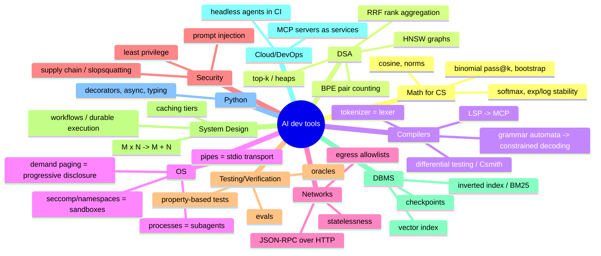

# Connections: How This Track Links to Everything Else

> This track is one repository in a larger knowledge base. Other tracks are referred to **by name** (each is its own repo). Lesson links below stay inside this track.

---

## The big picture

## Track-by-track

| Track | Concept there | How it appears here | Lesson(s) |
|---|---|---|---|
| **Math for CS** | Probability distributions, exp/log, numerical stability | Softmax with max-subtraction; temperature; pass@k estimator; bootstrap CI; cosine similarity | [01-beginner/01](01-beginner/01-llms-for-builders.md), [04-pro/01](04-pro/01-evals-for-prompts-and-agents.md), [03-advanced/03](03-advanced/03-rag-and-embeddings.md) |
| **DSA** | Hash maps, greedy algorithms, partial sorting, graphs | BPE merges are greedy pair counting; top-k; RRF; HNSW; interval merging as the AI-code case study | [01-beginner/01](01-beginner/01-llms-for-builders.md), [03-advanced/03](03-advanced/03-rag-and-embeddings.md), [04-pro/02](04-pro/02-ai-assisted-engineering-discipline.md) |
| **Compilers** | Lexing, parsing, grammars, LSP, compiler testing | Tokenizer as learned lexer; MCP modelled on LSP; constrained decoding as incremental parsing; differential testing from compiler testing | [01-beginner/01](01-beginner/01-llms-for-builders.md), [02-intermediate/03](02-intermediate/03-mcp-why-and-the-spec.md), [04-pro/03](04-pro/03-context-security-and-open-problems.md), [04-pro/02](04-pro/02-ai-assisted-engineering-discipline.md) |
| **OS** | Processes, pipes, isolation, paging | stdio MCP transport is parent/child pipes; subagents as isolated address spaces; Codex Seatbelt/bubblewrap sandboxes; skills as demand paging | [02-intermediate/03](02-intermediate/03-mcp-why-and-the-spec.md), [03-advanced/01](03-advanced/01-claude-code-subagents-hooks-permissions.md), [03-advanced/02](03-advanced/02-cursor-and-codex-workflows.md), [02-intermediate/05](02-intermediate/05-claude-code-memory-and-skills.md) |
| **Linux** | Shell, exit codes, shebangs, env vars | Hook scripts, exit code 2 semantics, `claude -p` pipelines, env vars for servers | [03-advanced/01](03-advanced/01-claude-code-subagents-hooks-permissions.md) |
| **Networks** | HTTP, RPC, statelessness, firewalls | JSON-RPC; Streamable HTTP; stateless APIs and stateless MCP; egress allowlists against exfiltration | [02-intermediate/03](02-intermediate/03-mcp-why-and-the-spec.md), [04-pro/03](04-pro/03-context-security-and-open-problems.md) |
| **Security** | Injection, confused deputy, supply chain, IFC | Indirect prompt injection; lethal trifecta; tool poisoning; slopsquatting; CaMeL as information-flow control | [04-pro/03](04-pro/03-context-security-and-open-problems.md), [04-pro/02](04-pro/02-ai-assisted-engineering-discipline.md) |
| **Testing/Verification** | Oracles, PBT, regression suites | Evals as stochastic tests; pass^k; Hypothesis; differential oracles; fake model endpoints | [04-pro/01](04-pro/01-evals-for-prompts-and-agents.md), [04-pro/02](04-pro/02-ai-assisted-engineering-discipline.md), [02-intermediate/01](02-intermediate/01-tool-calling-and-structured-output.md) |
| **System Design** | Adapters, workflows, caching, idempotency | M × N → M + N; LangGraph as durable workflow; progressive disclosure tiers; explicit state handles | [02-intermediate/03](02-intermediate/03-mcp-why-and-the-spec.md), [03-advanced/04](03-advanced/04-agents-with-langgraph.md) |
| **DBMS** | Indexes, transactions, persistence | BM25 inverted index; vector indexes; LangGraph checkpointers; parameterised SQL in MCP tools | [03-advanced/03](03-advanced/03-rag-and-embeddings.md), [03-advanced/04](03-advanced/04-agents-with-langgraph.md) |
| **Cloud/DevOps** | CI/CD, containers, services | Headless agents (`claude -p`, `codex exec`) in pipelines; eval gates in CI; MCP over HTTP as a service | [03-advanced/01](03-advanced/01-claude-code-subagents-hooks-permissions.md), [03-advanced/02](03-advanced/02-cursor-and-codex-workflows.md), [04-pro/01](04-pro/01-evals-for-prompts-and-agents.md) |
| **Parallel/CUDA** | GEMV/GEMM, memory bandwidth | Batched similarity search is a matrix product; local inference is bandwidth-bound; quantisation | [03-advanced/03](03-advanced/03-rag-and-embeddings.md), [03-advanced/05](03-advanced/05-local-models-with-ollama.md) |
| **Computer Architecture** | Memory hierarchy | VRAM vs RAM spill in local inference; context as a scarce fast memory | [03-advanced/05](03-advanced/05-local-models-with-ollama.md) |
| **Git** | Commits, diffs, worktrees | Undo for agents; reviewing diffs; versioned instruction files and skills | [01-beginner/03](01-beginner/03-meet-your-ai-coding-tools.md), [04-pro/02](04-pro/02-ai-assisted-engineering-discipline.md) |
| **Python** | Decorators, async, typing, Pydantic | MCP server decorators; async client; TypedDict state; validation | [02-intermediate/04](02-intermediate/04-build-an-mcp-server-in-python.md), [03-advanced/04](03-advanced/04-agents-with-langgraph.md) |
| **Java** | Typed interfaces | Tool schemas are interface contracts, like Java interfaces enforced at runtime | [02-intermediate/01](02-intermediate/01-tool-calling-and-structured-output.md) |
| **C** | Undefined behaviour, compiler differences | compiler-fuzz's UB-freedom requirement as an example invariant for agent instructions | [01-beginner/03](01-beginner/03-meet-your-ai-coding-tools.md), [02-intermediate/05](02-intermediate/05-claude-code-memory-and-skills.md) |
| **Rust** | Codex CLI context | The Codex CLI is an open-source project you can read alongside this track | [03-advanced/02](03-advanced/02-cursor-and-codex-workflows.md) |
| **ML/LLM agents** | Transformer internals, training | This track uses models as components; internals and fine-tuning live there | [01-beginner/01](01-beginner/01-llms-for-builders.md) |
| **Research skills** | Experimental design, reading papers | Eval design, uncertainty reporting, the paper list in the appendix | [04-pro/01](04-pro/01-evals-for-prompts-and-agents.md), [appendix](appendix.md) |
| **Career skills** | Interviews, writing | Prompt = spec; interview questions with model answers | [interview-questions](interview-questions.md) |

## Connections to my projects (where genuine)

| Project | Lessons that apply | The concrete link |
|---|---|---|
| compiler-fuzz | 03-advanced/02, 04-pro/01, 04-pro/02 | Differential oracle + generator + ddmin reducer is the same toolkit used to test AI-written code; planted-bug validation = grader calibration; `codex exec` in CI for triage |
| Nidhogg / Logly | 02-intermediate/01, /03, 03-advanced/03, 04-pro/03 | NL→query is structured output; Elasticsearch is BM25; MCP could expose fleet tools; logs are untrusted input to the Assistant |
| aws-waste-scanner | 01-beginner/02, 02-intermediate/04, 03-advanced/01 | AI summary prompt anatomy and hallucination guard; natural MCP server; deny rules on `aws` commands for agents |
| QiskitSage | 01-beginner/01, 02-intermediate/02, 03-advanced/05, 04-pro/01 | Multi-agent sectioning; local Ollama context/temperature pitfalls; evals for reviewer precision/recall |
| AURIXA | 02-intermediate/01, 03-advanced/04 | LangGraph plan/act flow with structured outputs and conditional routing |
| ARIA | 03-advanced/04, 04-pro/03 | LangGraph interrupt for approval; lethal trifecta in an email agent |

## Sources

- See each linked lesson's Sources section. The cross-track concepts (LSP, pipes, BM25, differential testing) are cited there to primary references (e.g. LSP: https://microsoft.github.io/language-server-protocol/, MCP spec: https://modelcontextprotocol.io/specification/latest, Robertson & Zaragoza BM25: https://dl.acm.org/doi/10.1561/1500000019).

## Verify yourself

1. Pick three rows in the track table and explain the connection aloud without looking at the lesson; then check against it.
2. For one project row, open the project's repository and find the code that the connection refers to; if it does not exist, the connection is a suggestion, not a fact, so treat it as a to-do.
