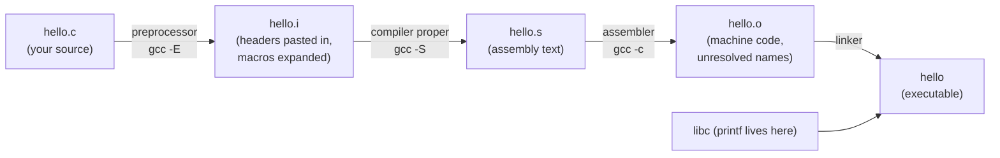

# Lesson B1 — Why C exists, and your first program end to end

> Level: beginner (zero knowledge assumed). Time: about 60–90 minutes including the exercises.
> Compilers used to test every example: GCC 13.3 and GCC 14.2 on Ubuntu 24.04 (x86-64), Clang 18.1. Tested November 2026.

---

## 1. Why does C exist at all?

In the early 1970s, operating systems were mostly written in assembly language. Assembly is precise but it is tied to one particular processor: if you move to a new machine, you rewrite everything. Dennis Ritchie at Bell Labs developed C (growing out of Ken Thompson's language B) so that the Unix operating system could be written in a language that was *close enough to the machine* to be fast and to manipulate memory directly, yet *high-level enough* to move between machines. Ritchie's own account of this history is in his paper *The Development of the C Language* (HOPL-II, 1993) — see Sources.

That design goal still explains almost every C rule you will meet:

- C gives you **direct access to memory** (addresses, bytes, pointers), because an OS kernel needs it.
- C does **very little checking at run time** (no array bounds checks, no garbage collector), because every check costs time and the language was meant to be as cheap as hand-written assembly.
- C leaves many details **to the implementation** (how big an `int` is, for example), because it had to run on very different hardware.

Today C is still the language of operating-system kernels (Linux), embedded firmware, language runtimes (CPython is written in C), databases (SQLite), and compilers' runtime libraries. When you later study compilers, OS and computer architecture, C is the "glue" language in which all of those ideas become concrete.

### The standards timeline (why "which C?" matters)

C is defined by an ISO standard, revised several times. Each revision is identified by the value of a predefined macro called `__STDC_VERSION__` (you will learn what a macro is in lesson I4; for now, think of it as a built-in constant the compiler gives you).

| Common name | Formal standard | `__STDC_VERSION__` | Headline additions |
|---|---|---|---|
| C89 / C90 | ANSI X3.159-1989 / ISO 9899:1990 | (not defined) | function prototypes, `const`, `void` |
| C99 | ISO 9899:1999 | `199901L` | `//` comments, `long long`, `<stdint.h>`, `bool`, variable-length arrays |
| C11 | ISO 9899:2011 | `201112L` | threads, atomics, `_Static_assert`, `_Alignas` |
| C17 | ISO 9899:2018 | `201710L` | defect fixes only, no new features |
| C23 | ISO/IEC 9899:2024 (published 31 Oct 2024) | `202311L` | `bool`/`true`/`false` keywords, `nullptr`, `constexpr`, `typeof`, `#embed`, checked integer arithmetic |

Two practical consequences:

1. **GCC 15 (released April 2025) changed its default from `-std=gnu17` to `-std=gnu23`** (GCC "Porting to GCC 15" page). Older code that used `bool` as a variable name, or declared functions as `int f();` meaning "unknown parameters", can break. Throughout this track we pass `-std=...` explicitly so the dialect never depends on which GCC you happen to have.
2. The ISO standard costs money, but the committee (WG14) publishes **free drafts**. N3220 is the draft that differs from the final C23 text only by one footnote in Annex K (per the WG14 editor's report N3221), so it is the document we cite as "the C23 standard". For C17 we cite draft N2176.

---

## 2. Intuition: the compiler is a translator with a very literal mind

Analogy: imagine you write a recipe in English, and a translator converts it into the native language of a robot chef. The robot does *exactly* what the translated recipe says — no common sense, no "you probably meant...". If your recipe says "add salt until the pot is full", the robot fills the pot with salt.

- Your `.c` file is the English recipe.
- The **compiler** (GCC or Clang) is the translator.
- The **executable** is the robot-language recipe.
- The **CPU** is the robot chef.

The one twist that makes C special: the C standard is a contract. If your recipe stays inside the contract, the translator promises a faithful translation. If you step outside it (for example, reading past the end of an array), the contract says *nothing at all* about what happens. That situation is called **undefined behaviour** and it gets a whole lesson (I3). Keep the word in the back of your mind.

---

## 3. Precise definitions

- **Source file / translation unit.** A `.c` file plus everything it `#include`s, after preprocessing, is a *translation unit* — the unit the compiler translates in one go (C23 draft N3220, §5.1.1.1).
- **Compiler driver.** The `gcc` command is really a *driver* that runs up to four stages in order: **preprocessing, compilation proper, assembly, and linking** (GCC manual, "Options Controlling the Kind of Output"). You will dissect each stage in lesson I5.
- **Hosted vs freestanding.** A *hosted* program runs on an operating system and starts at a function named `main`; a *freestanding* program (kernel, firmware) may start elsewhere. Everything in this track before the pro level is hosted.
- **`main` and the exit status.** In a hosted program, returning a value from `main` is equivalent to calling `exit` with that value; reaching the closing `}` of `main` returns 0 (N3220 §5.1.2.3.4). By convention 0 means success.

---

## 4. Step by step: from nothing to a running program

### Step 1 — the smallest useful program

```c
// file: hello.c
// build: gcc -std=c17 -Wall -Wextra -o hello hello.c
// run: ./hello; echo "exit status = $?"

#include <stdio.h>   // bring in the declaration of printf from the standard I/O library

// main is where a hosted C program starts running
int main(void)       // "void" here means: this function takes no arguments
{
    // printf writes formatted text to standard output; \n is a newline character
    printf("Hello, C!\n");

    // returning 0 from main tells the operating system "everything went fine"
    return 0;
}
```

Output:

```text
Hello, C!
exit status = 0
```

Line by line logic:

- `#include <stdio.h>` is an instruction to the **preprocessor**: "paste the contents of the header `stdio.h` here". That header *declares* `printf` (tells the compiler its name, its parameter types and its return type). The actual machine code for `printf` lives in the C library (glibc on Linux) and gets attached at the **link** stage.
- `int main(void)` says `main` returns an `int` and takes nothing.
- `printf("Hello, C!\n");` calls the function. The text in double quotes is a **string literal**.
- `return 0;` ends `main`. The shell can read this number through `$?`.

### Step 2 — compile it, and *always* turn on warnings

```bash
gcc -std=c17 -Wall -Wextra -o hello hello.c
./hello
```

- `-std=c17` picks the dialect (strict ISO C17). Use `-std=c23` with GCC 14+ / Clang 18+ when you want C23.
- `-Wall` turns on a large set of warnings "about constructions that some users consider questionable" — but, as the GCC manual itself warns, *not all* warnings. `-Wextra` adds more.
- `-o hello` names the output file. Without it, GCC writes `a.out`.

### Step 3 — the "dumbest approach" and why it hurts

The dumbest way to compile is just `gcc hello.c`. It works for this file, so why not do it always? Because of what happens when you make a mistake. Try this broken program:

```c
// file: oops.c
// build: gcc -std=c17 -o oops_nowarn oops.c 2>&1 | head -5; echo "--- now with warnings ---"; gcc -std=c17 -Wall -Wextra -o oops oops.c 2>&1 | grep -E "warning|error" | head -5
// run: ./oops

#include <stdio.h>

int main(void)
{
    int count;                         // declared but never given a value
    printf("count = %d\n", count);     // reading it is undefined behaviour (lesson I3)
    return 0;
}
```

Without `-Wall` GCC 13 compiles this silently. With `-Wall -Wextra` it reports something like:

```text
oops.c:10:5: warning: 'count' is used uninitialized [-Wuninitialized]
```

(The exact column and wording depend on the GCC version.) The program still *runs* and prints some number — maybe 0, maybe garbage. That is the annoying wall: **C will happily build and run a wrong program**. The compiler's warnings are your first line of defence, so the rule for this whole track is: never compile without `-Wall -Wextra`. Later (lesson I8) we add run-time detectors called *sanitizers* that catch what warnings miss.

### Step 4 — reading input and returning a meaningful status

```c
// file: greet.c
// build: gcc -std=c17 -Wall -Wextra -o greet greet.c
// run: echo 21 | ./greet; echo "exit=$?"; echo abc | ./greet; echo "exit=$?"

#include <stdio.h>
#include <stdlib.h>   // for EXIT_SUCCESS and EXIT_FAILURE

int main(void)
{
    int age;                                   // will hold the number the user types

    // scanf tries to read one integer; it returns how many items it successfully read
    if (scanf("%d", &age) != 1) {
        // reading failed (for example the user typed letters): report on stderr
        fprintf(stderr, "please type a whole number\n");
        return EXIT_FAILURE;                   // non-zero status = failure
    }

    // the read worked: compute and print
    printf("next year you will be %d\n", age + 1);
    return EXIT_SUCCESS;                       // same meaning as return 0
}
```

Output:

```text
next year you will be 22
exit=0
please type a whole number
exit=1
```

Notice `&age`. The `&` means "the address of `age`" — `scanf` needs to know *where* to store the number, not the number's current value. This is your first meeting with pointers; lesson B5 explains it properly. For now: "scanf needs an address so it can write into your variable".

Also notice **checking the return value of `scanf`**. Beginners skip this; then a user types `abc`, `age` stays uninitialised, and the program prints garbage. Checking every return value is a habit that will save you for the rest of your career.

---

## 5. Diagram: what `gcc hello.c` actually does



You can watch every stage yourself:

```bash
gcc -std=c17 -E hello.c -o hello.i     # stop after preprocessing
wc -l hello.c hello.i                  # the .i file is hundreds of lines: stdio.h got pasted in
gcc -std=c17 -S hello.c -o hello.s     # stop after compiling to assembly
gcc -std=c17 -c hello.c -o hello.o     # stop after assembling to an object file
gcc hello.o -o hello                   # link the object file with the C library
```

On the test machine (GCC 13.3, glibc 2.39) `hello.c` is 15 lines and `hello.i` is 556 lines (the count depends on your compiler and glibc version) — a vivid demonstration that `#include` really is copy-paste.

---

## 6. Common mistakes in this lesson

| Mistake | What happens | Fix |
|---|---|---|
| Compiling without `-Wall -Wextra` | Real bugs (uninitialised variables, wrong `printf` formats) compile silently | Always use them; add `-Werror` in projects to make warnings fatal |
| Forgetting `#include <stdio.h>` | Since GCC 14, calling an undeclared function is an **error** by default (implicit function declarations were removed from the language in C99) | Include the header that declares each library function |
| `void main()` | Not one of the forms the standard guarantees for hosted programs | Use `int main(void)` or `int main(int argc, char *argv[])` |
| Writing `scanf("%d", age)` without `&` | `scanf` writes to a garbage address → crash or worse | Pass the address: `&age` (and `-Wall` warns about the format mismatch) |
| Ignoring the return value of `scanf` | Variable stays uninitialised on bad input | Compare the result to the expected item count |
| Mixing up `-std=c17` and `-std=gnu17` | `gnu17` allows GNU extensions silently | Use `-std=c17` (or `c23`) plus `-Wpedantic` when learning, so you know what is standard |

---

## 7. Connections to other tracks

- **Compilers track:** the four stages you just saw *are* the front end / back end / assembler / linker pipeline. Your *compiler-fuzz* project feeds generated C to GCC and Clang through exactly this driver.
- **Linux track:** `$?`, standard output vs standard error (`stdout` vs `stderr`), and pipes like `echo 21 | ./greet` are shell concepts you will see again.
- **OS track:** `return` from `main` ends up as an `exit` system call; lesson P1 shows the process side of this.
- **Computer Architecture track:** the `.s` file is the bridge to instruction sets; lesson A2 reads it in detail.

### Where this shows up in my projects

- **compiler-fuzz:** the generator emits C programs and must pin `-std=` explicitly when comparing GCC against Clang, because the two compilers' *default* dialects differ by version (GCC 15 defaults to `gnu23`). Using an explicit dialect is the same discipline this lesson teaches.

---

## 8. Self-check questions

1. Why did Ritchie want a language "between" assembly and a high-level language?
2. Name the four stages run by the `gcc` driver, in order.
3. What does `#include <stdio.h>` literally do?
4. What is the exit status of a program whose `main` reaches its closing brace without a `return`?
5. Why must you pass `&age` instead of `age` to `scanf`?
6. GCC 15 changed a default. Which one, and how do you protect your builds from it?

<details>
<summary>Answers</summary>

1. To write an operating system (Unix) that was close to the machine — fast, with direct memory access — but still portable to new hardware without rewriting everything in a new assembly language.
2. Preprocessing, compilation proper, assembly, linking — always in that order.
3. It makes the preprocessor paste the text of the header file into your source at that point. `stdio.h` contains the declarations of `printf`, `scanf` and friends.
4. 0 (success). Reaching the `}` that terminates `main` returns 0 in a hosted environment.
5. `scanf` must *store* into the variable, so it needs the variable's address. Passing `age` would pass its (uninitialised) value, which `scanf` would then treat as an address.
6. The default dialect went from `-std=gnu17` to `-std=gnu23`. Always pass an explicit `-std=` flag in your builds.

</details>

---

## 9. Mnemonic (Tamil + English)

The four compiler stages: **Preprocess → Compile → Assemble → Link**

> **"Paati Cooks Appam Lovingly"** — *Paati* (grandma) **P**reprocesses the batter (mixes in all the `#include` ingredients), **C**ooks it into a shape (assembly), the **A**ppam is set (object file), and she **L**ovingly plates everything together with chutney from the shop (the C library) — that is linking.

For the warning flags: **"Wall-um Wextra-um illama compile panna, bug-u free ticket-la varum"** — compile without `-Wall` and `-Wextra`, and the bug gets a free ticket in.

---

## Sources

- Dennis M. Ritchie, *The Development of the C Language* (HOPL-II, 1993): https://www.nokia.com/bell-labs/about/dennis-m-ritchie/chist.html
- cppreference, *History of C*: https://en.cppreference.com/w/c/language/history
- WG14 N3220, C2y working draft (identical to C23 apart from one Annex K footnote): https://open-std.org/JTC1/SC22/WG14/www/docs/n3220.pdf
- WG14 N3221, Editor's report confirming the N3219/N3220 relationship: https://open-std.org/JTC1/SC22/WG14/www/docs/n3221.htm
- C17 final draft N2176 (mirror at UWA, the open-std copy is not public): https://teaching.csse.uwa.edu.au/units/CITS2002/resources/n2176.pdf
- Wikipedia, *C23 (C standard revision)* (publication date 31 Oct 2024, `202311L`): https://en.wikipedia.org/wiki/C23_(C_standard_revision)
- GCC, *Porting to GCC 15* (default changed to `-std=gnu23`): https://gcc.gnu.org/gcc-15/porting_to.html
- GCC, *Porting to GCC 14* (implicit function declarations become errors): https://gcc.gnu.org/gcc-14/porting_to.html
- GCC manual, *Options Controlling the Kind of Output* (four stages, `-E`, `-S`, `-c`, `-o`): https://gcc.gnu.org/onlinedocs/gcc/Overall-Options.html
- GCC manual, *Warning Options* (`-Wall` does not enable all warnings): https://gcc.gnu.org/onlinedocs/gcc/Warning-Options.html

## Verify yourself

1. Compile and run every block in this lesson exactly as written (each block's `// build:` and `// run:` lines are the commands used on the test machine).
2. Print the dialect your compiler uses by default:
   ```bash
   echo '__STDC_VERSION__' | gcc -E -x c - | tail -1          # default dialect
   echo '__STDC_VERSION__' | gcc -std=c17 -E -x c - | tail -1 # should print 201710L
   ```
   Note: GCC 13 and GCC 14 print `202000L` for `-std=c2x`/`-std=c23` (a provisional value observed on the test machine); GCC 15 reports the final `202311L`. Check your own compiler.
3. Check the claim "reaching the end of `main` returns 0" in N3220 §5.1.2.3.4 (program termination).
4. Check the four-stage claim in the GCC manual link above.
