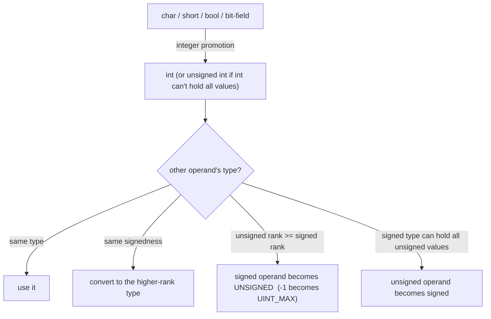

# Lesson B2 — Types, variables and operators: what a number really is in C

> Level: beginner. Prerequisite: Lesson B1. Time: about 90 minutes.
> Tested with GCC 13.3 / GCC 14.2 / Clang 18.1 on x86-64 Linux (Ubuntu 24.04), November 2026.

---

## 1. Why does this lesson exist?

In Python an integer just grows as big as it needs to. In Java an `int` is *always* exactly 32 bits on every machine. C sits in a third, stranger place: **the size of `int` is chosen by the implementation**, within minimum limits set by the standard. C was designed to run on machines with 16-bit, 32-bit, 36-bit and 64-bit words, so it refused to hard-code one size.

That freedom is why C is fast on every platform — and why "how many bits is this?" and "what happens when it overflows?" are the first questions a C programmer asks. If you get these wrong you get bugs that pass every test on your laptop and fail on a microcontroller, or fail only for large inputs.

---

## 2. Intuition: variables are labelled boxes of fixed width

Imagine a row of numbered lockers. A **variable** is a name you stick on one or more adjacent lockers. The **type** tells the compiler two things:

1. **How many lockers (bytes)** the value occupies.
2. **How to interpret the bits** inside: as a whole number with or without a sign, as a character code, or as a floating-point number.

An odometer is the perfect analogy for *unsigned* integers: a 3-digit odometer showing 999 rolls over to 000. C's unsigned types do exactly this — it is well-defined, guaranteed behaviour. *Signed* integers are different: if a signed calculation goes past its maximum, the C standard says the behaviour is **undefined** — the odometer is allowed to explode. Hold on to that asymmetry; it is one of the most important facts in C.

---

## 3. Precise definitions

### 3.1 Integer types and their *minimum* ranges

The standard (N3220 §5.2.5.3.2, `<limits.h>`) guarantees only minimum magnitudes. The actual sizes on x86-64 Linux (the "LP64" data model) are in the last column.

| Type | Guaranteed at least | Typical x86-64 Linux |
|---|---|---|
| `char` | 8 bits (`CHAR_BIT >= 8`) | 8 bits, **signed** on x86-64 |
| `short` | 16 bits | 16 bits |
| `int` | 16 bits | 32 bits |
| `long` | 32 bits | 64 bits (on 64-bit Windows it is 32!) |
| `long long` | 64 bits | 64 bits |

Every one of these (except plain `char`) comes in `signed` (default) and `unsigned` flavours. Whether plain `char` is signed or unsigned is **implementation-defined** — it is signed on x86-64 GCC but unsigned on ARM Linux, for example — which is why code that stores bytes should use `unsigned char` explicitly.

Since **C23, signed integers must use two's complement** representation (N3220 §6.2.6.2; the removal of other representations is listed in the C23 changes). Every mainstream compiler already did this, but before C23 the standard also permitted sign-magnitude and ones' complement.

### 3.2 Fixed-width types: when you need an exact size

`<stdint.h>` (C99) gives you `int8_t`, `int16_t`, `int32_t`, `int64_t` and the unsigned `uint8_t` … `uint64_t`. Use these whenever the *exact* width matters: file formats, network protocols, hardware registers, hashing.

### 3.3 `sizeof` and `size_t`

`sizeof` is an *operator* (not a function) that yields the size of a type or object in bytes, as a value of type `size_t` — an unsigned integer type big enough to hold the size of any object. Print it with `%zu`.

### 3.4 Floating types

`float`, `double`, `long double`. On essentially every desktop platform `float` and `double` are IEEE 754 binary32 and binary64. (Annex F of the standard, "ISO/IEC 60559 floating-point arithmetic", describes IEEE 754 conformance; an implementation that conforms defines `__STDC_IEC_559__` — C23 also adds `__STDC_IEC_60559_BFP__`.) Floating point is *approximate*: `0.1 + 0.2 == 0.3` is false.

### 3.5 Three kinds of "it depends" behaviour

These terms come from the standard (N3220 §3.5.1 implementation-defined, §3.5.3 undefined, §3.5.4 unspecified) and cppreference's summary:

- **Implementation-defined:** the compiler must pick a behaviour *and document it* (size of `int`, signedness of `char`, right-shifting a negative number).
- **Unspecified:** several behaviours allowed, no documentation required (order in which function arguments are evaluated).
- **Undefined (UB):** no requirements at all (signed overflow, reading an uninitialised variable, dividing by zero).

---

## 4. Step by step

### Step 1 — print the sizes on *your* machine

```c
// file: sizes.c
// build: gcc -std=c17 -Wall -Wextra -o sizes sizes.c
// run: ./sizes

#include <stdio.h>
#include <limits.h>   // INT_MAX, CHAR_BIT, LONG_MAX ...
#include <stdint.h>   // int32_t, uint8_t ...

int main(void)
{
    // sizeof gives bytes as a size_t; %zu is the printf format for size_t
    printf("char      : %zu byte(s), CHAR_BIT = %d\n", sizeof(char), CHAR_BIT);
    printf("short     : %zu\n", sizeof(short));
    printf("int       : %zu\n", sizeof(int));
    printf("long      : %zu\n", sizeof(long));
    printf("long long : %zu\n", sizeof(long long));
    printf("float     : %zu, double: %zu\n", sizeof(float), sizeof(double));

    // the limits.h macros tell you the actual range on this implementation
    printf("INT_MIN = %d, INT_MAX = %d\n", INT_MIN, INT_MAX);
    printf("UINT_MAX = %u\n", UINT_MAX);

    // a fixed-width type is exactly the width its name says
    printf("int32_t   : %zu\n", sizeof(int32_t));

    // is plain char signed here? CHAR_MIN is 0 when char is unsigned
    printf("plain char is %s\n", CHAR_MIN < 0 ? "signed" : "unsigned");
    return 0;
}
```

Output on x86-64 Linux:

```text
char      : 1 byte(s), CHAR_BIT = 8
short     : 2
int       : 4
long      : 8
long long : 8
float     : 4, double: 8
INT_MIN = -2147483648, INT_MAX = 2147483647
UINT_MAX = 4294967295
int32_t   : 4
plain char is signed
```

`sizeof(char)` is 1 *by definition* — but a "byte" in C means `CHAR_BIT` bits, which is at least 8.

### Step 2 — integer division and remainder

```c
// file: divide.c
// build: gcc -std=c17 -Wall -Wextra -o divide divide.c
// run: ./divide

#include <stdio.h>

int main(void)
{
    // integer division truncates toward zero (guaranteed since C99)
    printf(" 7 / 2  = %d\n",  7 / 2);
    printf("-7 / 2  = %d\n", -7 / 2);

    // the remainder has the sign of the dividend, so (a/b)*b + a%b == a always
    printf(" 7 %% 2  = %d\n",  7 % 2);   // %% prints a literal percent sign
    printf("-7 %% 2  = %d\n", -7 % 2);

    // to get a fractional answer, at least one operand must be floating point
    printf(" 7 / 2.0 = %f\n", 7 / 2.0);

    // a classic beginner bug: the division happens in int BEFORE the assignment
    double avg = (3 + 4) / 2;            // 7/2 is 3 (int), then converted to 3.0
    printf("avg (wrong) = %f\n", avg);
    double avg_ok = (3 + 4) / 2.0;       // 7/2.0 is 3.5
    printf("avg (right) = %f\n", avg_ok);
    return 0;
}
```

Output:

```text
 7 / 2  = 3
-7 / 2  = -3
 7 % 2  = 1
-7 % 2  = -1
 7 / 2.0 = 3.500000
avg (wrong) = 3.000000
avg (right) = 3.500000
```

### Step 3 — overflow: the dumbest assumption and the wall it hits

The dumbest assumption: "numbers behave like maths". Let us test it.

```c
// file: overflow.c
// build: gcc -std=c17 -Wall -Wextra -o overflow overflow.c
// run: ./overflow

#include <stdio.h>
#include <limits.h>

int main(void)
{
    // unsigned arithmetic is defined to wrap modulo 2^N (here 2^32)
    unsigned int u = UINT_MAX;
    u = u + 1;                                   // wraps to 0: guaranteed
    printf("UINT_MAX + 1 = %u\n", u);

    unsigned int small = 2;
    printf("2u - 10 = %u\n", small - 10);        // also wraps: 4294967288

    // signed overflow is UNDEFINED; we avoid doing it and instead check first
    int big = INT_MAX;
    if (big > INT_MAX - 1) {                     // would big + 1 overflow?
        printf("INT_MAX + 1 would overflow: refusing to compute it\n");
    }
    return 0;
}
```

Output:

```text
UINT_MAX + 1 = 0
2u - 10 = 4294967288
INT_MAX + 1 would overflow: refusing to compute it
```

What is annoying here: you must *check before* the signed operation, because once the overflow has happened the program is already in UB-land and the compiler is allowed to assume it never happens (lesson A4 shows GCC deleting an overflow check you wrote *after* the fact). C23 gives you a clean tool for this, `ckd_add` from `<stdckdint.h>` (lesson A5). For now, the pre-check above is the portable beginner pattern.

### Step 4 — mixing signed and unsigned (the comparison trap)

When an `int` meets an `unsigned int` in an expression, the **usual arithmetic conversions** convert the `int` to `unsigned int` (cppreference, *Implicit conversions*; N3220 §6.3.1.8). So `-1` becomes `UINT_MAX`.

```c
// file: signed_unsigned.c
// build: gcc -std=c17 -Wall -Wextra -o signed_unsigned signed_unsigned.c 2>&1 | grep -c warning
// run: ./signed_unsigned

#include <stdio.h>

int main(void)
{
    int neg = -1;
    unsigned int one = 1;

    // neg is converted to unsigned int (becomes 4294967295) before comparing!
    if (neg < one)
        printf("-1 < 1u is true\n");
    else
        printf("-1 < 1u is FALSE (signed was converted to unsigned)\n");

    // sizeof yields size_t (unsigned); comparing with a negative int has the same trap
    if (sizeof(int) > -1)
        printf("sizeof(int) > -1 is true\n");
    else
        printf("sizeof(int) > -1 is FALSE\n");
    return 0;
}
```

Output:

```text
-1 < 1u is FALSE (signed was converted to unsigned)
sizeof(int) > -1 is FALSE
```

`-Wextra` enables `-Wsign-compare`, which warns about both comparisons (the build line above counts 2 warnings with GCC 13). This is exactly why warnings matter.

### Step 5 — small types get promoted

Arithmetic on `char` and `short` first converts them to `int` (**integer promotion**). That is why this works without overflow even though each value fits in a `char`:

```c
// file: promote.c
// build: gcc -std=c17 -Wall -Wextra -o promote promote.c
// run: ./promote

#include <stdio.h>

int main(void)
{
    unsigned char a = 200, b = 100;     // each fits in 8 bits (max 255)
    int sum = a + b;                     // both promoted to int first: 300, no wrap
    unsigned char stored = a + b;        // 300 converted back to unsigned char: 300 mod 256 = 44
    printf("sum = %d, stored = %d\n", sum, stored);
    return 0;
}
```

Output:

```text
sum = 300, stored = 44
```

### Step 6 — operators you will use constantly

| Group | Operators | Notes |
|---|---|---|
| Arithmetic | `+ - * / %` | `/` truncates for integers |
| Comparison | `== != < > <= >=` | result is `int` 0 or 1 |
| Logical | `&& \|\| !` | **short-circuit**: right side evaluated only if needed |
| Bitwise | `& \| ^ ~ << >>` | work on the bits; shifting by ≥ width is UB |
| Assignment | `= += -= *= /= %= &= \|= ^= <<= >>=` | `x += 3` means `x = x + 3` |
| Increment | `++ --` | `i++` yields old value, `++i` yields new value |
| Conditional | `cond ? a : b` | an expression, not a statement |

Precedence trap: `x & 1 == 0` parses as `x & (1 == 0)` because `==` binds tighter than `&`. Write `(x & 1) == 0`. When in doubt, parenthesise.

```c
// file: bits.c
// build: gcc -std=c17 -Wall -Wextra -o bits bits.c
// run: ./bits

#include <stdio.h>

int main(void)
{
    unsigned int flags = 0;              // use unsigned for bit manipulation

    flags |= 1u << 3;                    // set bit 3      -> 0b1000 = 8
    flags |= 1u << 0;                    // set bit 0      -> 0b1001 = 9
    printf("flags = %u\n", flags);

    // test bit 3: parenthesise because == binds tighter than &
    if ((flags & (1u << 3)) != 0)
        printf("bit 3 is set\n");

    flags &= ~(1u << 3);                 // clear bit 3    -> 0b0001 = 1
    printf("after clear = %u\n", flags);

    flags ^= 1u << 1;                    // toggle bit 1   -> 0b0011 = 3
    printf("after toggle = %u\n", flags);
    return 0;
}
```

Output:

```text
flags = 9
bit 3 is set
after clear = 1
after toggle = 3
```

---

## 5. Diagram: the conversion ladder



And how a byte looks as bits (two's complement, 8 bits):

```text
 bit:   7   6   5   4   3   2   1   0
       +---+---+---+---+---+---+---+---+
  5  = | 0 | 0 | 0 | 0 | 0 | 1 | 0 | 1 |
       +---+---+---+---+---+---+---+---+
 -5  = | 1 | 1 | 1 | 1 | 1 | 0 | 1 | 1 |   (invert 5 -> 11111010, add 1 -> 11111011)
       +---+---+---+---+---+---+---+---+
```

---

## 6. Common mistakes

| Mistake | Consequence | Fix |
|---|---|---|
| Assuming `int` is 32 bits or `long` is 64 bits everywhere | Breaks on Windows (`long` = 32) or embedded targets (`int` = 16) | Use `<stdint.h>` types when width matters |
| `printf("%d", sizeof x)` | Wrong format: `sizeof` is `size_t` | `%zu` |
| `double avg = sum / n;` with ints | Integer division happens first | Cast: `(double)sum / n` |
| Checking overflow *after* `a + b` on signed ints | The overflow already was UB; check may be deleted by the optimiser | Pre-check with limits, or `ckd_add` (C23) |
| Comparing `int` with `size_t`/`unsigned` | Negative int becomes a huge unsigned value | Keep comparisons in one signedness; heed `-Wsign-compare` |
| `if (x & 1 == 0)` | Parses as `x & (1 == 0)` | `if ((x & 1) == 0)` |
| `1 << 31` with 32-bit `int` | The mathematical result 2^31 is not representable in `int`, so the left shift is UB (N3220 §6.5.8); `-fsanitize=undefined` reports it | Use `1u << 31` |
| Comparing floats with `==` | `0.1 + 0.2 != 0.3` | Compare with a tolerance |

---

## 7. Connections

- **Computer Architecture track:** two's complement, word sizes, and why x86-64 has 64-bit registers but `int` stays 32 bits (the LP64 model).
- **Math for CS track:** modular arithmetic is exactly what unsigned C integers implement (arithmetic mod 2^N).
- **Java track:** Java fixed `int` at 32 bits and *defined* signed overflow as wrapping; C left both open. Compare the design tradeoff (portability of results vs. speed on odd hardware).
- **Security track:** integer overflow leading to a too-small `malloc` is a classic vulnerability pattern (CERT rule INT32-C).
- **Rust track:** Rust panics on overflow in debug builds and wraps in release builds; C makes signed overflow UB.

### Where this shows up in my projects

- **compiler-fuzz:** a UB-free random program generator has to avoid signed overflow, shifts by too much, and division by zero *by construction* — typically by wrapping arithmetic in "safe math" helpers (the approach Csmith popularised). Every rule in Step 3–6 above is a rule the generator must enforce, otherwise GCC and Clang may legitimately disagree and the "bug" you find is in your test, not the compiler.

---

## 8. Self-check questions

1. What does the standard guarantee about the size of `int`?
2. Why is `unsigned` overflow safe but `signed` overflow dangerous?
3. What does `-7 / 2` evaluate to, and `-7 % 2`?
4. Why does `-1 < 1u` evaluate to 0?
5. What format specifier prints a `size_t`?
6. You need a 16-bit unsigned field in a network header. Which type?
7. Evaluate `(unsigned char)(250 + 10)`.

<details>
<summary>Answers</summary>

1. Only that it can represent at least the range −32767…32767 (at least 16 bits); its actual size is implementation-defined (32 bits on all mainstream desktop platforms).
2. Unsigned arithmetic is *defined* to wrap modulo 2^N. Signed overflow is *undefined behaviour*: the compiler may assume it never happens and optimise accordingly.
3. `-3` (truncation toward zero) and `-1` (sign follows the dividend).
4. `-1` (int) is converted to `unsigned int` by the usual arithmetic conversions, becoming `UINT_MAX`, which is not less than 1.
5. `%zu`.
6. `uint16_t` from `<stdint.h>`.
7. `250 + 10` is computed as `int` 260; converting to `unsigned char` gives 260 mod 256 = 4.

</details>

---

## 9. Mnemonic (Tamil + English)

**Signed vs unsigned overflow:**

> **"Unsigned-u odometer maadhiri suthum; Signed-u bomb maadhiri vedikkum."**
> Unsigned spins round like an odometer (wraps, defined). Signed blows up like a bomb (undefined behaviour).

**Minimum sizes (bits) — short, int, long, long long = 16, 16, 32, 64:**

> **"Sixteen Sisters, Thirty-two Thambis, Sixty-four Saapadu"** — *short* and *int*: two 16-bit sisters; *long*: 32 thambis (younger brothers); *long long*: 64 plates of saapadu (a meal). The bigger the name, the bigger the meal.

---

## Sources

- WG14 N3220 (C23-equivalent draft): §5.2.5.3.2 sizes of integer types `<limits.h>`, §6.2.5 types, §6.2.6.2 integer representation, §6.3.1.1 integer promotions, §6.3.1.8 usual arithmetic conversions, §6.5.6 multiplicative operators: https://open-std.org/JTC1/SC22/WG14/www/docs/n3220.pdf
- cppreference, *Undefined behavior* (definitions of UB / unspecified / implementation-defined): https://en.cppreference.com/w/c/language/behavior
- cppreference, *Implicit conversions* (promotion and usual arithmetic conversions, `2u - 10` example, `sizeof(int) > -1` example): https://en.cppreference.com/w/c/language/conversion
- cppreference, *Arithmetic types*: https://en.cppreference.com/w/c/language/arithmetic_types
- cppreference, *Fixed width integer types*: https://en.cppreference.com/w/c/types/integer
- Wikipedia, *C23* (removal of non-two's-complement representations): https://en.wikipedia.org/wiki/C23_(C_standard_revision)
- SEI CERT C rules list (INT32-C "Ensure that operations on signed integers do not result in overflow"): https://cmu-sei.github.io/secure-coding-standards/sei-cert-c-coding-standard/rules
- GCC manual, *Warning Options* (`-Wextra`, `-Wsign-compare`): https://gcc.gnu.org/onlinedocs/gcc/Warning-Options.html

## Verify yourself

1. Run every code block (commands are on the `// build:` and `// run:` lines).
2. Cross-compile mentally: run `gcc -m32 -dM -E - </dev/null | grep -E "SIZEOF_(INT|LONG)__"` if you have 32-bit support installed, and compare `__SIZEOF_LONG__` with the 64-bit result from `gcc -dM -E - </dev/null | grep SIZEOF_LONG`.
3. Check signedness of `char` on your platform: `gcc -dM -E - </dev/null | grep __CHAR_UNSIGNED__` (prints nothing on x86-64, prints a define on ARM Linux).
4. Compile `signed_unsigned.c` with and without `-Wextra` and confirm the `-Wsign-compare` warnings appear only with it.
5. Confirm the truncation-toward-zero rule in N3220 §6.5.6 ("Multiplicative operators").
