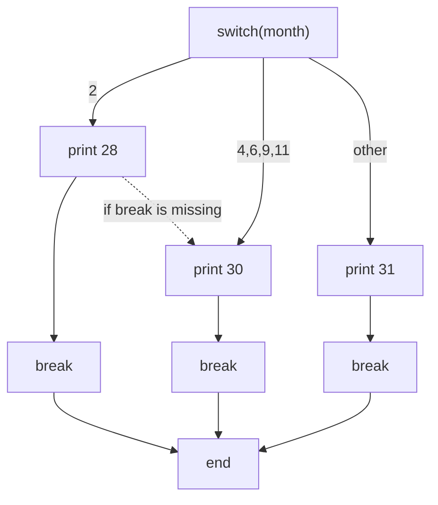

# Lesson B3 — Control flow and functions: making decisions, repeating, and breaking work into pieces

> Level: beginner. Prerequisites: B1, B2. Time: about 90 minutes.
> Tested with GCC 13.3 (`-std=c17`) on x86-64 Linux, November 2026.

---

## 1. Why this lesson exists

A program that runs top to bottom once is a calculator. Real programs **decide** (if/switch), **repeat** (loops), and **reuse** pieces of logic (functions). C's control flow looks like Java's because Java copied C — but there are C-specific traps: `switch` falls through, conditions are just integers, and functions *always* receive copies of their arguments. That last fact is the doorway to pointers (lesson B5).

---

## 2. Intuition

- **`if`** is a fork in the road. C has no real "boolean" in the condition: any non-zero value means *true*, zero means *false*.
- **Loops** are a train going round a circular track until a signal (the condition) says stop.
- **A function** is a vending machine: you put in coins (arguments), it gives you one item (return value). Crucially, the machine gets *photocopies* of your coins — it cannot reach into your wallet. That is **pass by value**.
- **The call stack** is a stack of plates: every function call puts a new plate (its local variables) on top; returning removes the top plate.

---

## 3. Precise definitions

- **Statement kinds** (N3220 §6.8): selection (`if`, `switch`), iteration (`while`, `do`, `for`), jump (`goto`, `continue`, `break`, `return`), compound (`{ ... }`, also called a block), expression statements.
- **Truth values:** `if (e)` executes the first branch when `e` compares unequal to 0 (N3220 §6.8.5). Relational and logical operators yield an `int` 0 or 1.
- **Function declaration (prototype)** tells the compiler the name, return type and parameter types: `int square(int x);`. A **definition** also supplies the body.
- **Pass by value:** "In preparing for the call to a function, the arguments are evaluated, and each parameter is assigned the value of the corresponding argument" (N3220 §6.5.3.3, function calls). The parameter is a *new object*.
- **Scope** is where a name is visible (block scope, file scope). **Lifetime/storage duration** is how long the object exists: local variables have *automatic* storage duration (created when the block is entered, destroyed when it is left) unless declared `static`, which gives *static* storage duration (exists for the whole program run, initialised once) — cppreference, *Storage duration*.

---

## 4. Step by step

### Step 1 — `if`, `else if`, and the truthiness of integers

```c
// file: grade.c
// build: gcc -std=c17 -Wall -Wextra -o grade grade.c
// run: ./grade

#include <stdio.h>

// returns a letter grade for a mark out of 100
char grade_of(int mark)
{
    // conditions are checked top to bottom; the first true one wins
    if (mark >= 90)
        return 'A';
    else if (mark >= 75)
        return 'B';
    else if (mark >= 50)
        return 'C';
    else
        return 'F';
}

int main(void)
{
    int marks[] = {95, 80, 50, 12};          // a small array (arrays are lesson B4)
    for (int i = 0; i < 4; i++)              // visit each mark
        printf("%d -> %c\n", marks[i], grade_of(marks[i]));

    int n = 5;
    if (n)                                   // any non-zero value counts as true
        printf("non-zero is true\n");
    return 0;
}
```

Output:

```text
95 -> A
80 -> B
50 -> C
12 -> F
non-zero is true
```

### Step 2 — `switch` and the fall-through trap

`switch` jumps to the matching `case` label and then **keeps running into the next cases** until it hits `break`. This is by design (it lets several labels share code), and it is also a classic bug.

```c
// file: days.c
// build: gcc -std=c17 -Wall -Wextra -Wimplicit-fallthrough -o days days.c
// run: ./days

#include <stdio.h>

// prints how many days a month has (non-leap year)
void print_days(int month)
{
    switch (month) {
    case 2:                         // February is special
        printf("month %d: 28 days\n", month);
        break;                      // stop here; without break we would fall into case 4
    case 4: case 6: case 9: case 11:  // several labels sharing one body: intended fall-through
        printf("month %d: 30 days\n", month);
        break;
    default:                        // everything else
        printf("month %d: 31 days\n", month);
        break;
    }
}

int main(void)
{
    print_days(2);
    print_days(9);
    print_days(12);
    return 0;
}
```

Output:

```text
month 2: 28 days
month 9: 30 days
month 12: 31 days
```

`-Wimplicit-fallthrough` (enabled by `-Wextra` in GCC) warns when a non-empty case falls into the next one. If you *mean* to fall through, C23 lets you say so with the `[[fallthrough]];` attribute (lesson A5).

### Step 3 — three loops, and when each fits

```c
// file: loops.c
// build: gcc -std=c17 -Wall -Wextra -o loops loops.c
// run: echo "5 3 0" | ./loops

#include <stdio.h>

int main(void)
{
    // for: when you know the count up front
    int total = 0;
    for (int i = 1; i <= 10; i++)        // init; condition; step
        total += i;
    printf("sum 1..10 = %d\n", total);

    // while: when you loop until something happens (condition checked FIRST)
    int n = 1;
    while (n < 100)
        n *= 2;                          // doubles: 1,2,4,...,128
    printf("first power of two >= 100 is %d\n", n);

    // do-while: body runs at least once (condition checked AFTER)
    int x, count = 0;
    do {
        if (scanf("%d", &x) != 1)        // stop on bad or missing input
            break;
        count++;
    } while (x != 0);                    // a 0 ends the input (and is counted)
    printf("read %d numbers\n", count);

    // continue skips to the next iteration; break leaves the loop
    for (int i = 0; i < 10; i++) {
        if (i % 2 == 0) continue;        // skip even numbers
        if (i > 7) break;                // stop entirely after 7
        printf("%d ", i);
    }
    printf("\n");
    return 0;
}
```

Output:

```text
sum 1..10 = 55
first power of two >= 100 is 128
read 3 numbers
1 3 5 7 
```

### Step 4 — functions: declare before use

The compiler reads a file top to bottom. If `main` calls `cube` before `cube` is defined, the compiler needs a **prototype** first. (Before C99 a missing declaration was silently assumed to return `int`; C99 removed this, and since GCC 14 it is a hard error by default — see GCC's "Porting to GCC 14".)

```c
// file: proto.c
// build: gcc -std=c17 -Wall -Wextra -o proto proto.c
// run: ./proto

#include <stdio.h>

long cube(int x);          // prototype: name, return type, parameter types

int main(void)
{
    printf("cube(7) = %ld\n", cube(7));   // OK: compiler already knows cube's type
    return 0;
}

long cube(int x)           // definition: must match the prototype
{
    return (long)x * x * x;    // cast first so the multiplication happens in long
}
```

Output:

```text
cube(7) = 343
```

One C-specific detail: in C17, `int f();` (empty parentheses) does **not** mean "no parameters" — it means "parameters not specified", which disables argument checking. Write `int f(void);`. C23 changed `()` to mean `(void)` (GCC "Porting to GCC 15"), but `(void)` works in every version, so prefer it.

### Step 5 — pass by value: the dumbest `swap`, and the wall it hits

The dumbest attempt at swapping two variables via a function:

```c
// file: swap_fail.c
// build: gcc -std=c17 -Wall -Wextra -o swap_fail swap_fail.c
// run: ./swap_fail

#include <stdio.h>

// tries to swap, but a and b are COPIES of the caller's variables
void swap_copy(int a, int b)
{
    int tmp = a;     // swap the copies...
    a = b;
    b = tmp;
    printf("inside : a=%d b=%d\n", a, b);   // the copies are swapped
}                    // ...and the copies are destroyed here

int main(void)
{
    int x = 1, y = 2;
    swap_copy(x, y);
    printf("outside: x=%d y=%d\n", x, y);   // originals untouched
    return 0;
}
```

Output:

```text
inside : a=2 b=1
outside: x=1 y=2
```

The wall: a function cannot change the caller's variables if it only receives copies. To get around it, the caller must hand over **the addresses** of its variables (like `scanf("%d", &x)` did). That is exactly what pointers are for — lesson B5 finishes this swap.

### Step 6 — scope, lifetime and `static` locals

```c
// file: counter.c
// build: gcc -std=c17 -Wall -Wextra -o counter counter.c
// run: ./counter

#include <stdio.h>

// returns how many times it has been called
int next_id(void)
{
    static int calls = 0;   // static storage: created once, survives between calls
    int temp = 0;           // automatic storage: created fresh on every call
    calls++;
    temp++;
    printf("calls=%d temp=%d\n", calls, temp);
    return calls;
}

int main(void)
{
    next_id();
    next_id();
    next_id();

    {                       // a nested block opens a new scope
        int inner = 42;
        printf("inner=%d\n", inner);
    }                       // inner's lifetime ends here; using it below would not compile
    return 0;
}
```

Output:

```text
calls=1 temp=1
calls=2 temp=1
calls=3 temp=1
inner=42
```

### Step 7 — recursion and the call stack

```c
// file: fact.c
// build: gcc -std=c17 -Wall -Wextra -o fact fact.c
// run: ./fact

#include <stdio.h>

// n! computed recursively; depth tracks how deep in the call stack we are
unsigned long long fact(unsigned n, int depth)
{
    printf("%*scall fact(%u)\n", depth * 2, "", n);   // indent by depth for a visual stack
    if (n <= 1)                                        // base case stops the recursion
        return 1;
    unsigned long long res = n * fact(n - 1, depth + 1);   // recursive case
    printf("%*sreturn %llu\n", depth * 2, "", res);
    return res;
}

int main(void)
{
    printf("4! = %llu\n", fact(4, 0));
    return 0;
}
```

Output:

```text
call fact(4)
  call fact(3)
    call fact(2)
      call fact(1)
    return 2
  return 6
return 24
4! = 24
```

(`%*s` takes a width from the argument list and prints the empty string padded to that width — a cheap indentation trick.)

---

## 5. Diagrams

The call stack while `fact(1)` is running:

```text
   higher addresses
 +----------------------+
 | main's frame         |
 +----------------------+
 | fact(4): n=4, depth=0|
 +----------------------+
 | fact(3): n=3, depth=1|
 +----------------------+
 | fact(2): n=2, depth=2|
 +----------------------+
 | fact(1): n=1, depth=3|  <- top of stack (the stack grows DOWN on x86-64)
 +----------------------+
   lower addresses
```

Each frame holds its own copy of `n` — this is pass-by-value and automatic storage working together. Lesson B6 maps where the stack lives in memory; lesson A2 shows the real frame layout from the assembly.

Switch fall-through:



---

## 6. Common mistakes

| Mistake | Consequence | Fix |
|---|---|---|
| `if (x = 5)` instead of `if (x == 5)` | Assigns 5, condition always true (GCC `-Wall` warns: `-Wparentheses`) | Use `==`; some people write `5 == x` |
| Missing `break` in `switch` | Falls into next case | Add `break`; use `-Wimplicit-fallthrough`; mark intended fall-through with `[[fallthrough]]` (C23) |
| `for (i = 0; i <= n; i++)` over an `n`-element array | Off-by-one: touches element `n`, out of bounds (UB) | `i < n` |
| `int f();` when you mean "no args" (C17) | No argument checking at all | `int f(void);` |
| Calling a function before declaring it | Error since GCC 14 / C99 | Prototype at top or in a header |
| Expecting a function to modify its argument | Only the copy changes | Pass a pointer (lesson B5) or return the new value |
| Returning nothing from a non-`void` function on some path | Using the result is UB (`-Wreturn-type` warns) | Every path must `return` a value |
| Unbounded recursion | Stack overflow → segmentation fault | Base case, or iterate instead |
| `while (x != 0.1)` on doubles | Never exactly equal → infinite loop | Compare with tolerance or use integer counters |

---

## 7. Connections

- **DSA track:** recursion, base cases and the call stack are exactly what you trace in recursion trees and DP; the stack-depth limit is why deep recursion becomes iteration + explicit stack.
- **OS track:** the "stack of plates" is a real memory region with a fixed limit (`ulimit -s` printed 8192 KiB, i.e. 8 MiB, on the Ubuntu 24.04 test machine; other systems may differ [unverified as a universal default — check with `ulimit -s`]).
- **Compilers track:** `switch` over dense cases is often compiled to a *jump table*; tail calls may be turned into loops at `-O2`.
- **Java track:** Java's `switch` also falls through (classic form), and Java is also pass-by-value — for objects it copies the *reference*, which is the same idea as passing a pointer in C.

---

## 8. Self-check questions

1. What does `if (7)` do, and why?
2. What prints if you remove the `break` after `case 2` in `days.c` and call `print_days(2)`?
3. Difference between `while` and `do-while`?
4. Why does `swap_copy` fail?
5. What is the difference between scope and lifetime? Give an example where they differ.
6. In C17, what does `int g();` declare?

<details>
<summary>Answers</summary>

1. Executes the branch: 7 compares unequal to 0, so it is "true".
2. Both `month 2: 28 days` and `month 2: 30 days`: execution falls from the `case 2` body into the `case 4/6/9/11` body until the next `break`.
3. `while` checks the condition before each iteration (may run 0 times); `do-while` checks after (runs at least once).
4. C passes arguments by value; the function swaps its own copies, which are destroyed when it returns.
5. Scope is where the *name* is visible; lifetime is how long the *object* exists. A `static int calls` inside a function has block scope (visible only inside the function) but static lifetime (exists for the whole program).
6. A function returning `int` with *unspecified* parameters (an old-style, non-prototype declaration). In C23 it means `int g(void)`.

</details>

---

## 9. Mnemonic (Tamil + English)

**Pass by value:**

> **"Xerox kuduthaa, original safe."** — Give a Xerox (photocopy) and the original is safe. C functions only ever get the Xerox of your variable.

**Switch needs break:**

> **"Break illaadha switch, brake illaadha bus."** — A switch without `break` is a bus without brakes: it keeps rolling into the next case.

**Loop choice:** *for* = "count theriyum" (you know the count), *while* = "event varum varai" (until the event comes), *do-while* = "oru thadavai kandippa" (at least once, for sure).

---

## Sources

- WG14 N3220: §6.8 statements, §6.8.5 selection statements, §6.8.6 iteration statements, §6.5.3.3 function calls, §6.7.7 declarators (function prototypes): https://open-std.org/JTC1/SC22/WG14/www/docs/n3220.pdf
- cppreference, *Storage duration and linkage*: https://en.cppreference.com/w/c/language/storage_duration
- cppreference, *switch statement*: https://en.cppreference.com/w/c/language/switch
- cppreference, *Function declarations* (empty parameter list meaning before/after C23): https://en.cppreference.com/w/c/language/function_declaration
- GCC, *Porting to GCC 14* (implicit function declarations are errors): https://gcc.gnu.org/gcc-14/porting_to.html
- GCC, *Porting to GCC 15* (`()` means `(void)` in C23): https://gcc.gnu.org/gcc-15/porting_to.html
- GCC manual, *Warning Options* (`-Wimplicit-fallthrough`, `-Wparentheses`, `-Wreturn-type`): https://gcc.gnu.org/onlinedocs/gcc/Warning-Options.html
- MIT OCW 6.087 *Practical Programming in C*, lecture 3 "Control flow. Functions and modular programming. Variable scope. Static and global variables.": https://ocw.mit.edu/courses/6-087-practical-programming-in-c-january-iap-2010/pages/calendar/

## Verify yourself

1. Run every block with the commands on its `// build:` / `// run:` lines.
2. Delete the `break;` after `case 2` in `days.c`, rebuild with `-Wextra`, and read the `-Wimplicit-fallthrough` warning.
3. Change `if (x == 5)` into `if (x = 5)` in a small test and confirm `-Wall` reports `-Wparentheses`.
4. Check your stack limit: `ulimit -s`. Then write a recursion without a base case and observe the segmentation fault.
5. Compile `int f(); int main(void){ return f(1,2,3); } int f(){return 0;}` with `-std=c17` (accepted) and with `-std=c23` using GCC 14 (rejected: too many arguments) to see the C23 change.
