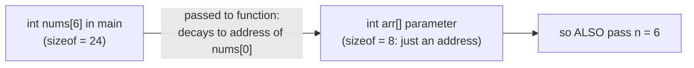

# Lesson B4 — Arrays and strings: rows of boxes, and text that ends in a zero

> Level: beginner. Prerequisites: B1–B3. Time: about 90 minutes.
> Tested with GCC 13.3 (`-std=c17`), and AddressSanitizer from GCC 13.3, x86-64 Linux, November 2026.

---

## 1. Why this lesson exists

Almost every program processes *collections*: marks of 60 students, pixels of an image, characters of a name. C's answer is the **array**: a fixed number of same-type elements stored **side by side** in memory. There is no `.length`, no bounds check, no resizing. And C has **no string type at all** — a "string" is just an array of `char` that happens to end with a zero byte.

These two design decisions (no bounds checks, zero-terminated strings) made C fast and simple in 1972, and they are also responsible for a very large share of the security vulnerabilities written since — buffer overflows. So this lesson is half "how to use arrays" and half "how not to get burned".

---

## 2. Intuition

- **An array is a row of identical lockers bolted together.** Locker numbers start at 0. If you have 5 lockers and ask for locker 7, C will not stop you: you open somebody else's locker. That is *out-of-bounds access* — undefined behaviour.
- **A C string is a train with a red caboose.** The carriages are characters; the red caboose is the **null character** `'\0'` (byte value 0). Functions like `strlen` walk along the train until they see the caboose. If the caboose is missing, they keep walking off the end of the platform.

---

## 3. Precise definitions

- **Array type:** `T a[N]` is an object of `N` contiguous elements of type `T`; `sizeof a == N * sizeof(T)`. Valid indices are `0` to `N-1`. Accessing `a[N]` or beyond (or a negative index) is undefined behaviour (N3220 §6.5.3.2 array subscripting, together with §6.5.7 additive operators, which only allow pointing up to "one past the last element").
- **Array-to-pointer conversion ("decay"):** in most expressions an array is automatically converted to the address of its first element. The exceptions are: operand of `sizeof`, operand of unary `&`, operand of `typeof`/`typeof_unqual` (C23), operand of `alignof`, and a string literal used to initialise an array (cppreference, *Array declaration*). Consequence for now: **when you pass an array to a function, the function receives only the start address — not the size.** Lesson B5 explains addresses fully.
- **String:** "a contiguous sequence of characters terminated by and including the first null character" (N3220 §7.1.1). Its **length** is the number of characters *before* the null.
- **String literal:** `"hi"` is a static array of 3 `char` (`'h'`, `'i'`, `'\0'`). Modifying a string literal is undefined behaviour.

---

## 4. Step by step

### Step 1 — declare, initialise, loop

```c
// file: arr_basics.c
// build: gcc -std=c17 -Wall -Wextra -o arr_basics arr_basics.c
// run: ./arr_basics

#include <stdio.h>

int main(void)
{
    int marks[5] = {70, 85, 90, 65, 100};   // 5 ints, side by side
    int zeros[4] = {0};                      // missing initialisers become 0
    int sized[] = {1, 2, 3};                 // size deduced from the initialiser: 3

    // number of elements = total bytes / bytes per element (works ONLY on a real array)
    size_t n = sizeof marks / sizeof marks[0];
    printf("marks has %zu elements, %zu bytes\n", n, sizeof marks);

    // find the maximum (a linear scan)
    int best = marks[0];
    for (size_t i = 1; i < n; i++)
        if (marks[i] > best)
            best = marks[i];
    printf("best = %d\n", best);

    printf("zeros[3] = %d, sized has %zu elements\n", zeros[3], sizeof sized / sizeof sized[0]);
    return 0;
}
```

Output:

```text
marks has 5 elements, 20 bytes
best = 100
zeros[3] = 0, sized has 3 elements
```

### Step 2 — passing an array to a function: the "missing size" wall

The dumbest approach: compute the length *inside* the function with the `sizeof` trick.

```c
// file: arr_param.c
// build: gcc -std=c17 -Wall -Wextra -o arr_param arr_param.c 2>&1 | grep -o "warning: .*" | head -2
// run: ./arr_param

#include <stdio.h>

// WRONG idea: arr looks like an array, but the parameter is really an address
void broken_len(int arr[])
{
    printf("inside: sizeof arr = %zu (size of an address, not the array!)\n", sizeof arr);
}

// RIGHT: the caller passes the length along with the array
int sum_arr(const int arr[], size_t n)       // const: we promise not to modify it
{
    int res = 0;
    for (size_t i = 0; i < n; i++)
        res += arr[i];
    return res;
}

int main(void)
{
    int nums[6] = {1, 2, 3, 4, 5, 6};
    printf("outside: sizeof nums = %zu\n", sizeof nums);
    broken_len(nums);
    printf("sum = %d\n", sum_arr(nums, sizeof nums / sizeof nums[0]));
    return 0;
}
```

Output (GCC also warns, via `-Wsizeof-array-argument`, that `sizeof` on an array parameter returns the pointer size):

```text
outside: sizeof nums = 24
inside: sizeof arr = 8 (size of an address, not the array!)
sum = 21
```

This wall is why C APIs always take a **(pointer, length)** pair: `memcpy(dst, src, n)`, `fgets(buf, size, stream)`, `snprintf(buf, size, ...)`. Make it your habit too.

### Step 3 — 2D arrays are rows laid end to end

```c
// file: grid.c
// build: gcc -std=c17 -Wall -Wextra -o grid grid.c
// run: ./grid

#include <stdio.h>

#define ROWS 2
#define COLS 3

int main(void)
{
    int grid[ROWS][COLS] = { {1, 2, 3},
                             {4, 5, 6} };    // 2 rows of 3

    // row-major: grid[r][c] sits at position r*COLS + c in memory
    for (int r = 0; r < ROWS; r++) {
        for (int c = 0; c < COLS; c++)
            printf("%d ", grid[r][c]);
        printf("\n");
    }
    printf("sizeof grid = %zu, sizeof grid[0] (one row) = %zu\n", sizeof grid, sizeof grid[0]);
    return 0;
}
```

Output:

```text
1 2 3 
4 5 6 
sizeof grid = 24, sizeof grid[0] (one row) = 12
```

(`#define ROWS 2` is a *macro*: the preprocessor replaces every `ROWS` with `2` before compilation. Lesson I4 covers macros.)

### Step 4 — strings: the zero at the end

```c
// file: str_basics.c
// build: gcc -std=c17 -Wall -Wextra -o str_basics str_basics.c
// run: ./str_basics

#include <stdio.h>
#include <string.h>   // strlen, strcmp, strcpy ...

int main(void)
{
    char name[] = "Ravi";            // array of 5 chars: 'R','a','v','i','\0'
    printf("strlen = %zu, sizeof = %zu\n", strlen(name), sizeof name);

    // print each byte, including the terminator, as a number
    for (size_t i = 0; i < sizeof name; i++)
        printf("name[%zu] = '%c' (%d)\n", i, name[i] ? name[i] : '0', name[i]);

    // our own strlen: walk until the terminator
    size_t len = 0;
    while (name[len] != '\0')
        len++;
    printf("hand-made strlen = %zu\n", len);

    // strings compare by content with strcmp; == would compare addresses
    char other[] = "Ravi";
    printf("strcmp == 0? %s\n", strcmp(name, other) == 0 ? "equal" : "different");
    return 0;
}
```

Output:

```text
strlen = 4, sizeof = 5
name[0] = 'R' (82)
name[1] = 'a' (97)
name[2] = 'v' (118)
name[3] = 'i' (105)
name[4] = '0' (0)
hand-made strlen = 4
strcmp == 0? equal
```

### Step 5 — the overflow wall, made visible with a sanitizer

Dumbest approach to copying a string: `strcpy(dst, src)`. It copies until it finds the null in `src` and has **no idea how big `dst` is**.

```c
// file: overflow_demo.c
// build: gcc -std=c17 -g -fsanitize=address -fno-omit-frame-pointer -o overflow_demo overflow_demo.c
// run: ./overflow_demo 2>&1 | grep -E "ERROR|WRITE|overflows" | head -3

#include <stdio.h>
#include <string.h>

int main(void)
{
    char small[8];                                   // room for 7 chars + '\0'
    const char *long_text = "this is far too long";  // 20 chars + '\0'
    strcpy(small, long_text);                        // writes 21 bytes into an 8-byte array: UB
    printf("%s\n", small);
    return 0;
}
```

Running with AddressSanitizer (ASan; lesson I8) stops the program at the bad write. Abridged output from GCC 13.3:

```text
==1864==ERROR: AddressSanitizer: stack-buffer-overflow on address 0x7fe867500028 at pc ... bp ... sp ...
WRITE of size 21 at 0x7fe867500028 thread T0
    #1 ... in main overflow_demo.c:12
    [32, 40) 'small' (line 10) <== Memory access at offset 40 overflows this variable
```

(The process id and addresses differ on every run.) Notice that GCC 13 already *warned at compile time* here, even without `-Wall`: `'strcpy' writing 21 bytes into a region of size 8 overflows the destination [-Wstringop-overflow=]`. It could see both sizes because they were constants. With a size only known at run time (user input), no compile-time warning is possible — that is why run-time tools matter. *Without* the sanitizer, the program may print the text and appear to work, may crash, or may corrupt a neighbouring variable silently. This is the stack buffer overflow that powered decades of exploits (Security track).

### Step 6 — the safe way: always know the size

```c
// file: safe_copy.c
// build: gcc -std=c17 -Wall -Wextra -o safe_copy safe_copy.c
// run: printf 'Prahalya Coimbatore\n' | ./safe_copy

#include <stdio.h>
#include <string.h>

int main(void)
{
    char buf[8];

    // snprintf never writes more than sizeof buf bytes and always terminates
    // it returns the length it WANTED to write, so we can detect truncation
    int wanted = snprintf(buf, sizeof buf, "%s", "this is far too long");
    printf("buf = \"%s\" (wanted %d chars, truncated: %s)\n",
           buf, wanted, (size_t)wanted >= sizeof buf ? "yes" : "no");

    // reading a line safely: fgets stops at sizeof line - 1 chars
    char line[10];
    if (fgets(line, sizeof line, stdin) != NULL) {
        line[strcspn(line, "\n")] = '\0';   // strip the newline if one was read
        printf("read: \"%s\"\n", line);
    }
    return 0;
}
```

Output (GCC also emits a `-Wformat-truncation` warning at compile time, because it can see the truncation coming — here it is intentional):

```text
buf = "this is" (wanted 20 chars, truncated: yes)
read: "Prahalya "
```

The input was longer than 9 characters, so `fgets` read only the first 9 and left the rest in the input stream — truncated, but *safe*. (`gets`, which had no size parameter at all, was removed from the language in C11 for exactly this reason — cppreference *History of C*.)

---

## 5. Diagrams

Memory picture of `char name[] = "Ravi";` and `int marks[5]`:

```text
name:   +-----+-----+-----+-----+------+
        | 'R' | 'a' | 'v' | 'i' | '\0' |      5 bytes, sizeof name == 5, strlen == 4
        +-----+-----+-----+-----+------+
index:     0     1     2     3     4

marks:  +------+------+------+------+------+
        |  70  |  85  |  90  |  65  | 100  |  each box 4 bytes -> 20 bytes
        +------+------+------+------+------+
offset:  0      4      8      12     16     20 <- "one past the end": may be pointed at, never read
```

2D array `grid[2][3]` in memory (row-major):

```text
        row 0             row 1
   +---+---+---+   +---+---+---+
   | 1 | 2 | 3 |   | 4 | 5 | 6 |      grid[r][c] is element number r*3 + c
   +---+---+---+   +---+---+---+
```



---

## 6. Common mistakes

| Mistake | Consequence | Fix |
|---|---|---|
| `for (i = 0; i <= n; i++)` | Reads/writes `a[n]`: out of bounds (UB) | `i < n` |
| `sizeof arr` inside a function to get the length | Gives the address size (8) | Pass the length as a parameter |
| `char s[5] = "hello";` | Legal in C, but no room for `'\0'` → not a string; `strlen(s)` runs off the end | `char s[6]` or `char s[] = "hello"` |
| `strcpy`, `strcat`, `sprintf` into fixed buffers | Buffer overflow | `snprintf`, or check lengths first; never `gets` |
| `if (s1 == s2)` for string equality | Compares addresses | `strcmp(s1, s2) == 0` |
| Forgetting `fgets` keeps the `'\n'` | Comparisons fail mysteriously | `line[strcspn(line, "\n")] = '\0';` |
| Modifying a string literal: `char *p = "hi"; p[0] = 'H';` | UB (often a crash: literals live in read-only memory) | `char p[] = "hi";` makes a modifiable copy |
| Returning a local array from a function | It dies when the function returns (lesson B6) | Caller supplies the buffer, or allocate on the heap |

---

## 7. Connections

- **DSA track:** arrays give O(1) indexing *because* elements are contiguous: address = base + i × size. Two-pointer and sliding-window techniques are just index arithmetic on this layout.
- **Computer Architecture track:** row-major layout decides whether your nested loop walks memory sequentially (cache-friendly) or jumps around (lesson P5 measures this).
- **Security track:** CERT rules STR31-C ("Guarantee that storage for strings has sufficient space for character data and the null terminator") and ARR30-C ("Do not form or use out-of-bounds pointers or array subscripts") exist because of Steps 5 and 6.
- **Java / Python tracks:** Java arrays carry their length and check bounds (throwing `ArrayIndexOutOfBoundsException`); Python strings are immutable objects with stored length. C trades that safety for zero overhead.
- **Rust track:** Rust slices are exactly C's (pointer, length) pair, made a first-class type with bounds checks.

---

## 8. Self-check questions

1. `int a[10];` — what are the valid indices, and what is `sizeof a` if `int` is 4 bytes?
2. Why can't a function find the length of an array argument with `sizeof`?
3. `char s[] = "abc";` — what are `sizeof s` and `strlen(s)`?
4. Why is `strcpy` dangerous and what do you use instead?
5. Where is `grid[1][2]` in memory relative to `grid[0][0]` for `int grid[2][3]`?
6. What does `fgets` do if the line is longer than the buffer?

<details>
<summary>Answers</summary>

1. 0 to 9; 40 bytes.
2. The array decays to the address of its first element when passed, so the parameter is really an address; `sizeof` gives the size of the address.
3. `sizeof s` = 4 (three letters plus `'\0'`); `strlen(s)` = 3.
4. It copies until the source's null byte without knowing the destination's size, so a long source overflows the destination. Use `snprintf(dst, sizeof dst, "%s", src)` (or check `strlen(src) < sizeof dst` before copying).
5. Element index 1×3 + 2 = 5, i.e. 5 × 4 = 20 bytes after `grid[0][0]`.
6. It reads at most `size − 1` characters, terminates the buffer with `'\0'`, and leaves the remaining characters in the stream for the next read.

</details>

---

## 9. Mnemonic (Tamil + English)

**Strings end in zero:**

> **"Kadaisi la zero illana, train platform-ai thaandi odum."** — If there is no zero at the end, the train runs right off the platform. (`strlen` keeps walking past the end.)

**Valid indices `0..N-1`:**

> **"Zero-la start, N-la stop illa; N-1-la nillu."** — Start at zero; don't stop *at* N, stop at N−1.

**Array APIs need (pointer, length):** **"Address mattum kudutha, auto-kaaran meter podamaattaan"** — give only the address and the auto driver won't run the meter; always give the length too.

---

## Sources

- WG14 N3220: §6.5.3.2 array subscripting, §6.5.7 additive operators (one-past-the-end rule), §7.1.1 definition of a string, §6.4.5 string literals: https://open-std.org/JTC1/SC22/WG14/www/docs/n3220.pdf
- cppreference, *Array declaration* (array-to-pointer conversion and its exceptions): https://en.cppreference.com/w/c/language/array
- cppreference, *History of C* (`gets` removed in C11): https://en.cppreference.com/w/c/language/history
- cppreference, *fgets*: https://en.cppreference.com/w/c/io/fgets ; *snprintf*: https://en.cppreference.com/w/c/io/fprintf
- Clang AddressSanitizer docs (stack/heap/global out-of-bounds detection): https://clang.llvm.org/docs/AddressSanitizer.html
- SEI CERT C rules (STR31-C, ARR30-C): https://cmu-sei.github.io/secure-coding-standards/sei-cert-c-coding-standard/rules

## Verify yourself

1. Run every block with its `// build:` / `// run:` lines. For `overflow_demo.c`, run it once *without* `-fsanitize=address` and compare the behaviour.
2. Confirm the "decay" exception list against cppreference's *Array declaration* page.
3. Change `char line[10]` to `char line[100]` in `safe_copy.c` and confirm the full line (without the newline) is printed.
4. Check that GCC warns for `sizeof` on an array parameter: `gcc -Wall -c arr_param.c` should print `-Wsizeof-array-argument`.
