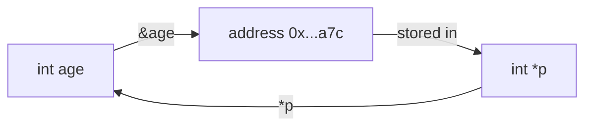

# Lesson B5 — Pointers, a first look: variables that hold addresses

> Level: beginner. Prerequisites: B1–B4. Time: about 2 hours (take a break halfway).
> Tested with GCC 13.3 (`-std=c17`) on x86-64 Linux, November 2026.

---

## 1. Why pointers exist

Three walls from earlier lessons all have the same solution:

1. **B3:** `swap_copy(x, y)` could not change the caller's variables, because functions receive copies.
2. **B1:** `scanf` needed `&age` — "the address of `age`" — to write into it.
3. **B4:** passing an array to a function passed only "the address of the first element".

A **pointer** is a variable whose value is a memory address. With addresses, a function can reach back into the caller's memory; large data can be shared without copying; and data structures (linked lists, trees — lesson I2) can link pieces of memory together. Pointers are not an exotic feature of C — they are *how the machine itself works*: every load and store instruction the CPU executes takes an address.

---

## 2. Intuition: house numbers

Memory is a very long street of houses (bytes), each with a house number (address).

- A normal variable `int age = 21;` is a house with the number 21 painted inside.
- `&age` asks: **"what is the house number of `age`?"** — e.g. 0x7ffd1234.
- A pointer `int *p = &age;` is a *piece of paper with that house number written on it*.
- `*p` means **"go to the house written on the paper and look inside"** → 21.
- `*p = 22;` means "go to that house and repaint what's inside" → `age` is now 22.

Two operators, opposite directions:

```text
     &  : variable  --->  its address      ("where do you live?")
     *  : address   --->  the variable there ("who lives at this address?")
```

---

## 3. Precise definitions

- **Pointer type:** for an object type `T`, `T *` is "pointer to `T`" (N3220 §6.2.5). The type matters: it tells the compiler how many bytes to read at the address and how to interpret them, and how far `p + 1` moves.
- **Address operator `&`:** "The unary `&` operator yields the address of its operand" (N3220 §6.5.4.2).
- **Indirection operator `*`:** if the operand points to an object, the result is an lvalue designating that object; if the pointer is invalid (null, dangling, misaligned), the behaviour is undefined (N3220 §6.5.4.2).
- **Null pointer:** a pointer value that is guaranteed to compare unequal to the address of any object. Written `NULL` (from `<stddef.h>`/`<stdio.h>`/`<stdlib.h>`), or `nullptr` in C23 (lesson A5). Dereferencing it is UB.
- **Pointer arithmetic:** if `p` points to element `i` of an array, `p + k` points to element `i + k` — it moves by `k * sizeof(T)` bytes. The result must stay within the array or point exactly one past its end; anything else is UB (N3220 §6.5.7).
- **Subscripting:** `a[i]` is *defined* as `*(a + i)` (N3220 §6.5.3.2). That single sentence explains why arrays and pointers feel so similar.

---

## 4. Step by step

### Step 1 — look at real addresses

```c
// file: addr.c
// build: gcc -std=c17 -Wall -Wextra -o addr addr.c
// run: ./addr

#include <stdio.h>

int main(void)
{
    int age = 21;
    int *p = &age;          // p holds the address of age

    // %p prints an address; it expects a void * (a generic pointer), hence the cast
    printf("value of age      : %d\n", age);
    printf("address of age    : %p\n", (void *)&age);
    printf("value stored in p : %p\n", (void *)p);     // same address
    printf("*p (go there)     : %d\n", *p);

    *p = 22;                // write THROUGH the pointer
    printf("age after *p = 22 : %d\n", age);

    printf("sizeof p = %zu bytes (an address on x86-64)\n", sizeof p);
    return 0;
}
```

Output (the address differs on every run because of address-space layout randomisation, lesson B6):

```text
value of age      : 21
address of age    : 0x7ffc3b1e4a7c
value stored in p : 0x7ffc3b1e4a7c
*p (go there)     : 21
age after *p = 22 : 22
sizeof p = 8 bytes (an address on x86-64)
```

### Step 2 — finish the swap from lesson B3

```c
// file: swap_ok.c
// build: gcc -std=c17 -Wall -Wextra -o swap_ok swap_ok.c
// run: ./swap_ok

#include <stdio.h>

// receives the ADDRESSES of the caller's variables
void swap(int *a, int *b)
{
    int tmp = *a;     // read what lives at address a
    *a = *b;          // overwrite the caller's first variable
    *b = tmp;         // overwrite the caller's second variable
}

int main(void)
{
    int x = 1, y = 2;
    swap(&x, &y);                         // hand over where x and y live
    printf("x=%d y=%d\n", x, y);
    return 0;
}
```

Output:

```text
x=2 y=1
```

Notice: C is *still* pass-by-value. `swap` receives copies of two **addresses**. But a copy of a house number still leads to the same house. That is the whole trick.

### Step 3 — returning more than one result

A function can return only one value, but it can write any number of results through pointers ("out-parameters").

```c
// file: minmax.c
// build: gcc -std=c17 -Wall -Wextra -o minmax minmax.c
// run: ./minmax

#include <stdio.h>
#include <stddef.h>

// finds min and max of arr[0..n-1]; returns 0 on success, -1 if n == 0
int min_max(const int arr[], size_t n, int *lo, int *hi)
{
    if (n == 0)
        return -1;                 // nothing to scan: report failure, outputs untouched
    *lo = *hi = arr[0];            // start both with the first element
    for (size_t i = 1; i < n; i++) {
        if (arr[i] < *lo) *lo = arr[i];
        if (arr[i] > *hi) *hi = arr[i];
    }
    return 0;
}

int main(void)
{
    int data[] = {7, -3, 12, 5, 0};
    int lo, hi;
    if (min_max(data, sizeof data / sizeof data[0], &lo, &hi) == 0)
        printf("lo=%d hi=%d\n", lo, hi);
    return 0;
}
```

Output:

```text
lo=-3 hi=12
```

### Step 4 — pointer arithmetic and `a[i] == *(a + i)`

```c
// file: ptr_arith.c
// build: gcc -std=c17 -Wall -Wextra -o ptr_arith ptr_arith.c
// run: ./ptr_arith

#include <stdio.h>

int main(void)
{
    int nums[4] = {10, 20, 30, 40};
    int *p = nums;                       // the array decays to &nums[0]

    // p + 1 moves by sizeof(int) = 4 bytes, not by 1 byte
    printf("p     = %p\n", (void *)p);
    printf("p + 1 = %p\n", (void *)(p + 1));

    // three spellings of the same element
    printf("nums[2]=%d  *(nums+2)=%d  p[2]=%d\n", nums[2], *(nums + 2), p[2]);

    // walk the array with a pointer instead of an index
    int res = 0;
    for (int *q = nums; q < nums + 4; q++)   // nums + 4 is "one past the end": OK to compare
        res += *q;
    printf("sum via pointer walk = %d\n", res);

    // difference of two pointers into the same array = number of elements between them
    int *l = &nums[0], *r = &nums[3];
    printf("r - l = %td elements\n", r - l);  // %td prints a ptrdiff_t
    return 0;
}
```

Output (addresses vary; the difference between the first two lines is always 4):

```text
p     = 0x7ffd5a0c2b40
p + 1 = 0x7ffd5a0c2b44
nums[2]=30  *(nums+2)=30  p[2]=30
sum via pointer walk = 100
r - l = 3 elements
```

### Step 5 — the dangerous pointers (and the dumbest mistakes)

```c
// file: bad_ptrs.c
// build: gcc -std=c17 -Wall -Wextra -o bad_ptrs bad_ptrs.c
// run: ./bad_ptrs

#include <stdio.h>

int main(void)
{
    int *wild;              // uninitialised: holds whatever bits were there. NEVER dereference.
    int *safe = NULL;       // explicitly "points nowhere"

    (void)wild;             // silence the unused warning; we do NOT use it

    // the habit: check for NULL before dereferencing any pointer you didn't just set
    if (safe != NULL)
        printf("%d\n", *safe);
    else
        printf("safe is NULL, not dereferencing\n");
    return 0;
}
```

Output:

```text
safe is NULL, not dereferencing
```

The four pointer sins, each undefined behaviour:

1. **Wild pointer:** dereferencing an uninitialised pointer.
2. **Null dereference:** `*p` when `p == NULL` (usually a segmentation fault on Linux, but the *compiler* may also assume it never happens — lesson I3).
3. **Dangling pointer:** pointing to an object whose lifetime ended (a returned local variable — lesson B6; freed heap memory — lesson I2).
4. **Out-of-bounds arithmetic:** going further than one past the end of an array.

### Step 6 — `const` and pointers (read the declaration right to left)

```c
// file: const_ptr.c
// build: gcc -std=c17 -Wall -Wextra -o const_ptr const_ptr.c
// run: ./const_ptr

#include <stdio.h>

// the function promises not to modify the characters it is given
size_t count_vowels(const char *s)
{
    size_t res = 0;
    for (; *s != '\0'; s++)            // moving s itself is fine; s is not const
        if (*s == 'a' || *s == 'e' || *s == 'i' || *s == 'o' || *s == 'u')
            res++;
    // *s = 'X';  would be a compile error: the chars are const
    return res;
}

int main(void)
{
    int a = 1, b = 2;
    const int *p1 = &a;      // "pointer to const int": can't change *p1, can change p1
    int *const p2 = &a;      // "const pointer to int": can change *p2, can't change p2
    p1 = &b;                 // OK
    *p2 = 10;                // OK: a becomes 10
    printf("a=%d *p1=%d vowels=%zu\n", a, *p1, count_vowels("coimbatore"));
    return 0;
}
```

Output:

```text
a=10 *p1=2 vowels=5
```

Reading trick: read right to left from the variable name. `const int *p1` → "p1 is a pointer to an int that is const". `int *const p2` → "p2 is a const pointer to an int".

---

## 5. Diagrams

```text
 Stack memory (addresses are illustrative)

   address        contents             name
 +-------------+---------------------+------
 | 0x...a7c    |        22           | age          <- *p reads/writes here
 +-------------+---------------------+------
 | 0x...a80    |   0x...a7c          | p            <- p's VALUE is age's ADDRESS
 +-------------+---------------------+------

          p ──────────────► age
       (holds 0x...a7c)    (holds 22)
```

Pointer arithmetic over `int nums[4]`:

```text
            nums[0]   nums[1]   nums[2]   nums[3]   (one past end)
           +--------+--------+--------+--------+
           |   10   |   20   |   30   |   40   |
           +--------+--------+--------+--------+
 address:   b        b+4      b+8      b+12     b+16
 pointer:   p        p+1      p+2      p+3      p+4   <- may be formed and compared, never dereferenced
```



---

## 6. Common mistakes

| Mistake | Consequence | Fix |
|---|---|---|
| `int *p; *p = 5;` | Writes to a random address (UB) | Initialise: `int *p = &x;` or `NULL` |
| `int* a, b;` thinking both are pointers | Only `a` is a pointer; `b` is an `int` | One declaration per line, or `int *a, *b;` |
| Forgetting `&` when calling `swap(x, y)` | Compile error/warning (int passed as pointer) — GCC 14 makes it an error (`-Wint-conversion`) | `swap(&x, &y)` |
| Printing a pointer with `%d` or `%x` | Wrong size, UB | `%p` with a `(void *)` cast |
| Not checking for `NULL` from functions that may fail | Null dereference crash | `if (p == NULL) { handle }` |
| Pointer arithmetic beyond one-past-the-end | UB even if you never dereference | Keep loops within `[base, base + n]` |
| Comparing pointers into *different* arrays with `<` | UB (relational comparison requires same array/object) | Only compare pointers into the same object; `==` is always allowed |

---

## 7. Connections

- **Computer Architecture track:** a pointer is just a 64-bit integer in a register used as a load/store address; `p + 1` scaling by `sizeof(T)` is what the `lea` instruction's scale factor does (lesson A2 shows it).
- **Java track:** Java references are pointers without arithmetic and with automatic null checks (`NullPointerException`). The name gives it away.
- **DSA track:** linked lists, trees and graphs are built from pointers (lesson I2). Two-pointer techniques (`l`, `r`) map to real pointers walking an array.
- **OS track:** these addresses are *virtual*; the OS and MMU translate them to physical memory (lesson B6 and the OS track's paging chapter).
- **Rust track:** Rust's references are pointers whose validity (no dangling, no data races) the borrow checker proves at compile time — a direct response to the four sins above.

---

## 8. Self-check questions

1. If `int x = 5; int *p = &x;`, what are `*p`, `p`, and `&p`?
2. Why does `swap(int *a, int *b)` work while `swap_copy(int a, int b)` does not, given that C is always pass-by-value?
3. If `p` points to `nums[0]` of an `int` array, by how many bytes does `p + 3` differ from `p` (4-byte `int`)?
4. Why is `nums[i]` the same as `i[nums]`? (Try it!)
5. Difference between `const char *s` and `char *const s`?
6. Name the four pointer sins.

<details>
<summary>Answers</summary>

1. `*p` is 5 (the int at that address); `p` is the address of `x`; `&p` is the address of the pointer variable itself (type `int **`).
2. The function receives copies of the *addresses*; a copied address still refers to the caller's original variables, so writing through it changes them.
3. 12 bytes (3 × `sizeof(int)`).
4. `a[i]` is defined as `*(a + i)`, and addition is commutative, so `i[a]` is `*(i + a)` — the same thing. (Legal, but never write it in real code.)
5. `const char *s`: the characters are read-only, the pointer can move. `char *const s`: the pointer is fixed, the characters can be modified.
6. Wild (uninitialised) pointer, null dereference, dangling pointer, out-of-bounds pointer arithmetic.

</details>

---

## 9. Mnemonic (Tamil + English)

**`&` vs `*`:**

> **"& — 'Enga irukka?' ; * — 'Ulla enna irukku?'"** — `&` asks *"where are you?"* (gives the address); `*` asks *"what's inside?"* (goes to the address and reads).

**Reading `const` declarations right to left:**

> **"Valadhu-la irundhu idadhu, Tamil padikra maadhiri illa — Urdu padikra maadhiri!"** — Read it right to left like Urdu, not left to right: `int *const p` → "p is a const pointer to int".

**The four sins — "WNDO":** **W**ild, **N**ull, **D**angling, **O**ut-of-bounds → *"Window"* — "Pointer-ai WNDO-la thookki podaadhe" (don't throw your pointer out of the WiNDOw).

---

## Sources

- WG14 N3220: §6.2.5 types (pointer types), §6.5.3.2 array subscripting (`E1[E2]` is `(*((E1)+(E2)))`), §6.5.4.2 address and indirection operators, §6.5.7 additive operators (pointer arithmetic and one-past-the-end), §6.5.9 relational operators: https://open-std.org/JTC1/SC22/WG14/www/docs/n3220.pdf
- cppreference, *Pointer declaration*: https://en.cppreference.com/w/c/language/pointer
- cppreference, *Member access operators* (subscript, dereference, address-of): https://en.cppreference.com/w/c/language/operator_member_access
- cppreference, *Arithmetic operators* (pointer arithmetic): https://en.cppreference.com/w/c/language/operator_arithmetic
- cppreference, *printf* (`%p`, `%td`, `%zu`): https://en.cppreference.com/w/c/io/fprintf
- GCC, *Porting to GCC 14* (`-Wint-conversion` is an error by default): https://gcc.gnu.org/gcc-14/porting_to.html

## Verify yourself

1. Run each block using the `// build:`/`// run:` lines. Run `addr` twice and note the address changes (ASLR).
2. In `ptr_arith.c`, change `int` to `double` and confirm `p + 1` now differs by 8.
3. Write `printf("%d\n", 2[nums]);` and confirm it prints 30.
4. Try `swap(x, y)` (no `&`) with `gcc-14 -std=c17` and read the error.
5. Read the one-sentence definition of `E1[E2]` in N3220 §6.5.3.2 yourself.
