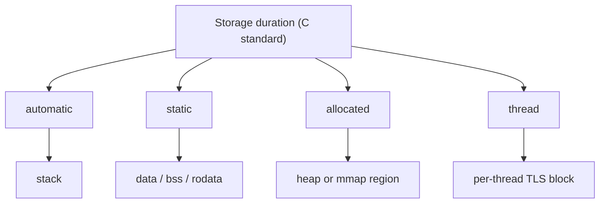

# Lesson B6 — Memory layout: where your variables actually live (stack vs heap)

> Level: beginner. Prerequisites: B1–B5. Time: about 2 hours.
> Tested with GCC 13.3 (`-std=c17`), glibc 2.39, Linux x86-64 (Ubuntu 24.04), November 2026.

---

## 1. Why this lesson exists

So far every variable just "existed". But a running program's memory is divided into regions with very different rules: some data lives for the whole run, some vanishes when a function returns, some lives exactly as long as you say. Most of C's nastiest bugs — dangling pointers, memory leaks, stack overflows, buffer overflows — come from not knowing *which region* a piece of data is in and *how long* it lives.

Java and Python hide this behind a garbage collector. C makes you choose. Once you can draw this lesson's diagram from memory, pointers stop being scary.

---

## 2. Intuition: a hostel building

Think of the process's memory as a tall hostel building:

- **Ground floor — the office (text/code):** the instructions of your program. Read-only; nobody lives here.
- **First floor — permanent residents (data and bss):** global and `static` variables. They move in before `main` starts and leave only when the program ends.
- **Middle floors, growing upward — the hall you book (heap):** you ask the warden (`malloc`) for a room of a given size, you get a room number (a pointer), and you *must* hand the key back (`free`). If you forget, the room stays booked forever (a **leak**). If you go back into the room after returning the key, someone else may be living there (**use-after-free**).
- **Top floors, growing downward — the guest rooms by the stairs (stack):** every function call gets a room automatically on arrival and loses it automatically on departure. Fast and tidy, but small, and anything left in the room is gone when you leave.

---

## 3. Precise definitions

### 3.1 What the C standard says: storage durations

The C standard does not talk about "stack" or "heap" at all. It defines **storage durations** — how long an object lives (N3220 §6.2.4; cppreference *Storage duration*):

| Storage duration | Which objects | Lifetime |
|---|---|---|
| **automatic** | non-`static` local variables, function parameters | from entry into the block until exit from it |
| **static** | globals, `static` locals, string literals | the entire program execution; initialised once, before `main` |
| **thread** (C11) | `thread_local` / `_Thread_local` objects | the entire life of the owning thread |
| **allocated** | memory from `malloc`, `calloc`, `realloc`, `aligned_alloc` | from allocation until `free` |

Using an object after its lifetime ends is undefined behaviour, and "the value of a pointer becomes indeterminate when the object it points to … reaches the end of its lifetime" (N3220 §6.2.4).

### 3.2 What a typical implementation does: the process memory map

On Linux x86-64 (and most systems), the implementation maps those durations onto regions of the process's **virtual address space**:

| Region | Holds | Typical permissions |
|---|---|---|
| **text** | machine code | read + execute |
| **rodata** | string literals, `const` globals | read-only |
| **data** | initialised globals/statics (`int g = 5;`) | read + write |
| **bss** | zero-initialised globals/statics (`int z;`) — takes no space in the file, zero-filled at load | read + write |
| **heap** | small `malloc` blocks (grown with the `brk` system call) | read + write |
| **memory-mapped area** | shared libraries, large `malloc` blocks (glibc uses `mmap` above a threshold, 128 KiB by default) | varies |
| **stack** | automatic variables, return addresses, saved registers | read + write |

The glibc `malloc(3)` man page documents that allocations larger than `MMAP_THRESHOLD` (128 kB by default, adjustable) are served with `mmap(2)`; the glibc manual's *Memory Allocation Tunables* page gives the same default of 131072 bytes.

**ASLR (address-space layout randomisation):** the kernel places the stack, heap, libraries (and position-independent executables) at random offsets on each run, so exploits cannot hard-code addresses. That is why the addresses you print change every run.

---

## 4. Step by step

### Step 1 — print an address from every region

```c
// file: regions.c
// build: gcc -std=c17 -Wall -Wextra -o regions regions.c
// run: ./regions

#include <stdio.h>
#include <stdlib.h>

int global_init = 42;          // data segment (initialised)
int global_zero;               // bss segment (zero-initialised)
const char *msg = "literal";   // the pointer is in data; the characters are in rodata

void some_function(void) {}    // code lives in text

int main(void)
{
    int local = 1;                              // stack (automatic)
    static int static_local = 2;                // data (static storage, block scope)
    int *heap_small = malloc(16);               // heap (allocated)
    int *heap_big = malloc(1 << 20);            // 1 MiB: glibc serves this with mmap

    if (heap_small == NULL || heap_big == NULL) // malloc can fail: always check
        return 1;

    // cast function pointer through an integer type only for printing (implementation-specific)
    printf("text   (function)      : %p\n", (void *)(size_t)some_function);
    printf("rodata (string literal): %p\n", (void *)msg);
    printf("data   (global_init)   : %p\n", (void *)&global_init);
    printf("data   (static_local)  : %p\n", (void *)&static_local);
    printf("bss    (global_zero)   : %p\n", (void *)&global_zero);
    printf("heap   (malloc 16)     : %p\n", (void *)heap_small);
    printf("mmap   (malloc 1 MiB)  : %p\n", (void *)heap_big);
    printf("stack  (local)         : %p\n", (void *)&local);

    free(heap_small);          // give the rooms back
    free(heap_big);
    (void)static_local;
    return 0;
}
```

One run on the test machine:

```text
text   (function)      : 0x55a5922711a9
rodata (string literal): 0x55a592272004
data   (global_init)   : 0x55a592274010
data   (static_local)  : 0x55a592274014
bss    (global_zero)   : 0x55a592274024
heap   (malloc 16)     : 0x55a5c25ee2a0
mmap   (malloc 1 MiB)  : 0x7ff2492ff010
stack  (local)         : 0x7ffd75965664
```

A real-world surprise from testing this lesson: the sandbox's environment had `MALLOC_MMAP_THRESHOLD_=67108864` set (64 MiB), and with it the 1 MiB block came from the ordinary heap (`0x55b8152902c0`, right after the 16-byte block). glibc lets environment variables and `GLIBC_TUNABLES` override the 128 KiB default. The output above was produced with those variables unset (`env -u MALLOC_MMAP_THRESHOLD_ ./regions`). Lesson: "where does `malloc` put it" is an *implementation* detail, never a language guarantee.

Read the pattern, not the numbers: code < rodata < data < bss < heap, then a huge gap, then mmap'd memory, then the stack near the top. (Printing a *function* address with `%p` requires converting a function pointer to `void *`, which the C standard does not guarantee; it works on POSIX systems. That is why the cast looks odd — lesson I1 covers function pointers properly.)

### Step 2 — ask the kernel for the map

Linux exposes every mapping of a process in `/proc/<pid>/maps`; `/proc/self/maps` is "my own" map. The `[heap]` and `[stack]` labels are documented pseudo-paths (man page `proc_pid_maps(5)`).

```c
// file: show_maps.c
// build: gcc -std=c17 -Wall -Wextra -o show_maps show_maps.c
// run: ./show_maps | grep -E "show_maps|\[heap\]|\[stack\]|libc" | awk '{print $1, $2, $6}'

#include <stdio.h>
#include <stdlib.h>

int main(void)
{
    void *p = malloc(100);              // make sure the heap exists
    FILE *f = fopen("/proc/self/maps", "r");
    if (f == NULL || p == NULL)
        return 1;

    char line[512];
    while (fgets(line, sizeof line, f) != NULL)   // copy the map to stdout line by line
        fputs(line, stdout);

    fclose(f);
    free(p);
    return 0;
}
```

Output on the test machine (address ranges vary; columns are range, permissions, path):

```text
5d1d6a2fa000-5d1d6a2fb000 r--p /tmp/kbtest/06-memory-layout-stack-vs-heap/show_maps
5d1d6a2fb000-5d1d6a2fc000 r-xp /tmp/kbtest/06-memory-layout-stack-vs-heap/show_maps
5d1d6a2fc000-5d1d6a2fd000 r--p /tmp/kbtest/06-memory-layout-stack-vs-heap/show_maps
5d1d6a2fd000-5d1d6a2fe000 r--p /tmp/kbtest/06-memory-layout-stack-vs-heap/show_maps
5d1d6a2fe000-5d1d6a2ff000 rw-p /tmp/kbtest/06-memory-layout-stack-vs-heap/show_maps
5d1d7f6b6000-5d1d7f6d7000 rw-p [heap]
7f2bd0c00000-7f2bd0c28000 r--p /usr/lib/x86_64-linux-gnu/libc.so.6
7f2bd0c28000-7f2bd0db0000 r-xp /usr/lib/x86_64-linux-gnu/libc.so.6
7f2bd0db0000-7f2bd0dff000 r--p /usr/lib/x86_64-linux-gnu/libc.so.6
7f2bd0dff000-7f2bd0e03000 r--p /usr/lib/x86_64-linux-gnu/libc.so.6
7f2bd0e03000-7f2bd0e05000 rw-p /usr/lib/x86_64-linux-gnu/libc.so.6
7ffd2a1c4000-7ffd2a1e5000 rw-p [stack]
```

`r-xp` is the code (read + execute, private), `rw-p` the writable data. Only the code segment is executable and only the data segments are writable — that separation (often called W^X, "write xor execute") is a security feature.

### Step 3 — the dumbest bug: returning the address of a local

```c
// file: dangling.c
// build: gcc -std=c17 -Wall -Wextra -o dangling dangling.c 2>&1 | grep -o "warning: .*"
// run: ./dangling

#include <stdio.h>

// returns the address of a local array: the array dies when the function returns
char *make_greeting_bad(void)
{
    char buf[32] = "vanakkam";
    return buf;                 // GCC warns: function returns address of local variable
}

int main(void)
{
    char *g = make_greeting_bad();   // g is a dangling pointer (GCC even replaces it with NULL)
    printf("pointer: %p\n", (void *)g);
    return 0;
}
```

Output (GCC 13.3, `-O0`):

```text
warning: function returns address of local variable [-Wreturn-local-addr]
pointer: (nil)
```

Interesting: GCC, knowing that using such a pointer is UB, *returns a null pointer* instead — so a later `printf("%s", g)` would crash immediately rather than print stale data. A different compiler or version might return the stale stack address. Either way the program is wrong. The fix is one of:

1. **Caller provides the buffer** (most idiomatic C): `void make_greeting(char *out, size_t n)`.
2. **Return heap memory** that the caller must `free` (Step 4).
3. **Return a pointer to static storage** (e.g. a string literal) when the data is constant.

### Step 4 — the heap: `malloc` and `free`

```c
// file: heap_basics.c
// build: gcc -std=c17 -Wall -Wextra -o heap_basics heap_basics.c
// run: ./heap_basics 5

#include <stdio.h>
#include <stdlib.h>
#include <string.h>

// returns a NEW heap string; the CALLER owns it and must free it
char *make_greeting(const char *name)
{
    size_t need = strlen("vanakkam, ") + strlen(name) + 1;  // +1 for '\0'
    char *res = malloc(need);                               // ask for exactly that many bytes
    if (res == NULL)
        return NULL;                                        // propagate failure
    snprintf(res, need, "vanakkam, %s", name);
    return res;                                             // heap memory outlives this call
}

int main(int argc, char *argv[])
{
    // argv holds the command-line words; argv[1] is the first argument (if any)
    int n = (argc > 1) ? atoi(argv[1]) : 3;

    // an array whose size is known only at run time: allocate it on the heap
    int *squares = malloc((size_t)n * sizeof *squares);    // sizeof *squares == sizeof(int)
    if (squares == NULL) {
        fprintf(stderr, "out of memory\n");
        return 1;
    }
    for (int i = 0; i < n; i++)
        squares[i] = i * i;                                 // use it like an array
    for (int i = 0; i < n; i++)
        printf("%d ", squares[i]);
    printf("\n");
    free(squares);                                          // hand back the room
    squares = NULL;                                         // defensive: no dangling pointer left

    char *g = make_greeting("Prahalya");
    if (g != NULL) {
        printf("%s\n", g);
        free(g);                                            // the caller frees what it received
    }
    return 0;
}
```

Output:

```text
0 1 4 9 16 
vanakkam, Prahalya
```

Rules of thumb (all from the `malloc(3)` man page and the C standard):

- `malloc` returns **uninitialised** memory; `calloc(n, size)` returns zeroed memory and checks `n * size` for overflow.
- `malloc` returns `NULL` on failure — always check.
- `free(NULL)` does nothing (safe). Freeing the same pointer twice is undefined behaviour.
- Every successful `malloc` must be matched by exactly one `free`. Lesson I2 builds disciplined ownership rules on top of this; lesson I8 shows tools that catch leaks automatically.

### Step 5 — stack vs heap, measured by failure modes

```c
// file: stack_limit.c
// build: gcc -std=c17 -Wall -Wextra -o stack_limit stack_limit.c
// run: ./stack_limit; echo "exit=$?"

#include <stdio.h>
#include <stdlib.h>

int main(void)
{
    // 64 MiB on the heap: fine on a normal machine
    size_t big = 64u * 1024 * 1024;
    char *h = malloc(big);
    printf("heap 64 MiB: %s\n", h ? "ok" : "failed");
    free(h);

    // a 64 MiB LOCAL array would exceed the default 8 MiB stack and crash with SIGSEGV:
    //   char s[64 * 1024 * 1024]; s[0] = 1;
    // so we don't do it here; try it yourself (see "Verify yourself").
    return 0;
}
```

Output:

```text
heap 64 MiB: ok
exit=0
```

| | Stack | Heap |
|---|---|---|
| Who allocates | compiler, automatically, on function entry | you, with `malloc` |
| Who frees | automatic, on return | you, with `free` |
| Speed | very fast (moving one register) | slower (allocator bookkeeping) |
| Size | small, fixed limit (8 MiB on the test machine, `ulimit -s`) | large (limited by RAM + virtual memory) |
| Lifetime | ends with the function | until `free` |
| Typical bugs | returning address of local, overflowing a local buffer, too-deep recursion | leaks, double free, use-after-free, heap overflow |

---

## 5. Diagram: the process address space (Linux x86-64, simplified)

```text
 high addresses  0x7fff ffff ffff
 +--------------------------------+
 |  stack  (grows DOWN)  [stack]  |  locals, return addresses   rw-
 |               |                |
 |               v                |
 |                                |
 |  memory-mapped region          |  libc.so, big malloc blocks  r-x / rw-
 |                                |
 |               ^                |
 |               |                |
 |  heap   (grows UP)    [heap]   |  malloc'd small blocks       rw-
 +--------------------------------+
 |  bss   (zero-initialised)      |  int global_zero;            rw-
 |  data  (initialised)           |  int global_init = 42;       rw-
 |  rodata (read-only)            |  "literal"                   r--
 |  text  (code)                  |  main, some_function         r-x
 +--------------------------------+
 low addresses (randomised base with ASLR/PIE)
```



---

## 6. Common mistakes

| Mistake | Consequence | Fix |
|---|---|---|
| Returning a pointer to a local variable | Dangling pointer (UB) | Caller buffer, heap allocation, or static data |
| Not checking `malloc`'s result | Null dereference when memory runs out | `if (p == NULL) …` |
| `malloc(n * sizeof(int))` with huge `n` | Multiplication overflows → tiny buffer → heap overflow | `calloc(n, sizeof(int))` (checks overflow) or check `n` first |
| Forgetting `free` | Memory leak (grows until the process dies) | Pair every `malloc` with one `free`; decide who owns it |
| Using memory after `free` | Use-after-free (UB, security hole) | Set the pointer to `NULL` after freeing |
| Assuming `malloc`'d memory is zero | Reads garbage | Use `calloc` or initialise |
| Huge local arrays | Stack overflow → segmentation fault | Heap-allocate large buffers |
| Writing to a string literal | Segfault (literal is in read-only rodata) | Copy into a `char[]` |

---

## 7. Connections

- **OS track:** virtual memory, pages, page faults, `brk`/`mmap` system calls, copy-on-write and ASLR are the OS-side story of this lesson. `/proc/self/maps` is your window into it.
- **Computer Architecture track:** the stack pointer register (`rsp` on x86-64) and how `call`/`ret` push and pop return addresses (lesson A2).
- **Java / Python tracks:** objects live on a garbage-collected heap, locals/references in stack frames. A GC removes leaks and use-after-free by design, at the cost of pauses and memory overhead.
- **Security track:** stack smashing (overwriting the return address), heap exploitation, W^X, ASLR and stack canaries are all defences or attacks on this layout (lessons A2, P4).
- **Cloud/DevOps track:** a container memory limit (cgroup) kills a process whose heap keeps growing — leaks become OOM kills in production.

### Where this shows up in my projects

- **aws-waste-scanner:** an AWS Lambda function is billed by memory size × duration, and its memory setting is a hard cap. A C (or any native) extension that leaks heap memory across warm invocations of the same Lambda container would steadily grow toward that cap — the same "booked room never returned" leak described above, in a cloud setting. (This is a general property of long-lived processes, stated here as an analogy, not a bug found in the project.)

---

## 8. Self-check questions

1. Which storage duration does each have: a function parameter; a `static int` inside a function; a global `int g;`; a block from `malloc`?
2. Why does `int global_zero;` not take space in the executable file?
3. Why do printed addresses change between runs?
4. What exactly is wrong with returning `buf` from `make_greeting_bad`?
5. Give two reasons to put an array on the heap instead of the stack.
6. What does `free(NULL)` do? What does `free(p); free(p);` do?

<details>
<summary>Answers</summary>

1. Automatic; static; static; allocated.
2. It lives in `.bss`, which the file only records as "this many bytes of zeros"; the loader allocates and zero-fills it at start-up.
3. ASLR: the kernel randomises the base addresses of the stack, heap, libraries and position-independent executable on each run.
4. `buf` has automatic storage duration; its lifetime ends when the function returns, so the returned pointer is indeterminate (dangling). Using it is UB.
5. (a) Its size is only known at run time and may be large (stack is small, e.g. 8 MiB); (b) it must outlive the function that creates it.
6. `free(NULL)` does nothing. A double free is undefined behaviour (glibc usually aborts with a "double free detected" message, but you cannot rely on that).

</details>

---

## 9. Mnemonic (Tamil + English)

**Process layout from low to high: Text, Data, BSS, Heap, (gap), Stack — "TDB-H-S":**

> **"Thatha Dosai Bajji, Hotel-la Saapadu"** — Thatha (grandpa) eats **T**ext, **D**osai = **D**ata, **B**ajji = **B**SS (low floors, always there); then the **H**otel = **H**eap grows upward; **S**aapadu (Stack) comes down from the top floor.

**Heap rule:**

> **"Malloc pannina, free pannu — illana room vaadagai kattikitte iruppa."** — If you malloc, free it — otherwise you keep paying rent for the room forever (a leak).

**Stack rule:** **"Function poyiduchaa, room-um poyiduchu."** — When the function leaves, its room leaves too: never return the address of a local.

---

## Sources

- WG14 N3220 §6.2.4 *Storage durations of objects* (lifetimes, indeterminate pointers): https://open-std.org/JTC1/SC22/WG14/www/docs/n3220.pdf
- cppreference, *Storage duration and linkage*: https://en.cppreference.com/w/c/language/storage_duration
- Linux man page `malloc(3)` (uninitialised memory, `free(NULL)`, double free, `MMAP_THRESHOLD` 128 kB, `calloc` overflow check): https://man7.org/linux/man-pages/man3/malloc.3.html
- glibc manual, *Memory Allocation Tunables* (`glibc.malloc.mmap_threshold` default 131072 bytes): https://www.sourceware.org/glibc/manual/2.41/html_node/Memory-Allocation-Tunables.html
- Linux man page `proc_pid_maps(5)` (`[heap]`, `[stack]`, permissions column): https://man7.org/linux/man-pages/man5/proc_pid_maps.5.html
- Linux man page `mmap(2)`: https://man7.org/linux/man-pages/man2/mmap.2.html
- Bryant & O'Hallaron, *Computer Systems: A Programmer's Perspective* (CS:APP), ch. 9 "Virtual Memory" (process address space figure) — book site: https://csapp.cs.cmu.edu/

## Verify yourself

1. Run each block. Run `regions` three times and confirm addresses change but the *ordering* holds.
2. `cat /proc/self/maps` in a shell shows the map of `cat` itself.
3. Find the `.data` and `.bss` sizes of a binary: `size ./regions` (columns `text data bss`). Add `int big_zero[100000];` at file scope, rebuild, and see `bss` grow by 400000 while the file size barely changes (`ls -l`).
4. Uncomment the 64 MiB local array in `stack_limit.c` (and use it), rebuild, run, and observe `Segmentation fault`. Then try `ulimit -s unlimited` in that shell and run again.
5. Check the `MMAP_THRESHOLD` claim by running `strace -e trace=brk,mmap ./regions` (if `strace` is installed) and spotting the 1 MiB `mmap` call — on the test machine it was `mmap(NULL, 1052672, PROT_READ|PROT_WRITE, MAP_PRIVATE|MAP_ANONYMOUS, -1, 0)` (1 MiB plus a page of bookkeeping). Then run `MALLOC_MMAP_THRESHOLD_=67108864 strace -e trace=brk,mmap ./regions` and watch it switch to `brk`.
