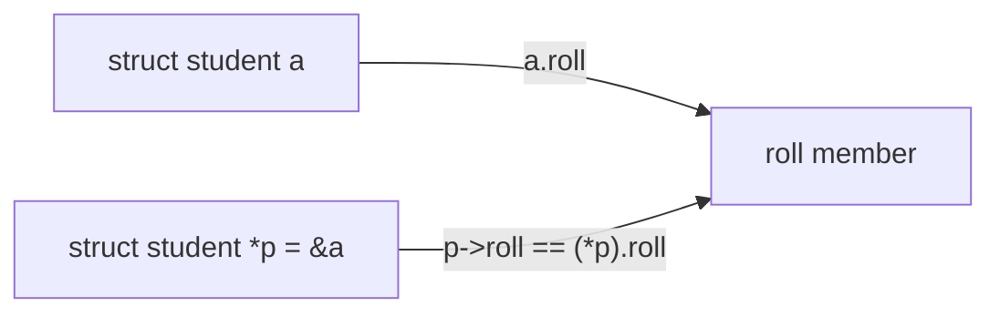
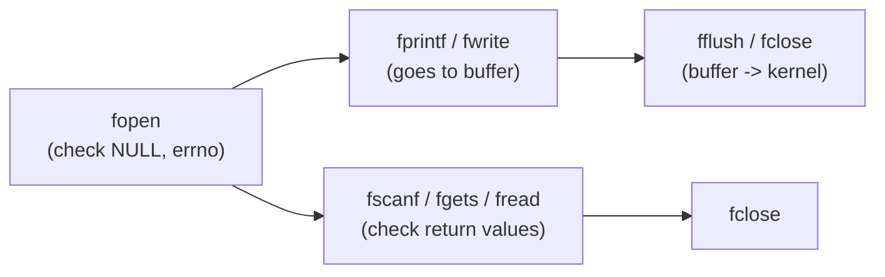

# Lesson B7 — Structs, enums and files: modelling real things and keeping them on disk

> Level: beginner. Prerequisites: B1–B6. Time: about 2 hours.
> Tested with GCC 13.3 (`-std=c17`), glibc 2.39, x86-64 Linux, November 2026.

---

## 1. Why this lesson exists

Real data has shape. A student has a roll number, a name and a CGPA; a network packet has a header with several fields. Keeping these as separate parallel arrays (`int rolls[]`, `char names[][32]`, `double cgpas[]`) works for ten minutes and then becomes a mess: sorting one array means remembering to sort the other two identically.

C's tool for "several values that belong together" is the **struct**. **Enums** give names to a fixed set of choices. And **files** let your program's data survive after the process exits. With these three, you can write your first genuinely useful programs — and you have every ingredient needed for the data structures of lesson I2.

---

## 2. Intuition

- **A struct is a form with labelled boxes.** An admission form has boxes "Name", "Roll No", "CGPA". Every filled-in form is one *struct value*; the blank form design is the *struct type*.
- **`.` vs `->`**: if you hold the form in your hand, you read a box with `form.name`. If you only hold a slip with the form's *locker number* (a pointer), you write `slip->name` — "go to the locker, then read the box". `p->name` is shorthand for `(*p).name`.
- **An enum is a dropdown menu**: only the listed options are meant to be chosen, each with a readable name.
- **A file is a notebook in a cupboard**: `fopen` takes it out, `fprintf`/`fscanf` write and read, `fclose` puts it back. If you forget `fclose`, some of what you wrote may still be on your desk (in a buffer), not in the notebook.

---

## 3. Precise definitions

- **Structure type:** "a sequentially allocated nonempty set of member objects" (N3220 §6.2.5). Members are laid out **in declaration order**, the first member is at offset 0, and the implementation may insert **padding** between members and at the end so each member is properly aligned (N3220 §6.7.3.2; deep dive in lesson A1).
- **Member access:** `s.m` for a struct value, `p->m` for a pointer to a struct; `p->m` is equivalent to `(*p).m` (N3220 §6.5.3.4).
- **Designated initialisers (C99):** `struct student s = { .roll = 7, .name = "Asha" };` — unnamed members are zero-initialised.
- **`typedef`** creates an alias name for a type; it does not create a new type (N3220 §6.7.9).
- **Enumeration:** a set of named integer constants. Before C23 every enumeration constant has type `int`; C23 adds enums with a fixed underlying type (`enum colour : unsigned char { … }`, lesson A5).
- **Union:** like a struct, but all members share the *same* storage; only one is meaningful at a time. Size is at least the size of the largest member.
- **Streams:** `FILE *` objects from `<stdio.h>`. `fopen` returns a null pointer on failure and sets `errno`. Output streams are **buffered**: data is guaranteed to reach the file only after `fflush` or `fclose` (or normal program exit, which closes open streams).

---

## 4. Step by step

### Step 1 — a struct, three ways to fill it, and `sizeof`

```c
// file: student.c
// build: gcc -std=c17 -Wall -Wextra -o student student.c
// run: ./student

#include <stdio.h>
#include <string.h>

// the "blank form": a type with three labelled members
struct student {
    int roll;
    char name[32];
    double cgpa;
};

int main(void)
{
    // 1) positional initialiser: values in declaration order
    struct student a = {1, "Asha", 8.9};

    // 2) designated initialiser (C99): order-independent and self-documenting
    struct student b = { .name = "Bala", .cgpa = 7.5, .roll = 2 };

    // 3) member by member
    struct student c;
    c.roll = 3;
    strcpy(c.name, "Chitra");      // safe here: the literal fits in 32 bytes
    c.cgpa = 9.1;

    struct student all[] = {a, b, c};             // an array of structs
    for (size_t i = 0; i < sizeof all / sizeof all[0]; i++)
        printf("%d %-7s %.2f\n", all[i].roll, all[i].name, all[i].cgpa);

    // 4 + 32 + 8 = 44 bytes of members, but the struct is 48: padding (lesson A1)
    printf("sizeof(struct student) = %zu\n", sizeof(struct student));
    return 0;
}
```

Output:

```text
1 Asha    8.90
2 Bala    7.50
3 Chitra  9.10
sizeof(struct student) = 48
```

### Step 2 — passing structs: copy vs pointer

The dumbest approach: pass the struct by value to a function that is supposed to modify it. It is the `swap_copy` wall from lesson B3 again — the function gets a photocopy of the whole form. Passing by value also *copies every byte* (48 here; could be kilobytes).

```c
// file: struct_param.c
// build: gcc -std=c17 -Wall -Wextra -o struct_param struct_param.c
// run: ./struct_param

#include <stdio.h>

typedef struct {          // typedef: now "point" is a name for this struct type
    double x, y;
} point;

// receives a COPY: changes are lost
void move_copy(point p, double dx)
{
    p.x += dx;
}

// receives the ADDRESS: changes stick; -> reads a member through a pointer
void move_ptr(point *p, double dx)
{
    p->x += dx;           // same as (*p).x += dx
}

// read-only access: pointer to const avoids the copy AND promises not to modify
double dist2(const point *p)
{
    return p->x * p->x + p->y * p->y;
}

int main(void)
{
    point pt = {1.0, 2.0};
    move_copy(pt, 10.0);
    printf("after move_copy: (%.1f, %.1f)\n", pt.x, pt.y);
    move_ptr(&pt, 10.0);
    printf("after move_ptr : (%.1f, %.1f)\n", pt.x, pt.y);
    printf("dist^2 = %.1f\n", dist2(&pt));

    point q = pt;         // struct assignment copies all members (arrays inside too)
    q.y = 0.0;
    printf("pt.y=%.1f q.y=%.1f\n", pt.y, q.y);
    return 0;
}
```

Output:

```text
after move_copy: (1.0, 2.0)
after move_ptr : (11.0, 2.0)
dist^2 = 125.0
pt.y=2.0 q.y=0.0
```

Rule of thumb used throughout C codebases: **pass structs by pointer** (`const T *` if read-only); return small structs by value when convenient.

### Step 3 — enums and a `switch` over them

```c
// file: enums.c
// build: gcc -std=c17 -Wall -Wextra -o enums enums.c
// run: ./enums

#include <stdio.h>

// named constants: RED=0, GREEN=1, YELLOW=2 unless you assign values
enum signal { RED, GREEN, YELLOW };

const char *action(enum signal s)
{
    switch (s) {          // -Wall's -Wswitch warns if a listed enumerator is not handled
    case RED:    return "stop";
    case GREEN:  return "go";
    case YELLOW: return "slow down";
    }
    return "unknown";     // reached only for values outside the enum
}

int main(void)
{
    for (enum signal s = RED; s <= YELLOW; s++)
        printf("%d -> %s\n", s, action(s));
    return 0;
}
```

Output:

```text
0 -> stop
1 -> go
2 -> slow down
```

Try deleting `case YELLOW:` — `-Wall` (which includes `-Wswitch`) warns "enumeration value 'YELLOW' not handled in switch". That warning is one of the main reasons to prefer enums over bare `#define` constants.

### Step 4 — a union, carefully: a tagged value

```c
// file: tagged.c
// build: gcc -std=c17 -Wall -Wextra -o tagged tagged.c
// run: ./tagged

#include <stdio.h>

enum kind { K_INT, K_DOUBLE };

// a "tagged union": the tag says which union member is currently valid
struct value {
    enum kind tag;
    union {
        int i;
        double d;
    } as;                 // i and d share the same bytes
};

void print_value(const struct value *v)
{
    if (v->tag == K_INT)
        printf("int %d\n", v->as.i);
    else
        printf("double %.3f\n", v->as.d);
}

int main(void)
{
    struct value vals[] = { {K_INT, {.i = 42}}, {K_DOUBLE, {.d = 3.14159}} };
    for (int i = 0; i < 2; i++)
        print_value(&vals[i]);
    printf("sizeof union = %zu (size of its largest member, double)\n", sizeof vals[0].as);
    return 0;
}
```

Output:

```text
int 42
double 3.142
sizeof union = 8 (size of its largest member, double)
```

This "tag + union" pattern is how interpreters (CPython's objects, JSON parsers) represent "a value that can be one of several types". Reading a member other than the one last written ("type punning") is a subtle area — lesson A1 covers exactly what the standard allows.

### Step 5 — text files: write, then read back

```c
// file: marks_file.c
// build: gcc -std=c17 -Wall -Wextra -o marks_file marks_file.c
// run: ./marks_file && cat marks.txt

#include <stdio.h>
#include <stdlib.h>
#include <errno.h>
#include <string.h>

typedef struct {
    int roll;
    char name[32];
    double cgpa;
} student;

int main(void)
{
    student in[] = { {1, "Asha", 8.9}, {2, "Bala", 7.5}, {3, "Chitra", 9.1} };
    size_t n = sizeof in / sizeof in[0];

    // ---- write ----
    FILE *f = fopen("marks.txt", "w");            // "w": create or truncate for writing
    if (f == NULL) {
        // errno says WHY; strerror turns it into text
        fprintf(stderr, "open for write failed: %s\n", strerror(errno));
        return EXIT_FAILURE;
    }
    for (size_t i = 0; i < n; i++)
        fprintf(f, "%d %s %.2f\n", in[i].roll, in[i].name, in[i].cgpa);
    if (fclose(f) != 0) {                          // fclose flushes the buffer: check it too
        perror("fclose");
        return EXIT_FAILURE;
    }

    // ---- read back ----
    f = fopen("marks.txt", "r");
    if (f == NULL) {
        perror("open for read");                   // perror prints "msg: reason"
        return EXIT_FAILURE;
    }
    student s;
    double total = 0;
    int count = 0;
    // %31s: read at most 31 chars into a 32-byte array (leaves room for '\0')
    while (fscanf(f, "%d %31s %lf", &s.roll, s.name, &s.cgpa) == 3) {
        total += s.cgpa;
        count++;
    }
    fclose(f);
    printf("read %d records, average cgpa %.3f\n", count, count ? total / count : 0.0);

    // what happens when a file doesn't exist
    if (fopen("no_such_file.txt", "r") == NULL)
        perror("no_such_file.txt");
    return EXIT_SUCCESS;
}
```

Output:

```text
read 3 records, average cgpa 8.500
no_such_file.txt: No such file or directory
1 Asha 8.90
2 Bala 7.50
3 Chitra 9.10
```

(The last three lines come from `cat marks.txt`.) Note `%31s` — a width on `%s` is the `scanf` equivalent of "always know the size", the lesson from B4.

### Step 6 — binary files: `fwrite`/`fread` whole structs

```c
// file: binfile.c
// build: gcc -std=c17 -Wall -Wextra -o binfile binfile.c
// run: ./binfile && ls -l data.bin | awk '{print $5, "bytes"}'

#include <stdio.h>

typedef struct {
    int roll;
    double cgpa;
} rec;

int main(void)
{
    rec out[3] = { {1, 8.9}, {2, 7.5}, {3, 9.1} };

    FILE *f = fopen("data.bin", "wb");            // "b" matters on Windows, harmless on Linux
    if (!f) { perror("data.bin"); return 1; }
    size_t wrote = fwrite(out, sizeof out[0], 3, f);   // write 3 elements of sizeof(rec) bytes
    fclose(f);

    rec back[3];
    f = fopen("data.bin", "rb");
    if (!f) { perror("data.bin"); return 1; }
    size_t got = fread(back, sizeof back[0], 3, f);    // returns number of ELEMENTS read
    fclose(f);

    printf("wrote %zu, read %zu, back[2] = {%d, %.1f}, sizeof(rec) = %zu\n",
           wrote, got, back[2].roll, back[2].cgpa, sizeof(rec));
    return 0;
}
```

Output:

```text
wrote 3, read 3, back[2] = {3, 9.1}, sizeof(rec) = 16
48 bytes
```

48 bytes = 3 × 16, but `rec` has only 12 bytes of real data — 4 bytes of padding per record went into the file. Raw struct dumps are fast but **not portable**: a machine with different padding, `int` size or byte order (endianness) cannot read the file correctly. Serious file formats and network protocols write each field explicitly with fixed-width types (lesson A1).

---

## 5. Diagrams

`struct student` in memory (x86-64):

```text
offset:  0        4                                  36      40        48
         +--------+----------------------------------+-------+---------+
         |  roll  |            name[32]              |  pad  |  cgpa   |
         | 4 bytes|            32 bytes              | 4 B   | 8 bytes |
         +--------+----------------------------------+-------+---------+
                                     cgpa must start at a multiple of 8 -> 4 bytes of padding
```

`.` vs `->`:



File I/O lifecycle:



---

## 6. Common mistakes

| Mistake | Consequence | Fix |
|---|---|---|
| `p.x` when `p` is a pointer | Compile error | `p->x` |
| Passing large structs by value | Slow copies; modifications lost | `T *` or `const T *` |
| Comparing structs with `==` | Compile error: C has no struct equality | Compare member by member (`memcmp` is wrong because padding bytes are unspecified) |
| Not checking `fopen` result | Null `FILE *` → crash in `fprintf` | `if (f == NULL) { perror(...); }` |
| `fscanf(f, "%s", name)` without width | Buffer overflow on long words | `%31s` for a 32-byte buffer |
| Loop `while (!feof(f))` | Processes the last record twice / uses garbage | Loop on the *return value* of the read function |
| Forgetting `fclose` | Lost buffered output, leaked file descriptor | Always `fclose`, and check its return |
| Writing raw structs to files/sockets for other machines | Padding/endianness/size mismatch | Serialise field by field with fixed-width types |
| Reading a union member you didn't last write | Implementation-specific reinterpretation (see A1) | Keep a tag |

---

## 7. Connections

- **DSA track:** nodes of linked lists and trees are structs containing pointers to the same struct type (lesson I2).
- **DBMS track:** a fixed-size record written with `fwrite` is the simplest "heap file"; padding and alignment questions reappear in database page layouts.
- **Networks track:** protocol headers (IP, TCP) are specified field by field with exact widths and byte order (network byte order is big-endian); `htons`/`ntohl` exist because raw struct dumps are not portable.
- **Java / Python:** a Java class with only fields, or a Python `dataclass`, is the closest equivalent; Java has no unions, Python's dynamic typing is essentially a tagged union implemented in C.
- **OS track:** a `FILE *` wraps a lower-level integer *file descriptor*; lesson P2 uses `open`/`read`/`write` directly.

### Where this shows up in my projects

- **Nidhogg / Logly:** log lines and Elasticsearch documents are records with named fields — in Python/JSON they are dictionaries, but the moment such data is stored in a compact binary format, the "fixed-width fields, explicit byte order, no raw struct dumps" rule of Step 6 is what keeps it portable across machines.

---

## 8. Self-check questions

1. What is the difference between `s.name` and `p->name`?
2. Why is `sizeof(struct student)` 48 and not 44?
3. Why should a function that only reads a struct take `const struct student *`?
4. What does `fclose` do besides closing?
5. Why is `while (!feof(f))` a broken reading loop?
6. What happens in memory when you write `u.d = 3.14;` and then read `u.i` for `union { int i; double d; } u;`?

<details>
<summary>Answers</summary>

1. `s.name` accesses a member of a struct *value*; `p->name` accesses a member through a *pointer* and means `(*p).name`.
2. `cgpa` is a `double` with 8-byte alignment; after `roll` (4) and `name` (32) we are at offset 36, so 4 padding bytes are inserted to start `cgpa` at 40; 40 + 8 = 48.
3. It avoids copying the whole struct and documents/enforces (at compile time) that the function will not modify it.
4. It flushes any buffered output to the OS, releases the buffer, and releases the underlying file descriptor. It can fail (e.g. disk full), so check its return value.
5. `feof` only becomes true *after* a read has already failed, so the loop body runs once more with a failed read and stale or garbage data. Loop on the read function's return value instead.
6. The bytes of the `double` are reinterpreted as an `int` (the first 4 bytes on x86-64). C permits this through a union (with an implementation-specific result); see lesson A1 for the precise rules.

</details>

---

## 9. Mnemonic (Tamil + English)

**`.` vs `->`:**

> **"Kaila irundha dot, kadhavu number irundha arrow."** — If the form is in your hand, use a dot; if you only have the door number (pointer), use the arrow.

**File discipline — Open, Check, Use, Close (OCUC):**

> **"Open panni, Check panni, Use panni, Close pannu — OCUC, illana 'OUCH'."** — Skip a step and you get "OUCH".

**Padding:** **"Double-ku 8-la thaan seat"** — a `double` only sits on a seat number divisible by 8, so the compiler leaves empty seats before it.

---

## Sources

- WG14 N3220: §6.2.5 types (structure and union types), §6.7.3.2 structure and union specifiers (order, padding), §6.5.3.4 structure and union members (`.` and `->`), §6.7.9 type definitions, §6.7.11 initialisation (designated initialisers), §7.23 `<stdio.h>`: https://open-std.org/JTC1/SC22/WG14/www/docs/n3220.pdf
- cppreference, *Struct declaration*: https://en.cppreference.com/w/c/language/struct
- cppreference, *Union declaration*: https://en.cppreference.com/w/c/language/union
- cppreference, *Enumerations*: https://en.cppreference.com/w/c/language/enum
- cppreference, *File input/output* (`fopen`, `fclose`, `fread`, `fwrite`, `fscanf`): https://en.cppreference.com/w/c/io
- Linux man page `fopen(3)`: https://man7.org/linux/man-pages/man3/fopen.3.html
- GCC manual, *Warning Options* (`-Wswitch` enabled by `-Wall`): https://gcc.gnu.org/onlinedocs/gcc/Warning-Options.html
- MIT OCW 6.087, lecture 6 "User-defined datatypes, structs, unions, bitfields": https://ocw.mit.edu/courses/6-087-practical-programming-in-c-january-iap-2010/pages/calendar/

## Verify yourself

1. Run each block. Use `xxd data.bin | head` to *see* the padding bytes in the binary file.
2. Print `offsetof(struct student, cgpa)` (from `<stddef.h>`) and confirm it is 40.
3. Reorder `struct student` as `double cgpa; int roll; char name[32];` and predict, then check, the new `sizeof` (answer: 48 — 8 + 4 + 32 = 44, rounded up to a multiple of 8).
4. Remove `case YELLOW:` in `enums.c` and confirm the `-Wswitch` warning.
5. Check the `p->m` ≡ `(*p).m` statement in N3220 §6.5.3.4.
