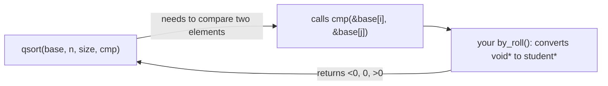

# Lesson I1 — Pointers deep dive: pointers to pointers, arrays vs pointers, `void *`, and function pointers

> Level: intermediate. Prerequisites: the whole beginner level (especially B5, B6). Time: about 2.5 hours.
> Tested with GCC 13.3 (`-std=c17 -Wall -Wextra`), x86-64 Linux, November 2026.

---

## 1. Why this lesson exists

Beginner pointers let you modify a caller's variable and walk an array. Real C code goes further:

- `main(int argc, char *argv[])` hands you an **array of pointers**.
- A function that must *change which memory a pointer points to* (allocate a buffer for the caller, delete a list head) needs a **pointer to a pointer**.
- `qsort`, `bsearch`, `pthread_create`, signal handlers and every plugin/callback system need **pointers to functions** and **generic `void *` data**.

These are the techniques that make C able to express "generic" code without templates or generics. This lesson is precise about the type system, because with pointers the *type* is the whole story: it decides the step size of arithmetic and what the compiler assumes.

---

## 2. Intuition

- **Pointer to pointer:** a slip of paper that tells you where *another* slip of paper is kept. Following it once (`*pp`) gives you the second slip (a pointer); following twice (`**pp`) gives you the house.
- **Array vs pointer:** an array *is* the row of houses; a pointer is a slip with one house number. In most expressions the row is automatically summarised as "the number of its first house" (decay), which is why they feel the same — but `sizeof`, `&` and assignment reveal they are different things.
- **`void *`:** a house number with no description of what kind of building is there. You can carry it around and give it to someone, but you must say what the building is (convert it to a typed pointer) before going inside.
- **Function pointer:** a phone number of a person who knows how to do a job. `qsort` doesn't know how to compare your students; you give it the phone number of someone who does.

---

## 3. Precise definitions

- **Pointer to pointer:** `T **pp` — `*pp` has type `T *`, `**pp` has type `T`.
- **Array type vs pointer type:** for `int a[10]`, `a` has type `int[10]`. In most expressions it is converted to `int *` pointing at `a[0]`. Exceptions: operand of `sizeof`, unary `&`, `typeof` (C23), `alignof`, and string literal initialisers (cppreference *Array declaration*). `&a` has type `int (*)[10]` — "pointer to array of 10 ints" — and `&a + 1` advances by 40 bytes.
- **Arrays of pointers vs pointers to arrays:** `int *ap[3]` is an array of 3 pointers; `int (*pa)[3]` is a pointer to an array of 3 ints. Rule: postfix `[]` and `()` bind tighter than prefix `*`, so parentheses change everything.
- **`void *`:** "A pointer to void may be converted to or from a pointer to any object type. A pointer to any object type may be converted to a pointer to void and back again; the result shall compare equal to the original pointer" (N3220 §6.3.2.3). No arithmetic is allowed on `void *` in standard C (GCC allows it as an extension, `-Wpointer-arith` warns).
- **Function pointers:** `int (*cmp)(const void *, const void *)` is a pointer to a function taking two `const void *` and returning `int`. A function designator decays to a pointer to the function, so `cmp = compare_roll;` and `cmp = &compare_roll;` are equivalent, and `cmp(a, b)` calls it. Converting a function pointer to `void *` is **not** guaranteed by ISO C (POSIX requires it to work for `dlsym`).
- **`qsort`:** `void qsort(void *base, size_t nmemb, size_t size, int (*compar)(const void *, const void *));` — the comparator returns negative, zero or positive (cppreference *qsort*).

---

## 4. Step by step

### Step 1 — `argv`: your first array of pointers

```c
// file: args.c
// build: gcc -std=c17 -Wall -Wextra -o args args.c
// run: ./args hello "two words" 42

#include <stdio.h>

int main(int argc, char *argv[])        // argv: array of pointers to strings
{
    printf("argc = %d\n", argc);
    for (int i = 0; i < argc; i++)
        printf("argv[%d] = \"%s\"\n", i, argv[i]);   // each argv[i] is a char *
    printf("argv[argc] is %s\n", argv[argc] == NULL ? "NULL (guaranteed terminator)" : "?");
    return 0;
}
```

Output:

```text
argc = 4
argv[0] = "./args"
argv[1] = "hello"
argv[2] = "two words"
argv[3] = "42"
argv[argc] is NULL (guaranteed terminator)
```

In a parameter list, `char *argv[]` is adjusted to `char **argv` — the same "array parameter is really a pointer" rule from lesson B4, one level up.

### Step 2 — pointer to pointer: the "allocate for the caller" wall

The dumbest attempt: a helper that allocates a buffer and assigns it to its parameter.

```c
// file: alloc_out.c
// build: gcc -std=c17 -Wall -Wextra -o alloc_out alloc_out.c
// run: ./alloc_out

#include <stdio.h>
#include <stdlib.h>

// WRONG: buf is a COPY of the caller's pointer; assigning it changes only the copy
void make_buffer_bad(int *buf, size_t n)
{
    buf = malloc(n * sizeof *buf);   // the caller never sees this address -> leak
    (void)buf;
}

// RIGHT: receive the ADDRESS of the caller's pointer, and write the new address there
int make_buffer(int **out, size_t n)
{
    int *p = malloc(n * sizeof *p);
    if (p == NULL)
        return -1;
    for (size_t i = 0; i < n; i++)
        p[i] = (int)(i * 10);
    *out = p;                        // modify the caller's pointer variable
    return 0;
}

int main(void)
{
    int *a = NULL;
    make_buffer_bad(a, 4);
    printf("after bad : a = %p\n", (void *)a);   // still NULL (and 16 bytes leaked)

    int *b = NULL;
    if (make_buffer(&b, 4) == 0) {
        printf("after good: b[3] = %d\n", b[3]);
        free(b);
    }
    return 0;
}
```

Output:

```text
after bad : a = (nil)
after good: b[3] = 30
```

Same lesson as `swap` in B5, one level higher: **to change a `T` in the caller, take a `T *`; to change a `T *` in the caller, take a `T **`.**

### Step 3 — arrays are not pointers: `sizeof`, `&`, and step size

```c
// file: arr_vs_ptr.c
// build: gcc -std=c17 -Wall -Wextra -o arr_vs_ptr arr_vs_ptr.c
// run: ./arr_vs_ptr

#include <stdio.h>

int main(void)
{
    int a[10] = {0};
    int *p = a;                 // decay: p points to a[0]
    int (*pa)[10] = &a;         // pointer to the WHOLE array of 10 ints

    printf("sizeof a  = %zu (whole array)\n", sizeof a);
    printf("sizeof p  = %zu (one pointer)\n", sizeof p);

    // same starting address, different types -> different step sizes
    printf("p + 1  - p  = %td bytes\n", (char *)(p + 1) - (char *)p);
    printf("pa + 1 - pa = %td bytes\n", (char *)(pa + 1) - (char *)pa);

    // a = p;   // does not compile: an array is not assignable
    p = p + 1;  // a pointer is an ordinary variable
    (void)p;

    // a 2D array decays to a pointer to its first ROW
    int grid[3][4] = {{0}};
    int (*row)[4] = grid;       // row + 1 skips a whole row of 4 ints = 16 bytes
    printf("row + 1 - row = %td bytes\n", (char *)(row + 1) - (char *)row);
    return 0;
}
```

Output:

```text
sizeof a  = 40 (whole array)
sizeof p  = 8 (one pointer)
p + 1  - p  = 4 bytes
pa + 1 - pa = 40 bytes
row + 1 - row = 16 bytes
```

Declarations to decode (read from the name outward, `[]`/`()` before `*`):

| Declaration | Meaning |
|---|---|
| `int *a[3]` | array of 3 pointers to int |
| `int (*a)[3]` | pointer to array of 3 ints |
| `int *f(void)` | function returning pointer to int |
| `int (*f)(void)` | pointer to function returning int |
| `int (*fs[4])(int)` | array of 4 pointers to functions taking int returning int |

### Step 4 — `void *` and a generic swap

```c
// file: generic_swap.c
// build: gcc -std=c17 -Wall -Wextra -o generic_swap generic_swap.c
// run: ./generic_swap

#include <stdio.h>
#include <string.h>

// swaps two objects of ANY type, given their size in bytes
void swap_any(void *x, void *y, size_t size)
{
    unsigned char tmp[64];                  // fixed scratch space for small objects
    if (size > sizeof tmp)
        return;                             // keep the demo simple; real code would loop or malloc
    memcpy(tmp, x, size);                   // memcpy works on raw bytes: no type needed
    memcpy(x, y, size);
    memcpy(y, tmp, size);
}

typedef struct { int roll; double cgpa; } student;

int main(void)
{
    int i1 = 1, i2 = 2;
    double d1 = 1.5, d2 = 2.5;
    student s1 = {1, 8.0}, s2 = {2, 9.0};

    swap_any(&i1, &i2, sizeof i1);          // int * converts to void * implicitly
    swap_any(&d1, &d2, sizeof d1);
    swap_any(&s1, &s2, sizeof s1);
    printf("%d %d | %.1f %.1f | %d %d\n", i1, i2, d1, d2, s1.roll, s2.roll);
    return 0;
}
```

Output:

```text
2 1 | 2.5 1.5 | 2 1
```

Why `unsigned char` and `memcpy`? Because C allows **any object to be accessed as an array of characters** — that is the one universal "view" of memory (lesson A1 explains the aliasing rule behind it).

### Step 5 — function pointers and `qsort`

```c
// file: sort_students.c
// build: gcc -std=c17 -Wall -Wextra -o sort_students sort_students.c
// run: ./sort_students

#include <stdio.h>
#include <stdlib.h>
#include <string.h>

typedef struct {
    int roll;
    char name[16];
    double cgpa;
} student;

// comparator: negative if a<b, 0 if equal, positive if a>b
int by_roll(const void *a, const void *b)
{
    const student *x = a, *y = b;            // convert void * back to the real type
    return (x->roll > y->roll) - (x->roll < y->roll);   // avoids overflow of x->roll - y->roll
}

int by_cgpa_desc(const void *a, const void *b)
{
    const student *x = a, *y = b;
    return (y->cgpa > x->cgpa) - (y->cgpa < x->cgpa);   // descending order
}

int by_name(const void *a, const void *b)
{
    const student *x = a, *y = b;
    return strcmp(x->name, y->name);
}

void print_all(const char *title, const student *arr, size_t n)
{
    printf("%s:", title);
    for (size_t i = 0; i < n; i++)
        printf(" %s(%d,%.1f)", arr[i].name, arr[i].roll, arr[i].cgpa);
    printf("\n");
}

int main(void)
{
    student cls[] = { {3, "Chitra", 9.1}, {1, "Asha", 8.9}, {2, "Bala", 9.5} };
    size_t n = sizeof cls / sizeof cls[0];

    // a table of (name, comparator) pairs: function pointers stored as data
    struct { const char *title; int (*cmp)(const void *, const void *); } orders[] = {
        {"by roll", by_roll}, {"by cgpa desc", by_cgpa_desc}, {"by name", by_name},
    };

    for (size_t k = 0; k < sizeof orders / sizeof orders[0]; k++) {
        qsort(cls, n, sizeof cls[0], orders[k].cmp);   // qsort calls back into our function
        print_all(orders[k].title, cls, n);
    }
    return 0;
}
```

Output:

```text
by roll: Asha(1,8.9) Bala(2,9.5) Chitra(3,9.1)
by cgpa desc: Bala(2,9.5) Chitra(3,9.1) Asha(1,8.9)
by name: Asha(1,8.9) Bala(2,9.5) Chitra(3,9.1)
```

The tempting comparator `return x->roll - y->roll;` works for small numbers but **overflows** (UB) for values far apart, e.g. `INT_MIN` and `1`. The `(a > b) - (a < b)` idiom is overflow-free.

### Step 6 — a dispatch table (how interpreters and drivers are built)

```c
// file: calc.c
// build: gcc -std=c17 -Wall -Wextra -o calc calc.c
// run: ./calc

#include <stdio.h>

typedef double (*binop)(double, double);   // typedef makes function-pointer types readable

static double add(double a, double b) { return a + b; }
static double sub(double a, double b) { return a - b; }
static double mul(double a, double b) { return a * b; }
static double dvd(double a, double b) { return a / b; }

int main(void)
{
    // index the table by the operator character: a tiny "virtual method table"
    binop table[128] = {0};
    table['+'] = add; table['-'] = sub; table['*'] = mul; table['/'] = dvd;

    const char *ops = "+-*/%";
    for (const char *c = ops; *c; c++) {
        binop f = table[(unsigned char)*c];
        if (f != NULL)                         // a null function pointer must never be called
            printf("6 %c 3 = %g\n", *c, f(6, 3));
        else
            printf("'%c' not supported\n", *c);
    }
    return 0;
}
```

Output:

```text
6 + 3 = 9
6 - 3 = 3
6 * 3 = 18
6 / 3 = 2
'%' not supported
```

This is exactly how the Linux kernel's `struct file_operations` works: a struct of function pointers that each driver fills in.

---

## 5. Diagrams

`char *argv[]` for `./args hello "two words" 42`:

```text
 argv ──► +---------+      +---+---+---+---+---+---+---+
          | argv[0] | ───► | . | / | a | r | g | s |\0 |
          +---------+      +---+---+---+---+---+---+---+
          | argv[1] | ───► "hello\0"
          +---------+
          | argv[2] | ───► "two words\0"
          +---------+
          | argv[3] | ───► "42\0"
          +---------+
          |  NULL   |
          +---------+
```

`int **out` in `make_buffer(&b, 4)`:

```text
 make_buffer's frame         main's frame              heap
 +-------------+            +-------------+          +----+----+----+----+
 | out = &b    | ─────────► | b           | ───────► |  0 | 10 | 20 | 30 |
 +-------------+            +-------------+          +----+----+----+----+
        *out = p   writes into b;   **out is b[0]
```



---

## 6. Common mistakes

| Mistake | Consequence | Fix |
|---|---|---|
| Assigning to a pointer parameter to "return" memory | Caller never sees it; leak | Take `T **out`, or return the pointer |
| `int *p[3]` when you meant pointer-to-array | Wrong type, confusing errors | `int (*p)[3]`; use `typedef` for clarity |
| Arithmetic on `void *` | Not standard C (GCC extension) | Convert to `unsigned char *` first |
| `return a - b;` in comparators | Signed overflow for extreme values | `(a > b) - (a < b)` |
| Comparator with wrong signature, then cast to `qsort`'s type | Calling through an incompatible function type is UB | Write exactly `int f(const void *, const void *)` |
| Calling a null function pointer | Crash (UB) | Check before calling |
| Expecting `sizeof` on a pointer to give an array's size | Gives 8 | Carry the length |
| Casting `void *` to function pointer for plugins | Not ISO C (POSIX `dlsym` requires it to work) | Know it is a platform assumption |

---

## 7. Connections

- **DSA track:** `qsort`'s comparator is the same idea as a Java `Comparator` or Python's `key=` function; generic containers in C (hash maps, vectors) store `void *` plus element size.
- **OS track:** system-call tables, interrupt vector tables and VFS `file_operations` are arrays/structs of function pointers.
- **Compilers track:** C++ virtual functions compile down to a hidden pointer to a table of function pointers — the `calc.c` dispatch table is the hand-written version.
- **Java track:** interfaces and lambdas are typed, safe function pointers with captured state; C needs an extra `void *context` parameter to carry state (look at `pthread_create`'s `void *arg`).
- **C++ track:** templates (`std::sort`) replace `void *` + size with compile-time types, which also lets the comparator be inlined — often faster than `qsort`.

### Where this shows up in my projects

- **compiler-fuzz:** a delta-debugging reducer (ddmin) applies a *test predicate* — "does this reduced program still show the GCC-vs-Clang mismatch?" — over and over. In C that predicate would naturally be a function pointer plus a `void *context`, which is the same shape as `qsort`'s comparator; in a Python implementation it is a callable passed as an argument. The pattern is "pass behaviour as data".

---

## 8. Self-check questions

1. What is the type of `&a` for `int a[5]`, and how far does `&a + 1` move?
2. Why must `make_buffer` take `int **`?
3. Decode `char *(*f)(int)`.
4. Why can't you do arithmetic on a `void *` in standard C?
5. Why is `return x - y;` a bad comparator for `int`s?
6. Why does `swap_any` use `unsigned char` and `memcpy`?

<details>
<summary>Answers</summary>

1. `int (*)[5]`; it moves by `sizeof a` = 20 bytes (with 4-byte `int`).
2. It must modify the caller's `int *` variable; to modify an object of type `T` from a function you need a `T *`, and here `T` is `int *`.
3. `f` is a pointer to a function taking an `int` and returning a `char *`.
4. `void` is an incomplete type with no size, so `p + 1` has no defined step.
5. `x - y` can overflow `int` (e.g. `INT_MAX - (-1)`), which is undefined behaviour and may give the wrong sign.
6. Any object may be accessed as a sequence of characters (`unsigned char`), so copying bytes with `memcpy` is valid for every type, regardless of the effective type of the data.

</details>

---

## 9. Mnemonic (Tamil + English)

**Pointer levels: to change X, pass the address of X:**

> **"Maatha vendiyadhu ethuvo, adhoda address-ai kudu."** — Whatever you want changed, hand over *its* address. To change an `int`, give `int *`; to change an `int *`, give `int **`.

**Declarator reading (brackets and calls before star):**

> **"Square-um round-um munnadi, star pinnadi"** — square brackets `[]` and round brackets `()` grab the name first, the star `*` comes after — unless you put the star inside your own round brackets.

**qsort comparator signs:** **"Minus-na munnadi, plus-na pinnadi, zero-na samam."** — negative: a goes first; positive: a goes after; zero: equal.

---

## Sources

- WG14 N3220: §6.3.2.1 (array-to-pointer and function-to-pointer conversion), §6.3.2.3 pointers (`void *` conversions), §6.7.7 declarators, §7.24.5.2 `qsort`: https://open-std.org/JTC1/SC22/WG14/www/docs/n3220.pdf
- cppreference, *Array declaration*: https://en.cppreference.com/w/c/language/array
- cppreference, *Pointer declaration* (pointers to functions, pointers to void): https://en.cppreference.com/w/c/language/pointer
- cppreference, *qsort*: https://en.cppreference.com/w/c/algorithm/qsort
- cppreference, *main function* (`argv[argc]` is a null pointer): https://en.cppreference.com/w/c/language/main_function
- POSIX `dlsym` (function pointer from `void *`): https://pubs.opengroup.org/onlinepubs/9799919799/functions/dlsym.html
- GCC manual, *Pointer Arith* extension and `-Wpointer-arith`: https://gcc.gnu.org/onlinedocs/gcc/Pointer-Arith.html
- MIT OCW 6.087, lectures 7–8 (pointers to pointers, void and function pointers): https://ocw.mit.edu/courses/6-087-practical-programming-in-c-january-iap-2010/pages/calendar/

## Verify yourself

1. Run each block.
2. Compile `void *p = 0; p++;` with `gcc -std=c17 -Wpedantic` and read the warning about arithmetic on `void *`.
3. Use the `cdecl` tool (or https://cdecl.org) to decode the table of declarations in Step 3.
4. Replace `by_roll` with `return x->roll - y->roll;`, add students with rolls `INT_MIN` and `1`, build with `-fsanitize=undefined`, and observe the overflow report.
5. Check the `void *` round-trip guarantee in N3220 §6.3.2.3.
