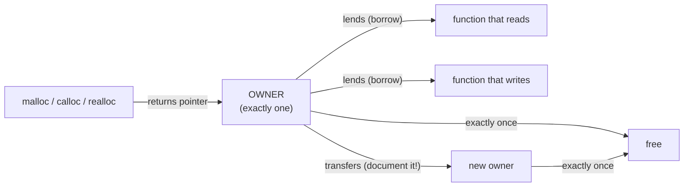

# Lesson I2 — Dynamic memory in practice: ownership, growable arrays, and linked lists

> Level: intermediate. Prerequisites: B6 (stack vs heap), I1 (pointers to pointers). Time: about 3 hours.
> Tested with GCC 13.3 (`-std=c17 -Wall -Wextra`), Valgrind 3.22, AddressSanitizer (GCC 13.3), x86-64 Linux, November 2026.

---

## 1. Why this lesson exists

Lesson B6 introduced `malloc` and `free`. Knowing the two function names is easy; writing programs that allocate thousands of objects with **no leaks, no double frees, no use-after-free** is the actual skill. That skill is mostly about one idea the language does not enforce: **ownership** — at every moment, exactly one piece of code is responsible for freeing each allocation.

We will build the two workhorse data structures of C programs — a **growable array** (like Java's `ArrayList` / Python's `list`) and a **singly linked list** — and see how each design decision is forced by a wall the previous design hits.

---

## 2. Intuition: library books

Treat every heap allocation as a **library book**:

- `malloc` = borrowing a book. You get a slip (the pointer).
- `free` = returning it. Return it **exactly once**.
- Losing the slip before returning the book = **leak** (the library thinks you still have it).
- Reading the book after returning it = **use-after-free** (someone else may have borrowed it and scribbled in it).
- Returning it twice = **double free** (the library's records become corrupt).
- **Ownership** = whose name is on the borrowing record. You can lend the slip to friends (pass pointers around — "borrowing"), but only the owner returns the book. If ownership moves, say so explicitly in the API's documentation.

---

## 3. Precise definitions

From the C standard's memory management functions (N3220 §7.24.3) and the `malloc(3)` man page:

- `void *malloc(size_t size)` — allocates `size` bytes, **uninitialised**; returns a null pointer on failure.
- `void *calloc(size_t nmemb, size_t size)` — allocates an array of `nmemb` objects of `size` bytes, **all bits zero**; returns null if `nmemb * size` would overflow (glibc's man page documents the overflow check).
- `void *realloc(void *ptr, size_t size)` — returns a pointer to a block of the new size with the old contents (up to the smaller size) preserved; **the block may move**. On failure it returns null and **the original block is untouched and still valid**. `realloc(NULL, n)` behaves like `malloc(n)`. `realloc(p, 0)`: implementation-defined (and deprecated) in C17, **undefined behaviour in C23** (cppreference *realloc*).
- `void free(void *ptr)` — deallocates; `free(NULL)` does nothing; freeing anything not obtained from an allocation function, or freeing twice, is UB.
- `void *aligned_alloc(size_t alignment, size_t size)` (C11) — allocation with a stricter alignment. C23 also adds `free_sized` and `free_aligned_sized` (N3220 §7.24.3.4–7.24.3.5), which let the caller tell the allocator the size being freed.
- **Ownership** is not a C language term; it is a design convention. A function's documentation must say whether a returned pointer must be freed by the caller ("caller owns"), and whether a pointer argument is kept ("takes ownership") or only used during the call ("borrows").

---

## 4. Step by step: a growable array

### Wall 0 — fixed arrays

`int nums[100];` — what if the input has 101 numbers? We need the size to be decided at run time *and* to change while the program runs.

### Attempt 1 — the dumbest growable array: `realloc` by one each time

```c
// file: grow_by_one.c
// build: gcc -std=c17 -O2 -Wall -Wextra -o grow_by_one grow_by_one.c
// run: ./grow_by_one 100000

#include <stdio.h>
#include <stdlib.h>

int main(int argc, char *argv[])
{
    long n = argc > 1 ? atol(argv[1]) : 10;
    int *arr = NULL;
    size_t len = 0;
    long copies_possible = 0;           // bytes realloc MIGHT have to move, in the worst case

    for (long i = 0; i < n; i++) {
        // grow by exactly one element every time
        int *tmp = realloc(arr, (len + 1) * sizeof *arr);
        if (tmp == NULL) { free(arr); return 1; }   // on failure arr is still valid: free it
        arr = tmp;
        copies_possible += (long)(len * sizeof *arr);
        arr[len++] = (int)i;
    }
    printf("len=%zu, worst-case bytes moved = %ld (about n^2/2 * 4)\n", len, copies_possible);
    free(arr);
    return 0;
}
```

Output:

```text
len=100000, worst-case bytes moved = 19999800000 (about n^2/2 * 4)
```

What is annoying: each `realloc` *may* copy the whole array to a new place, so the total work is 1 + 2 + … + n = O(n²) in the worst case (glibc can often extend a block in place, especially at the top of the heap, which hides the problem in small tests — but you cannot rely on it). We need fewer reallocations.

### Attempt 2 — geometric growth (capacity doubling)

Keep a **capacity** separate from the **length**. When full, double the capacity. Each element is then copied O(1) times on average (1 + 2 + 4 + … + n < 2n), giving **amortised O(1)** appends — the same analysis as Java's `ArrayList` and Python's `list` growth.

```c
// file: vec.c
// build: gcc -std=c17 -Wall -Wextra -g -fsanitize=address,undefined -o vec vec.c
// run: ./vec

#include <stdio.h>
#include <stdlib.h>
#include <stdint.h>

// a growable array of ints. The vec struct OWNS the buffer `data`.
typedef struct {
    int *data;
    size_t len;   // number of elements in use
    size_t cap;   // number of elements allocated
} vec;

// returns 0 on success, -1 on allocation failure (vec unchanged on failure)
int vec_push(vec *v, int x)
{
    if (v->len == v->cap) {                                  // full: grow
        size_t new_cap = v->cap ? v->cap * 2 : 4;            // start at 4, then double
        if (new_cap > SIZE_MAX / sizeof *v->data)            // guard the multiplication
            return -1;
        int *tmp = realloc(v->data, new_cap * sizeof *v->data);
        if (tmp == NULL)
            return -1;                                       // old v->data still valid
        v->data = tmp;
        v->cap = new_cap;
    }
    v->data[v->len++] = x;
    return 0;
}

// releases everything the vec owns and resets it to a valid empty state
void vec_free(vec *v)
{
    free(v->data);
    v->data = NULL;
    v->len = v->cap = 0;
}

int main(void)
{
    vec v = {0};                       // {NULL, 0, 0}: a valid empty vector
    size_t reallocs = 0, last_cap = 0;
    for (int i = 0; i < 1000; i++) {
        if (vec_push(&v, i * i) != 0) { vec_free(&v); return 1; }
        if (v.cap != last_cap) { reallocs++; last_cap = v.cap; }
    }
    printf("len=%zu cap=%zu reallocs=%zu last=%d\n", v.len, v.cap, reallocs, v.data[v.len - 1]);
    vec_free(&v);
    return 0;
}
```

Output (clean under AddressSanitizer + UBSan — no reports):

```text
len=1000 cap=1024 reallocs=9 last=998001
```

9 reallocations for 1000 elements instead of 1000. Note the three defensive habits in `vec_push`:

1. **`tmp` for `realloc`.** Writing `v->data = realloc(v->data, …)` loses the only pointer to the old block if `realloc` fails → leak.
2. **Overflow guard** before `new_cap * sizeof`.
3. **Failure leaves the object unchanged** (strong guarantee), so the caller can still clean up.

---

## 5. Step by step: a singly linked list

### Why another structure?

Inserting at the front of a growable array moves every element: O(n). A linked list inserts at the front in O(1) — at the cost of one allocation per node and poor cache locality (lesson P5 measures that cost).

### Attempt 1 — the straightforward delete, with a special case

```c
// file: list.c
// build: gcc -std=c17 -Wall -Wextra -g -fsanitize=address,undefined -o list list.c
// run: ./list

#include <stdio.h>
#include <stdlib.h>

typedef struct node {
    int val;
    struct node *next;          // a struct may contain a pointer to its own type
} node;

// pushes a new node at the front; returns the new head (or the old head on failure)
node *push_front(node *head, int val)
{
    node *n = malloc(sizeof *n);
    if (n == NULL)
        return head;            // unchanged on failure (caller may check by comparing)
    n->val = val;
    n->next = head;
    return n;
}

// version 1: delete first node with value `val`, needing a special case for the head
node *remove_v1(node *head, int val)
{
    if (head == NULL) return NULL;
    if (head->val == val) {               // special case: deleting the head
        node *rest = head->next;
        free(head);
        return rest;
    }
    node *prev = head;
    while (prev->next != NULL && prev->next->val != val)
        prev = prev->next;
    if (prev->next != NULL) {             // found: unlink and free
        node *victim = prev->next;
        prev->next = victim->next;
        free(victim);
    }
    return head;
}

// version 2: pointer-to-pointer walks the LINKS, so the head is not special
void remove_v2(node **link, int val)
{
    while (*link != NULL && (*link)->val != val)
        link = &(*link)->next;            // advance to the next link field
    if (*link != NULL) {
        node *victim = *link;
        *link = victim->next;             // rewrite whichever link pointed at victim
        free(victim);
    }
}

void print_list(const node *h)
{
    for (; h != NULL; h = h->next)
        printf("%d -> ", h->val);
    printf("NULL\n");
}

// frees every node; the list OWNS its nodes
void free_list(node *h)
{
    while (h != NULL) {
        node *next = h->next;             // save before freeing: h->next is invalid after free
        free(h);
        h = next;
    }
}

int main(void)
{
    node *head = NULL;
    for (int i = 1; i <= 5; i++)
        head = push_front(head, i);       // 5 -> 4 -> 3 -> 2 -> 1
    print_list(head);

    head = remove_v1(head, 5);            // delete the head (special case path)
    head = remove_v1(head, 3);            // delete a middle node
    print_list(head);

    remove_v2(&head, 4);                  // head again, no special case needed
    remove_v2(&head, 1);                  // tail
    print_list(head);

    free_list(head);
    return 0;
}
```

Output (clean under ASan + UBSan):

```text
5 -> 4 -> 3 -> 2 -> 1 -> NULL
4 -> 2 -> 1 -> NULL
2 -> NULL
```

The wall in `remove_v1` is the duplicated logic for "the head" — two code paths, twice the chance of a bug. `remove_v2` removes the wall by changing *what we walk*: not the nodes, but the **links** (the `head` variable itself, then each `next` field). Whatever link points to the victim gets rewritten. Linus Torvalds has publicly used this exact example to describe "good taste" in code [unverified — widely reported from a 2016 TED interview; the technique stands on its own].

### The bug the sanitizer catches for you

The most common linked-list bug is freeing a node and then reading its `next`:

```c
// file: uaf.c
// build: gcc -std=c17 -g -fsanitize=address -o uaf uaf.c
// run: ./uaf 2>&1 | grep -E "ERROR|READ of" | head -2

#include <stdlib.h>

typedef struct node { int val; struct node *next; } node;

int main(void)
{
    node *a = malloc(sizeof *a), *b = malloc(sizeof *b);
    if (!a || !b) return 1;
    a->next = b; b->next = NULL;

    // WRONG free loop: reads h->next AFTER free(h)
    for (node *h = a; h != NULL; h = h->next)
        free(h);
    return 0;
}
```

Output (abridged; addresses vary):

```text
==2101==ERROR: AddressSanitizer: heap-use-after-free on address 0x502000000018 at pc ... bp ... sp ...
READ of size 8 at 0x502000000018 thread T0
```

The fix is the `next` temporary in `free_list` above.

---

## 6. Diagrams

Growable array, before and after a doubling `realloc`:

```text
 before (len=4, cap=4)          after push(5): realloc to cap=8 (block may MOVE)
 data ─► [ 1 | 2 | 3 | 4 ]      data ─► [ 1 | 2 | 3 | 4 | 5 |   |   |   ]
                                         old block freed by realloc if it moved
```

Pointer-to-pointer removal of value 3 from `head -> 5 -> 3 -> 1`:

```text
  link starts at &head
  &head ─► [head] ─► (5|next) ─► (3|next) ─► (1|NULL)
  step:   link = &(*link)->next   now link points at 5's next field
  found:  *link = victim->next    5's next field now points at 1
  result: head ─► (5) ─► (1) ─► NULL ;  free(victim)
```



---

## 7. Common mistakes

| Mistake | Consequence | Fix |
|---|---|---|
| `p = realloc(p, n);` | On failure the old block is leaked and `p` is NULL | `tmp = realloc(p, n); if (tmp) p = tmp;` |
| `malloc(n * sizeof(T))` without overflow check | Wraps to a small size → heap overflow | `calloc`, or check `n > SIZE_MAX / sizeof(T)` |
| `malloc(sizeof(T *))` when you meant `sizeof(T)` | Allocates 8 bytes for a big struct | Idiom: `p = malloc(sizeof *p);` — size follows the pointer's type |
| Reading `h->next` after `free(h)` | Use-after-free | Save `next` first |
| Freeing a pointer into the middle of a block (`free(p + 1)`) | UB, usually an abort | Free the exact pointer the allocator returned |
| Two owners both freeing | Double free | One owner; others borrow; null out after free |
| Using `realloc(p, 0)` to free | UB in C23 | Call `free(p)` |
| Assuming `realloc` keeps the address | Other pointers into the old block dangle | Re-derive pointers from the new base (store indices, not pointers) |
| Forgetting to free on an error path | Leak only in rare situations | Single cleanup point (`goto cleanup;` pattern, lesson P2) |

---

## 8. Connections

- **DSA track:** amortised analysis of doubling (aggregate method: total copies < 2n); linked-list pointer manipulation is the same in Java, minus `free`.
- **Java / Python tracks:** `ArrayList` grows by roughly 1.5× and CPython's `list` over-allocates by a smaller factor [unverified: growth factors are implementation details of OpenJDK and CPython, not checked here]; the garbage collector replaces ownership discipline.
- **C++ track:** `std::vector` is exactly `vec`; RAII destructors and `std::unique_ptr` turn "exactly one owner frees exactly once" into a compiler-enforced rule.
- **Rust track:** ownership and borrowing are *language* rules there — this lesson's convention, checked by the compiler.
- **OS track:** `malloc` sits on top of `brk`/`mmap` (lesson A3 opens the allocator).
- **Testing/Verification track:** sanitizers and Valgrind (lesson I8) are dynamic checkers of the ownership rules.

### Where this shows up in my projects

- **compiler-fuzz:** a ddmin reducer repeatedly builds smaller candidate programs from pieces of the original; in C, each candidate would be a heap-allocated buffer whose ownership passes to the "test this candidate" step and must be freed whichever way the test goes — exactly the single-owner, free-on-every-path discipline above. (In the project's Python implementation the garbage collector does this for you; the C version is what the GCC and Clang drivers themselves must get right.)

---

## 9. Self-check questions

1. Why is `p = realloc(p, n)` a bug even if it works in every test?
2. Why does doubling the capacity give amortised O(1) appends?
3. In `remove_v2`, what does `link` point to on the first iteration, and why does that remove the special case?
4. Which allocation function zero-initialises and checks the multiplication for overflow?
5. What is the C23 status of `realloc(p, 0)`?
6. Why is `p = malloc(sizeof *p)` preferred over `p = malloc(sizeof(struct node))`?

<details>
<summary>Answers</summary>

1. If `realloc` fails it returns NULL; you overwrite `p` with NULL and lose the only pointer to the still-allocated old block — a leak, plus a null pointer to crash on later.
2. Each doubling copies the current elements; over n appends the copies total at most 1 + 2 + 4 + … + n/2 + n < 2n, so the average cost per append is constant.
3. It points to the `head` variable itself. Since `head` is just another "link" (a `node *` that may point to the victim), rewriting `*link` works the same for the head and for any `next` field.
4. `calloc`.
5. Undefined behaviour (it was implementation-defined and deprecated in C17).
6. The size automatically follows the pointer's declared type; if you later change `p`'s type, the allocation size stays correct, and you can't accidentally write the wrong struct name.

</details>

---

## 10. Mnemonic (Tamil + English)

**The four heap sins — Leak, Double free, Use-after-free, Overflow ("LDUO"):**

> **"Library book-ai 'Ladoo' maadhiri treat pannadhe"** — don't treat a library book like a **LaDdU-O** (ladoo): don't **L**ose it (leak), don't return it **D**ouble, don't **U**se it after returning, don't **O**verflow its pages.

**realloc rule:**

> **"Realloc-ku thambi (tmp) venum."** — `realloc` always needs a little brother called `tmp`.

**Doubling:** **"Rendu madangu, rendu madangu — ArrayList-um appadithaan."** — double it, double it; that's how growable arrays stay fast.

---

## Sources

- WG14 N3220 §7.24.3 memory management functions (§7.24.3.2 `calloc`, §7.24.3.3 `free`, §7.24.3.4 `free_sized`, §7.24.3.5 `free_aligned_sized`, §7.24.3.6 `malloc`, §7.24.3.7 `realloc`): https://open-std.org/JTC1/SC22/WG14/www/docs/n3220.pdf
- cppreference, *realloc* (C17 vs C23 behaviour for size 0; failure leaves original valid): https://en.cppreference.com/w/c/memory/realloc
- Linux man page `malloc(3)` (calloc overflow check, free(NULL), reallocarray): https://man7.org/linux/man-pages/man3/malloc.3.html
- Clang AddressSanitizer documentation (heap-use-after-free detection): https://clang.llvm.org/docs/AddressSanitizer.html
- SEI CERT C rules (MEM30-C "Do not access freed memory"): https://cmu-sei.github.io/secure-coding-standards/sei-cert-c-coding-standard/rules
- Cormen, Leiserson, Rivest, Stein, *Introduction to Algorithms*, ch. 16/17 "Amortized Analysis" (dynamic tables) — MIT Press book page: https://mitpress.mit.edu/9780262046305/introduction-to-algorithms/
- MIT OCW 6.087, lecture 6 (memory allocation, linked lists) and lecture 11 (malloc and valgrind): https://ocw.mit.edu/courses/6-087-practical-programming-in-c-january-iap-2010/pages/calendar/

## Verify yourself

1. Run each block. Also run `vec` and `list` under Valgrind (lesson I8) after building *without* sanitizers: `gcc -std=c17 -g -o list list.c && valgrind --leak-check=full ./list` — expect "All heap blocks were freed -- no leaks are possible".
2. Remove `free_list(head);` from `list.c`, rebuild with `-fsanitize=address`, and read the LeakSanitizer report at exit.
3. Count actual moves: in `grow_by_one.c`, record how often `tmp != arr` (the block moved) for n = 100000. You will find glibc moves the block far less than n times — note why this does not make the algorithm O(n) in general.
4. Confirm the C23 `realloc(p, 0)` change on cppreference's *realloc* page.
