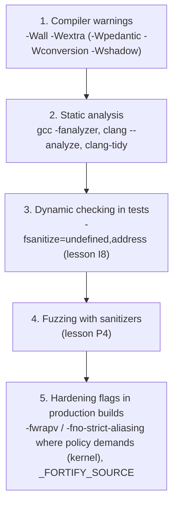

# Lesson I3 — Undefined behaviour: the contract you sign every time you write C

> Level: intermediate. Prerequisites: B2 (overflow), B4 (bounds), B5 (pointers), B6 (lifetimes). Time: about 2.5 hours.
> Every compiler output in this lesson was produced on the test machine: GCC 13.3 and Clang 18.1, x86-64 Linux, November 2026. Results of UB are *not* stable across versions — that is the point.

---

## 1. Why this lesson exists

You have met the phrase "undefined behaviour" (UB) in nearly every lesson. Time to face it directly, because UB is the single concept that most separates people who *write C* from people who *write correct C*.

The surprising part is not that wrong programs do wrong things. It is that **a program containing UB can do something that no line of your source code seems to say** — skip a check you wrote, run a branch you thought impossible, or "work" at `-O0` and break at `-O2`. That happens because modern optimising compilers *reason from the assumption that UB never occurs*. Your *compiler-fuzz* project lives exactly on this boundary: a GCC-vs-Clang difference is only a compiler bug if the test program is free of UB.

---

## 2. Intuition: a contract with a very literal lawyer

The C standard is a contract between you and the compiler:

> "If your program obeys these rules, I promise the compiled program behaves as the abstract machine says. If it breaks any rule marked *undefined*, I promise **nothing** — not even about the parts that ran *before* the violation."

The compiler is like a lawyer who uses every promise you made. If you promised "signed addition never overflows", the lawyer may conclude "`x + 1 > x` is always true" and delete your overflow check. That conclusion is correct *under the contract* — you broke the contract, not the compiler.

Why would a language be designed this way? Because those promises let the compiler generate fast code on every machine: no bounds checks, no overflow checks, free choice of instruction sequences, loop transformations that assume indices don't wrap. C's original goal (lesson B1) was assembly-level speed on any hardware; UB is the price.

---

## 3. Precise definitions

The standard (N3220 §3.5) and cppreference's *Undefined behavior* page define a ladder of four behaviours:

| Term | Definition (paraphrasing cppreference / N3220 §3.5.x) | Example |
|---|---|---|
| **Implementation-defined** | Unspecified behaviour where *each implementation documents* its choice | `sizeof(int)`, signedness of `char`, right shift of a negative number |
| **Unspecified** | Two or more behaviours permitted; no documentation required; may differ each time | Order of evaluation of function arguments; whether identical string literals share storage |
| **Locale-specific** | Depends on the current locale | Whether `islower` is true for non-ASCII letters |
| **Undefined** | "There are no restrictions on the behavior of the program" | Signed overflow, out-of-bounds access, null dereference, data races |

Key facts:

- Compilers must issue a diagnostic for **syntax rule or constraint violations**, but are **not required to diagnose UB** (cppreference).
- The informative **Annex J.2** of the standard lists the undefined behaviours [unverified: the exact number of entries, commonly said to be over 200, was not counted for N3220].
- A **strictly conforming** program depends on no unspecified, undefined or implementation-defined behaviour.
- UB is a property of an *execution*, not of source text: `a[i]` is fine for `i = 3` and UB for `i = 10`.

---

## 4. Step by step: a catalogue, then the optimiser's view

### 4.1 The UB catalogue you must know by heart

| # | Undefined behaviour | Typical source | Standard hook |
|---|---|---|---|
| 1 | **Signed integer overflow** | `INT_MAX + 1`, `a * b` with big ints | §6.5.1 (exceptional conditions) |
| 2 | **Out-of-bounds access / pointer arithmetic** beyond one-past-the-end | `a[n]`, `p + n + 1` | §6.5.7 |
| 3 | **Null pointer dereference** | `*p` with `p == NULL` | §6.5.4.2 |
| 4 | **Use after lifetime** (dangling pointer, use-after-free) | returning `&local`, using freed memory | §6.2.4 |
| 5 | **Reading uninitialised automatic variables** (in many cases) | `int x; return x;` | §6.3.2.1, Annex J.2 |
| 6 | **Unsequenced modifications** of the same object | `i = i++ + 1;`, `a[i] = i++;` | §6.5.1 |
| 7 | **Shifts** by negative or ≥ width; left shift overflowing a signed type | `1 << 32`, `1 << 31` (32-bit `int`) | §6.5.8 |
| 8 | **Division / remainder by zero**; `INT_MIN / -1` | `x / 0` | §6.5.6 |
| 9 | **Strict-aliasing violation** (accessing an object through an incompatible lvalue type) | `*(float *)&some_int` | §6.5.1 (effective type rules; lesson A1) |
| 10 | **Data race** between threads | two threads, one writes, no synchronisation | §5.1.2.5 (lesson A6) |
| 11 | **Modifying a string literal** or a `const` object | `char *s = "hi"; s[0] = 'H';` | §6.4.5, §6.7.4 |
| 12 | **Misaligned access** through a typed pointer | `*(int *)(buf + 1)` | §6.3.2.3 |
| 13 | **Using the value of a function call** that fell off the end of a non-`void` function | missing `return` | §6.9.2 |
| 14 | **Calling a function through an incompatible function-pointer type** | casting comparators | §6.3.2.3 |
| 15 | `realloc(p, 0)` (C23) | "free via realloc" | §7.24.3.7 |

Plus one subtle rule about loops: an iteration statement whose controlling expression is not a constant expression, and which performs no I/O, no `volatile` accesses and no synchronisation or atomic operations in its body, "may be assumed by the implementation to terminate" (N3220 §6.8.6.1, carried over from C11). A side-effect-free search loop may therefore be deleted entirely.

### 4.2 The dumbest mental model: "UB means it crashes or gives garbage"

Let us test that model against a real compiler.

```c
// file: overflow_check.c
// build: gcc -std=c17 -O0 -o oc_O0 overflow_check.c && gcc -std=c17 -O2 -o oc_O2 overflow_check.c && gcc -std=c17 -O2 -fwrapv -o oc_wrapv overflow_check.c
// run: ./oc_O0; ./oc_O2; ./oc_wrapv

#include <stdio.h>
#include <limits.h>

// intended: "does x + 1 overflow?" -- but the check itself performs the overflow
int will_overflow(int x)
{
    return x + 1 < x;      // if x == INT_MAX this is UB
}

int main(void)
{
    printf("will_overflow(INT_MAX) = %d\n", will_overflow(INT_MAX));
    return 0;
}
```

Output with GCC 13.3:

```text
will_overflow(INT_MAX) = 0
will_overflow(INT_MAX) = 0
will_overflow(INT_MAX) = 1
```

On x86-64 the hardware `add` instruction wraps, so naive reasoning predicts `INT_MIN < INT_MAX` → 1. Yet GCC prints 0 **even at `-O0`**: its front end folds `x + 1 < x` to `0` because, for signed `x`, that comparison can only be true via overflow, which "cannot happen". The generated function is literally:

```text
will_overflow:
	endbr64
	xorl	%eax, %eax      ; return 0
	ret
```

Only `-fwrapv` (which tells GCC "signed overflow wraps", making it defined *for this compiler*) restores the hardware behaviour. The wall this exposes: **you cannot test your way out of UB**, because the bug is in the reasoning step, not in an instruction you can watch.

The correct check never performs the overflow:

```c
// file: overflow_ok.c
// build: gcc -std=c17 -O2 -Wall -Wextra -o overflow_ok overflow_ok.c
// run: ./overflow_ok

#include <stdio.h>
#include <limits.h>
#include <stdbool.h>

// pre-condition check: compares against the limit BEFORE adding
bool add_would_overflow(int a, int b)
{
    return (b > 0 && a > INT_MAX - b) || (b < 0 && a < INT_MIN - b);
}

int main(void)
{
    printf("%d %d %d\n", add_would_overflow(INT_MAX, 1),
                         add_would_overflow(INT_MIN, -1),
                         add_would_overflow(5, 7));
    return 0;
}
```

Output:

```text
1 1 0
```

(C23's `ckd_add` from `<stdckdint.h>` does this for you — lesson A5. GCC and Clang also offer `__builtin_add_overflow`.)

### 4.3 Out of bounds: the loop that "always finds it"

This example is straight from cppreference's *UB and optimization* section, run on our machine:

```c
// file: table.c
// build: gcc -std=c17 -O0 -o t_gcc_O0 table.c && gcc -std=c17 -O2 -o t_gcc_O2 table.c && clang -std=c17 -O2 -o t_clang_O2 table.c
// run: ./t_gcc_O0; ./t_gcc_O2; ./t_clang_O2

#include <stdio.h>

int table[4] = {1, 2, 3, 4};

// bug: i <= 4 reads table[4], one past the end
int exists_in_table(int v)
{
    for (int i = 0; i <= 4; i++)
        if (table[i] == v)
            return 1;
    return 0;
}

int main(void)
{
    printf("exists(42) = %d\n", exists_in_table(42));
    return 0;
}
```

Output:

```text
exists(42) = 0
exists(42) = 1
exists(42) = 0
```

GCC 13 at `-O2` compiled the whole function to `return 1`: the only way to *finish* the loop without returning 1 is to execute `table[4]`, which is UB, so GCC assumes one of the first four iterations must return 1. Clang 18 vectorised the four in-bounds comparisons and happened to give 0. **Same source, three answers** — and none of them is "wrong", because the program has no defined meaning.

### 4.4 The null check that disappears

```c
// file: nullchk.c
// build: gcc -std=c17 -O2 -S -o nullchk.s nullchk.c && gcc -std=c17 -O2 -fno-delete-null-pointer-checks -S -o nullchk_keep.s nullchk.c
// run: sed -n '/^read_or_minus1:/,/ret/p' nullchk.s | grep -v '^\s*\.'; echo ---; sed -n '/^read_or_minus1:/,/ret/p' nullchk_keep.s | grep -v '^\s*\.'

// dereferences BEFORE checking: the check comes too late
int read_or_minus1(int *p)
{
    int x = *p;            // if p were NULL, this line is already UB...
    if (p == 0)            // ...so the compiler concludes p != NULL here
        return -1;
    return x;
}
```

Output:

```text
read_or_minus1:
	endbr64
	movl	(%rdi), %eax
	ret
---
read_or_minus1:
	endbr64
	testq	%rdi, %rdi
	movl	$-1, %eax
	cmovne	(%rdi), %eax
	ret
```

With default flags the `if (p == 0)` vanished. GCC documents this as `-fdelete-null-pointer-checks`, "on by default on most targets". The Linux kernel builds with `-fno-delete-null-pointer-checks` (kernel top-level `Makefile`), because in kernel space address 0 can be mapped and such deleted checks have caused real vulnerabilities [the specific 2009 incident is widely discussed; see the kernel flag itself as the verifiable evidence].

### 4.5 Unsequenced modifications

```c
// file: seq.c
// build: gcc -std=c17 -Wall -o seq seq.c 2>&1 | grep -o "warning: .*"
// run: ./seq

#include <stdio.h>

int main(void)
{
    int i = 1;
    i = i++ + 1;          // UB: two unsequenced writes to i
    int a[3] = {0};
    int j = 0;
    a[j] = j++;           // UB: write to j unsequenced with the read of j in a[j]
    printf("%d %d\n", i, a[0]);
    return 0;
}
```

Output:

```text
warning: operation on 'i' may be undefined [-Wsequence-point]
warning: operation on 'j' may be undefined [-Wsequence-point]
2 0
```

Clang 18 flags the same lines with `-Wunsequenced`. The fix is always the same: one modification per full expression (`i = i + 1;` then `x = i;`).

### 4.6 Uninitialised reads

```c
// file: uninit.c
// build: gcc -std=c17 -O2 -Wall -Wextra -o uninit uninit.c
// run: ./uninit

#include <stdio.h>

// a is only set on one path: returning it on the other path reads an uninitialised value
int pick(int x)
{
    int a;
    if (x)
        a = 42;
    return a;
}

int main(void)
{
    printf("pick(0) = %d\n", pick(0));
    return 0;
}
```

Output (GCC 13.3, `-O2`):

```text
pick(0) = 42
```

No warning was printed in this case, and the optimiser simply made `pick` return 42 unconditionally — the same transformation cppreference shows. (Warnings for uninitialised use depend on optimisation level and data-flow analysis; they are helpful but never complete.)

---

## 5. How to defend yourself: layered tools



UBSan on the overflow example:

```c
// file: ubsan_demo.c
// build: gcc -std=c17 -g -fsanitize=undefined -o ubsan_demo ubsan_demo.c
// run: ./ubsan_demo 2>&1

#include <stdio.h>
#include <limits.h>

int main(int argc, char *argv[])
{
    (void)argv;
    int big = INT_MAX;
    int sum = big + argc;          // argc is 1 at run time: overflow, detected at run time
    int shift = 1 << (30 + argc);  // 1 << 31 in a 32-bit int: not representable
    printf("%d %d\n", sum, shift);
    return 0;
}
```

Output:

```text
ubsan_demo.c:12:9: runtime error: signed integer overflow: 2147483647 + 1 cannot be represented in type 'int'
ubsan_demo.c:13:19: runtime error: left shift of 1 by 31 places cannot be represented in type 'int'
-2147483648 -2147483648
```

Note: by default UBSan *reports and continues*; `-fno-sanitize-recover=undefined` makes it exit at the first error (GCC *Instrumentation Options*).

---

## 6. Common mistakes (in thinking about UB)

| Belief | Reality |
|---|---|
| "UB just means a platform-specific result" | That is *implementation-defined*. UB has no requirements at all. |
| "It works on my machine at `-O0`, so it's fine" | Optimisation level, compiler version, inlining context and neighbouring code all change the outcome. |
| "The hardware wraps on overflow, so C does too" | The C abstract machine, not the hardware, defines the semantics; the compiler reasons about the abstract machine. |
| "UB only affects the line where it happens" | Optimisers propagate the assumption backwards and forwards ("time travel"): earlier checks can be removed. |
| "I'll check for overflow after the addition" | The check is UB-dependent and may be folded away (§4.2). Check *before*. |
| "Unsigned overflow is UB too" | No — unsigned arithmetic wraps by definition. (Conversions of out-of-range values *to* signed types are implementation-defined, not UB.) |
| "Sanitizers prove my program has no UB" | They only check the executions your tests run. |

---

## 7. Connections

- **Compilers track:** UB-based reasoning is what enables loop induction-variable widening, vectorisation and dead-code elimination; lesson A4 walks through the optimiser passes.
- **Testing/Verification track:** differential testing (Csmith; Yang et al., PLDI 2011) works only on UB-free programs; Csmith's generator inserts "safe math" wrappers for exactly the catalogue in §4.1.
- **Security track:** many CVEs are UB (overflows, use-after-free); deleted null/overflow checks turned latent bugs into exploits — see Wang et al., *Towards Optimization-Safe Systems* (SOSP 2013), which built the STACK checker for "unstable code".
- **Rust track:** safe Rust has no UB by construction; `unsafe` blocks are where UB can re-enter, under rules very similar to C's.
- **Java track:** Java defines integer overflow (wraps), array bounds (exception), null (exception) — it replaced each UB entry with a defined, checked behaviour, paying run-time cost.

### Where this shows up in my projects

- **compiler-fuzz:** the whole premise of a "UB-free random C generator" is this lesson. If the generator ever emits catalogue items 1, 2, 5, 6, 7 or 8, a GCC-vs-Clang difference at `-O2` is *expected* (as `table.c` shows), not a compiler bug. That is why the project runs its own tests under UBSan: the sanitizer acts as the oracle that a generated program is UB-free on the executed path before a mismatch is reported as a compiler bug.

---

## 8. Self-check questions

1. Define UB, unspecified and implementation-defined behaviour with one example each.
2. Why did GCC print 0 for `will_overflow(INT_MAX)` even at `-O0`?
3. In `table.c`, explain GCC's reasoning for `return 1`.
4. Why is `int x = *p; if (!p) return -1;` broken, and how do you fix it?
5. Is `unsigned u = UINT_MAX; u++;` UB?
6. What does `-fwrapv` change, and why is it not a fix for portable code?
7. Can a sanitizer-clean test suite guarantee no UB?

<details>
<summary>Answers</summary>

1. UB: no requirements (signed overflow). Unspecified: one of several allowed behaviours, undocumented (argument evaluation order). Implementation-defined: chosen and documented by the implementation (`sizeof(int)`).
2. For signed `x`, `x + 1 < x` can only be true if the addition overflows, which is UB; GCC's front-end folding simplifies the expression to 0 regardless of optimisation level.
3. The loop can only exit normally after evaluating `table[4]`, which is UB. Assuming no UB occurs, the function must return 1 during iterations 0–3, so the compiler returns 1 unconditionally.
4. The dereference already happened; if `p` were null, behaviour is undefined, so the compiler infers `p != NULL` and removes the check. Fix: check before dereferencing.
5. No. Unsigned arithmetic wraps modulo 2^N; `u` becomes 0.
6. It makes GCC treat signed overflow as wrapping (defining it for that compiler and flag). Code relying on it is not portable to compilers or builds without the flag, and it can disable some optimisations.
7. No. It only checks the paths actually executed with the inputs used.

</details>

---

## 9. Mnemonic (Tamil + English)

**The ladder, from mild to wild: Implementation-defined → Unspecified → Undefined ("I-U-U"):**

> **"Ivan solluvaan, Unakku theriyaadhu, Ulaga-me theriyaadhu."** — *Implementation-defined*: the compiler will tell you (documents it). *Unspecified*: you won't know which one. *Undefined*: the whole world doesn't know.

**The top-8 UB list — "SONU SUDS":**

> **S**igned overflow, **O**ut of bounds, **N**ull deref, **U**se after free/lifetime, **S**equence (unsequenced writes), **U**ninitialised read, **D**ivide by zero, **S**hift too far.
> **"SONU-ku SUDS potta, code-um sutham aagum"** — give Sonu soap suds and the code gets clean too.

---

## Sources

- cppreference, *Undefined behavior* (definitions, "UB and optimization" examples including the table lookup and null check): https://en.cppreference.com/w/c/language/behavior
- cppreference, *Order of evaluation* (unsequenced modification rules and examples): https://en.cppreference.com/w/c/language/eval_order
- WG14 N3220: §3.5.1/3.5.3/3.5.4 (behaviour definitions), §6.5.1 (expressions: exceptional conditions, sequencing, effective type), §6.5.7, §6.5.8, §6.8.6.1 (iteration statements: termination assumption), Annex J.2: https://open-std.org/JTC1/SC22/WG14/www/docs/n3220.pdf
- GCC manual, *Optimize Options* (`-fdelete-null-pointer-checks`, `-fstrict-aliasing`): https://gcc.gnu.org/onlinedocs/gcc/Optimize-Options.html
- GCC manual, *Code Gen Options* (`-fwrapv`, `-ftrapv`): https://gcc.gnu.org/onlinedocs/gcc/Code-Gen-Options.html
- GCC manual, *Instrumentation Options* (`-fsanitize=undefined`, `-fno-sanitize-recover`): https://gcc.gnu.org/onlinedocs/gcc/Instrumentation-Options.html
- Clang, *UndefinedBehaviorSanitizer*: https://clang.llvm.org/docs/UndefinedBehaviorSanitizer.html
- Linux kernel top-level Makefile (`-fno-delete-null-pointer-checks`, `-fno-strict-aliasing`, `-fno-strict-overflow`): https://github.com/torvalds/linux/blob/master/Makefile
- Chris Lattner, *What Every C Programmer Should Know About Undefined Behavior* (LLVM blog, 2011), parts 1–3: https://blog.llvm.org/2011/05/what-every-c-programmer-should-know.html
- Xi Wang, Nickolai Zeldovich, M. Frans Kaashoek, Armando Solar-Lezama, *Towards Optimization-Safe Systems: Analyzing the Impact of Undefined Behavior*, SOSP 2013: https://pdos.csail.mit.edu/papers/stack:sosp13.pdf
- Xuejun Yang, Yang Chen, Eric Eide, John Regehr, *Finding and Understanding Bugs in C Compilers*, PLDI 2011: https://www-old.cs.utah.edu/~regehr/papers/pldi11-preprint.pdf

## Verify yourself

1. Run every block with its build/run lines. Then repeat with your own compiler versions — expect differences; record them.
2. Paste `table.c` into Compiler Explorer (https://godbolt.org) and compare GCC and Clang at `-O0`, `-O1`, `-O2`, `-O3`.
3. Rebuild `overflow_check.c` with `-fsanitize=undefined` and confirm the runtime report.
4. Open Annex J.2 of N3220 and find the entries for signed overflow, unsequenced side effects and out-of-bounds pointer arithmetic.
5. Read §6.8.6.1 of N3220 for the exact wording of the loop-termination assumption.
