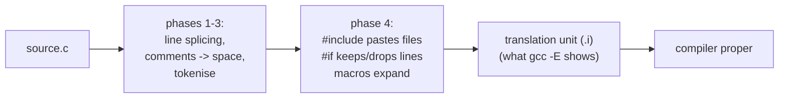

# Lesson I4 — The preprocessor: a text-rewriting machine that runs before the compiler

> Level: intermediate. Prerequisites: B1 (compilation stages). Time: about 2 hours.
> Tested with GCC 13.3 (`-std=c17`), GCC 14.2 (`-std=c23`), Clang 18.1, x86-64 Linux, November 2026.

---

## 1. Why this lesson exists

Every C file starts with `#include`, and real codebases are full of `#define`, `#ifdef`, include guards and macro tricks. The preprocessor exists because early C had no modules, no constants (`const` came with C89), no inline functions (C99), no generics (`_Generic` came with C11) and no way to ask "which platform am I on?" — so a **text-substitution** stage was bolted in front of the compiler to provide all of them.

It is powerful and dangerous for the same reason: it **knows nothing about C**. It works on *tokens* and does blind substitution, so a macro can look like a function and behave nothing like one. Knowing exactly what it does lets you read Linux kernel, glibc or SQLite source, and avoid a classic family of bugs.

---

## 2. Intuition: find-and-replace with a few extra powers

Imagine running your editor's **find-and-replace** over the source file before handing it to the compiler, plus three extras:

1. **Paste another file here** (`#include`).
2. **Keep or delete this block depending on a condition** (`#if` / `#ifdef`).
3. **Replace with parameters** (function-like macros), and two tiny string tricks: turn an argument into a string (`#`) and glue two tokens into one (`##`).

The compiler proper never sees your macros — only the result. `gcc -E` shows you that result.

---

## 3. Precise definitions

- **Translation phases** (N3220 §5.1.1.2): the standard describes eight conceptual phases. Phases 1–3 handle characters, line splicing (backslash-newline) and splitting into *preprocessing tokens* (comments become a single space); **phase 4 executes preprocessing directives and expands macros**; later phases concatenate string literals, translate and link.
- **Directive:** a line whose first non-whitespace token is `#` (N3220 §6.10). Directives are line-based; continue a long one with a trailing backslash.
- **`#include <h>` vs `#include "h"`** (§6.10.3): both search implementation-defined places; the quoted form first searches in an implementation-defined way (GCC: the directory of the current file, then `-iquote`/`-I` paths) and falls back to the `<>` search.
- **Object-like macro:** `#define NAME replacement`. **Function-like macro:** `#define NAME(params) replacement` — the `(` must touch the name.
- **`#` operator** (stringizing) turns a macro parameter into a string literal; **`##` operator** (token pasting) concatenates two tokens (§6.10.5).
- **Variadic macros** (C99): `...` and `__VA_ARGS__`; **`__VA_OPT__(x)`** (C23, N3033) expands to `x` only if the variadic arguments are non-empty.
- **Predefined macros** (§6.10.10): `__FILE__`, `__LINE__`, `__DATE__`, `__TIME__`, `__STDC__`, `__STDC_VERSION__`, `__STDC_HOSTED__` and others. (`__func__` is *not* a macro; it is an implicitly declared identifier inside each function.)
- **Conditional inclusion** (§6.10.2): `#if`, `#ifdef`, `#ifndef`, `#elif`, `#else`, `#endif`, plus C23's `#elifdef`/`#elifndef` (N2645), `__has_include` (N2799), `__has_c_attribute`, and `__has_embed`.
- **Diagnostics:** `#error` (all versions) and `#warning` (standardised in C23, N2686; long supported by GCC/Clang as an extension).
- **`#embed`** (C23, N3017, §6.10.4): includes a binary file as a comma-separated list of integers. Supported from **GCC 15** and **Clang 19** (GCC and Clang status pages) — the test machine's GCC 14 / Clang 18 do not support it, so its example is marked as not compiled.

---

## 4. Step by step

### Step 1 — see the preprocessor's output

```c
// file: tiny.c
// build: gcc -std=c17 -E -P tiny.c -o tiny.i
// run: cat tiny.i

#define GREETING "vanakkam"
#define TIMES 3

int main(void)
{
    // the compiler will never see the names GREETING or TIMES
    for (int i = 0; i < TIMES; i++)
        puts(GREETING);
    return 0;
}
```

Output (`-P` suppresses the `# line` markers):

```text
int main(void)
{
    for (int i = 0; i < 3; i++)
        puts("vanakkam");
    return 0;
}
```

The comment became whitespace (phase 3) and both macros were replaced (phase 4); with `-P`, GCC also drops the now-blank lines. (We only preprocess here: the file deliberately omits `#include <stdio.h>` so the output stays short, so it would not compile as-is.)

### Step 2 — the dumbest function-like macro, and its three walls

```c
// file: macro_walls.c
// build: gcc -std=c17 -Wall -Wextra -o macro_walls macro_walls.c
// run: ./macro_walls

#include <stdio.h>

#define SQUARE_BAD(x)  x * x            // wall 1: no parentheses
#define SQUARE_OK(x)   ((x) * (x))      // parenthesise each use AND the whole

#define MAX_BAD(a, b)  ((a) > (b) ? (a) : (b))   // wall 2: evaluates an argument twice

static inline int max_int(int a, int b)          // the real fix for wall 2: a function
{
    return a > b ? a : b;
}

int main(void)
{
    // wall 1: SQUARE_BAD(1 + 2) expands to 1 + 2 * 1 + 2 = 5, not 9
    printf("SQUARE_BAD(1+2) = %d, SQUARE_OK(1+2) = %d\n", SQUARE_BAD(1 + 2), SQUARE_OK(1 + 2));
    // also: 100 / SQUARE_BAD(2) -> 100 / 2 * 2 = 100
    printf("100 / SQUARE_BAD(2) = %d, 100 / SQUARE_OK(2) = %d\n", 100 / SQUARE_BAD(2), 100 / SQUARE_OK(2));

    // wall 2: the larger argument is evaluated TWICE, so i is incremented twice
    int i = 5, j = 3;
    int m = MAX_BAD(i++, j);
    printf("MAX_BAD(i++, j) = %d, i is now %d (incremented twice)\n", m, i);

    i = 5;
    m = max_int(i++, j);
    printf("max_int(i++, j) = %d, i is now %d\n", m, i);
    return 0;
}
```

Output:

```text
SQUARE_BAD(1+2) = 5, SQUARE_OK(1+2) = 9
100 / SQUARE_BAD(2) = 100, 100 / SQUARE_OK(2) = 25
MAX_BAD(i++, j) = 6, i is now 7 (incremented twice)
max_int(i++, j) = 5, i is now 6
```

**Wall 3 — multi-statement macros and `if`/`else`.** A macro that expands to two statements breaks when used as the body of an unbraced `if`. The idiom is `do { ... } while (0)`, which makes the macro a single statement that still requires a trailing semicolon:

```c
// file: dowhile.c
// build: gcc -std=c17 -Wall -Wextra -o dowhile dowhile.c
// run: ./dowhile

#include <stdio.h>

// two statements wrapped so the macro acts as ONE statement
#define LOG_AND_COUNT(msg, counter) do { puts(msg); (counter)++; } while (0)

int main(void)
{
    int errors = 0;
    int ok = 0;
    if (!ok)
        LOG_AND_COUNT("something failed", errors);   // expands safely inside if/else
    else
        puts("all good");
    printf("errors = %d\n", errors);
    return 0;
}
```

Output:

```text
something failed
errors = 1
```

Modern advice (and the C23 direction with `constexpr`): prefer `static inline` functions, `enum` or `const`/`constexpr` objects over macros whenever you can. Use macros only for what functions cannot do — the next steps.

### Step 3 — what only macros can do: `#`, `##`, `__FILE__`, `__LINE__`

```c
// file: macro_powers.c
// build: gcc -std=c17 -Wall -Wextra -o macro_powers macro_powers.c
// run: ./macro_powers

#include <stdio.h>

// # turns the expression TEXT into a string; __FILE__/__LINE__ give the call site
#define CHECK(expr) \
    do { if (!(expr)) printf("%s:%d: check failed: %s\n", __FILE__, __LINE__, #expr); } while (0)

// ## glues tokens: MAKE_GETTER(roll) defines a function named get_roll
#define MAKE_GETTER(field) \
    static int get_##field(const struct student *s) { return s->field; }

struct student { int roll; int year; };
MAKE_GETTER(roll)
MAKE_GETTER(year)

// variadic macro: forwards any number of arguments to printf
#define DEBUG(...) printf("[debug] " __VA_ARGS__)

int main(void)
{
    struct student s = { .roll = 17, .year = 4 };
    CHECK(get_roll(&s) == 17);          // passes: prints nothing
    CHECK(get_year(&s) == 3);           // fails: prints the source text of the expression
    DEBUG("roll=%d year=%d\n", get_roll(&s), get_year(&s));
    printf("compiled in function %s, C version %ld\n", __func__, (long)__STDC_VERSION__);
    return 0;
}
```

Output:

```text
macro_powers.c:26: check failed: get_year(&s) == 3
[debug] roll=17 year=4
compiled in function main, C version 201710
```

This is exactly how `assert` from `<assert.h>` is built — it prints the failed expression, file and line, then calls `abort`, and compiles to nothing when `NDEBUG` is defined.

### Step 4 — conditional compilation and `-D`

```c
// file: config.c
// build: gcc -std=c17 -Wall -o config_default config.c && gcc -std=c17 -Wall -DVERBOSE -DLEVEL=3 -o config_v config.c
// run: ./config_default; ./config_v

#include <stdio.h>

#ifndef LEVEL            // give a default if the build didn't define one
#define LEVEL 1
#endif

int main(void)
{
#ifdef VERBOSE
    puts("verbose build");
#else
    puts("quiet build");
#endif

#if LEVEL >= 3           // #if evaluates integer constant expressions
    puts("level >= 3 features on");
#elif LEVEL == 2
    puts("level 2 features on");
#else
    puts("basic features only");
#endif

#if defined(__linux__)   // a compiler-provided platform macro (not ISO C)
    puts("built for Linux");
#endif
    return 0;
}
```

Output:

```text
quiet build
basic features only
built for Linux
verbose build
level >= 3 features on
built for Linux
```

`gcc -dM -E - < /dev/null` lists every macro the compiler predefines — try it and search for `__x86_64__`, `__GNUC__`, `__SIZEOF_LONG__`.

### Step 5 — include guards: why headers need them

```c
// file: point.h
#ifndef POINT_H          // first time: POINT_H is not defined, so continue
#define POINT_H          // define it so a second #include skips everything

typedef struct { int x, y; } point;
int manhattan(point a, point b);

#endif                   // POINT_H
```

```c
// file: use_point.c
// build: gcc -std=c17 -Wall -Wextra -o use_point use_point.c
// run: ./use_point

#include <stdio.h>
#include <stdlib.h>
#include "point.h"
#include "point.h"       // included twice (happens indirectly in real projects): harmless thanks to the guard

int manhattan(point a, point b)
{
    return abs(a.x - b.x) + abs(a.y - b.y);
}

int main(void)
{
    point p = {1, 2}, q = {4, 6};
    printf("manhattan = %d\n", manhattan(p, q));
    return 0;
}
```

Output:

```text
manhattan = 7
```

Without the guard, the second inclusion would redefine the `typedef` of an anonymous struct as a *different* type and fail to compile. `#pragma once` is a widely supported but **non-standard** alternative.

### Step 6 — X-macros: one list, many expansions

The wall: an `enum` of error codes and a parallel array of their names must be kept in sync by hand. X-macros keep **one** list and expand it twice.

```c
// file: xmacro.c
// build: gcc -std=c17 -Wall -Wextra -o xmacro xmacro.c
// run: ./xmacro

#include <stdio.h>

// the single source of truth: each X(name, message) is one entry
#define ERROR_LIST(X)                       \
    X(E_OK,       "success")                \
    X(E_NOFILE,   "file not found")         \
    X(E_NOMEM,    "out of memory")          \
    X(E_BADINPUT, "invalid input")

// expansion 1: the enum
#define AS_ENUM(name, msg) name,
enum error_code { ERROR_LIST(AS_ENUM) E_COUNT };

// expansion 2: the message table, indexed by the enum
#define AS_MSG(name, msg) [name] = msg,
static const char *const error_msg[] = { ERROR_LIST(AS_MSG) };

// expansion 3: the names as strings, via #
#define AS_NAME(name, msg) [name] = #name,
static const char *const error_name[] = { ERROR_LIST(AS_NAME) };

int main(void)
{
    for (int e = 0; e < E_COUNT; e++)
        printf("%d %-10s %s\n", e, error_name[e], error_msg[e]);
    return 0;
}
```

Output:

```text
0 E_OK       success
1 E_NOFILE   file not found
2 E_NOMEM    out of memory
3 E_BADINPUT invalid input
```

### Step 7 — C23 preprocessor additions (GCC 14 / Clang 18)

```c
// file: c23_pp.c
// build: gcc-14 -std=c23 -Wall -Wextra -o c23_pp c23_pp.c 2>&1 | grep -o "warning: #warning.*"
// run: ./c23_pp

#include <stdio.h>

// __has_include: test whether a header exists before including it
#if __has_include(<stdckdint.h>)
#  include <stdckdint.h>
#  define HAVE_CKD 1
#else
#  define HAVE_CKD 0
#endif

#define FEATURE_A
// #elifdef / #elifndef: shorter forms of #elif defined(...)
#ifdef FEATURE_B
#  define PICKED "B"
#elifdef FEATURE_A
#  define PICKED "A"
#else
#  define PICKED "none"
#endif

// __VA_OPT__: emit the comma only when extra arguments are present
#define LOG(fmt, ...) printf("[log] " fmt "\n" __VA_OPT__(,) __VA_ARGS__)

#warning "this is a C23 #warning: compilation continues"

int main(void)
{
    LOG("no extra arguments");
    LOG("picked=%s, have ckd=%d", PICKED, HAVE_CKD);
    return 0;
}
```

Output (the warning is printed by the compiler, the rest by the program):

```text
warning: #warning "this is a C23 #warning: compilation continues" [-Wcpp]
[log] no extra arguments
[log] picked=A, have ckd=1
```

`#embed` (not compiled here — requires GCC 15+ or Clang 19+):

```c
/* NOT COMPILED ON THE TEST MACHINE (GCC 14.2 / Clang 18.1 lack #embed).
   Adapted from cppreference's #embed page. */
static const unsigned char icon[] = {
#embed "icon.png"
};
```

---

## 5. Diagrams



How `SQUARE_BAD(1 + 2)` expands:

```text
 #define SQUARE_BAD(x)  x * x
 SQUARE_BAD(1 + 2)
      x  := 1 + 2           (tokens, not a value!)
      ->  1 + 2 * 1 + 2     = 1 + 2 + 2 = 5
 #define SQUARE_OK(x)   ((x) * (x))
      ->  ((1 + 2) * (1 + 2)) = 9
```

---

## 6. Common mistakes

| Mistake | Consequence | Fix |
|---|---|---|
| Missing parentheses around parameters/body | Operator-precedence surprises | `((x) * (x))` |
| Arguments with side effects (`i++`) to macros | Evaluated 0, 1 or 2 times | Use an inline function |
| Space between name and `(` in `#define F (x)` | Becomes an object-like macro whose text starts with `(x)` | No space |
| Trailing semicolon in the macro body | `if (c) M(); else …` breaks | `do { … } while (0)` without the final `;` |
| Headers without include guards | Redefinition errors | `#ifndef X_H / #define X_H / #endif` |
| Using `#ifdef` for a macro that may be defined as 0 | `#ifdef` is true even if value is 0 | `#if FEATURE` when the value matters |
| Macros named like functions with different semantics | Readers assume function semantics | UPPER_CASE names for macros |
| Defining reserved identifiers (`_Foo`, `__bar`) | UB/clashes with the implementation | Avoid leading underscore + capital or double underscore |
| `#define TRUE 1` etc. in C23 code | Conflicts with keywords `true`/`false` (C23) | Use `<stdbool.h>` / the C23 keywords |

---

## 7. Connections

- **Compilers track:** the preprocessor is a separate lexical pass before parsing; tools like `cpp`, `clang -E` and compile_commands-driven IDEs must run it to understand code.
- **C++ track:** `constexpr`, templates, `inline` and modules (C++20) each replaced one use of macros; C23 imported `constexpr` objects in the same spirit.
- **Linux track / OS track:** the kernel uses `#ifdef CONFIG_...` (generated from Kconfig) to build drivers in or out; `container_of` is a famous macro.
- **Testing track:** `assert` is a macro; test frameworks (Unity, Check) build their `TEST_ASSERT_EQUAL` from `#`, `__FILE__`, `__LINE__`.
- **Build/Make lesson (I6):** `-D` flags and `-MMD` dependency files are produced by the preprocessor.

### Where this shows up in my projects

- **compiler-fuzz:** generated test programs need a way to print a checksum of their final state so GCC and Clang outputs can be compared; a common design (Csmith's) is a fixed runtime header of helper macros/functions included into every generated file, kept tiny and UB-free. Running `gcc -E` on a generated file is also the quickest way to confirm that both compilers saw the same translation unit.

---

## 8. Self-check questions

1. In which translation phase are macros expanded? What happens to comments before that?
2. Expand `SQUARE_BAD(a - b)` by hand.
3. Why do multi-statement macros use `do { … } while (0)`?
4. What do `#` and `##` do? Give a use for each.
5. Why does `#include "point.h"` twice not cause an error?
6. What does `__VA_OPT__(,)` solve?
7. Why is `__func__` not a macro, and why does that matter?

<details>
<summary>Answers</summary>

1. Phase 4. Comments were already replaced by a single space in phase 3.
2. `a - b * a - b`, i.e. `a - (b*a) - b`.
3. To make the expansion a single statement that requires a trailing semicolon, so it works as the body of an unbraced `if`/`else`.
4. `#` stringizes a parameter (assert messages, enum-to-string tables). `##` pastes tokens into one (generating function or variable names like `get_roll`).
5. The include guard: the first inclusion defines `POINT_H`, and the second inclusion's `#ifndef POINT_H` skips the whole body.
6. A variadic macro with a fixed `fmt` and optional extra arguments needs a comma only when extra arguments exist; `__VA_OPT__(,)` emits it conditionally (C23), replacing the GNU `, ## __VA_ARGS__` extension.
7. It is a predefined identifier declared by the compiler inside each function body (phase 7), not by the preprocessor — so it cannot be used in `#if` or pasted with `##`, and `"..." __func__` string concatenation does not work.

</details>

---

## 9. Mnemonic (Tamil + English)

**Macro hygiene — "Bracket, Bracket, Braces":**

> **"Ovvoru x-kum bracket, mothathukkum bracket, statement-na do-while braces."** — Bracket every x, bracket the whole thing, and for statements wrap in do-while braces.

**`#` vs `##`:**

> **"Ore hash — string aakkum; rendu hash — ottu podum."** — One hash makes it a string; two hashes stick tokens together (like *ottu*, glue).

**Macros are blind:** **"Macro-ku kannu theriyaadhu, copy-paste mattum theriyum."** — the macro can't see C; it only knows copy-paste.

---

## Sources

- WG14 N3220: §5.1.1.2 translation phases, §6.10 preprocessing directives (§6.10.2 conditional inclusion, §6.10.3 source file inclusion, §6.10.4 binary resource inclusion, §6.10.5 macro replacement, §6.10.7 diagnostic directives, §6.10.10 predefined macro names): https://open-std.org/JTC1/SC22/WG14/www/docs/n3220.pdf
- cppreference, *Preprocessor* overview and *Replacing text macros* (`#`, `##`, `__VA_ARGS__`, `__VA_OPT__`): https://en.cppreference.com/w/c/preprocessor and https://en.cppreference.com/w/c/preprocessor/replace
- cppreference, *Binary resource inclusion (#embed)*: https://en.cppreference.com/w/c/preprocessor/embed
- cppreference, *C23* feature list with proposal numbers (N2645 `#elifdef`, N2686 `#warning`, N2799 `__has_include`, N3017 `#embed`, N3033 `__VA_OPT__`): https://www.cppreference.com/w/c/23.html
- GCC, *C Status* (`#embed` in GCC 15): https://gcc.gnu.org/projects/c-status.html
- Clang, *C Support in Clang* (`#embed` in Clang 19): https://clang.llvm.org/c_status.html
- GCC manual, *Preprocessor Options* (`-D`, `-E`, `-MMD`, `-MP`): https://gcc.gnu.org/onlinedocs/gcc/Preprocessor-Options.html
- The GNU C Preprocessor manual (include search order, `#pragma once`, common predefined macros): https://gcc.gnu.org/onlinedocs/cpp/

## Verify yourself

1. Run each block. Run `gcc -E macro_walls.c | tail -20` to *see* the expansions.
2. `gcc -dM -E - < /dev/null | sort | less` — browse every predefined macro of your compiler.
3. Remove the include guard from `point.h` and read the compiler error.
4. Try `#embed` on Compiler Explorer with GCC 15 or Clang 19 (or later), compiling with `-std=c23`.
5. Read the eight translation phases in N3220 §5.1.1.2 and map each to something you saw in Step 1.
