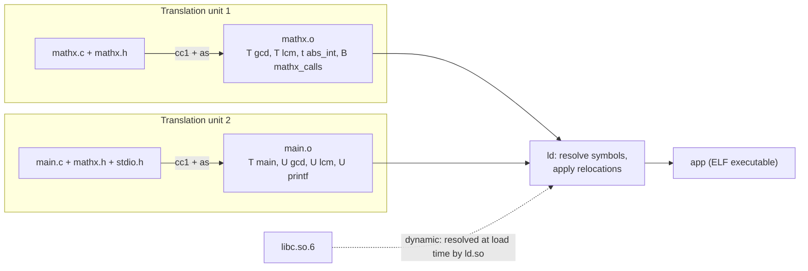

# Lesson I5 — Compilation and linking: from many `.c` files to one program

> Level: intermediate. Prerequisites: B1 (the four stages), B6 (memory regions), I4 (preprocessor, include guards). Time: about 2.5 hours.
> Tested with GCC 13.3, GNU binutils (`nm`, `objdump`, `ar`, `readelf`) and glibc 2.39 on x86-64 Linux (Ubuntu 24.04), November 2026.

---

## 1. Why this lesson exists

One-file programs hide the most important part of how C scales: **separate compilation**. Real projects have hundreds of `.c` files, each compiled *alone* into an object file, then *linked*. This explains a whole family of errors beginners find mysterious:

- `undefined reference to 'foo'` — compiled fine, failed to link.
- `multiple definition of 'count'` — a variable defined in a header.
- a program that builds on one machine and says `error while loading shared libraries` on another.

It also explains what `static` on a global means, why headers contain declarations but not definitions, and how libraries work. When you study compilers and OS later, this lesson is the bridge between them.

---

## 2. Intuition: a group project report

Five students each write one chapter (translation unit) of a report. Each chapter may say "see Figure 3 in Chapter 2" — a **reference** to something defined elsewhere. Each student compiles their chapter into a PDF with a placeholder where the cross-reference goes (an **object file** with **unresolved symbols** and **relocations**). Then an editor (the **linker**) staples the PDFs together, assigns final page numbers, and fills in every placeholder.

- If Chapter 4 refers to "Figure 9" that nobody wrote → *undefined reference*.
- If two chapters both define "Figure 3" → *multiple definition*.
- A **header file** is the shared table of contents everyone agrees on: it says what exists (declarations), not the content (definitions).
- `static` on a global is a "private note": only usable inside that chapter, invisible to the editor.

---

## 3. Precise definitions

- **Translation unit (TU):** a source file plus everything it includes, after preprocessing (N3220 §5.1.1.1). The compiler sees one TU at a time.
- **Declaration vs definition:** a *declaration* specifies the interpretation of an identifier; a *definition* also creates the object or supplies the function body (N3220 §6.7). `extern int count;` declares; `int count = 0;` defines. A function prototype declares; a function with a body defines.
- **Linkage** (N3220 §6.2.2; cppreference *Storage duration and linkage*):
  - *external* — the name refers to the same entity across all TUs (non-`static` file-scope functions and variables, and anything declared `extern` with no prior internal declaration);
  - *internal* — visible only within its TU (file-scope `static` objects and functions; and in C23, file-scope `constexpr` objects);
  - *none* — block-scope locals, parameters.
- **One external definition rule:** if an identifier with external linkage is used, the whole program must contain *exactly one* external definition for it (N3220 §6.9.1).
- **Tentative definition:** a file-scope `int x;` with no initialiser and no `extern`. Historically many compilers merged such definitions across TUs as "common" symbols; **GCC 10 changed the default to `-fno-common`**, so the same tentative definition in two TUs is now a link error (GCC "Porting to GCC 10").
- **Object file (ELF relocatable, `.o`):** machine code and data in **sections** (`.text`, `.data`, `.rodata`, `.bss`), a **symbol table** (defined and undefined names) and **relocation entries** (places to patch once final addresses are known).
- **Linker (`ld`, invoked by `gcc`):** performs **symbol resolution** (match each undefined reference to one definition) and **relocation** (assign addresses, patch references). (CS:APP ch. 7 is the standard textbook treatment.)
- **Static library (`.a`):** an archive of `.o` files made by `ar`; the linker copies in only the members needed to resolve currently undefined symbols, scanning libraries **in command-line order**.
- **Shared library (`.so`):** position-independent code (`-fPIC`) linked at run time by the dynamic linker `ld.so`, which searches `DT_RPATH`, `LD_LIBRARY_PATH`, `DT_RUNPATH`, `/etc/ld.so.cache`, then default paths such as `/lib` and `/usr/lib` (man page `ld.so(8)`).

---

## 4. Step by step

### Step 1 — split a program into a module

```c
// file: mathx.h
#ifndef MATHX_H
#define MATHX_H

// the module's public interface: declarations only
int gcd(int a, int b);
long lcm(int a, int b);
extern int mathx_calls;     // declaration of a variable DEFINED in mathx.c

#endif
```

```c
// file: mathx.c
#include "mathx.h"          // include your own header: the compiler checks definitions match it

int mathx_calls = 0;        // the ONE definition of the shared counter (external linkage)

// internal helper: static gives internal linkage, invisible to other .c files
static int abs_int(int x)
{
    return x < 0 ? -x : x;
}

int gcd(int a, int b)
{
    mathx_calls++;
    a = abs_int(a);
    b = abs_int(b);
    while (b != 0) {        // Euclid: gcd(a, b) = gcd(b, a mod b)
        int r = a % b;
        a = b;
        b = r;
    }
    return a;
}

long lcm(int a, int b)
{
    if (a == 0 || b == 0) return 0;
    return (long)abs_int(a) / gcd(a, b) * abs_int(b);   // divide first to limit overflow
}
```

```c
// file: main.c
// build: gcc -std=c17 -Wall -Wextra -c mathx.c -o mathx.o && gcc -std=c17 -Wall -Wextra -c main.c -o main.o && gcc mathx.o main.o -o app
// run: ./app

#include <stdio.h>
#include "mathx.h"

int main(void)
{
    printf("gcd(84, 36) = %d\n", gcd(84, 36));
    printf("lcm(4, 6)   = %ld\n", lcm(4, 6));
    printf("calls       = %d\n", mathx_calls);
    return 0;
}
```

Output:

```text
gcd(84, 36) = 12
lcm(4, 6)   = 12
calls       = 2
```

Each `.c` was compiled **without seeing the other**; `main.c` only knew the declarations in `mathx.h`. The final `gcc mathx.o main.o -o app` is the link step.

### Step 2 — look inside the object files with `nm`

```bash
nm mathx.o
nm main.o
```

Output on the test machine:

```text
mathx.o:
0000000000000000 t abs_int
0000000000000017 T gcd
0000000000000075 T lcm
0000000000000000 B mathx_calls

main.o:
                 U gcd
                 U lcm
0000000000000000 T main
                 U mathx_calls
                 U printf
```

Reading the letters (from `man nm`): `T` = defined in text (code) with external linkage, `t` = defined in text but **local** (our `static abs_int`), `B` = defined in bss (zero-initialised data), `U` = **undefined** — referenced here, must be found elsewhere. The linker's job is to match every `U` with exactly one `T`/`D`/`B` somewhere. `printf`'s `U` is satisfied by the C library, which `gcc` links automatically.

### Step 3 — the two classic link errors, on purpose

**Undefined reference** — forget to link `mathx.o`:

```bash
gcc main.o -o app_broken
```

```text
/usr/bin/ld: main.o: in function `main':
main.c:(.text+0x13): undefined reference to `gcd'
/usr/bin/ld: main.c:(.text+0x38): undefined reference to `lcm'
/usr/bin/ld: main.c:(.text+0x55): undefined reference to `mathx_calls'
collect2: error: ld returned 1 exit status
```

(The linker on the test machine also printed two extra warnings about a "relocation in read-only section" and "DT_TEXTREL in a PIE" — side effects of the failed resolution; they disappear once the symbols are found.)

Note who complains: `ld` (via `collect2`), not the compiler. Compiling succeeded; *resolution* failed.

**Multiple definition** — the dumbest way to share a variable is to *define* it in the header:

```c
// file: bad_shared.h
#ifndef BAD_SHARED_H
#define BAD_SHARED_H
int counter;              // tentative DEFINITION in a header: every includer defines it
#endif
```

```c
// file: one.c
#include "bad_shared.h"
void bump(void) { counter++; }
```

```c
// file: two.c
// build: gcc -std=c17 -c one.c -o one.o && gcc -std=c17 -c two.c -o two.o && (gcc one.o two.o -o shared 2>&1 | grep -o "multiple definition of .counter.*" | head -1; true)
// run: gcc -std=c17 -fcommon one.c two.c -o shared_common && ./shared_common

#include <stdio.h>
#include "bad_shared.h"
void bump(void);
int main(void) { bump(); bump(); printf("counter = %d\n", counter); return 0; }
```

Output:

```text
multiple definition of `counter'; one.o:(.bss+0x0): first defined here
counter = 2
```

Include guards do **not** help: they stop double inclusion *within one TU*, but `one.c` and `two.c` are different TUs, each getting its own definition. With GCC ≥ 10 this is an error; the old `-fcommon` behaviour (second command) merges them silently. The correct pattern is Step 1's: `extern int counter;` in the header, `int counter = 0;` in exactly one `.c` file.

### Step 4 — a static library and the ordering trap

```bash
gcc -std=c17 -Wall -c mathx.c -o mathx.o
ar rcs libmathx.a mathx.o           # r: insert, c: create, s: write an index
gcc main.o -L. -lmathx -o app_static   # -L. : search here; -lmathx : libmathx.a (or .so)
./app_static
gcc -L. -lmathx main.o -o app_wrong_order    # library BEFORE the object that needs it
```

Output of the last command (abridged):

```text
/usr/bin/ld: main.o: in function `main':
main.c:(.text+0x13): undefined reference to `gcd'
```

Why: the linker scans inputs left to right. When it reaches `libmathx.a`, nothing is undefined yet, so it takes no members from it; later, `main.o` introduces `U gcd`, but the library has already been passed. **Rule: put libraries after the objects that use them** (and order libraries so users come before providers).

### Step 5 — a shared library and the dynamic linker

```bash
gcc -std=c17 -Wall -fPIC -c mathx.c -o mathx_pic.o   # position-independent code
gcc -shared mathx_pic.o -o libmathx.so               # build the shared object
gcc main.o -L. -lmathx -o app_dyn                    # links against .so (preferred over .a)
./app_dyn                                            # fails: ld.so does not search "."
LD_LIBRARY_PATH=. ./app_dyn                          # works: tell ld.so where to look
gcc main.o -L. -lmathx -Wl,-rpath,'$ORIGIN' -o app_rpath   # or bake a search path into the binary
./app_rpath
ldd ./app_rpath | head -3
```

Output:

```text
./app_dyn: error while loading shared libraries: libmathx.so: cannot open shared object file: No such file or directory
gcd(84, 36) = 12
lcm(4, 6)   = 12
calls       = 2
gcd(84, 36) = 12
lcm(4, 6)   = 12
calls       = 2
	linux-vdso.so.1 (0x00007faa4975b000)
	libmathx.so => /tmp/kbtest/05-compilation-and-linking/./libmathx.so (0x00007faa49749000)
	libc.so.6 => /lib/x86_64-linux-gnu/libc.so.6 (0x00007faa49400000)
```

`$ORIGIN` means "the directory containing the executable". Static vs shared in one table:

| | Static `.a` | Shared `.so` |
|---|---|---|
| When code is attached | link time (copied into the executable) | load time / run time (`ld.so`) |
| Executable size | larger | smaller |
| Update a bug fix in the library | must relink every program | replace the `.so` once |
| Deployment failure mode | none at run time | "cannot open shared object file", version mismatches |
| Code generation requirement | none | `-fPIC` |

Lesson P3 goes deeper: ELF sections, the GOT/PLT, symbol interposition and `LD_PRELOAD`.

### Step 6 — watching the linker's view with `objdump -r`

```bash
objdump -dr main.o | grep -A1 "call"
```

Output on the test machine (first call only; offsets vary with compiler version):

```text
  12:	e8 00 00 00 00       	call   17 <main+0x17>
			13: R_X86_64_PLT32	gcd-0x4
```

The call instruction in `main.o` has a placeholder `00 00 00 00` and a **relocation** record: "patch the 4 bytes at offset 0x13 with the address of `gcd` (relative, via the PLT)". After linking, `objdump -d app` shows the real displacement.

---

## 5. Diagrams



Linkage at a glance:

```text
            file scope                       block scope
            ----------------------------     ------------------------
 int x;       external linkage, static dur.    no linkage, automatic
 static int x; internal linkage, static dur.   no linkage, static duration
 extern int x; declaration, external linkage   declaration, external linkage
 static void f() internal linkage             (not allowed)
```

---

## 6. Common mistakes

| Mistake | Symptom | Fix |
|---|---|---|
| Defining variables in headers | `multiple definition` (GCC ≥ 10) | `extern` declaration in header, one definition in a `.c` |
| Defining non-`static` functions in headers | `multiple definition` | Declare in header; or `static inline` for tiny helpers |
| Forgetting to compile/link a `.c` | `undefined reference` | Add the file/object/library to the link |
| Library before object on the command line | `undefined reference` despite `-l` | Objects first, then `-l` libraries |
| Header declaration differs from definition | Silent mismatch if the `.c` doesn't include its own header | Always include `x.h` in `x.c` |
| Making every helper global | Name clashes across modules; no optimiser freedom | `static` for TU-private functions |
| Shipping a program linked to a `.so` in an unusual path | "cannot open shared object file" on users' machines | rpath with `$ORIGIN`, install to standard paths, or link statically |
| Mixing objects compiled with different `-std`/ABI-affecting flags | Subtle struct layout or `bool` ABI mismatches | Consistent flags across the build (GCC 15 notes `bool` vs `int` ABI differences) |

---

## 7. Connections

- **Compilers track:** `cc1` (compiler proper) produces assembly; `as` produces relocatable objects; whole-program optimisation (`-flto`) moves optimisation into the link step (lesson P5).
- **OS track:** `ld.so` runs before `main`, mapping `.so` files with `mmap`; `/proc/self/maps` (lesson B6) shows the result.
- **Linux track:** `ldd`, `nm`, `objdump`, `readelf`, `ar`, `ldconfig` and `LD_LIBRARY_PATH` are everyday tools.
- **Java track:** the JVM links classes lazily at run time by name — conceptually a dynamic linker with verification; a "NoSuchMethodError" is Java's cousin of an unresolved symbol.
- **Python track:** a C extension module is a shared library (`.so`) loaded with `dlopen` by the interpreter.
- **Cloud/DevOps track:** container images often ship statically linked binaries (or distroless images with exact `.so` sets) precisely to avoid the shared-library failure mode.

### Where this shows up in my projects

- **compiler-fuzz:** comparing GCC 15.2 against Clang 21.1 means both compilers must link against the same C library and runtime; a differential tester also has to classify a *link* failure (or a missing sanitizer runtime library) separately from a *wrong-code* result, because only the latter indicates a miscompilation.
- **aws-waste-scanner:** an AWS Lambda deployment package that bundles a native Python extension succeeds or fails on exactly the shared-library rules above — the `.so` must have been built for the Lambda runtime's architecture and glibc. (General Lambda behaviour, not a project-specific bug.)

---

## 8. Self-check questions

1. What does `U printf` in `nm main.o` mean, and who resolves it?
2. Why does `static int abs_int` appear as `t` and not `T`?
3. Why don't include guards prevent the `multiple definition of counter` error?
4. Why does `gcc -L. -lmathx main.o` fail but `gcc main.o -L. -lmathx` work?
5. What does `-fPIC` enable, and when is it required?
6. List the dynamic linker's search order for `libmathx.so`.

<details>
<summary>Answers</summary>

1. `printf` is referenced but not defined in this object; the linker (at link time) and then `ld.so` (at load time, since libc is shared) resolve it to glibc's definition.
2. `static` gives it internal linkage, so its symbol is local to the object file (lowercase letter in `nm`), not visible to other TUs.
3. Guards only prevent a header from being processed twice within one translation unit; each `.c` file is a separate TU and gets its own definition.
4. The linker processes inputs in order and only extracts archive members that resolve symbols that are *already* undefined; when the archive comes first, nothing is undefined yet.
5. Code that works at any load address (references go through a GOT/PC-relative addressing); required for shared libraries.
6. `DT_RPATH` (only if no `DT_RUNPATH`), `LD_LIBRARY_PATH`, `DT_RUNPATH`, `/etc/ld.so.cache`, then the default paths (`/lib`, `/usr/lib`, or the 64-bit variants).

</details>

---

## 9. Mnemonic (Tamil + English)

**Header = declarations, `.c` = definitions:**

> **"Header-la 'irukku'nu sollu, .c-la 'idho'nu kaattu."** — In the header just *say* it exists; in the `.c` *show* it.

**Link order:**

> **"Kaekkaravan munnadi, kudukkaravan pinnadi."** — The one who *asks* (object with `U` symbols) goes first; the one who *gives* (the library) comes after.

**nm letters:** **"Periya T ellarukkum, chinna t veetukku mattum, U-na 'Unga kitta irukka?'"** — capital T is for everyone, small t is only for home (static), U means "do you have it?" (undefined).

---

## Sources

- WG14 N3220: §5.1.1.1 program structure (translation units), §6.2.2 linkages of identifiers, §6.7 declarations, §6.9 external definitions (§6.9.1 general, §6.9.3 external object definitions / tentative definitions): https://open-std.org/JTC1/SC22/WG14/www/docs/n3220.pdf
- cppreference, *Storage duration and linkage*: https://en.cppreference.com/w/c/language/storage_duration
- GCC, *Porting to GCC 10* (`-fno-common` default): https://gcc.gnu.org/gcc-10/porting_to.html
- GCC manual, *Code Gen Options* (`-fpic`, `-fPIC`): https://gcc.gnu.org/onlinedocs/gcc/Code-Gen-Options.html
- GCC manual, *Link Options* (`-l`, `-L`, `-shared`, `-Wl`): https://gcc.gnu.org/onlinedocs/gcc/Link-Options.html
- Linux man page `ld.so(8)` (search order, `LD_LIBRARY_PATH`, `$ORIGIN`): https://man7.org/linux/man-pages/man8/ld.so.8.html
- GNU binutils documentation (`nm`, `objdump`, `ar`): https://sourceware.org/binutils/docs/binutils/
- Bryant & O'Hallaron, *CS:APP*, ch. 7 "Linking" — book site: https://csapp.cs.cmu.edu/
- Ian Lance Taylor, *Linkers part 1* (first post of his 2007 essay series on linkers; later parts are linked from each post): https://www.airs.com/blog/archives/38

## Verify yourself

1. Build Step 1 and run `nm mathx.o main.o`; match each letter with `man nm`.
2. Reproduce both link errors from Step 3 and the ordering error from Step 4.
3. Run `readelf -d app_rpath | grep -i path` and confirm `RUNPATH` contains `$ORIGIN`.
4. Run `LD_DEBUG=libs LD_LIBRARY_PATH=. ./app_dyn 2>&1 | head -20` to watch `ld.so` search for libraries.
5. Read the GCC 10 porting note on `-fno-common` and compile `two.c` with and without `-fcommon`.
