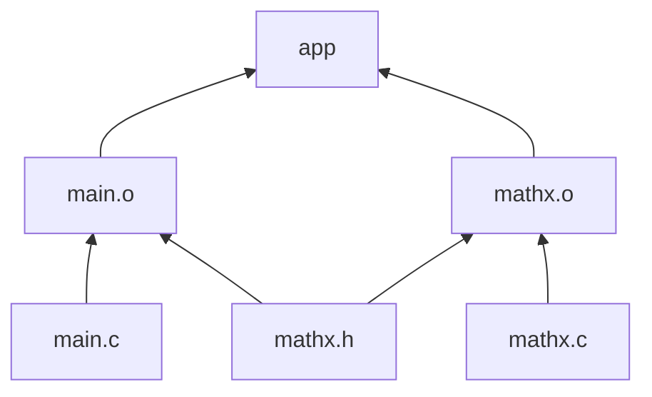

# Lesson I6 — `make`: rebuilding only what changed, correctly

> Level: intermediate. Prerequisites: I5 (separate compilation, object files, linking). Time: about 2 hours.
> Tested with GNU Make 4.3 and GCC 13.3 on x86-64 Linux, November 2026.

---

## 1. Why this lesson exists

Lesson I5 split a program into modules compiled separately. With three files you can type the commands. With three hundred you cannot, and you also don't *want* to recompile all three hundred when you edit one. You need a tool that knows:

1. **what depends on what** (`app` needs `main.o` and `mathx.o`; `main.o` needs `main.c` and `mathx.h`), and
2. **what is out of date** (an input newer than its output),

and then runs the *minimum* set of commands, in a valid order, possibly in parallel. That tool is `make`, created by Stuart Feldman at Bell Labs in 1976 (Wikipedia, *Make (software)*). Modern build generators (CMake, Meson) still usually *emit* Makefiles or Ninja files built on the same idea.

---

## 2. Intuition: a recipe card with a "best before" check

A Makefile is a stack of recipe cards:

> **To make** `app` **you need** `main.o` and `mathx.o`. **Recipe:** link them.
> **To make** `main.o` **you need** `main.c` and `mathx.h`. **Recipe:** compile `main.c`.

Before cooking, `make` checks the timestamps: if `app` is *newer* than everything it needs, it's fresh — skip it. If any ingredient was modified after the dish was made, re-cook that dish *and everything that uses it*. The cards form a **directed acyclic graph (DAG)**, and `make` does a post-order walk over it.

---

## 3. Precise definitions (GNU Make)

- **Rule:**
  ```text
  target ... : prerequisites ...
  <TAB>recipe line
  <TAB>recipe line
  ```
  Recipe lines **must start with a tab character** (unless `.RECIPEPREFIX` is changed).
- **Out of date:** a target is remade if it does not exist or if any prerequisite is newer than it (modification time).
- **Default goal:** the first target in the Makefile (unless `.DEFAULT_GOAL` is set).
- **Variables:** `CC = gcc`, used as `$(CC)`. `=` is recursively expanded (evaluated on use); `:=` is simply expanded (evaluated once at definition); `?=` sets only if not already set; `+=` appends.
- **Automatic variables** (GNU Make manual, *Automatic Variables*): `$@` the target name; `$<` the first prerequisite; `$^` all prerequisites (duplicates removed); `$?` prerequisites newer than the target; `$*` the stem matched by `%` in a pattern rule.
- **Pattern rule:** `%.o: %.c` — how to build any `.o` from the same-named `.c`.
- **Phony target:** "just a name for a recipe to be executed when you make an explicit request"; declaring `.PHONY: clean` avoids a conflict with a file of the same name and skips the implicit-rule search (GNU Make manual, *Phony Targets*).
- **Automatic dependency generation:** GCC's `-MMD` writes a `.d` file listing the user headers each object depends on (system headers excluded), and `-MP` adds a phony target for each header so deleting a header doesn't break the build (GCC *Preprocessor Options*).
- **`-j N`:** run up to N recipes in parallel — correct only if the dependency graph is complete.

---

## 4. Step by step

We reuse the `mathx` module from lesson I5; its files are repeated below so this lesson stands alone.

### Setup — the three source files (same as lesson I5)

Put these three files in an empty directory; every Makefile below sits next to them.

```c
// file: mathx.h
#ifndef MATHX_H
#define MATHX_H

// the module's public interface: declarations only
int gcd(int a, int b);
long lcm(int a, int b);
extern int mathx_calls;     // declaration of a variable DEFINED in mathx.c

#endif
```

```c
// file: mathx.c
#include "mathx.h"          // include your own header: the compiler checks definitions match it

int mathx_calls = 0;        // the ONE definition of the shared counter (external linkage)

// internal helper: static gives internal linkage, invisible to other .c files
static int abs_int(int x)
{
    return x < 0 ? -x : x;
}

int gcd(int a, int b)
{
    mathx_calls++;
    a = abs_int(a);
    b = abs_int(b);
    while (b != 0) {        // Euclid: gcd(a, b) = gcd(b, a mod b)
        int r = a % b;
        a = b;
        b = r;
    }
    return a;
}

long lcm(int a, int b)
{
    if (a == 0 || b == 0) return 0;
    return (long)abs_int(a) / gcd(a, b) * abs_int(b);   // divide first to limit overflow
}
```

```c
// file: main.c

#include <stdio.h>
#include "mathx.h"

int main(void)
{
    printf("gcd(84, 36) = %d\n", gcd(84, 36));
    printf("lcm(4, 6)   = %ld\n", lcm(4, 6));
    printf("calls       = %d\n", mathx_calls);
    return 0;
}
```

### Attempt 0 — the dumbest build: a shell script

```bash
#!/bin/sh
gcc -std=c17 -Wall -Wextra -c mathx.c -o mathx.o
gcc -std=c17 -Wall -Wextra -c main.c -o main.o
gcc mathx.o main.o -o app
```

Works, but recompiles *everything* every time. With large projects that is minutes per edit. Wall: we need "only what changed".

### Attempt 1 — a naive Makefile

```makefile
# file: Makefile.naive
# build: make -f Makefile.naive
# run: make -f Makefile.naive; echo "--- touch mathx.h ---"; sleep 1; touch mathx.h; make -f Makefile.naive

# link step: app depends on both object files
app: main.o mathx.o
	gcc main.o mathx.o -o app

# compile steps: each object depends on its .c file ONLY (this is the bug)
main.o: main.c
	gcc -std=c17 -Wall -Wextra -c main.c -o main.o

mathx.o: mathx.c
	gcc -std=c17 -Wall -Wextra -c mathx.c -o mathx.o
```

Output:

```text
gcc -std=c17 -Wall -Wextra -c main.c -o main.o
gcc -std=c17 -Wall -Wextra -c mathx.c -o mathx.o
gcc main.o mathx.o -o app
make: 'app' is up to date.
--- touch mathx.h ---
make: 'app' is up to date.
```

Progress: the second `make` did nothing (everything fresh). But **the wall**: after touching `mathx.h`, `make` still thinks everything is up to date, because no rule mentions the header. If you had changed a struct layout or a function signature in `mathx.h`, `main.o` would keep the *old* assumption — a **stale build**, one of the nastiest bug classes because the source code looks right.

### Attempt 2 — variables, pattern rules, automatic variables, and generated dependencies

```makefile
# file: Makefile
# build: rm -f app *.o && make
# run: make; echo "--- touch mathx.h ---"; sleep 1; touch mathx.h; make; echo "--- make -n clean ---"; make -n clean; cat main.d

# ---- configuration (override from the command line: make CC=clang) ----
# NOTE: "CC ?= gcc" would NOT work: make already defines CC (as "cc") by default
CC      := gcc
CFLAGS  := -std=c17 -Wall -Wextra -g -O2
# write foo.d next to foo.o listing the headers foo.c includes
# (comments go on their own line: a trailing comment leaves trailing spaces in the value)
DEPFLAGS := -MMD -MP
LDLIBS  :=

SRCS := main.c mathx.c
# substitution reference: main.o mathx.o
OBJS := $(SRCS:.c=.o)
DEPS := $(OBJS:.o=.d)

# ---- the default goal (first target) ----
app: $(OBJS)
	$(CC) $^ $(LDLIBS) -o $@

# ---- one pattern rule compiles ANY .c into a .o ----
# $< = the .c file (first prerequisite), $@ = the .o target
%.o: %.c
	$(CC) $(CFLAGS) $(DEPFLAGS) -c $< -o $@

# ---- housekeeping targets that are not files ----
.PHONY: clean
clean:
	rm -f app $(OBJS) $(DEPS)

# ---- pull in the generated header dependencies (silently skip if missing) ----
-include $(DEPS)
```

Output (the build line first deletes the objects left by Attempt 1, then runs `make` once, so the run below begins with an up-to-date tree):

```text
make: 'app' is up to date.
--- touch mathx.h ---
gcc -std=c17 -Wall -Wextra -g -O2 -MMD -MP -c main.c -o main.o
gcc -std=c17 -Wall -Wextra -g -O2 -MMD -MP -c mathx.c -o mathx.o
gcc main.o mathx.o  -o app
--- make -n clean ---
rm -f app main.o mathx.o main.d mathx.d
main.o: main.c mathx.h
mathx.h:
```

Read the last two lines — that is `main.d`, written by the *compiler* during the first build: "`main.o` depends on `main.c` and `mathx.h`", plus an empty phony rule for `mathx.h` (from `-MP`). Because the Makefile `-include`s it, touching the header now rebuilds exactly the objects that include it. The dependency graph is always correct because the compiler, who actually read the `#include`s, wrote it.

### Step 3 — debug, release and sanitizer builds

```makefile
# file: Makefile.modes
# build: make -f Makefile.modes MODE=asan
# run: ./app_asan; make -f Makefile.modes MODE=release -s && ./app_release | head -1

MODE ?= debug

# per-mode flags chosen with conditionals
ifeq ($(MODE),release)
  CFLAGS := -std=c17 -Wall -Wextra -O2 -DNDEBUG
else ifeq ($(MODE),asan)
  CFLAGS := -std=c17 -Wall -Wextra -O1 -g -fsanitize=address,undefined -fno-omit-frame-pointer
  LDFLAGS := -fsanitize=address,undefined
else
  CFLAGS := -std=c17 -Wall -Wextra -O0 -g
endif

# separate object directory per mode (comment on its own line: see the trap below)
BUILD := build/$(MODE)
OBJS  := $(BUILD)/main.o $(BUILD)/mathx.o

app_$(MODE): $(OBJS)
	$(CC) $(LDFLAGS) $^ -o $@

# objects go into the mode's directory; | $(BUILD) is an order-only prerequisite
$(BUILD)/%.o: %.c | $(BUILD)
	$(CC) $(CFLAGS) -MMD -MP -c $< -o $@

$(BUILD):
	mkdir -p $@

-include $(OBJS:.o=.d)
```

Output:

```text
gcd(84, 36) = 12
lcm(4, 6)   = 12
calls       = 2
gcd(84, 36) = 12
```

**Two real traps hit while testing this lesson.** (1) The first draft wrote `CC ?= gcc`; the build ran `cc`, not `gcc`, because GNU Make *predefines* `CC = cc`, so `?=` never assigns. (2) The first draft of `Makefile.modes` had `BUILD := build/$(MODE)   # comment` on one line. Make keeps the spaces before a trailing `#` comment as part of the value, so `BUILD` became `"build/asan   "`, and the pattern rule silently broke with `*** mixed implicit and normal rules` and `No rule to make target '%.c'`. Comments on their own lines avoid it.

Separate object directories per mode avoid the subtle bug of linking a sanitizer-instrumented `.o` with a non-instrumented one. The `| $(BUILD)` **order-only prerequisite** means "the directory must exist first, but its timestamp changing (every time a file is added) must not trigger rebuilds".

### Step 4 — parallel builds and why the graph must be complete

`make -j8` runs independent recipes at the same time. On a correct Makefile it is simply faster. On an incomplete one (a missing dependency) it produces *intermittent* failures — a target starts before something it secretly needs is ready. If `make` works but `make -j` sometimes fails, suspect a missing prerequisite, not the compiler.

```bash
make clean && time make -j2      # watch two compiles start together
```

---

## 5. Diagrams

The dependency DAG `make` walks (post-order: children before parents):



Decision `make` takes for each target:

```text
 for target T (after making all prerequisites):
   if T does not exist               -> run recipe
   else if any prereq mtime > T mtime -> run recipe
   else                              -> T is up to date, skip
```

---

## 6. Common mistakes

| Mistake | Symptom | Fix |
|---|---|---|
| Spaces instead of a TAB before recipe lines | `*** missing separator.  Stop.` | Use a real tab (configure your editor) |
| Headers not listed as prerequisites | Stale builds after editing a header | `-MMD -MP` + `-include $(DEPS)` |
| No `.PHONY` for `clean`, `test`, `all` | A file named `clean` makes the target "up to date" | `.PHONY: clean test all` |
| Using `=` for expensive expressions (e.g. `$(shell ...)`) | Re-evaluated at every use | `:=` |
| Libraries in `LDFLAGS` before objects | Undefined references (I5 link order) | Put `-l` in `LDLIBS` after `$^` |
| Mixing debug/asan/release objects in one directory | Odd link errors or missing sanitizer reports | Per-mode build directories |
| `CC ?= gcc` | No effect: `CC` is predefined as `cc` | `CC := gcc` or pass `make CC=gcc` |
| Trailing `# comment` after a variable value | Trailing spaces become part of the value, breaking paths/patterns | Put comments on their own lines |
| Recipes that write files not named as targets | `make -j` races | Every produced file is a target |
| Hand-writing header deps | They drift out of date | Let the compiler generate them |
| Each recipe line runs in a **separate shell** | `cd dir` on one line doesn't affect the next | Join with `&&` on one line, or `.ONESHELL:` |

---

## 7. Connections

- **DSA track:** `make` is a topological sort over a DAG plus a staleness test — the same algorithm as course-prerequisite scheduling problems; a cycle is reported as `Circular ... dependency dropped`.
- **Cloud/DevOps track:** CI pipelines (GitHub Actions, Jenkins) call `make test`; Docker layer caching is the same "skip if inputs unchanged" idea, keyed by content instead of timestamps. Bazel and Ninja push the idea further (content hashes, hermetic actions).
- **Linux track:** `make` recipes are shell; understanding quoting and `$$` (a literal `$` for the shell) comes from there.
- **Git track:** `git checkout` updates mtimes of changed files, which is exactly what tells `make` what to rebuild.
- **Compilers track:** dependency files come from the preprocessor (lesson I4).

### Where this shows up in my projects

- **aws-waste-scanner:** the project has a `Makefile` driving tasks such as tests and Terraform operations; those targets are classic `.PHONY` targets (they produce no file named after themselves), which is why `.PHONY` matters there.
- **compiler-fuzz:** building each generated test program under several compiler/optimisation combinations (GCC/Clang × `-O0/-O2/-O3`) is the "per-mode build directory" pattern of Step 3: each configuration must have its own outputs so results are never mixed.

---

## 8. Self-check questions

1. When does `make` decide to rerun a recipe?
2. What do `$@`, `$<` and `$^` expand to in `app: main.o mathx.o`?
3. Why did the naive Makefile fail to rebuild after `touch mathx.h`, and how does `-MMD -MP` fix it?
4. Why must `clean` be declared `.PHONY`?
5. Why can a Makefile work with `make` but fail randomly with `make -j8`?
6. Difference between `CFLAGS = $(shell ...)` and `CFLAGS := $(shell ...)`?

<details>
<summary>Answers</summary>

1. When the target doesn't exist or any prerequisite has a newer modification time than the target (after first bringing the prerequisites up to date).
2. `$@` = `app`; `$<` = `main.o`; `$^` = `main.o mathx.o`.
3. No rule listed `mathx.h` as a prerequisite of the objects. `-MMD` makes GCC write a `.d` file with the real header dependencies; `-include` adds them to the graph; `-MP` adds empty rules for headers so deleting one doesn't break `make`.
4. If a file named `clean` exists, a non-phony `clean` target with no prerequisites is considered up to date and its recipe never runs; `.PHONY` also skips implicit-rule search.
5. A missing prerequisite: serially the order happens to work, but in parallel a recipe can start before the thing it really needs is built.
6. `=` re-runs the shell command every time `CFLAGS` is expanded; `:=` runs it once, when the line is read.

</details>

---

## 9. Mnemonic (Tamil + English)

**Automatic variables:**

> **"@ — ilakku (target), < — mudhal porul (first prereq), ^ — ellaa porulum (all prereqs)."**
> `$@` is the *target* you're aiming at (the "@" looks like a bullseye); `$<` points left to the *first* ingredient; `$^` is a roof over *all* of them.

**Tabs, not spaces:**

> **"Make-ku Tab thaan pudikkum, Space-a paatha 'missing separator'nu kovam varum."** — Make only likes tabs; show it spaces and it gets angry with "missing separator".

**Header deps:** **"MMD-MP — Make-ku Mudhal Dependency, Missing Prevent."** — `-MMD` gives make the dependencies first; `-MP` prevents trouble when a header goes missing.

---

## Sources

- GNU Make manual (rules, variables, flavors, pattern rules, order-only prerequisites, parallel execution): https://www.gnu.org/software/make/manual/make.html
- GNU Make manual, *Automatic Variables*: https://www.gnu.org/software/make/manual/html_node/Automatic-Variables.html
- GNU Make manual, *Phony Targets*: https://www.gnu.org/software/make/manual/html_node/Phony-Targets.html
- GCC manual, *Preprocessor Options* (`-MMD`, `-MP`, `-D`): https://gcc.gnu.org/onlinedocs/gcc/Preprocessor-Options.html
- GCC manual, *Instrumentation Options* (sanitizer flags used in the asan mode): https://gcc.gnu.org/onlinedocs/gcc/Instrumentation-Options.html
- Peter Miller, *Recursive Make Considered Harmful* (originally AUUGN 1997; republished in ACCU Overload, issue 71) — classic paper on whole-project dependency graphs: https://accu.org/journals/overload/14/71/miller_2004/
- Wikipedia, *Make (software)* (origin: Stuart Feldman, Bell Labs, 1976): https://en.wikipedia.org/wiki/Make_(software)

## Verify yourself

1. Recreate Attempt 1 and Attempt 2 in an empty directory with lesson I5's three files; reproduce the stale-build problem and its fix.
2. Run `make -n` (dry run: print commands without running) and `make -d | less` (debug: see every decision).
3. Replace a recipe tab with spaces and read the error.
4. Create a file called `clean`, remove `.PHONY`, and watch `make clean` do nothing.
5. Check each automatic variable's definition in the GNU Make manual page linked above.
