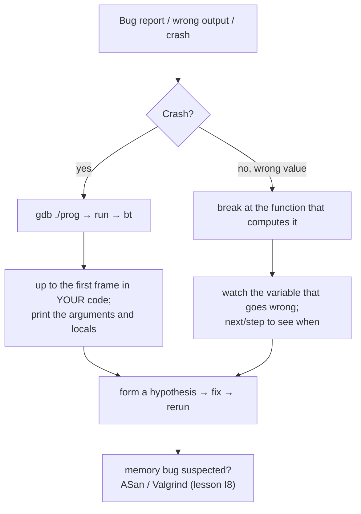

# Lesson I7 — Debugging with GDB: stop guessing, start observing

> Level: intermediate. Prerequisites: B5–B7 (pointers, structs), I2 (linked lists), I5 (compilation). Time: about 2 hours.
> Every GDB transcript below is real output from GNU gdb 15.1 with GCC 13.3 (`-g -O0`), run in batch mode (`gdb -q -batch -x script ./buggy`) on x86-64 Linux, November 2026. Addresses differ on your machine.

---

## 1. Why this lesson exists

The beginner's debugger is `printf`: add prints, rebuild, rerun, squint, repeat. It works, and it has three walls:

1. **Every question costs a rebuild.** You forgot to print `count`? Edit, compile, run again.
2. **Prints change the program.** Extra I/O changes timing (threads), buffering and even, through UB, optimisation.
3. **Crashes eat your prints.** Output written with `printf` sits in a buffer; if the process dies of a segmentation fault, buffered output may never appear (we'll see this happen).

A **debugger** lets you pause a running program at any line, inspect any variable or memory, change values, and watch a variable until it changes — *without rebuilding*. GDB, the GNU Debugger, is the standard on Linux; LLDB (LLVM) is similar, and IDE debuggers (VS Code, CLion) are front ends to one of the two.

---

## 2. Intuition: a video player for your program

Running a program normally is watching a film at full speed. GDB gives you the remote:

- **pause** at a scene (*breakpoint*), or **pause when something specific changes** (*watchpoint*);
- **frame-by-frame**: next line (`next`), step *into* a function call (`step`), run until this function returns (`finish`);
- **freeze-frame inspection**: what is in every variable, every struct, every byte (`print`, `x`, `info locals`);
- **after a crash, the crime scene photo**: the exact line and the chain of calls that got there (`backtrace`).

---

## 3. Precise definitions

- **Debug information:** `-g` makes the compiler emit DWARF debug info (mapping machine addresses to source lines, variable locations and types). Without it GDB sees only raw instructions and function names.
- **Optimisation and debugging:** at `-O2` variables live in registers or are optimised away and lines are reordered; GCC's `-O0` is described as making "debugging produce the expected results", and `-Og` optimises "while keeping in mind debugging experience" (GCC *Optimize Options*). Use `-O0` or `-Og` with `-g` while debugging.
- **Breakpoint:** stop when execution reaches a location (`break file.c:LINE`, `break function`). `tbreak` is a breakpoint "enabled only for one stop". `break LOC if COND` stops only when the condition is non-zero (GDB manual, *Setting Breakpoints*).
- **Watchpoint:** "a special breakpoint that stops your program when the value of an expression changes" (`watch expr`); `rwatch` stops on reads, `awatch` on reads or writes. GDB uses CPU debug registers (hardware watchpoints) when it can; software watchpoints single-step and are "hundreds of times slower" (GDB manual, *Setting Watchpoints*).
- **Stack frame / backtrace:** each active function call has a frame; `backtrace` (`bt`) lists them innermost first; `frame N`, `up`, `down` select which frame's locals you inspect.
- **Core dump:** a file with the memory image of a crashed process, which GDB can open later (`gdb ./prog core`) — enabled with `ulimit -c unlimited` subject to the system's `core_pattern`.

---

## 4. Step by step

### Step 1 — a program with two bugs

```c
// file: buggy.c
// build: gcc -std=c17 -Wall -Wextra -g -O0 -o buggy buggy.c
// run: ./buggy; echo "exit=$?"

#include <stdio.h>
#include <stdlib.h>
#include <string.h>

typedef struct node {
    char name[16];
    int marks;
    struct node *next;
} node;

// builds a list from parallel arrays; returns the head
node *build(const char *names[], const int marks[], int n)
{
    node *head = NULL;
    for (int i = 0; i < n; i++) {
        node *nd = malloc(sizeof *nd);
        if (nd == NULL) exit(1);
        snprintf(nd->name, sizeof nd->name, "%s", names[i]);
        nd->marks = marks[i];
        nd->next = head;
        head = nd;
    }
    return head;
}

// BUG 1 (logic): should average over all nodes
double average(const node *h)
{
    int total = 0, count = 0;
    for (; h->next != NULL; h = h->next) {   // stops one node early
        total += h->marks;
        count++;
    }
    return count ? (double)total / count : 0.0;
}

// BUG 2 (crash): looks up a name that may not exist
int marks_of(const node *h, const char *name)
{
    while (strcmp(h->name, name) != 0)        // never checks h != NULL
        h = h->next;
    return h->marks;
}

int main(void)
{
    const char *names[] = {"asha", "bala", "chitra"};
    const int marks[] = {90, 80, 70};
    node *head = build(names, marks, 3);

    printf("average = %.2f\n", average(head));   // expected 80.00
    printf("bala    = %d\n", marks_of(head, "bala"));
    printf("deepa   = %d\n", marks_of(head, "deepa"));
    return 0;
}
```

Run in a terminal (captured with `script` so stdout was a terminal):

```text
average = 75.00
bala    = 80
Segmentation fault
```

(Your shell may say `Segmentation fault (core dumped)` if core dumps are enabled.)

Run with output piped (as the test harness and many CI systems do), the result was only:

```text
Segmentation fault
exit=139
```

**Both `printf` lines vanished.** When stdout is a terminal it is line-buffered (flushed at each `\n`); when it is a pipe or file it is fully buffered, and the crash killed the process before the buffer was flushed. Exit status 139 = 128 + 11, and 11 is `SIGSEGV`. This is wall 3 from §1, live.

### Step 2 — the crash: `run`, `backtrace`, `frame`, `print`

Session script (`s1.gdb`) and its real output:

```text
(gdb) run
Program received signal SIGSEGV, Segmentation fault.
__strcmp_evex () at ../sysdeps/x86_64/multiarch/strcmp-evex.S:314
(gdb) backtrace
#0  __strcmp_evex () at ../sysdeps/x86_64/multiarch/strcmp-evex.S:314
#1  0x000055555555534d in marks_of (h=0x0, name=0x555555556036 "deepa") at buggy.c:44
#2  0x0000555555555433 in main () at buggy.c:57
(gdb) frame 1
#1  0x000055555555534d in marks_of (h=0x0, name=0x555555556036 "deepa") at buggy.c:44
44	    while (strcmp(h->name, name) != 0)        // never checks h != NULL
(gdb) print h
$1 = (const node *) 0x0
(gdb) print name
$2 = 0x555555556036 "deepa"
(gdb) up
#2  0x0000555555555433 in main () at buggy.c:57
57	    printf("deepa   = %d\n", marks_of(head, "deepa"));
(gdb) print *head
$3 = {name = "chitra\000\000\000\000\000\000\000\000\000", marks = 70, next = 0x5555555592d0}
(gdb) print head->next->next->next
$4 = (struct node *) 0x0
```

How to read it:

- The crash is *inside* glibc's optimised `strcmp` (frame #0). That is almost never where the bug is — library functions crash because they were *given* bad arguments. So go **up** to your own code.
- Frame #1: `marks_of` was called with `name = "deepa"` and has walked to `h = 0x0`. `strcmp(h->name, …)` dereferenced a null pointer. Bug found: the loop never checks for the end of the list.
- `print *head` prints a whole struct; `print head->next->next->next` follows pointers like C — the list has 3 nodes, then NULL, and "deepa" isn't among them.

The "source not found" warning for `strcmp-evex.S` just means glibc's source isn't installed; it does not matter.

### Step 3 — stop *before* the crash with a conditional breakpoint

```text
(gdb) break buggy.c:45 if h->next == 0
Breakpoint 1 at 0x132e: file buggy.c, line 45.
(gdb) run
Breakpoint 1, marks_of (h=0x5555555592a0, name=0x555555556036 "deepa") at buggy.c:45
45	        h = h->next;
(gdb) print h->name
$1 = "asha", '\000' <repeats 11 times>
(gdb) print name
$2 = 0x555555556036 "deepa"
```

We stopped exactly at the moment the code is about to step from the last node (`asha`) into NULL, with the name still unmatched. A first attempt, `break buggy.c:44 if h == 0`, never triggered: the compiler placed the loop test at the bottom of the loop, so the line-44 breakpoint address is reached only on loop entry. **Breakpoints attach to machine addresses, not to your mental model of the line.** When a conditional breakpoint seems to be ignored, try a neighbouring line.

### Step 4 — the logic bug: breakpoints, watchpoints and `finish`

`average` returns 75 instead of 80. No crash, so no backtrace to read — we must watch the computation.

```text
(gdb) break average
Breakpoint 1 at 0x12bd: file buggy.c, line 33.
(gdb) run
Breakpoint 1, average (h=0x555555559300) at buggy.c:33
33	    int total = 0, count = 0;
(gdb) print *h
$1 = {name = "chitra\000\000\000\000\000\000\000\000\000", marks = 70, next = 0x5555555592d0}
(gdb) watch count
Hardware watchpoint 2: count
(gdb) continue
Hardware watchpoint 2: count
Old value = 21845
New value = 0
average (h=0x555555559300) at buggy.c:34
(gdb) continue
Hardware watchpoint 2: count
Old value = 0
New value = 1
average (h=0x555555559300) at buggy.c:34
34	    for (; h->next != NULL; h = h->next) {   // stops one node early
(gdb) print h->name
$2 = "chitra\000\000\000\000\000\000\000\000\000"
(gdb) print h->next->name
$3 = "bala", '\000' <repeats 11 times>
(gdb) print h->next->next
$4 = (struct node *) 0x5555555592a0
(gdb) delete
(gdb) finish
0x00005555555553d3 in main () at buggy.c:55
55	    printf("average = %.2f\n", average(head));   // expected 80.00
Value returned is $5 = 75
```

Observations:

- The first watchpoint hit shows `Old value = 21845` → `0`: before `int count = 0;` executed, the stack slot held **leftover garbage** (21845 = 0x5555, part of an old address). That is what "uninitialised" really looks like.
- Walking the list from the stop point: `chitra → bala → asha (0x5555555592a0) → NULL`. The loop condition `h->next != NULL` is false when `h` is the *last* node, so `asha` (90) is never added: (70 + 80) / 2 = 75. Fix: `for (; h != NULL; h = h->next)`.
- `finish` runs to the end of the current function and prints the return value.

### Step 5 — looking at raw memory with `x` and types with `ptype`

```text
(gdb) break build
(gdb) run
Breakpoint 1, build (names=0x7fffffff6cf0, marks=0x7fffffff6ce4, n=3) at buggy.c:18
(gdb) next   (x4, until just after malloc)
22	        snprintf(nd->name, sizeof nd->name, "%s", names[i]);
(gdb) x/4xg nd
0x5555555592a0:	0x0000000000000000	0x0000000000000000
0x5555555592b0:	0x0000000000000000	0x0000000000000000
(gdb) ptype nd
type = struct node {
    char name[16];
    int marks;
    struct node *next;
} *
```

`x/4xg nd` = e**x**amine **4** units in he**x**, each a **g**iant (8-byte) word, starting at `nd`. The fresh `malloc` block happens to be zeros here (new memory from the kernel is zero-filled), but `malloc` does **not** promise that; on reused memory you would see old data. Format letters: `x` hex, `d` decimal, `c` char, `s` string, `i` instructions; sizes: `b` 1, `h` 2, `w` 4, `g` 8 bytes.

### Step 6 — the fix, verified

```c
// file: fixed.c
// build: gcc -std=c17 -Wall -Wextra -g -O0 -o fixed fixed.c
// run: ./fixed

#include <stdio.h>
#include <stdlib.h>
#include <string.h>

typedef struct node { char name[16]; int marks; struct node *next; } node;

node *build(const char *names[], const int marks[], int n)
{
    node *head = NULL;
    for (int i = 0; i < n; i++) {
        node *nd = malloc(sizeof *nd);
        if (nd == NULL) exit(1);
        snprintf(nd->name, sizeof nd->name, "%s", names[i]);
        nd->marks = marks[i];
        nd->next = head;
        head = nd;
    }
    return head;
}

// FIX 1: visit every node, including the last
double average(const node *h)
{
    int total = 0, count = 0;
    for (; h != NULL; h = h->next) {
        total += h->marks;
        count++;
    }
    return count ? (double)total / count : 0.0;
}

// FIX 2: stop at the end of the list and report "not found" with -1
int marks_of(const node *h, const char *name)
{
    for (; h != NULL; h = h->next)
        if (strcmp(h->name, name) == 0)
            return h->marks;
    return -1;
}

int main(void)
{
    const char *names[] = {"asha", "bala", "chitra"};
    const int marks[] = {90, 80, 70};
    node *head = build(names, marks, 3);
    printf("average = %.2f\n", average(head));
    printf("bala    = %d\n", marks_of(head, "bala"));
    printf("deepa   = %d\n", marks_of(head, "deepa"));
    while (head) { node *nx = head->next; free(head); head = nx; }   // free the list
    return 0;
}
```

Output:

```text
average = 80.00
bala    = 80
deepa   = -1
```

### Step 7 — a cheat sheet of commands

| Command (short form) | What it does |
|---|---|
| `run [args]` (`r`) | start the program (with arguments) |
| `break f` / `break file.c:N` (`b`) | breakpoint at function / line |
| `break N if expr` | conditional breakpoint |
| `tbreak N` | one-shot breakpoint |
| `watch expr` / `rwatch` / `awatch` | stop when expr is written / read / either |
| `next` (`n`) / `step` (`s`) | next line, stepping over / into calls |
| `finish` | run until current function returns, print value |
| `continue` (`c`) | resume until next stop |
| `until N` | run until line N (handy to leave a loop) |
| `backtrace` (`bt`), `frame N`, `up`, `down` | inspect the call stack |
| `print expr` (`p`), `p *ptr`, `p arr[0]@5` | evaluate C expressions; `@` prints N consecutive elements |
| `display expr` | print expr at every stop |
| `info locals` / `info args` / `info breakpoints` | list locals / args / breakpoints |
| `x/NFU addr` | examine raw memory |
| `ptype expr` | show the type |
| `set var x = 5` | change a variable while paused |
| `layout src` (or `gdb -tui`) | text UI with source window |

---

## 5. Diagram: a debugging workflow



---

## 6. Common mistakes

| Mistake | Symptom | Fix |
|---|---|---|
| Debugging a binary built without `-g` | "No symbol table is loaded", no line numbers | Rebuild with `-g` |
| Debugging an `-O2` build | `<optimized out>` values, jumping lines | `-O0 -g` or `-Og -g` |
| Blaming the library frame (`strcmp`, `malloc`) | Reading glibc assembly for nothing | `up` to your own frame; check what you passed in |
| Relying on `printf` debugging around crashes | Missing output (buffering) | `fprintf(stderr, ...)` (unbuffered) or a debugger |
| Stepping through a huge loop with `next` | Tedium | Conditional breakpoint, `until`, or a watchpoint |
| Watchpoint on a local after its function returns | GDB deletes it ("left the block") | Re-set on next entry, or watch via an address with care |
| Assuming a conditional breakpoint line is hit every iteration | Never stops | Breakpoints are addresses; try another line in the loop |
| Using GDB for memory corruption hunts | The crash site is far from the bad write | Use AddressSanitizer or Valgrind first (lesson I8) |

---

## 7. Connections

- **Computer Architecture track:** hardware watchpoints are CPU debug registers (x86 DR0–DR3); `x/i $pc` and `layout asm` show machine instructions (lesson A2).
- **OS track:** GDB uses the `ptrace` system call to stop and inspect another process; signals (`SIGSEGV`, `SIGTRAP`) are how the kernel reports events (lesson P1).
- **Compilers track:** DWARF is the compiler's record of where variables live; optimised code makes that record complex, which is why `-Og` exists.
- **Java / Python tracks:** `jdb`/IDE debuggers and `pdb` offer the same breakpoints/stepping on top of a VM; Python crashes print a traceback automatically — the equivalent of `bt` for free.
- **Testing track:** a failing test plus a debugger is the fastest loop; record-and-replay debuggers (`rr`) let you run *backwards* to the moment memory was corrupted.

### Where this shows up in my projects

- **compiler-fuzz:** once a generated program gives different output under GCC and Clang, a reduced test case is small enough to step through in GDB under each compiler side by side — comparing where the two executions first diverge (`watch` on the checksum variable is a natural way to find that point).

---

## 8. Self-check questions

1. Why did the two `printf` lines disappear when the program's output was piped?
2. The crash was reported in `__strcmp_evex`. Why is that not where the bug is, and which command gets you to the right place?
3. What does `Old value = 21845` tell you about local variables?
4. What do `next`, `step` and `finish` each do?
5. Why might `break buggy.c:44 if h == 0` never stop?
6. Why build with `-O0` or `-Og` for debugging?

<details>
<summary>Answers</summary>

1. stdout to a pipe is fully buffered; the text was still in the user-space buffer when SIGSEGV killed the process, so it was never written.
2. `strcmp` crashed because it received a null pointer from the caller. `up` (or `frame 1`) moves to `marks_of`, where `print h` shows `0x0`.
3. Before initialisation, a local's stack slot contains whatever bytes were left there; reading it without initialising is undefined behaviour.
4. `next` executes the current line, treating calls as one step; `step` enters called functions; `finish` runs until the current function returns and shows the return value.
5. A breakpoint is placed at an address. The compiler laid out the loop with its test at the bottom, so the address associated with line 44 is executed only once (on loop entry) when `h` is not yet null.
6. Optimisation keeps variables in registers, removes them, inlines functions and reorders code, so values show as `<optimized out>` and stepping jumps around; `-O0`/`-Og` keep the code close to the source.

</details>

---

## 9. Mnemonic (Tamil + English)

**The crash routine — Run, Backtrace, Up, Print ("R-B-U-P"):**

> **"Run pannu, Backtrace paaru, Up po, Print pannu — 'RuBUP'!"** — like rubbing your eyes awake: run, look back, go up, print.

**next vs step:**

> **"Next — vaasal thaandi po; Step — ulla poi paaru."** — `next` walks past the door (over the call); `step` goes inside and looks.

**Watchpoint:** **"Watch-na CCTV — maarina udane alarm."** — a watchpoint is a CCTV camera: the moment the value changes, the alarm rings.

---

## Sources

- GDB manual (current), *Setting Breakpoints* (`break`, `tbreak`, `break … if`): https://sourceware.org/gdb/current/onlinedocs/gdb.html/Set-Breaks.html
- GDB manual, *Setting Watchpoints* (`watch`, `rwatch`, `awatch`, hardware vs software): https://sourceware.org/gdb/current/onlinedocs/gdb.html/Set-Watchpoints.html
- GDB manual, *Examining the Stack* and *Examining Memory* (`backtrace`, `frame`, `x`): https://sourceware.org/gdb/current/onlinedocs/gdb.html/Stack.html and https://sourceware.org/gdb/current/onlinedocs/gdb.html/Memory.html
- GCC manual, *Optimize Options* (`-O0`, `-Og`): https://gcc.gnu.org/onlinedocs/gcc/Optimize-Options.html
- GCC manual, *Debugging Options* (`-g`, DWARF): https://gcc.gnu.org/onlinedocs/gcc/Debugging-Options.html
- cppreference, *setvbuf* (full vs line buffering of streams): https://en.cppreference.com/w/c/io/setvbuf
- Linux man page `signal(7)` (SIGSEGV is signal 11 on x86-64): https://man7.org/linux/man-pages/man7/signal.7.html
- rr record-and-replay debugger: https://rr-project.org/

## Verify yourself

1. Build `buggy.c` and reproduce every session above interactively (`gdb ./buggy`), or in batch: put the commands in a file and run `gdb -q -batch -x script.gdb ./buggy`.
2. Compare `./buggy` in a terminal vs `./buggy | cat` and confirm the lost output.
3. Rebuild with `-O2 -g` and try `print total` inside `average`: note `<optimized out>` or jumping lines.
4. Enable core dumps (`ulimit -c unlimited`), crash the program, then `gdb ./buggy core*` (location depends on `/proc/sys/kernel/core_pattern`; on systemd systems use `coredumpctl gdb`).
5. Check the "hundreds of times slower" software-watchpoint statement in the GDB manual.
