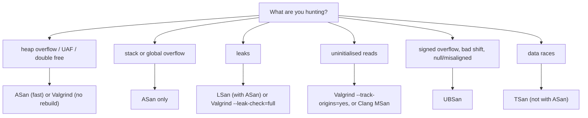

# Lesson I8 — Valgrind and the sanitizers: making invisible memory bugs visible

> Level: intermediate. Prerequisites: I2 (heap ownership), I3 (undefined behaviour), I7 (GDB). Time: about 2.5 hours.
> All outputs are real, from Valgrind 3.22 and GCC 13.3's AddressSanitizer / UndefinedBehaviorSanitizer / ThreadSanitizer on x86-64 Linux, November 2026. (Clang 18 is installed on the test machine but its sanitizer runtime libraries are not, so Clang-only MemorySanitizer could not be run — marked below.)

---

## 1. Why this lesson exists

GDB (lesson I7) shows you *where a program crashed*. Memory bugs are worse than crashes: a heap overflow can silently corrupt a neighbouring allocation, and the program fails ten thousand instructions later in unrelated code — or never fails in testing and fails in production. Undefined behaviour is, by definition, not guaranteed to produce any symptom at all.

So we need tools that check **every memory access** as it happens and report the *first* bad one, with the allocation and free history attached. There are two families:

- **Valgrind (Memcheck):** runs your *unmodified* binary on a synthetic CPU and checks every instruction — no rebuild, but very slow.
- **Sanitizers (ASan, UBSan, TSan, MSan, LSan):** the *compiler* inserts checks into your code — rebuild required, much faster, catches some bugs Valgrind can't.

Professional C projects run both kinds in CI. Your *compiler-fuzz* project runs its tests under UBSan for exactly this reason.

---

## 2. Intuition

- **Valgrind is a driving examiner sitting next to you**: you drive your normal car (the original binary), and the examiner watches every single move. Thorough, but the lesson goes 20–30× slower.
- **A sanitizer is a car fitted with sensors at the factory** (instrumented at compile time): it drives almost normally, but every sensor beeps the instant you touch a line. You have to buy a specially built car (rebuild with `-fsanitize=`).
- **Shadow memory** (how ASan works): for every 8 bytes of your memory, ASan keeps one "shadow" byte saying how many of those 8 bytes are addressable. Around each allocation it places **red zones** marked "poisoned"; touching a red zone or a freed (quarantined) block triggers a report (Serebryany et al., USENIX ATC 2012).

---

## 3. Precise definitions

### Valgrind Memcheck (Valgrind user manual)

- Detects: invalid reads/writes (overruns, underruns, use after free), **use of uninitialised values**, invalid frees (double free, mismatched allocation/free), overlapping `memcpy` source/destination, fishy size arguments, and **memory leaks**.
- Leak kinds: **definitely lost** (no pointer to the block remains — fix these), **indirectly lost** (lost only because the blocks pointing to it are lost), **possibly lost** (only an interior pointer found), **still reachable** (a pointer still exists at exit).
- Options: `--leak-check=full` (details per leak), `--show-leak-kinds=...` (default `definite,possible`), `--track-origins=yes` (report where an uninitialised value came from; "halves Memcheck's speed").
- Cost: the Quick Start guide says programs run "much slower (eg. 20 to 30 times)" and that Memcheck "can't detect out-of-range reads or writes to arrays that are allocated statically or on the stack".

### Sanitizers (GCC *Instrumentation Options*; Clang sanitizer docs)

| Flag | Name | Finds | Notes |
|---|---|---|---|
| `-fsanitize=address` | ASan | heap/stack/global out-of-bounds, use-after-free, use-after-return (opt-in), use-after-scope, double/invalid free | Typical slowdown about 2× (Clang docs); cannot be combined with `thread` |
| (included with ASan on Linux) | LSan | leaks at exit | On by default with ASan on Linux; `-fsanitize=leak` standalone |
| `-fsanitize=undefined` | UBSan | signed overflow, bad shifts, null/misaligned pointer use, some array bounds, division by zero, invalid `bool`/enum loads, unreachable reached… | `unsigned-integer-overflow` is *not* in the group (not UB); reports and continues unless `-fno-sanitize-recover` |
| `-fsanitize=thread` | TSan | data races | Incompatible with ASan |
| `-fsanitize=memory` | MSan | use of uninitialised memory | **Clang only**; requires all code (including libraries) instrumented |

Useful companions: `-g` (line numbers), `-fno-omit-frame-pointer` (better stack traces), `ASAN_OPTIONS=detect_stack_use_after_return=1`, `UBSAN_OPTIONS=print_stacktrace=1`.

---

## 4. Step by step

### Step 1 — one program, five classic bugs

```c
// file: membugs.c
// build: gcc -std=c17 -g -O0 -o membugs membugs.c
// run: for i in 1 2 3 4 5; do echo "### case $i"; valgrind --leak-check=full --track-origins=yes ./membugs $i 2>&1 | grep -E "Invalid|uninitialised|definitely lost in|ERROR SUMMARY"; done

#include <stdio.h>
#include <stdlib.h>
#include <string.h>

// bug selected by argv[1]: 1=heap overflow, 2=use-after-free, 3=leak, 4=uninitialised read, 5=double free
int main(int argc, char *argv[])
{
    int which = argc > 1 ? atoi(argv[1]) : 0;
    int *a = malloc(4 * sizeof *a);
    if (a == NULL) return 1;
    for (int i = 0; i < 4; i++) a[i] = i;

    if (which == 1) {
        a[4] = 99;                        // one element past the end
    } else if (which == 2) {
        free(a);
        printf("%d\n", a[0]);             // read after free
        return 0;
    } else if (which == 3) {
        a = malloc(100);                  // first block's only pointer overwritten
    } else if (which == 4) {
        int *b = malloc(4 * sizeof *b);   // never initialised
        if (b && b[2] > 0) puts("positive");
        free(b);
    } else if (which == 5) {
        free(a);
        free(a);
        return 0;
    }
    free(a);
    return 0;
}
```

Run *without* any tool on the test machine, cases 1, 3 and 4 exited with status 0 and printed nothing suspicious; case 2 printed the garbage value `1489523117` (most likely the allocator's free-list bookkeeping, which glibc writes into freed blocks) and exited 0; only case 5 was caught, because glibc happens to check for it: `free(): double free detected in tcache 2`, then `Aborted` (exit 134). Four of five bugs invisible — that is the wall.

### Step 2 — Valgrind: no rebuild, everything checked

Summary lines from the run command above:

```text
### case 1
==1026== Invalid write of size 4
==1026== ERROR SUMMARY: 1 errors from 1 contexts (suppressed: 0 from 0)
### case 2
==1030== Invalid read of size 4
==1030== ERROR SUMMARY: 1 errors from 1 contexts (suppressed: 0 from 0)
### case 3
==1034== 16 bytes in 1 blocks are definitely lost in loss record 1 of 1
==1034== ERROR SUMMARY: 1 errors from 1 contexts (suppressed: 0 from 0)
### case 4
==1038== Conditional jump or move depends on uninitialised value(s)
==1038== ERROR SUMMARY: 1 errors from 1 contexts (suppressed: 0 from 0)
### case 5
==1042== Invalid free() / delete / delete[] / realloc()
==1042== ERROR SUMMARY: 1 errors from 1 contexts (suppressed: 0 from 0)
```

The full report for case 1 tells the whole story — what went wrong, *and* where the block came from:

```text
==1026== Invalid write of size 4
==1026==    at 0x109258: main (membugs.c:14)
==1026==  Address 0x4a7e050 is 0 bytes after a block of size 16 alloc'd
==1026==    at 0x4846828: malloc (in /usr/libexec/valgrind/vgpreload_memcheck-amd64-linux.so)
==1026==    by 0x109208: main (membugs.c:9)
```

Case 4 with `--track-origins=yes` adds the origin of the garbage:

```text
==1038== Conditional jump or move depends on uninitialised value(s)
==1038==    at 0x1092D8: main (membugs.c:23)
==1038==  Uninitialised value was created by a heap allocation
==1038==    at 0x4846828: malloc (...)
==1038==    by 0x1092C0: main (membugs.c:22)
```

Note *when* Memcheck complains about uninitialised data: not when you copy it, but when it **affects control flow or an output** ("conditional jump depends on…"). Copying garbage around is legal; deciding something based on it is the bug.

Case 3's leak summary uses the vocabulary from §3:

```text
==1034==    definitely lost: 16 bytes in 1 blocks
==1034==    indirectly lost: 0 bytes in 0 blocks
==1034==      possibly lost: 0 bytes in 0 blocks
==1034==    still reachable: 0 bytes in 0 blocks
```

### Step 3 — AddressSanitizer: rebuild, run fast

```c
// file: asan_cases.c
// build: gcc -std=c17 -g -O0 -fsanitize=address -fno-omit-frame-pointer -o asan_cases asan_cases.c
// run: for i in 1 2 3 5; do echo "### case $i"; ./asan_cases $i 2>&1 | grep -E "^==[0-9]+==ERROR|^(READ|WRITE) of|Direct leak"; done

#include <stdio.h>
#include <stdlib.h>

// same bugs as membugs.c (case 4, uninitialised read, is not ASan's job)
int main(int argc, char *argv[])
{
    int which = argc > 1 ? atoi(argv[1]) : 0;
    int *a = malloc(4 * sizeof *a);
    if (a == NULL) return 1;
    for (int i = 0; i < 4; i++) a[i] = i;
    if (which == 1) {
        a[4] = 99;
    } else if (which == 2) {
        free(a);
        printf("%d\n", a[0]);
        return 0;
    } else if (which == 3) {
        a = malloc(100);
    } else if (which == 5) {
        free(a);
        free(a);
        return 0;
    }
    free(a);
    return 0;
}
```

Output:

```text
### case 1
==1085==ERROR: AddressSanitizer: heap-buffer-overflow on address 0x502000000020 at pc ... bp ... sp ...
WRITE of size 4 at 0x502000000020 thread T0
### case 2
==1057==ERROR: AddressSanitizer: heap-use-after-free on address 0x502000000010 at pc ... bp ... sp ...
READ of size 4 at 0x502000000010 thread T0
### case 3
==1061==ERROR: LeakSanitizer: detected memory leaks
Direct leak of 16 byte(s) in 1 object(s) allocated from:
### case 5
==1071==ERROR: AddressSanitizer: attempting double-free on 0x502000000010 in thread T0:
```

(Process ids and addresses vary per run.) The full use-after-free report adds both histories — exactly what you need to fix the ownership bug:

```text
0x502000000010 is located 0 bytes inside of 16-byte region [0x502000000010,0x502000000020)
freed by thread T0 here:
    #0 ... in free ../../../../src/libsanitizer/asan/asan_malloc_linux.cpp:52
    #1 ... in main /tmp/san/membugs.c:16
```

**A wall we hit while testing:** compiling case 1 with `-O1 -fsanitize=address` produced **no report at all**. In the `-O1` assembly the instruction `movl $99, (...)` is gone: writing `a[4]` immediately before `free(a)` is a *dead store* (nothing reads it), so the optimiser deleted it — and ASan cannot report an access that no longer exists. At `-O0` the store survives and is caught. Lesson: sanitizers check the program *the compiler produced*; for hunting a specific bug, use `-O0` or `-O1` and make sure the buggy value is actually used.

### Step 4 — Valgrind vs ASan on a *stack* overflow

```c
// file: stack_oob.c
// build: gcc -std=c17 -g -O0 -o stack_oob stack_oob.c && gcc -std=c17 -g -O0 -fsanitize=address -o stack_oob_asan stack_oob.c
// run: valgrind ./stack_oob 2>&1 | grep -E "ERROR SUMMARY"; ./stack_oob_asan 2>&1 | grep -E "ERROR: AddressSanitizer"

#include <stdio.h>

int main(int argc, char *argv[])
{
    (void)argv;
    int arr[4] = {0};
    int idx = 3 + argc;          // 4 when run with no arguments: one past the end
    arr[idx] = 7;                // stack out-of-bounds write
    printf("%d\n", arr[0]);
    return 0;
}
```

Output:

```text
==...== ERROR SUMMARY: 0 errors from 0 contexts (suppressed: 0 from 0)
==...==ERROR: AddressSanitizer: stack-buffer-overflow on address 0x7f... at pc ... bp ... sp ...
```

Valgrind reported **0 errors** — as its manual warns, Memcheck cannot see overruns of stack or static arrays (it only knows heap block boundaries). ASan, which inserted red zones around `arr` at compile time, catches it. This is the main reason to use both.

### Step 5 — ThreadSanitizer on a data race

```c
// file: race.c
// build: gcc -std=c17 -g -O1 -fsanitize=thread -o race_tsan race.c -pthread && gcc -std=c17 -O0 -o race_O0 race.c -pthread && gcc -std=c17 -O2 -o race_O2 race.c -pthread
// run: ./race_tsan 2>&1 | grep -E "WARNING|Read of|Previous write|Location"; for i in 1 2 3; do ./race_O0; done; ./race_O2

#include <pthread.h>
#include <stdio.h>

long counter = 0;                       // shared and unprotected

// each thread increments the shared counter 100000 times
void *work(void *arg)
{
    (void)arg;
    for (int i = 0; i < 100000; i++)
        counter++;                      // read-modify-write: not atomic
    return NULL;
}

int main(void)
{
    pthread_t t1, t2;
    pthread_create(&t1, NULL, work, NULL);
    pthread_create(&t2, NULL, work, NULL);
    pthread_join(t1, NULL);
    pthread_join(t2, NULL);
    printf("counter = %ld (expected 200000)\n", counter);
    return 0;
}
```

Output:

```text
WARNING: ThreadSanitizer: data race (pid=1157)
  Read of size 8 at 0x55db2bd24018 by thread T2:
  Previous write of size 8 at 0x55db2bd24018 by thread T1:
  Location is global 'counter' of size 8 at 0x55db2bd24018 (race_tsan+0x4018)
counter = 107312 (expected 200000)
counter = 107147 (expected 200000)
counter = 106294 (expected 200000)
counter = 200000 (expected 200000)
```

Three different wrong answers at `-O0` (lost updates when both threads read the same old value), and a "correct" 200000 at `-O2` — because the optimiser turned the loop into a single `counter += 100000`, shrinking the race window to almost nothing. A data race is UB (lesson A6), so "it gave the right answer" proves nothing; TSan reports the race regardless of the result.

### Step 6 — MemorySanitizer (Clang only; not run here)

```c
/* NOT RUN ON THE TEST MACHINE: requires Clang's msan runtime
   (libclang_rt.msan), which is not installed. Command for your machine:
     clang -std=c17 -g -O1 -fsanitize=memory -fsanitize-memory-track-origins membugs.c -o membugs_msan
     ./membugs_msan 4
   Expected per the Clang MSan docs: a "use-of-uninitialized-value" report at the
   `if (b && b[2] > 0)` line, with the allocation origin. */
```

### Step 7 — wiring it into your workflow

```makefile
# file: Makefile
# build: true
# run: true
# a sanitizer test target (pattern used in lesson I6's Makefile.modes)
CFLAGS_SAN := -std=c17 -g -O1 -fno-omit-frame-pointer -fsanitize=address,undefined -fno-sanitize-recover=undefined

.PHONY: test-asan test-valgrind
test-asan:
	$(CC) $(CFLAGS_SAN) -o prog_san prog.c && ./prog_san

test-valgrind:
	$(CC) -std=c17 -g -O0 -o prog_vg prog.c && valgrind --leak-check=full --error-exitcode=1 ./prog_vg
```

`--error-exitcode=1` (Valgrind) and `-fno-sanitize-recover` (UBSan) make the *tools'* findings fail the build — essential in CI, where nobody reads logs of green runs.

---

## 5. Diagrams

How ASan sees a 16-byte allocation:

```text
 application memory:  [redzone][ a[0] a[1] a[2] a[3] ][ redzone ][ ... ]
 shadow (1 byte/8 B):  fa fa     00        00           fa  fa
                                                   ^ a[4] lands here -> shadow says "poisoned"
                                                     -> heap-buffer-overflow report
 after free(a): shadow of a[0..3] becomes "freed" (fd) and the block is quarantined,
               so a later a[0] read is reported as heap-use-after-free
```

Which tool for which bug:



| | Valgrind Memcheck | ASan (+LSan) | UBSan | TSan | MSan |
|---|---|---|---|---|---|
| Rebuild needed | no | yes | yes | yes | yes (everything) |
| Typical slowdown | 20–30× (Valgrind docs) | ~2× (Clang docs) | small [unverified: varies by checks enabled] | about 5×–15× (Clang TSan docs; memory 5×–10×) | moderate |
| Heap OOB / UAF | yes | yes | no | no | no |
| Stack/global OOB | **no** | yes | partial (`bounds` for known sizes) | no | no |
| Uninitialised reads | yes | no | no | no | yes |
| Leaks | yes | yes | no | no | no |
| UB arithmetic | no | no | yes | no | no |
| Data races | (Helgrind/DRD tools) | no | no | yes | no |

---

## 6. Common mistakes

| Mistake | Consequence | Fix |
|---|---|---|
| Testing only at `-O2` with sanitizers | Optimiser deletes the faulty access; no report | Debug at `-O0`/`-O1`; also test the release configuration |
| Combining `address` and `thread` | Build error (incompatible) | Separate builds/CI jobs |
| Running Valgrind on an ASan binary | Conflicts and nonsense | Valgrind on a plain `-g` build |
| Ignoring "possibly lost"/"still reachable" forever | Real leaks hide among them | Fix definite leaks first, then review the rest |
| Assuming a clean run proves no bugs | Only executed paths are checked | Grow test inputs; fuzz (lesson P4) |
| Shipping sanitizer builds to production | ASan docs: it is a testing tool, not for production or security-sensitive binaries | Use hardening flags instead (lesson P4) |
| Not linking with the sanitizer flag | Undefined references to `__asan_*` | Pass `-fsanitize=...` at link time too |
| Missing `-g` | Reports without line numbers | Always add `-g` |

---

## 7. Connections

- **Testing/Verification track:** sanitizers are run-time *oracles* — they turn silent UB into test failures; combined with fuzzers they find most memory-safety bugs found in large C codebases today (lesson P4).
- **Security track:** each ASan report class (heap-buffer-overflow, use-after-free, double-free) is a CWE category; exploitation starts where these reports end.
- **Compilers track:** sanitizers are compiler passes that insert checks; shadow memory is a classic compiler-runtime co-design (paper: Serebryany et al., 2012). Valgrind is a dynamic binary translation framework (Nethercote & Seward, PLDI 2007).
- **Parallel/CUDA track:** NVIDIA's Compute Sanitizer plays the same role for GPU kernels (memcheck, racecheck, initcheck) [unverified: tool names not confirmed from the NVIDIA docs index page].
- **Rust track:** safe Rust removes the need for ASan/TSan for safe code; Miri is Rust's interpreter-based UB checker, conceptually close to Valgrind.

### Where this shows up in my projects

- **compiler-fuzz:** the project's test suite runs with UBSan, and the same logic applies to its *generated* programs: before reporting "GCC and Clang disagree", the program is checked for UB (e.g. compiled with `-fsanitize=undefined` and run), because a UB program legitimately produces different results under different compilers (lesson I3's `table.c`). The `-O1` dead-store surprise in Step 3 is also a reminder that the oracle must observe the *executed* behaviour.

---

## 8. Self-check questions

1. Name two bug classes Valgrind finds that ASan does not, and one ASan finds that Valgrind does not.
2. Why did ASan miss the heap overflow at `-O1`?
3. What is the difference between "definitely lost" and "indirectly lost"?
4. When exactly does Memcheck report the use of an uninitialised value?
5. Why can't you use ASan and TSan in the same build?
6. The racy program printed 200000 at `-O2`. Is it correct? Why?

<details>
<summary>Answers</summary>

1. Valgrind: uninitialised value use, and it needs no rebuild (also works on binaries you can't recompile). ASan: stack and global buffer overflows.
2. The write to `a[4]` was immediately followed by `free(a)` with no read, so the optimiser removed it as a dead store; the instrumented access no longer existed.
3. Definitely lost: no pointer to the block exists anywhere. Indirectly lost: pointers to it exist only inside other blocks that are themselves lost (e.g. the rest of a leaked linked list).
4. When the uninitialised value influences a conditional jump/move, is used as an address, or is passed to a system call — not when it is merely copied.
5. They use incompatible shadow-memory layouts and runtimes; GCC documents that `-fsanitize=address` cannot be combined with `-fsanitize=thread`.
6. No. It has a data race, which is undefined behaviour; the optimiser happened to make the race window tiny. Different flags, compilers or load would expose lost updates, as `-O0` did.

</details>

---

## 9. Mnemonic (Tamil + English)

**Which tool, one line each — "Valgrind Vaathiyaar, ASan Alarm, UBSan Umpire, TSan Traffic police":**

> **Valgrind = Vaathiyaar** (teacher): slow, checks every line, no rebuild needed.
> **ASan = Alarm**: fitted in the house (rebuild), rings on any out-of-bounds touch — even on the stack.
> **UBSan = Umpire**: calls fouls on arithmetic (overflow, shifts).
> **TSan = Traffic police**: catches two threads crashing into the same variable.
> **"Vaathiyaar-ukku stack theriyaadhu"** — the teacher (Valgrind) can't see stack arrays.

---

## Sources

- Valgrind user manual, *Memcheck: a memory error detector* (error kinds, leak kinds, `--leak-check`, `--show-leak-kinds`, `--track-origins`): https://valgrind.org/docs/manual/mc-manual.html
- Valgrind, *Quick Start Guide* (20–30× slowdown; cannot detect stack/static array overruns; compile with `-g`, prefer `-O0`): https://valgrind.org/docs/manual/quick-start.html
- GCC manual, *Instrumentation Options* (`-fsanitize=address/undefined/thread/leak`, incompatibility of address and thread, `-fno-sanitize-recover`, `-fsanitize-trap`): https://gcc.gnu.org/onlinedocs/gcc/Instrumentation-Options.html
- Clang, *AddressSanitizer* (bug classes, ~2× slowdown, LSan default on Linux, not for production): https://clang.llvm.org/docs/AddressSanitizer.html
- Clang, *UndefinedBehaviorSanitizer* (checks, what `-fsanitize=undefined` excludes): https://clang.llvm.org/docs/UndefinedBehaviorSanitizer.html
- Clang, *MemorySanitizer*: https://clang.llvm.org/docs/MemorySanitizer.html
- K. Serebryany, D. Bruening, A. Potapenko, D. Vyukov, *AddressSanitizer: A Fast Address Sanity Checker*, USENIX ATC 2012: https://www.usenix.org/conference/atc12/technical-sessions/presentation/serebryany
- N. Nethercote, J. Seward, *Valgrind: A Framework for Heavyweight Dynamic Binary Instrumentation*, PLDI 2007 (DOI 10.1145/1273442.1250746): https://dx.doi.org/10.1145/1273442.1250746
- NVIDIA Compute Sanitizer documentation index: https://docs.nvidia.com/compute-sanitizer/
- Clang, *ThreadSanitizer* (5×–15× slowdown, 5×–10× memory): https://clang.llvm.org/docs/ThreadSanitizer.html

## Verify yourself

1. Build and run every block; for each case compare Valgrind and ASan reports.
2. Reproduce the `-O1` miss: `gcc -O1 -fsanitize=address -S membugs.c` and search the assembly for `$99`; then do the same at `-O0`.
3. `ASAN_OPTIONS=help=1 ./asan_cases` lists every runtime option; try `detect_stack_use_after_return=1` on a function that returns the address of a local.
4. Fix `race.c` with a mutex (`pthread_mutex_lock`) or `_Atomic long counter;` and confirm TSan goes quiet and `-O0` gives 200000.
5. Read the Memcheck limitation about stack arrays in the Quick Start guide and confirm it with `stack_oob.c`.
