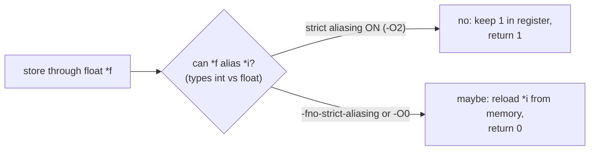

# Lesson A1 — Objects in memory: representation, alignment, padding, strict aliasing and `restrict`

> Level: advanced. Prerequisites: B2 (types), B7 (structs, unions), I1 (`void *`, `memcpy`), I3 (UB). Time: about 3 hours.
> Tested with GCC 13.3 / GCC 14.2 / Clang 18.1, x86-64 Linux (little-endian), November 2026. Assembly is GCC 13.3 `-O2`.

---

## 1. Why this lesson exists

Up to now a variable was "a box with a value". At the advanced level we need the precise picture, because performance and correctness both depend on it:

- Why is a struct bigger than the sum of its members, and how do you shrink it?
- Why does reading an `int` through a `float *` give **different answers at `-O0` and `-O2`**?
- Why is `memcpy` the officially blessed way to reinterpret bytes, and why do kernels compile with `-fno-strict-aliasing`?
- What does `restrict` actually buy you in generated code?

These are the rules of the **C object model**: how objects are represented as bytes, where they may be placed, and which pointer types may legally look at them.

---

## 2. Intuition

- **Object representation:** every object is a sequence of bytes, like a word is a sequence of letters. You may always *spell out* any object byte by byte (`unsigned char`), but reading the letters of an English word as if they were a French word (a different type) is not guaranteed to mean anything.
- **Alignment:** a parking lot where buses may only park at bays numbered by multiples of 8, cars at multiples of 4, scooters anywhere. The compiler leaves empty bays (padding) so each vehicle lands on a legal bay.
- **Strict aliasing:** the compiler is a librarian who assumes a book about *ints* and a book about *floats* are never the same physical book. If you secretly glue them together and write in one, the librarian keeps quoting the old text from the other.
- **`restrict`:** your written promise to the librarian: "nobody else will touch this book while I'm using it" — so the librarian can keep a copy in hand instead of re-checking the shelf.

---

## 3. Precise definitions

- **Byte, object representation:** objects (other than bit-fields) consist of contiguous sequences of one or more bytes; any object can be copied into an `unsigned char[sizeof obj]`, and that array is its **object representation** (N3220 §6.2.6.1). Some bit patterns may be **non-value representations** (formerly "trap representations") for a type, e.g. `bool` bytes other than 0/1 (cppreference *Undefined behavior*, "invalid scalar").
- **Padding:** structures may contain unnamed padding after members and at the end, never before the first member; the values of padding bytes are unspecified (N3220 §6.2.6.1, §6.7.3.2).
- **Alignment:** "the number of bytes between successive addresses at which objects of this type can be allocated" — always a power of two; `char` has alignment 1; the largest fundamental alignment is that of `max_align_t` (cppreference *Objects and alignment*). Query with `alignof` (C23 keyword; `_Alignof` before C23), request stricter with `alignas`.
- **Effective type:** for a declared object, its declared type. For allocated memory (no declared type), the type of the lvalue used for the first non-character store (or the effective type copied in by `memcpy`/`memmove`) (N3220 §6.5.1; cppreference *Objects and alignment*).
- **Strict aliasing rule:** an object with effective type T1 may be accessed only through an lvalue of: a type compatible with T1; a qualified version of it; the signed/unsigned variant; an aggregate or union containing one of these; or a **character type** (`char`, `signed char`, `unsigned char`). Anything else is UB (same sources). GCC enables `-fstrict-aliasing` at `-O2`, `-O3`, `-Os` (GCC *Optimize Options*).
- **Type punning through unions:** reading a union member other than the one last stored reinterprets the bytes as the new type (a footnote in N3220 §6.5.3.4 says so; this is how C differs from C++, where it is UB). The result may be a non-value representation.
- **`restrict`** (C99): if an object accessed through a `restrict`-qualified pointer is modified, all accesses to it within the pointer's block must go through that pointer (N3220 §6.7.4.2 formal definition). Violating the promise is UB.
- **Endianness:** the order of bytes of a multi-byte object in memory. x86-64 and (by default) AArch64 Linux are little-endian (least significant byte at the lowest address). C does not specify it.

---

## 4. Step by step

### Step 1 — see the bytes of any object

```c
// file: bytes.c
// build: gcc -std=c17 -Wall -Wextra -o bytes bytes.c
// run: ./bytes

#include <stdio.h>
#include <stdint.h>
#include <string.h>

// prints the object representation of any object, byte by byte, lowest address first
static void dump(const char *label, const void *obj, size_t n)
{
    const unsigned char *p = obj;     // character type: always allowed to alias
    printf("%-12s:", label);
    for (size_t i = 0; i < n; i++)
        printf(" %02x", p[i]);
    printf("\n");
}

int main(void)
{
    uint32_t x = 0x11223344;
    int32_t neg = -2;
    float f = 1.0f;
    double d = 0.1;

    dump("0x11223344", &x, sizeof x);     // little-endian: 44 33 22 11
    dump("-2 (int32)", &neg, sizeof neg); // two's complement
    dump("1.0f", &f, sizeof f);           // IEEE 754 binary32: 0x3f800000
    dump("0.1", &d, sizeof d);            // 0.1 is not exact in binary

    // the portable way to reinterpret bits: memcpy into an object of the target type
    uint32_t bits;
    memcpy(&bits, &f, sizeof bits);
    printf("bits of 1.0f = 0x%08x\n", (unsigned)bits);
    return 0;
}
```

Output:

```text
0x11223344  : 44 33 22 11
-2 (int32)  : fe ff ff ff
1.0f        : 00 00 80 3f
0.1         : 9a 99 99 99 99 99 b9 3f
bits of 1.0f = 0x3f800000
```

`44 33 22 11` is little-endian in action. The `memcpy` at the end is the standard, UB-free bit cast; GCC and Clang compile such a fixed-size `memcpy` into a single register move — no actual call.

### Step 2 — padding: measure it, then remove it

```c
// file: padding.c
// build: gcc -std=c17 -Wall -Wextra -o padding padding.c
// run: ./padding

#include <stdio.h>
#include <stddef.h>      // offsetof
#include <stdalign.h>    // alignof (macro before C23, keyword in C23)
#include <stdint.h>

// members in a "natural" but wasteful order
struct bad {
    char tag;        // 1 byte, then 7 bytes of padding so the double is 8-aligned
    double value;    // 8
    char flag;       // 1 byte, then 3 bytes padding for the int
    int count;       // 4
    char c2;         // 1 byte, then 7 bytes tail padding so arrays of struct stay aligned
};

// same members sorted by decreasing alignment
struct good {
    double value;    // 8
    int count;       // 4
    char tag;        // 1
    char flag;       // 1
    char c2;         // 1, then 1 byte tail padding
};

int main(void)
{
    printf("struct bad : size %zu, align %zu\n", sizeof(struct bad), alignof(struct bad));
    printf("  offsets: tag %zu, value %zu, flag %zu, count %zu, c2 %zu\n",
           offsetof(struct bad, tag), offsetof(struct bad, value),
           offsetof(struct bad, flag), offsetof(struct bad, count), offsetof(struct bad, c2));
    printf("struct good: size %zu, align %zu\n", sizeof(struct good), alignof(struct good));
    printf("alignof: char %zu, int %zu, double %zu, max_align_t %zu\n",
           alignof(char), alignof(int), alignof(double), alignof(max_align_t));
    return 0;
}
```

Output:

```text
struct bad : size 32, align 8
  offsets: tag 0, value 8, flag 16, count 20, c2 24
struct good: size 16, align 8
alignof: char 1, int 4, double 8, max_align_t 16
```

Half the memory saved by reordering alone. For a million-element array that is 16 MB less memory and twice as many records per cache line (lesson P5). Rule of thumb: **sort members by decreasing alignment** (unless a fixed layout is required). Padding bytes have unspecified values — which is why comparing structs with `memcmp` is wrong (lesson B7).

### Step 3 — strict aliasing: the same source, two answers

```c
// file: alias.c
// build: gcc -std=c17 -O0 -o al_O0 alias.c && gcc -std=c17 -O2 -o al_O2 alias.c && gcc -std=c17 -O2 -fno-strict-aliasing -o al_nsa alias.c
// run: ./al_O0; ./al_O2; ./al_nsa

#include <stdio.h>

// writes through an int* and a float*, then reads the int back
int write_then_read(int *i, float *f)
{
    *i = 1;
    *f = 0.0f;        // under strict aliasing, a float store cannot change an int object
    return *i;        // ...so the compiler may return the constant 1
}

int main(void)
{
    int x = 0;
    // UB: x's effective type is int, but write_then_read stores to it through a float lvalue
    printf("result = %d\n", write_then_read(&x, (float *)&x));
    return 0;
}
```

Output:

```text
result = 0
result = 1
result = 0
```

At `-O2` GCC assumed `*i` and `*f` cannot be the same object (different, incompatible types), so it returned the value it just stored, `1`, without reloading. `-fno-strict-aliasing` turns that assumption off. With `-Wall -O2`, GCC even warns at the call: `dereferencing type-punned pointer will break strict-aliasing rules [-Wstrict-aliasing]`.

Why does C have this rule? Look at the cppreference example `f1(int *pi, double *pd, double d)`: a loop storing to `*pd++` while testing `i < *pi`. Without the rule, every `double` store might change `*pi`, forcing a reload of `*pi` on each iteration and blocking vectorisation. The rule lets the compiler hoist the load out of the loop.

### Step 4 — the three legal ways to reinterpret bytes

```c
// file: punning.c
// build: gcc -std=c17 -O2 -Wall -Wextra -o punning punning.c
// run: ./punning

#include <stdio.h>
#include <stdint.h>
#include <string.h>

// 1) memcpy: always defined (for types where every bit pattern is a valid value)
static uint32_t bits_memcpy(float f)
{
    uint32_t u;
    memcpy(&u, &f, sizeof u);
    return u;
}

// 2) union: defined in C (reinterpretation of the object representation), UB in C++
static uint32_t bits_union(float f)
{
    union { float f; uint32_t u; } pun = { .f = f };
    return pun.u;
}

// 3) character access: read the bytes one by one (byte order is the platform's)
static uint32_t bits_chars(float f)
{
    const unsigned char *p = (const unsigned char *)&f;
    return (uint32_t)p[0] | (uint32_t)p[1] << 8 | (uint32_t)p[2] << 16 | (uint32_t)p[3] << 24;  // assumes little-endian
}

int main(void)
{
    float f = -2.5f;
    printf("%08x %08x %08x\n", (unsigned)bits_memcpy(f), (unsigned)bits_union(f), (unsigned)bits_chars(f));
    return 0;
}
```

Output:

```text
c0200000 c0200000 c0200000
```

C23 adds nothing new here, but C++20 added `std::bit_cast` for the same purpose — confirming `memcpy` semantics as the model. Writing *portable* binary formats goes one step further: shift bytes explicitly so the code does not depend on the host's endianness:

```c
// file: be32.c
// build: gcc -std=c17 -O2 -Wall -Wextra -o be32 be32.c
// run: ./be32

#include <stdio.h>
#include <stdint.h>

// store a 32-bit value in big-endian (network) order, independent of the host
static void put_be32(unsigned char *out, uint32_t v)
{
    out[0] = (unsigned char)(v >> 24);
    out[1] = (unsigned char)(v >> 16);
    out[2] = (unsigned char)(v >> 8);
    out[3] = (unsigned char)v;
}

// read it back
static uint32_t get_be32(const unsigned char *in)
{
    return (uint32_t)in[0] << 24 | (uint32_t)in[1] << 16 | (uint32_t)in[2] << 8 | in[3];
}

int main(void)
{
    unsigned char buf[4];
    put_be32(buf, 0xCAFEBABE);
    printf("%02x %02x %02x %02x -> 0x%08x\n", buf[0], buf[1], buf[2], buf[3], (unsigned)get_be32(buf));
    return 0;
}
```

Output:

```text
ca fe ba be -> 0xcafebabe
```

### Step 5 — misaligned access: works on x86, still UB

```c
// file: misalign.c
// build: gcc -std=c17 -O0 -g -fsanitize=alignment -o misalign misalign.c
// run: ./misalign 2>&1 | sed 's/0x[0-9a-f]*/ADDR/g'

#include <stdio.h>
#include <stdint.h>
#include <string.h>

// WRONG: assumes p is suitably aligned for uint32_t
static uint32_t load_cast(const unsigned char *p)
{
    return *(const uint32_t *)p;
}

// RIGHT: memcpy has no alignment requirement on its arguments
static uint32_t load_memcpy(const unsigned char *p)
{
    uint32_t v;
    memcpy(&v, p, sizeof v);
    return v;
}

int main(void)
{
    unsigned char buf[16] = {0, 1, 0, 0, 0, 2, 0, 0, 0};
    // buf + 1 is (almost certainly) not 4-byte aligned
    printf("cast=%u memcpy=%u\n", (unsigned)load_cast(buf + 1), (unsigned)load_memcpy(buf + 1));
    return 0;
}
```

Output (UBSan's alignment check):

```text
misalign.c:12:12: runtime error: load of misaligned address ADDR for type 'const uint32_t', which requires 4 byte alignment
ADDR: note: pointer points here
 ...
cast=1 memcpy=1
```

A testing surprise: the first draft did the cast directly on the local array inside `main` (`*(uint32_t *)(buf + 1)`), and GCC 13.3 emitted **no** alignment report for it; moving the access into a function that receives a plain pointer made the check fire. Sanitizers instrument what the compiler decides to check — they have blind spots.

On x86-64 the hardware tolerates the misaligned load, so `bad` happens to be correct; on some ARM, SPARC or with vector instructions it can fault, and compilers may emit instructions that *assume* alignment (e.g. aligned SIMD loads). Packed network buffers must be read with `memcpy` or byte shifts.

### Step 6 — `restrict`: the promise, in assembly

```c
// file: restrict.c
// build: gcc -std=c17 -O2 -S -o restrict.s restrict.c
// run: sed -n '/^add_twice:/,/ret/p;/^add_twice_r:/,/ret/p' restrict.s | grep -v '^\s*\.'

// a and b might point to the same int: the compiler must reload *b after writing *a
void add_twice(int *a, int *b)
{
    *a += *b;
    *a += *b;
}

// promise: a and b never refer to the same object
void add_twice_r(int *restrict a, int *restrict b)
{
    *a += *b;
    *a += *b;
}
```

Output:

```text
add_twice:
	endbr64
	movl	(%rsi), %eax
	addl	(%rdi), %eax
	movl	%eax, (%rdi)
	addl	(%rsi), %eax
	movl	%eax, (%rdi)
	ret
add_twice_r:
	endbr64
	movl	(%rsi), %eax
	addl	%eax, %eax
	addl	%eax, (%rdi)
	ret
```

Without `restrict`, after storing to `*a` the compiler must **reload** `*b` (`addl (%rsi)` the second time), because if `a == b` the value changed. With `restrict` it loads `*b` once and computes `*a + 2*b`. Note the danger: `add_twice_r(&x, &x)` now computes `x + 2x` = 3x instead of the non-restrict result 4x — breaking the promise is UB and gives "wrong" answers silently. Standard library examples: `memcpy(void *restrict, const void *restrict, size_t)` (overlap forbidden) vs `memmove` (overlap allowed).

### Step 7 — flexible array members and bit-fields

```c
// file: flex.c
// build: gcc -std=c17 -Wall -Wextra -g -fsanitize=address -o flex flex.c
// run: ./flex

#include <stdio.h>
#include <stdlib.h>
#include <string.h>

// flexible array member (C99): the last member has no size; storage comes from malloc
typedef struct {
    size_t len;
    char data[];          // must be last; sizeof(msg) does not include it
} msg;

msg *msg_new(const char *s)
{
    size_t n = strlen(s) + 1;
    msg *m = malloc(sizeof *m + n);      // header + payload in ONE allocation
    if (m == NULL) return NULL;
    m->len = n - 1;
    memcpy(m->data, s, n);
    return m;
}

// bit-fields: pack small fields; layout and order within the unit are implementation-defined
struct flags {
    unsigned ready : 1;
    unsigned mode  : 3;   // values 0..7
    unsigned level : 4;   // values 0..15
};

int main(void)
{
    msg *m = msg_new("vanakkam");
    if (m == NULL) return 1;
    printf("sizeof(msg)=%zu, len=%zu, data=%s\n", sizeof(msg), m->len, m->data);
    free(m);

    struct flags f = { .ready = 1, .mode = 5, .level = 9 };
    printf("sizeof(struct flags)=%zu, mode=%u level=%u\n", sizeof f, f.mode, f.level);
    return 0;
}
```

Output:

```text
sizeof(msg)=8, len=8, data=vanakkam
sizeof(struct flags)=4, mode=5 level=9
```

Flexible array members give you variable-sized records with one allocation and one `free` (better locality than a separate `char *`). Bit-fields save space for flags, but their bit order, the allocation unit and whether a plain `int` bit-field is signed are implementation-defined — **never use bit-fields to match a hardware register or wire format** in portable code; use masks and shifts (lesson B2) instead.

---

## 5. Diagrams

`struct bad` vs `struct good` (each cell = 1 byte, `.` = padding):

```text
 struct bad (32 bytes)
 0       8               16      20      24      32
 [t.......][vvvvvvvv][f...][cccc][c.......]
   tag      value    flag  count  c2 + tail padding

 struct good (16 bytes)
 0               8       12     16
 [vvvvvvvv][cccc][t][f][c][.]
   value    count tag flag c2 pad
```

The strict-aliasing decision the optimiser makes:



---

## 6. Common mistakes

| Mistake | Consequence | Fix |
|---|---|---|
| `*(float *)&int_var` / `*(uint32_t *)&float_var` | Strict-aliasing UB, flag- and version-dependent results | `memcpy` (or a union in C) |
| `*(uint32_t *)(buf + off)` on packed bytes | Misaligned access UB (faults on some CPUs) | `memcpy` or byte shifts |
| `memcmp` on structs | Padding bytes are unspecified → false mismatches | Compare members |
| Writing raw structs to disk/network | Padding, alignment, endianness differ across platforms | Serialise fields explicitly (`put_be32`) |
| Bit-fields for hardware registers/wire formats | Implementation-defined layout | Masks and shifts on fixed-width integers |
| Adding `restrict` where pointers can overlap | Silent wrong results (UB) | Only when you can guarantee no overlap |
| `memcpy` with overlapping buffers | UB (`restrict` params) | `memmove` |
| Assuming `sizeof(struct)` = sum of members | Buffer size bugs | `sizeof`, `offsetof` |
| `char` used for raw bytes | Sign extension surprises (`char` is signed on x86-64) | `unsigned char` / `uint8_t` |

---

## 7. Connections

- **Computer Architecture track:** alignment comes from how the memory bus and caches fetch aligned words and lines; endianness is an ISA property; misaligned SIMD loads (`movaps` vs `movups`) show alignment assumptions in machine code.
- **Compilers track:** strict aliasing is *type-based alias analysis* (TBAA); `restrict` feeds alias analysis directly. LLVM IR's `noalias` attribute is how Clang lowers `restrict`.
- **Networks track:** network byte order is big-endian; `htonl`/`ntohl` and `put_be32`-style serialisation exist because of Step 4.
- **OS track:** the Linux kernel builds with `-fno-strict-aliasing` (top-level Makefile), trading some optimisation for freedom to reinterpret memory in low-level code.
- **C++ track:** union punning is UB in C++; `std::bit_cast` (C++20) and `std::start_lifetime_as` (C++23) formalise the `memcpy` model.
- **Parallel/CUDA track:** coalesced GPU memory access and `__restrict__` on kernel pointers are the same two ideas at GPU scale.

### Where this shows up in my projects

- **compiler-fuzz:** strict-aliasing violations are one of the UB classes a C program generator must never emit — `alias.c` above is exactly a program for which GCC `-O0` and `-O2` legitimately disagree. A generator that only casts between compatible types (or uses character types) avoids this whole false-positive class.
- **QiskitSage:** reviewing pull requests to Qiskit includes code touching native extensions, where questions like "does this cast respect alignment and aliasing?" are typical review comments for C/Rust interop layers. (Stated as the kind of review concern such a reviewer would flag, not a specific finding.)

---

## 8. Self-check questions

1. What does `44 33 22 11` for `0x11223344` tell you about the machine?
2. Compute `sizeof` and member offsets of `struct { char a; int b; char c; }` on x86-64.
3. State the strict-aliasing rule in one sentence, including the exception that makes `memcpy` and byte dumps legal.
4. Why did `alias.c` print 1 at `-O2`?
5. Is reading the "wrong" member of a union UB in C? In C++?
6. What does `restrict` let the compiler do in `add_twice_r`, and what goes wrong if the caller passes the same pointer twice?
7. Why must you not use bit-fields to describe a network header?

<details>
<summary>Answers</summary>

1. It is little-endian: the least significant byte (0x44) is stored at the lowest address.
2. `a` at 0, 3 bytes padding, `b` at 4, `c` at 8, 3 bytes tail padding: size 12, alignment 4.
3. An object may only be accessed through an lvalue of a compatible type (modulo qualifiers and signedness), an aggregate/union containing such a type, or a character type — the character-type exception is what makes byte-wise access (`unsigned char *`, `memcpy`) legal for any object.
4. With strict aliasing enabled, GCC assumed the `float` store could not modify the `int` object, so it returned the just-stored constant 1 without reloading memory.
5. In C it reinterprets the bytes as the other type (the result may be a non-value representation for some types). In C++ it is UB.
6. It may load `*b` once and keep it in a register across the store to `*a`. If `a == b`, the second addition uses the stale value, producing 3x instead of 4x — UB from a broken promise.
7. The order of bit-fields within a storage unit, the unit size and padding are implementation-defined, so the layout may not match the wire format on all compilers/architectures.

</details>

---

## 9. Mnemonic (Tamil + English)

**Struct ordering — biggest first:**

> **"Periya aalu munnadi, chinna aalu pinnadi — padding kammi."** — Big members in front, small ones at the back: less padding.

**Strict-aliasing escape hatch — "Char is the master key":**

> **"Char saavi ellaa poottaiyum thirakkum; float saavi int poottai thirakkaadhu."** — The `char` key opens every lock; a `float` key won't open an `int` lock.

**Type punning, legal routes — "M-U-C":** **M**emcpy, **U**nion (C only), **C**har bytes → **"MUC — Moonu vazhi mattum"** (only three roads).

---

## Sources

- WG14 N3220: §6.2.6 representations of types, §6.2.8 alignment of objects, §6.5.1 (effective type and aliasing paragraphs), §6.5.3.4 structure and union members (union reinterpretation footnote), §6.7.3.2 structure and union specifiers (padding, flexible array members, bit-fields), §6.7.4.2 formal definition of `restrict`: https://open-std.org/JTC1/SC22/WG14/www/docs/n3220.pdf
- cppreference, *Objects and alignment* (effective type, strict aliasing list, `f1`/`f2` example, alignment): https://en.cppreference.com/w/c/language/object
- cppreference, *restrict type qualifier*: https://en.cppreference.com/w/c/language/restrict
- cppreference, *Struct declaration* (flexible array members, bit-fields): https://en.cppreference.com/w/c/language/struct
- GCC manual, *Optimize Options* (`-fstrict-aliasing` enabled at `-O2`, `-O3`, `-Os`): https://gcc.gnu.org/onlinedocs/gcc/Optimize-Options.html
- GCC manual, *Warning Options* (`-Wstrict-aliasing`): https://gcc.gnu.org/onlinedocs/gcc/Warning-Options.html
- Clang, *UndefinedBehaviorSanitizer* (`alignment` check): https://clang.llvm.org/docs/UndefinedBehaviorSanitizer.html
- Linux kernel top-level Makefile (`-fno-strict-aliasing`): https://github.com/torvalds/linux/blob/master/Makefile
- Ulrich Drepper, *What Every Programmer Should Know About Memory* (2007), §6 on data layout and cache lines: https://lwn.net/Articles/250967/

## Verify yourself

1. Run every block; for `alias.c` also try `clang -O2` and record whether Clang makes the same choice on your version.
2. Use `pahole` (from the `dwarves` package, if available) on a `-g` object to print struct holes automatically: `pahole padding.o`.
3. In `restrict.c`, call `add_twice_r(&x, &x)` with `x = 1` at `-O2` and observe 3 instead of 4.
4. Compile `alias.c` with `-O2 -Wall` and read the `-Wstrict-aliasing` warning.
5. Find the formal `restrict` definition in N3220 §6.7.4.2 and the aliasing list in §6.5.1, and compare with cppreference's wording.
