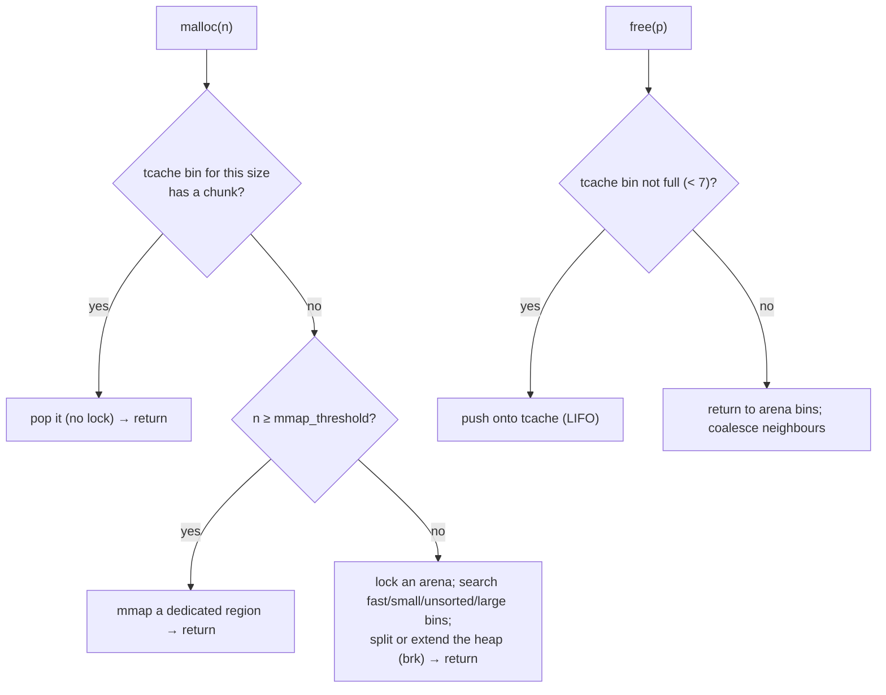

# Lesson A3 — Inside `malloc`: how a heap allocator works (and building one)

> Level: advanced. Prerequisites: B6 (heap), I2 (ownership), A1 (alignment). Time: about 3 hours.
> Tested with GCC 13.3 and glibc 2.39 on x86-64 Linux, November 2026. glibc internals change between versions; numbers marked "observed" come from the test machine.

---

## 1. Why this lesson exists

`malloc` looks like magic: ask for 100 bytes, get a pointer; `free` it, and the memory is "gone". But `malloc` is ordinary C code in your C library, sitting between your program and the kernel. Understanding it explains:

- why `malloc(1)` actually consumes 32 bytes (observed below),
- why freeing a block and allocating again often returns *the same address* — which is why use-after-free bugs are exploitable,
- why programs with many small allocations are slow, and why linked lists lose to arrays (lesson P5),
- why corrupted heap metadata produces messages like `free(): double free detected in tcache 2` (lesson I8).

We will build a working allocator in ~100 lines, then compare its design with glibc's.

---

## 2. Intuition: a hostel warden with a ledger

The warden (allocator) rents out one long corridor of rooms (an **arena** obtained from the OS). Each rented stretch gets a little **signboard** in front of it (a **header**) saying how big it is and whether it's occupied. When a guest leaves, the warden marks the signboard "free" and, if the next stretch is also free, knocks down the wall between them (**coalescing**) so a big group can be housed later.

Problems the warden faces:

- **Search time:** walking the whole corridor for every booking is slow → keep separate lists by room size (**bins / size classes**).
- **Fragmentation:** lots of small free gaps that can't fit a big group → coalescing, careful placement.
- **Many wardens:** with many threads, one ledger means queues → per-thread caches (**tcache**) and multiple **arenas**.
- **Huge requests:** don't fit in the corridor → rent a separate building directly from the city (**`mmap`** for large blocks).

---

## 3. Precise definitions

- **Arena / heap / chunk** (glibc terminology, Red Hat *malloc internals and you*): an *arena* is "a collection of one or more heaps, plus overhead needed to keep track of lists of chunks"; a *heap* is "a large contiguous region of memory"; a *chunk* is "a region of contiguous memory which may be returned by `malloc()` or has been passed to `free()`, plus overhead".
- **Header / metadata:** bookkeeping stored next to each block (size, flags, list links). `free(p)` finds it by stepping back from `p`.
- **Alignment guarantee:** `malloc` returns memory suitably aligned for any fundamental type (`alignof(max_align_t)`, 16 on x86-64 Linux — lesson A1).
- **Internal fragmentation:** wasted space *inside* allocated blocks (rounding, headers). **External fragmentation:** free space split into pieces too small to satisfy requests.
- **Placement policies:** *first fit* (first block large enough), *best fit* (smallest block large enough), *next fit*; *segregated fits* keep separate free lists per size class (Wilson, Johnstone, Neely & Boles, *Dynamic Storage Allocation: A Survey and Critical Review*, 1995).
- **Coalescing:** merging adjacent free blocks; *boundary tags* (a footer copying the size) let a block find its *previous* neighbour in O(1).
- **glibc specifics** (glibc manual, *Memory Allocation Tunables*): a per-thread cache (**tcache**) holds up to `glibc.malloc.tcache_count` chunks per size class (default **7**) for sizes up to `glibc.malloc.tcache_max` (default **1032 bytes** on 64-bit); requests above `glibc.malloc.mmap_threshold` (default **131072 bytes**, adjusted dynamically unless set) are served by `mmap`; the number of arenas is limited based on the number of CPU cores (`glibc.malloc.arena_max`, default 0 = automatic).

---

## 4. Step by step

### Step 1 — what glibc actually does (observe before building)

```c
// file: usable.c
// build: gcc -std=c17 -Wall -Wextra -o usable usable.c
// run: env -u MALLOC_MMAP_THRESHOLD_ -u MALLOC_TRIM_THRESHOLD_ ./usable

#include <stdio.h>
#include <stdlib.h>
#include <malloc.h>     // malloc_usable_size: a glibc extension, not ISO C
#include <stdint.h>
// probes glibc's real chunk sizes and reuse behaviour
int main(void)
{
    void *a = malloc(32), *b = malloc(32);
    printf("two fresh 32-byte blocks are %ld bytes apart\n", (long)((char *)b - (char *)a));
    free(a);
    void *c = malloc(32);
    printf("after free(a), malloc(32) returns a again? %s\n", c == a ? "yes" : "no");
    free(b); free(c);
    size_t req[] = {1, 24, 25, 40, 100, 1000};
    for (size_t i = 0; i < sizeof req / sizeof req[0]; i++) {
        void *p = malloc(req[i]);
        printf("malloc(%4zu): usable %4zu, address %% 16 = %lu\n", req[i], malloc_usable_size(p), (unsigned long)((uintptr_t)p % 16));
        free(p);
    }
    return 0;
}
```

Output (observed, glibc 2.39; the `env -u` removes sandbox overrides as explained in lesson B6):

```text
two fresh 32-byte blocks are 48 bytes apart
after free(a), malloc(32) returns a again? yes
malloc(   1): usable   24, address % 16 = 0
malloc(  24): usable   24, address % 16 = 0
malloc(  25): usable   40, address % 16 = 0
malloc(  40): usable   40, address % 16 = 0
malloc( 100): usable  104, address % 16 = 0
malloc(1000): usable 1000, address % 16 = 0
```

Reading it:

- A 32-byte request occupies a **48-byte chunk** (32 payload rounded up + 16 bytes of size metadata, in 16-byte steps): internal fragmentation in action.
- The smallest chunk is 32 bytes, of which 24 are usable — so `malloc(1)` costs 32 bytes.
- Freeing `a` and asking again for the same size returned **the same address**: the freed chunk went into the per-thread cache (a LIFO list) and was handed straight back. That is fast — and it is why a dangling pointer to `a` now silently aliases the new object `c`.

### Step 2 — the dumbest allocator: a bump pointer

The simplest possible allocator keeps one pointer into a big region and moves it forward:

```text
 next ─► |used|used|used|          free ...                     |
 malloc(n): p = next; next += round_up(n); return p
 free(p):   do nothing
```

It is blazing fast and used for real (compilers' AST arenas, per-request arenas in servers: free everything at once at the end). Its wall: **`free` cannot reuse memory**, so a long-running program with churn runs out. We need to *know* where each block is and whether it's free → headers.

### Step 3 — a first-fit allocator with splitting and coalescing

```c
// file: myalloc.c
// build: gcc -std=c17 -Wall -Wextra -g -O1 -o myalloc myalloc.c
// run: ./myalloc

#include <stdio.h>
#include <stddef.h>
#include <stdint.h>
#include <string.h>
#include <sys/mman.h>   // mmap: ask the OS for raw pages (POSIX)

// every block starts with a header; the payload follows it
typedef struct header {
    size_t size;              // payload size in bytes (multiple of ALIGN)
    int free;                 // 1 if available
    struct header *next;      // next block in address order (implicit list)
} header;

#define ALIGN 16                              // same guarantee glibc gives on x86-64
#define ARENA_SIZE (64 * 1024)
#define HDR ((sizeof(header) + ALIGN - 1) & ~(size_t)(ALIGN - 1))   // header rounded up to 16

static header *arena = NULL;                  // first block of our single arena

// rounds n up to a multiple of ALIGN
static size_t round_up(size_t n) { return (n + ALIGN - 1) & ~(size_t)(ALIGN - 1); }

// lazily map one arena from the OS and make it a single free block
static int arena_init(void)
{
    void *mem = mmap(NULL, ARENA_SIZE, PROT_READ | PROT_WRITE, MAP_PRIVATE | MAP_ANONYMOUS, -1, 0);
    if (mem == MAP_FAILED) return -1;
    arena = mem;
    arena->size = ARENA_SIZE - HDR;
    arena->free = 1;
    arena->next = NULL;
    return 0;
}

// first fit: walk the list, take the first free block that is big enough, split off the rest
void *my_malloc(size_t n)
{
    if (n == 0) return NULL;
    if (arena == NULL && arena_init() != 0) return NULL;
    size_t need = round_up(n);
    for (header *h = arena; h != NULL; h = h->next) {
        if (!h->free || h->size < need) continue;
        if (h->size >= need + HDR + ALIGN) {          // big enough to split usefully
            header *rest = (header *)((char *)h + HDR + need);
            rest->size = h->size - need - HDR;
            rest->free = 1;
            rest->next = h->next;
            h->next = rest;
            h->size = need;
        }
        h->free = 0;
        return (char *)h + HDR;                       // payload starts after the header
    }
    return NULL;                                      // no block fits: out of memory
}

// free: mark the block free, then merge runs of adjacent free blocks (coalescing)
void my_free(void *p)
{
    if (p == NULL) return;
    header *h = (header *)((char *)p - HDR);          // step back to the header
    h->free = 1;
    for (header *cur = arena; cur != NULL; cur = cur->next) {
        while (cur->free && cur->next != NULL && cur->next->free) {
            cur->size += HDR + cur->next->size;       // absorb the neighbour
            cur->next = cur->next->next;
        }
    }
}

// prints the block list: [size:F] free, [size:U] used
static void dump(const char *label)
{
    printf("%-22s", label);
    for (header *h = arena; h != NULL; h = h->next)
        printf(" [%zu:%c]", h->size, h->free ? 'F' : 'U');
    printf("\n");
}

int main(void)
{
    char *a = my_malloc(100);       // rounded to 112
    char *b = my_malloc(200);       // rounded to 208
    char *c = my_malloc(50);        // rounded to 64
    if (!a || !b || !c) return 1;
    dump("after a, b, c:");
    printf("payload alignment ok: %s\n",
           ((uintptr_t)a % ALIGN == 0 && (uintptr_t)b % ALIGN == 0 && (uintptr_t)c % ALIGN == 0) ? "yes" : "no");

    strcpy(b, "data in b");
    my_free(b);
    dump("after free(b):");          // a hole in the middle

    char *d = my_malloc(120);       // first fit reuses b's hole and splits it
    if (!d) return 1;
    dump("after d = malloc(120):");

    my_free(a);
    my_free(d);
    dump("after free(a), free(d):"); // a, d and the split remainder coalesce
    my_free(c);
    dump("after free(c):");          // everything merges back into one block

    char *big = my_malloc(70000);    // larger than the whole arena
    printf("malloc(70000) -> %s\n", big ? "ok" : "NULL (arena too small)");
    return 0;
}
```

Output:

```text
after a, b, c:         [112:U] [208:U] [64:U] [65024:F]
payload alignment ok: yes
after free(b):         [112:U] [208:F] [64:U] [65024:F]
after d = malloc(120): [112:U] [128:U] [48:F] [64:U] [65024:F]
after free(a), free(d): [352:F] [64:U] [65024:F]
after free(c):         [65504:F]
malloc(70000) -> NULL (arena too small)
```

Check the arithmetic: the header is 24 bytes rounded to `HDR` = 32; 112 + 208 + 64 + 65024 + 4 × 32 = 65536, the arena size. When `d` (120 → 128) took `b`'s 208-byte hole, the remainder 208 − 128 − 32 = 48 became a new free block. Freeing `a` and `d` merged `a`, `d` and that 48-byte remainder: 112 + 32 + 128 + 32 + 48 = 352. Finally everything coalesced into one block of 65536 − 32.

This allocator works, and it already shows why heap corruption is so destructive: **the metadata lives right next to user data**. Overflow `a` by a few bytes and you overwrite `b`'s header — the next `my_malloc` walks into garbage. Real allocators add integrity checks (glibc's "double free detected", "corrupted size vs. prev_size") precisely because of this.

### Step 4 — walls of the toy design, and how production allocators climb them

| Wall in `myalloc` | Production technique |
|---|---|
| `my_malloc` walks *all* blocks: O(number of blocks) | Segregated free lists ("bins") per size class; bitmaps of non-empty bins |
| `my_free` rescans the whole list to coalesce | Boundary tags (footer with size) to find the previous block in O(1) |
| One global list → threads would need one global lock | Per-thread caches (glibc tcache), multiple arenas, thread-local heaps (jemalloc, mimalloc's sharded free lists) |
| One fixed 64 KiB arena | Grow with `brk`/`mmap`; return memory with `madvise`/`munmap`/trimming |
| Huge blocks fragment the arena | Serve big requests directly with `mmap` (glibc: above `mmap_threshold`) |
| Header corruption goes unnoticed | Integrity checks, mangling of free-list pointers ("safe-linking") [unverified: the glibc version that introduced it is commonly cited as 2.32, but the 2.32 release announcement does not mention it], guard pages in hardened allocators |
| First fit can fragment badly over time | Size-class rounding, best-fit within classes, slab/page-per-size-class designs |

### Step 5 — custom allocators you will meet in real code

- **Arena / region allocator:** bump-allocate everything for one request/frame/compilation unit, free it all at once. Zero per-object `free` cost; no leaks within the region by construction.
- **Pool / slab allocator:** fixed-size objects from pre-carved pages (Linux kernel slab allocator for `struct inode`, network buffers). O(1) alloc/free, no external fragmentation for that size.
- **Drop-in replacements:** jemalloc, tcmalloc, mimalloc — linked in or injected with `LD_PRELOAD` (lesson P3) to change a program's allocator without recompiling.

---

## 5. Diagrams

Block layout in `myalloc`:

```text
 arena (mmap'd, 64 KiB)
 +--------+-------------+--------+---------------+--------+----------+--------+---------------
 | header | payload a   | header | payload b     | header | payload c| header | free ...
 | 112 U  | 112 bytes   | 208 F  | 208 bytes     | 64 U   | 64 bytes | 65024 F|
 +--------+-------------+--------+---------------+--------+----------+--------+---------------
   32 B   ^ returned ptr   32 B
          (header + 32)
```

glibc's fast path, simplified:



---

## 6. Common mistakes

| Mistake | Consequence | Fix |
|---|---|---|
| Assuming `malloc(n)` costs n bytes | Memory blow-up with millions of tiny objects | Batch small objects in arrays/pools |
| Relying on freed memory being "gone" | Use-after-free reads the *next* object placed there (LIFO reuse) | Null pointers after `free`; sanitizers |
| Writing past a block "just a little" | Corrupts the neighbour's header → crash later in `malloc`/`free` | Bounds discipline; ASan |
| Mixing allocators (`free` on memory from a custom pool or from `mmap`) | Heap corruption | Free with the matching deallocator |
| Benchmarking with tiny inputs only | tcache hides costs that appear at scale | Benchmark realistic sizes and thread counts |
| Calling `malloc` in a signal handler | Not async-signal-safe → deadlock/corruption | Pre-allocate; only async-signal-safe calls (lesson P1) |
| Using `malloc_usable_size` to resize logic | glibc extension; implementation detail | Track sizes yourself |

---

## 7. Connections

- **OS track:** `brk`/`sbrk` and `mmap` are the system calls underneath; pages, demand paging and `madvise(MADV_DONTNEED)` decide when memory really returns to the OS.
- **DSA track:** free lists are linked lists; size-class bins are an array of lists (like hashing by size); best-fit with balanced trees appears in some allocators.
- **Java / Python tracks:** the JVM uses bump allocation in thread-local allocation buffers plus a garbage collector; CPython has its own small-object allocator (pymalloc) on top of `malloc`.
- **Security track:** heap exploitation (tcache poisoning, unlink attacks) targets exactly the metadata shown in the diagram; glibc's hardening checks and pointer mangling are the defences.
- **Parallel track:** allocator contention is a classic multithreaded bottleneck; per-thread caches trade memory for scalability.

### Where this shows up in my projects

- **compiler-fuzz:** a program generator that builds an AST for each random program and discards it after printing is the textbook case for an **arena allocator** (allocate nodes by bumping, free the whole arena at once). Compilers themselves (GCC's obstacks, LLVM's `BumpPtrAllocator`) use this design for the same reason.

---

## 8. Self-check questions

1. Why does `malloc(1)` use 32 bytes in glibc on x86-64?
2. Why did `malloc(32)` after `free(a)` return `a`'s address, and why does that matter for security?
3. In `myalloc`, why does `my_free` need coalescing at all?
4. What is the difference between internal and external fragmentation? Give one example of each from this lesson.
5. Why do production allocators use size classes instead of a single first-fit list?
6. When does glibc use `mmap` directly, and why?

<details>
<summary>Answers</summary>

1. The minimum chunk on 64-bit glibc is 32 bytes (16-byte alignment and room for metadata/free-list links), of which 24 are usable.
2. The freed chunk was pushed onto the per-thread cache for its size class, which is LIFO, so the next same-size request popped it. A dangling pointer to the old object now points into the new one, so use-after-free can read or corrupt live data — the basis of many exploits.
3. Without it, alternating allocations and frees would leave many adjacent small free blocks that together could satisfy a larger request but individually cannot (external fragmentation); merging restores large blocks.
4. Internal: a 32-byte request occupying a 48-byte chunk; `my_malloc(100)` rounding to 112. External: after freeing `b`, the 208-byte hole could not satisfy a 300-byte request although the total free space was larger.
5. Searching one list is O(n) and mixes sizes, causing fragmentation; size classes make allocation O(1) for common sizes and keep similar sizes together.
6. For requests above the mmap threshold (128 KiB by default, dynamically adjusted): large blocks get their own mapping so they don't fragment the heap and can be returned to the OS immediately on `free`.

</details>

---

## 9. Mnemonic (Tamil + English)

**Allocator evolution — Bump → List → Bins → Thread cache → mmap ("B-L-B-T-M"):**

> **"Bus-la Luggage, Bag-la Thali, Mela Maadi"** — *Bus* (bump: just keep moving forward), *Luggage list* (free list), *Bag* (bins, sorted by size), *Thali* (thread cache — each person's own plate), *Mela maadi* (the upstairs floor = mmap for huge items).

**Use-after-free danger:**

> **"Kaali panna room-ku udane adutha aal varuvaan."** — The room you just vacated gets the next guest immediately (LIFO tcache), so never walk back in.

---

## Sources

- glibc manual, *Memory Allocation Tunables* (`tcache_count` default 7, `tcache_max` 1032 bytes on 64-bit, `mmap_threshold` 131072, `arena_max`): https://www.sourceware.org/glibc/manual/2.41/html_node/Memory-Allocation-Tunables.html
- DJ Delorie (Red Hat), *malloc internals and you* (arena, heap, chunk definitions; tcache): https://developers.redhat.com/blog/2017/03/02/malloc-internals-and-you
- glibc wiki, *MallocInternals* (detailed chunk/bin description): https://sourceware.org/glibc/wiki/MallocInternals
- Linux man page `malloc(3)` (`MMAP_THRESHOLD`, `malloc_usable_size` is in `malloc_usable_size(3)`): https://man7.org/linux/man-pages/man3/malloc.3.html
- Linux man page `mmap(2)` (`MAP_ANONYMOUS`, `MAP_FAILED`): https://man7.org/linux/man-pages/man2/mmap.2.html
- P. R. Wilson, M. S. Johnstone, M. Neely, D. Boles, *Dynamic Storage Allocation: A Survey and Critical Review*, IWMM 1995: https://www.cs.hmc.edu/~oneill/gc-library/Wilson-Alloc-Survey-1995.pdf
- D. Leijen, B. Zorn, L. de Moura, *Mimalloc: Free List Sharding in Action*, APLAS 2019: https://www.microsoft.com/en-us/research/publication/mimalloc-free-list-sharding-in-action
- Bryant & O'Hallaron, *CS:APP*, §9.9 "Dynamic Memory Allocation" (implicit free lists, boundary tags, segregated fits; the malloc lab) — book site: https://csapp.cs.cmu.edu/

## Verify yourself

1. Build and run both programs. Change `ALIGN`, `ARENA_SIZE` or the requests and predict the dump before running.
2. Add boundary-tag footers to `myalloc` so `my_free` coalesces with the previous block in O(1) instead of rescanning.
3. Run `GLIBC_TUNABLES=glibc.malloc.tcache_count=0 ./usable` and check whether "returns a again?" changes (the arena's fast bins may still return it — observe and explain).
4. Overflow `a` by 40 bytes in `myalloc.c` and watch the next `dump` print garbage — then run it under ASan (`-fsanitize=address`), which will *not* see it (the arena is one big `mmap`ed block from ASan's point of view): a lesson in why custom allocators need their own checks.
5. Read the tunables page and confirm the three default values quoted above.
