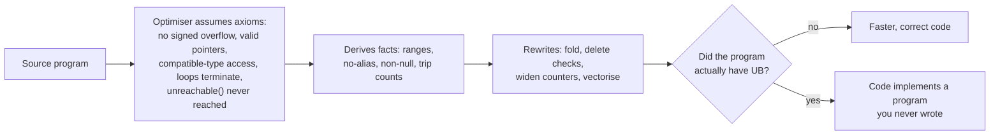

# Lesson A4 — How optimisers use undefined behaviour (and how to keep control)

> Level: advanced. Prerequisites: I3 (UB catalogue), A1 (aliasing), A2 (reading assembly). Time: about 2.5 hours.
> Assembly from GCC 13.3 / GCC 14.2 at `-O2` (with `-fno-asynchronous-unwind-tables -fcf-protection=none` to remove noise), x86-64 Linux, November 2026.

---

## 1. Why this lesson exists

Lesson I3 showed *that* compilers exploit UB. This lesson shows *how and why*, at the level of the reasoning an optimiser performs, because:

- you need to predict which "harmless" bugs turn into deleted checks;
- you need to choose project-wide policy flags (`-fwrapv`, `-fno-strict-aliasing`, `-fno-delete-null-pointer-checks`) with understanding, as the Linux kernel does;
- and, conversely, you can *give* the optimiser facts on purpose (`restrict`, C23 `unreachable()`, `[[assume]]`-like builtins) to get faster code.

This is also the intellectual core of your compiler-verification interests: a miscompilation is "the optimiser assumed something false" — but so is "the program had UB", and telling them apart is the job.

---

## 2. Intuition: optimisation as proof with axioms

An optimiser proves theorems about your program and rewrites it using them. Its **axioms** include the standard's promises *you* made by writing a valid program:

- "signed arithmetic never overflows",
- "objects are only accessed through compatible types",
- "pointers that are dereferenced are valid (non-null, in bounds)",
- "pointer arithmetic stays inside its array",
- "side-effect-free loops terminate",
- "control never reaches `unreachable()`".

From true axioms it derives true theorems. If your program breaks an axiom, the "theorems" are false for your program — and the rewritten code faithfully implements a program you never wrote. Nothing is malicious here; it's logic with a false premise.

---

## 3. Precise definitions

- **As-if rule:** an implementation may transform a program in any way that preserves its *observable behaviour* (volatile accesses, I/O, data written to files at termination) for executions without UB (N3220 §5.1.2.4, program semantics).
- **UB as an optimisation assumption:** because "there are no restrictions" on executions with UB (§3.5.3), the compiler only needs to be correct on UB-free executions, so it may assume the conditions that would cause UB never hold (cppreference *UB and optimization*).
- **Value-range propagation / induction-variable analysis:** derive ranges of values (e.g. "this `int` loop counter never wraps") to compute trip counts, widen counters to 64-bit, vectorise.
- **`unreachable()`** (C23, `<stddef.h>`): reaching it is UB, so it is an explicit hint that a path cannot happen; GCC's `__builtin_unreachable()` and Clang's builtins are the older spelling.
- **Policy flags** (GCC manual): `-fwrapv` assumes signed overflow wraps; `-ftrapv` traps on signed overflow in add/sub/mul; `-fno-strict-overflow` implies `-fwrapv -fwrapv-pointer`; `-fno-strict-aliasing`; `-fno-delete-null-pointer-checks`.

---

## 4. Step by step: five optimisations powered by UB

All five functions are in one file:

```c
// file: fold.c
// build: gcc -std=c17 -O2 -fno-asynchronous-unwind-tables -fcf-protection=none -S -o fold.s fold.c && gcc -std=c17 -O2 -fwrapv -fno-asynchronous-unwind-tables -fcf-protection=none -S -o fold_wrapv.s fold.c
// run: grep -v -E '^\s*\.(file|text|globl|type|size|ident|section|p2align)' fold.s; echo "===== -fwrapv twice_half_s"; sed -n '/^twice_half_s:/,/ret/p' fold_wrapv.s

// (1) arithmetic identity valid only if x * 2 cannot overflow
int twice_half_s(int x) { return (x * 2) / 2; }
unsigned twice_half_u(unsigned x) { return (x * 2) / 2; }

// (2) a "did the pointer wrap?" check
int buf_ok(char *p, unsigned long len, char *end)
{
    if (p + len < p)            // relies on wrap-around, which pointer arithmetic never has in C
        return 0;
    return p + len <= end;
}

// (3) loop counters: int vs unsigned
long sum_to(int n)        { long s = 0; for (int i = 0; i <= n; i++) s += i; return s; }
long sum_to_u(unsigned n) { long s = 0; for (unsigned i = 0; i <= n; i++) s += i; return s; }
```

### Optimisation 1 — algebra on signed integers

```text
twice_half_s:
	movl	%edi, %eax              ; return x  -- (x*2)/2 == x, because x*2 "cannot overflow"
	ret
twice_half_u:
	movl	%edi, %eax
	andl	$2147483647, %eax       ; return x & 0x7fffffff -- unsigned x*2 really wraps
	ret
===== -fwrapv twice_half_s
twice_half_s:
	leal	(%rdi,%rdi), %eax       ; x*2 (wrapping)
	sarl	%eax                    ; /2
	ret
```

For unsigned, wrap-around is *defined*, so the compiler must preserve it (clear the top bit). For signed, the no-overflow axiom makes `(x*2)/2 == x` a theorem. With `-fwrapv` the axiom is gone and the real computation returns. Here UB-based reasoning *produced better code*; the same reasoning deleted the overflow check in lesson I3.

### Optimisation 2 — the pointer-wrap check is rewritten

```text
buf_ok:
	xorl	%eax, %eax
	testq	%rsi, %rsi             ; is len "negative" when viewed as signed?
	js	.L4                    ; then return 0
	addq	%rsi, %rdi
	xorl	%eax, %eax
	cmpq	%rdi, %rdx
	setnb	%al                    ; return p + len <= end
.L4:
	ret
```

Pointer arithmetic that leaves its array is UB, so "`p + len` wrapped around the address space" cannot happen in a valid program. GCC therefore rewrote `p + len < p` as "len, interpreted as a signed offset, is negative". That is *not* the overflow check the author intended — for an attacker-controlled `len`, a check of this shape was the classic pattern that Wang et al. (SOSP 2013) found deleted or weakened in real systems code. The robust check compares *lengths*, not pointers: `if (len > (size_t)(end - p)) return 0;`.

### Optimisation 3 — signed loop counters can be widened

```text
sum_to:                          ; int i
	testl	%edi, %edi
	js	.L10                   ; n < 0: loop doesn't run
	movslq	%edi, %rdi             ; widen n to 64 bits ONCE
	xorl	%eax, %eax
	xorl	%edx, %edx
.L9:
	movq	%rax, %rcx
	addq	%rax, %rdx             ; s += i   (i kept as a 64-bit register)
	addq	$1, %rax
	cmpq	%rdi, %rcx
	jne	.L9                    ; exactly n+1 iterations: trip count is known
	...
sum_to_u:                        ; unsigned i
.L13:
	movl	%eax, %ecx             ; 32-bit counter, re-zero-extended each time
	addl	$1, %eax
	addq	%rcx, %rdx
	cmpl	%eax, %edi
	jnb	.L13                   ; if n == UINT_MAX this loop is INFINITE (i wraps to 0)
```

With `int i`, "`i++` never overflows" means `i <= n` terminates after exactly `n + 1` iterations, so the counter can live in a 64-bit register and the trip count is known (enabling vectorisation and unrolling in more complex loops). With `unsigned i`, `i <= UINT_MAX` is always true and wrap-around is defined, so the compiler must keep exact 32-bit semantics. This is the main performance argument *for* signed overflow being UB — and why changing loop counters to `unsigned` "for safety" can make code slower.

### Optimisation 4 — telling the compiler a fact: C23 `unreachable()`

```c
// file: unr.c
// build: gcc-14 -std=c23 -O2 -fno-asynchronous-unwind-tables -fcf-protection=none -S -o unr.s unr.c && sed 's/default: unreachable();/default: return -1;/' unr.c > unr_checked.c && gcc-14 -std=c23 -O2 -fno-asynchronous-unwind-tables -fcf-protection=none -S -o unr_checked.s unr_checked.c
// run: sed -n '/^classify:/,$p' unr.s | grep -v -E '^\s+\.'; echo "===== with default: return -1"; sed -n '/^classify:/,$p' unr_checked.s | grep -v -E '^\s+\.'

#include <stddef.h>     // C23: unreachable()

// precondition: k is 0, 1 or 2
int classify(int k)
{
    switch (k) {
    case 0: return 10;
    case 1: return 20;
    case 2: return 30;
    default: unreachable();      // promise: never happens (UB if it does)
    }
}
```

Output:

```text
classify:
	leal	5(%rdi,%rdi,4), %eax   ; eax = 5k + 5
	addl	%eax, %eax             ; eax = 10k + 10
	ret
===== with default: return -1
classify:
	cmpl	$2, %edi
	ja	.L3                    ; range check kept
	leal	5(%rdi,%rdi,4), %eax
	addl	%eax, %eax
	ret
.L3:
	movl	$-1, %eax
	ret
```

GCC noticed the three results are `10k + 10` and, once told other values cannot occur, removed the range check and the jump entirely. The same power is a footgun: call `classify(7)` and you get 80 — or anything else. Use `unreachable()` only with a precondition you have *proven*, ideally guarded by an `assert` in debug builds.

### Optimisation 5 — strict aliasing and null-pointer facts (recap)

- Lesson A1: `write_then_read(int *i, float *f)` returned a constant at `-O2` because `int` and `float` lvalues cannot alias.
- Lesson I3: `int x = *p; if (!p) return -1;` lost its null check because the earlier dereference "proved" `p != NULL`.

### Step 6 — choosing a policy

| Option | Effect | Who uses it / when |
|---|---|---|
| Write UB-free code + sanitizers in CI | Full optimisation, bugs caught in tests | The default goal |
| `-fwrapv` | Signed overflow defined as wrapping (GCC/Clang semantics, not ISO C) | Code that must behave predictably on overflow; blocks some loop optimisations |
| `-fno-strict-overflow` | Implies `-fwrapv -fwrapv-pointer` | Linux kernel (`KBUILD_CFLAGS += -fno-strict-overflow`) |
| `-fno-strict-aliasing` | Disables type-based alias analysis | Linux kernel, some interpreters/networking code that pun types |
| `-fno-delete-null-pointer-checks` | Keeps null checks after dereferences | Linux kernel, embedded code where address 0 is valid |
| `-ftrapv` / `-fsanitize=signed-integer-overflow` with trapping | Overflow becomes a crash instead of silent | Hardened builds; debugging |
| C23 `ckd_add/ckd_sub/ckd_mul` | Explicit overflow-checked arithmetic | New code that must handle overflow (lesson A5) |

---

## 5. Diagrams



---

## 6. Common mistakes

| Mistake | Why it fails | Better |
|---|---|---|
| Overflow check *after* the operation (`if (a + b < a)`) on signed ints | The check depends on UB; folded away | Pre-check against limits or `ckd_add` |
| Pointer-wrap checks `p + len < p` | Pointer arithmetic can't wrap in C; rewritten | Compare lengths: `len > (size_t)(end - p)` |
| "Unsigned everywhere for safety" | Wrap is defined but often wrong too, and blocks loop optimisations | Use signed for counts/indices that shouldn't wrap; check bounds explicitly |
| `unreachable()` / `__builtin_unreachable()` on unproven paths | Turns a bug into arbitrary behaviour | `assert` in debug, unreachable only with proof |
| Assuming `-O0` behaviour is "the real" behaviour | `-O0` also folds some UB (lesson I3) | Treat UB as a bug at every level |
| Blaming the compiler on first sight | Most "compiler bugs" in user code are UB | Sanitize, reduce, then compare compilers |

---

## 7. Connections

- **Compilers track:** these are standard passes — instruction combining, scalar evolution / induction-variable simplification, alias analysis, jump threading, dead-code elimination. LLVM IR makes the assumptions explicit with `nsw`/`nuw` ("no signed/unsigned wrap") flags, `poison` values and `noalias`.
- **Testing/Verification track:** translation validation (does the optimised code refine the source?) and tools such as Alive2 for LLVM check optimisations formally (the Alive2 README cites its PLDI 2021 paper); Csmith-style fuzzers find bugs where the *compiler* derived a false fact from a valid program.
- **Security track:** "optimisation-unstable code" (Wang et al., SOSP 2013) is a vulnerability class; the kernel's flags are a policy response.
- **Rust track:** Rust defines overflow (panic in debug, wrap in release by default) and gives LLVM `nsw`-style facts only where proven safe — a different point in the same trade-off.

### Where this shows up in my projects

- **compiler-fuzz:** the differential tester's verdicts depend on this lesson. If GCC and Clang disagree at `-O2` on a generated program, there are exactly two explanations: the program has UB (the generator failed — both compilers may be "right"), or one compiler derived a false theorem from a valid program (a real miscompilation). The `twice_half_s` / `buf_ok` / `sum_to` patterns above are the kinds of rewrites that appear in reduced test cases, and reading the `-O0` vs `-O2` assembly is how you decide which explanation holds.

---

## 8. Self-check questions

1. Why is `(x * 2) / 2` folded to `x` for `int` but not for `unsigned`?
2. What did GCC turn `p + len < p` into, and why is that legal?
3. Give the performance argument for signed overflow being UB, using `sum_to`.
4. What does C23 `unreachable()` do, and what happens if it is reached?
5. Which three flags does the Linux kernel use to opt out of UB-based assumptions?
6. A GCC-vs-Clang mismatch appears only at `-O2`. Name the first two checks you perform before calling it a compiler bug.

<details>
<summary>Answers</summary>

1. Signed overflow is UB, so the compiler may assume `x*2` doesn't overflow, making the identity true. Unsigned arithmetic wraps by definition, so the top bit is lost and the compiler must clear it (`x & 0x7fffffff`).
2. Into "is `len` negative as a signed 64-bit value". Pointer arithmetic beyond the array (including any wrap) is UB, so `p + len < p` can only be true in a valid program if the offset is negative.
3. With an `int` counter, `i <= n` with `i++` can't wrap, so the loop runs exactly `n+1` times; the counter can be widened to 64 bits and the trip count computed (enabling vectorisation/unrolling). With `unsigned`, `n == UINT_MAX` would make the loop infinite, so exact 32-bit wrap semantics must be kept.
4. It declares that control cannot reach that point (reaching it is UB), letting the compiler delete range checks or branches; if it *is* reached, behaviour is undefined (e.g. `classify(7)` returned 80).
5. `-fno-strict-aliasing`, `-fno-delete-null-pointer-checks`, `-fno-strict-overflow`.
6. Run the program under UBSan/ASan (and check for other UB like unsequenced writes or aliasing) to exclude UB; then reduce the test case and check whether the mismatch persists across optimisation levels/compiler versions (and inspect the assembly).

</details>

---

## 9. Mnemonic (Tamil + English)

**The optimiser's axioms — "No Over, No Alias, No Null, No Escape, Loops End, Never Reach" — "N-N-N-N-L-N":**

> **"Naan Neenga Naanga Nammal — Loop-um Nikkum"** — a playful chain of Tamil pronouns (*naan* I, *neenga* you, *naanga* we, *nammal* us): **N**o overflow, **N**o bad alias, **N**o null, **N**o out-of-bounds escape; **L**oops end; and the last *Nikkum* — "it will stop" — reminds you `unreachable()` is never reached.

**When UB meets the optimiser:**

> **"Thappaana premise-la sariyaana logic — thappaana answer."** — Correct logic on a false premise gives a wrong answer.

---

## Sources

- cppreference, *Undefined behavior* — "UB and optimization" section: https://en.cppreference.com/w/c/language/behavior
- WG14 N3220: §3.5.3 (undefined behavior), §5.1.2.4 (program semantics / as-if), §6.5.7 (additive operators: pointer arithmetic), §7.21 `<stddef.h>` (`unreachable`): https://open-std.org/JTC1/SC22/WG14/www/docs/n3220.pdf
- cppreference, *unreachable* (C23): https://en.cppreference.com/w/c/program/unreachable
- GCC manual, *Code Gen Options* (`-fwrapv`, `-ftrapv`, `-fstrict-overflow`): https://gcc.gnu.org/onlinedocs/gcc/Code-Gen-Options.html
- GCC manual, *Optimize Options* (`-fstrict-aliasing`, `-fdelete-null-pointer-checks`): https://gcc.gnu.org/onlinedocs/gcc/Optimize-Options.html
- Linux kernel top-level Makefile: https://github.com/torvalds/linux/blob/master/Makefile
- Chris Lattner, *What Every C Programmer Should Know About Undefined Behavior* #1–#3 (LLVM blog, 2011): https://blog.llvm.org/2011/05/what-every-c-programmer-should-know.html
- X. Wang, N. Zeldovich, M. F. Kaashoek, A. Solar-Lezama, *Towards Optimization-Safe Systems: Analyzing the Impact of Undefined Behavior*, SOSP 2013: https://pdos.csail.mit.edu/papers/stack:sosp13.pdf
- X. Yang, Y. Chen, E. Eide, J. Regehr, *Finding and Understanding Bugs in C Compilers*, PLDI 2011: https://www-old.cs.utah.edu/~regehr/papers/pldi11-preprint.pdf
- Alive2 project (translation validation for LLVM): https://github.com/AliveToolkit/alive2

## Verify yourself

1. Regenerate all assembly above; then repeat with `clang -O2` and compare its choices.
2. On Compiler Explorer, add `-fwrapv` to `sum_to` and see whether the 64-bit widening survives.
3. Call `classify(7)` from a `main` compiled at `-O2` and observe the result; then add `assert(k >= 0 && k <= 2)` before the switch and build without `-DNDEBUG`.
4. Rewrite `buf_ok` with a length comparison and confirm the generated code no longer depends on signedness tricks.
5. Read the "UB and optimization" section on cppreference and match each example to one of the five optimisations here.
