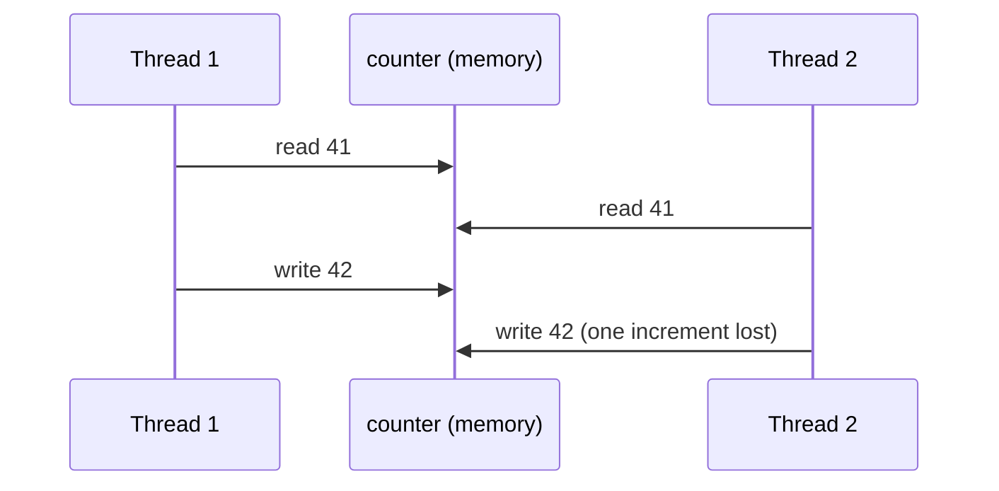
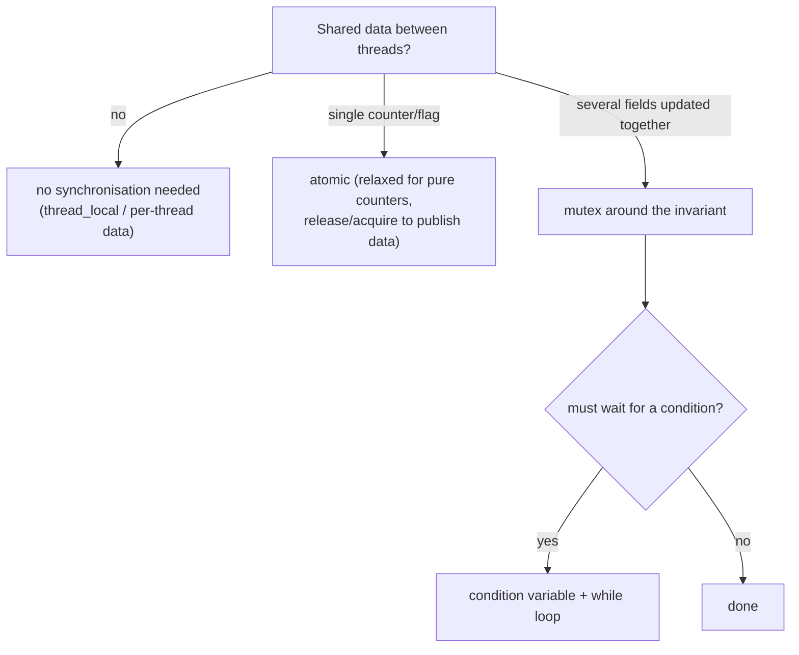

# Lesson A6 — Concurrency in C: threads, data races, mutexes, atomics and memory order

> Level: advanced. Prerequisites: I3 (UB), I8 (ThreadSanitizer), A2 (assembly), A4 (optimiser assumptions). Time: about 3.5 hours.
> Tested with GCC 13.3, glibc 2.39 (POSIX threads and C11 `<threads.h>`), ThreadSanitizer from GCC 13.3, on a 2-core x86-64 Linux VM, November 2026. Timings are from that VM and will differ on yours.

---

## 1. Why this lesson exists

Since C11, threads are part of the C language: the standard defines a **memory model** — what one thread is guaranteed to see of another thread's writes — plus `<threads.h>` and `<stdatomic.h>`. Before C11, C had no notion of threads at all, and multithreaded C relied on library promises (POSIX) that compilers did not formally have to respect (Hans Boehm's 2005 paper *Threads Cannot Be Implemented as a Library* explains why that was unsound).

You need this lesson because concurrency bugs are the hardest bugs: they depend on timing, disappear under the debugger, and — crucially for C — a **data race is undefined behaviour**, so the optimiser may transform racy code in ways that no interleaving of your source lines explains. Lesson I8 showed a racy counter giving three different wrong answers at `-O0` and a "correct" answer at `-O2`. This lesson explains why and how to write correct code instead.

---

## 2. Intuition

- **Threads** are several cooks in one kitchen (one address space). They share the fridge (globals, heap) but each has their own cutting board (stack).
- **A data race** is two cooks grabbing the same bowl at the same time without talking, at least one of them pouring into it.
- **A mutex** is a single key to the pantry: whoever holds it works alone inside; everyone else waits.
- **An atomic operation** is a vending machine slot: a coin goes in completely or not at all; no one can see "half a coin".
- **Memory ordering** is about *notes left for others*: "I put the cake in the fridge (payload), *then* I flip the sign to READY (flag)". A **release** store on the sign promises "everything I did before is visible to anyone who sees this sign"; an **acquire** load of the sign promises "after I see it, I will see everything that was done before it". Without that pairing, a cook may see the READY sign but an empty fridge — CPUs and compilers reorder independent memory operations.

---

## 3. Precise definitions

- **Data race** (N3220 §5.1.2.5, multi-threaded executions and data races): two *conflicting* actions (accesses to the same memory location, at least one a write) in different threads, at least one of which is not atomic, and neither *happens before* the other. "Any such data race results in undefined behavior."
- **Happens-before:** the ordering relation built from sequenced-before (within a thread) and *synchronizes-with* (across threads), e.g. a mutex unlock synchronizes with the next lock of the same mutex; a release store synchronizes with an acquire load that reads its value (cppreference *memory_order*).
- **Atomic types** (`<stdatomic.h>`, C11): `_Atomic T` or the typedefs `atomic_int`, `atomic_long`, `atomic_bool`…; operations `atomic_load`, `atomic_store`, `atomic_fetch_add`, `atomic_compare_exchange_strong/weak`, and `_explicit` variants that take a `memory_order`.
- **Memory orders** (cppreference *memory_order*):
  - `memory_order_relaxed` — "only this operation's atomicity is guaranteed", no ordering of other accesses;
  - `memory_order_acquire` (loads) — no reads/writes in this thread can be reordered before it; it sees writes released to the same variable;
  - `memory_order_release` (stores) — no reads/writes in this thread can be reordered after it;
  - `memory_order_acq_rel` — both, for read-modify-write operations;
  - `memory_order_seq_cst` (the default) — acquire/release plus "a single total order exists in which all threads observe all modifications in the same order".
- **`volatile`** means every access is an observable side effect the compiler must perform (for memory-mapped I/O and `setjmp`/signals); it does **not** make accesses atomic or ordered between threads — "concurrent read and write is a data race" (cppreference).
- **Threads APIs:** POSIX `pthread_create/join`, `pthread_mutex_*`, `pthread_cond_*`; C11 `<threads.h>` `thrd_create/join`, `mtx_*`, `cnd_*`, `thread_local`. glibc added ISO C threads in 2.28 ("Support for ISO C threads (ISO/IEC 9899:2011) has been added"), implemented on top of pthreads.

---

## 4. Step by step

### Step 1 — three counters: racy, mutex, atomic

```c
// file: counters.c
// build: gcc -std=c17 -O2 -Wall -Wextra -pthread -o counters counters.c
// run: ./counters

#include <stdio.h>
#include <pthread.h>
#include <stdatomic.h>
#include <time.h>

#define THREADS 4
#define ITERS 1000000

long plain_counter = 0;                    // racy: plain long, no synchronisation
long locked_counter = 0;                   // protected by the mutex below
pthread_mutex_t lock = PTHREAD_MUTEX_INITIALIZER;
atomic_long atomic_counter = 0;            // _Atomic long: every ++ is one indivisible RMW

// volatile stops the compiler from merging the loop, so the race is visible even at -O2
static void *racy(void *arg)
{
    (void)arg;
    for (int i = 0; i < ITERS; i++) {
        long v = *(volatile long *)&plain_counter;   // read
        *(volatile long *)&plain_counter = v + 1;    // write back: another thread may have written in between
    }
    return NULL;
}

// mutex: only one thread at a time runs the critical section
static void *with_mutex(void *arg)
{
    (void)arg;
    for (int i = 0; i < ITERS; i++) {
        pthread_mutex_lock(&lock);
        locked_counter++;
        pthread_mutex_unlock(&lock);
    }
    return NULL;
}

// atomic: hardware read-modify-write (lock xadd on x86-64), no lock object needed
static void *with_atomic(void *arg)
{
    (void)arg;
    for (int i = 0; i < ITERS; i++)
        atomic_fetch_add_explicit(&atomic_counter, 1, memory_order_relaxed);
    return NULL;
}

// starts THREADS threads running fn, waits for all, returns elapsed milliseconds
static double run(void *(*fn)(void *))
{
    pthread_t t[THREADS];
    struct timespec a, b;
    clock_gettime(CLOCK_MONOTONIC, &a);
    for (int i = 0; i < THREADS; i++) pthread_create(&t[i], NULL, fn, NULL);
    for (int i = 0; i < THREADS; i++) pthread_join(t[i], NULL);
    clock_gettime(CLOCK_MONOTONIC, &b);
    return (b.tv_sec - a.tv_sec) * 1e3 + (b.tv_nsec - a.tv_nsec) / 1e6;
}

int main(void)
{
    double t1 = run(racy), t2 = run(with_mutex), t3 = run(with_atomic);
    printf("expected      : %d\n", THREADS * ITERS);
    printf("racy          : %ld  (%.0f ms)\n", plain_counter, t1);
    printf("mutex         : %ld  (%.0f ms)\n", locked_counter, t2);
    printf("atomic relaxed: %ld  (%.0f ms)\n", atomic_load(&atomic_counter), t3);
    return 0;
}
```

Output (two runs on the 2-core test VM):

```text
expected      : 4000000
racy          : 3092428  (1 ms)
mutex         : 4000000  (113 ms)
atomic relaxed: 4000000  (106 ms)
expected      : 4000000
racy          : 3061797  (1 ms)
mutex         : 4000000  (150 ms)
atomic relaxed: 4000000  (76 ms)
```

- **Racy:** about a quarter of the increments were lost — two threads read the same old value and both wrote back value+1. It's *fast* because it's wrong. (The `volatile` casts are only there to stop GCC from collapsing the loop into one addition, the effect that hid the race at `-O2` in lesson I8. The program is still a data race, still UB: `volatile` is not synchronisation.)
- **Mutex:** correct; each increment pays for a lock/unlock pair and cache-line ping-pong between cores.
- **Atomic:** correct and here comparable or faster; on x86-64, `atomic_fetch_add` is a single `lock add` instruction (Step 4). Relaxed order is enough because the counter's *value* is all we need — no other data is published through it.

### Step 2 — publishing data: release/acquire message passing

The dumbest idea: "set `payload`, then set a plain `int ready = 1`; the reader spins on `ready`". It fails for two independent reasons: (1) it's a data race on `ready` and `payload` → UB, and the compiler may hoist the read of `ready` out of the spin loop (it "can't change" in a race-free program) and spin forever; (2) even in assembly, weakly ordered CPUs (ARM, POWER) may make `ready` visible before `payload`. Atomics with release/acquire fix both.

```c
// file: mp.c
// build: gcc -std=c17 -O2 -Wall -Wextra -pthread -o mp mp.c && gcc -std=c17 -O1 -g -fsanitize=thread -pthread -o mp_tsan mp.c && sed 's/memory_order_release/memory_order_relaxed/; s/memory_order_acquire/memory_order_relaxed/' mp.c > mp_relaxed.c && gcc -std=c17 -O1 -g -fsanitize=thread -pthread -o mp_relaxed_tsan mp_relaxed.c
// run: ./mp; echo "--- TSan, release/acquire:"; ./mp_tsan 2>&1 | grep -c "WARNING: ThreadSanitizer"; echo "--- TSan, relaxed:"; ./mp_relaxed_tsan 2>&1 | grep -E "WARNING|Read of|Previous write"

#include <stdio.h>
#include <stdbool.h>      // true/false in C17 (keywords in C23)
#include <stdatomic.h>
#include <pthread.h>
#include <sched.h>        // sched_yield

static int payload;                 // ordinary, non-atomic data
static atomic_bool ready = false;   // the flag that publishes it

// producer: write the data, THEN publish with a release store
static void *producer(void *arg)
{
    (void)arg;
    payload = 42;                                                     // (1)
    atomic_store_explicit(&ready, true, memory_order_release);        // (2) publish
    return NULL;
}

// consumer: spin with acquire loads; once it sees true, payload is guaranteed visible
static void *consumer(void *arg)
{
    int *out = arg;
    while (!atomic_load_explicit(&ready, memory_order_acquire))       // (3)
        sched_yield();                                                // let other threads run
    *out = payload;                                                   // (4) reads 42, no data race
    return NULL;
}

int main(void)
{
    pthread_t p, c;
    int got = 0;
    pthread_create(&c, NULL, consumer, &got);
    pthread_create(&p, NULL, producer, NULL);
    pthread_join(p, NULL);
    pthread_join(c, NULL);
    printf("consumer read %d\n", got);
    return 0;
}
```

Output:

```text
consumer read 42
--- TSan, release/acquire:
0
--- TSan, relaxed:
WARNING: ThreadSanitizer: data race (pid=701)
  Read of size 4 at 0x5577aab4d018 by thread T1:
  Previous write of size 4 at 0x5577aab4d018 by thread T2:
```

With release/acquire, TSan reports **0** races: the release store (2) synchronizes-with the acquire load (3) that reads `true`, so write (1) happens-before read (4). Changing both orders to `relaxed` keeps `ready` itself race-free (it's atomic) but removes the happens-before edge, so the access to the plain `payload` becomes a data race — and TSan, which models the C11 memory model, flags exactly that, even though on x86 the program would probably still print 42. **Testing on x86 cannot validate memory orders**; reasoning (or TSan) must.

A testing note: the first version of this example used C11 `thrd_create` from `<threads.h>`; under ThreadSanitizer the relaxed variant crashed with `ThreadSanitizer: SEGV on unknown address` on the test machine. Using `pthread_create` (which TSan intercepts directly) worked. Use pthreads for code you plan to check with TSan [unverified as a general rule: observed with GCC 13.3's TSan and glibc 2.39 only].

### Step 3 — waiting without spinning: a bounded queue with C11 `<threads.h>`

Spinning burns a core. When a thread must wait for a *condition* ("queue not empty"), use a mutex plus **condition variables**:

```c
// file: queue.c
// build: gcc -std=c17 -O2 -Wall -Wextra -pthread -o queue queue.c
// run: ./queue

#include <stdio.h>
#include <threads.h>      // C11 threads: thrd_t, mtx_t, cnd_t (glibc 2.28+)

#define CAP 4             // tiny buffer so the producer really has to wait
#define ITEMS 20

// a bounded FIFO shared by one producer and one consumer
static int buf[CAP];
static int head = 0, tail = 0, count = 0;
static mtx_t m;
static cnd_t not_full, not_empty;

static int producer(void *arg)
{
    (void)arg;
    for (int i = 1; i <= ITEMS; i++) {
        mtx_lock(&m);
        while (count == CAP)                 // ALWAYS re-check in a loop (spurious wakeups)
            cnd_wait(&not_full, &m);         // atomically unlocks m and sleeps; relocks on wake
        buf[tail] = i;
        tail = (tail + 1) % CAP;
        count++;
        cnd_signal(&not_empty);              // wake the consumer if it was waiting
        mtx_unlock(&m);
    }
    return 0;
}

static int consumer(void *arg)
{
    long *sum = arg;
    for (int i = 1; i <= ITEMS; i++) {
        mtx_lock(&m);
        while (count == 0)
            cnd_wait(&not_empty, &m);
        int v = buf[head];
        head = (head + 1) % CAP;
        count--;
        cnd_signal(&not_full);
        mtx_unlock(&m);
        *sum += v;                           // work outside the lock
    }
    return 0;
}

int main(void)
{
    mtx_init(&m, mtx_plain);
    cnd_init(&not_full);
    cnd_init(&not_empty);
    thrd_t p, c;
    long sum = 0;
    thrd_create(&p, producer, NULL);
    thrd_create(&c, consumer, &sum);
    thrd_join(p, NULL);
    thrd_join(c, NULL);
    printf("consumed sum = %ld (expected %d)\n", sum, ITEMS * (ITEMS + 1) / 2);
    cnd_destroy(&not_full);
    cnd_destroy(&not_empty);
    mtx_destroy(&m);
    return 0;
}
```

Output:

```text
consumed sum = 210 (expected 210)
```

The two rules that make condition variables correct: **check the condition in a `while` loop** (wake-ups can be spurious, or another thread may have consumed the item first), and **modify the shared state only while holding the mutex** that the condition variable waits with.

### Step 4 — what memory orders cost on x86-64

```c
// file: ord.c
// build: gcc -std=c17 -O2 -fno-asynchronous-unwind-tables -fcf-protection=none -S -o ord.s ord.c
// run: grep -v -E '^\s+\.' ord.s | grep -v '^x:'

#include <stdatomic.h>

atomic_int x;

// one function per kind of atomic operation, to see the x86-64 instruction for each
void store_seq_cst(int v) { atomic_store(&x, v); }                                  // default order: seq_cst
void store_release(int v) { atomic_store_explicit(&x, v, memory_order_release); }
int  load_acquire(void)   { return atomic_load_explicit(&x, memory_order_acquire); }
void inc_relaxed(void)    { atomic_fetch_add_explicit(&x, 1, memory_order_relaxed); }
```

Output:

```text
store_seq_cst:
	xchgl	x(%rip), %edi       ; seq_cst store needs a full barrier: xchg has an implicit lock
	ret
store_release:
	movl	%edi, x(%rip)       ; release store: a plain mov (x86 stores are already ordered this way)
	ret
load_acquire:
	movl	x(%rip), %eax       ; acquire load: a plain mov
	ret
inc_relaxed:
	lock addl	$1, x(%rip) ; atomic read-modify-write: lock prefix
	ret
```

x86-64 has a strong hardware memory model (TSO), so acquire/release cost nothing extra in instructions — only the *compiler* is restrained from reordering. Sequentially consistent stores need a full fence (`xchg`). On ARM64 the same source produces `stlr`/`ldar` (store-release/load-acquire) instructions [unverified on the test machine: no ARM compiler installed; check on Compiler Explorer]. This is why "it works on my x86 laptop" proves little for code that must run on ARM servers and phones.

### Step 5 — `thread_local` and the rest of the toolbox

- `thread_local int errno_like;` (C23 keyword; `_Thread_local` in C11) gives each thread its own copy — that is how `errno` is per-thread in glibc.
- `atomic_compare_exchange_weak` in a loop builds lock-free algorithms (stacks, counters with conditions); beware the **ABA problem** and memory reclamation, which make lock-free structures much harder than they look.
- `call_once` / `pthread_once` for thread-safe one-time initialisation.
- Read-write locks (`pthread_rwlock_t`) when reads vastly outnumber writes.
- **False sharing:** two threads writing *different* variables on the *same cache line* still ping-pong the line between cores; padding hot per-thread data to 64-byte lines fixes it (lesson P5 measures it).

---

## 5. Diagrams

Lost update in the racy counter:



Release/acquire creates a happens-before edge:

```text
 Thread P (producer)                     Thread C (consumer)
 payload = 42            (1)
   | sequenced-before
 store(ready, true, release) (2) ──synchronizes-with──► load(ready, acquire) == true (3)
                                                          | sequenced-before
                                                        read payload (4)  -> 42 guaranteed
 (1) happens-before (4): no data race on payload
```

Choosing a tool:



---

## 6. Common mistakes

| Mistake | Consequence | Fix |
|---|---|---|
| Sharing a plain variable "because the race is harmless" | UB; compiler may cache, tear or hoist accesses | Atomics or a mutex |
| Using `volatile` for thread synchronisation | No atomicity, no ordering; still a data race | `_Atomic` / `<stdatomic.h>` |
| `memory_order_relaxed` on a flag that publishes other data | Reader may see the flag but stale data | release store + acquire load (or default seq_cst) |
| `if (cond) cnd_wait(...)` instead of `while` | Spurious wake-ups → acting on a false condition | Always `while` |
| Locking two mutexes in different orders in different threads | Deadlock | Global lock ordering |
| Holding a lock while doing slow I/O | Throughput collapse | Copy data out, unlock, then do I/O |
| Validating concurrent code only on x86 | ARM/POWER expose reorderings | Reason with the memory model; TSan; test on ARM |
| Calling non-async-signal-safe functions in the child after `fork` in a threaded program | Deadlocks (other threads' locks are held forever) | Only async-signal-safe calls until `exec` (lesson P1) |
| ASan and TSan in one build | Not allowed | Separate builds |

---

## 7. Connections

- **OS track:** threads vs processes, kernel scheduling, futexes (how a mutex sleeps without spinning), context switches.
- **Parallel/CUDA track (PDS course):** OpenMP's `#pragma omp atomic`/`critical`, MPI's message passing, and CUDA's `atomicAdd`, `__syncthreads()`, and scoped memory orders (`cuda::atomic` with thread/block/device scopes) are the same ideas at other scales.
- **Computer Architecture track:** cache coherence (MESI), store buffers, TSO vs weak memory models explain *why* orders are needed.
- **Java track:** the Java Memory Model (JSR-133) has `volatile` with acquire/release semantics — Java's `volatile` is roughly C's `atomic_*` with seq_cst, **not** C's `volatile`; `synchronized` is a mutex.
- **Rust track:** Rust's `Send`/`Sync` traits rule out data races at compile time; its atomics use the same C++/C memory orders.
- **DBMS track:** isolation levels and locking protocols (2PL) solve the same consistency problem for transactions.

### Where this shows up in my projects

- **aws-waste-scanner:** scanning many AWS accounts/regions concurrently (e.g. a Python thread pool) needs the same discipline: per-task results collected through a thread-safe structure, not appended to a shared list from many threads without a lock. (In CPython the GIL makes simple appends safe, but compound check-then-act operations still need a lock — the "several fields updated together" case above.)
- **compiler-fuzz:** running many compile-and-run jobs in parallel is embarrassingly parallel *if* each job has its own working directory and output files; shared files (a single results log) become the data race. The fix is the same as here: one writer, or a lock around the shared resource.

---

## 8. Self-check questions

1. Define a data race precisely. Is it UB?
2. Why did the racy counter lose about 25% of increments?
3. Why is `memory_order_relaxed` fine for the counter but not for the `ready` flag?
4. What does "the release store synchronizes-with the acquire load" buy you?
5. Why must `cnd_wait` be called inside a `while` loop?
6. On x86-64, what instruction does a seq_cst store compile to, and a release store? What does that imply for testing?
7. Why is C's `volatile` not a substitute for atomics, and how does Java's `volatile` differ?

<details>
<summary>Answers</summary>

1. Two conflicting accesses (same location, at least one write) in different threads, at least one non-atomic, with neither happening before the other. Yes — undefined behaviour (N3220 §5.1.2.5).
2. `++` is a read, an add and a write; when two threads interleave read-read-write-write, both write the same value and one increment disappears.
3. The counter's final value is the only thing anyone needs, and atomicity guarantees no lost updates. The flag is used to *publish* other, non-atomic data; without release/acquire there is no happens-before edge, so reading `payload` after seeing the flag is a data race and may observe stale data.
4. Everything sequenced before the release store in the producer happens-before everything sequenced after the acquire load in the consumer, so plain writes like `payload = 42` are visible and race-free.
5. Wake-ups can be spurious, and another thread may change the state between the signal and the waiter re-acquiring the mutex; the condition must be re-checked.
6. `xchg` (implicitly locked, full barrier) vs plain `mov`. Because x86's hardware order is strong, wrong orders often still "work" on x86 — tests there can't validate code that will run on weaker architectures.
7. C `volatile` forces each access to happen but provides neither atomicity nor inter-thread ordering. Java's `volatile` fields have acquire/release (sequentially consistent) semantics under the Java Memory Model — closer to C's `atomic_*` defaults.

</details>

---

## 9. Mnemonic (Tamil + English)

**Release before you leave, Acquire when you arrive:**

> **"Poradhukku munnadi Release, vandhadhukku appuram Acquire."** — *Release* the flag after finishing your work (before leaving); *acquire* when you arrive (before reading what was left for you).

**The four orders, weakest to strongest — Relaxed, Acquire, Release, Seq_cst ("RARS"):**

> **"Rasam, Appalam, Rice, Sambar"** — the meal in order of how filling (strong) it is: *Rasam* is light (relaxed), *Appalam* and *Rice* are the pair you take together (acquire/release), *Sambar* is the full-meal guarantee (seq_cst — everyone eats in the same order).

**Condition variables:** **"Wait-a while-kulla vai, if-kulla illa."** — Put the wait inside a `while`, not an `if`.

---

## Sources

- WG14 N3220: §5.1.2.5 multi-threaded executions and data races, §7.17 atomics `<stdatomic.h>`, §7.28 threads `<threads.h>`: https://open-std.org/JTC1/SC22/WG14/www/docs/n3220.pdf
- cppreference, *memory_order* (definitions of each order; volatile is not atomic): https://en.cppreference.com/w/c/atomic/memory_order
- cppreference, *Concurrency support library* (C11 threads, atomics): https://en.cppreference.com/w/c/thread
- glibc 2.28 release announcement ("Support for ISO C threads ... has been added"): https://www.sourceware.org/ml/libc-alpha/2018-08/msg00003.html
- Linux man pages `pthread_create(3)`, `pthread_mutex_lock(3p)`, `pthread_cond_wait(3p)`: https://man7.org/linux/man-pages/man3/pthread_create.3.html
- Clang, *ThreadSanitizer*: https://clang.llvm.org/docs/ThreadSanitizer.html
- Hans-J. Boehm, *Threads Cannot Be Implemented as a Library*, PLDI 2005 (copy hosted by the University of Washington): https://courses.cs.washington.edu/courses/cse590p/05au/p261-boehm.pdf
- Ulrich Drepper, *What Every Programmer Should Know About Memory* (2007), §6.4 on multi-threaded optimisations and false sharing: https://lwn.net/Articles/250967/
- Paul E. McKenney, *Is Parallel Programming Hard, And, If So, What Can You Do About It?* (free book, kernel.org): https://cdn.kernel.org/pub/linux/kernel/people/paulmck/perfbook/perfbook.html
- MIT OCW 6.087, lectures 12–13 "Multithreading and concurrency": https://ocw.mit.edu/courses/6-087-practical-programming-in-c-january-iap-2010/pages/calendar/

## Verify yourself

1. Build and run every block; run `counters` several times and on a machine with more cores — the racy count and timings change.
2. Build `counters.c` with `-fsanitize=thread` and confirm TSan flags only the racy function.
3. Remove the `while` around `cnd_wait` in `queue.c` and reason about which interleaving breaks it (TSan will not catch this logic bug).
4. Paste `ord.c` into Compiler Explorer with an ARM64 GCC and compare the instructions for acquire, release and seq_cst.
5. Read §5.1.2.5 of N3220 and find the sentence that makes a data race undefined behaviour.
