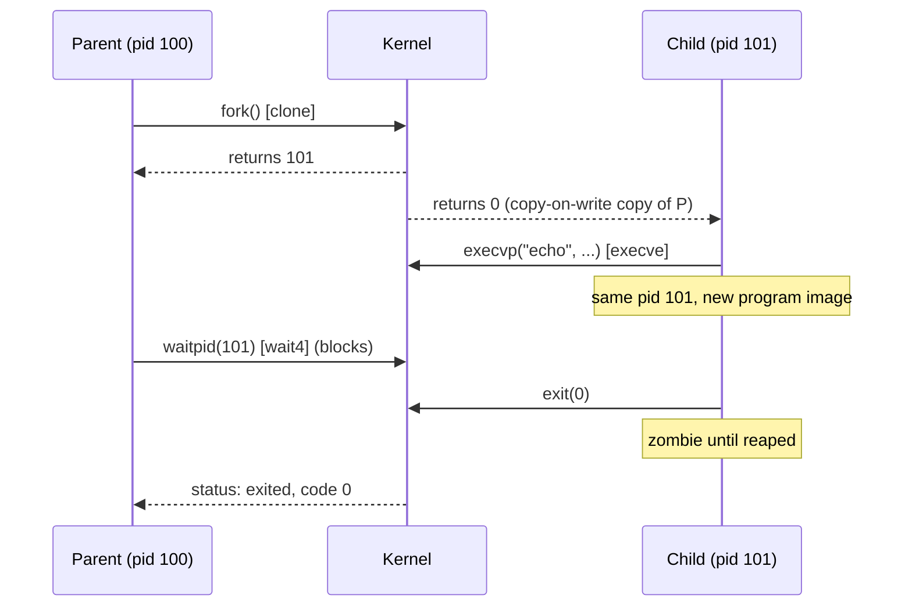

# Lesson P1 — Systems programming I: processes, `fork`/`exec`/`wait`, and signals

> Level: pro. Prerequisites: B6 (address space), I5 (linking), I7 (exit statuses, buffering), A6 (concurrency, async-signal safety). Time: about 3 hours.
> POSIX/Linux APIs, tested on Linux 6.x x86-64 with glibc 2.39 and GCC 13.3 (`-std=c17` plus `_POSIX_C_SOURCE`), November 2026.

---

## 1. Why this lesson exists

Everything so far ran inside one process. Real systems software — shells, web servers, build tools, container runtimes, your *compiler-fuzz* harness that launches GCC, Clang and the compiled test binaries — **creates, supervises and communicates with other processes**, and must react to asynchronous events (Ctrl-C, a child crashing, a timeout). C is the language in which the Unix process API was designed, so here it is in its native form, before Python's `subprocess` or Java's `ProcessBuilder` wrap it.

The pro-level focus is on the sharp edges: what *exactly* is duplicated by `fork`, why output can appear twice, what you may and may not do inside a signal handler, and how exit statuses encode crashes.

---

## 2. Intuition

- **`fork`** photocopies the whole running program — memory, open files, even the half-written page in your notebook (the stdio buffer). Now there are two identical copies continuing from the same line; the only difference is the return value of `fork` (0 in the copy, the copy's ID in the original).
- **`exec`** is "erase my notebook and replace it with a different book": same process (same PID, same open files), entirely new program.
- **`wait`** is the parent collecting the child's report card. Until the parent collects it, the finished child lingers as a **zombie** (an entry holding the exit status).
- **A signal** is a tap on the shoulder that can arrive *between any two instructions*. Whatever you were doing (maybe halfway through `malloc` or `printf`) is paused while the handler runs — which is why the handler may only do things that are safe to do in the middle of *anything*.

---

## 3. Precise definitions

- **Process:** an instance of a running program with its own virtual address space, file-descriptor table, PID, credentials and signal dispositions.
- **`fork()`** (man `fork(2)`): "On success, the PID of the child process is returned in the parent, and 0 is returned in the child"; the child is "an exact duplicate of the parent process" except for listed items (PID, pending signals, locks…); "The child process and the parent process run in separate memory spaces"; "Under Linux, `fork()` is implemented using copy-on-write pages". In a multithreaded process, "the child process is created with a single thread—the one that called `fork()`", and the child should only call async-signal-safe functions until `execve`.
- **`execve(path, argv, envp)`** replaces the process image; on success it does not return. `execvp` searches `PATH` like a shell.
- **`waitpid(pid, &status, options)`** reaps a child; macros `WIFEXITED`/`WEXITSTATUS` (normal exit, low 8 bits of the exit code) and `WIFSIGNALED`/`WTERMSIG` (killed by a signal). Shells report a signal death as 128 + signal number (139 = 128 + 11 = SIGSEGV).
- **Signal disposition:** default action (terminate, core dump, ignore, stop), ignore, or a handler installed with `sigaction` (prefer it over the older `signal`).
- **Async-signal-safe function:** "one that can be safely called from within a signal handler" (man `signal-safety(7)`). The list includes `write`, `_exit`, `read`, `kill`, `sigprocmask`; it does **not** include `printf` or anything in stdio, and `malloc` is not on it.
- **`volatile sig_atomic_t`**: the only object type the C standard guarantees a handler may write (and the program read) safely (N3220 §7.14.1.1, the `signal` function).

---

## 4. Step by step

### Step 1 — `fork` + `exec` + `wait`: a tiny `system()`

```c
// file: forkexec.c
// build: gcc -std=c17 -Wall -Wextra -o forkexec forkexec.c
// run: ./forkexec

#define _POSIX_C_SOURCE 200809L   // expose POSIX declarations under strict -std=c17
#include <stdio.h>
#include <stdlib.h>
#include <unistd.h>       // fork, execvp, getpid
#include <sys/wait.h>     // waitpid and the W* macros

// runs argv[0] with arguments argv in a child process; returns its exit status (or -1)
int run(char *const argv[])
{
    pid_t pid = fork();                        // one process becomes two
    if (pid < 0) {                             // fork failed: still one process
        perror("fork");
        return -1;
    }
    if (pid == 0) {                            // CHILD: fork returned 0
        execvp(argv[0], argv);                 // replace this process image; returns only on error
        perror("execvp");
        _exit(127);                            // conventional "command not found" status
    }
    int status;                                // PARENT: fork returned the child's pid
    if (waitpid(pid, &status, 0) < 0) {        // reap the child (otherwise it becomes a zombie)
        perror("waitpid");
        return -1;
    }
    if (WIFEXITED(status))                     // normal exit: report the exit code
        return WEXITSTATUS(status);
    if (WIFSIGNALED(status))                   // killed by a signal: report 128 + signal like shells do
        return 128 + WTERMSIG(status);
    return -1;
}

int main(void)
{
    char *echo_cmd[] = {"echo", "hello from a child process", NULL};
    char *false_cmd[] = {"false", NULL};
    char *missing[] = {"no-such-program-xyz", NULL};
    char *crash[] = {"sh", "-c", "kill -SEGV $$", NULL};

    printf("parent pid is %s\n", getpid() > 0 ? "positive" : "?");
    fflush(stdout);                             // flush BEFORE fork, or the buffer is duplicated
    printf("echo  -> status %d\n", run(echo_cmd));
    printf("false -> status %d\n", run(false_cmd));
    fflush(stdout);
    printf("missing -> status %d\n", run(missing));
    printf("crash -> status %d\n", run(crash));
    return 0;
}
```

Output:

```text
parent pid is positive
hello from a child process
echo  -> status 0
false -> status 1
execvp: No such file or directory
missing -> status 127
crash -> status 139
```

- `echo` and `false` exited normally with 0 and 1.
- A missing program: `execvp` returned (it only returns on failure), we printed the error and `_exit(127)` — the same status a shell gives for "command not found".
- The `sh` that sent itself `SIGSEGV` died from the signal: `WIFSIGNALED`, signal 11 → 139. When your fuzzing harness sees 139 from a test binary, that is a crash, not an exit code the program chose.

Why `_exit` and not `exit` in the child after a failed `exec`? `exit` runs `atexit` handlers and flushes stdio buffers **copied from the parent** — output the parent will also flush, so it would appear twice. `_exit` leaves immediately.

Watch the system calls with `strace -f` (trimmed):

```text
clone(child_stack=NULL, flags=CLONE_CHILD_CLEARTID|CLONE_CHILD_SETTID|SIGCHLD ...   <- glibc's fork() is the clone syscall
[pid  2059] wait4(2060,  <unfinished ...>                                         <- waitpid() is wait4
[pid  2060] execve(".../bin/echo", ["echo", "hello from a child process"], ...) = -1 ENOENT
[pid  2060] execve(".../bin/echo", ...) = -1 ENOENT                               <- execvp trying each PATH entry
...
```

### Step 2 — the duplicated-output wall

```c
// file: dup.c
// build: gcc -std=c17 -Wall -Wextra -o dup dup.c
// run: ./dup | cat

#define _POSIX_C_SOURCE 200809L
#include <stdio.h>
#include <unistd.h>
#include <sys/wait.h>

int main(void)
{
    printf("written once, before fork\n");   // into the stdio buffer (stdout is a pipe: fully buffered)
    pid_t pid = fork();                       // the child gets a COPY of the unflushed buffer
    if (pid == 0)
        return 0;                             // child exits: flushes its copy
    waitpid(pid, NULL, 0);
    return 0;                                 // parent exits: flushes its copy too
}
```

Output with stdout piped (`./dup | cat`):

```text
written once, before fork
written once, before fork
```

Output in a terminal (captured with `script`):

```text
written once, before fork
```

The line was printed by one `printf` but appeared twice when piped. Explanation: with a pipe, stdout is fully buffered, so the text was still in the user-space buffer at `fork`; the child received a copy of that buffer; both processes flushed their copy at exit. In a terminal, stdout is line-buffered, so the `\n` flushed it *before* the fork. Rule: **`fflush(stdout)` (and any other output streams) immediately before `fork`** — which `forkexec.c` does.

### Step 3 — signals done right: flags, `sigaction`, and async-signal-safety

```c
// file: sig.c
// build: gcc -std=c17 -Wall -Wextra -o sig sig.c
// run: ./sig

#define _POSIX_C_SOURCE 200809L
#include <stdio.h>
#include <string.h>
#include <signal.h>
#include <unistd.h>
#include <sys/wait.h>

// the ONLY kind of variable a handler should write: volatile sig_atomic_t
static volatile sig_atomic_t got_usr1 = 0;
static volatile sig_atomic_t got_term = 0;

// signal handler: keep it tiny, set a flag, use only async-signal-safe calls (write, not printf)
static void on_signal(int signo)
{
    if (signo == SIGUSR1) got_usr1++;
    if (signo == SIGTERM) got_term = 1;
    const char msg[] = "  [handler ran]\n";
    write(STDOUT_FILENO, msg, sizeof msg - 1);
}

int main(void)
{
    struct sigaction sa;
    memset(&sa, 0, sizeof sa);
    sa.sa_handler = on_signal;
    sigemptyset(&sa.sa_mask);                  // block no extra signals while handling
    sa.sa_flags = SA_RESTART;                  // restart interrupted slow system calls
    sigaction(SIGUSR1, &sa, NULL);
    sigaction(SIGTERM, &sa, NULL);

    pid_t parent = getpid();
    pid_t child = fork();
    if (child == 0) {                          // child: send the parent three signals, then exit
        kill(parent, SIGUSR1);
        sleep(1);
        kill(parent, SIGUSR1);
        sleep(1);
        kill(parent, SIGTERM);
        _exit(0);
    }

    // main loop: do "work" until asked to terminate; react to flags outside the handler
    while (!got_term) {
        pause();                               // sleep until a signal arrives
        printf("main loop woke up: usr1 count = %d\n", (int)got_usr1);
        fflush(stdout);
    }
    waitpid(child, NULL, 0);
    printf("clean shutdown after SIGTERM\n");
    return 0;
}
```

Output:

```text
  [handler ran]
main loop woke up: usr1 count = 1
  [handler ran]
main loop woke up: usr1 count = 2
  [handler ran]
main loop woke up: usr1 count = 2
clean shutdown after SIGTERM
```

The design pattern every robust C server uses: the **handler only records** that something happened (a `volatile sig_atomic_t` flag, or a byte written to a pipe — the "self-pipe trick"), and the **main loop acts** on it, where calling `printf`, `malloc` or closing files is safe. Why not `printf` in the handler? If the signal arrives while the main program is inside `printf` holding stdio's internal lock or halfway through updating the buffer, a `printf` in the handler can deadlock or corrupt it (man `signal-safety(7)` uses exactly this example). Linux also offers `signalfd(2)` to receive signals as readable file descriptors in an event loop.

### Step 4 — zombies, orphans and `SIGCHLD` (concepts)

- A child that has exited but not been waited for is a **zombie** (`Z` in `ps`): its memory is gone, but its PID and exit status remain until reaped. A long-running parent that never calls `waitpid` leaks PIDs.
- If the parent dies first, the child is an **orphan** and is re-parented (to `init`/PID 1 or a "subreaper"), which reaps it.
- A server can reap asynchronously: handle `SIGCHLD` by setting a flag, then in the main loop call `waitpid(-1, &st, WNOHANG)` repeatedly until it returns 0.
- In containers, the process running as PID 1 inherits this reaping duty, which is why minimal init processes (e.g. `tini`) exist [named as an example; see its project page].

---

## 5. Diagrams



Copy-on-write after `fork`:

```text
 before write:   parent page table ─┐
                                    ├──► physical page X (read-only, shared)
                 child page table  ─┘
 child writes:   kernel copies X -> X'; child now maps X' (writable); parent keeps X
```

Signal arrival:

```text
 main:  ... printf( ─ ─ ─ ─ ─ ─ ─ ─ ─ ─ ) ...   <- interrupted at an arbitrary instruction
                       ▼ signal
 handler:           got_usr1++; write(1, ...); return     (only async-signal-safe calls)
                       ▲
 main resumes exactly where it was
```

---

## 6. Common mistakes

| Mistake | Consequence | Fix |
|---|---|---|
| Not flushing stdio before `fork` | Duplicated output when buffered | `fflush(NULL)` before `fork` |
| `exit()` in a child after failed `exec` | Duplicated buffered output, parent's `atexit` handlers run twice | `_exit()` |
| Never calling `waitpid` | Zombie accumulation | Reap children (blocking, or `WNOHANG` loop on `SIGCHLD`) |
| Interpreting `status` directly | Wrong exit codes | `WIFEXITED`/`WEXITSTATUS`/`WIFSIGNALED`/`WTERMSIG` |
| `printf`/`malloc`/locks in signal handlers | Deadlock, heap corruption | Set a `volatile sig_atomic_t` flag; act in the main loop |
| Using `signal()` instead of `sigaction()` | Portability differences (handler reset, restart semantics) | `sigaction` with explicit flags |
| Forgetting `EINTR` | Slow syscalls fail when a signal arrives | `SA_RESTART`, or retry on `EINTR` |
| `fork` in a multithreaded program, then calling non-async-signal-safe functions | Deadlock on locks held by vanished threads | Call `exec` immediately, or use `posix_spawn` |
| Building command lines with `system()` from untrusted input | Shell injection | `execvp` with an argv array |

---

## 7. Connections

- **OS track:** process states, scheduling, copy-on-write, `clone` flags (threads are `clone` with shared memory), process groups and job control, PID namespaces.
- **Linux track:** shells are fork/exec/wait loops; `$?` is `WEXITSTATUS`; `kill -l` lists signals; `strace -f` shows all of the above.
- **Python track:** `subprocess.run` performs fork+exec (or `posix_spawn`) and exposes `returncode` (negative for signals in Python); `signal.signal` handlers in Python run in the main thread *between* bytecodes, sidestepping async-signal-safety for Python code.
- **Cloud/DevOps track:** containers send `SIGTERM` then `SIGKILL` on shutdown; graceful shutdown is exactly Step 3's flag-and-drain pattern; PID 1 must reap zombies.
- **Security track:** command injection via `system()`; privilege separation via fork + drop privileges.

### Where this shows up in my projects

- **compiler-fuzz:** the harness launches the compilers and then the compiled test programs as child processes, with timeouts. Classifying each result correctly is Step 1: an exit status vs. death by signal (139 = segfault, 134 = abort from a failed assertion or sanitizer), plus a timeout (the harness sends a signal and records "hang"). A GCC-vs-Clang "mismatch" where one binary was *killed by a timeout* is a different finding from one where both exited and printed different checksums.
- **Nidhogg:** a long-running ops service has to shut down gracefully on `SIGTERM` (stop accepting work, finish in-flight requests, exit) — in Python/uvicorn this is handled by the server framework, but underneath it is the same handler-sets-flag, main-loop-drains pattern. (General behaviour of such servers, stated as an analogy.)

---

## 8. Self-check questions

1. What does `fork` return in the parent and in the child, and what if it fails?
2. Why did "written once" print twice through a pipe but once in a terminal?
3. Why use `_exit(127)` after a failed `execvp`?
4. How do you tell "exited with code 139" apart from "killed by SIGSEGV"?
5. Why is `printf` forbidden in a signal handler, and what is the standard pattern instead?
6. What is a zombie, and how do you prevent zombies in a server that spawns many children?

<details>
<summary>Answers</summary>

1. Parent: the child's PID (> 0). Child: 0. On failure: −1 in the parent, no child created, `errno` set.
2. When piped, stdout is fully buffered; the unflushed buffer was copied into the child by `fork` and both processes flushed it. In a terminal, stdout is line-buffered, so the newline flushed it before `fork`.
3. To exit immediately without flushing stdio buffers inherited from the parent or running its `atexit` handlers (which would duplicate output/effects); 127 is the conventional "command not found" status.
4. Use the macros: `WIFEXITED(status) && WEXITSTATUS(status) == 139` vs `WIFSIGNALED(status) && WTERMSIG(status) == SIGSEGV`. Only the shell's `$?` conflates them as 128+n.
5. It is not async-signal-safe: if the signal interrupts the main program inside stdio, re-entering stdio can deadlock or corrupt its state. Pattern: the handler sets a `volatile sig_atomic_t` flag (or writes to a self-pipe) and the main loop does the real work.
6. A terminated child whose exit status has not been collected by `wait`/`waitpid`. Reap children: a `SIGCHLD` flag plus a `waitpid(-1, &st, WNOHANG)` loop in the main loop (or set `SIGCHLD` to `SIG_IGN` where automatic reaping is acceptable).

</details>

---

## 9. Mnemonic (Tamil + English)

**The process lifecycle — Fork, Exec, Wait, Exit ("F-E-W-E"):**

> **"Few-e Family"** — *Fork* (twins are born), *Exec* (one twin changes career), *Wait* (parent waits for the report card), *Exit* (child leaves home). **"Report card vaangalana, pillai zombie aagidum!"** — if the parent doesn't collect the report card, the child becomes a zombie.

**Signal handler rule:**

> **"Handler-la flag mattum podu, vela ellaam main-la."** — In the handler, only raise the flag; do all the real work in `main`.

---

## Sources

- Linux man page `fork(2)` (return values, separate memory, copy-on-write, multithreaded fork): https://man7.org/linux/man-pages/man2/fork.2.html
- Linux man pages `execve(2)` and `exec(3)` (`execvp` PATH search): https://man7.org/linux/man-pages/man2/execve.2.html and https://man7.org/linux/man-pages/man3/exec.3.html
- Linux man page `wait(2)` (`waitpid`, `WIFEXITED`, `WTERMSIG`, zombies): https://man7.org/linux/man-pages/man2/wait.2.html
- Linux man page `signal-safety(7)` (definition, safe-function list, `printf` example): https://man7.org/linux/man-pages/man7/signal-safety.7.html
- Linux man page `sigaction(2)`: https://man7.org/linux/man-pages/man2/sigaction.2.html
- Linux man page `signal(7)` (signal numbers and default actions): https://man7.org/linux/man-pages/man7/signal.7.html
- WG14 N3220 §7.14 signal handling `<signal.h>` (`volatile sig_atomic_t`): https://open-std.org/JTC1/SC22/WG14/www/docs/n3220.pdf
- Michael Kerrisk, *The Linux Programming Interface* (No Starch Press, 2010), chs. 20–28 (signals, process creation, `exec`, monitoring children) — book page: https://man7.org/tlpi/
- Bryant & O'Hallaron, *CS:APP*, ch. 8 "Exceptional Control Flow" (processes, signals, the shell lab) — book site: https://csapp.cs.cmu.edu/
- tini (minimal init for containers): https://github.com/krallin/tini

## Verify yourself

1. Build and run all three programs; run `forkexec` under `strace -f -e trace=clone,execve,wait4` and match each line to the code.
2. Remove `fflush(stdout)` before the first `run` and pipe the output through `cat`: count the duplicated lines.
3. Create a zombie on purpose (a parent that sleeps 30 s without `waitpid`) and observe it with `ps -o pid,stat,cmd`.
4. Replace `write` in `on_signal` with `printf` and think through (do not rely on testing) why it can deadlock; then read the example in `signal-safety(7)`.
5. Check the `volatile sig_atomic_t` rule in N3220 §7.14.1.1.
