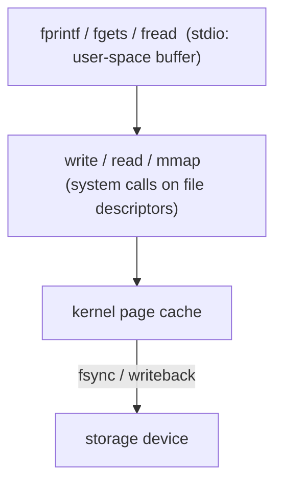

# Lesson P2 — Systems programming II: file descriptors, robust I/O, pipes, `mmap` and shared memory

> Level: pro. Prerequisites: B7 (stdio), P1 (fork/exec), A6 (atomics), A3 (`mmap` in allocators). Time: about 3 hours.
> POSIX/Linux, glibc 2.39, GCC 13.3, x86-64, November 2026. Timings are from a 2-core VM and are illustrative only.

---

## 1. Why this lesson exists

`FILE *` and `fprintf` (lesson B7) are a convenient library layer. Underneath, every open file, pipe, socket, terminal and device is a **file descriptor** — a small integer handled by the kernel through a few system calls (`open`, `read`, `write`, `close`, `lseek`, `dup2`, `pipe`, `mmap`). Pro-level C code works at this layer when it needs control: servers, databases, shells, build tools, loggers.

The sharp edges are where reliability lives: **short reads and writes**, `EINTR`, error handling with clean resource release, file descriptors leaking into children, and knowing when `mmap` helps (and when it doesn't — we'll measure).

---

## 2. Intuition

- **A file descriptor is a token at a cloakroom.** The kernel keeps your coat (the open file, its offset, its flags); you hold token number 3. `dup2(3, 1)` means "make token 1 refer to the same coat as token 3" — the trick behind shell redirection.
- **`read`/`write` are a bucket brigade, not a pipe in one go.** You ask to move 64 KiB; the kernel may move less (a "short" transfer) and tell you how much. Robust code keeps passing buckets until done.
- **A pipe is a one-way tube with a small tank** inside the kernel: one process pours in, another drinks out; the drinker gets "end of file" only when *every* pouring end is closed.
- **`mmap` makes a file look like an array in memory**: the kernel pages it in lazily when you touch it.

---

## 3. Precise definitions

- **File descriptor:** a non-negative integer indexing the process's descriptor table; 0, 1, 2 are stdin, stdout, stderr. Descriptors are inherited across `fork` and kept across `exec` unless `O_CLOEXEC`/`FD_CLOEXEC` is set.
- **`ssize_t read(int fd, void *buf, size_t n)`** returns the number of bytes read (0 at end of file), or −1 with `errno` set. **`write`** returns the number of bytes written, which may be fewer than requested; −1 on error (man `read(2)`, `write(2)`).
- **`EINTR`:** a blocking call interrupted by a signal handler before transferring data fails with `errno == EINTR` unless the handler was installed with `SA_RESTART` (lesson P1).
- **`errno`:** a thread-local integer set by failing calls; meaningful only immediately after a call reports failure. `strerror(errno)` / `perror` turn it into text.
- **`pipe(int fds[2])`:** `fds[0]` is the read end, `fds[1]` the write end; a read returns 0 (EOF) when all write ends are closed; writing when all read ends are closed raises `SIGPIPE`.
- **`dup2(old, new)`:** makes `new` refer to the same open file description as `old` (closing `new` first).
- **`mmap(addr, len, prot, flags, fd, offset)`** (man `mmap(2)`): `MAP_PRIVATE` — "a private copy-on-write mapping"; `MAP_SHARED` — "Updates to the mapping are visible to other processes mapping the same region"; `MAP_ANONYMOUS` — not backed by a file, zero-filled; on error returns `MAP_FAILED`; `offset` must be a multiple of the page size.
- **Feature-test macros:** with strict `-std=c17`, glibc hides POSIX/BSD declarations; define `_POSIX_C_SOURCE 200809L` (or `_DEFAULT_SOURCE` for extras like `MAP_ANONYMOUS`) before any `#include` (man `feature_test_macros(7)`).

---

## 4. Step by step

### Step 1 — a robust file copy: short writes, `EINTR`, and the `goto cleanup` pattern

The dumbest copy is `read(in, buf, n); write(out, buf, n);` once. Walls: files bigger than the buffer, `write` returning less than `n` (pipes, sockets, full disks, signals), errors halfway through leaking descriptors. The version below climbs all three.

```c
// file: copy.c
// build: gcc -std=c17 -Wall -Wextra -o copy copy.c
// run: head -c 300000 /dev/urandom > in.bin && ./copy in.bin out.bin && cmp in.bin out.bin && echo "identical"; ./copy missing.bin x.bin; echo "exit=$?"

#define _POSIX_C_SOURCE 200809L
#include <stdio.h>
#include <string.h>
#include <errno.h>
#include <fcntl.h>      // open, O_* flags
#include <unistd.h>     // read, write, close

// writes ALL n bytes, looping over partial writes and EINTR; returns 0 or -1
static int write_all(int fd, const char *buf, size_t n)
{
    while (n > 0) {
        ssize_t w = write(fd, buf, n);
        if (w < 0) {
            if (errno == EINTR) continue;      // interrupted by a signal before writing: retry
            return -1;
        }
        buf += w;                              // a short write is legal: advance and continue
        n -= (size_t)w;
    }
    return 0;
}

// copies src to dst; single exit path releases whatever was acquired
int copy_file(const char *src, const char *dst)
{
    int res = -1;                              // pessimistic default
    int in = -1, out = -1;
    char buf[65536];

    in = open(src, O_RDONLY);
    if (in < 0) { fprintf(stderr, "open %s: %s\n", src, strerror(errno)); goto cleanup; }

    out = open(dst, O_WRONLY | O_CREAT | O_TRUNC, 0644);   // rw-r--r--
    if (out < 0) { fprintf(stderr, "open %s: %s\n", dst, strerror(errno)); goto cleanup; }

    for (;;) {
        ssize_t r = read(in, buf, sizeof buf);
        if (r == 0) break;                     // end of file
        if (r < 0) {
            if (errno == EINTR) continue;
            perror("read");
            goto cleanup;
        }
        if (write_all(out, buf, (size_t)r) != 0) { perror("write"); goto cleanup; }
    }
    if (fsync(out) != 0) { perror("fsync"); goto cleanup; }   // ask the kernel to persist the data
    res = 0;                                   // success only if we got here

cleanup:                                       // one place to release resources, in reverse order
    if (out >= 0 && close(out) != 0 && res == 0) { perror("close"); res = -1; }
    if (in >= 0) close(in);
    return res;
}

int main(int argc, char *argv[])
{
    if (argc != 3) { fprintf(stderr, "usage: %s SRC DST\n", argv[0]); return 2; }
    return copy_file(argv[1], argv[2]) == 0 ? 0 : 1;
}
```

Output:

```text
identical
open missing.bin: No such file or directory
exit=1
```

The **single cleanup label** is the idiomatic C answer to "release everything I acquired, on every error path": initialise every resource handle to an "unacquired" value (`-1`, `NULL`), jump to `cleanup` on any failure, and release in reverse order there. Linux kernel code uses the same pattern pervasively. Two more pro details: `close` on the output file can report a delayed write error (so we check it), and `fsync` asks the kernel to flush the data to the storage device — without it, "the copy succeeded" only means "the kernel has it in its page cache".

### Step 2 — a two-process pipeline with `pipe` + `fork` + `dup2` + `exec`

```c
// file: pipeline.c
// build: gcc -std=c17 -Wall -Wextra -o pipeline pipeline.c
// run: ./pipeline

#define _POSIX_C_SOURCE 200809L
#include <stdio.h>
#include <stdlib.h>
#include <unistd.h>
#include <sys/wait.h>

// runs the equivalent of:  printf 'b\na\nc\n' | sort
int main(void)
{
    int fds[2];                                // fds[0] = read end, fds[1] = write end
    if (pipe(fds) != 0) { perror("pipe"); return 1; }

    pid_t left = fork();
    if (left == 0) {                           // child 1: the writer
        dup2(fds[1], STDOUT_FILENO);           // its stdout now goes INTO the pipe
        close(fds[0]);                         // close every end we don't use
        close(fds[1]);
        execlp("printf", "printf", "b\\na\\nc\\n", (char *)NULL);
        _exit(127);
    }

    pid_t right = fork();
    if (right == 0) {                          // child 2: the reader
        dup2(fds[0], STDIN_FILENO);            // its stdin now comes FROM the pipe
        close(fds[0]);
        close(fds[1]);                         // crucial: otherwise sort never sees end-of-file
        execlp("sort", "sort", (char *)NULL);
        _exit(127);
    }

    close(fds[0]);                             // the parent uses neither end
    close(fds[1]);
    int st1, st2;
    waitpid(left, &st1, 0);
    waitpid(right, &st2, 0);
    fprintf(stderr, "statuses: %d %d\n", WEXITSTATUS(st1), WEXITSTATUS(st2));
    return 0;
}
```

Output:

```text
a
b
c
statuses: 0 0
```

This is literally what a shell does for `printf 'b\na\nc\n' | sort`. The wall that bites everyone once: if the reader child (or the parent) **forgets to close the write end**, `sort` waits forever for end-of-file, because a write end is still open somewhere — in its own process. Every process must close every pipe end it does not use.

### Step 3 — `mmap` vs `read`: measure, don't assume

```c
// file: mmapcount.c
// build: gcc -std=c17 -O2 -Wall -Wextra -o mmapcount mmapcount.c
// run: seq 1 2000000 > nums.txt && ./mmapcount nums.txt

#define _POSIX_C_SOURCE 200809L
#include <stdio.h>
#include <string.h>
#include <fcntl.h>
#include <unistd.h>
#include <sys/mman.h>
#include <sys/stat.h>
#include <time.h>

static double now_ms(void)
{
    struct timespec t;
    clock_gettime(CLOCK_MONOTONIC, &t);
    return t.tv_sec * 1e3 + t.tv_nsec / 1e6;
}

// way 1: read() into a buffer, count '\n'
static long count_read(int fd)
{
    char buf[1 << 16];
    long res = 0;
    ssize_t r;
    lseek(fd, 0, SEEK_SET);
    while ((r = read(fd, buf, sizeof buf)) > 0)
        for (ssize_t i = 0; i < r; i++)
            res += buf[i] == '\n';
    return res;
}

// way 2: map the file into memory and scan it like an array
static long count_mmap(int fd, size_t size)
{
    const char *p = mmap(NULL, size, PROT_READ, MAP_PRIVATE, fd, 0);
    if (p == MAP_FAILED) { perror("mmap"); return -1; }
    long res = 0;
    for (size_t i = 0; i < size; i++)
        res += p[i] == '\n';
    munmap((void *)p, size);
    return res;
}

int main(int argc, char *argv[])
{
    if (argc != 2) return 2;
    int fd = open(argv[1], O_RDONLY);
    if (fd < 0) { perror(argv[1]); return 1; }
    struct stat st;
    if (fstat(fd, &st) != 0 || st.st_size == 0) { close(fd); return 1; }   // mmap of size 0 fails

    double t0 = now_ms();
    long a = count_read(fd);
    double t1 = now_ms();
    long b = count_mmap(fd, (size_t)st.st_size);
    double t2 = now_ms();
    printf("size %lld bytes: read() -> %ld lines (%.1f ms), mmap -> %ld lines (%.1f ms)\n",
           (long long)st.st_size, a, t1 - t0, b, t2 - t1);
    close(fd);
    return 0;
}
```

Output (two runs on the test VM):

```text
size 14888896 bytes: read() -> 2000000 lines (12.6 ms), mmap -> 2000000 lines (14.6 ms)
size 14888896 bytes: read() -> 2000000 lines (16.2 ms), mmap -> 2000000 lines (10.9 ms)
```

Neither wins consistently for a sequential scan of a cached ~15 MB file: `read` pays for copying into the buffer; `mmap` pays for setting up the mapping and page faults. `mmap` shines for **random access** to large files, for **sharing** pages between processes, and for avoiding a copy when data is used in place (the LMDB key-value store, for example, is designed around a memory-mapped file [unverified here — see LMDB's own documentation]). It also has costs: page-fault latency, `SIGBUS` if the file is truncated while mapped, and awkward error handling (an I/O error becomes a signal, not a return value).

### Step 4 — sharing memory between processes

```c
// file: shm.c
// build: gcc -std=c17 -O2 -Wall -Wextra -o shm shm.c
// run: ./shm

#define _DEFAULT_SOURCE           // MAP_ANONYMOUS under strict -std=c17
#include <stdio.h>
#include <stdatomic.h>
#include <unistd.h>
#include <sys/mman.h>
#include <sys/wait.h>

#define WORKERS 4
#define ITERS 100000

int main(void)
{
    // MAP_SHARED | MAP_ANONYMOUS: memory that stays SHARED across fork (not copy-on-write)
    atomic_long *shared = mmap(NULL, sizeof *shared, PROT_READ | PROT_WRITE,
                               MAP_SHARED | MAP_ANONYMOUS, -1, 0);
    long *private_copy = mmap(NULL, sizeof *private_copy, PROT_READ | PROT_WRITE,
                              MAP_PRIVATE | MAP_ANONYMOUS, -1, 0);
    if (shared == MAP_FAILED || private_copy == MAP_FAILED) { perror("mmap"); return 1; }
    atomic_init(shared, 0);
    *private_copy = 0;

    for (int w = 0; w < WORKERS; w++) {
        if (fork() == 0) {                     // each child increments both counters
            for (int i = 0; i < ITERS; i++) {
                atomic_fetch_add(shared, 1);   // atomics work across processes on shared memory
                (*private_copy)++;             // only changes the child's private copy
            }
            _exit(0);
        }
    }
    for (int w = 0; w < WORKERS; w++)
        wait(NULL);
    printf("shared counter = %ld (expected %d), private counter in parent = %ld\n",
           atomic_load(shared), WORKERS * ITERS, *private_copy);
    return 0;
}
```

Output:

```text
shared counter = 400000 (expected 400000), private counter in parent = 0
```

`MAP_SHARED` memory created *before* `fork` stays shared between parent and children, so four processes incremented one counter (atomics work across processes as long as the type is lock-free; C11's `atomic_is_lock_free` lets you check). The `MAP_PRIVATE` page was copied-on-write in each child, so the parent's copy stayed 0 — lesson P1's copy-on-write diagram, demonstrated. For unrelated processes, named shared memory (`shm_open` + `mmap`) or a mapped file plays the same role.

---

## 5. Diagrams

Descriptor tables after `dup2` in the pipeline:

```text
 writer child                         kernel                          reader child
 fd 0 -> terminal                                                     fd 0 -> pipe READ end
 fd 1 -> pipe WRITE end  ──bytes──►  [ pipe buffer ]  ──bytes──►      fd 1 -> terminal
 fd 2 -> terminal                                                     fd 2 -> terminal
 (fds[0], fds[1] closed)                                              (fds[0], fds[1] closed)
 EOF for the reader happens only when EVERY write-end descriptor in EVERY process is closed
```

Layers of I/O:



---

## 6. Common mistakes

| Mistake | Consequence | Fix |
|---|---|---|
| Assuming `write(fd, buf, n)` writes `n` bytes | Silent truncation on pipes/sockets/full disks | Loop until done (`write_all`) |
| Ignoring `EINTR` | Spurious failures when signals arrive | Retry, or `SA_RESTART` |
| Not checking `close` on written files | Missed delayed write errors | Check `close`'s return value |
| Treating a successful `write` as durable | Data lost on power failure | `fsync` (and `fsync` the directory for new files) |
| Leaking descriptors into children | Pipes never reach EOF; security leaks | Close unused ends; `O_CLOEXEC` / `pipe2(..., O_CLOEXEC)` |
| Mixing `FILE *` and raw `read`/`write` on the same descriptor | Buffered data appears out of order | Use one layer per descriptor, or `fflush` |
| `mmap` of a zero-length file | `EINVAL` | Check the size first |
| Using `errno` without a failure indication | Stale values | Read `errno` only right after a call reports failure |
| Forgetting feature-test macros with `-std=c17` | "implicit declaration of `fsync`/`MAP_ANONYMOUS` undeclared" | `#define _POSIX_C_SOURCE 200809L` / `_DEFAULT_SOURCE` first |

---

## 7. Connections

- **OS track:** file descriptor tables, open file descriptions, the page cache, demand paging for `mmap`, copy-on-write, and why `fsync` exists.
- **Networks track:** sockets are file descriptors; short reads/writes and `EINTR` are *normal* there; `epoll`/`select` multiplex many descriptors.
- **DBMS track:** write-ahead logs depend on `fsync` ordering; buffer managers compete with (or use) `mmap`; the debate over `mmap` in databases is a known research topic (Crotty, Leis, Pavlo, *Are You Sure You Want to Use MMAP in Your Database Management System?*, CIDR 2022).
- **Linux track:** `|`, `>`, `2>&1` in the shell are `pipe` and `dup2`; `lsof -p PID` lists a process's descriptors.
- **Python track:** `os.read/os.write/os.pipe/os.dup2` and `mmap.mmap` are thin wrappers over exactly these calls.

### Where this shows up in my projects

- **compiler-fuzz:** capturing a compiled test program's stdout to compare GCC and Clang outputs means redirecting the child's descriptor 1 into a pipe or file (Step 2), reading *all* of it (short reads), and making sure no extra copy of the write end stays open — otherwise the harness waits forever and reports a false "timeout".
- **Nidhogg / Logly:** log shipping and tailing ultimately read files through descriptors with short reads and rotation handling; an `mmap`-vs-`read` choice for scanning large log files is exactly the measurement in Step 3 (the project itself queries logs through Elasticsearch; stated as an analogy for the underlying I/O).

---

## 8. Self-check questions

1. Why can `write` return fewer bytes than requested, and how do you handle it?
2. What does `goto cleanup` buy you over returning early from each error check?
3. In the pipeline, what happens if the reader child does not close `fds[1]`?
4. What does `dup2(fds[1], STDOUT_FILENO)` do?
5. When is `mmap` a better choice than `read`, and what new failure mode does it introduce?
6. Why did the parent's `MAP_PRIVATE` counter stay 0 while the `MAP_SHARED` one reached 400000?

<details>
<summary>Answers</summary>

1. The descriptor may accept only part of the data (pipe/socket buffer space, disk space, a signal arriving after some bytes were written). Loop, advancing the buffer pointer by the amount written, until all bytes are written or a real error occurs.
2. One place that releases every acquired resource in reverse order, so no error path leaks descriptors/memory, and the success path shares the same release code.
3. `sort` never sees end-of-file, because a write end of the pipe is still open (in its own process), so it blocks forever.
4. Makes descriptor 1 (stdout) refer to the pipe's write end, so anything the program writes to stdout goes into the pipe.
5. For random access to large files, sharing pages between processes, or using data in place without copying. New failure modes: I/O errors and file truncation surface as signals (`SIGBUS`), plus page-fault latency at first touch.
6. After `fork`, private mappings are copy-on-write: each child incremented its own copy. Shared mappings refer to the same physical pages in all processes, so all increments landed in one counter.

</details>

---

## 9. Mnemonic (Tamil + English)

**Robust I/O checklist — Short, Signal, Status, Sync ("4 S"):**

> **"Naalu S — Short write, Signal (EINTR), Status of close, Sync (fsync)."** — **"Naalu S illaama file ezhudhaadhe"** — don't write a file without the four S's.

**Pipes:**

> **"Ezhudhura vaai ellaam moodina thaan, padikkiravanukku EOF."** — Only when every writing mouth is shut does the reader get EOF.

---

## Sources

- Linux man pages `open(2)`, `read(2)`, `write(2)`, `close(2)`, `fsync(2)`: https://man7.org/linux/man-pages/man2/open.2.html, https://man7.org/linux/man-pages/man2/read.2.html, https://man7.org/linux/man-pages/man2/write.2.html, https://man7.org/linux/man-pages/man2/close.2.html, https://man7.org/linux/man-pages/man2/fsync.2.html
- Linux man pages `pipe(2)`, `dup(2)`, `pipe(7)`: https://man7.org/linux/man-pages/man2/pipe.2.html, https://man7.org/linux/man-pages/man2/dup.2.html, https://man7.org/linux/man-pages/man7/pipe.7.html
- Linux man page `mmap(2)` (`MAP_PRIVATE`, `MAP_SHARED`, `MAP_ANONYMOUS`, `MAP_FAILED`, page-aligned offset): https://man7.org/linux/man-pages/man2/mmap.2.html
- Linux man page `errno(3)`: https://man7.org/linux/man-pages/man3/errno.3.html
- Linux man page `feature_test_macros(7)`: https://man7.org/linux/man-pages/man7/feature_test_macros.7.html
- Michael Kerrisk, *The Linux Programming Interface*, chs. 4–5 (file I/O), 44 (pipes), 49 (memory mappings) — book page: https://man7.org/tlpi/
- W. Richard Stevens, Stephen A. Rago, *Advanced Programming in the UNIX Environment*, 3rd ed. (Addison-Wesley, 2013) — publisher page: https://www.pearson.com/en-us/subject-catalog/p/advanced-programming-in-the-unix-environment/P200000000628
- A. Crotty, V. Leis, A. Pavlo, *Are You Sure You Want to Use MMAP in Your Database Management System?*, CIDR 2022: https://vldb.org/cidrdb/2022/are-you-sure-you-want-to-use-mmap-in-your-database-management-system.html
- MIT OCW 6.087 lecture 14 "Linux inter process communication": https://ocw.mit.edu/courses/6-087-practical-programming-in-c-january-iap-2010/pages/calendar/

## Verify yourself

1. Run all four programs; run `copy` under `strace -e trace=openat,read,write,close,fsync` and count the system calls.
2. In `pipeline.c`, delete `close(fds[1]);` in the reader child and observe the hang (use `timeout 3 ./pipeline`).
3. Re-run `mmapcount` on a file larger than RAM is not practical here — instead try a file you just created (`echo 3 | sudo tee /proc/sys/vm/drop_caches` if you are allowed) and compare cold-cache timings.
4. Change `MAP_SHARED` to `MAP_PRIVATE` for the counter in `shm.c` and predict the output.
5. Read the `write(2)` man page's description of partial writes and the `pipe(7)` page's description of EOF and `SIGPIPE`.
