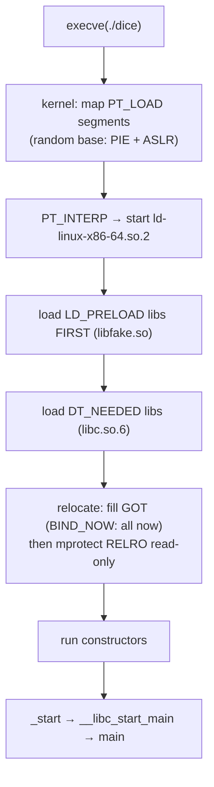

# Lesson P3 — Linkers and loaders in depth: ELF, PIE, GOT/PLT, symbol interposition and plugins

> Level: pro. Prerequisites: I5 (compilation and linking basics), A2 (calling convention), B6 (address space). Time: about 3 hours.
> Linux x86-64, GCC 13.3 (Ubuntu 24.04 build, which enables PIE and immediate binding by default), GNU binutils, glibc 2.39 dynamic loader, November 2026.

---

## 1. Why this lesson exists

Lesson I5 showed the linker resolving symbols. At the pro level you need to know what happens *after* linking, when the kernel and the dynamic loader turn an ELF file into a running process, because:

- **Security hardening** (PIE + ASLR, RELRO, immediate binding, non-executable stack) is implemented in ELF headers and the loader.
- **Interposition** (`LD_PRELOAD`) lets you replace any shared-library function in a program you cannot recompile — used by memory profilers, sanitizer runtimes, fake-time testing tools and, unfortunately, malware.
- **Plugins** (`dlopen`/`dlsym`) are how databases, editors and language runtimes load extensions — including every Python C extension.
- **Symbol visibility** decides your shared library's ABI and its load time.

---

## 2. Intuition

- An **ELF file** is a shipping container with two manifests: a **section** list for the linker ("here are `.text`, `.data`, `.rodata`, symbol tables…") and a **segment** (program header) list for the loader ("map these bytes read+execute here, those read+write there, and ask `/lib64/ld-linux-x86-64.so.2` to finish the job").
- The **dynamic loader** is the stage crew that arrives before the play (`main`) starts: it maps the shared libraries, fills in a table of addresses (the **GOT**), runs constructors, then hands control to `_start` → `main`.
- **GOT/PLT** is a phone directory: your code doesn't hard-code libc's address (it changes every run due to ASLR); it calls a tiny stub (PLT) that jumps through a directory entry (GOT) the loader filled in.
- **Interposition** works because the loader searches libraries in order and the **first** definition of a name wins — `LD_PRELOAD` puts your library at the front of the queue.

---

## 3. Precise definitions

- **ELF types:** relocatable (`.o`), executable (`EXEC`), shared object (`DYN`). A **PIE** (position-independent executable) is reported as type `DYN` and can be loaded at a random base — ASLR for the main program.
- **Program headers (segments):** `PT_INTERP` names the dynamic loader; `PT_LOAD` segments are mapped by the kernel; `PT_GNU_STACK` declares whether the stack is executable; `PT_GNU_RELRO` marks a region the loader makes read-only after relocation.
- **Dynamic section:** `DT_NEEDED` (required libraries), `DT_RUNPATH`/`DT_RPATH`, `DT_FLAGS` such as `BIND_NOW` (resolve all symbols at load time instead of lazily on first call) — man `ld.so(8)`.
- **GOT (Global Offset Table) / PLT (Procedure Linkage Table):** position-independent code reaches external data and functions indirectly through GOT entries; calls to external functions go through PLT stubs that `jmp *GOT[n]` (GCC `-fpic`/`-fPIC` documentation: "constant addresses ... are accessed through a global offset table").
- **Symbol interposition and search order:** the loader resolves each symbol by searching the loaded objects in load order; `LD_PRELOAD` objects are loaded before all others and "can be used to selectively override functions in other shared object[s]" (man `ld.so(8)`). `dlsym(RTLD_NEXT, name)` finds the *next* definition after the current object.
- **`dlopen`/`dlsym`/`dlclose`** load a shared object at run time and look up symbols by name; POSIX requires that `dlsym`'s `void *` result can be converted to a function pointer even though ISO C does not guarantee that conversion (POSIX `dlsym` page).
- **Visibility:** `-fvisibility=hidden` makes symbols local to the shared object by default; `__attribute__((visibility("default")))` exports chosen ones. Hidden symbols cannot be interposed and need no dynamic symbol-table entry.

---

## 4. Step by step

### Step 1 — dissect a hello-world ELF

```bash
gcc -std=c17 -O2 -o hello hello.c        # hello.c: int main(void){ puts("hi"); return 0; }
readelf -h hello | grep -E "Type|Entry"
readelf -l hello | grep -E "INTERP|LOAD|GNU_RELRO|GNU_STACK|interpreter"
readelf -d hello | grep -E "NEEDED|FLAGS"
objdump -d hello | grep -A3 "<puts@plt>:"
```

Output on the test machine (trimmed):

```text
  Type:                              DYN (Position-Independent Executable file)
  Entry point address:               0x1080
  INTERP         0x0000000000000318 0x0000000000000318 0x0000000000000318
      [Requesting program interpreter: /lib64/ld-linux-x86-64.so.2]
  LOAD           0x0000000000000000 0x0000000000000000 0x0000000000000000
  LOAD           0x0000000000001000 0x0000000000001000 0x0000000000001000
  LOAD           0x0000000000002000 0x0000000000002000 0x0000000000002000
  LOAD           0x0000000000002db8 0x0000000000003db8 0x0000000000003db8
  GNU_STACK      0x0000000000000000 0x0000000000000000 0x0000000000000000
  GNU_RELRO      0x0000000000002db8 0x0000000000003db8 0x0000000000003db8
 0x0000000000000001 (NEEDED)             Shared library: [libc.so.6]
 0x000000000000001e (FLAGS)              BIND_NOW
 0x000000006ffffffb (FLAGS_1)            Flags: NOW PIE
0000000000001050 <puts@plt>:
    1050:	f3 0f 1e fa          	endbr64
    1054:	ff 25 76 2f 00 00    	jmp    *0x2f76(%rip)        # 3fd0 <puts@GLIBC_2.2.5>
```

What this tells you:

- **PIE by default** (`gcc -v` shows `--enable-default-pie` on Ubuntu): addresses in the file start near 0 and are relocated to a random base at run time — that's why lesson B6's code addresses started with `0x55…` and changed every run.
- **Four `LOAD` segments**: read-only headers/rodata, read+execute code, read-only data, read+write data — the permission split you saw in `/proc/self/maps`.
- **`BIND_NOW` + `GNU_RELRO`** ("full RELRO"): all symbols are resolved at load time and the GOT is then made read-only, so an attacker with a memory-write bug can't overwrite GOT entries to hijack calls.
- **`puts@plt`** is a stub: `jmp *0x2f76(%rip)` jumps through the GOT slot at `0x3fd0`, which the loader filled with libc's `puts` address.

### Step 2 — interposition with `LD_PRELOAD`

The dumbest way to change how a closed-source program behaves is to patch its binary. The loader gives a cleaner hook: define the same symbol in a library loaded first.

```c
// file: fake_rand.c
// build: gcc -std=c17 -O2 -shared -fPIC -o libfake.so fake_rand.c -ldl
// (built before dice.c's run line executes; see the order of blocks)

#define _GNU_SOURCE           // for RTLD_NEXT
#include <dlfcn.h>
#include <stdio.h>
#include <stddef.h>
// our rand() is found BEFORE libc's: every program using rand() now gets 3
int rand(void) { return 3; }
// count calls, then forward to the "next" malloc in search order (libc's)
static size_t n_malloc = 0;
void *malloc(size_t size)
{
    static void *(*real_malloc)(size_t) = NULL;
    if (!real_malloc) real_malloc = (void *(*)(size_t))dlsym(RTLD_NEXT, "malloc");
    n_malloc++;
    return real_malloc(size);
}
// runs when the library is unloaded at exit (a GCC/Clang extension)
__attribute__((destructor)) static void report(void)
{
    fprintf(stderr, "[preload] malloc called %zu times\n", n_malloc);
}
```

```c
// file: dice.c
// build: gcc -std=c17 -O2 -o dice dice.c && gcc -std=c17 -O0 -o dice0 dice.c
// run: ./dice | head -1 | sed 's/[0-9]$/N/'; LD_PRELOAD=./libfake.so ./dice; echo '--- -O0 build:'; LD_PRELOAD=./libfake.so ./dice0 2>&1 | grep preload

#include <stdio.h>
#include <stdlib.h>
#include <time.h>
// rolls three dice and makes one heap allocation
int main(void)
{
    srand((unsigned)time(NULL));
    for (int i = 0; i < 3; i++) printf("roll %d: %d\n", i, rand() % 6 + 1);
    char *p = malloc(100); free(p);
    return 0;
}
```

Output:

```text
roll 0: N
[preload] malloc called 1 times
roll 0: 4
roll 1: 4
roll 2: 4
--- -O0 build:
[preload] malloc called 2 times
```

- Without preload the dice are random; with `LD_PRELOAD=./libfake.so`, every roll is 3 % 6 + 1 = 4: our `rand` was found first. (The `[preload]` line appears before the rolls because stderr is unbuffered while stdout, being a pipe, was flushed later at exit.)
- **A real surprise from testing:** the `-O2` build counted only **one** `malloc` — and `objdump -d dice | grep -c "call.*malloc"` printed 0. GCC removed the program's `malloc(100); free(p);` pair entirely, because nothing observable used the memory (allocation elision is allowed by the as-if rule). The single counted call came from stdio allocating stdout's buffer inside libc. At `-O0` the program's own call survives: 2 calls. Tools that rely on interposition measure the *compiled* program, not the source.

### Step 3 — plugins with `dlopen`, and controlling exports with visibility

```c
// file: plugin.c
// build: gcc -std=c17 -O2 -fPIC -shared -fvisibility=hidden -o libplugin.so plugin.c && gcc -std=c17 -O2 -fPIC -shared -o libplugin_default.so plugin.c

// helper is internal to the library; only plugin_run is part of the public ABI
static int helper(int x) { return x * 10; }
int internal_but_global(int x) { return x + 1; }          // hidden by -fvisibility=hidden
__attribute__((visibility("default"))) int plugin_run(int x) { return helper(internal_but_global(x)); }
```

```c
// file: host.c
// build: gcc -std=c17 -O2 -Wall -Wextra -o host host.c -ldl
// run: ./host; ./host ./libplugin_default.so; nm -D --defined-only libplugin.so | grep -v ' _'; echo ---; nm -D --defined-only libplugin_default.so | grep -v ' _'

#define _GNU_SOURCE
#include <stdio.h>
#include <dlfcn.h>
// loads a plugin at run time and looks up symbols by name
int main(int argc, char *argv[])
{
    const char *path = argc > 1 ? argv[1] : "./libplugin.so";
    void *h = dlopen(path, RTLD_NOW);
    if (!h) { fprintf(stderr, "dlopen: %s\n", dlerror()); return 1; }
    int (*run)(int);
    *(void **)&run = dlsym(h, "plugin_run");      // POSIX-sanctioned way to store dlsym's void * into a function pointer
    void *hidden = dlsym(h, "internal_but_global");
    printf("plugin_run(4) = %d; internal_but_global visible? %s\n", run ? run(4) : -1, hidden ? "yes" : "no");
    dlclose(h);
    return 0;
}
```

Output:

```text
plugin_run(4) = 50; internal_but_global visible? no
plugin_run(4) = 50; internal_but_global visible? yes
0000000000001110 T plugin_run
---
0000000000001120 T internal_but_global
0000000000001130 T plugin_run
```

With `-fvisibility=hidden`, only the explicitly exported `plugin_run` is in the dynamic symbol table; `internal_but_global` became invisible to `dlsym` and to interposition — a smaller, intentional ABI. Large libraries use this (often via an `EXPORT` macro) to shrink load time and prevent accidental dependence on internals.

### Step 4 — what happens between `execve` and `main`

1. The kernel reads the program headers, maps the `PT_LOAD` segments (at a random base for PIE), sets up the stack with `argc`, `argv`, `envp` and the *auxiliary vector*, and, because there is a `PT_INTERP`, starts the **dynamic loader** instead of the program.
2. `ld.so` maps each `DT_NEEDED` library (searching rpath, `LD_LIBRARY_PATH`, runpath, `ld.so.cache`, default dirs — lesson I5), processes `LD_PRELOAD` first, applies relocations (filling the GOT), makes RELRO regions read-only, and runs each library's initialisers (constructors).
3. It jumps to the program's entry point `_start` (from `crt1.o`), which calls `__libc_start_main`, which runs the program's own constructors and then calls `main(argc, argv, envp)`.
4. When `main` returns, `exit` runs `atexit` handlers, destructors (like our `report`), flushes stdio, and calls the `exit_group` system call.

`LD_DEBUG=bindings ./dice 2>&1 | grep rand` shows the loader binding `rand` live.

---

## 5. Diagrams



A call through the PLT and GOT:

```text
 main:            call puts@plt
 puts@plt:        jmp  *GOT[puts]            ; indirect jump
 GOT[puts]:       0x7f...  ──────────────►  libc.so.6: puts   (filled in by ld.so)
 With LD_PRELOAD defining puts, ld.so would fill GOT[puts] with the PRELOADED address instead.
```

---

## 6. Common mistakes

| Mistake | Consequence | Fix |
|---|---|---|
| Interposing `malloc` and calling `printf` (which may call `malloc`) inside it | Infinite recursion or deadlock | Keep wrappers minimal; use `write` for diagnostics |
| Assuming source-level calls survive optimisation when profiling via interposition | Missing calls (elided `malloc`/`free`, inlined functions) | Measure the real binary; compare `-O0` vs `-O2` |
| Exporting every global from a shared library | Accidental ABI, slower loading, interposition surprises | `-fvisibility=hidden` + explicit exports |
| Storing `dlsym` results with a plain cast from `void *` and ignoring `dlerror` | Silent nulls; non-portable conversion in ISO C | Check for NULL, call `dlerror()`; POSIX idiom `*(void **)&fp = dlsym(...)` |
| Relying on `LD_LIBRARY_PATH`/`LD_PRELOAD` for setuid programs | Ignored in secure-execution mode | Install libraries properly |
| Forgetting `-fPIC` when building a `.so` | Text relocations or link errors | Always `-fPIC` for shared objects |
| `dlclose` while function pointers into the library are still in use | Calls into unmapped memory | Keep the handle open while pointers are live |

---

## 7. Connections

- **OS track:** `execve`, the auxiliary vector, `mmap` of segments, ASLR entropy, and page permissions (W^X).
- **Security track:** RELRO, BIND_NOW, PIE, NX stack and CET are the loader-side mitigations; `LD_PRELOAD` rootkits and GOT overwrite attacks are their adversaries.
- **Compilers track:** `-fPIC` code generation (GOT-relative loads), link-time optimisation, and symbol versioning (`puts@GLIBC_2.2.5`).
- **Python track:** `import numpy` `dlopen`s compiled `.so` extension modules and looks up `PyInit_<name>` with `dlsym` — exactly Step 3.
- **Testing track:** fault injection (make `malloc` fail on the Nth call) and time faking (`faketime`) are interposition techniques.

### Where this shows up in my projects

- **compiler-fuzz:** sanitizer-instrumented test binaries depend on runtime libraries (`libasan`, `libubsan`) found by the loader; when testing two compilers, each binary must load its *own* compiler's runtime. A missing or mismatched runtime shows up as a loader error before `main` — a harness should classify that as an infrastructure failure, not a miscompilation.
- **QiskitSage:** Qiskit's performance-critical parts are compiled native extensions loaded into Python with `dlopen`, so a pull request that changes exported symbols or build flags of the native layer changes what the loader sees — the kind of ABI concern this lesson equips a reviewer to spot (an illustrative connection, not a specific finding).

---

## 8. Self-check questions

1. What is the difference between ELF sections and segments, and who uses each?
2. Why is a PIE reported as type `DYN`?
3. What do `BIND_NOW` and `GNU_RELRO` together protect against?
4. Why did `LD_PRELOAD` change the dice but count only one `malloc` at `-O2`?
5. What does `dlsym(RTLD_NEXT, "malloc")` return in an interposing library?
6. Why might a library author compile with `-fvisibility=hidden`?

<details>
<summary>Answers</summary>

1. Sections (`.text`, `.data`, symbol tables…) organise the file for the linker and tools; segments (program headers like `PT_LOAD`, `PT_INTERP`) tell the kernel and loader what to map where with which permissions.
2. It is position-independent and relocated at load time like a shared object, so it uses the shared-object ELF type; that's what allows a random load address.
3. All relocations are done at load time, after which the GOT and other relocated data are made read-only, so memory-corruption bugs can't overwrite GOT entries to redirect calls.
4. Our `rand` was found before libc's, so it replaced it. GCC eliminated the program's unused `malloc`/`free` pair at `-O2`; the only remaining call came from stdio allocating its buffer.
5. A pointer to the next definition of `malloc` in the loader's search order after the current library — normally libc's real `malloc`.
6. To export only the intended API (stable ABI), make internal symbols non-interposable (allowing better optimisation), and reduce dynamic symbol table size and load time.

</details>

---

## 9. Mnemonic (Tamil + English)

**Loader steps — Map, Interpreter, Preload, Needed, Relocate, Constructors, Start ("M-I-P-N-R-C-S"):**

> **"Madurai-la Idli, Podi, Nei, Rasam, Chutney, Sambar"** — a Madurai breakfast plate in exactly the order the loader works: **M**ap segments, **I**nterpreter, **P**reload, **N**eeded libs, **R**elocate, **C**onstructors, **S**tart main.

**Interposition rule:**

> **"Mudhalla vandhavanukku thaan seat."** — The seat goes to whoever comes first: the first definition in search order wins.

---

## Sources

- Linux man page `ld.so(8)` (search order, `LD_PRELOAD`, `LD_DEBUG`, `BIND_NOW`, secure-execution mode): https://man7.org/linux/man-pages/man8/ld.so.8.html
- Linux man page `elf(5)` (ELF header, program headers, dynamic section): https://man7.org/linux/man-pages/man5/elf.5.html
- Linux man pages `dlopen(3)` and `dlsym(3)` (`RTLD_NEXT`): https://man7.org/linux/man-pages/man3/dlopen.3.html and https://man7.org/linux/man-pages/man3/dlsym.3.html
- POSIX `dlsym` (function-pointer conversion requirement): https://pubs.opengroup.org/onlinepubs/9799919799/functions/dlsym.html
- GCC manual, *Code Gen Options* (`-fpic`, `-fPIC`, `-fvisibility`): https://gcc.gnu.org/onlinedocs/gcc/Code-Gen-Options.html
- Ulrich Drepper, *How To Write Shared Libraries* (copy hosted at the University of Miami): https://cs.miami.edu/~burt/learning/Csc521.091/docs/dsohowto.pdf
- Ian Lance Taylor, *Linkers* essay series, part 1 (2007): https://www.airs.com/blog/archives/38
- John R. Levine, *Linkers and Loaders* (Morgan Kaufmann, 1999) — author's page: https://linker.iecc.com/
- Bryant & O'Hallaron, *CS:APP*, ch. 7 "Linking" (§7.12 PIC, GOT/PLT; §7.13 library interpositioning) — book site: https://csapp.cs.cmu.edu/

## Verify yourself

1. Run Step 1's commands on your own binaries; compare `gcc -no-pie` output (`Type: EXEC`).
2. Build with `-Wl,-z,lazy` and check `readelf -d` for the absence of `BIND_NOW`; then use `LD_DEBUG=bindings` to watch lazy binding at first call.
3. Reproduce the `-O2` vs `-O0` `malloc` counts and confirm with `objdump -d dice | grep malloc`.
4. Build `libplugin.so` without `-fvisibility=hidden` and compare `nm -D` output.
5. Read the `LD_PRELOAD` and secure-execution sections of `ld.so(8)`.
