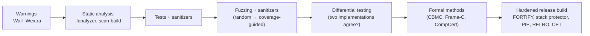

# Lesson P4 — Hardening, static analysis, fuzzing and verification: making C code trustworthy

> Level: pro. Prerequisites: I3 (UB), I8 (sanitizers), A2 (stack protector), A4 (optimiser and UB), P3 (RELRO/PIE). Time: about 3.5 hours.
> Tested with GCC 13.3 / GCC 14.2 (Ubuntu builds), Clang 18.1 static analyzer, glibc 2.39, x86-64 Linux, November 2026. Clang's libFuzzer runtime is not installed on the test machine; the libFuzzer harness is shown but marked *not run*.

---

## 1. Why this lesson exists

C gives you no memory safety, so trustworthy C comes from **layers of defence**, each catching what the previous layer missed:

1. **Write it carefully** (everything so far).
2. **Analyse it without running it** — compiler warnings, static analysers.
3. **Run it with checks** — sanitizers (lesson I8) on tests…
4. …and on **millions of generated inputs** — fuzzing.
5. **Compare implementations** — differential testing (the idea behind your *compiler-fuzz* project).
6. **Harden the shipped binary** so the bugs that remain are harder to exploit.
7. For the highest assurance, **prove** properties — model checking, deductive verification, verified compilers.

This lesson gives you hands-on contact with layers 2, 4, 5 and 6, and a map of 7. It is also the meeting point with the Testing/Verification and Security tracks.

---

## 2. Intuition: a building's safety system

- **Static analysis** is the architect's plan review: checks the blueprint for missing exits without building anything. Cheap, early, but it can raise false alarms and miss things only real use reveals.
- **Fuzzing** is a stress test: thousands of random visitors try every door, at every hour, carrying strange luggage. ASan is the CCTV that records the exact moment something breaks.
- **Differential testing** is asking two independent inspectors the same question; if they disagree, at least one is wrong — you don't need to know the right answer in advance.
- **Hardening** is sprinklers and fire doors: it doesn't prevent the fire (bug), it limits the damage (exploit).
- **Formal verification** is a mathematical guarantee that a specific kind of fire *cannot* start, for a precisely specified building.

---

## 3. Precise definitions

- **Hardening flags** (GCC manual; GCC 14 `-fhardened`):
  - `-D_FORTIFY_SOURCE=2/3` (with optimisation): glibc replaces calls like `strcpy`, `memcpy`, `sprintf` with checked variants when the destination size is known (level 3 also uses dynamic object sizes); overflows abort with `*** buffer overflow detected ***`.
  - `-fstack-protector-strong` (lesson A2), `-fstack-clash-protection` (probe large stack allocations so they cannot jump over the guard page), `-fcf-protection=full` (Intel CET: `endbr64`, shadow stack support).
  - `-fPIE -pie`, `-Wl,-z,relro -Wl,-z,now` (lesson P3).
  - `-ftrivial-auto-var-init=zero` (GCC 12+ [unverified version]): initialise automatic variables to zero, turning uninitialised-read bugs into deterministic behaviour.
  - **`-fhardened`** (GCC 14): "an umbrella option that enables a set of hardening flags"; `gcc --help=hardened` lists them.
- **Static analysis:** analysing source without executing it. GCC's `-fanalyzer` (since GCC 10) performs interprocedural path-sensitive analysis reporting CWE-classified warnings (double free, use-after-free, NULL dereference, leaks…); the Clang Static Analyzer (`clang --analyze`, `scan-build`) and `clang-tidy` are the Clang equivalents. **Sound** analysers report all bugs of a class (with false positives); most practical bug finders are **unsound** (they miss some).
- **Fuzzing:** automatically generating many inputs to find crashes or property violations. **Coverage-guided** fuzzers (libFuzzer: "an in-process, coverage-guided, evolutionary fuzzing engine"; AFL++) mutate inputs that reach new code. A libFuzzer target is `int LLVMFuzzerTestOneInput(const uint8_t *Data, size_t Size)` built with `-fsanitize=fuzzer,address` (LLVM *libFuzzer* docs; the page notes libFuzzer is in maintenance mode, its authors having moved to Centipede).
- **Differential testing:** run the same input through two or more implementations that should agree and treat any disagreement as a bug signal — Csmith (Yang, Chen, Eide, Regehr, PLDI 2011) applied it to C compilers with randomly generated UB-free programs.
- **Formal methods:** **bounded model checking** (CBMC checks C programs for assertion failures, overflows, pointer errors up to a bound — Kroening & Tautschnig, TACAS 2014); **deductive verification** (Frama-C with ACSL contracts); **verified compilation** (CompCert: a C compiler whose generated code is formally proven to behave as the source — Leroy, CACM 2009).

---

## 4. Step by step

### Step 1 — hardening in action: `_FORTIFY_SOURCE`

```c
// file: fort.c
// build: gcc -std=c17 -O2 -U_FORTIFY_SOURCE -D_FORTIFY_SOURCE=3 -o fort fort.c && gcc -std=c17 -O2 -U_FORTIFY_SOURCE -D_FORTIFY_SOURCE=0 -fno-stack-protector -o fort_off fort.c
// run: ./fort hi; ./fort AAAAAAAAAAAAAAAA; echo "exit=$?"; ./fort_off AAAAAAAAAAAAAAAA; echo "exit=$?"

#include <stdio.h>
#include <string.h>

// copies an argument into an 8-byte buffer: the size is known to the compiler, the input is not
int main(int argc, char *argv[])
{
    char buf[8];
    strcpy(buf, argc > 1 ? argv[1] : "ok");
    printf("%s\n", buf);
    return 0;
}
```

Output:

```text
hi
*** buffer overflow detected ***: terminated
Aborted
exit=134
Segmentation fault
exit=139
```

With FORTIFY, the compiler knew `buf` has 8 bytes, so `strcpy` became `__strcpy_chk(buf, src, 8)`, which detected the 17-byte copy and aborted *before* corrupting anything. With FORTIFY and the stack protector off, the overflow ran to completion and crashed on return (lesson A2). Note: on the test machine `echo | gcc -O2 -dM -E - | grep FORTIFY` prints `#define _FORTIFY_SOURCE 3` — **Ubuntu's GCC enables FORTIFY level 3 by default at `-O2`**, which is why the demo uses `-U_FORTIFY_SOURCE` to set it explicitly. `gcc-14 --help=hardened` on the test machine lists what `-fhardened` turns on:

```text
The following options are enabled by -fhardened:
  -D_FORTIFY_SOURCE=3 (or =2 for glibc < 2.35)
  -D_GLIBCXX_ASSERTIONS
  -ftrivial-auto-var-init=zero
  -fPIE  -pie
  -Wl,-z,now
  -Wl,-z,relro
  -fstack-protector-strong
  -fstack-clash-protection
  -fcf-protection=full
```

### Step 2 — static analysis: bugs found without running anything

```c
// file: leaky.c
// build: gcc -std=c17 -O0 -fanalyzer -c leaky.c -o leaky.o 2>&1 | grep -o "warning: .*"; clang --analyze leaky.c 2>&1 | grep -o "warning: .*"; true
// run: true

#include <stdlib.h>
#include <string.h>
#include <stdio.h>

// returns an upper-case copy of s; contains three planted bugs
char *dup_upper(const char *s)
{
    char *res = malloc(strlen(s) + 1);           // BUG A: result not checked for NULL
    if (strlen(s) == 0)
        return NULL;                             // BUG B: leaks res on this path
    for (size_t i = 0; s[i]; i++)
        res[i] = (char)(s[i] & ~0x20);
    res[strlen(s)] = '\0';
    return res;
}

int main(void)
{
    char *u = dup_upper("abc");
    puts(u);
    free(u);
    free(u);                                     // BUG C: double free
    return 0;
}
```

Output (GCC 13.3 `-fanalyzer`, then Clang 18 `--analyze`):

```text
warning: dereference of possibly-NULL 'res' [CWE-690] [-Wanalyzer-possible-null-dereference]
warning: double-'free' of 'u' [CWE-415] [-Wanalyzer-double-free]
warning: Attempt to free released memory [unix.Malloc]
```

GCC's analyzer found bugs A and C; Clang's found C. **Neither reported the leak (bug B)** in this run — a concrete reminder that practical analysers are unsound. Their value is cheap, early detection of many bugs on *all paths*, including paths your tests never execute; their limits are why we still run sanitizers and fuzzers.

### Step 3 — the dumbest fuzzer: random inputs + ASan

Before reaching for a framework, write the dumbest possible fuzzer: generate random strings, feed them to the target, let AddressSanitizer be the oracle.

```c
// file: fuzz_kv.c
// build: gcc -std=c17 -g -O1 -fsanitize=address,undefined -fno-omit-frame-pointer -o fuzz_kv fuzz_kv.c
// run: ./fuzz_kv 2>&1 | grep -E "^iteration|ERROR: AddressSanitizer|WRITE of|#[01] " | tail -5

#include <stdio.h>
#include <stdlib.h>
#include <string.h>

// TARGET: copy the key part of "key=value" into key[0..keycap-1], NUL-terminated.
// Contains a subtle off-by-one bug.
int parse_kv(const char *s, char *key, size_t keycap)
{
    size_t i = 0;
    while (s[i] != '\0' && s[i] != '=') {
        if (i > keycap - 1)          // BUG: should stop at i == keycap - 1 to leave room for '\0'
            return -1;
        key[i] = s[i];
        i++;
    }
    if (s[i] != '=')
        return -1;                   // no '=' found
    key[i] = '\0';                   // when i == keycap this writes one past the end
    return (int)i;
}

// generates a random string over a small alphabet that makes '=' likely
static void random_input(char *buf, size_t maxlen)
{
    static const char alphabet[] = "abcxyz=";
    size_t len = (size_t)rand() % maxlen;
    for (size_t i = 0; i < len; i++)
        buf[i] = alphabet[rand() % (sizeof alphabet - 1)];
    buf[len] = '\0';
}

int main(void)
{
    srand(12345);                                // fixed seed: reproducible runs
    char input[32];
    for (long it = 1; it <= 1000000; it++) {
        random_input(input, sizeof input);
        char *key = malloc(8);                   // heap buffer so ASan has exact bounds
        if (key == NULL) return 1;
        fprintf(stderr, "iteration %ld input \"%s\"\n", it, input);   // unbuffered: survives the crash
        parse_kv(input, key, 8);
        free(key);
    }
    printf("no crash found\n");
    return 0;
}
```

Output:

```text
iteration 131 input "ayxyzbxb=x=axcxc=cxx==ccxxayx"
==3916==ERROR: AddressSanitizer: heap-buffer-overflow on address 0x502000001058 ...
WRITE of size 1 at 0x502000001058 thread T0
    #0 ... in parse_kv fuzz_kv.c:22
    #1 ... in main fuzz_kv.c:45
```

After 131 random inputs it found a key of exactly 8 characters (`ayxyzbxb`) followed by `=`: the loop allowed `i == 8`, then `key[8] = '\0'` wrote one byte past the 8-byte buffer. A hand-written unit test with "normal" keys would likely never try the exact boundary length. Printing each input to **stderr** (unbuffered) before the call means the crashing input survives the abort — lesson I7's buffering lesson again.

The wall of random fuzzing: inputs that need structure (a valid header, a checksum, a magic number) are almost never generated by chance. **Coverage-guided** fuzzers climb that wall by keeping inputs that reach new branches and mutating them.

### Step 4 — coverage-guided fuzzing with libFuzzer (not run here)

```c
/* NOT RUN ON THE TEST MACHINE: requires Clang's libFuzzer runtime, which is not installed.
   Build:  clang -g -O1 -fsanitize=fuzzer,address fuzz_target.c -o fuzz_target
   Run:    ./fuzz_target corpus_dir/            (libFuzzer generates and saves interesting inputs) */
#include <stdint.h>
#include <stddef.h>
#include <string.h>

int parse_kv(const char *s, char *key, size_t keycap);   // the target from Step 3

// libFuzzer calls this with each generated input
int LLVMFuzzerTestOneInput(const uint8_t *data, size_t size)
{
    char input[64], key[8];
    if (size >= sizeof input) return 0;          // keep inputs bounded
    memcpy(input, data, size);
    input[size] = '\0';                          // the target expects a C string
    parse_kv(input, key, sizeof key);
    return 0;                                    // non-crashing inputs return 0
}
```

The harness is the same idea as Step 3's loop, minus the input generator: the engine supplies inputs, instruments branch coverage, and minimises crashing inputs. OSS-Fuzz (Google) runs such harnesses continuously for many open-source C/C++ projects [unverified: scale figures not checked here].

### Step 5 — differential testing: two implementations, one oracle

```c
// file: diff_avg.c
// build: gcc -std=c17 -O2 -Wall -Wextra -o diff_avg diff_avg.c && gcc -std=c17 -O0 -g -fsanitize=undefined -o diff_avg_ubsan diff_avg.c
// run: ./diff_avg; ./diff_avg_ubsan 2>&1 | grep -m1 "runtime error"

#include <stdio.h>
#include <stdlib.h>
#include <stdint.h>

// REFERENCE: obviously correct, computed in a wider type, rounds toward zero like C division
static int avg_ref(int a, int b)
{
    return (int)(((long long)a + b) / 2);
}

// CANDIDATE: the "fast" version someone wrote
static int avg_fast(int a, int b)
{
    return (a + b) / 2;              // overflows (UB) when a + b leaves int's range
}

// a random 32-bit int built from two rand() calls (rand() may give only 31 bits)
static int rand_int(void)
{
    uint32_t u = ((uint32_t)rand() << 16) ^ (uint32_t)rand();
    return (int)u;                   // implementation-defined conversion; two's complement on GCC
}

int main(void)
{
    srand(7);
    for (long it = 1; it <= 1000000; it++) {
        int a = rand_int(), b = rand_int();
        int r1 = avg_ref(a, b), r2 = avg_fast(a, b);
        if (r1 != r2) {                                   // the oracle: two implementations must agree
            printf("MISMATCH after %ld tests: a=%d b=%d ref=%d fast=%d\n", it, a, b, r1, r2);
            return 1;
        }
    }
    printf("1000000 tests agreed\n");
    return 0;
}
```

Output:

```text
MISMATCH after 2 tests: a=1535677211 b=1064065937 ref=1299871574 fast=-847612074
diff_avg.c:18:15: runtime error: signed integer overflow: 1535677211 + 1064065937 cannot be represented in type 'int'
```

No one had to know the "right" average in advance: disagreement *is* the signal. UBSan then explains *why* — signed overflow in `a + b` (lesson I3).

A true story from writing this lesson: the first "fix" tried was the well-known `a / 2 + b / 2 + (a % 2 + b % 2) / 2`. The differential test rejected it immediately — `MISMATCH after 22 tests: a=559524653 b=-1853899678 ref=-647187512 fast=-647187513` — because when the signs differ, C's truncating division rounds the two halves in different directions. The version that survived a million tests (and UBSan) is:

```c
// overflow-free average that matches (a + b) / 2 computed in a wider type
static int avg_fast(int a, int b)
{
    if ((a < 0) != (b < 0))
        return (a + b) / 2;                       // opposite signs: a + b cannot overflow
    return a / 2 + b / 2 + (a % 2 + b % 2) / 2;   // same sign: halves first, remainders agree in sign
}
```

That is the real value of an oracle: it checks *your fixes* too.

This is precisely the architecture of compiler differential testing: the "two implementations" are GCC and Clang (or `-O0` and `-O2` of one compiler), the "inputs" are randomly generated programs, and the oracle is "same checksum output". Its crucial precondition is the same as here: the input program must be free of UB, or a disagreement means nothing.

### Step 6 — beyond testing: proving properties (overview)

| Approach | Tool examples | What you get | Cost |
|---|---|---|---|
| Bounded model checking | CBMC | For all inputs up to a bound: no assertion failure, overflow, out-of-bounds, null deref | Needs loop bounds; can be slow |
| Abstract interpretation | Astrée (commercial), Frama-C EVA | Sound absence of run-time errors for whole programs (with false alarms) | Tuning, expertise |
| Deductive verification | Frama-C + ACSL / WP | Functional correctness against a written contract | Writing specs and proofs |
| Verified compiler | CompCert | Compiled code provably preserves source semantics | Restricted C subset, fewer optimisations |
| Translation validation | Alive2 (LLVM) | Checks individual optimisations/compilations for refinement | Per-transformation |

---

## 5. Diagrams



How a fuzzer, a sanitizer and a differential oracle fit together:

```text
  generator ──input──► implementation A ──output A──┐
      ▲                  (with ASan/UBSan)          ├──► compare: equal? ── no ──► BUG (save input, reduce it)
      │                                             │
      └── coverage / mutation feedback   implementation B ──output B──┘
                                         (crash or sanitizer report) ──► BUG
```

---

## 6. Common mistakes

| Mistake | Consequence | Fix |
|---|---|---|
| Treating hardening as a fix | Bugs remain; only exploitation gets harder | Fix bugs; harden as defence in depth |
| FORTIFY without optimisation | No effect (needs `-O1`+) | Build release with `-O2` |
| Ignoring static-analysis warnings as "false positives" by default | Real bugs slip through | Triage each; suppress narrowly with comments |
| Fuzzing without sanitizers | Memory corruption goes unnoticed unless it crashes | Always fuzz with ASan/UBSan |
| Losing the crashing input | Can't reproduce | Log inputs before use (stderr) or let the engine save them |
| Differential testing with UB-containing inputs | False alarms | Ensure inputs are UB-free (sanitize the reference run) |
| Not reducing failing inputs | Huge, unreadable reproducers | Delta debugging (ddmin), C-Reduce, libFuzzer `-minimize_crash` |
| Believing "fuzzed for a day" means "secure" | Coverage plateaus; deep states unreached | Measure coverage; add dictionaries/structure-aware fuzzing |

---

## 7. Connections

- **Testing/Verification track:** test oracles, property-based testing (QuickCheck/Hypothesis are differential/property testing for functions), delta debugging, model checking and theorem proving in depth.
- **Security track:** CWE categories from the analyser output, exploit mitigations (CET, RELRO), and secure SDLC practices; fuzzing is a primary vulnerability-discovery method.
- **Compilers track:** Csmith, EMI (equivalence modulo inputs) and translation validation test and verify compilers themselves; CompCert shows end-to-end proof is possible.
- **Python track:** Hypothesis implements property-based testing; Atheris (Google) is a coverage-guided fuzzer for Python code and native extensions [named as an example].
- **Rust track:** `cargo fuzz` uses libFuzzer; Miri and Kani (a CBMC-based model checker for Rust) mirror the C tools.

### Where this shows up in my projects

- **compiler-fuzz:** this lesson *is* the project's architecture: a UB-free random C generator (Step 3's generator, but producing programs), GCC 15.2 vs Clang 21.1 at `-O0/-O2/-O3` as the differential oracle (Step 5), a ddmin reducer to shrink failing programs (the "reduce" box in the diagram), planted-bug validation to confirm the pipeline actually detects known bugs (the same idea as seeding `parse_kv` with a known bug and checking the fuzzer finds it), and UBSan-enabled tests to guard against the "UB in the input" false alarm.
- **aws-waste-scanner:** its test suite uses fakes for cloud APIs; property-based or differential tests (e.g. comparing a report computed two ways) are a natural next step of the same oracle idea (a suggestion, not something the project currently does as far as this lesson's sources show).

---

## 8. Self-check questions

1. What did `_FORTIFY_SOURCE` change about `strcpy(buf, …)`, and why does it need optimisation?
2. Name two bugs the analysers found and one they missed in `leaky.c`. What does that tell you about static analysis?
3. Why did the random fuzzer find `parse_kv`'s bug quickly, and what kind of bug would it struggle with?
4. What is the oracle in differential testing, and what is its key precondition?
5. Why print the fuzz input to stderr rather than stdout before each call?
6. Place CBMC, Frama-C/WP and CompCert on the spectrum from "testing" to "proof", and say what each guarantees.

<details>
<summary>Answers</summary>

1. With the destination size known at compile time, the call was rewritten to a checked variant (`__strcpy_chk`) that aborts on overflow. The object-size information comes from the optimiser's analysis (`__builtin_object_size`), so it needs `-O1` or higher.
2. Found: possible NULL dereference of `res` (GCC) and the double free (both). Missed: the leak on the empty-string path. Practical analysers are unsound: useful, cheap, path-covering, but not complete.
3. The bug triggers on a simple condition (an exactly-8-character key followed by `=`) that random strings over a small alphabet hit often. It would struggle with bugs behind structured preconditions (magic numbers, checksums, nested formats) — coverage guidance and structure-aware generation address that.
4. Agreement between independent implementations (e.g. two compilers or two optimisation levels); the input must be free of undefined behaviour (and of other legitimately implementation-dependent behaviour), otherwise disagreements are not bugs.
5. stderr is unbuffered, so the last input is written before the crash kills the process; stdout to a pipe/file is buffered and would be lost.
6. CBMC: bounded model checking — proves absence of the checked errors for all inputs within the bound. Frama-C/WP: deductive verification — proves code meets its ACSL contract (functional correctness) given loop invariants. CompCert: verified compiler — proves compilation preserves the semantics of (UB-free) source programs. All three are on the "proof" side; fuzzing and differential testing are on the "testing" side.

</details>

---

## 9. Mnemonic (Tamil + English)

**The trust ladder — Warn, Analyse, Sanitize, Fuzz, Differ, Prove, Harden ("W-A-S-F-D-P-H"):**

> **"Watchman Appa Sonnaru: First Door Poottu, Harden pannu!"** — *"Watchman dad said: first lock the door, then harden it"* — **W**arnings, **A**nalysis, **S**anitizers, **F**uzzing, **D**ifferential testing, **P**roofs, **H**ardening.

**Differential testing in one line:**

> **"Rendu per ore kelvi-ku vera vera badhil sonna, oruthan thappu."** — If two people give different answers to the same question, one of them is wrong (as long as the question itself is valid — no UB!).

---

## Sources

- GCC manual, *Instrumentation Options* (`-fstack-protector-strong`, `-fstack-clash-protection`, `-fcf-protection`): https://gcc.gnu.org/onlinedocs/gcc/Instrumentation-Options.html
- GCC, *GCC 14 Release Series Changes* (`-fhardened`): https://gcc.gnu.org/gcc-14/changes.html
- GCC manual, *Static Analyzer Options* (`-fanalyzer`): https://gcc.gnu.org/onlinedocs/gcc/Static-Analyzer-Options.html
- David Malcolm (Red Hat Developer blog), *Static analysis in GCC 10*: https://developers.redhat.com/blog/2020/03/26/static-analysis-in-gcc-10
- Clang Static Analyzer: https://clang-analyzer.llvm.org/
- LLVM, *libFuzzer – a library for coverage-guided fuzz testing* (target signature, `-fsanitize=fuzzer`, maintenance status): https://llvm.org/docs/LibFuzzer.html
- X. Yang, Y. Chen, E. Eide, J. Regehr, *Finding and Understanding Bugs in C Compilers*, PLDI 2011: https://www-old.cs.utah.edu/~regehr/papers/pldi11-preprint.pdf
- D. Kroening, M. Tautschnig, *CBMC – C Bounded Model Checker*, TACAS 2014: https://link.springer.com/10.1007/978-3-642-54862-8_26
- X. Leroy, *Formal Verification of a Realistic Compiler*, CACM 52(7), 2009: https://xavierleroy.org/publi/compcert-CACM.pdf
- Frama-C platform: https://frama-c.com/
- A. Zeller, R. Hildebrandt, *Simplifying and Isolating Failure-Inducing Input*, IEEE TSE 28(2), 2002 (ddmin): https://www.st.cs.uni-saarland.de/papers/tse2002/tse2002.pdf
- OSS-Fuzz: https://github.com/google/oss-fuzz

## Verify yourself

1. Run every block. Check your compiler's default FORTIFY level: `echo | gcc -O2 -dM -E - | grep FORTIFY`.
2. `gcc --help=hardened` (GCC 14+) — compare with the list above.
3. Fix `parse_kv` (`if (i >= keycap - 1)`) and rerun the fuzzer: it should print `no crash found` after a million inputs.
4. Replace `avg_fast` with the sign-aware version above and confirm a million differential tests agree; then try the naive `a / 2 + b / 2 + (a % 2 + b % 2) / 2` and watch it fail.
5. If you have Clang with compiler-rt installed, build and run the libFuzzer harness and compare how fast it finds the bug versus the random fuzzer.
6. Read the CBMC and CompCert papers' introductions and write down, in one sentence each, the precise guarantee they claim.
