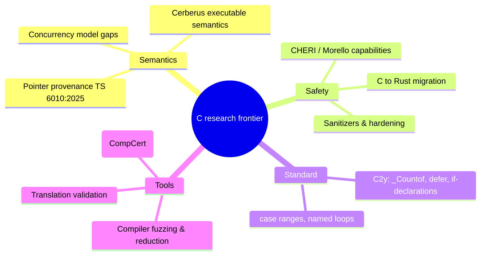

# Lesson P5 — Performance engineering and the research frontier of C

> Level: pro. Prerequisites: A1 (layout), A2 (assembly), A3 (allocators), A4 (optimiser), A6 (atomics). Time: about 3.5 hours.
> Measurements from a 2-vCPU Intel Xeon VM @ 2.10 GHz (L1d 48 KiB/core, L2 2 MiB/core, 64-byte cache lines), GCC 13.3, x86-64 Linux, November 2026. **Absolute numbers will differ on your machine; the ratios are the point.** `perf` is not installed on the test machine, so `perf` commands are shown but not run.

---

## 1. Why this lesson exists

C is chosen when performance matters, yet most slow C programs are slow for reasons the source code does not show: **memory access patterns, cache misses, false sharing, missed vectorisation, and the optimiser's choices**. Big-O analysis says a linked-list traversal and an array traversal are both O(n); on the test machine one took **196× longer** than the other. This lesson builds the habits of performance work — *measure, explain with the hardware model, change one thing, measure again* — and then closes the track with the open questions researchers and the C committee are working on today.

---

## 2. Intuition: the library and the desk

The CPU is a reader at a tiny desk (registers) next to a small shelf (L1 cache, tens of KiB), a bookcase down the hall (L2, MiB), the basement archive (L3), and an off-site warehouse (RAM, roughly a hundred times slower than L1 [unverified as a precise figure — order of magnitude per Drepper 2007]).

- Fetching anything brings a whole **cache line** (64 bytes) — like fetching a whole box of index cards. Using every card in the box (sequential access) is cheap; using one card per box (strided or pointer-chasing access) wastes the trip.
- The hardware **prefetcher** notices regular patterns ("you're reading boxes in order") and fetches ahead — it cannot predict where a linked list's next node lives.
- Two readers editing different cards **in the same box** must keep passing the box back and forth — **false sharing**.
- **SIMD** lets the reader process 4, 8 or 16 cards in one motion — if the cards are laid out side by side and independent.

---

## 3. Precise definitions

- **Cache line:** the unit of transfer between memory levels; 64 bytes on the test machine (`getconf LEVEL1_DCACHE_LINESIZE`).
- **Spatial / temporal locality:** using data near recently used data / reusing the same data soon.
- **False sharing:** threads write *different* variables that share a cache line, forcing coherence traffic as if they shared data (Drepper, *What Every Programmer Should Know About Memory*, §6.4).
- **Vectorisation:** the compiler turns a loop into SIMD instructions; GCC reports successes with `-fopt-info-vec-optimized`. Aliasing (`restrict`, lesson A1), dependencies between iterations and floating-point reassociation rules decide what is vectorisable.
- **Optimisation levels:** `-O2` is the common release level; `-O3` adds loop transformations such as "interchange, unroll-and-jam, peeling, unswitching, and distribution" (GCC *Optimize Options*); `-march=native` lets GCC use every instruction-set extension of the build machine (non-portable binaries); `-flto` optimises across translation units at link time.
- **Amdahl's law:** if a fraction *p* of run time is sped up by a factor *s*, the overall speed-up is 1 / ((1 − p) + p/s) — optimise what dominates.

---

## 4. Step by step

### Step 1 — the same O(n) work, very different times

```c
// file: cache.c
// build: gcc -std=c17 -O2 -Wall -Wextra -o cache cache.c
// run: ./cache

#define _POSIX_C_SOURCE 200809L
#include <stdio.h>
#include <stdlib.h>
#include <time.h>

#define N 4096                                   // 4096 x 4096 ints = 64 MiB: far bigger than any cache

static double now_ms(void)
{
    struct timespec t;
    clock_gettime(CLOCK_MONOTONIC, &t);
    return t.tv_sec * 1e3 + t.tv_nsec / 1e6;
}

typedef struct node { long val; struct node *next; } node;

int main(void)
{
    int *grid = malloc((size_t)N * N * sizeof *grid);
    if (!grid) return 1;
    for (size_t i = 0; i < (size_t)N * N; i++) grid[i] = (int)(i & 7);

    // 1) row-major walk: consecutive addresses, every byte of each cache line used
    double t0 = now_ms();
    long s1 = 0;
    for (int r = 0; r < N; r++)
        for (int c = 0; c < N; c++)
            s1 += grid[(size_t)r * N + c];
    double t1 = now_ms();

    // 2) column-major walk: jumps 16 KiB each step, one int used per cache line fetched
    long s2 = 0;
    for (int c = 0; c < N; c++)
        for (int r = 0; r < N; r++)
            s2 += grid[(size_t)r * N + c];
    double t2 = now_ms();
    printf("row-major   : sum %ld in %6.1f ms\n", s1, t1 - t0);
    printf("column-major: sum %ld in %6.1f ms\n", s2, t2 - t1);
    free(grid);

    // 3) array vs linked list with nodes scattered in memory (shuffled allocation order)
    const size_t M = 4000000;
    long *arr = malloc(M * sizeof *arr);
    node **nodes = malloc(M * sizeof *nodes);
    if (!arr || !nodes) return 1;
    for (size_t i = 0; i < M; i++) { arr[i] = (long)i; nodes[i] = malloc(sizeof(node)); if (!nodes[i]) return 1; nodes[i]->val = (long)i; }
    srand(1);
    for (size_t i = M - 1; i > 0; i--) {         // Fisher-Yates shuffle of the link order
        size_t j = ((size_t)rand() * (size_t)RAND_MAX + (size_t)rand()) % (i + 1);
        node *tmp = nodes[i]; nodes[i] = nodes[j]; nodes[j] = tmp;
    }
    for (size_t i = 0; i + 1 < M; i++) nodes[i]->next = nodes[i + 1];
    nodes[M - 1]->next = NULL;

    double t3 = now_ms();
    long s3 = 0;
    for (size_t i = 0; i < M; i++) s3 += arr[i];
    double t4 = now_ms();
    long s4 = 0;
    for (node *h = nodes[0]; h != NULL; h = h->next) s4 += h->val;
    double t5 = now_ms();
    printf("array       : sum %ld in %6.1f ms\n", s3, t4 - t3);
    printf("linked list : sum %ld in %6.1f ms\n", s4, t5 - t4);
    for (size_t i = 0; i < M; i++) free(nodes[i]);
    free(nodes); free(arr);
    return 0;
}
```

Output:

```text
row-major   : sum 58720256 in   12.6 ms
column-major: sum 58720256 in  160.8 ms
array       : sum 7999998000000 in    3.9 ms
linked list : sum 7999998000000 in  762.9 ms
```

- **Row vs column (≈13×):** identical arithmetic, identical memory; only the order differs. Row-major uses all 16 ints of each 64-byte line and the prefetcher streams ahead; column-major uses one int per line and jumps 16 KiB each step (lesson B4's row-major layout).
- **Array vs shuffled linked list (≈196×):** the list does the same additions, but every `h->next` is a dependent load to an unpredictable address — the CPU cannot start the next load until the current one returns, and each one misses the caches. Plus each node carries `malloc` overhead (lesson A3: a 16-byte node occupies a 32-byte chunk). This is the strongest practical argument for arrays (and "arrays of structs" vs "structs of arrays" layouts) in performance code.

### Step 2 — false sharing

```c
// file: falseshare.c
// build: gcc -std=c17 -O2 -Wall -Wextra -pthread -o falseshare falseshare.c
// run: ./falseshare

#define _POSIX_C_SOURCE 200809L
#include <stdio.h>
#include <pthread.h>
#include <stdatomic.h>
#include <time.h>

#define ITERS 20000000

// two counters on the SAME 64-byte cache line
struct { atomic_long a; atomic_long b; } same_line;

// two counters on DIFFERENT cache lines (alignas pushes b to the next line)
struct { atomic_long a; _Alignas(64) atomic_long b; } split_lines;

static void *bump(void *p)
{
    atomic_long *c = p;
    for (long i = 0; i < ITERS; i++)
        atomic_fetch_add_explicit(c, 1, memory_order_relaxed);   // each thread touches only its own counter
    return NULL;
}

// runs two threads, one per counter, and returns elapsed milliseconds
static double run(atomic_long *x, atomic_long *y)
{
    struct timespec t0, t1;
    pthread_t a, b;
    clock_gettime(CLOCK_MONOTONIC, &t0);
    pthread_create(&a, NULL, bump, x);
    pthread_create(&b, NULL, bump, y);
    pthread_join(a, NULL);
    pthread_join(b, NULL);
    clock_gettime(CLOCK_MONOTONIC, &t1);
    return (t1.tv_sec - t0.tv_sec) * 1e3 + (t1.tv_nsec - t0.tv_nsec) / 1e6;
}

int main(void)
{
    printf("offset of b: same_line %zu bytes, split_lines %zu bytes\n",
           (size_t)((char *)&same_line.b - (char *)&same_line), (size_t)((char *)&split_lines.b - (char *)&split_lines));
    printf("same cache line   : %6.1f ms\n", run(&same_line.a, &same_line.b));
    printf("separate lines    : %6.1f ms\n", run(&split_lines.a, &split_lines.b));
    return 0;
}
```

Output — first session (two runs):

```text
offset of b: same_line 8 bytes, split_lines 64 bytes
same cache line   :  970.0 ms
separate lines    :  129.4 ms
offset of b: same_line 8 bytes, split_lines 64 bytes
same cache line   : 1203.4 ms
separate lines    :  113.7 ms
```

Output — a later session on the same VM (six runs, summarised):

```text
same cache line   :  253–331 ms
separate lines    :  188–231 ms
```

The threads never touch each other's counter, yet sharing one cache line made the program slower in every run: **7–10×** in the first session, **1.3–1.6×** in the later one. Each atomic increment needs exclusive ownership of the line, so the line ping-pongs between the cores that run the two threads. Why did the penalty shrink so much between sessions? On a 2-vCPU cloud VM we do not control where the hypervisor places the vCPUs; if both land on hyperthreads of one physical core they share an L1 cache and the ping-pong is cheap [unverified explanation — the VM topology was not inspectable from inside]. This is an honest picture of performance work: **the effect is real, its size depends on hardware and placement, so measure on the target machine.** `_Alignas(64)` (C11; `alignas` in C23) moved `b` onto its own line. Per-thread counters, statistics and queue head/tail indices are the usual culprits.

### Step 3 — vectorisation and a surprising `-O3`

```c
// file: vec.c
// build: for f in "-O0" "-O2" "-O3" "-O3 -march=native"; do gcc -std=c17 $f -o "vec_$(echo $f | tr -d ' =-')" vec.c; done; gcc -std=c17 -O3 -fopt-info-vec-optimized -c vec.c -o /dev/null 2>&1 | grep -o "loop vectorized.*" | head -2
// run: for f in O0 O2 O3 O3marchnative; do printf "%-16s" "$f:"; ./vec_$f; done

#define _POSIX_C_SOURCE 200809L
#include <stdio.h>
#include <stdlib.h>
#include <time.h>

#define N 4096
#define REPS 20000

// y[i] = a * x[i] + y[i]  (the classic SAXPY kernel)
static void saxpy(int n, float a, const float *restrict x, float *restrict y)
{
    for (int i = 0; i < n; i++)
        y[i] = a * x[i] + y[i];
}

int main(void)
{
    static float x[N], y[N];
    for (int i = 0; i < N; i++) { x[i] = (float)i * 0.5f; y[i] = 1.0f; }
    struct timespec t0, t1;
    clock_gettime(CLOCK_MONOTONIC, &t0);
    for (int r = 0; r < REPS; r++)
        saxpy(N, 1e-6f, x, y);
    clock_gettime(CLOCK_MONOTONIC, &t1);
    double ms = (t1.tv_sec - t0.tv_sec) * 1e3 + (t1.tv_nsec - t0.tv_nsec) / 1e6;
    printf("%7.1f ms  (y[100] = %.3f)\n", ms, y[100]);
    return 0;
}
```

Output (vectorisation report, then timings):

```text
loop vectorized using 16 byte vectors
loop vectorized using 16 byte vectors
O0:               148.2 ms  (y[100] = 1.999)
O2:                 8.4 ms  (y[100] = 1.999)
O3:                53.0 ms  (y[100] = 1.999)
O3marchnative:     51.2 ms  (y[100] = 1.999)
```

`-O2` (which vectorises since GCC 12, using the "very-cheap" cost model — GCC 12 release notes) was ~18× faster than `-O0`. But **`-O3` was ~6× slower than `-O2`**, consistently across repeated runs. `gcc -O3 -fopt-info-optimized` explains why:

```text
vec.c:27:9: optimized:  Inlining saxpy/28 into main/29.
vec.c:26:23: optimized: applying unroll and jam with factor 2
vec.c:26:23: optimized: loops interchanged in loop nest
vec.c:23:23: optimized: loop vectorized using 16 byte vectors
```

After inlining `saxpy` into the benchmark's repetition loop, `-O3` **interchanged the loops** so that the 20,000 repetitions became the inner loop. That turns each `y[i]` into a long chain of dependent floating-point multiply-adds — limited by instruction latency instead of throughput. The transformation is legal and often helpful; here, on this toy benchmark, it backfired. (`-march=native` widened the vectors to 32 bytes but could not fix the dependency chain.) Lessons: **higher `-O` is not monotonically faster**, micro-benchmarks can be distorted by inlining into the benchmark loop, and `-fopt-info` tells you what the compiler actually did.

### Step 4 — a measurement workflow

1. **Reproduce** a stable benchmark (fixed inputs, warm-up, several runs; report the spread, not one number).
2. **Profile** to find where time goes: `perf stat -e cycles,instructions,cache-misses ./prog` and `perf record -g ./prog; perf report` (not run here); build with `-g -fno-omit-frame-pointer` so stacks are readable (lesson A2).
3. **Explain** with the hardware model: cache misses? branch mispredictions? dependency chains? contention?
4. **Change one thing**, re-measure, keep the change only if it helps on realistic inputs.
5. **Check correctness** after every change (tests + sanitizers): fast and wrong is worthless.

---

## 5. The research frontier: where C is going

### 5.1 Pointer provenance and the memory object model

What exactly *is* a pointer in C — just an address, or an address plus the identity of the object it came from ("provenance")? Compilers already assume provenance (e.g. two pointers with equal addresses may still be treated as not aliasing if they derive from different objects), but C17 never said so precisely. The Cerberus project (Memarian et al., *Exploring C Semantics and Pointer Provenance*, POPL 2019) built an executable semantics and surveyed real code; WG14 then developed the **PNVI-ae-udi** model ("provenance not via integers, address-exposed, user-disambiguation"), published as **ISO/IEC TS 6010:2025**, *Programming languages — C — A provenance-aware memory object model for C* (published May 2025; it builds on ISO/IEC 9899:2018). Practical consequence for you: casting pointers to integers and back, or comparing pointers to different objects, is subtle territory — tools like CHERI and optimiser correctness both depend on these rules.

### 5.2 Memory safety for existing C

- **CHERI** (Cambridge / SRI, with Arm's experimental **Morello** board): hardware *capabilities* replace raw pointers with bounded, unforgeable references, so out-of-bounds and many use-after-free accesses trap in hardware, while recompiled C code keeps working.
- Sanitizers in production-like settings, hardened allocators, and compiler-inserted bounds checking are other active directions.
- Industry and government guidance increasingly favours memory-safe languages for new code; for the huge existing C base, the questions are migration (C→Rust translation research) and retrofitting safety.

### 5.3 The next standard, C2y

N3220 is the **C2y working draft**. Features already voted into C2y (per the Wikipedia *C2Y* summary of WG14 papers) include: `_Countof` with `<stdcountof.h>` (N3369, N3469) — finally a standard "number of elements in this array"; `if` declarations (N3356); case ranges `case 1 ... 3:` (N3370); named loops for multi-level `break`/`continue` (N3355); `__COUNTER__` (N3457); `0o` octal prefix and delimited escapes (N3353); `strnlen` (N3326); and a `defer` mechanism for scope-based cleanup (paper N3734) — which would replace much of the `goto cleanup` pattern from lesson P2. Watch the GCC and Clang status pages for implementation progress.

### 5.4 Open problems worth a research paper

- **Compiler correctness at scale:** differential testing finds bugs, but what about miscompilations that need specific *undefined-behaviour-free* program shapes Csmith never generates? Better generators, better reducers, and testing *new* targets (GPU compilers, MLIR-based pipelines) are active areas — directly relevant to extending *compiler-fuzz*.
- **UB detection completeness:** sanitizers miss UB that the optimiser exploits at compile time (lesson A4); "UB-aware" static analysis (STACK, SOSP 2013) and formal semantics (Cerberus) attack this.
- **Specification gaps:** concurrency (the C11 memory model has known issues with "out-of-thin-air" values), provenance, and uninitialised memory are still debated.
- **Performance portability:** the same C runs on CPUs with very different vector widths and memory models (lesson A6); auto-vectorisation remains brittle (Step 3).

---

## 6. Diagrams

The memory hierarchy (sizes from the test VM's `lscpu`; latencies are orders of magnitude, see Drepper 2007):

```text
 registers      ~ hundreds of bytes    ~1 cycle
   │
 L1d cache      48 KiB per core        a few cycles
   │
 L2 cache       2 MiB per core         ~10+ cycles
   │
 L3 cache       shared                 tens of cycles
   │
 DRAM           GiBs                   hundreds of cycles   <- every linked-list hop that misses
```

Same-line vs split-line counters:

```text
 same_line:   | a (8 B) | b (8 B) | ............ 48 B ............ |   one 64-byte line: cores fight over it
 split_lines: | a (8 B) | ..... padding ..... |   | b (8 B) | ..... |   two lines: no interference
```



---

## 7. Common mistakes

| Mistake | Consequence | Fix |
|---|---|---|
| Optimising without profiling | Effort spent on the wrong 5% | Profile first; apply Amdahl's law |
| Single-run timings | Noise mistaken for improvement | Several runs, report spread, fixed inputs |
| Assuming `-O3` ≥ `-O2` | Can be slower (Step 3) | Measure each level on real workloads |
| `-march=native` in distributed binaries | Illegal-instruction crashes on older CPUs | Target a baseline (`-march=x86-64-v2`/`v3`) or use function multiversioning |
| Pointer-heavy data structures in hot loops | Cache misses dominate | Arrays, indices instead of pointers, pooled allocation |
| Per-thread counters packed together | False sharing | Pad/align to 64 bytes, or per-thread local accumulation then combine |
| Benchmarks the optimiser can delete or distort | Meaningless numbers | Use results (print/checksum), beware inlining into the timing loop |
| Trading correctness for speed (UB "tricks") | Fragile, version-dependent behaviour | Keep sanitizers in the loop |

---

## 8. Connections

- **Computer Architecture track:** caches, coherence (MESI), prefetching, SIMD units, out-of-order execution and instruction latency vs throughput explain every number in this lesson.
- **Parallel/CUDA track (PDS course):** GPU *coalesced* memory access is the row-major lesson at warp scale; shared-memory bank conflicts resemble false sharing; Amdahl's law bounds parallel speed-up.
- **DSA track:** constant factors and memory behaviour decide which O(n log n) algorithm wins; cache-oblivious algorithms and B-trees exist because of the hierarchy.
- **Compilers track:** loop interchange, unroll-and-jam, vectorisation cost models, LTO and PGO (profile-guided optimisation).
- **Research skills track:** this lesson's §5 is a starting reading list: Cerberus (POPL 2019), TS 6010, CHERI, STACK (SOSP 2013), Csmith (PLDI 2011), CompCert (CACM 2009).

### Where this shows up in my projects

- **compiler-fuzz:** Step 3 is a ready-made example of what a differential tester compares: `-O2` and `-O3` produced *the same result* (`y[100] = 1.999`) through very different loop structures. A mismatch there would have been a miscompilation candidate; performance differences are not. Loop interchange and unroll-and-jam — exactly the `-O3`-only passes seen here — are classic places to look for optimiser bugs, which is why testing `-O3` separately from `-O2` is worthwhile.
- **Compiler research direction (GPU compiler testing):** extending differential testing to GPU compilers means comparing kernels whose performance-motivated transformations (vectorisation, memory coalescing) must preserve semantics — the same "same result, different code" principle.

---

## 9. Self-check questions

1. Why was the column-major walk ~13× slower than row-major on identical data?
2. Give two reasons the shuffled linked list was ~196× slower than the array.
3. What is false sharing, how did `_Alignas(64)` fix it, and why did the measured penalty vary so much between sessions?
4. Why was `-O3` slower than `-O2` for `vec.c`, and how did you find out?
5. State Amdahl's law and use it: 40% of run time is sped up 10×. Overall speed-up?
6. What problem does the provenance TS 6010:2025 address?
7. Name three features voted into C2y.

<details>
<summary>Answers</summary>

1. Row-major uses every int of each 64-byte cache line and lets the prefetcher stream sequential lines; column-major touches one int per line with a 16 KiB stride, so nearly every access misses the cache.
2. Each step is a dependent load to an unpredictable address (no prefetching, no overlap of misses), and nodes are separate heap chunks with allocator overhead, so far more memory is touched.
3. Different threads writing different variables in the same cache line force the line to bounce between cores for exclusive ownership. Aligning `b` to 64 bytes put it on its own line. The penalty depends on where the two threads physically run (separate cores vs hyperthreads sharing a cache) and on machine load — on a cloud VM that placement is outside your control.
4. After inlining, `-O3` interchanged the loops (and applied unroll-and-jam), making the repetition loop innermost and creating a long dependent chain of floating-point operations per element — latency-bound. `-fopt-info-optimized` reported the interchange.
5. Speed-up = 1 / ((1 − p) + p/s) = 1 / (0.6 + 0.04) = 1 / 0.64 ≈ 1.56×.
6. It precisely specifies pointer provenance in C's memory object model (which object a pointer may access, including through integer casts), clarifying what programs and compilers may assume — the PNVI-ae-udi model.
7. Any three of: `_Countof`/`<stdcountof.h>`, `if` declarations, case ranges, named loops, `__COUNTER__`, `0o` octal prefix and delimited escapes, `strnlen`, `defer`.

</details>

---

## 10. Mnemonic (Tamil + English)

**Performance workflow — Reproduce, Profile, Explain, Change, Check ("R-P-E-C-C"):**

> **"Rajini Padam Eppovum Collection Confirm"** — a Rajini film's collection is always confirmed: **R**eproduce, **P**rofile, **E**xplain, **C**hange one thing, **C**heck correctness.

**Locality:**

> **"Box-a thookittu vandha, ella card-um use pannu."** — If you carried the whole box (cache line) here, use every card in it.

**False sharing:** **"Oru line-la rendu per kudithanam panna, sandai thaan."** — Two families living on one cache line means constant fights; give each its own line.

---

## Sources

- Ulrich Drepper, *What Every Programmer Should Know About Memory* (2007; LWN serialisation, part 1): https://lwn.net/Articles/250967/
- GCC manual, *Optimize Options* (`-O2`, `-O3` loop transformations, `-flto`): https://gcc.gnu.org/onlinedocs/gcc/Optimize-Options.html
- GCC manual, *Developer Options* (`-fopt-info`): https://gcc.gnu.org/onlinedocs/gcc/Developer-Options.html
- Linux `perf` wiki: https://perfwiki.github.io/main/
- GCC 12 release notes (vectorisation enabled at `-O2`): https://gcc.gnu.org/gcc-12/changes.html
- K. Memarian et al., *Exploring C Semantics and Pointer Provenance*, POPL 2019: https://www.cl.cam.ac.uk/~km569/exploring_provenance.pdf
- ISO/IEC TS 6010:2025, *Programming languages — C — A provenance-aware memory object model for C* (catalogue entry): https://standards.iteh.ai/catalog/standards/iso/de3583c6-f277-4853-9df7-5f9e9c5e0fa8/iso-iec-ts-6010-2025
- WG14 N3057 (provenance TS draft): https://www.open-std.org/jtc1/sc22/WG14/www/docs/n3057.pdf
- CHERI project, University of Cambridge — Morello platform paper (IEEE Micro 2023): https://www.cl.cam.ac.uk/research/security/ctsrd/pdfs/202305ieeemicro-morello-platform.pdf
- Wikipedia, *C2Y (C standard revision)* (features voted into C2y, with paper numbers): https://en.wikipedia.org/wiki/C2Y_(C_standard_revision)
- WG14 N3469 (`_Countof` follow-up paper): https://www.open-std.org/JTC1/SC22/wg14/www/docs/n3469.htm
- X. Wang et al., *Towards Optimization-Safe Systems* (STACK), SOSP 2013: https://pdos.csail.mit.edu/papers/stack:sosp13.pdf
- X. Yang et al., *Finding and Understanding Bugs in C Compilers* (Csmith), PLDI 2011: https://www-old.cs.utah.edu/~regehr/papers/pldi11-preprint.pdf

## Verify yourself

1. Run all three programs several times; compute the ratios on your machine and compare.
2. Change `N` in `cache.c` to 256 (the grid then fits in L2) and see the row/column gap shrink.
3. In `falseshare.c`, replace the atomics with plain `long` and `volatile` writes, and compare (then remember lesson A6: that version is a data race only if threads touch the same variable — here they don't).
4. Prevent the `-O3` interchange by moving `saxpy` into a separate translation unit (or marking it `__attribute__((noinline))`) and re-measure `-O2` vs `-O3`.
5. If `perf` is available: `perf stat -e cache-misses,cycles ./cache` and relate the miss counts to Step 1.
6. Read the abstract of TS 6010 and the introduction of the Cerberus POPL 2019 paper.
