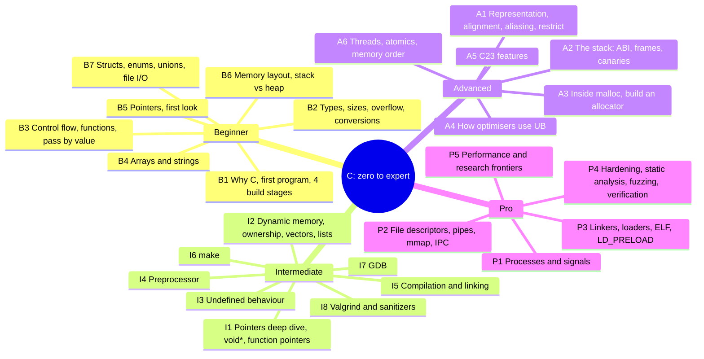
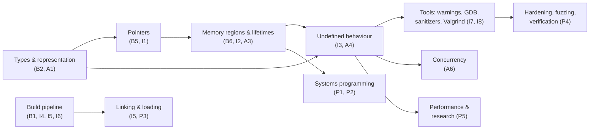

# C Programming — Zero to Expert

A complete, research-backed learning track for the C language: from "what is a compiler?" to undefined-behaviour-driven optimisation, allocator internals, the C11 memory model, ELF loading, fuzzing and the open research questions around C today.

Every lesson follows the same shape — **why it exists → intuition → precise definition → step-by-step (starting from the dumbest approach and letting each wall force the next idea) → diagrams → commented, compiled code → common mistakes → connections → self-check questions → a Tamil + English mnemonic → Sources → Verify yourself.**

Every complete program in this track was compiled and run on the test machine (GCC 13.3 / GCC 14.2 / Clang 18.1, glibc 2.39, Valgrind 3.22, GDB 15.1, GNU Make 4.3, Ubuntu 24.04, x86-64), November 2026. Outputs shown are real. Each runnable block starts with `// file:` and carries the exact `// build:` and `// run:` commands used. The few blocks that could not be compiled on that machine (C23 `#embed`, Clang MemorySanitizer, libFuzzer) are explicitly marked **NOT COMPILED/NOT RUN** with the reason.

This repository is self-contained. Other learning tracks (Compilers, Computer Architecture, OS, DSA, Security, Testing/Verification, Rust, Parallel/CUDA, and others) are referred to **by name** in each lesson's "Connections" section.

---

## Who this is for, and prerequisites

- **Beginner level:** no prior C needed. You should be able to use a terminal (`cd`, `ls`, running a program) and a text editor.
- **Intermediate level:** the beginner level, plus comfort with basic data structures (arrays, linked lists) at the level of any first programming course.
- **Advanced level:** intermediate level, plus willingness to read short x86-64 assembly listings (lesson A2 teaches what you need).
- **Pro level:** advanced level, plus a Linux machine (the systems lessons use POSIX/Linux APIs).

Tooling: a Linux (or WSL2) machine with `gcc`, `make`, `gdb` and `valgrind`. GCC 14+ or Clang 18+ for the C23 lesson; GCC 15+ or Clang 19+ for `#embed`.

---

## Roadmap (mind map)

How the big ideas connect:

---

## Lessons and time estimates

| Level | Lesson | File | Estimated time |
|---|---|---|---|
| Beginner | B1 Why C exists, and your first program end to end | [01-beginner/01-why-c-and-first-program.md](01-beginner/01-why-c-and-first-program.md) | 1–1.5 h |
| | B2 Types, variables and operators | [01-beginner/02-types-variables-operators.md](01-beginner/02-types-variables-operators.md) | 1.5 h |
| | B3 Control flow and functions | [01-beginner/03-control-flow-and-functions.md](01-beginner/03-control-flow-and-functions.md) | 1.5 h |
| | B4 Arrays and strings | [01-beginner/04-arrays-and-strings.md](01-beginner/04-arrays-and-strings.md) | 1.5 h |
| | B5 Pointers, a first look | [01-beginner/05-pointers-first-look.md](01-beginner/05-pointers-first-look.md) | 2 h |
| | B6 Memory layout: stack vs heap | [01-beginner/06-memory-layout-stack-vs-heap.md](01-beginner/06-memory-layout-stack-vs-heap.md) | 2 h |
| | B7 Structs, enums and file I/O | [01-beginner/07-structs-enums-and-file-io.md](01-beginner/07-structs-enums-and-file-io.md) | 2 h |
| Intermediate | I1 Pointers deep dive | [02-intermediate/01-pointers-deep-dive.md](02-intermediate/01-pointers-deep-dive.md) | 2.5 h |
| | I2 Dynamic memory and data structures | [02-intermediate/02-dynamic-memory-and-data-structures.md](02-intermediate/02-dynamic-memory-and-data-structures.md) | 3 h |
| | I3 Undefined behaviour | [02-intermediate/03-undefined-behavior.md](02-intermediate/03-undefined-behavior.md) | 2.5 h |
| | I4 The preprocessor | [02-intermediate/04-preprocessor.md](02-intermediate/04-preprocessor.md) | 2 h |
| | I5 Compilation and linking | [02-intermediate/05-compilation-and-linking.md](02-intermediate/05-compilation-and-linking.md) | 2.5 h |
| | I6 make | [02-intermediate/06-make.md](02-intermediate/06-make.md) | 2 h |
| | I7 Debugging with GDB | [02-intermediate/07-debugging-with-gdb.md](02-intermediate/07-debugging-with-gdb.md) | 2 h |
| | I8 Valgrind and sanitizers | [02-intermediate/08-valgrind-and-sanitizers.md](02-intermediate/08-valgrind-and-sanitizers.md) | 2.5 h |
| Advanced | A1 Representation, alignment, aliasing, `restrict` | [03-advanced/01-object-representation-alignment-aliasing.md](03-advanced/01-object-representation-alignment-aliasing.md) | 3 h |
| | A2 The stack up close | [03-advanced/02-the-stack-up-close.md](03-advanced/02-the-stack-up-close.md) | 3 h |
| | A3 Inside `malloc` | [03-advanced/03-heap-allocator-internals.md](03-advanced/03-heap-allocator-internals.md) | 3 h |
| | A4 How optimisers use UB | [03-advanced/04-ub-and-the-optimizer.md](03-advanced/04-ub-and-the-optimizer.md) | 2.5 h |
| | A5 C23 | [03-advanced/05-c23-features.md](03-advanced/05-c23-features.md) | 2.5 h |
| | A6 Concurrency and atomics | [03-advanced/06-concurrency-and-atomics.md](03-advanced/06-concurrency-and-atomics.md) | 3.5 h |
| Pro | P1 Processes and signals | [04-pro/01-processes-and-signals.md](04-pro/01-processes-and-signals.md) | 3 h |
| | P2 File I/O, pipes, `mmap`, IPC | [04-pro/02-file-io-pipes-mmap-ipc.md](04-pro/02-file-io-pipes-mmap-ipc.md) | 3 h |
| | P3 Linkers, loaders, ELF | [04-pro/03-linkers-loaders-elf.md](04-pro/03-linkers-loaders-elf.md) | 3 h |
| | P4 Hardening, fuzzing, verification | [04-pro/04-hardening-fuzzing-verification.md](04-pro/04-hardening-fuzzing-verification.md) | 3.5 h |
| | P5 Performance and research frontiers | [04-pro/05-performance-and-research-frontiers.md](04-pro/05-performance-and-research-frontiers.md) | 3.5 h |

Totals (reading + running every example + self-check): beginner ≈ 12 h, intermediate ≈ 19 h, advanced ≈ 17.5 h, pro ≈ 16 h — about **65 hours**, plus the exercises and mini projects in [exercises.md](exercises.md) (budget another 25–40 h).

Supporting files:

- [glossary.md](glossary.md) — A–Z terms, plain and precise meaning, with lesson links.
- [appendix.md](appendix.md) — cheat sheets (flags, format specifiers, GDB, make, sanitizers), standards, books, courses, papers, tools.
- [exercises.md](exercises.md) — graded exercises per level with solutions, and three mini projects.
- [interview-questions.md](interview-questions.md) — model answers.
- [connections.md](connections.md) — how this track links to the other tracks and to the learner's projects.
- [common-mistakes.md](common-mistakes.md) — the consolidated list of traps.

---

## Suggested paths

- **"I need C for a systems/compiler role soon":** B1–B7 quickly → I1, I2, I3, I5, I8 → A1, A2, A4 → P3, P4.
- **"I want to understand memory deeply":** B5, B6 → I1, I2 → A1, A3 → P2, P5.
- **"Concurrency":** I3 → A1 → A6 → P1 → P5 §false sharing.
- **"Modern C":** B1 (dialects) → I4 → A5.

---

## Coverage check

The rules for this knowledge base require that the track covers the topics of (1) a standard university course and (2) a standard industry reference, and shows where each is covered.

### (1) University course: MIT OpenCourseWare 6.087 *Practical Programming in C* (IAP 2010) — lecture calendar

| 6.087 lecture topic (as listed on the OCW calendar) | Where covered here |
|---|---|
| 1. Introduction. Writing, compiling, and debugging C programs. Hello world. | B1; debugging in I7 |
| 2. Variables and datatypes, operators. | B2 |
| 3. Control flow. Functions and modular programming. Variable scope. Static and global variables. | B3; modular programming and linkage in I5 |
| 4. More control flow. Input and output. | B3, B7 (stdio), P2 (descriptor I/O) |
| 5. Pointers and memory addressing. Arrays and pointer arithmetic. Strings. Searching and sorting algorithms. | B4, B5, I1 (`qsort`, comparators); searching/sorting algorithms themselves belong to the DSA track |
| 6. User-defined datatypes, structs, unions, bitfields. Memory allocation. Linked lists, binary trees. | B7, A1 (bit-fields, unions), B6/I2 (allocation, linked lists); binary trees are left to the DSA track (same pointer techniques as I2) |
| 7. Pointers to pointers, pointer and string arrays, multidimensional arrays. Stacks and queues. | I1 (pointer to pointer, `argv`, multidimensional arrays), A6 (bounded queue) |
| 8. Void and function pointers. Hash tables. | I1; hash tables left to the DSA track |
| 9. External libraries. B-trees, priority queues. | I5 (static/shared libraries), P3 (dynamic loading); B-trees/priority queues in the DSA track |
| 10. C standard library: stdio.h, ctype.h, stdlib.h, assert.h, stdarg.h, time.h | B1, B4, B7 (stdio, string), I2 (stdlib allocation), I4 (`assert`), A5 (`stdckdint.h`, `stdbit.h`), P5 (`time.h` clocks); `stdarg.h` variadic functions: appendix.md cheat sheet |
| 11. Dynamic memory allocation, malloc and valgrind, garbage collection. | B6, I2, I8, A3; garbage collection discussed as a contrast in B6/I2/A3 (not implemented) |
| 12. Multithreading and concurrency. | A6 |
| 13. Multithreaded programming. Sockets and asynchronous I/O. | A6; sockets and async I/O introduced as descriptors in P2 — full treatment belongs to the Networks track |
| 14. Linux inter process communication. | P1 (signals), P2 (pipes, shared memory) |

### (2) Industry reference: ISO/IEC 9899 (C23, via WG14 draft N3220) and SEI CERT C

| Standard clause / reference area | Where covered here |
|---|---|
| §5.1.1 Translation environment (translation units, translation phases) | B1, I4 (phases), I5 (translation units) |
| §5.1.2 Execution environments (hosted startup/termination, program semantics, multi-threaded executions and data races) | B1 (`main`, exit status), A4 (as-if rule), A6 (data races) |
| §5.2 Environmental considerations (limits, `<limits.h>`) | B2 |
| §6.2 Concepts (scopes, linkages, storage durations, types, representations, compatible types, alignment) | B3, B6, I5, B2, A1 |
| §6.3 Conversions | B2, A1 |
| §6.4 Lexical elements (literals, string literals) | B2, B4, A5 (binary literals, digit separators) |
| §6.5 Expressions (sequencing, effective type/aliasing, operators, pointer arithmetic) | B2, B5, I3, A1, A4 |
| §6.6 Constant expressions | A5 (`constexpr`) |
| §6.7 Declarations (storage classes, qualifiers incl. `restrict`, declarators, initialisation, type inference, static assertions, attributes) | B3, B7, I1, A1, A5 |
| §6.8 Statements | B3; loop termination assumption in I3 |
| §6.9 External definitions | I5 |
| §6.10 Preprocessing directives (incl. `#embed`) | I4, A5 |
| §7 Library: `<stdio.h>`, `<string.h>`, `<stdlib.h>`, `<assert.h>`, `<stdatomic.h>`, `<threads.h>`, `<signal.h>`, `<stdckdint.h>`, `<stdbit.h>`, `<stddef.h>` | B1, B4, B7, I2, I4, A5, A6, P1 |
| §7 Library: `<math.h>`, `<complex.h>`, `<fenv.h>`, `<locale.h>`, `<wchar.h>`/`<uchar.h>`, `<time.h>` details, `<setjmp.h>` | **Not covered in depth (deliberate):** numerics and internationalisation are reference material rather than concepts; see appendix.md for where to read them. `setjmp`/`longjmp` is mentioned in the appendix only. |
| Annex J (portability: unspecified, undefined, implementation-defined behaviour) | I3, A4 |
| Annex K (bounds-checking interfaces, `strcpy_s`) | **Excluded:** optional, not implemented by glibc; the track teaches size-carrying APIs (`snprintf`, `fgets`) and checked arithmetic instead (B4, A5) |
| SEI CERT C rules (e.g. INT32-C signed overflow, ARR30-C bounds, STR31-C string space, MEM30-C use-after-free, EXP33-C uninitialised reads) | B2, B4, I2, I3, I8; cited in each lesson's Sources |
| POSIX/Linux systems APIs (processes, signals, file descriptors, `mmap`, dynamic loading) — beyond ISO C, but standard industry practice | P1, P2, P3 |
| Toolchain practice (GCC/Clang flags, make, GDB, Valgrind, sanitizers, static analysis, fuzzing) | B1, I5–I8, P4 |

---

## Conventions used in every lesson

- **Code style:** `snake_case`; results in `res`/`ans`; bounds as `l`/`r`, `lo`/`hi`; every block commented; C code is explained by logic (C syntax is assumed known after the beginner level).
- **Version-specific facts** carry a version and date (e.g. "GCC 15 defaults to `-std=gnu23`").
- **Unverifiable claims** are marked `[unverified]`.
- **Every lesson ends with "Sources" and "Verify yourself".**

---

## Sources

- MIT OCW 6.087 *Practical Programming in C*, calendar: https://ocw.mit.edu/courses/6-087-practical-programming-in-c-january-iap-2010/pages/calendar/
- WG14 N3220 (C2y working draft, identical to C23 except one Annex K footnote): https://open-std.org/JTC1/SC22/WG14/www/docs/n3220.pdf
- WG14 N3221 (editor's report on N3219/N3220): https://open-std.org/JTC1/SC22/WG14/www/docs/n3221.htm
- SEI CERT C Coding Standard, rules list: https://cmu-sei.github.io/secure-coding-standards/sei-cert-c-coding-standard/rules
- cppreference C reference: https://en.cppreference.com/w/c
- GCC manual: https://gcc.gnu.org/onlinedocs/gcc/
- Clang documentation: https://clang.llvm.org/docs/

## Verify yourself

1. Pick any lesson, copy one `// file:` block, and run its `// build:` and `// run:` lines; compare with the printed output (addresses, PIDs and timings will differ).
2. Check the 6.087 coverage table against the OCW calendar page linked above.
3. Open N3220's table of contents and confirm the clause numbers used in the industry-reference table.
