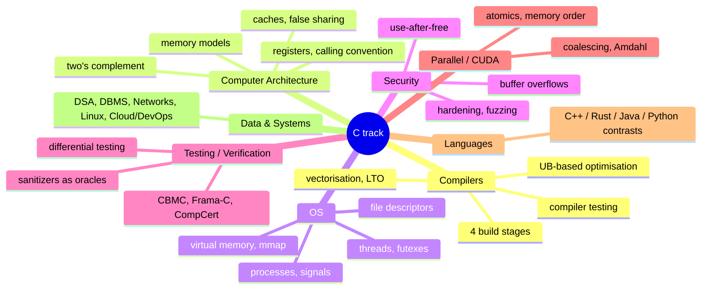

# Connections — how C links to the other tracks and to real projects

C is the "glue" track: most other systems topics become concrete in C. This file collects, in one place, the cross-links scattered through the lessons' "Connections" sections. Other tracks are named, not linked, because each track is its own repository.

---

## Track-by-track map

| Track | What connects | C lessons |
|---|---|---|
| **Compilers** | Preprocess → compile → assemble → link; translation phases; UB as optimiser axioms; alias analysis (TBAA, `restrict` → `noalias`); loop interchange/unroll-and-jam; vectorisation; inlining; Csmith/EMI; translation validation (Alive2); CompCert | B1, I4, I5, A1, A4, P4, P5 |
| **Computer Architecture** | Two's complement, word sizes, endianness; registers and the SysV calling convention; `call`/`ret`, red zone; CET shadow stacks; caches, lines, prefetching; MESI coherence; TSO vs weak memory models | B2, A1, A2, A6, P5 |
| **Operating Systems** | Virtual address space, `brk`/`mmap`, copy-on-write, ASLR; processes, `fork`/`exec`/`wait`, zombies; signals; file descriptors, page cache, `fsync`; threads, futex-based mutexes; `ptrace` for debuggers | B6, A3, A6, P1, P2, I7 |
| **Security** | Stack/heap overflows, use-after-free, double free, integer overflow → small allocations; CERT C rules; canaries, NX/W^X, PIE+ASLR, RELRO, FORTIFY, CET; fuzzing; `LD_PRELOAD` abuse | B4, I2, I3, A2, A3, P3, P4 |
| **Testing / Verification** | Sanitizers as run-time oracles; Valgrind; random and coverage-guided fuzzing; differential testing; delta debugging; bounded model checking (CBMC); deductive verification (Frama-C); verified compilation | I8, P4 |
| **Parallel / CUDA (PDS course)** | Data races, atomics, release/acquire; condition variables; false sharing; Amdahl's law; GPU analogues: `atomicAdd`, `__syncthreads`, scoped atomics, coalesced access, Compute Sanitizer | A6, P5, I8 |
| **DSA** | Arrays (O(1) indexing from contiguity), growable arrays (amortised doubling), linked lists (pointer-to-pointer deletion), hash tables (mini project 1), `qsort` comparators, recursion and stack depth; constant factors from caches | B3, B4, I1, I2, P5, exercises |
| **Linux** | Shell pipes and redirection (`pipe`, `dup2`), `$?` and exit statuses, `/proc/self/maps`, `strace`, `ldd`, `nm`, `objdump`, `readelf`, `ulimit` | B1, B6, I5, P1, P2, P3 |
| **Networks** | Byte order (big-endian network order, `put_be32`), sockets as descriptors, short reads/writes, `EINTR` | A1, P2 |
| **DBMS** | Fixed-size records and padding, `fsync` and write-ahead logging, buffer pool vs `mmap` (CIDR 2022 paper) | B7, P2 |
| **Cloud / DevOps** | Containers' `SIGTERM` graceful shutdown, PID 1 reaping, memory limits killing leaky processes, static binaries in images, Makefiles in CI, sanitizer jobs in CI | B6, I6, I8, P1, I5 |
| **C++** | `constexpr`, `nullptr`, `auto`, attributes and digit separators came from C++; RAII vs manual ownership; templates vs `void *` generics; union punning is UB in C++; `std::bit_cast` | I1, I2, A1, A5 |
| **Rust** | Ownership and borrowing as language rules (C's convention made checkable); slices = (pointer, length); defined overflow behaviour; `unsafe` re-admits C-like UB; `extern "C"` uses the SysV ABI; `cargo fuzz`, Miri, Kani | B4, I2, I3, A2, P4 |
| **Java** | Fixed `int` width and defined overflow; references = pointers without arithmetic; `NullPointerException` vs UB; JMM `volatile` ≈ C atomics; `ArrayList` growth; GC vs ownership | B2, B5, I2, A6 |
| **Python** | CPython is written in C; `ctypes`/C extensions follow the ABI and are `dlopen`ed; `subprocess` = fork/exec; `os.read/os.write`, `mmap` module; GIL vs real data races | A2, P1, P2, P3 |
| **Math for CS** | Modular arithmetic (unsigned wrap), two's complement, amortised analysis, Amdahl's law | B2, I2, P5 |
| **Git** | Checkouts change mtimes → `make` rebuild decisions | I6 |
| **Research skills** | Reading WG14 papers and standard drafts; the paper list in appendix.md; open problems in P5 | B1, P5, appendix |
| **Career skills** | interview-questions.md; explaining UB and memory clearly is a common systems-interview filter | all |
| **AI dev tools / ML / Quantum** | Mostly indirect: native extensions (NumPy, Qiskit's compiled parts) are C/C++/Rust loaded into Python via `dlopen`; performance lessons (P5) apply to numeric kernels | P3, P5 |

---

## Where this shows up in my projects

These connections are stated only where the concept genuinely applies; where a statement is an analogy or a suggestion rather than something the project does, the lesson says so.

| Project | Concepts from this track | Lessons |
|---|---|---|
| **compiler-fuzz** (UB-free random C generator; GCC vs Clang at `-O0/-O2/-O3`; ddmin reducer; planted-bug validation; UBSan-enabled tests) | Pinning `-std=` because compiler defaults differ (GCC 15 = `gnu23`); avoiding every UB class in generated code (signed overflow, shifts, aliasing, unsequenced writes) or a mismatch means nothing; UBSan as oracle; reading `-O0` vs `-O2` assembly to localise a miscompilation; classifying exit statuses vs signal deaths vs timeouts; capturing child output through pipes without hanging; arena allocation for ASTs; differential testing and delta debugging as the core architecture; loop transformations at `-O3` as likely bug sites | B1, B2, I3, I8, A1, A2, A3, A4, A5, P1, P2, P4, P5 |
| **Nidhogg / Logly** (Elasticsearch fleet ops console, NL log search) | Graceful shutdown on `SIGTERM` (handler-sets-flag pattern, by analogy); record formats and portable serialisation; reading large log files (`read` vs `mmap` trade-offs, by analogy) | B7, P1, P2 |
| **aws-waste-scanner** (AWS Lambda + Terraform, multi-account) | Memory caps and leaks in long-lived processes (analogy); Lambda packages with native `.so` dependencies must match the runtime's architecture and glibc; `.PHONY` Makefile targets; thread-safe collection of results from concurrent scans | B6, I5, I6, A6 |
| **QiskitSage** (multi-agent Qiskit PR reviewer on local Ollama) | Review concerns for native-extension code: alignment/aliasing in casts, exported-symbol/ABI changes in compiled layers loaded with `dlopen` (illustrative) | A1, P3 |
| **AURIXA, ARIA** | No genuine C-level connection; not forced. | — |

---

## Sources

- Each row's lessons list their own primary sources (WG14 N3220, GCC/Clang manuals, man7.org, papers).
- Project descriptions come from the shared rules file of the knowledge base this track belongs to (project summaries supplied by the learner).

## Verify yourself

1. Pick one row of the track table, open the referenced lessons, and write one paragraph explaining the connection in your own words.
2. For the compiler-fuzz row, list which of its features correspond to which lesson's example program.
