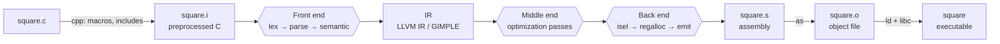

# 01 · What is a compiler? The big picture

> Level: beginner · Time: ~1.5 h · Prereqs: you can write and run a C program

## 1. Why this exists

A CPU understands only one language: the bit patterns of its instruction set (x86-64, ARM, RISC-V, NVIDIA SASS…). Humans do not want to write `0x0f 0xaf 0xff` to multiply two numbers. We want to write `x * x`, give the variable a name, put it in a function, and let *something* figure out registers, stack frames and addresses. That something is a **compiler**: a program that reads a program in one language and writes an equivalent program in another language.

Everything in this track — lexing, parsing, SSA, register allocation, compiler fuzzing — is the answer to one question: *how do you turn text a human wrote into machine code that does exactly what the text means, and does it fast?* The "exactly what the text means" half is where compiler testing (lesson 04-pro) lives. The "fast" half is optimization.

## 2. Intuition: a translation office

Imagine a translation office that converts Tamil legal contracts into English.

1. A clerk **reads the letters** and groups them into words — "this is a word, this is a number, this is punctuation". (Lexing.)
2. A grammarian **checks the sentence structure** — subject, verb, object; which clause belongs to which. (Parsing.)
3. A lawyer **checks the meaning** — does every person referenced actually exist in the contract? Is a date used where an amount was expected? (Semantic analysis.)
4. The office writes the contract into a **neutral internal format** that is easy to reason about. (Intermediate representation, IR.)
5. An editor **tightens it** — removes repeated clauses, precomputes totals — without changing the legal meaning. (Optimization.)
6. Finally, a writer **produces the English version** in the house style of the client. (Code generation for a specific CPU.)

The crucial rule of the office: step 5 may change *how* the contract reads, never *what it means*. A compiler bug is exactly an editor that silently changed the meaning.

## 3. Precise definition

A **compiler** is a program that translates a program *P* written in a source language *S* into a program *P′* in a target language *T* such that, for every input on which *P* has defined behaviour, *P′* has the same observable behaviour. "Observable behaviour" for C is defined by the C standard (roughly: accesses to `volatile` objects, data written to files, and interactive I/O) — the compiler may change everything else.

Related programs:

| Program | Input → Output | Example |
|---|---|---|
| Compiler | source → lower-level code, ahead of time | `gcc`, `clang`, `rustc`, `nvcc` |
| Interpreter | source → *executes it directly*, no target program | CPython's bytecode loop, `bash` |
| JIT compiler | compiles at run time, while the program runs | Java HotSpot, the CUDA driver compiling PTX |
| Transpiler / source-to-source | source → source in another high-level language | TypeScript → JavaScript |
| Assembler | assembly text → machine-code object file | `as` |
| Linker | many object files → one executable/library | `ld`, `lld`, `mold` |

A modern compiler is split into three parts:

* **Front end**: understands the *source* language (lexing, parsing, semantic analysis), produces IR.
* **Middle end**: language- and machine-independent optimizations on the IR.
* **Back end**: understands the *target* machine (instruction selection, register allocation, scheduling, emission).

Why the split? With *M* languages and *N* machines, one-compiler-per-pair needs *M × N* compilers. With a shared IR you need *M* front ends + *N* back ends. This is the core idea behind LLVM (Lattner & Adve, CGO 2004) and GCC's GENERIC/GIMPLE/RTL design.

## 4. Step by step: watch a real compiler work

The "compiler" you type (`gcc`, `clang`) is really a **driver**: a small program that runs several tools in sequence. Clang will print its plan for you:

```text
$ clang -ccc-print-phases square.c
            +- 0: input, "square.c", c
         +- 1: preprocessor, {0}, cpp-output
      +- 2: compiler, {1}, ir
   +- 3: backend, {2}, assembler
+- 4: assembler, {3}, object
5: linker, {4}, image
```

(Output from Clang 18.1.3 in this sandbox.) Read it bottom-up: to make the final `image` (executable), the linker needs an `object`, which the assembler makes from assembly text, which the backend makes from `ir`, which the compiler proper makes from preprocessed C.

Here is the program we will push through each stage:

```c
// file: square.c
// A tiny program used to watch each compiler stage.
#include <stdio.h>      // the preprocessor will paste stdio.h's declarations here
#define FACTOR 2        // a macro: the preprocessor replaces FACTOR with 2

// square: returns x*x. Logic: one multiplication, no side effects.
int square(int x) { return x * x; }

int main(void) {
    // Prints square(3) * FACTOR = 9 * 2 = 18
    printf("%d\n", square(3) * FACTOR);
    return 0;
}
```

### Stage 1 — preprocessing (`gcc -E`)

The C preprocessor is a text-substitution pass that runs *before* the real compiler sees anything. It handles `#include`, `#define`, `#if`, and it strips comments. The tail of `gcc -E square.c`:

```text
# 7 "square.c"
int square(int x) { return x * x; }

int main(void) {

    printf("%d\n", square(3) * 2);
    return 0;
}
```

`FACTOR` is gone — replaced by `2`. The comments are gone too (the blank lines are where they were). The `# 7 "square.c"` line is a *line marker* saying "the next line came from line 7 of square.c", so later error messages can point at your original file. Above it are hundreds of lines pasted from `stdio.h`.

### Stage 2 — compilation proper (`gcc -S`)

This is where lexing, parsing, semantic analysis, IR, optimization and code generation all happen. The output is assembly text. With `-O1`, GCC 13.3 produced (directives trimmed):

```text
square:
	endbr64
	imull	%edi, %edi        # x = x * x   (x arrives in register edi)
	movl	%edi, %eax        # return value goes in eax
	ret
main:
	endbr64
	subq	$8, %rsp
	movl	$18, %edx         # square(3)*2 was computed at COMPILE time: 18
	leaq	.LC0(%rip), %rsi  # address of "%d\n"
	movl	$2, %edi
	movl	$0, %eax
	call	__printf_chk@PLT  # Ubuntu's default _FORTIFY_SOURCE swapped printf for a checked variant
	movl	$0, %eax          # return 0
	addq	$8, %rsp
	ret
```

Two lessons hide in this output:

1. `main` never calls `square`. The optimizer **inlined** it and **constant-folded** `3*3*2` into `18`. The machine code is different from the source, but the observable behaviour (printing `18`) is the same. That is the contract.
2. `printf` became `__printf_chk`. Your distribution's compiler defaults (here Ubuntu enabling `_FORTIFY_SOURCE` at `-O1`+) change the program too. "What the compiler does" depends on version, flags *and* distro configuration — always record all three in a bug report.

### Stage 3 — assembling (`gcc -c`)

The assembler turns text into an **object file**: machine code plus a symbol table plus *relocations* (holes to be filled in later).

```text
$ gcc -c square.c && file square.o && nm square.o
square.o: ELF 64-bit LSB relocatable, x86-64, version 1 (SYSV), not stripped
0000000000000013 T main
                 U printf
0000000000000000 T square
```

`T` means "defined in the text (code) section"; `U` means "used here but **u**ndefined — someone else must provide it". (At `-O0` it is plain `printf`; the `__printf_chk` swap only happens with optimization.)

### Stage 4 — linking

```text
$ gcc square.o -o square && ./square
18
```

The linker finds `printf` in the C library, patches the call site, and lays out the final executable. Lesson 03-advanced/03 covers this in depth.

### The full map



And the M×N argument as a picture:

```text
  C ──┐                     ┌── x86-64
 C++ ─┼──► [ shared IR ] ───┼── AArch64
Rust ─┤    (optimize once)  ├── RISC-V
Swift ┘                     └── NVPTX (GPU)
 M front ends        +        N back ends   (instead of M × N compilers)
```

## 5. Code: a 20-line "compiler" to demystify the word

To prove a compiler is "just a program that writes a program", here is a C program that reads a sum like `1+2+40` and *emits* an x86-64 assembly program that returns that sum as the process exit code. It skips everything clever, but it has the shape of a real compiler: read source, check it, emit target code.

```c
// file: tinycc.c
// A toy compiler: input "1+2+40" on argv[1] -> x86-64 assembly on stdout.
// The generated program's exit status is the value of the sum.
#include <stdio.h>
#include <stdlib.h>
#include <ctype.h>

int main(int argc, char **argv) {
    if (argc != 2) { fprintf(stderr, "usage: %s 'expr'\n", argv[0]); return 1; }
    const char *p = argv[1];

    // Emit the fixed prologue: a global function called main.
    printf("    .globl main\nmain:\n");

    // First operand must be a number; strtol parses it and advances p.
    if (!isdigit((unsigned char)*p)) { fprintf(stderr, "expected number\n"); return 1; }
    printf("    movl $%ld, %%eax\n", strtol(p, (char **)&p, 10));

    // Then any number of "+N" or "-N": emit one add/sub instruction each.
    while (*p) {
        char op = *p++;
        if ((op != '+' && op != '-') || !isdigit((unsigned char)*p)) {
            fprintf(stderr, "syntax error near '%c'\n", op);
            return 1;
        }
        long n = strtol(p, (char **)&p, 10);
        printf("    %s $%ld, %%eax\n", op == '+' ? "addl" : "subl", n);
    }

    // Return: the value in eax becomes main's return value = exit status.
    printf("    ret\n");
    printf("    .section .note.GNU-stack,\"\",@progbits\n"); // mark stack non-executable
    return 0;
}
```

Run it:

```text
$ gcc -o tinycc tinycc.c
$ ./tinycc '1+2+40' > out.s && cat out.s
    .globl main
main:
    movl $1, %eax
    addl $2, %eax
    addl $40, %eax
    ret
    .section .note.GNU-stack,"",@progbits
$ gcc out.s -o out && ./out; echo "exit=$?"
exit=43
```

Logic recap: the loop is a (very small) **lexer** (it recognises numbers and `+`/`-`), a (very small) **parser** (it enforces "number, then operator-number pairs"), and a **code generator** (one instruction per operator). Lessons 02–05 replace each part with the real technique.

## 6. Common mistakes

* **"The compiler runs my code."** No — a compiler *translates*; running happens later. Confusing the two causes confusion about compile-time vs run-time errors.
* **Thinking `gcc` is one program.** It is a driver for `cc1` (compiler proper), `as`, and `collect2`/`ld`. Run `gcc -v square.c` to see each sub-command.
* **Expecting the binary to "look like" the source.** Inlining, constant folding, and reordering are allowed as long as observable behaviour is preserved. Debugging optimized code is hard for this reason; use `-O0 -g` while learning.
* **Forgetting the preprocessor is dumb text substitution.** `#define SQ(x) x*x` then `SQ(1+2)` gives `1+2*1+2 = 5`, not 9.
* **Reporting "GCC miscompiles my code" without the version, flags and distro defaults.** As the `__printf_chk` example shows, defaults differ between builds.

## 7. Connections

* **C track**: the preprocessor, translation units, and `static`/`extern` linkage are what the compiler pipeline consumes.
* **Computer Architecture track**: the back end targets an ISA; registers, calling conventions and pipelines shape code generation.
* **OS track**: the loader that maps your executable into memory and the dynamic linker (lesson 03-advanced/03).
* **Testing/Verification track**: the "same observable behaviour" contract is the oracle used in differential testing (04-pro).

### Where this shows up in my projects

**compiler-fuzz** compares GCC and Clang at `-O0/-O2/-O3`. It relies on the exact contract from §3: for a program without undefined behaviour, every compiler and every optimization level must produce the same observable output. When they disagree, at least one translation broke the contract.

## 8. Self-check

1. Why do compilers use an intermediate representation instead of translating source straight to machine code?
2. In the `-O1` output above, where did the call to `square` go?
3. What does `U printf` in `nm` output mean, and who resolves it?
4. Give one difference between a JIT compiler and an ahead-of-time compiler.
5. If `-O0` prints 18 and `-O2` prints 19 for a program, is that always a compiler bug?

<details><summary>Answers</summary>

1. To reduce M×N language/machine pairs to M+N components, and because a neutral, simple IR is far easier to analyse and optimize than either source text or machine code.
2. It was inlined into `main` and the whole expression `square(3)*2` was constant-folded to `18` at compile time.
3. The symbol `printf` is referenced but not defined in this object file; the linker (static or dynamic) resolves it, here from the C library.
4. A JIT compiles while the program is running (so it can use run-time information, at the cost of start-up time); an AOT compiler finishes translation before the program ever runs.
5. No. If the program has undefined behaviour (lesson 03-advanced/04), the standard places no requirements on it, so different outputs are permitted. It is a bug only if the program is UB-free.

</details>

## 9. Mnemonic (Tamil + English)

**"Lakshmi Paati's Sambar, Idli, Oothappam, Chutney"** — a tiffin menu served in the same order as the compiler phases: **L**ex → **P**arse → **S**emantic → **I**R → **O**ptimize → **C**odegen. Paati never serves chutney before the idli is made, and a compiler never emits code before it has built the IR.

## Sources

* Clang driver documentation (`-ccc-print-phases`, driver design): https://clang.llvm.org/docs/DriverInternals.html
* C. Lattner, V. Adve, "LLVM: A Compilation Framework for Lifelong Program Analysis & Transformation", CGO 2004: https://llvm.org/pubs/2004-01-30-CGO-LLVM.html
* GCC Internals, "Passes and Files of the Compiler": https://gcc.gnu.org/onlinedocs/gccint/Passes.html
* ISO/IEC 9899:201x (C11) committee draft N1570 — definitions of undefined/unspecified behaviour (§3.4) and observable behaviour (§5.1.2.3): https://www.open-std.org/jtc1/sc22/wg14/www/docs/n1570.pdf
* Aho, Lam, Sethi, Ullman, *Compilers: Principles, Techniques, and Tools*, 2nd ed., ch. 1 "Introduction": https://www.pearson.com/store/en-us/p/compilers-principles-techniques-and-tools/P200000003472
* Cooper & Torczon, *Engineering a Compiler*, 3rd ed. (2022), ch. 1 "Overview of Compilation": https://shop.elsevier.com/books/engineering-a-compiler/cooper/978-0-12-815412-0

## Verify yourself

```bash
# file: verify-01.sh
# Re-run every claim in this lesson. Tested with GCC 13.3 and Clang 18.1.3 (Ubuntu 24.04), Nov 2026.
clang -ccc-print-phases square.c            # the 6-phase plan shown in §4
gcc -E square.c | tail -9                   # FACTOR replaced by 2, comments stripped
gcc -S -O1 square.c -o - | grep -E 'movl\s+\$18|call'   # constant 18 and the printf call
gcc -c square.c && nm square.o              # T main, T square, U printf
gcc -v square.c -o square 2>&1 | grep -E 'cc1|as |collect2' | cut -c1-80   # the driver's sub-tools
gcc -o tinycc tinycc.c && ./tinycc '1+2+40' > out.s && gcc out.s -o out; ./out; echo "exit=$?"   # 43
```

Check against sources: compare the observable-behaviour definition with N1570 §5.1.2.3; compare the front/middle/back split with the GCC Internals pass overview.
