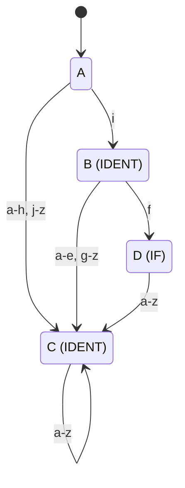

# 02 · Lexing: from characters to tokens

> Level: beginner · Time: ~2 h · Prereqs: lesson 01; C strings and `switch`

## 1. Why this exists

A source file is just a long string of characters: `l`, `e`, `t`, ` `, `x`, … A parser that had to think about individual characters would drown in detail — "is this space significant? is `<` the start of `<=`? is `let` a keyword or the start of the variable `letter`?" So compilers first run a **lexer** (also called a scanner or tokenizer) that groups characters into **tokens**: `LET`, `IDENT(x)`, `ASSIGN`, `INT(10)`, `SEMI`. Whitespace and comments vanish here. Everything after this point works on a clean stream of tokens.

## 2. Intuition: reading a sentence

When you read *"letterbox"* you don't see `l-e-t-t-e-r-b-o-x`; you see one word. You also don't stop after `let` and declare "verb!" — you keep reading until the word ends. That is **maximal munch**: always take the *longest* possible token. And when you see *"let"* standing alone, you know it's a keyword, not a name, because you have a dictionary of reserved words. A lexer is that reading reflex, written as a program.

## 3. Precise definitions

* **Token**: a pair *(kind, attribute)*, e.g. `(INT, 10)` or `(IDENT, "x")`. Kinds are a small fixed set.
* **Lexeme**: the actual characters that formed the token: `10`, `x`.
* **Pattern**: the rule describing which lexemes belong to a kind, usually a **regular expression**: `[0-9]+` for integers, `[A-Za-z_][A-Za-z0-9_]*` for identifiers.
* **Regular expression** over an alphabet Σ: built from ε (empty string), single characters, and three operators — concatenation `rs`, alternation `r|s`, and Kleene star `r*` (zero or more). Shorthand like `r+` (= `rr*`), `r?` (= `r|ε`) and classes `[0-9]` are sugar.
* **Finite automaton**: a set of states, a start state, accepting states, and a transition function. A **DFA** (deterministic) has exactly one next state per (state, character); an **NFA** may have several, plus ε-moves.
* **Kleene's theorem**: regular expressions, NFAs and DFAs describe exactly the same class of languages — the *regular languages*.

Two disambiguation rules make a set of patterns into a usable lexer (these are exactly the rules `flex` documents):

1. **Longest match**: "If it finds more than one match, it takes the one matching the most text."
2. **Rule priority**: "If it finds two or more matches of the same length, the rule listed first in the flex input file is chosen." That is why keywords are listed *before* the identifier rule.

## 4. Step by step: the dumbest approach and why it breaks

**Attempt 1 — split on spaces.** `strtok(src, " ")` on `let x=10;` gives `let`, `x=10;`. Programmers don't put spaces around everything, so this fails immediately.

**Attempt 2 — one character at a time.** Treat each character as a token. Now `>=` becomes `>` and `=`, and `10` becomes `1`,`0`. The parser would have to reassemble them — we've just moved the problem.

**Attempt 3 — try every pattern with a regex library, at every position.** Correct, but backtracking regex engines can be exponential: Russ Cox shows Perl/PCRE/Python taking O(2ⁿ) time on the pattern a?ⁿaⁿ, while Thompson's 1968 NFA simulation needs only O(mn). Also slow because we restart each pattern at every position.

**The wall forces the real idea:** combine *all* token patterns into *one* automaton, run it once over the input, remember the last accepting state seen (for longest match), and use rule order to break ties. That automaton is built in three classic steps:

1. **Regex → NFA** (Thompson's construction): each regex operator becomes a small NFA fragment glued with ε-edges.
2. **NFA → DFA** (subset construction): each DFA state is the *set* of NFA states you could be in.
3. **DFA minimisation** (Hopcroft's algorithm): merge states that behave identically.

### Worked example: `if` vs identifiers

Patterns: rule 1 `if` (keyword), rule 2 `[a-z]+` (identifier). The combined NFA:

```text
          i        f
   ┌──► (1) ──► (2) ──► ((3)) accept IF
 (0) ε
   └──► (4) ──[a-z]──► ((5)) accept IDENT
                 ▲        │
                 └─[a-z]──┘
```

Subset construction (track sets of NFA states):

| DFA state | NFA set | on `i` | on `f` | on other `[a-z]` | accepts |
|---|---|---|---|---|---|
| A | {0,1,4} | B | C | C | — |
| B | {2,5} | C | D | C | IDENT |
| C | {5} | C | C | C | IDENT |
| D | {3,5} | C | C | C | IF and IDENT → **IF** wins (rule 1 listed first) |

Run it on `iffy`: A –i→ B –f→ D (accepting, remember "IF at length 2") –f→ C (accepting IDENT, length 3) –y→ C (IDENT, length 4) → end. The *last* accepting point is length 4 → one token `IDENT(iffy)`. Longest match beat the keyword, which is exactly what we want.



### Hand-written vs generated

Industrial compilers usually **hand-write** their lexers: Clang's `Lexer.cpp` and GCC's C-family lexer are hand-written, because hand code gives better error messages, speed and control over tricky cases (C's preprocessor, raw strings). Generators like `flex` or `re2c` are excellent for DSLs and quick prototypes. You should know both.

## 5. Code

### 5.1 A hand-written lexer for Tiny

"Tiny" is the toy language we grow across lessons 02–05: integers, variables, `let`, `print`, `if/else`, `while`, arithmetic and comparison operators, `#` comments.

```c
// file: lexer.c
// Hand-written lexer for "Tiny", the toy language used in lessons 02-05.
// Input: source text. Output: one token per line: KIND 'lexeme' line:col
#include <stdio.h>
#include <string.h>
#include <ctype.h>

typedef enum {                      // every kind of token Tiny has
    T_INT, T_IDENT, T_LET, T_PRINT, T_IF, T_ELSE, T_WHILE,
    T_PLUS, T_MINUS, T_STAR, T_SLASH, T_ASSIGN, T_EQ, T_NE,
    T_LT, T_LE, T_GT, T_GE, T_LPAREN, T_RPAREN, T_LBRACE, T_RBRACE,
    T_SEMI, T_EOF, T_ERROR
} Kind;

static const char *kind_name[] = {
    "INT","IDENT","LET","PRINT","IF","ELSE","WHILE",
    "PLUS","MINUS","STAR","SLASH","ASSIGN","EQ","NE",
    "LT","LE","GT","GE","LPAREN","RPAREN","LBRACE","RBRACE",
    "SEMI","EOF","ERROR"
};

typedef struct {                    // a token = kind + where its text is
    Kind kind;
    const char *start;              // points into the source buffer (no copy)
    int len, line, col;
} Token;

static const char *src;             // current position in the source
static int line = 1, col = 1;

// advance one character, keeping line/column up to date
static char next(void) {
    char c = *src++;
    if (c == '\n') { line++; col = 1; } else col++;
    return c;
}

// keyword table: identifiers are checked against this after being scanned
static Kind keyword(const char *s, int n) {
    static const struct { const char *w; Kind k; } kw[] = {
        {"let",T_LET},{"print",T_PRINT},{"if",T_IF},{"else",T_ELSE},{"while",T_WHILE}};
    for (size_t i = 0; i < sizeof kw / sizeof kw[0]; i++)
        if ((int)strlen(kw[i].w) == n && strncmp(kw[i].w, s, n) == 0) return kw[i].k;
    return T_IDENT;
}

Token lex(void) {
    // 1. skip whitespace and '#' comments (they produce no tokens)
    for (;;) {
        if (*src == ' ' || *src == '\t' || *src == '\n' || *src == '\r') next();
        else if (*src == '#') { while (*src && *src != '\n') next(); }
        else break;
    }
    Token t = { T_EOF, src, 0, line, col };
    if (*src == '\0') return t;

    char c = next();
    // 2. numbers: longest run of digits (maximal munch)
    if (isdigit((unsigned char)c)) {
        while (isdigit((unsigned char)*src)) next();
        t.kind = T_INT;
    }
    // 3. identifiers/keywords: letter or _ followed by letters, digits, _
    else if (isalpha((unsigned char)c) || c == '_') {
        while (isalnum((unsigned char)*src) || *src == '_') next();
        t.kind = keyword(t.start, (int)(src - t.start));
    }
    // 4. operators: look one char ahead to choose between '<' and '<=' etc.
    else switch (c) {
        case '+': t.kind = T_PLUS; break;   case '-': t.kind = T_MINUS; break;
        case '*': t.kind = T_STAR; break;   case '/': t.kind = T_SLASH; break;
        case '(': t.kind = T_LPAREN; break; case ')': t.kind = T_RPAREN; break;
        case '{': t.kind = T_LBRACE; break; case '}': t.kind = T_RBRACE; break;
        case ';': t.kind = T_SEMI; break;
        case '=': if (*src == '=') { next(); t.kind = T_EQ; } else t.kind = T_ASSIGN; break;
        case '!': if (*src == '=') { next(); t.kind = T_NE; } else t.kind = T_ERROR; break;
        case '<': if (*src == '=') { next(); t.kind = T_LE; } else t.kind = T_LT; break;
        case '>': if (*src == '=') { next(); t.kind = T_GE; } else t.kind = T_GT; break;
        default:  t.kind = T_ERROR;          // unknown character: report, keep going
    }
    t.len = (int)(src - t.start);
    return t;
}

int main(void) {
    // the program to tokenize (a real compiler would read a file)
    src = "let x = 10;   # a comment\n"
          "while (x >= 1) { print x*2; x = x - 1; }\n"
          "y <= 3 @";
    for (;;) {
        Token t = lex();
        printf("%-7s '%.*s' %d:%d\n", kind_name[t.kind], t.len, t.start, t.line, t.col);
        if (t.kind == T_EOF) break;
    }
    return 0;
}
```

Logic walk-through:

* **Skipping**: whitespace and comments are consumed in a loop *before* each token, so they never reach the parser.
* **Maximal munch** for numbers and names: keep consuming while the next character still fits.
* **Keywords** are recognised *after* scanning a full identifier — so `letter` stays an identifier (the scan doesn't stop at `let`). This is the hand-written equivalent of "longest match first, then rule priority".
* **One-character lookahead** (`*src == '='`) decides `<` vs `<=`. Most C-like languages need only one or two characters of lookahead in the lexer.
* **Errors don't stop the lexer**: `@` becomes an `ERROR` token with a precise `line:col`, so the compiler can report several errors in one run.
* Tokens hold a pointer + length into the source rather than a copied string — zero allocation, which is also what Clang does with its `SourceLocation`s.

Output (GCC 13.3, `gcc -Wall -Wextra -std=c11`):

```text
LET     'let' 1:1
IDENT   'x' 1:5
ASSIGN  '=' 1:7
INT     '10' 1:9
SEMI    ';' 1:11
WHILE   'while' 2:1
LPAREN  '(' 2:7
IDENT   'x' 2:8
GE      '>=' 2:10
INT     '1' 2:13
RPAREN  ')' 2:14
LBRACE  '{' 2:16
PRINT   'print' 2:18
IDENT   'x' 2:24
STAR    '*' 2:25
INT     '2' 2:26
SEMI    ';' 2:27
IDENT   'x' 2:29
ASSIGN  '=' 2:31
IDENT   'x' 2:33
MINUS   '-' 2:35
INT     '1' 2:37
SEMI    ';' 2:38
RBRACE  '}' 2:40
IDENT   'y' 3:1
LE      '<=' 3:3
INT     '3' 3:6
ERROR   '@' 3:8
EOF     '' 3:9
```

### 5.2 The same idea as a DFA table

Lexer generators produce a *table*. Here is a minimal table-driven DFA that classifies whole strings, so you can see the machinery behind §4:

```c
// file: dfa.c
// Table-driven DFA that classifies a whole string as INT, IDENT, or rejects it.
// This is what lexer generators like flex build automatically from regexes.
#include <stdio.h>
#include <ctype.h>

enum { S_START, S_INT, S_IDENT, S_DEAD, NSTATES };   // DFA states
enum { C_DIGIT, C_LETTER, C_OTHER, NCLASSES };       // input character classes

// map a character to its class (shrinks the table from 256 columns to 3)
static int cls(char c) {
    if (isdigit((unsigned char)c)) return C_DIGIT;
    if (isalpha((unsigned char)c) || c == '_') return C_LETTER;
    return C_OTHER;
}

// delta[state][class] = next state. Row = where we are, column = what we read.
static const int delta[NSTATES][NCLASSES] = {
    /* START */ { S_INT,  S_IDENT, S_DEAD },
    /* INT   */ { S_INT,  S_DEAD,  S_DEAD },   // "12a" is not an INT
    /* IDENT */ { S_IDENT,S_IDENT, S_DEAD },
    /* DEAD  */ { S_DEAD, S_DEAD,  S_DEAD },   // trap state: never accepts
};

static const char *classify(const char *s) {
    int st = S_START;
    for (; *s; s++) st = delta[st][cls(*s)];  // one table lookup per character
    return st == S_INT ? "INT" : st == S_IDENT ? "IDENT" : "reject";
}

int main(void) {
    const char *tests[] = { "42", "x1", "_tmp", "12a", "", "a-b" };
    for (int i = 0; i < 6; i++) printf("%-6s -> %s\n", tests[i], classify(tests[i]));
    return 0;
}
```

```text
42     -> INT
x1     -> IDENT
_tmp   -> IDENT
12a    -> reject
       -> reject
a-b    -> reject
```

Logic: the inner loop is a single array lookup per character — O(n) for input length n, no backtracking, no matter how many patterns were compiled into the table. *Character classes* compress the 256-column table; flex does the same ("equivalence classes").

### 5.3 The same tokens with flex

```c
/* file: tiny.l */
/* flex specification for the same Tiny tokens. flex turns these regexes into a DFA. */
%option noyywrap nounput noinput yylineno
%%
"let"|"print"|"if"|"else"|"while"   { printf("KEYWORD '%s'\n", yytext); }
[0-9]+                              { printf("INT     '%s'\n", yytext); }
[A-Za-z_][A-Za-z0-9_]*              { printf("IDENT   '%s'\n", yytext); }
"=="|"!="|"<="|">="                 { printf("OP2     '%s'\n", yytext); }
[-+*/=<>(){};]                      { printf("OP1     '%s'\n", yytext); }
"#".*                               { /* comment: discard */ }
[ \t\r\n]+                          { /* whitespace: discard */ }
.                                   { printf("ERROR   '%s' line %d\n", yytext, yylineno); }
%%
int main(void) { yylex(); return 0; }
```

```text
$ flex -o tiny.yy.c tiny.l && gcc -o tinylex tiny.yy.c
$ printf 'let letter = 10; # hi\nif (letter<=3) print letter @\n' | ./tinylex
KEYWORD 'let'
IDENT   'letter'
OP1     '='
INT     '10'
OP1     ';'
KEYWORD 'if'
OP1     '('
IDENT   'letter'
OP2     '<='
INT     '3'
OP1     ')'
KEYWORD 'print'
IDENT   'letter'
ERROR   '@' line 2
```

Notice `letter` → `IDENT` (longest match beats the 3-char keyword `let`), and `let` → `KEYWORD` (same length as the identifier match, keyword rule listed first wins). `yytext` is flex's pointer to the current lexeme. `%option yylineno` makes flex track line numbers for you.

## 6. Common mistakes

* **Checking keywords before finishing the identifier** → `letter` lexes as `LET` + `ter`. Always scan the longest identifier, *then* look it up.
* **Putting the identifier rule above keywords in flex** → keywords become identifiers, because same-length ties go to the earlier rule.
* **Forgetting the EOF token** → the parser reads past the end of the buffer.
* **Passing a plain `char` to `isdigit`** → undefined behaviour for negative `char` values (e.g. UTF-8 bytes on signed-`char` platforms). Cast to `unsigned char`, as the code does.
* **Assuming lexing is context-free in every language.** C's `typedef` problem: whether `T * x;` is a multiplication or a declaration depends on whether `T` was declared a type — the classic "lexer hack" feeds symbol-table information back into the lexer. Python's significant indentation needs the lexer to emit synthetic `INDENT`/`DEDENT` tokens.
* **Using backtracking regexes on untrusted input** → catastrophic slowdowns (ReDoS). DFA-based matching is linear.

## 7. Connections

* **Math for CS track**: regular languages, DFAs/NFAs, closure properties, the pumping lemma (why balanced parentheses are *not* regular — hence parsers, lesson 03).
* **Security track**: ReDoS and input validation; fuzzers generate token-level mutations.
* **Python track**: Python's `tokenize` module exposes CPython's tokenizer, including `INDENT`/`DEDENT`.
* **DSA track**: the keyword lookup is a classic place for a perfect hash function (GNU `gperf` exists to generate exactly such reserved-word tables).

Clang will even show you its own token stream — `clang -fsyntax-only -Xclang -dump-tokens t.c` on `int x = 10;` prints `int 'int'`, `identifier 'x'`, `equal '='`, `numeric_constant '10'`, `semi ';'`, `eof ''`, each with a `Loc=<t.c:line:col>` — the same idea as our `line:col`.

## 8. Self-check

1. What is the difference between a token and a lexeme?
2. Why does `iffy` become one identifier and not `IF` + `fy`?
3. Why do lexer generators convert the NFA to a DFA instead of simulating the NFA?
4. Give one reason production compilers hand-write their lexers.
5. Can a lexer alone check that parentheses are balanced? Why or why not?

<details><summary>Answers</summary>

1. A token is the classified unit `(kind, attribute)`; the lexeme is the exact source text that produced it.
2. Longest match: the DFA keeps running past the accepting `IF` state and the last accepting state seen is IDENT at length 4.
3. A DFA has exactly one state at a time, so each character costs one table lookup; NFA simulation tracks a set of states per character.
4. Better error messages and recovery, speed, and handling of language quirks (C preprocessor, context-dependent tokens) that are awkward in a generator.
5. No. Balanced parentheses need unbounded counting, which no finite automaton can do (it is not a regular language). That is the parser's job.

</details>

## 9. Mnemonic (Tamil + English)

**"Neelam mukkiyam, appuram munnurimai"** — *length first, then priority*. Like a queue at the ration shop: the person with the **longest** list (longest match) is served; if two lists are equally long, the one who **came first** (earlier rule) goes first.

## Sources

* Flex manual, "How the input is matched": https://westes.github.io/flex/manual/Matching.html
* Russ Cox, "Regular Expression Matching Can Be Simple And Fast" (2007), citing K. Thompson, "Regular expression search algorithm", CACM 11(6), 1968: https://swtch.com/~rsc/regexp/regexp1.html
* Aho, Lam, Sethi, Ullman, *Compilers: Principles, Techniques, and Tools*, 2nd ed., ch. 3 "Lexical Analysis": https://www.pearson.com/store/en-us/p/compilers-principles-techniques-and-tools/P200000003472
* Cooper & Torczon, *Engineering a Compiler*, 3rd ed., ch. 2 "Scanners": https://shop.elsevier.com/books/engineering-a-compiler/cooper/978-0-12-815412-0
* Stanford CS143 lectures 3–4, "Lexical Analysis" and "Implementation of Lexical Analysis": https://web.stanford.edu/class/cs143/
* LLVM Kaleidoscope tutorial ch. 1, "Kaleidoscope Introduction and the Lexer" (a hand-written lexer in C++): https://llvm.org/docs/tutorial/MyFirstLanguageFrontend/index.html

## Verify yourself

```bash
# file: verify-02.sh
# Tested with GCC 13.3 and flex 2.6.4 on Ubuntu 24.04, Nov 2026.
gcc -Wall -Wextra -std=c11 -o lexer lexer.c && ./lexer          # matches the token listing in 5.1
gcc -Wall -Wextra -o dfa dfa.c && ./dfa                          # 12a -> reject
flex -o tiny.yy.c tiny.l && gcc -o tinylex tiny.yy.c
printf 'let letter = 10;\n' | ./tinylex                          # KEYWORD let, IDENT letter
# Show that Clang's real lexer produces tokens too:
printf 'int x = 10;\n' > t.c && clang -fsyntax-only -Xclang -dump-tokens t.c 2>&1 | head -6
```

Check against sources: the two disambiguation rules against the flex manual page; the O(mn) vs O(2ⁿ) claim against Cox's article.
