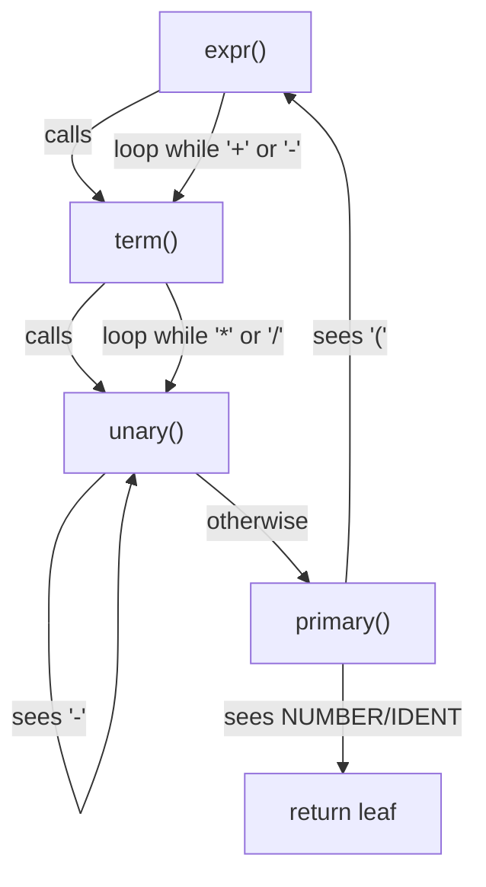

# 03 · Parsing basics: grammars and recursive descent

> Level: beginner · Time: ~2.5 h · Prereqs: lesson 02 (tokens); recursion in C

## 1. Why this exists

The lexer gave us a flat list: `INT(1) PLUS INT(2) STAR INT(3)`. But meaning lives in *structure*: does `1 + 2 * 3` mean `(1+2)*3 = 9` or `1+(2*3) = 7`? Is the `else` in `if (a) if (b) x; else y;` attached to the first `if` or the second? A **parser** turns the flat token list into a tree that answers these questions, and rejects programs whose structure is illegal (`1 + * 2`). Lexing could not do this: lesson 02 showed that finite automata cannot even count nested parentheses.

## 2. Intuition: sentence diagrams

In school grammar, "The boy who ate the mango smiled" is diagrammed as *[The boy [who ate the mango]] [smiled]* — the relative clause hangs off "boy". A parser draws the same kind of diagram for code. The rules of the diagram ("a sentence is a noun phrase followed by a verb phrase") are a **grammar**. Precedence is just a grammar rule saying "multiplication phrases sit *inside* addition phrases".

## 3. Precise definitions

A **context-free grammar (CFG)** is a 4-tuple *G = (N, Σ, P, S)*:

* *N* — **nonterminals** (syntactic categories such as `expr`, `stmt`),
* *Σ* — **terminals** (token kinds from the lexer),
* *P* — **productions** `A → α`, where `A ∈ N` and `α` is a string of terminals and nonterminals,
* *S ∈ N* — the start symbol.

A **derivation** rewrites one nonterminal at a time using a production. *Leftmost* derivations always rewrite the leftmost nonterminal. A **parse tree** records the derivation as a tree: interior nodes are nonterminals, leaves are terminals, read left-to-right they give the input. A grammar is **ambiguous** if some input has two different parse trees.

Notation: **BNF** writes productions as `<expr> ::= <expr> "+" <term>`; **EBNF** adds `{ x }` (zero or more), `[ x ]` (optional) and `( a | b )` grouping, which maps directly onto loops and `if`s in code.

## 4. Step by step: from an ambiguous grammar to a working parser

### Step 1 — the dumbest grammar

```text
E → E + E | E - E | E * E | E / E | ( E ) | num
```

It accepts exactly the right *strings*, but `1 + 2 * 3` has two parse trees:

```text
      E                         E
    / | \                     / | \
   E  +  E                   E  *  E
   |   / | \               / | \    |
   1  E  *  E             E  +  E   3
      |     |             |     |
      2     3             1     2
   = 1 + (2*3) = 7        = (1+2) * 3 = 9
```

**What's annoying:** the grammar does not say which one we mean. An ambiguous grammar cannot drive a deterministic parser.

### Step 2 — stratify by precedence

Give each precedence level its own nonterminal. Lower levels (looser binding) are *closer to the root*:

```text
E → E + T | E - T | T          (additive level)
T → T * F | T / F | F          (multiplicative level)
F → ( E ) | num                (atoms)
```

Now `*` can only appear inside a `T`, which sits inside an `E`, so `1 + 2 * 3` has exactly one tree. Writing `E + T` (not `T + E`) puts the recursion on the **left**, which makes `8 - 3 - 2` group as `(8-3)-2` — **left associativity**.

### Step 3 — the wall: left recursion

The most natural way to code a grammar is **recursive descent**: one C function per nonterminal, calling each other as the productions say. Translate `E → E + T` literally:

```c
void E(void) { E(); expect('+'); T(); }   /* calls itself before consuming anything */
```

`E` calls `E` calls `E`… without consuming a token — infinite recursion, stack overflow. **Left recursion kills recursive descent.**

### Step 4 — eliminate left recursion

The standard rewrite: `A → A α | β` becomes `A → β A'`, `A' → α A' | ε`. In EBNF that is simply "a β followed by zero or more α":

```text
expr    → term  { ('+' | '-') term }
term    → unary { ('*' | '/') unary }
unary   → '-' unary | primary
primary → NUMBER | IDENT | '(' expr ')'
```

The `{ … }` becomes a `while` loop. Crucially, by building the tree *inside* the loop (`left = new_node(left, op, right)`), we still get **left-associative** trees even though the grammar is no longer left-recursive.

### Step 5 — choosing a production with one token of lookahead

How does `primary` know which alternative to take? It peeks at the next token: a digit or letter → `NUMBER`/`IDENT`; `(` → parenthesised expression; anything else → syntax error. When every choice can be made by looking at one token, the grammar is **LL(1)** — formalised with FIRST/FOLLOW sets in lesson 02-intermediate/01.



## 5. Code

### 5.1 Recursive descent, one function per precedence level

The parser returns a fully parenthesised string, so you can *see* the tree it built.

```c
// file: rd.c
// Recursive-descent parser for arithmetic expressions.
// Returns the input fully parenthesised, which makes precedence and
// associativity visible. Grammar (EBNF, left recursion removed):
//   expr    -> term  { ('+' | '-') term }
//   term    -> unary { ('*' | '/') unary }
//   unary   -> '-' unary | primary
//   primary -> NUMBER | IDENT | '(' expr ')'
#include <stdio.h>
#include <stdlib.h>
#include <string.h>
#include <ctype.h>

static const char *p;                        // cursor into the input string

static void skip(void) { while (*p == ' ') p++; }   // skip blanks

static void error(const char *msg) {         // report where parsing failed, stop
    fprintf(stderr, "syntax error at '%s': %s\n", *p ? p : "<end>", msg);
    exit(1);
}

// build "(" a " op " b ")" in a fresh heap string (frees the inputs)
static char *wrap(char *a, char op, char *b) {
    char *s = malloc(strlen(a) + strlen(b) + 6);
    sprintf(s, "(%s %c %s)", a, op, b);
    free(a); free(b);
    return s;
}

static char *expr(void);                      // forward declaration: grammar is recursive

static char *primary(void) {
    skip();
    if (isalnum((unsigned char)*p)) {         // NUMBER or IDENT: copy the run of chars
        const char *start = p;
        while (isalnum((unsigned char)*p)) p++;
        return strndup(start, (size_t)(p - start));
    }
    if (*p == '(') {                          // '(' expr ')': parentheses just group
        p++;
        char *inner = expr();
        skip();
        if (*p != ')') error("expected ')'");
        p++;
        return inner;
    }
    error("expected number, name or '('");
    return NULL;
}

static char *unary(void) {
    skip();
    if (*p == '-') {                          // unary minus is RIGHT-recursive: - - x
        p++;
        char *operand = unary();
        char *s = malloc(strlen(operand) + 4);
        sprintf(s, "(-%s)", operand);
        free(operand);
        return s;
    }
    return primary();
}

// One function per precedence level. The while-loop (instead of recursion
// on the left) is what makes '-' and '/' LEFT-associative: a-b-c = (a-b)-c.
static char *term(void) {
    char *left = unary();
    for (skip(); *p == '*' || *p == '/'; skip()) {
        char op = *p++;
        left = wrap(left, op, unary());       // fold the new operand into the left
    }
    return left;
}

static char *expr(void) {
    char *left = term();                      // '*' binds tighter: parsed one level down
    for (skip(); *p == '+' || *p == '-'; skip()) {
        char op = *p++;
        left = wrap(left, op, term());
    }
    return left;
}

int main(int argc, char **argv) {
    p = argc > 1 ? argv[1] : "1 + 2 * 3";
    char *tree = expr();
    skip();
    if (*p) error("unexpected trailing input");
    printf("%s\n", tree);
    free(tree);
    return 0;
}
```

```text
$ gcc -Wall -Wextra -std=gnu11 -o rd rd.c
1 + 2 * 3        => (1 + (2 * 3))
8 - 3 - 2        => ((8 - 3) - 2)
(1 + 2) * 3      => ((1 + 2) * 3)
-x * -(y - 1)    => ((-x) * (-(y - 1)))
a / b / c * d    => (((a / b) / c) * d)
1 + * 2          => syntax error at '* 2': expected number, name or '('
(1 + 2           => syntax error at '<end>': expected ')'
```

Logic notes: (a) *precedence* comes from the call structure — `expr` calls `term`, so `*` is grouped first; (b) *associativity* comes from the loop that keeps folding into `left`; (c) `-std=gnu11` is used because `strndup` is POSIX, not ISO C.

### 5.2 Precedence climbing: one function, a table of binding powers

With 15 precedence levels (C has about that many), one function per level gets tedious. **Precedence climbing** — the heart of Vaughan Pratt's 1973 "Top Down Operator Precedence" parsers — uses a single function plus a table. Clang's binary-expression parser works on the same principle: inside `ParseRHSOfBinaryExpression` it stops when it sees a token with "a lower precedence than we are allowed to parse".

```c
// file: pratt.c
// Precedence climbing (the core of a Pratt parser): ONE function handles
// every binary operator, driven by a table of binding powers.
// '^' is right-associative to show how associativity is encoded.
#include <stdio.h>
#include <stdlib.h>
#include <string.h>
#include <ctype.h>

static const char *p;
static void skip(void) { while (*p == ' ') p++; }
static void die(const char *m) { fprintf(stderr, "syntax error: %s\n", m); exit(1); }

// binding power table: higher binds tighter. right=1 means right-associative.
static int prec(char op, int *right) {
    *right = 0;
    switch (op) {
        case '+': case '-': return 10;
        case '*': case '/': return 20;
        case '^': *right = 1; return 30;      // 2^3^2 = 2^(3^2)
        default:  return -1;                  // not a binary operator: stop
    }
}

static char *parse(int min_prec);

static char *atom(void) {                     // NUMBER | IDENT | '(' expr ')'
    skip();
    if (*p == '(') {
        p++;
        char *e = parse(0);
        skip();
        if (*p++ != ')') die("expected ')'");
        return e;
    }
    if (!isalnum((unsigned char)*p)) die("expected operand");
    const char *s = p;
    while (isalnum((unsigned char)*p)) p++;
    return strndup(s, (size_t)(p - s));
}

// parse an expression whose operators all have precedence >= min_prec
static char *parse(int min_prec) {
    char *left = atom();
    for (;;) {
        skip();
        int right_assoc, pr = prec(*p, &right_assoc);
        if (pr < min_prec) return left;       // operator too weak (or none): give back control
        char op = *p++;
        // left-assoc: the right side may only contain STRONGER operators (pr+1)
        // right-assoc: the right side may contain the SAME operator again (pr)
        char *rhs = parse(right_assoc ? pr : pr + 1);
        char *s = malloc(strlen(left) + strlen(rhs) + 6);
        sprintf(s, "(%s %c %s)", left, op, rhs);
        free(left); free(rhs);
        left = s;
    }
}

int main(int argc, char **argv) {
    p = argc > 1 ? argv[1] : "1 + 2 * 3";
    char *t = parse(0);
    skip();
    if (*p) die("trailing input");
    printf("%s\n", t);
    free(t);
    return 0;
}
```

```text
1 + 2 * 3        => (1 + (2 * 3))
8 - 3 - 2        => ((8 - 3) - 2)
2 ^ 3 ^ 2        => (2 ^ (3 ^ 2))
a * b ^ c + d    => ((a * (b ^ c)) + d)
(a + b) ^ 2      => ((a + b) ^ 2)
```

Logic: `parse(min)` means "parse the longest expression in which every operator has binding power ≥ `min`". When parsing the right operand of a left-associative operator of power *p*, we call `parse(p+1)`, which refuses another operator of power *p* — so the outer loop picks it up and folds it into `left`: left associativity. For a right-associative operator we call `parse(p)`, which *accepts* another `^`, so it nests to the right. Adding a new operator is one line in `prec`.

### 5.3 The dangling-else problem

`if (a) if (b) x; else y;` — which `if` owns the `else`? The grammar `S → if (E) S | if (E) S else S | other` is ambiguous. Every C-family language resolves it the same way: **the `else` binds to the nearest unmatched `if`**. A recursive-descent parser gets this for free: after parsing the inner `if (b) x;`, it immediately checks "is the next token `else`?" and takes it. Clang 18's AST dump of `if (a) if (b) x=1; else y=2;` confirms it — the `has_else` flag is on the *inner* `IfStmt`:

```text
    `-IfStmt  <col:34, col:60>
      `-IfStmt  <col:41, col:60> has_else
        |-BinaryOperator  <col:48, col:50> 'int' '='
        `-BinaryOperator  <col:58, col:60> 'int' '='
```

(Bottom-up parser generators report it as a shift/reduce conflict and resolve it by shifting — lesson 02-intermediate/01.)

## 6. Common mistakes

* **Writing a left-recursive production in a recursive-descent parser** → infinite recursion. Convert `A → A α | β` into a loop.
* **Removing left recursion and accidentally making operators right-associative** (`expr → term '-' expr`) → `8-3-2` evaluates to `8-(3-2) = 7`. Build the tree in the loop to stay left-associative.
* **Treating unary minus at the same level as binary minus** → `-2*3` or `2*-3` parse wrongly. Give unary operators their own (higher) level.
* **Stopping at the first error with no location.** Real parsers report the token and position and often *recover* (skip to the next `;` or `}` — "panic mode") so they can report more errors.
* **Not checking for trailing input** → `1 + 2 )` silently accepted as `1 + 2`.

## 7. Connections

* **Math for CS track**: CFGs, pushdown automata, the Chomsky hierarchy — CFGs are exactly what a stack-based automaton recognises (and recursion is a stack).
* **DSA track**: recursion and explicit stacks; the shunting-yard algorithm is precedence climbing with an explicit operator stack.
* **Python track**: CPython ≥ 3.9 uses a PEG parser (PEP 617) — a different formalism with ordered choice instead of ambiguity.
* **Security track**: parsers are a top attack surface ("LangSec"); grammar-based fuzzers generate inputs from the same grammars.

## 8. Self-check

1. What makes a grammar ambiguous? Give an example.
2. Why does `E → E + T` break a recursive-descent parser, and what is the standard fix?
3. In precedence climbing, what single change turns a left-associative operator into a right-associative one?
4. How does a recursive-descent parser resolve the dangling else?
5. Rewrite `L → L , x | x` without left recursion.

<details><summary>Answers</summary>

1. Some input string has two distinct parse trees. `E → E+E | E*E | num` on `1+2*3`.
2. `E()` calls `E()` before consuming any token → infinite recursion. Rewrite `A → Aα | β` as `A → β A'`, `A' → α A' | ε` (in code: parse β, then loop over α).
3. Recurse with `min_prec = pr` instead of `pr + 1` for the right operand.
4. After parsing the inner `if`'s body, it greedily consumes an `else` if the next token is one, so `else` binds to the nearest `if`.
5. `L → x L'`, `L' → , x L' | ε` — in EBNF `L → x { , x }`.

</details>

## 9. Mnemonic (Tamil + English)

**"Perukkal Paati, Koottal Thatha"** — *Multiplication is grandma, addition is grandpa*. Paati (multiplication) always holds the grandkids (operands) **closer**, so she binds tighter; Thatha (addition) only gets them after Paati is done. And for associativity: **"Idathu kai first"** — the *left hand eats first* (left-associative `-` and `/`), except for the power operator `^`, who is left-handed-rebel and eats from the right.

## Sources

* V. R. Pratt, "Top Down Operator Precedence", POPL 1973 (bibliographic record): https://bibtex.github.io/POPL-1973-Pratt.html
* Clang source, `clang/lib/Parse/ParseExpr.cpp` (`ParseRHSOfBinaryExpression`): https://github.com/llvm/llvm-project/blob/main/clang/lib/Parse/ParseExpr.cpp
* LLVM Kaleidoscope tutorial ch. 2, "Implementing a Parser and AST" (recursive descent + operator-precedence parsing): https://llvm.org/docs/tutorial/MyFirstLanguageFrontend/index.html
* Aho, Lam, Sethi, Ullman, *Compilers: Principles, Techniques, and Tools*, 2nd ed., ch. 4 "Syntax Analysis" (ambiguity, left-recursion elimination, dangling else): https://www.pearson.com/store/en-us/p/compilers-principles-techniques-and-tools/P200000003472
* Cooper & Torczon, *Engineering a Compiler*, 3rd ed., ch. 3 "Parsers": https://shop.elsevier.com/books/engineering-a-compiler/cooper/978-0-12-815412-0
* Stanford CS143 lectures 5 and 7, "Introduction to Parsing" and "Top-Down Parsing": https://web.stanford.edu/class/cs143/
* PEP 617, "New PEG parser for CPython": https://peps.python.org/pep-0617/

## Verify yourself

```bash
# file: verify-03.sh
# Tested with GCC 13.3 on Ubuntu 24.04, Nov 2026.
gcc -Wall -Wextra -std=gnu11 -o rd rd.c
gcc -Wall -Wextra -std=gnu11 -o pratt pratt.c
for e in "1 + 2 * 3" "8 - 3 - 2" "(1 + 2) * 3" "-x * -(y - 1)" "a / b / c * d"; do ./rd "$e"; done
./rd "1 + * 2"; ./rd "(1 + 2"                       # both report a syntax error
for e in "2 ^ 3 ^ 2" "a * b ^ c + d"; do ./pratt "$e"; done
# Clang's real parse tree for C's dangling else (look for the IfStmt nesting):
printf 'void f(int a,int b,int x,int y){ if (a) if (b) x=1; else y=2; }\n' > de.c
clang -fsyntax-only -Xclang -ast-dump de.c 2>&1 | grep -E 'IfStmt|BinaryOperator' | sed 's/0x[0-9a-f]*//g' | cut -c1-60
```

Check against sources: left-recursion elimination and dangling-else resolution in the Dragon Book ch. 4; the precedence check inside `ParseRHSOfBinaryExpression` in Clang's source.
