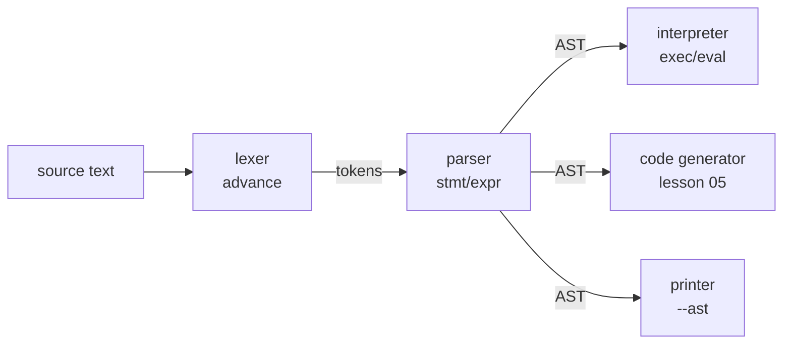

# 04 · Abstract syntax trees and tree-walking interpreters

> Level: beginner · Time: ~3 h · Prereqs: lessons 02–03; C structs, pointers, `malloc`

## 1. Why this exists

The parser in lesson 03 *printed* its structure and threw it away. A real compiler needs to keep that structure in memory so that later phases — type checking, optimization, code generation — can walk over it many times. The data structure is the **abstract syntax tree (AST)**. Once you have an AST, the simplest possible "back end" is an **interpreter** that walks the tree and executes it directly. Building one is the fastest way to understand what each node *means*, and it gives you a reference implementation to test a real compiler against (lesson 05 does exactly that).

## 2. Intuition: the recipe card, not the handwriting

A parse tree records *how* the sentence was written: every bracket, every semicolon, every grammar rule used. An AST records only *what it means*: "add 1 to (multiply 2 by x)". Brackets are gone because the tree shape already encodes grouping. Think of a grandmother's recipe dictated over the phone (parse tree: every "umm", every "and then") versus the clean recipe card you write down afterwards (AST: ingredients and steps).

```text
 Parse tree for 1 + 2 * x                 AST for 1 + 2 * x
            expr                                  (+)
          /  |   \                               /   \
       term  +   term                           1    (*)
        |       /  |  \                             /   \
      unary  unary *  unary                        2     x
        |      |        |
     primary primary  primary
        |      |        |
        1      2        x
```

## 3. Precise definitions

* **AST**: a tree whose interior nodes are *operators or constructs* (binary op, `if`, `while`, function call, declaration) and whose leaves are *operands* (literals, variable references). It omits syntactic noise (parentheses, separators, chain productions like `term → unary`).
* **Node kinds**: usually split into **expressions** (produce a value: `1+x`) and **statements** (produce an effect: `print x;`, `x = 3;`).
* **Tree-walking interpreter**: a recursive function `eval(node)` that evaluates children and combines their results (post-order traversal), plus `exec(node)` for statements.
* **Environment**: the run-time mapping from variable names to values.

Real compilers keep extra information on each node: the **source location** (for errors), and after semantic analysis the **type** and a link to the **declaration** the name refers to. Clang's AST is a famous example — you can dump it:

```text
$ clang -fsyntax-only -Xclang -ast-dump f.c      # f.c: int f(int x) { return 1 + 2 * x; }
  `-CompoundStmt  <col:14, col:34>
    `-ReturnStmt  <col:16, col:31>
      `-BinaryOperator  <col:23, col:31> 'int' '+'
        |-IntegerLiteral  <col:23> 'int' 1
        `-BinaryOperator  <col:27, col:31> 'int' '*'
          |-IntegerLiteral  <col:27> 'int' 2
          `-ImplicitCastExpr  <col:31> 'int' <LValueToRValue>
            `-DeclRefExpr  <col:31> 'int' lvalue ParmVar  'x' 'int'
```

(Clang 18.1.3; pointer addresses removed.) Note the `ImplicitCastExpr <LValueToRValue>`: the AST makes explicit the "read the value stored in `x`" step that C leaves implicit. Every node also has a type (`'int'`) — semantic analysis has already run.

## 4. Step by step: designing the Tiny AST

**Dumbest approach — one struct per node kind with no common header.** You end up writing `if (is_binop(p)) ((BinOp*)p)->…` everywhere and cannot store different nodes in one array.

**Annoyance → a tagged union / "fat node".** One `struct Node` with a `kind` tag and the union of all fields. Wasteful (every node carries fields it doesn't use) but trivially simple. This is what we use; production compilers in C (GCC's `tree`) use a tagged representation too, while C++ compilers (Clang) use a class hierarchy with a kind tag plus custom RTTI.

**Next wall — evaluation order and meaning.** The interpreter must decide what `/` does on zero, what `x` means if never declared, whether comparisons return 0/1. Writing the interpreter *forces* you to specify the language — that is its hidden value.

Tiny's grammar (extends lesson 03):

```text
program → stmt* EOF
stmt    → 'let' IDENT '=' expr ';'      (declare)
        | IDENT '=' expr ';'            (assign)
        | 'print' expr ';'
        | 'if' '(' expr ')' stmt [ 'else' stmt ]
        | 'while' '(' expr ')' stmt
        | '{' stmt* '}'
expr    → add [ ('<'|'<='|'>'|'>='|'=='|'!=') add ]     (comparisons don't chain)
add     → mul { ('+'|'-') mul }
mul     → unary { ('*'|'/') unary }
unary   → '-' unary | primary
primary → INT | IDENT | '(' expr ')'
```



## 5. Code

### 5.1 The front end: lexer + parser → AST (`tiny_front.h`)

This header is reused unchanged by lesson 05's compiler. It is a single header (functions are `static`) so each tool is one `gcc` command.

```c
// file: tiny_front.h
// Front end for the Tiny language: lexer + recursive-descent parser -> AST.
// Shared by the interpreter (lesson 04) and the code generator (lesson 05).
#ifndef TINY_FRONT_H
#define TINY_FRONT_H
#include <stdio.h>
#include <stdlib.h>
#include <string.h>
#include <ctype.h>

/* ---------- lexer (same design as lesson 02, compacted) ---------- */
typedef enum { T_INT, T_ID, T_LET, T_PRINT, T_IF, T_ELSE, T_WHILE, T_OP, T_EOF } Tok;
static const char *src;   static int line = 1;
static Tok tok;           static long tok_val;      // current token and its value
static char tok_text[32];                           // identifier text or operator

static void advance(void) {                         // read the next token into tok/tok_text
    for (;;) {                                      // skip blanks and '#' comments
        if (*src == '\n') { line++; src++; }
        else if (isspace((unsigned char)*src)) src++;
        else if (*src == '#') while (*src && *src != '\n') src++;
        else break;
    }
    if (!*src) { tok = T_EOF; strcpy(tok_text, "<eof>"); return; }
    if (isdigit((unsigned char)*src)) { tok = T_INT; tok_val = strtol(src, (char **)&src, 10); return; }
    if (isalpha((unsigned char)*src) || *src == '_') {
        int n = 0;
        while ((isalnum((unsigned char)*src) || *src == '_') && n < 31) tok_text[n++] = *src++;
        tok_text[n] = '\0';
        tok = !strcmp(tok_text, "let") ? T_LET : !strcmp(tok_text, "print") ? T_PRINT :
              !strcmp(tok_text, "if") ? T_IF : !strcmp(tok_text, "else") ? T_ELSE :
              !strcmp(tok_text, "while") ? T_WHILE : T_ID;
        return;
    }
    // operators: two-char ones first (maximal munch), then single chars
    static const char *two[] = { "==", "!=", "<=", ">=" };
    for (int i = 0; i < 4; i++)
        if (src[0] == two[i][0] && src[1] == two[i][1]) {
            strcpy(tok_text, two[i]); src += 2; tok = T_OP; return;
        }
    if (strchr("+-*/<>=(){};", *src)) { tok_text[0] = *src++; tok_text[1] = '\0'; tok = T_OP; return; }
    fprintf(stderr, "line %d: unexpected character '%c'\n", line, *src); exit(1);
}

/* ---------- AST ---------- */
typedef enum { N_NUM, N_VAR, N_BIN, N_NEG, N_LET, N_ASSIGN, N_PRINT, N_IF, N_WHILE, N_BLOCK } NodeKind;
typedef struct Node Node;
struct Node {
    NodeKind kind;
    char op[3];          // for N_BIN: "+", "<=", ...
    long val;            // for N_NUM
    char name[32];       // for N_VAR, N_LET, N_ASSIGN
    Node *a, *b, *c;     // children: operands / condition-then-else / value
    Node **list; int n;  // for N_BLOCK: statements
    int line;            // source line, for error messages
};

static Node *mk(NodeKind k) {                       // allocate a zeroed node
    Node *x = calloc(1, sizeof *x);
    x->kind = k; x->line = line;
    return x;
}

/* ---------- parser helpers ---------- */
static int is_op(const char *s) { return tok == T_OP && !strcmp(tok_text, s); }
static void expect_op(const char *s) {
    if (!is_op(s)) { fprintf(stderr, "line %d: expected '%s' but found '%s'\n", line, s, tok_text); exit(1); }
    advance();
}

static Node *expr(void);

static Node *primary(void) {
    Node *x;
    if (tok == T_INT) { x = mk(N_NUM); x->val = tok_val; advance(); return x; }
    if (tok == T_ID)  { x = mk(N_VAR); strcpy(x->name, tok_text); advance(); return x; }
    if (is_op("("))   { advance(); x = expr(); expect_op(")"); return x; }
    fprintf(stderr, "line %d: expected expression, found '%s'\n", line, tok_text); exit(1);
}
static Node *unary(void) {
    if (is_op("-")) { advance(); Node *x = mk(N_NEG); x->a = unary(); return x; }
    return primary();
}
static Node *bin(Node *l, const char *op, Node *r) {  // build a binary-operator node
    Node *x = mk(N_BIN); strcpy(x->op, op); x->a = l; x->b = r; return x;
}
static Node *mul(void) {                              // mul -> unary { (*|/) unary }
    Node *l = unary();
    while (is_op("*") || is_op("/")) { char op[3]; strcpy(op, tok_text); advance(); l = bin(l, op, unary()); }
    return l;
}
static Node *add(void) {                              // add -> mul { (+|-) mul }
    Node *l = mul();
    while (is_op("+") || is_op("-")) { char op[3]; strcpy(op, tok_text); advance(); l = bin(l, op, mul()); }
    return l;
}
static Node *expr(void) {                             // expr -> add [ relop add ]  (non-associative)
    Node *l = add();
    const char *rel[] = { "<", "<=", ">", ">=", "==", "!=" };
    for (int i = 0; i < 6; i++)
        if (is_op(rel[i])) { char op[3]; strcpy(op, tok_text); advance(); return bin(l, op, add()); }
    return l;
}

static Node *stmt(void) {
    Node *x;
    if (tok == T_LET) {                               // let IDENT = expr ;
        advance(); x = mk(N_LET);
        if (tok != T_ID) { fprintf(stderr, "line %d: expected name after 'let'\n", line); exit(1); }
        strcpy(x->name, tok_text); advance(); expect_op("="); x->a = expr(); expect_op(";");
        return x;
    }
    if (tok == T_ID) {                                // IDENT = expr ;
        x = mk(N_ASSIGN); strcpy(x->name, tok_text); advance();
        expect_op("="); x->a = expr(); expect_op(";");
        return x;
    }
    if (tok == T_PRINT) { advance(); x = mk(N_PRINT); x->a = expr(); expect_op(";"); return x; }
    if (tok == T_IF) {                                // if ( expr ) stmt [else stmt]
        advance(); x = mk(N_IF); expect_op("("); x->a = expr(); expect_op(")");
        x->b = stmt();
        if (tok == T_ELSE) { advance(); x->c = stmt(); }   // nearest-if rule, for free
        return x;
    }
    if (tok == T_WHILE) {
        advance(); x = mk(N_WHILE); expect_op("("); x->a = expr(); expect_op(")"); x->b = stmt();
        return x;
    }
    if (is_op("{")) {                                 // { stmt* }
        advance(); x = mk(N_BLOCK);
        while (!is_op("}")) {
            if (tok == T_EOF) { fprintf(stderr, "line %d: missing '}'\n", line); exit(1); }
            x->list = realloc(x->list, sizeof(Node *) * (size_t)(x->n + 1));
            x->list[x->n++] = stmt();
        }
        advance();
        return x;
    }
    fprintf(stderr, "line %d: unexpected '%s'\n", line, tok_text); exit(1);
}

// program -> stmt* EOF ; returned as one N_BLOCK
static Node *parse_program(const char *text) {
    src = text; line = 1; advance();
    Node *prog = mk(N_BLOCK);
    while (tok != T_EOF) {
        prog->list = realloc(prog->list, sizeof(Node *) * (size_t)(prog->n + 1));
        prog->list[prog->n++] = stmt();
    }
    return prog;
}

// read a whole file into a NUL-terminated heap buffer
static char *read_file(const char *path) {
    FILE *f = fopen(path, "rb");
    if (!f) { perror(path); exit(1); }
    fseek(f, 0, SEEK_END); long n = ftell(f); rewind(f);
    char *buf = malloc((size_t)n + 1);
    if (fread(buf, 1, (size_t)n, f) != (size_t)n) { perror("read"); exit(1); }
    buf[n] = '\0'; fclose(f);
    return buf;
}
#endif
```

Logic highlights:

* `advance()` is lesson 02's lexer compacted: it keeps exactly **one token of lookahead** in `tok`/`tok_text`/`tok_val`.
* Each grammar rule is one function returning a `Node *`. The `while` loops in `mul`/`add` build **left-leaning** trees, giving left associativity.
* `expr` accepts at most *one* comparison, so `a < b < c` is a syntax error — a deliberate language-design choice that avoids C's confusing `(a < b) < c`.
* Every node records `line`, so the interpreter can say *where* an error is.
* The dangling `else` resolves to the nearest `if` because `stmt()` grabs an `else` right after parsing the inner statement.

### 5.2 The interpreter and AST printer (`tiny_interp.c`)

```c
// file: tiny_interp.c
// Tree-walking interpreter + AST printer for Tiny.  Usage: ./tiny_interp prog.tiny [--ast]
#include "tiny_front.h"
#include <limits.h>

/* ---- AST printer: S-expressions, one statement per line ---- */
static void show(Node *x) {
    switch (x->kind) {
    case N_NUM:    printf("%ld", x->val); break;
    case N_VAR:    printf("%s", x->name); break;
    case N_NEG:    printf("(neg "); show(x->a); printf(")"); break;
    case N_BIN:    printf("(%s ", x->op); show(x->a); printf(" "); show(x->b); printf(")"); break;
    case N_LET:    printf("(let %s ", x->name); show(x->a); printf(")"); break;
    case N_ASSIGN: printf("(set %s ", x->name); show(x->a); printf(")"); break;
    case N_PRINT:  printf("(print "); show(x->a); printf(")"); break;
    case N_IF:     printf("(if "); show(x->a); printf(" "); show(x->b);
                   if (x->c) { printf(" "); show(x->c); } printf(")"); break;
    case N_WHILE:  printf("(while "); show(x->a); printf(" "); show(x->b); printf(")"); break;
    case N_BLOCK:  printf("(block");
                   for (int i = 0; i < x->n; i++) { printf(" "); show(x->list[i]); }
                   printf(")"); break;
    }
}

/* ---- environment: a flat table of variables (scopes come in lesson 02-intermediate/02) ---- */
static struct { char name[32]; long val; } vars[256];
static int nvars;

static long *lookup(const char *name, int line) {     // find an existing variable or die
    for (int i = 0; i < nvars; i++) if (!strcmp(vars[i].name, name)) return &vars[i].val;
    fprintf(stderr, "line %d: undefined variable '%s'\n", line, name); exit(1);
}

/* ---- evaluator: post-order walk; children first, then combine ---- */
static long eval(Node *x) {
    switch (x->kind) {
    case N_NUM: return x->val;
    case N_VAR: return *lookup(x->name, x->line);
    // Tiny defines + - * and negation as 64-bit WRAPPING arithmetic. Doing the
    // math in unsigned long avoids C's signed-overflow undefined behaviour;
    // converting back to long is implementation-defined (GCC/Clang: modulo 2^64).
    case N_NEG: return (long)(0UL - (unsigned long)eval(x->a));
    case N_BIN: {
        long l = eval(x->a), r = eval(x->b);
        switch (x->op[0]) {
        case '+': return (long)((unsigned long)l + (unsigned long)r);
        case '-': return (long)((unsigned long)l - (unsigned long)r);
        case '*': return (long)((unsigned long)l * (unsigned long)r);
        case '/': if (r == 0) { fprintf(stderr, "line %d: division by zero\n", x->line); exit(1); }
                  if (l == LONG_MIN && r == -1) return LONG_MIN;   // the one overflowing division: wrap
                  return l / r;
        case '<': return x->op[1] == '=' ? l <= r : l < r;
        case '>': return x->op[1] == '=' ? l >= r : l > r;
        case '=': return l == r;
        case '!': return l != r;
        }
        fprintf(stderr, "eval: unknown operator %s\n", x->op); exit(1);
    }
    default: fprintf(stderr, "eval: not an expression\n"); exit(1);
    }
}

/* ---- executor: statements have effects, not values ---- */
static void exec(Node *x) {
    switch (x->kind) {
    case N_LET:                                   // declare: must be new, table must have room
        for (int i = 0; i < nvars; i++)
            if (!strcmp(vars[i].name, x->name)) {
                fprintf(stderr, "line %d: '%s' already declared\n", x->line, x->name); exit(1);
            }
        if (nvars == 256) { fprintf(stderr, "too many variables\n"); exit(1); }
        strcpy(vars[nvars].name, x->name); vars[nvars++].val = eval(x->a); break;
    case N_ASSIGN: *lookup(x->name, x->line) = eval(x->a); break;
    case N_PRINT:  printf("%ld\n", eval(x->a)); break;
    case N_IF:     if (eval(x->a)) exec(x->b); else if (x->c) exec(x->c); break;
    case N_WHILE:  while (eval(x->a)) exec(x->b); break;
    case N_BLOCK:  for (int i = 0; i < x->n; i++) exec(x->list[i]); break;
    default:       eval(x); break;
    }
}

int main(int argc, char **argv) {
    if (argc < 2) { fprintf(stderr, "usage: %s file.tiny [--ast]\n", argv[0]); return 1; }
    Node *prog = parse_program(read_file(argv[1]));
    if (argc > 2 && !strcmp(argv[2], "--ast")) { show(prog); printf("\n"); return 0; }
    exec(prog);
    return 0;
}
```

Logic highlights:

* `eval` is a **post-order** walk: evaluate both children, then apply the operator. The line `long l = eval(x->a), r = eval(x->b);` fixes the order left-then-right, because in C the end of each full declarator is a sequence point. Had we written `return eval(x->a) + eval(x->b);`, C would leave the order *unspecified*. Our choice is now part of Tiny's specification.
* **Overflow is defined in Tiny, but not in C.** If the interpreter computed `l * r` on `long` directly, a Tiny program that overflows would make the *interpreter itself* execute C undefined behaviour (lesson 03-advanced/04). So Tiny *defines* `+ - *` and negation as 64-bit wrap-around, and the interpreter computes them in `unsigned long` (where wrap-around is defined) before converting back. `LONG_MIN / -1` is the one overflowing division, so it is special-cased too. Precisely specifying corner cases like this is exactly what lets lesson 05 test a compiler against this interpreter.
* `exec` gives statements meaning: `while` is literally a C `while` over `eval(cond)`. An interpreter defines the *semantics* of the source language in terms of the host language.
* Division by zero and undefined variables are **run-time errors** here. A compiler would like to catch the second one at compile time — that is semantic analysis (lesson 02-intermediate/02).
* `let` rejects redeclaration. An earlier draft of this lesson's code silently appended a *new* `t` to the table on every loop iteration (`while (…) { let t = …; }`), overflowed the 256-entry array, corrupted memory, and printed `1` forever. Bugs like that are why language specs need scoping rules, and why the C code checks the table bound.

### 5.3 Running it

```text
# file: fact.tiny
# factorial of 10 and the first Fibonacci numbers below 100
let n = 10;
let f = 1;
while (n > 1) { f = f * n; n = n - 1; }
print f;
let a = 0; let b = 1; let t = 0;
while (a < 100) { print a; t = a + b; a = b; b = t; }
if (f == 3628800) print 1; else print 0;
```

```text
$ gcc -Wall -Wextra -std=c11 -o tiny_interp tiny_interp.c
$ ./tiny_interp fact.tiny | tr '\n' ' '
3628800 0 1 1 2 3 5 8 13 21 34 55 89 1
$ printf 'let x = 1 + 2 * 3;\nif (x > 5) print x; else print -x;\n' > small.tiny
$ ./tiny_interp small.tiny --ast
(block (let x (+ 1 (* 2 3))) (if (> x 5) (print x) (print (neg x))))
$ ./tiny_interp small.tiny
7
$ printf 'print y;\n' > bad.tiny && ./tiny_interp bad.tiny
line 1: undefined variable 'y'
$ printf 'let x = (1 + ;\n' > bad2.tiny && ./tiny_interp bad2.tiny
line 1: expected expression, found ';'
$ printf 'print 10 / (5 - 5);\n' > dz.tiny && ./tiny_interp dz.tiny
line 1: division by zero
```

### 5.4 Interpreters in the real world

Tree-walking is the simplest interpreter design but slow: every node visit is a pointer chase plus a `switch`. Production interpreters compile the AST to **bytecode** for a virtual machine (CPython, the JVM, Lua) and then often JIT-compile hot bytecode to machine code (HotSpot, V8). The AST stays the shared input.

## 6. Common mistakes

* **Keeping parentheses as nodes.** The tree shape already encodes grouping; a `Paren` node adds nothing but special cases.
* **Losing source locations.** Without `line`/`col` on every node, later phases cannot produce useful errors. Clang attaches a `SourceRange` to every node.
* **Mixing statements and expressions carelessly.** If `print` were an expression, what is its value? Decide explicitly (C makes assignment an expression; Tiny does not).
* **Recursion depth.** A deeply nested input (`((((…))))` 100 000 levels) overflows the C stack of a recursive parser or evaluator. Real compilers cap nesting depth: Clang 18 stops with "bracket nesting level exceeded maximum of 256" (tunable with `-fbracket-depth`).
* **Memory management.** This lesson never frees the AST; real compilers use arena (bump) allocators that free the whole tree at once — Clang allocates AST nodes in its `ASTContext`.
* **Implicit evaluation order.** In C, the order of evaluating `f() + g()` is *unspecified*. If your interpreter fixes one order and your compiler another, a differential test will flag a "bug" that is really an unspecified-behaviour difference.

## 7. Connections

* **DSA track**: tree traversals (pre/in/post-order), tagged unions, recursion vs explicit stacks.
* **Java track**: the *Visitor pattern* is the OOP way to write `eval`/`show` over a class hierarchy of nodes; Clang's `RecursiveASTVisitor` is one.
* **Python track**: `import ast; print(ast.dump(ast.parse("1+2*x")))` shows CPython's AST.
* **Testing/Verification track**: a simple interpreter is a *reference oracle* — the idea behind differential testing.

### Where this shows up in my projects

* **QiskitSage** parses Python with `ast` to review Qiskit pull requests — the same AST idea: work on structure, not text.
* **compiler-fuzz**'s random C generator builds an AST-like structure of statements and expressions before printing C source; generating *from a tree* is what makes it easy to guarantee every expression is well-formed.

## 8. Self-check

1. Name two things a parse tree contains that an AST omits.
2. Why is `eval` naturally a post-order traversal?
3. Why does Tiny reject `a < b < c` while C accepts it?
4. In the interpreter, where is the language's semantics for `/` defined?
5. What are two reasons production interpreters don't walk the AST directly?

<details><summary>Answers</summary>

1. Parentheses and other punctuation tokens; chain productions like `term → unary → primary` that carry no meaning.
2. An operator's value depends on its operands' values, so children must be evaluated before the parent combines them.
3. The grammar's `expr` rule allows at most one relational operator; C's grammar makes relational operators left-associative, so `a<b<c` means `(a<b)<c`.
4. In the `case '/'` branch of `eval`: it checks for zero and otherwise uses C's `long` division (truncation toward zero).
5. Speed (pointer chasing and dispatch per node) and memory locality; bytecode is compact and a loop over it is faster, and it is a convenient input for a JIT.

</details>

## 9. Mnemonic (Tamil + English)

**"Pillaigal mudhalil, Appa kadaisi"** — *children first, father last*: that is post-order evaluation. At a wedding feast the kids (operands) are served first; only after both have eaten does Appa (the operator) "combine" and pay the bill.

## Sources

* Clang documentation, "Introduction to the Clang AST": https://clang.llvm.org/docs/IntroductionToTheClangAST.html
* LLVM Kaleidoscope tutorial ch. 2, "Implementing a Parser and AST": https://llvm.org/docs/tutorial/MyFirstLanguageFrontend/index.html
* Clang command-line reference (`-fbracket-depth`): https://clang.llvm.org/docs/ClangCommandLineReference.html
* Python `ast` module documentation: https://docs.python.org/3/library/ast.html
* Aho, Lam, Sethi, Ullman, *Compilers: Principles, Techniques, and Tools*, 2nd ed., ch. 2 and 5 (syntax-directed translation, syntax trees): https://www.pearson.com/store/en-us/p/compilers-principles-techniques-and-tools/P200000003472
* ISO C N1570 §6.5 (unsequenced evaluation of operands): https://www.open-std.org/jtc1/sc22/wg14/www/docs/n1570.pdf

## Verify yourself

```bash
# file: verify-04.sh
# Tested with GCC 13.3 and Clang 18.1.3, Ubuntu 24.04, Nov 2026.
gcc -Wall -Wextra -std=c11 -o tiny_interp tiny_interp.c        # compiles warning-free
./tiny_interp fact.tiny | tr '\n' ' '; echo                    # 3628800 0 1 1 2 3 5 8 13 21 34 55 89 1
printf 'let x = 1 + 2 * 3;\nif (x > 5) print x; else print -x;\n' > small.tiny
./tiny_interp small.tiny --ast && ./tiny_interp small.tiny     # AST, then 7
printf 'while (1 < 2) { let t = 1; }\n' > redecl.tiny; ./tiny_interp redecl.tiny   # 't' already declared
printf 'let m = 9223372036854775807;\nprint m + 1;\n' > wrap.tiny; ./tiny_interp wrap.tiny  # -9223372036854775808
printf 'int f(int x) { return 1 + 2 * x; }\n' > f.c
clang -fsyntax-only -Xclang -ast-dump f.c | tail -8             # Clang's AST for the same expression
python3 -c "import ast; print(ast.dump(ast.parse('1+2*x', mode='eval')))"
python3 -c "print('int x = ' + '('*257 + '1' + ')'*257 + ';')" > deep.c
clang -fsyntax-only deep.c 2>&1 | head -1    # bracket nesting level exceeded maximum of 256
```

Check against sources: compare the Clang dump with "Introduction to the Clang AST"; the nesting limit is checked empirically by the `deep.c` command (Clang 18.1.3).
