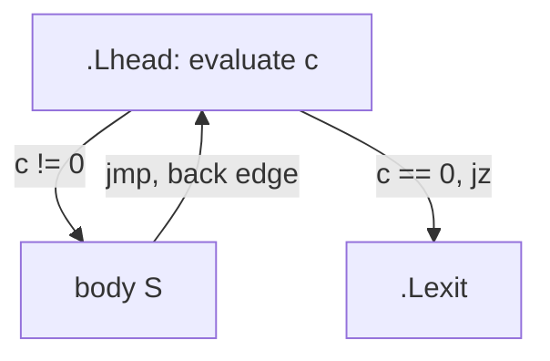

# 05 · Your first real compiler — and your first compiler test

> Level: beginner · Time: ~3 h · Prereqs: lesson 04 (`tiny_front.h`, `tiny_interp.c`); basic x86-64 assembly helps but is explained here

## 1. Why this exists

Lesson 04 *executed* Tiny programs. Now we *translate* them into x86-64 assembly that runs natively, without the interpreter. That is the moment an interpreter becomes a compiler. Then we ask the question that drives the whole 04-pro level of this track: **how do we know our compiler is correct?** We answer it the way industrial compiler testers do — by generating random programs and checking that two independent implementations agree (*differential testing*). We even plant a bug and watch the tester catch it.

## 2. Intuition: a calculator with a notepad

Imagine evaluating `1 + 2 * 3` with a calculator that has one display (`%rax`) and a stack of sticky notes (the hardware stack). To add two things you: compute the left side on the display, write it on a sticky note, compute the right side on the display, peel the note off, combine. That's a **stack-machine code generator**: dead simple, always correct, and slow — every intermediate value takes a trip through memory. Real compilers keep values in registers (lesson 03-advanced/02), but correctness first.

## 3. Precise definitions

* **Code generation**: translating IR (here, directly the AST) into target instructions.
* **Calling convention / ABI**: the contract between functions. On Linux x86-64 (System V AMD64 ABI): integer arguments go in `%rdi, %rsi, %rdx, %rcx, %r8, %r9`; the return value comes back in `%rax`; `%rsp` must be 16-byte aligned at a `call`; for variadic functions like `printf`, `%al` holds the number of vector registers used.
* **Stack frame**: the region of the stack belonging to one function activation. We set it up with the **prologue** `push %rbp; mov %rsp,%rbp; sub $N,%rsp` and tear it down with `leave; ret` (the **epilogue**).
* **Differential testing** (McKeeman, 1998): run the same input through two or more implementations that are supposed to agree; any disagreement reveals a bug in at least one of them. It sidesteps the need to know the "right answer" in advance — the *oracle problem*.

## 4. Step by step

### 4.1 Expressions: the stack machine

Rule: *every* expression leaves its value in `%rax`.

* Number `n` → `movq $n, %rax`
* Variable `v` (slot *i*) → `movq -8(i+1)(%rbp), %rax`
* `a op b` → gen(a); `pushq %rax`; gen(b); `movq %rax,%rcx`; `popq %rax`; `op %rcx,%rax`

Because every `push` is matched by a `pop`, the stack pointer is the same before and after any expression — so `%rsp` is still 16-byte aligned whenever we `call printf`.

Comparisons use `cmpq` then `setCC %al` (set the low byte to 0/1 based on flags), then `movzbq %al,%rax` to zero-extend to 64 bits.

### 4.2 Statements: labels and jumps

```text
if (c) S1 else S2          while (c) S
    <gen c>                .Lhead:
    testq %rax,%rax            <gen c>
    jz .Lelse                  testq %rax,%rax
    <gen S1>                   jz .Lexit
    jmp .Lend                  <gen S>
.Lelse:                        jmp .Lhead      ← back edge
    <gen S2>               .Lexit:
.Lend:
```



These diagrams are **control-flow graphs** — the central data structure of the intermediate level.

### 4.3 Variables: stack slots and a compile-time symbol table

Each `let` assigns the next free 8-byte slot below `%rbp`. The compiler keeps a *compile-time* table from names to slots. Notice what moves: the interpreter discovered "undefined variable" **at run time**; the compiler discovers it **at compile time**, before the program ever runs. Semantic analysis (02-intermediate/02) generalises this.

### 4.4 Semantics must match the reference — including corner cases

Tiny's spec (set in lesson 04): `+ - *` wrap at 64 bits; `x / 0` is a run-time error with exit status 1; `LONG_MIN / -1` wraps to `LONG_MIN`. On x86, `idivq` raises a divide-error exception (SIGFPE on Linux) for *both* `x/0` and `LONG_MIN/-1`, so the compiler must emit explicit checks for both. A naive code generator that just emits `cqto; idivq` would crash where the interpreter prints a result — exactly the kind of disagreement differential testing finds.

## 5. Code

### 5.1 The compiler (`tinyc.c`)

Uses `tiny_front.h` from lesson 04 unchanged.

```c
// file: tinyc.c
// Tiny -> x86-64 assembly (AT&T syntax, System V ABI, Linux).
// Strategy: a "stack machine" code generator. Every expression leaves its
// value in %rax; binary operators save the left value on the hardware stack.
// Usage: ./tinyc prog.tiny > prog.s && gcc prog.s -o prog
#include "tiny_front.h"

static char names[256][32];      // compile-time symbol table: name -> stack slot index
static int nnames;
static int label_id;             // counter for unique jump labels

static int slot(const char *name, int line) {        // find a declared variable's slot
    for (int i = 0; i < nnames; i++) if (!strcmp(names[i], name)) return i;
    fprintf(stderr, "line %d: undefined variable '%s'\n", line, name);  // caught at COMPILE time
    exit(1);
}

// variable i lives at -8*(i+1)(%rbp) in main's stack frame
static void gen_expr(Node *x) {
    switch (x->kind) {
    case N_NUM: printf("    movq $%ld, %%rax\n", x->val); return;
    case N_VAR: printf("    movq %d(%%rbp), %%rax\n", -8 * (slot(x->name, x->line) + 1)); return;
    case N_NEG: gen_expr(x->a); printf("    negq %%rax\n"); return;
    case N_BIN:
        gen_expr(x->a);                      // left value -> rax
        printf("    pushq %%rax\n");          // save it on the stack
        gen_expr(x->b);                      // right value -> rax
        printf("    movq %%rax, %%rcx\n");    // rcx = right
        printf("    popq %%rax\n");           // rax = left
        switch (x->op[0]) {
        case '+': printf("    addq %%rcx, %%rax\n"); return;
        case '-': printf("    subq %%rcx, %%rax\n"); return;
        case '*': printf("    imulq %%rcx, %%rax\n"); return;
        case '/': {                          // Tiny semantics: x/0 is a runtime error,
            int l = label_id; label_id += 2; // x/-1 is negation (wraps; idiv would trap on LONG_MIN/-1)
            printf("    testq %%rcx, %%rcx\n    jz .Ldivzero\n");
            printf("    cmpq $-1, %%rcx\n    jne .L%d\n    negq %%rax\n    jmp .L%d\n", l, l + 1);
            printf(".L%d:\n    cqto\n    idivq %%rcx\n.L%d:\n", l, l + 1);   // rdx:rax / rcx
            return;
        }
        default: {                           // comparisons: cmp + setCC -> 0/1 in rax
            // PLANTED BUG for the differential-testing demo: with TINYC_BUG=1 set,
            // '<=' is compiled as '<' (an off-by-one a real compiler could have).
            int bug = getenv("TINYC_BUG") != NULL;
            const char *cc = !strcmp(x->op, "<") ? "l" : !strcmp(x->op, "<=") ? (bug ? "l" : "le") :
                             !strcmp(x->op, ">") ? "g" : !strcmp(x->op, ">=") ? "ge" :
                             !strcmp(x->op, "==") ? "e" : "ne";
            printf("    cmpq %%rcx, %%rax\n    set%s %%al\n    movzbq %%al, %%rax\n", cc);
            return;
        }
        }
    default: fprintf(stderr, "not an expression\n"); exit(1);
    }
}

static void gen_stmt(Node *x) {
    int l1, l2;
    switch (x->kind) {
    case N_LET:
        for (int i = 0; i < nnames; i++)
            if (!strcmp(names[i], x->name)) { fprintf(stderr, "line %d: '%s' already declared\n", x->line, x->name); exit(1); }
        if (nnames == 256) { fprintf(stderr, "too many variables\n"); exit(1); }
        gen_expr(x->a);                      // evaluate BEFORE declaring: 'let x = x;' is an error
        strcpy(names[nnames++], x->name);
        printf("    movq %%rax, %d(%%rbp)\n", -8 * nnames);
        return;
    case N_ASSIGN:
        gen_expr(x->a);
        printf("    movq %%rax, %d(%%rbp)\n", -8 * (slot(x->name, x->line) + 1));
        return;
    case N_PRINT:                            // printf("%ld\n", value)
        gen_expr(x->a);
        printf("    movq %%rax, %%rsi\n    leaq .Lfmt(%%rip), %%rdi\n");
        printf("    xorl %%eax, %%eax\n    call printf@PLT\n");   // al=0: no vector args
        return;
    case N_IF:
        l1 = label_id++; l2 = label_id++;
        gen_expr(x->a);
        printf("    testq %%rax, %%rax\n    jz .L%d\n", l1);       // false -> else part
        gen_stmt(x->b);
        printf("    jmp .L%d\n.L%d:\n", l2, l1);
        if (x->c) gen_stmt(x->c);
        printf(".L%d:\n", l2);
        return;
    case N_WHILE:
        l1 = label_id++; l2 = label_id++;
        printf(".L%d:\n", l1);                                        // loop head
        gen_expr(x->a);
        printf("    testq %%rax, %%rax\n    jz .L%d\n", l2);       // exit when false
        gen_stmt(x->b);
        printf("    jmp .L%d\n.L%d:\n", l1, l2);                   // back edge
        return;
    case N_BLOCK:
        for (int i = 0; i < x->n; i++) gen_stmt(x->list[i]);
        return;
    default: gen_expr(x); return;
    }
}

int main(int argc, char **argv) {
    if (argc != 2) { fprintf(stderr, "usage: %s file.tiny\n", argv[0]); return 1; }
    Node *prog = parse_program(read_file(argv[1]));
    printf("    .section .rodata\n.Lfmt: .string \"%%ld\\n\"\n");
    printf(".Ldzmsg: .ascii \"division by zero\\n\"\n");   // 17 bytes, no NUL needed
    printf("    .text\n    .globl main\nmain:\n");
    printf("    pushq %%rbp\n    movq %%rsp, %%rbp\n");          // prologue: new frame
    printf("    subq $2048, %%rsp\n");                           // 256 slots * 8 bytes, 16-aligned
    gen_stmt(prog);
    printf("    xorl %%eax, %%eax\n    leave\n    ret\n");       // return 0
    printf(".Ldivzero:\n    movl $2, %%edi\n    leaq .Ldzmsg(%%rip), %%rsi\n");  // write(2, msg, 17)
    printf("    movl $17, %%edx\n    call write@PLT\n");
    printf("    movl $1, %%edi\n    call exit@PLT\n");          // runtime error: exit(1)
    printf("    .section .note.GNU-stack,\"\",@progbits\n");
    return 0;
}
```

Logic notes:

* The prologue reserves 2048 bytes = 256 slots × 8; 2048 is a multiple of 16, so alignment is preserved.
* `let x = expr;` generates `expr` **before** adding `x` to the table, so `let x = x;` is rejected as using an undefined variable — a scoping decision encoded in one line order.
* The planted bug: when the environment variable `TINYC_BUG` is set, `<=` is compiled with `setl` instead of `setle`. It only matters when both sides are equal — a realistic "boundary" bug.
* The `.note.GNU-stack` section tells the linker this code does not need an executable stack.

### 5.2 What the output looks like

```text
$ gcc -Wall -Wextra -std=c11 -o tinyc tinyc.c
$ printf 'let x = 1 + 2 * 3;\nprint x;\n' > small.tiny
$ ./tinyc small.tiny        # (excerpt)
    subq $2048, %rsp
    movq $1, %rax
    pushq %rax
    movq $2, %rax
    pushq %rax
    movq $3, %rax
    movq %rax, %rcx
    popq %rax
    imulq %rcx, %rax
    movq %rax, %rcx
    popq %rax
    addq %rcx, %rax
    movq %rax, -8(%rbp)
    movq -8(%rbp), %rax
```

Fourteen instructions to compute 7. GCC 13.3 at `-O2`, for the C equivalent `long x = 1 + 2 * 3; printf("%ld\n", x);`, emits `movl $7, %edx` — one instruction, because it **constant-folded** at compile time (lesson 02-intermediate/07) and keeps values in **registers** (lesson 03-advanced/02). That gap *is* the optimizer.

```text
$ ./tinyc fact.tiny > fact.s && gcc fact.s -o fact && ./fact | tr '\n' ' '
3628800 0 1 1 2 3 5 8 13 21 34 55 89 1
$ ./tiny_interp fact.tiny | tr '\n' ' '
3628800 0 1 1 2 3 5 8 13 21 34 55 89 1
$ printf 'let a = 5;\nprint a / 0;\n' > dz.tiny
$ ./tinyc dz.tiny > dz.s && gcc dz.s -o dz && ./dz; echo "exit=$?"
division by zero
exit=1
```

### 5.3 The differential tester (`difftest.py`)

Python is used here because generating random text is short in Python. Syntax notes for C programmers follow the code.

```python
# file: difftest.py
# Differential tester: random Tiny programs -> run the interpreter AND the
# compiled binary -> any difference in output means one of them is wrong.
import random, subprocess, sys, os, tempfile

def gen_expr(rng, names, depth):
    """Return a random expression string using only declared variable names."""
    if depth == 0 or rng.random() < 0.3:                 # leaf: number or variable
        if names and rng.random() < 0.5:
            return rng.choice(names)
        return str(rng.randint(-20, 20))
    op = rng.choice(['+', '-', '*', '/', '<', '<=', '>', '>=', '==', '!='])
    left = gen_expr(rng, names, depth - 1)
    right = gen_expr(rng, names, depth - 1)
    if op == '/':                                        # keep the divisor non-zero:
        right = f"(({right}) * 2 + 1)"                   # 2k+1 is odd, so never 0 (even when wrapping)
    if op in ('<', '<=', '>', '>=', '==', '!='):
        return f"(({left}) {op} ({right}))"              # parenthesise: Tiny comparisons don't chain
    return f"({left} {op} {right})"

def gen_program(rng):
    """A random straight-line program with ifs and one bounded while loop."""
    names, lines = [], []
    for i in range(rng.randint(3, 8)):                   # declare some variables
        lines.append(f"let v{i} = {gen_expr(rng, names, 3)};")
        names.append(f"v{i}")
    for _ in range(rng.randint(3, 8)):                   # mix of statements
        kind = rng.random()
        if kind < 0.4:
            lines.append(f"print {gen_expr(rng, names, 4)};")
        elif kind < 0.7:
            lines.append(f"{rng.choice(names)} = {gen_expr(rng, names, 3)};")
        else:
            lines.append(f"if ({gen_expr(rng, names, 2)}) print {gen_expr(rng, names, 2)}; "
                         f"else print {gen_expr(rng, names, 2)};")
    lines.append("let k = 0;")                           # a loop that surely terminates
    lines.append(f"while (k < 5) {{ print {gen_expr(rng, names + ['k'], 3)}; k = k + 1; }}")
    return "\n".join(lines) + "\n"

def run(cmd):
    """Run a command, return (exit status, stdout) - the observable behaviour."""
    p = subprocess.run(cmd, capture_output=True, text=True, timeout=10)
    return p.returncode, p.stdout

def main():
    n = int(sys.argv[1]) if len(sys.argv) > 1 else 200
    rng = random.Random(2026)                            # fixed seed => reproducible runs
    tmp = tempfile.mkdtemp()
    mismatches = 0
    for i in range(n):
        src = gen_program(rng)
        path = os.path.join(tmp, f"t{i}.tiny")
        with open(path, "w") as f:
            f.write(src)
        expected = run(["./tiny_interp", path])          # oracle 1: the interpreter
        asm = subprocess.run(["./tinyc", path], capture_output=True, text=True).stdout
        with open(path + ".s", "w") as f:
            f.write(asm)
        subprocess.run(["gcc", path + ".s", "-o", path + ".bin"], check=True)
        actual = run([path + ".bin"])                    # oracle 2: the compiled program
        if expected != actual:
            mismatches += 1
            if mismatches == 1:                          # show the first failure in full
                print(f"MISMATCH on {path}\n--- program ---\n{src}--- interp ---\n{expected}\n--- compiled ---\n{actual}")
    print(f"{n} programs, {mismatches} mismatches")

if __name__ == "__main__":
    main()
```

Python syntax, line by line for a C programmer:

* `import random, subprocess, sys, os, tempfile` — load standard modules (like `#include`, but they are objects you access with a dot: `random.Random`).
* `def gen_expr(rng, names, depth):` — defines a function; no types are declared; the body is the indented block (indentation *is* the braces). The `"""…"""` line is a docstring (a comment attached to the function).
* `rng.random() < 0.3` — `rng` is a seeded random generator object; `.random()` returns a float in [0, 1).
* `rng.choice([...])` — picks one element of a list (`[...]` is a list literal, like a dynamic array).
* `f"({left} {op} {right})"` — an *f-string*: text with `{expr}` holes filled in, like `sprintf` without format codes. `{{` and `}}` produce literal braces.
* `names + ['k']` — list concatenation produces a new list; `names.append(x)` adds in place.
* `for i in range(rng.randint(3, 8)):` — loop `i = 0 … n-1` where n is random in [3, 8].
* `"\n".join(lines)` — glue the list of strings with newlines in between.
* `subprocess.run(cmd, capture_output=True, text=True, timeout=10)` — run a program (like `fork`+`exec`+`wait`), capture its stdout as a string; `p.returncode` is its exit status.
* `return p.returncode, p.stdout` — returns a *tuple* (a fixed pair); `expected != actual` compares both elements.
* `with open(path, "w") as f:` — open a file and close it automatically when the block ends.
* `if __name__ == "__main__": main()` — run `main()` only when the file is executed as a script.

Logic:

1. **Generate** a random program that is *valid by construction*: variables are used only after declaration, divisors are forced odd (`2k+1` can never be zero, even with wrap-around), comparisons are parenthesised so they never chain, and the only loop has a fixed bound so every program terminates. A generator that produced invalid or non-terminating programs would waste time or raise false alarms — Csmith's design (04-pro/02) is all about this.
2. **Run** it through both implementations and capture the **observable behaviour**: exit status + stdout.
3. **Compare**. Any difference means a bug in the compiler, the interpreter, or the generator's validity assumptions.
4. The seed is fixed (`Random(2026)`) so a failure is **reproducible** — a must for bug reports.

### 5.4 Results

```text
$ python3 difftest.py 200
200 programs, 0 mismatches
$ TINYC_BUG=1 python3 difftest.py 200 | tail -1
200 programs, 40 mismatches
```

With the planted bug, the first mismatching program printed (abbreviated) was:

```text
--- interp ---
(0, '1\n-1\n1\n1\n1\n1\n1\n1\n')
--- compiled ---
(0, '1\n-1\n1\n0\n0\n0\n0\n0\n')
```

The failing program is 13 lines of noise. Which `<=` is the culprit? Shrinking a failing input to a minimal one automatically is **test-case reduction** (delta debugging) — 04-pro/04 builds a reducer that shrinks exactly this kind of output.

Also note what 0 mismatches does *not* prove: our generator never produces a `<=` whose sides are equal in some code path we didn't exercise, never divides by `-1`, never overflows… Testing shows the presence of bugs, never their absence. Coverage of the generator matters as much as the number of runs.

## 6. Common mistakes

* **Misaligned stack at `call`** → `printf` with SSE instructions crashes with SIGSEGV. Keep `%rsp` 16-byte aligned before every `call`.
* **Forgetting `%al = 0` before calling a variadic function** → the System V ABI uses `%al` as an upper bound on vector registers used; garbage there is technically wrong.
* **Emitting raw `idiv`** → SIGFPE on `x/0` and on `LONG_MIN/-1`.
* **Reusing label numbers** → "symbol already defined" from the assembler. Use one global counter.
* **A random generator that produces invalid programs** → the tester reports "mismatches" that are really undefined or unspecified behaviour. Validity-by-construction is the whole game in compiler fuzzing.
* **Comparing only stdout** → misses crashes and wrong exit codes. Compare the full observable behaviour.

## 7. Connections

* **Computer Architecture track**: x86-64 registers, flags (`cmp`/`setCC`), the stack, alignment.
* **OS track**: signals (SIGFPE, SIGSEGV), process exit status, `fork`/`exec` (what `subprocess.run` does).
* **Testing/Verification track**: differential testing, the oracle problem, reproducible seeds.
* **Python track**: `subprocess`, f-strings, seeded randomness.

### Where this shows up in my projects

This lesson is a miniature of **compiler-fuzz**: a generator that is UB-free by construction, two "implementations" compared on observable output (there: GCC vs Clang at `-O0/-O2/-O3`; here: interpreter vs compiler), and a planted bug to *validate the tester itself*. Planting a bug and confirming the harness catches it is good practice for any testing tool — a tester that has never failed has not been shown to work.

## 8. Self-check

1. Why does every expression leave its value in `%rax` in a stack-machine code generator?
2. Why must the compiler check for `LONG_MIN / -1` explicitly on x86-64?
3. What is the oracle problem and how does differential testing avoid it?
4. Why does `difftest.py` use a fixed random seed?
5. The planted bug was caught in 40 of 200 programs. Why not all 200?

<details><summary>Answers</summary>

1. A single, fixed location gives a uniform contract between code fragments: any parent knows where to find its child's value. It trades efficiency for simplicity.
2. `idivq` raises a divide error when the quotient does not fit in 64 bits, which happens for `LONG_MIN / -1`; Tiny defines that case as wrapping, so the compiler must special-case it.
3. The oracle problem: for a random input we don't know the correct output. Differential testing compares two implementations that should agree, so a mismatch reveals a bug without knowing the right answer.
4. Reproducibility: the same seed regenerates the same failing program for debugging and bug reports.
5. The bug only changes behaviour when a `<=` is evaluated with equal operands and that result reaches the output; many programs never hit that combination.

</details>

## 9. Mnemonic (Tamil + English)

**"Rendu per sonna, onnu thappu"** — *if two people say different things, one of them is wrong*. That is differential testing in five words. And for the stack machine: **"Push panni, pop panni, rax-la vechu"** — push it, pop it, keep it in rax.

## Sources

* W. M. McKeeman, "Differential Testing for Software", *Digital Technical Journal* 10(1), 1998 (summary and citation): https://en.wikipedia.org/wiki/Differential_testing
* System V Application Binary Interface, AMD64 Architecture Processor Supplement (register usage, stack alignment, `%al` for variadic calls): https://gitlab.com/x86-psABIs/x86-64-ABI
* Intel® 64 and IA-32 Architectures Software Developer's Manual, Vol. 2 (`IDIV`: #DE on divide by zero or quotient overflow): https://www.intel.com/content/www/us/en/developer/articles/technical/intel-sdm.html
* X. Yang, Y. Chen, E. Eide, J. Regehr, "Finding and Understanding Bugs in C Compilers", PLDI 2011 (randomized differential testing with checksums and voting): https://www-old.cs.utah.edu/~regehr/papers/pldi11-preprint.pdf
* Python `subprocess` documentation: https://docs.python.org/3/library/subprocess.html
* Stanford CS143 lecture 12, "Code Generation" (stack-machine code generation): https://web.stanford.edu/class/cs143/

## Verify yourself

```bash
# file: verify-05.sh
# Needs tiny_front.h and tiny_interp.c from lesson 04 in the same directory.
# Tested with GCC 13.3 and Python 3.13, Ubuntu 24.04, Nov 2026.
gcc -Wall -Wextra -std=c11 -o tinyc tinyc.c
gcc -Wall -Wextra -std=c11 -o tiny_interp tiny_interp.c
./tinyc fact.tiny > fact.s && gcc fact.s -o fact && ./fact | tr '\n' ' '; echo
printf 'let a = 5;\nprint a / 0;\n' > dz.tiny && ./tinyc dz.tiny > dz.s && gcc dz.s -o dz; ./dz; echo "exit=$?"
printf 'let m = 9223372036854775807;\nlet z = m + 1;\nprint z / -1;\n' > ov.tiny
./tinyc ov.tiny > ov.s && gcc ov.s -o ov && ./ov                 # -9223372036854775808, no SIGFPE
python3 difftest.py 200                                          # 0 mismatches
TINYC_BUG=1 python3 difftest.py 200 | tail -1                    # non-zero mismatches
```

Check against sources: register/alignment rules against the System V AMD64 psABI; the `IDIV` exception conditions against the Intel SDM Vol. 2 entry for `IDIV`.
