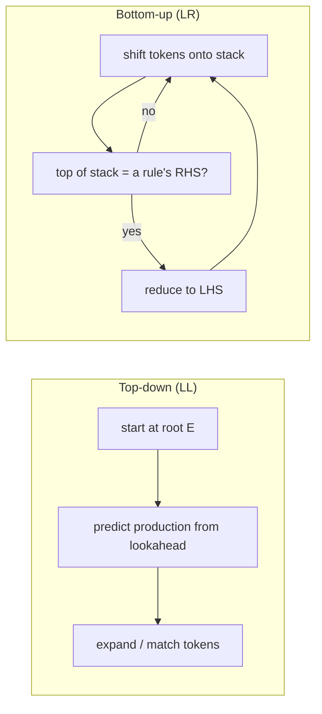

# 01 · Parsing theory: LL(1), LR and parser generators

> Level: intermediate · Time: ~3 h · Prereqs: 01-beginner/03 (grammars, recursive descent, left recursion)

## 1. Why this exists

In the beginner lesson you wrote a recursive-descent parser by intuition: "if the next token is `(`, take this branch". Two questions were left open:

1. **When is one token of lookahead enough?** For which grammars can a parser *always* choose correctly without backtracking? The answer is the **LL(1)** condition, computed with FIRST and FOLLOW sets.
2. **What about grammars that are natural but not LL(1)** — left-recursive, ambiguous with precedence rules, or needing to see a whole phrase before deciding? The answer is **bottom-up LR parsing**, the theory behind `yacc`/`bison`, introduced by Donald Knuth in 1965 ("On the translation of languages from left to right", *Information and Control*).

Interviews ask both. More importantly, the FIRST/FOLLOW computation is your first **fixpoint algorithm** — the same pattern as dataflow analysis later in this level.

## 2. Intuition

* **Top-down (LL)** is a *predictor*: standing at the root, it guesses which production will produce the input and checks the guess token by token. Like solving a maze from the entrance, choosing turns by peeking one step ahead.
* **Bottom-up (LR)** is a *recogniser*: it reads tokens onto a stack and, whenever the top of the stack matches the right-hand side of a rule, it **reduces** them to the rule's left side. Like assembling a jigsaw from the pieces up: you only name the "sky region" once you have the pieces that make it.

The names: **LL** = scan **L**eft-to-right, build a **L**eftmost derivation. **LR** = scan **L**eft-to-right, build a **R**ightmost derivation in reverse. The number in parentheses is the lookahead.

## 3. Precise definitions

For a grammar with nonterminals *N*, terminals Σ, and ε the empty string:

* **FIRST(α)** — the set of terminals that can begin a string derived from α, plus ε if α can derive ε.
* **FOLLOW(A)** — the set of terminals that can appear immediately to the right of nonterminal *A* in some sentential form; `$` (end of input) is in FOLLOW(start).
* **LL(1) table**: for each production `A → α`, put it in cell `M[A, a]` for every `a ∈ FIRST(α)`; if ε ∈ FIRST(α), also for every `a ∈ FOLLOW(A)`.
* A grammar is **LL(1)** iff no cell gets two productions. Equivalently, for any two alternatives `A → α | β`: FIRST(α) ∩ FIRST(β) = ∅, and if β ⇒* ε then FIRST(α) ∩ FOLLOW(A) = ∅.
* **LR(0) item**: a production with a dot showing how much has been seen, e.g. `E → E + • T`. A **state** of an LR automaton is a set of items.
* **Shift/reduce parser actions**: *shift* (push next token), *reduce* `A → β` (pop |β| symbols, push A), *accept*, *error*.
* **Conflicts**: *shift/reduce* (a state can both shift and reduce on the same lookahead) and *reduce/reduce* (two different reductions apply).
* The family, by power: **LR(0) ⊂ SLR(1) ⊂ LALR(1) ⊂ LR(1)** in the grammars they accept. LALR(1) (DeRemer, 1969) merges LR(1) states with the same core, giving tables the size of LR(0)'s at the cost of occasional "mysterious" reduce/reduce conflicts. Every LL(1) grammar is LR(1), but not every LR(1) grammar is LL(1) — left recursion, for example, is fine for LR and fatal for LL.

## 4. Step by step

### 4.1 FIRST and FOLLOW by fixpoint iteration

Grammar G (left recursion already removed):

```text
E  → T E'
E' → + T E' | ε
T  → F T'
T' → * F T' | ε
F  → ( E ) | id
```

**Dumbest approach:** compute FIRST(E) by recursively asking FIRST(T), which asks FIRST(F)… That works here, but with mutually recursive rules (A → B…, B → A…) naive recursion never terminates.

**What forces the real idea:** we need an algorithm that is guaranteed to stop. Observation: sets only ever *grow*, and they are bounded by |Σ|+1 elements. So start everything empty, sweep over all productions adding what each rule implies, and repeat until a full sweep changes nothing — a **fixpoint**. Termination follows from monotone growth in a finite space. Remember this argument: Kildall's dataflow framework (lesson 06) is the same argument on lattices.

Result (matches the Dragon Book's classic example):

| | FIRST | FOLLOW |
|---|---|---|
| E | `(` `id` | `)` `$` |
| E' | `+` ε | `)` `$` |
| T | `(` `id` | `+` `)` `$` |
| T' | `*` ε | `+` `)` `$` |
| F | `(` `id` | `*` `+` `)` `$` |

### 4.2 The LL(1) table and a stack-based parser

| | id | + | * | ( | ) | $ |
|---|---|---|---|---|---|---|
| E | E→TE' | | | E→TE' | | |
| E' | | E'→+TE' | | | E'→ε | E'→ε |
| T | T→FT' | | | T→FT' | | |
| T' | | T'→ε | T'→*FT' | | T'→ε | T'→ε |
| F | F→id | | | F→(E) | | |

No cell has two entries, so G is LL(1). A table-driven parser replaces recursion with an explicit stack: pop the top; if it is a terminal, match the input; if a nonterminal, look up `M[top, lookahead]` and push the right-hand side reversed.

### 4.3 Bottom-up: shift/reduce by hand

Take the *ambiguous* grammar `E → E + E | E * E | id` plus the rule "`*` binds tighter than `+`, both left-associative". Parse `id + id * id`:

| Stack | Input | Action |
|---|---|---|
| `$` | `id + id * id $` | shift |
| `$ id` | `+ id * id $` | reduce E → id |
| `$ E` | `+ id * id $` | shift |
| `$ E +` | `id * id $` | shift |
| `$ E + id` | `* id $` | reduce E → id |
| `$ E + E` | `* id $` | **conflict**: reduce E→E+E, or shift `*`? `*` > `+` ⇒ **shift** |
| `$ E + E *` | `id $` | shift |
| `$ E + E * id` | `$` | reduce E → id |
| `$ E + E * E` | `$` | reduce E → E * E |
| `$ E + E` | `$` | reduce E → E + E |
| `$ E` | `$` | accept |

The highlighted step is a **shift/reduce conflict** in the LR automaton. Precedence declarations resolve it: if the incoming token has *higher* precedence than the rule, shift; if *lower*, reduce; if *equal*, use associativity (`%left` → reduce, `%right` → shift). Without declarations, Bison's documented default is to shift — "Bison is designed to resolve these conflicts by choosing to shift, unless otherwise directed by operator precedence declarations" — which also happens to give the conventional dangling-else resolution ("attaching the else-clause to the innermost if-statement").



### 4.4 Which to use in practice?

| | Hand-written recursive descent (LL-ish) | LR generators (bison, yacc) |
|---|---|---|
| Grammar | must avoid left recursion; use loops | left recursion welcome; ambiguity + precedence OK |
| Error messages | excellent, fully custom | harder (improved by Bison's `%define parse.error detailed`) |
| Used by | GCC's C/C++ front ends (hand-written since GCC 3.4/4.1 replaced the bison parsers), Clang, rustc, Go | many DSLs, PostgreSQL's SQL grammar, older GCC |
| Theory needed | FIRST/FOLLOW intuition | conflicts, items, LALR quirks |

Bison constructs **LALR(1)** tables by default "for historical reasons"; `%define lr.type ielr` or `canonical-lr` selects more powerful constructions when LALR's state merging causes "mysterious" conflicts. Beyond LR: **GLR** (Bison's `%glr-parser`) and **Earley** handle any CFG including ambiguous ones; **PEG** parsers (CPython since 3.9) use ordered choice and memoisation instead of lookahead tables.

## 5. Code

### 5.1 FIRST/FOLLOW, LL(1) table, and a table-driven parser in Python

```python
# file: ll1.py
# Compute FIRST and FOLLOW sets, build an LL(1) parse table, and run a
# table-driven (non-recursive) predictive parser on token strings.
EPS = "ε"          # the empty string
END = "$"          # end-of-input marker

# Grammar: expressions with left recursion already removed (lesson 01-beginner/03).
# Each nonterminal maps to a list of alternatives; each alternative is a list of symbols.
GRAMMAR = {
    "E":  [["T", "E'"]],
    "E'": [["+", "T", "E'"], [EPS]],
    "T":  [["F", "T'"]],
    "T'": [["*", "F", "T'"], [EPS]],
    "F":  [["(", "E", ")"], ["id"]],
}
START = "E"
NONTERMS = set(GRAMMAR)                      # set of the dict's keys

def first_of_seq(seq, first):
    """FIRST of a sequence X1 X2 ... Xn: add FIRST(X1); if X1 can vanish, continue."""
    out = set()
    for sym in seq:
        f = first[sym] if sym in NONTERMS else {sym}   # a terminal's FIRST is itself
        out |= f - {EPS}                               # |= is set union in place
        if EPS not in f:
            return out                                 # X_i can't vanish: stop here
    out.add(EPS)                                       # every symbol could vanish
    return out

def compute_first():
    first = {A: set() for A in NONTERMS}   # dict comprehension: A -> empty set
    changed = True
    while changed:                         # fixpoint iteration: repeat until nothing grows
        changed = False
        for A, alts in GRAMMAR.items():
            for alt in alts:
                new = first_of_seq(alt, first) if alt != [EPS] else {EPS}
                if not new <= first[A]:    # <= on sets means "is subset of"
                    first[A] |= new
                    changed = True
    return first

def compute_follow(first):
    follow = {A: set() for A in NONTERMS}
    follow[START].add(END)                 # the start symbol is followed by end-of-input
    changed = True
    while changed:
        changed = False
        for A, alts in GRAMMAR.items():
            for alt in alts:
                for i, B in enumerate(alt):        # enumerate gives (index, item) pairs
                    if B not in NONTERMS:
                        continue
                    rest = first_of_seq(alt[i + 1:], first)   # alt[i+1:] = slice after B
                    add = rest - {EPS}
                    if EPS in rest:                # B can be at the end of A's expansion
                        add |= follow[A]
                    if not add <= follow[B]:
                        follow[B] |= add
                        changed = True
    return follow

def build_table(first, follow):
    table = {}                                     # (nonterminal, terminal) -> alternative
    for A, alts in GRAMMAR.items():
        for alt in alts:
            f = first_of_seq(alt, first) if alt != [EPS] else {EPS}
            targets = (f - {EPS}) | (follow[A] if EPS in f else set())
            for a in targets:
                if (A, a) in table:                # two rules for one cell = not LL(1)
                    raise ValueError(f"LL(1) conflict at ({A}, {a})")
                table[(A, a)] = alt
    return table

def parse(tokens, table):
    """Table-driven predictive parse; prints each step. Returns True if accepted."""
    stack = [END, START]                           # a Python list used as a stack
    tokens = tokens + [END]
    pos = 0
    while stack:
        top = stack.pop()
        look = tokens[pos]
        if top == EPS:
            continue
        if top not in NONTERMS:                    # terminal on stack: must match input
            if top != look:
                print(f"  error: expected {top!r}, got {look!r}")
                return False
            pos += 1
            continue
        alt = table.get((top, look))               # .get returns None if missing
        if alt is None:
            print(f"  error: no rule for ({top}, {look!r})")
            return False
        print(f"  {top:3} -> {' '.join(alt):10} lookahead {look}")
        stack.extend(reversed(alt))                # push RHS so its first symbol is on top
    return pos == len(tokens)

if __name__ == "__main__":
    first = compute_first()
    follow = compute_follow(first)
    for A in GRAMMAR:
        print(f"FIRST({A}) = {sorted(first[A])}   FOLLOW({A}) = {sorted(follow[A])}")
    table = build_table(first, follow)
    print("parse: id + id * id")
    print("accepted:", parse(["id", "+", "id", "*", "id"], table))
    print("parse: id + * id")
    print("accepted:", parse(["id", "+", "*", "id"], table))
```

Python syntax notes (for a C programmer):

* `GRAMMAR = { "E": [["T","E'"]], ... }` — a **dict** (hash map) from strings to lists of lists.
* `set(GRAMMAR)` — a set of the dict's keys. Sets support `|` (union), `-` (difference), `<=` (subset), `in` (membership).
* `{A: set() for A in NONTERMS}` — a *dict comprehension*: builds a dict in one expression, like a `for` loop that fills a map.
* `for A, alts in GRAMMAR.items():` — iterate key/value pairs (tuple unpacking into two variables).
* `x if cond else y` — Python's ternary, like C's `cond ? x : y`.
* `alt[i + 1:]` — a *slice*: the sub-list from index `i+1` to the end (a copy).
* `table[(A, a)]` — dict keys can be tuples, so `(nonterminal, terminal)` is a natural 2-D index.
* `stack.pop()` removes and returns the last element; `stack.extend(reversed(alt))` appends the alternative backwards so its *first* symbol ends up on top.
* `f"{top:3}"` — format `top` left-aligned in 3 columns; `{look!r}` prints with quotes (`repr`).

Logic: `compute_first` and `compute_follow` are **fixpoint loops** — they repeat sweeps until `changed` stays `False`. `build_table` raises an error on any double entry, which is precisely the LL(1) test.

```text
$ python3 ll1.py
FIRST(E) = ['(', 'id']   FOLLOW(E) = ['$', ')']
FIRST(E') = ['+', 'ε']   FOLLOW(E') = ['$', ')']
FIRST(T) = ['(', 'id']   FOLLOW(T) = ['$', ')', '+']
FIRST(T') = ['*', 'ε']   FOLLOW(T') = ['$', ')', '+']
FIRST(F) = ['(', 'id']   FOLLOW(F) = ['$', ')', '*', '+']
parse: id + id * id
  E   -> T E'       lookahead id
  T   -> F T'       lookahead id
  F   -> id         lookahead id
  T'  -> ε          lookahead +
  E'  -> + T E'     lookahead +
  T   -> F T'       lookahead id
  F   -> id         lookahead id
  T'  -> * F T'     lookahead *
  F   -> id         lookahead id
  T'  -> ε          lookahead $
  E'  -> ε          lookahead $
accepted: True
parse: id + * id
  E   -> T E'       lookahead id
  T   -> F T'       lookahead id
  F   -> id         lookahead id
  T'  -> ε          lookahead +
  E'  -> + T E'     lookahead +
  error: no rule for (T, '*')
accepted: False
```

The printed productions, read top to bottom, are exactly a **leftmost derivation** — the "second L" in LL.

### 5.2 An LALR(1) calculator with Bison

```c
/* file: calc.y */
/* LALR(1) calculator. The grammar is deliberately AMBIGUOUS (E -> E + E | E * E);
   the %left lines resolve the shift/reduce conflicts by precedence. */
%{
#include <stdio.h>
#include <ctype.h>
int yylex(void);
void yyerror(const char *s) { fprintf(stderr, "error: %s\n", s); }
%}
%token NUM
%left '+' '-'          /* lowest precedence, left-associative */
%left '*' '/'          /* higher precedence */
%right UMINUS          /* highest: unary minus (a pseudo-token used by %prec) */
%%
input : /* empty */ | input line ;
line  : '\n' | expr '\n'        { printf("= %d\n", $1); } ;
expr  : NUM                     { $$ = $1; }
      | expr '+' expr           { $$ = $1 + $3; }
      | expr '-' expr           { $$ = $1 - $3; }
      | expr '*' expr           { $$ = $1 * $3; }
      | expr '/' expr           { $$ = $3 ? $1 / $3 : 0; }
      | '-' expr %prec UMINUS   { $$ = -$2; }
      | '(' expr ')'            { $$ = $2; }
      ;
%%
/* hand-written lexer: numbers, single-char operators, newline; skips blanks */
int yylex(void) {
    int c;
    while ((c = getchar()) == ' ' || c == '\t') ;
    if (isdigit(c)) { int v = c - '0'; while (isdigit(c = getchar())) v = v*10 + c - '0';
                      ungetc(c, stdin); yylval = v; return NUM; }
    return c == EOF ? 0 : c;          /* 0 tells bison "end of input" */
}
int main(void) { setvbuf(stdout, NULL, _IONBF, 0); return yyparse(); }  /* unbuffered: keep output order */
```

Logic notes:

* `$$` is the value of the rule's left side; `$1`, `$3` are the values of the 1st and 3rd right-side symbols. The actions run **at reduce time**, i.e. bottom-up, which is why the calculator evaluates correctly with no explicit tree.
* `%left '+' '-'` then `%left '*' '/'`: later lines have *higher* precedence.
* `%prec UMINUS` gives the unary-minus rule the precedence of the pseudo-token `UMINUS`, so `2 * -3` and `-(2+3)*4` work.
* `yylex` returns a character's own code for single-character tokens — Bison accepts character literals like `'+'` as token kinds.

```text
$ bison -o calc.tab.c calc.y && gcc -o calc calc.tab.c
$ printf '1 + 2 * 3\n8 - 3 - 2\n-(2+3)*4\n2 * -3\n1 + * 2\n' | ./calc
= 7
= 3
= -20
= -6
error: syntax error
```

Now delete the precedence lines and ask Bison 3.8.2 to explain:

```text
$ sed '/^%left/d;/^%right/d;s/ %prec UMINUS//' calc.y > ambig.y
$ bison -Wcounterexamples -o ambig.tab.c ambig.y
ambig.y: warning: 20 shift/reduce conflicts [-Wconflicts-sr]
ambig.y: warning: shift/reduce conflict on token '+' [-Wcounterexamples]
  Example: '-' expr . '+' expr
  Shift derivation
    expr
    `-> 10: '-' expr
                `-> 6: expr . '+' expr
  Reduce derivation
    expr
    `-> 6: expr               '+' expr
           `-> 10: '-' expr .
```

This is the ambiguity from 01-beginner/03 reported mechanically: is `-a + b` equal to `-(a+b)` (shift) or `(-a) + b` (reduce)? The dot `.` marks where the parser is in the LR item.

## 6. Common mistakes

* **Computing FOLLOW without FIRST of the *rest* of the production.** FOLLOW(B) for `A → α B β` is FIRST(β) − {ε}, plus FOLLOW(A) only if β ⇒* ε.
* **Forgetting `$` in FOLLOW(start).** Then ε-productions never get table entries for end-of-input.
* **Assuming "no conflicts" means "the grammar means what I want".** Bison silently shifts on unresolved shift/reduce conflicts; always read the conflict report (`-Wcounterexamples`, `-v` for the `.output` automaton).
* **Precedence declaration order backwards.** In Bison, *later* `%left`/`%right` lines bind *tighter*.
* **Thinking LALR(1) = LR(1).** LALR merges states and can introduce reduce/reduce conflicts that canonical LR(1) does not have.
* **Using LL(1) theory on a left-recursive grammar** → immediate conflict (FIRST of `E → E + T` overlaps `E → T`).

## 7. Connections

* **Math for CS track**: pushdown automata; LR(k) parsers recognise exactly the deterministic context-free languages (Knuth 1965).
* **DSA track**: fixpoint iteration over sets; explicit stacks replacing recursion.
* **Intermediate lesson 06 (dataflow)**: FIRST/FOLLOW are a monotone fixpoint over a finite lattice of sets — the template for every dataflow analysis.
* **DBMS track**: PostgreSQL's SQL grammar is a Bison grammar (`gram.y`).
* **Python track**: CPython's PEG grammar (PEP 617) avoids LL(1)'s restrictions without LR tables.

## 8. Self-check

1. State the LL(1) condition for alternatives `A → α | β`.
2. Why is `E → E + T | T` never LL(1)?
3. In the shift/reduce trace, why did the parser shift `*` instead of reducing `E + E`?
4. What does `%left` do differently from `%right` when precedences are equal?
5. Why might LALR(1) report a conflict that canonical LR(1) does not?

<details><summary>Answers</summary>

1. FIRST(α) ∩ FIRST(β) = ∅; and if β ⇒* ε then FIRST(α) ∩ FOLLOW(A) = ∅ (and at most one alternative can derive ε).
2. Every string derived from `E + T` starts with something in FIRST(E) ⊇ FIRST(T), so both alternatives share FIRST sets — the table cell gets two entries.
3. `*` has higher precedence than the rule `E → E + E` (whose precedence is that of `+`), so the higher-precedence operator must be grouped first: shift.
4. With equal precedence, `%left` chooses reduce (grouping to the left), `%right` chooses shift (grouping to the right).
5. LALR merges LR(1) states with identical cores, unioning their lookahead sets; the union can make two reductions want the same lookahead (a reduce/reduce conflict) that the separate LR(1) states did not.

</details>

## 9. Mnemonic (Tamil + English)

**"Mudhal-la yaaru, pinnaadi yaaru"** — *who comes first, who comes after*: FIRST and FOLLOW. And for Bison's default: **"Sandhegam-na shift"** — *in doubt, shift* (Bison's documented default for unresolved shift/reduce conflicts).

## Sources

* D. E. Knuth, "On the translation of languages from left to right", *Information and Control* 8(6), 1965 (bibliographic record): https://lclem.github.io/bibliographer/articles/10.1016/s0019-9958(65)90426-2
* GNU Bison manual, "Shift/Reduce Conflicts": https://www.gnu.org/software/bison/manual/html_node/Shift_002fReduce.html
* GNU Bison manual, "LR Table Construction" (LALR default, IELR, canonical LR): https://www.gnu.org/software/bison/manual/html_node/LR-Table-Construction.html
* Aho, Lam, Sethi, Ullman, *Compilers: Principles, Techniques, and Tools*, 2nd ed., ch. 4 (FIRST/FOLLOW, LL(1), LR(0)/SLR/LR(1)/LALR): https://www.pearson.com/store/en-us/p/compilers-principles-techniques-and-tools/P200000003472
* Cooper & Torczon, *Engineering a Compiler*, 3rd ed., ch. 3 "Parsers": https://shop.elsevier.com/books/engineering-a-compiler/cooper/978-0-12-815412-0
* Stanford CS143 lectures 7–8, "Top-Down Parsing" and "Bottom-Up Parsing": https://web.stanford.edu/class/cs143/
* GCC 3.4 release notes ("A hand-written recursive-descent C++ parser has replaced the YACC-derived C++ parser"): https://gcc.gnu.org/gcc-3.4/changes.html
* GCC 4.1 release notes ("The old Bison-based C and Objective-C parser has been replaced by a new, faster hand-written recursive-descent parser"): https://gcc.gnu.org/gcc-4.1/changes.html
* PEP 617, "New PEG parser for CPython": https://peps.python.org/pep-0617/

## Verify yourself

```bash
# file: verify-01i.sh
# Tested with Python 3.13, Bison 3.8.2, GCC 13.3, Ubuntu 24.04, Nov 2026.
python3 ll1.py                                       # FIRST/FOLLOW table and both parse traces
bison -o calc.tab.c calc.y && gcc -o calc calc.tab.c
printf '1 + 2 * 3\n8 - 3 - 2\n-(2+3)*4\n2 * -3\n' | ./calc       # 7, 3, -20, -6
sed '/^%left/d;/^%right/d;s/ %prec UMINUS//' calc.y > ambig.y
bison -Wcounterexamples -o ambig.tab.c ambig.y 2>&1 | head -3     # 20 shift/reduce conflicts
bison -v -o calc.tab.c calc.y && grep -c "^State" calc.output     # number of LALR states
```

Check against sources: the FIRST/FOLLOW table against the Dragon Book's worked expression-grammar example in ch. 4; Bison's default resolution against the "Shift/Reduce Conflicts" manual page.
