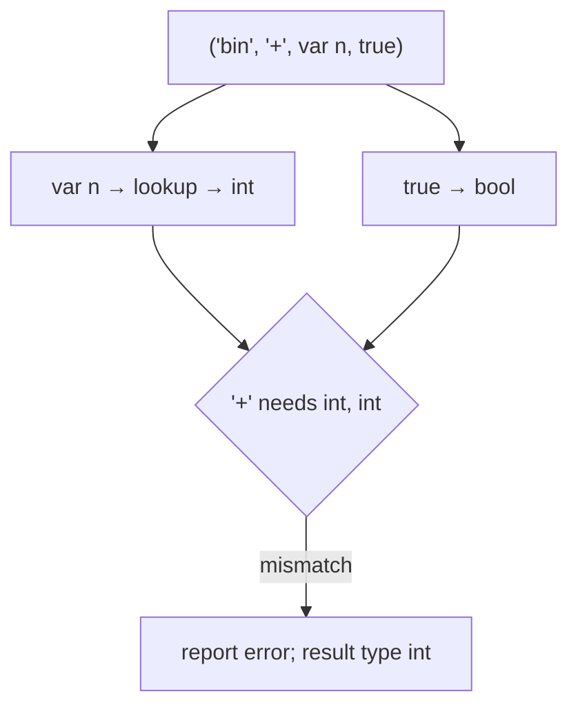

# 02 · Semantic analysis: scopes, symbol tables and type checking

> Level: intermediate · Time: ~2.5 h · Prereqs: 01-beginner/04 (ASTs); C types

## 1. Why this exists

The parser accepts `int x = 1 + true;` and `return y;` (with `y` never declared) — both are *grammatically* fine. Context-free grammars cannot express "every name must be declared before use" or "the operands of `+` must be numbers": those rules depend on *context* far away in the program. **Semantic analysis** is the front-end phase that enforces them. It answers, for every name, *which declaration does this refer to?* (name resolution) and, for every expression, *what is its type, and is that type allowed here?* (type checking). It also decorates the AST with that information — types, links to declarations, and implicit conversions — so that the IR generator does not need to re-derive it.

## 2. Intuition: the guest list and the dress code

At a wedding, the gatekeeper does two jobs. **Guest list**: is this person invited — and to *which* hall (scopes: the reception hall list differs from the family-only lunch list; a cousin "Ravi" at lunch is not the same as a colleague "Ravi" at the reception — shadowing)? **Dress code**: is what you're wearing allowed in this hall (types)? Some outfits are converted at the door — "please put on this shawl" — that's an **implicit conversion** inserted by the compiler.

## 3. Precise definitions

* **Scope**: the region of program text in which a declaration is visible. C, Java and most modern languages use **lexical (static) scoping**: you can determine the binding by reading the program text.
* **Shadowing**: an inner declaration with the same name hides an outer one for the inner region.
* **Symbol table**: a data structure mapping names to their attributes (kind, type, storage location, declaration site), supporting *enter scope*, *exit scope*, *declare*, and *lookup* (innermost first). Typical implementations: a stack of hash tables, or one hash table whose entries are chains tagged with scope depth.
* **Type system**: a set of rules assigning types to expressions, written as inference rules, e.g. "if Γ ⊢ e₁ : int and Γ ⊢ e₂ : int then Γ ⊢ e₁ + e₂ : int", where Γ (the *environment*) is the symbol table.
* **Static vs dynamic typing**: checked at compile time (C, Java, Rust) vs at run time (Python, JavaScript). **Strong vs weak** is about how much implicit conversion/reinterpretation is allowed — C is static but fairly weak (many implicit conversions).
* **Type checking vs type inference**: checking verifies annotated types; inference *computes* missing types (Hindley–Milner, from Milner's 1978 "A theory of type polymorphism in programming", used by ML and Haskell; local inference like C++ `auto`, Java `var`, Rust `let`).
* **Attribute grammars** (Knuth, 1968, "Semantics of context-free languages"): the formal model — each grammar symbol carries *attributes*; **synthesized** attributes flow up the tree (an expression's type), **inherited** attributes flow down (the current scope/environment).

## 4. Step by step

### 4.1 Dumbest approach: one global table

Put every name in one table. It breaks immediately on

```c
int x = 10;
{ int x = 20; }   /* which x? */
printf("%d", x);  /* must be 10 */
```

A single table either rejects the second `x` or overwrites the first. **The wall:** names have *lifetimes in the text*, so the table must too.

### 4.2 A stack of scopes

Enter a block → push an empty table. Declare → insert into the *top* table (error only if the name is already in the *top* table). Lookup → search from top to bottom; the first hit wins (that's shadowing). Exit block → pop. All four operations are O(1) average per scope searched; lookup is O(depth) in the worst case. Clang's `Scope`/`DeclContext` machinery and GCC's binding levels are industrial versions of this stack.

```text
  { int x; bool b;                 scope stack during the inner block:
     { bool x;   ← here              ┌──────────────┐
       x ...  →  bool                │ x: bool      │  ← top (searched first)
       b ...  →  bool                ├──────────────┤
     }                               │ x: int, b:bool│
  }                                  ├──────────────┤
                                     │ globals, funcs│
                                     └──────────────┘
```

### 4.3 Order matters: declare after checking the initialiser

`int x = x + 1;` — in C, the new `x` is in scope *within its own initialiser* (so this reads an uninitialised variable: undefined behaviour). Many languages (Tiny in 01-beginner/05, Rust, Java for locals) instead check the initialiser *before* declaring the name. The order of two lines in the checker *is* a language-design decision.

### 4.4 Two passes for mutual recursion

If `f` calls `g` and `g` calls `f`, a single top-to-bottom pass sees a call to `g` before `g`'s declaration. Options: require forward declarations (C's prototypes) or do **two passes** — first collect all top-level signatures, then check bodies (Java, Rust, our checker below).

### 4.5 Type checking as a post-order walk

The type of an expression is a **synthesized attribute**: compute children's types, then apply the rule for the operator. Errors: report, then return a special **error type** that is silently accepted by every rule — otherwise one undeclared variable produces a cascade of follow-on errors ("int + error", "cannot assign error"…). Clang's equivalent is marking invalid declarations and expressions so later checks stay quiet.



### 4.6 Implicit conversions are semantic analysis too

C inserts conversions silently, and the AST makes them explicit. The **usual arithmetic conversions** (C11 §6.3.1.8) say: if one operand is `unsigned int` and the other `int`, the `int` is converted to `unsigned int`. So `-1 < 1u` compares `4294967295 < 1` — false. Clang's AST shows the inserted node:

```text
BinaryOperator <line:10:9, col:15> 'int' '<'
|-ImplicitCastExpr <col:9> 'unsigned int' <IntegralCast>
| `-ImplicitCastExpr <col:9> 'int' <LValueToRValue>
|   `-DeclRefExpr <col:9> 'int' lvalue Var 'neg' 'int'
```

This is a favourite source of real bugs — and of *false alarms* in compiler testing if a generated program relies on such conversions without the tester understanding them.

## 5. Code

### 5.1 A scoped type checker (`typecheck.py`)

The AST is written directly as Python tuples, so this file is only the checker.

```python
# file: typecheck.py
# Semantic analysis for a tiny typed language: scoped symbol table, name
# resolution, and type checking. The AST is written directly as Python
# tuples so we can focus on the checker, not on parsing.
#
# Types: "int", "bool", and function types ("fn", [param types], return type).
# AST forms (first element = node kind):
#   ("num", 3)  ("true",)  ("false",)  ("var", "x")
#   ("bin", op, left, right)          op in + - * / < <= == && ||
#   ("call", "f", [args])
#   ("decl", type, "x", init)         declare a variable in the current scope
#   ("assign", "x", expr)  ("if", cond, then, else_or_None)  ("while", cond, body)
#   ("block", [stmts])     ("return", expr)
#   ("func", "f", [(type, name)...], ret_type, body)   top-level function

class Checker:
    def __init__(self):
        self.scopes = [{}]          # stack of dicts: name -> type; [0] is global scope
        self.errors = []            # collect ALL errors instead of stopping at the first
        self.ret_type = None        # return type of the function being checked

    # ---------- symbol table ----------
    def push(self):
        self.scopes.append({})      # entering a block opens a new scope

    def pop(self):
        self.scopes.pop()           # leaving it discards that scope's names

    def declare(self, name, typ):
        if name in self.scopes[-1]:                      # [-1] = innermost scope
            self.errors.append(f"redeclaration of '{name}' in the same scope")
        self.scopes[-1][name] = typ

    def lookup(self, name):
        for scope in reversed(self.scopes):              # innermost first => shadowing works
            if name in scope:
                return scope[name]
        self.errors.append(f"use of undeclared name '{name}'")
        return "error"                                   # poison type: suppress follow-on errors

    # ---------- expressions: return the expression's type ----------
    def expr(self, e):
        kind = e[0]
        if kind == "num":
            return "int"
        if kind in ("true", "false"):
            return "bool"
        if kind == "var":
            t = self.lookup(e[1])
            if isinstance(t, tuple):                     # a function used as a value
                self.errors.append(f"function '{e[1]}' used as a variable")
                return "error"
            return t
        if kind == "bin":
            _, op, l, r = e                              # tuple unpacking; _ = ignored
            lt, rt = self.expr(l), self.expr(r)
            if "error" in (lt, rt):
                return "error"                           # already reported: stay quiet
            if op in "+-*/":
                want, result = "int", "int"
            elif op in ("<", "<="):
                want, result = "int", "bool"
            elif op == "==":
                if lt != rt:
                    self.errors.append(f"'==' compares {lt} with {rt}")
                return "bool"
            else:                                        # && ||
                want, result = "bool", "bool"
            if lt != want or rt != want:
                self.errors.append(f"operator '{op}' needs {want} operands, got {lt} and {rt}")
            return result
        if kind == "call":
            _, name, args = e
            ft = self.lookup(name)
            if ft == "error":
                return "error"
            if not isinstance(ft, tuple):
                self.errors.append(f"'{name}' is not a function")
                return "error"
            _, params, ret = ft
            if len(args) != len(params):
                self.errors.append(f"'{name}' expects {len(params)} argument(s), got {len(args)}")
            for i, (a, p) in enumerate(zip(args, params)):   # zip pairs up two lists
                at = self.expr(a)
                if at not in (p, "error"):
                    self.errors.append(f"argument {i + 1} of '{name}': expected {p}, got {at}")
            return ret
        raise ValueError(f"unknown expression {e}")

    # ---------- statements ----------
    def stmt(self, s):
        kind = s[0]
        if kind == "decl":
            _, typ, name, init = s
            it = self.expr(init)                         # check the initialiser BEFORE declaring
            if it not in (typ, "error"):
                self.errors.append(f"cannot initialise {typ} '{name}' with {it}")
            self.declare(name, typ)
        elif kind == "assign":
            _, name, value = s
            nt, vt = self.lookup(name), self.expr(value)
            if "error" not in (nt, vt) and nt != vt:
                self.errors.append(f"cannot assign {vt} to '{name}' of type {nt}")
        elif kind in ("if", "while"):
            ct = self.expr(s[1])
            if ct not in ("bool", "error"):
                self.errors.append(f"'{kind}' condition must be bool, got {ct}")
            for sub in s[2:]:
                if sub is not None:
                    self.stmt(sub)
        elif kind == "block":
            self.push()
            for sub in s[1]:
                self.stmt(sub)
            self.pop()
        elif kind == "return":
            rt = self.expr(s[1])
            if self.ret_type is None:
                self.errors.append("return outside a function")
            elif rt not in (self.ret_type, "error"):
                self.errors.append(f"returning {rt} from a function returning {self.ret_type}")
        else:
            raise ValueError(f"unknown statement {s}")

    def program(self, funcs):
        # pass 1: declare every function first, so calls may appear before definitions
        for _, name, params, ret, _body in funcs:
            self.declare(name, ("fn", [t for t, _ in params], ret))   # list comprehension
        # pass 2: check bodies, each in a scope holding its parameters
        for _, name, params, ret, body in funcs:
            self.push()
            for t, p in params:
                self.declare(p, t)
            self.ret_type = ret
            self.stmt(body)
            self.ret_type = None
            self.pop()
        return self.errors

GOOD = [
    ("func", "max", [("int", "a"), ("int", "b")], "int",
        ("block", [("if", ("bin", "<", ("var", "a"), ("var", "b")),
                          ("return", ("var", "b")), ("return", ("var", "a")))])),
    ("func", "main", [], "int",
        ("block", [("decl", "int", "x", ("call", "max", [("num", 3), ("num", 4)])),
                   ("block", [("decl", "bool", "x", ("true",)),          # shadows outer x: legal
                              ("if", ("var", "x"), ("assign", "x", ("false",)), None)]),
                   ("return", ("bin", "+", ("var", "x"), ("num", 1)))])),
]

BAD = [
    ("func", "f", [("int", "n")], "bool",
        ("block", [("decl", "int", "y", ("bin", "+", ("var", "n"), ("true",))),  # int + bool
                   ("decl", "int", "y", ("num", 0)),                             # redeclared
                   ("while", ("var", "n"), ("assign", "z", ("num", 1))),         # int cond; z undeclared
                   ("return", ("call", "f", [("num", 1), ("num", 2)])),          # arity
                   ("return", ("var", "n"))])),                                  # int from bool fn
]

if __name__ == "__main__":
    print("GOOD:", Checker().program(GOOD) or "no errors")
    print("BAD:")
    for msg in Checker().program(BAD):
        print("  error:", msg)
```

Python syntax notes:

* `class Checker:` defines a class; `def __init__(self):` is the constructor; `self` is the explicit "this" pointer and must be the first parameter of every method.
* `self.scopes = [{}]` — a list containing one empty dict; `self.scopes[-1]` is the *last* element (negative indices count from the end).
* `for scope in reversed(self.scopes):` iterates innermost to outermost without copying.
* `_, op, l, r = e` — *tuple unpacking*: assigns the four elements of `e` to four names; `_` is the convention for "don't care".
* `isinstance(t, tuple)` — run-time type test (function types are represented as tuples `("fn", params, ret)`).
* `"error" in (lt, rt)` — membership test in a tuple.
* `zip(args, params)` pairs elements of two lists; `enumerate(...)` adds an index; together, `for i, (a, p) in enumerate(zip(...))` loops with index and pair.
* `[t for t, _ in params]` — *list comprehension*: the list of parameter types.
* `x or "no errors"` — `or` returns its first truthy operand, so an empty error list prints `"no errors"`.

Logic notes:

* `declare` only checks the **innermost** scope → shadowing allowed, same-scope redeclaration rejected.
* `lookup` returns the **poison type** `"error"` for unknown names; every rule treats `"error"` as compatible, so each mistake is reported **once**.
* `program` makes **two passes** so functions can call each other in any order.
* `ret_type` is an *inherited attribute*: context flowing down into `return` statements.

```text
$ python3 typecheck.py
GOOD: no errors
BAD:
  error: operator '+' needs int operands, got int and bool
  error: redeclaration of 'y' in the same scope
  error: 'while' condition must be bool, got int
  error: use of undeclared name 'z'
  error: 'f' expects 1 argument(s), got 2
  error: returning int from a function returning bool
```

All six seeded errors are found in one run, and there are no cascades.

### 5.2 What a production C compiler does with the same ideas (`conv.c`)

```c
// file: conv.c
// Semantic analysis in a real C compiler: implicit conversions it inserts for you.
#include <stdio.h>

int main(void) {
    int neg = -1;
    unsigned int one = 1;
    // Usual arithmetic conversions: int vs unsigned int -> both become unsigned int,
    // so -1 turns into 4294967295 and the comparison is FALSE.
    if (neg < one) printf("-1 < 1u is true\n");
    else           printf("-1 < 1u is false (!)\n");

    double d = 3.9;
    int i = d;            // implicit double -> int conversion truncates toward zero: 3
    printf("i = %d\n", i);

    int x = 10;
    {
        int x = 20;       // shadows the outer x: legal C, but -Wshadow warns
        printf("inner x = %d\n", x);
    }
    printf("outer x = %d\n", x);
    return 0;
}
```

```text
$ gcc -Wall -Wextra -o conv conv.c && ./conv
conv.c:10:13: warning: comparison of integer expressions of different signedness: 'int' and 'unsigned int' [-Wsign-compare]
-1 < 1u is false (!)
i = 3
inner x = 20
outer x = 10
$ clang -Wall -Wextra -Wshadow -Wconversion -fsyntax-only conv.c 2>&1 | grep warning
conv.c:14:13: warning: implicit conversion turns floating-point number into integer: 'double' to 'int' [-Wfloat-conversion]
conv.c:19:13: warning: declaration shadows a local variable [-Wshadow]
conv.c:10:13: warning: comparison of integers of different signs: 'int' and 'unsigned int' [-Wsign-compare]
```

Each warning is a semantic-analysis rule that C *permits* but that compilers flag because it is so often a mistake.

## 6. Common mistakes

* **Checking redeclaration against all scopes** → legal shadowing rejected. Check only the innermost scope.
* **Popping the scope too early** (before checking a `for`-loop's body, or forgetting that function parameters share the body's outermost scope in C).
* **Not having an error type** → one typo produces twenty errors.
* **Forgetting implicit conversions when generating IR** → `int + double` emitted as integer addition. The AST must carry the conversion explicitly (Clang's `ImplicitCastExpr`).
* **Assuming C's `int` → `unsigned` conversion is intuitive** → `-1 < 1u` is false; `sizeof(x) - 5 > 0` is always true for small `x` because `size_t` is unsigned.
* **Treating semantic errors as parse errors.** Keep the phases separate: parse errors mean "not a sentence", semantic errors mean "a sentence that doesn't make sense".

## 7. Connections

* **C track**: integer promotions and usual arithmetic conversions (C11 §6.3.1), linkage and storage duration.
* **Java track**: Java's definite-assignment rules are a semantic check; generics are type-checked then *erased*.
* **Rust track**: the borrow checker is a (much richer) semantic analysis over lifetimes; `let` inference is local Hindley–Milner-style.
* **DSA track**: stack of hash tables; union–find powers Hindley–Milner unification.
* **Testing/Verification track**: random program generators must produce *well-typed* programs — the generator embeds a type checker in reverse (generate an expression *of a requested type*).

### Where this shows up in my projects

* **compiler-fuzz**'s generator only emits expressions whose types and conversions it understands, so that GCC and Clang must agree on the result; an implicit `int`→`unsigned` conversion the generator didn't model would look like a "miscompilation" when it is actually correct C.
* **QiskitSage**'s semantic review agent (SA-SEM) reasons about what Python code *means* beyond its syntax — the same parse-vs-semantics boundary as this lesson.

## 8. Self-check

1. Why can't a context-free grammar enforce "declare before use"?
2. With a stack of scopes, which scopes does `declare` check and which does `lookup` search?
3. What is the purpose of an error (poison) type?
4. Why does `-1 < 1u` evaluate to false in C?
5. Is an expression's type a synthesized or inherited attribute? What about the expected return type inside a function body?

<details><summary>Answers</summary>

1. It requires relating two distant parts of the program (declaration and use) with matching names — that is context-sensitive information a CFG cannot carry.
2. `declare` checks only the innermost (top) scope; `lookup` searches from innermost to outermost and returns the first match.
3. To suppress cascades of follow-on errors after the first real error; every type rule accepts it silently.
4. The usual arithmetic conversions convert the `int` operand to `unsigned int`, so −1 becomes 4294967295, which is not less than 1.
5. Synthesized (computed from children). The expected return type is inherited (flows down from the function declaration).

</details>

## 9. Mnemonic (Tamil + English)

**"Ulle irundhu veliye"** — *search from inside to outside*: lookup starts in the innermost scope, like searching for your spectacles first in your shirt pocket, then the room, then the whole house. And for C's trap: **"Unsigned vandha, minus ponadhu"** — *when unsigned arrives, the minus disappears*.

## Sources

* ISO C N1570 (C11 draft), §6.2.1 "Scopes of identifiers", §6.3.1.8 "Usual arithmetic conversions": https://www.open-std.org/jtc1/sc22/wg14/www/docs/n1570.pdf
* D. E. Knuth, "Semantics of context-free languages", *Mathematical Systems Theory* 2(2), 1968: https://researchr.org/publication/Knuth68
* R. Milner, "A theory of type polymorphism in programming", *Journal of Computer and System Sciences* 17(3), 1978: https://researchr.org/publication/Milner78poly
* Clang, "Introduction to the Clang AST" (`ImplicitCastExpr`, `DeclRefExpr`): https://clang.llvm.org/docs/IntroductionToTheClangAST.html
* Clang diagnostics reference (`-Wshadow`, `-Wsign-compare`, `-Wfloat-conversion`): https://clang.llvm.org/docs/DiagnosticsReference.html
* Aho, Lam, Sethi, Ullman, *Compilers: Principles, Techniques, and Tools*, 2nd ed., ch. 5 "Syntax-Directed Translation" and §6.5 "Type Checking": https://www.pearson.com/store/en-us/p/compilers-principles-techniques-and-tools/P200000003472
* Stanford CS143 lectures 9–10, "Semantic Analysis & Type Checking": https://web.stanford.edu/class/cs143/

## Verify yourself

```bash
# file: verify-02i.sh
# Tested with Python 3.13, GCC 13.3, Clang 18.1.3, Ubuntu 24.04, Nov 2026.
python3 typecheck.py                                  # GOOD: no errors; six BAD errors
gcc -Wall -Wextra -o conv conv.c && ./conv            # "-1 < 1u is false (!)", i = 3
clang -Wall -Wextra -Wshadow -Wconversion -fsyntax-only conv.c 2>&1 | grep -c "warning:"   # 3
clang -fsyntax-only -Xclang -ast-dump conv.c 2>&1 | grep -A2 "BinaryOperator.*'<'" | sed 's/0x[0-9a-f]*//g'
```

Check against sources: the conversion rule against N1570 §6.3.1.8; the `ImplicitCastExpr <IntegralCast>` node against the Clang AST introduction.
