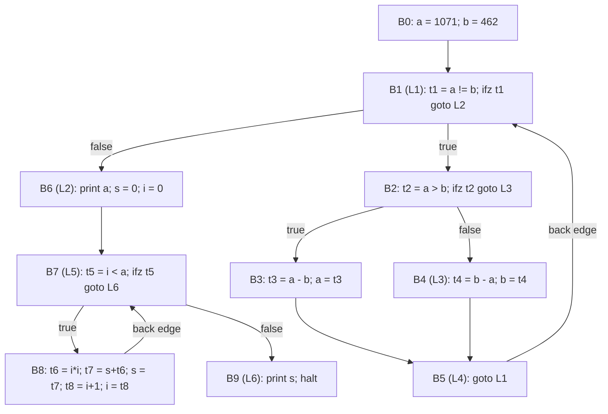

# 03 · Intermediate representations, basic blocks and control-flow graphs

> Level: intermediate · Time: ~2.5 h · Prereqs: 01-beginner/04–05 (Tiny AST, code generation)

## 1. Why this exists

In 01-beginner/05 the code generator walked the AST directly and produced 14 instructions to compute `7`. To optimize, we need a representation where questions like *"is this value already computed?"*, *"is this assignment ever read?"*, *"which code runs in a loop?"* are easy to ask. ASTs are bad at this: control flow is implicit in the nesting, and expressions are deep trees. Machine code is bad too: it is full of target details (registers, addressing modes). The answer is an **intermediate representation (IR)** that is *flat* (a list of simple instructions) and has *explicit control flow* (a graph of blocks). Almost every optimization in this track is defined on that graph.

## 2. Intuition: a recipe rewritten as numbered steps with "go to step N"

A recipe in prose ("while the dough is sticky, add flour; if it's too dry, add water") is like an AST. Rewrite it as numbered one-action steps — "Step 4: if dough not sticky go to step 7" — and you have **three-address code**. Now group the steps that always run together, with no "go to" in or out in the middle — "steps 1–3: measure, mix, knead" — and draw arrows between the groups. Those groups are **basic blocks** and the drawing is the **control-flow graph (CFG)**. A cook (or optimizer) can now see the loop as a cycle of arrows.

## 3. Precise definitions

* **IR**: any representation of the program between source and target. Classified by *structure* — **tree** (AST), **linear** (three-address code, stack code, bytecode), **graph** (CFG, DAG, dependence graph) — and by *level* — high (close to source), mid, low (close to machine).
* **Three-address code (TAC)**: instructions of the form `x = y op z`, `x = op y`, `x = y`, `goto L`, `if x goto L`, plus calls and memory operations. "At most three addresses" (two operands, one result); every intermediate value gets a named temporary. GCC's GIMPLE is "a three-address representation derived from GENERIC" that works by "breaking down GENERIC expressions into tuples of no more than 3 operands".
* **Basic block**: a maximal sequence of instructions with one entry (only the first instruction can be jumped to) and one exit (only the last instruction can jump away). Once the first instruction runs, all of them run, in order.
* **Control-flow graph**: a directed graph G = (V, E) whose nodes are basic blocks; edge B₁ → B₂ means control can pass directly from the end of B₁ to the start of B₂. It has a unique entry node.
* **Leaders algorithm**: an instruction is a *leader* if (1) it is the first instruction, (2) it is the target of a jump, or (3) it immediately follows a jump. Each basic block is a leader plus everything up to the next leader.

The industrial IR ladder you'll meet in this track:

| Compiler | High | Mid (most optimizations) | Low (machine-level) |
|---|---|---|---|
| GCC | GENERIC (trees) | GIMPLE (→ GIMPLE SSA) | RTL ("Register Transfer Language") |
| LLVM/Clang | Clang AST | LLVM IR (SSA) | SelectionDAG / gMIR → MachineInstr (MIR) |
| MLIR | domain dialects (`linalg`, `tosa`) | `scf`, `affine`, `arith` | `llvm` dialect → LLVM IR |

## 4. Step by step

### 4.1 Lowering: AST → TAC

Rules (post-order, like the code generator, but emitting named values instead of using a stack):

* constant/variable → use it directly as an operand;
* `a op b` → lower `a` to name *x*, lower `b` to name *y*, emit `tN = x op y`, return `tN`;
* `if (c) S1 else S2` → `ifz c goto Lelse; S1; goto Lend; Lelse: S2; Lend:`;
* `while (c) S` → `Lhead: ifz c goto Lexit; S; goto Lhead; Lexit:`.

**What's annoying about the result?** It is still a flat list; the loop exists only as a backward `goto`. To ask "which instructions are in the loop?" you'd have to trace jumps by hand. Hence step 4.2.

### 4.2 Basic blocks and the CFG

Apply the leaders algorithm, then add edges: an unconditional `goto L` → one edge to L's block; a conditional jump → two edges (target and fall-through); anything else → fall-through to the next block; `halt`/`return` → none.

For Euclid's GCD by subtraction (`gcd.tiny` below), the CFG is:



Now loops are visible as **back edges** (B5→B1, B8→B7), "joins" are visible as blocks with several predecessors (B5, B1, B7), and dead code would be visible as blocks unreachable from B0. Lesson 04 adds **dominators** to define loops precisely.

### 4.3 Why blocks? Local vs global

Inside one basic block, there are no branches, so analysis is simple straight-line reasoning — **local optimization** (e.g. value numbering within a block). Across blocks, information must flow along edges and merge at joins — **global optimization** (dataflow analysis, lesson 06). The CFG is the dividing line.

### 4.4 Real compilers do the same thing

GCC 13.3's GIMPLE for the C version of `gcd` (`-fdump-tree-gimple`):

```text
int gcd (int a, int b)
{
  int D.2749;

  goto <D.2743>;
  <D.2744>:
  if (a > b) goto <D.2746>; else goto <D.2747>;
  <D.2746>:
  a = a - b;
  goto <D.2748>;
  <D.2747>:
  b = b - a;
  <D.2748>:
  <D.2743>:
  if (a != b) goto <D.2744>; else goto <D.2742>;
  <D.2742>:
  D.2749 = a;
  return D.2749;
}
```

Two things to notice: (1) `D.2749` is a compiler-generated temporary — the "tN" of GIMPLE; (2) GCC already **rotated the loop**: it jumps to the test at the bottom (`goto <D.2743>`) so each iteration needs only one conditional branch, instead of our `goto Lhead` + `ifz` at the top. After `-fdump-tree-cfg`, the same function is printed as numbered blocks `<bb 2>` … `<bb 8>` with explicit `goto <bb N>` edges.

LLVM can draw its CFG for you: `opt -passes=dot-cfg -disable-output gcd.ll` writes `.gcd.dot`; render it with `dot -Tpng .gcd.dot -o gcd.png`.

## 5. Code

### 5.1 Lowering Tiny to TAC (`tiny_tac.c`)

Uses `tiny_front.h` from lesson 01-beginner/04 unchanged (copy it next to this file).

```c
// file: tiny_tac.c
// Lower a Tiny AST (from tiny_front.h, lesson 01-beginner/04) into
// three-address code (TAC): every instruction has at most one operator,
// and every intermediate value gets a fresh temporary t1, t2, ...
// Usage: ./tiny_tac prog.tiny
#include "tiny_front.h"

static int ntemp, nlabel;                 // counters for fresh temporaries and labels

// Return the NAME holding e's value (a variable, a constant, or a new temp),
// emitting whatever instructions are needed to compute it.
static void lower_expr(Node *e, char *out) {
    char a[32], b[32];
    switch (e->kind) {
    case N_NUM: sprintf(out, "%ld", e->val); return;      // constants are operands as-is
    case N_VAR: strcpy(out, e->name); return;             // so are variables
    case N_NEG:
        lower_expr(e->a, a);
        sprintf(out, "t%d", ++ntemp);
        printf("    %s = neg %s\n", out, a);
        return;
    case N_BIN:
        lower_expr(e->a, a);                              // operands first (post-order)
        lower_expr(e->b, b);
        sprintf(out, "t%d", ++ntemp);                     // fresh temp for the result
        printf("    %s = %s %s %s\n", out, a, e->op, b);
        return;
    default: fprintf(stderr, "not an expression\n"); exit(1);
    }
}

static void lower_stmt(Node *s) {
    char v[32];
    int l1, l2;
    switch (s->kind) {
    case N_LET: case N_ASSIGN:
        lower_expr(s->a, v);
        printf("    %s = %s\n", s->name, v);              // copy instruction
        return;
    case N_PRINT:
        lower_expr(s->a, v);
        printf("    print %s\n", v);
        return;
    case N_IF:
        l1 = ++nlabel; l2 = ++nlabel;
        lower_expr(s->a, v);
        printf("    ifz %s goto L%d\n", v, l1);           // conditional jump: if v == 0
        lower_stmt(s->b);
        printf("    goto L%d\n", l2);
        printf("L%d:\n", l1);
        if (s->c) lower_stmt(s->c);
        printf("L%d:\n", l2);
        return;
    case N_WHILE:
        l1 = ++nlabel; l2 = ++nlabel;
        printf("L%d:\n", l1);                             // loop header (target of back edge)
        lower_expr(s->a, v);
        printf("    ifz %s goto L%d\n", v, l2);
        lower_stmt(s->b);
        printf("    goto L%d\n", l1);
        printf("L%d:\n", l2);
        return;
    case N_BLOCK:
        for (int i = 0; i < s->n; i++) lower_stmt(s->list[i]);
        return;
    default: fprintf(stderr, "bad statement\n"); exit(1);
    }
}

int main(int argc, char **argv) {
    if (argc != 2) { fprintf(stderr, "usage: %s file.tiny\n", argv[0]); return 1; }
    lower_stmt(parse_program(read_file(argv[1])));
    printf("    halt\n");
    return 0;
}
```

Logic: `lower_expr` returns *the name of the place holding the value* — for constants and variables that's the thing itself (no instruction needed), for operators a fresh temporary. This is why TAC is better than the stack machine of 01-beginner/05: values have **names**, so a later pass can see that `t6 = i * i` is used exactly once, or that two temporaries compute the same thing.

```text
# file: gcd.tiny
# Euclid's algorithm by repeated subtraction, then a sum over the result.
let a = 1071;
let b = 462;
while (a != b) {
  if (a > b) a = a - b; else b = b - a;
}
print a;
let s = 0;
let i = 0;
while (i < a) { s = s + i * i; i = i + 1; }
print s;
```

```text
$ gcc -Wall -Wextra -std=c11 -o tiny_tac tiny_tac.c && ./tiny_tac gcd.tiny | tee gcd.tac
    a = 1071
    b = 462
L1:
    t1 = a != b
    ifz t1 goto L2
    t2 = a > b
    ifz t2 goto L3
    t3 = a - b
    a = t3
    goto L4
L3:
    t4 = b - a
    b = t4
L4:
    goto L1
L2:
    print a
    s = 0
    i = 0
L5:
    t5 = i < a
    ifz t5 goto L6
    t6 = i * i
    t7 = s + t6
    s = t7
    t8 = i + 1
    i = t8
    goto L5
L6:
    print s
    halt
```

### 5.2 Leaders, basic blocks and the CFG (`cfg.py`)

```python
# file: cfg.py
# Split three-address code into basic blocks (the "leaders" algorithm),
# connect them into a control-flow graph, and print it plus Graphviz DOT.
# Usage: python3 cfg.py prog.tac
import sys

def read_tac(path):
    """Return a list of instruction strings; label lines like 'L1:' are kept."""
    with open(path) as f:
        return [line.strip() for line in f if line.strip()]   # drop blank lines

def find_leaders(code):
    """Leader = first instruction of a basic block."""
    leaders = {0}                                    # rule 1: the first instruction
    for i, ins in enumerate(code):
        if ins.endswith(":"):                        # rule 2: any jump target (a label)
            leaders.add(i)
        if ins.startswith(("goto", "ifz", "halt")) and i + 1 < len(code):
            leaders.add(i + 1)                       # rule 3: instruction after a jump
    return sorted(leaders)

def build_cfg(code):
    leaders = find_leaders(code)
    # each block runs from one leader up to (not including) the next leader
    bounds = list(zip(leaders, leaders[1:] + [len(code)]))
    blocks = [code[s:e] for s, e in bounds]
    label_to_block = {}                              # "L3" -> block index
    for b, body in enumerate(blocks):
        if body[0].endswith(":"):
            label_to_block[body[0][:-1]] = b         # [:-1] strips the trailing ':'
    succ = {b: [] for b in range(len(blocks))}
    for b, body in enumerate(blocks):
        last = body[-1]
        if last.startswith("goto"):                  # unconditional: one successor
            succ[b].append(label_to_block[last.split()[1]])
        elif last.startswith("ifz"):                 # conditional: target AND fall-through
            succ[b].append(label_to_block[last.split()[-1]])
            succ[b].append(b + 1)
        elif last != "halt" and b + 1 < len(blocks):
            succ[b].append(b + 1)                    # plain fall-through
    return blocks, succ

if __name__ == "__main__":
    blocks, succ = build_cfg(read_tac(sys.argv[1]))
    for b, body in enumerate(blocks):
        print(f"B{b}: " + " ; ".join(body) + f"   -> {['B%d' % s for s in succ[b]]}")
    with open("cfg.dot", "w") as f:                  # Graphviz: dot -Tpng cfg.dot -o cfg.png
        f.write("digraph cfg {\n  node [shape=box];\n")
        for b, body in enumerate(blocks):
            label = "\\l".join(body) + "\\l"         # \l = left-justified line break in DOT
            f.write(f'  B{b} [label="B{b}:\\l{label}"];\n')
            for s in succ[b]:
                f.write(f"  B{b} -> B{s};\n")
        f.write("}\n")
```

Python syntax notes:

* `[line.strip() for line in f if line.strip()]` — list comprehension with a filter: keep stripped non-empty lines.
* `leaders = {0}` — a set literal with one element; `.add(i)` inserts.
* `ins.startswith(("goto", "ifz", "halt"))` — `startswith` accepts a tuple of prefixes.
* `list(zip(leaders, leaders[1:] + [len(code)]))` — pairs each leader with the next one (or the end), giving `(start, end)` ranges.
* `code[s:e]` — slice from `s` up to but not including `e`.
* `body[0][:-1]` — the string without its last character (drop `:`).
* `'B%d' % s` — old-style C-like formatting (`%d` as in `printf`).
* `"\\l".join(body)` — in Python source `"\\l"` is the two characters backslash-`l`, which Graphviz interprets as a left-aligned line break.

Logic: exactly the three leader rules from §3; a block ending in `ifz` gets two successors (jump target first, then fall-through), which is why B1 lists `['B6', 'B2']`.

```text
$ python3 cfg.py gcd.tac
B0: a = 1071 ; b = 462   -> ['B1']
B1: L1: ; t1 = a != b ; ifz t1 goto L2   -> ['B6', 'B2']
B2: t2 = a > b ; ifz t2 goto L3   -> ['B4', 'B3']
B3: t3 = a - b ; a = t3 ; goto L4   -> ['B5']
B4: L3: ; t4 = b - a ; b = t4   -> ['B5']
B5: L4: ; goto L1   -> ['B1']
B6: L2: ; print a ; s = 0 ; i = 0   -> ['B7']
B7: L5: ; t5 = i < a ; ifz t5 goto L6   -> ['B9', 'B8']
B8: t6 = i * i ; t7 = s + t6 ; s = t7 ; t8 = i + 1 ; i = t8 ; goto L5   -> ['B7']
B9: L6: ; print s ; halt   -> []
```

B5 contains only `goto L1` — an *empty* block a later "CFG simplification" pass would delete by redirecting B3 and B4 straight to B1 (LLVM's `simplifycfg` "performs dead code elimination and basic block merging").

### 5.3 The C version, for the real compilers' dumps

```c
// file: gcd.c
// The same algorithm in C, to compare with GCC's and LLVM's real IRs.
int gcd(int a, int b) {
    while (a != b) {
        if (a > b) a = a - b;
        else       b = b - a;
    }
    return a;
}
```

## 6. Common mistakes

* **Forgetting rule 3 of the leaders algorithm** (the instruction after a conditional jump starts a new block) → a block with a branch in the middle, breaking every analysis that assumes straight-line blocks.
* **Treating a label as an instruction that "does" something.** Labels are just names for block entries; after building the CFG you can drop them.
* **Missing the fall-through edge of a conditional branch** → half the CFG disappears, and later "dead code elimination" deletes live code.
* **Confusing a CFG with a call graph.** A CFG is *intra*-procedural (blocks within one function); the call graph is *inter*-procedural (functions calling functions).
* **Assuming GCC's dump file numbers are stable.** `gcd.c.006t.gimple` / `015t.cfg` are pass numbers from GCC 13.3; they change between versions. Use `-fdump-tree-all` and `ls` when unsure.

## 7. Connections

* **DSA track**: graphs, adjacency lists, DFS/BFS, reverse postorder (lesson 04 uses all of these on CFGs).
* **Computer Architecture track**: branch prediction loves "rotated" loops with the test at the bottom — one branch per iteration.
* **Security track**: binary analysis tools (Ghidra, IDA, angr) recover CFGs from machine code; control-flow integrity (CFI) enforces that execution follows CFG edges.
* **Testing/Verification track**: branch/edge coverage is defined on CFG edges; coverage-guided fuzzers (AFL, libFuzzer) instrument edges.

### Where this shows up in my projects

**compiler-fuzz** compares GCC and Clang at different optimization levels; when they disagree, dumping `-fdump-tree-*` (GCC) or `-print-after-all` (LLVM) at each level and diffing the CFGs is how you localise *which* pass changed the program's meaning (03-advanced/06 shows the workflow).

## 8. Self-check

1. State the three rules that make an instruction a leader.
2. Why is three-address code easier to optimize than the stack-machine code of 01-beginner/05?
3. In the GCD CFG, which blocks have more than one predecessor, and why does that matter?
4. Why did GCC put the `a != b` test at the bottom of the loop?
5. What is the difference between local and global optimization?

<details><summary>Answers</summary>

1. It is the first instruction; it is the target of a jump; it immediately follows a jump.
2. Every value has a name, so passes can talk about "the value t6" — its uses, its redundancy, its liveness; in stack code values are anonymous slots whose identity depends on stack depth.
3. B1 (from B0 and B5), B5 (from B3 and B4), B7 (from B6 and B8). At such "join points" information from different paths must be merged — the core difficulty of global analysis and the place SSA puts φ-functions (lesson 04).
4. Loop rotation: with the test at the bottom, each iteration executes one conditional branch instead of an unconditional jump plus a conditional branch.
5. Local works within one basic block (straight-line code, no merging); global works across the whole CFG of a function and must combine information at joins and iterate around loops.

</details>

## 9. Mnemonic (Tamil + English)

**"Mudhal, Kuri, Thaavu-ku Pinnadi"** — *First, Target, After-a-jump*: the three leader rules. Picture a bus route: a new stop (block) starts at the **first** stop, at every stop someone **targets** (a jump destination), and right **after** every place the bus can swerve off-route.

## Sources

* GCC Internals, "GIMPLE": https://gcc.gnu.org/onlinedocs/gccint/GIMPLE.html
* GCC Internals, "RTL Representation": https://gcc.gnu.org/onlinedocs/gccint/RTL.html
* GCC Developer Options (`-fdump-tree-…`, `-fdump-rtl-…`): https://gcc.gnu.org/onlinedocs/gcc/Developer-Options.html
* LLVM, "LLVM's Analysis and Transform Passes" (`dot-cfg`, `simplifycfg`): https://llvm.org/docs/Passes.html
* LLVM Language Reference (SSA-based IR, three forms): https://llvm.org/docs/LangRef.html
* Aho, Lam, Sethi, Ullman, *Compilers: Principles, Techniques, and Tools*, 2nd ed., ch. 6 "Intermediate-Code Generation" and §8.4 "Basic Blocks and Flow Graphs": https://www.pearson.com/store/en-us/p/compilers-principles-techniques-and-tools/P200000003472
* Cooper & Torczon, *Engineering a Compiler*, 3rd ed., ch. 4 "Intermediate Representations": https://shop.elsevier.com/books/engineering-a-compiler/cooper/978-0-12-815412-0
* Cornell CS 6120 (A. Sampson), lesson "Representing Programs" (Bril IR, basic blocks, CFGs): https://www.cs.cornell.edu/courses/cs6120/2023fa/self-guided/

## Verify yourself

```bash
# file: verify-03i.sh
# Needs tiny_front.h from lesson 01-beginner/04. Tested with GCC 13.3, Clang/LLVM 18.1.3, Python 3.13.
gcc -Wall -Wextra -std=c11 -o tiny_tac tiny_tac.c && ./tiny_tac gcd.tiny > gcd.tac
python3 cfg.py gcd.tac                               # 10 blocks, back edges B5->B1 and B8->B7
dot -Tpng cfg.dot -o cfg.png 2>/dev/null && echo "rendered cfg.png"
gcc -O0 -c -fdump-tree-gimple -fdump-tree-cfg gcd.c && ls gcd.c.*   # GIMPLE and CFG dumps
cat gcd.c.*.gimple                                   # loop test rotated to the bottom
clang -O0 -Xclang -disable-O0-optnone -S -emit-llvm gcd.c -o gcd.ll
opt -passes=dot-cfg -disable-output gcd.ll           # writes .gcd.dot
```

Check against sources: the GIMPLE quotes against the GCC Internals "GIMPLE" page; the leaders algorithm against the Dragon Book §8.4.
