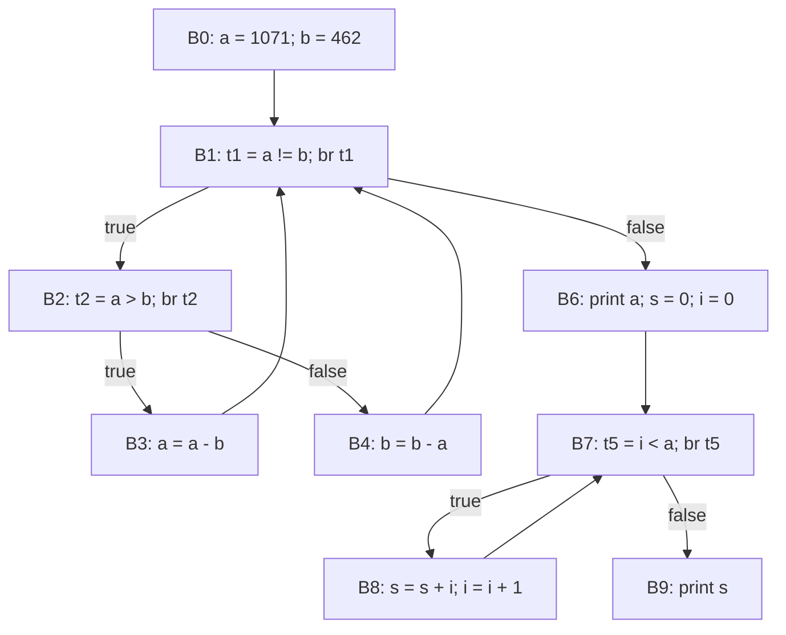

# 04 · Static single assignment (SSA) form and dominance

> Level: intermediate · Time: ~3.5 h · Prereqs: lesson 03 (TAC, basic blocks, CFGs); DFS on graphs

## 1. Why this exists

In three-address code a variable like `a` is assigned in many places. Every optimization then has to ask "*which* assignment of `a` reaches this use?" — a question that needs a whole-function analysis (reaching definitions, lesson 06) and is easy to get wrong. **SSA form** removes the question: each variable is assigned **exactly once** in the program text, so every use has exactly one definition, and "def–use" information is simply a pointer. Constant propagation, dead-code elimination, value numbering and register allocation all become simpler and faster on SSA. That is why LLVM IR, GCC's GIMPLE (after `into-SSA`), MLIR, the JVM JITs, V8 and most GPU compilers use it.

The catch: at a point where control-flow paths **merge**, which version do you use? SSA's answer is the **φ (phi) function**, and placing φs efficiently required a new idea — **dominance frontiers** — from Cytron, Ferrante, Rosen, Wegman and Zadeck, "Efficiently Computing Static Single Assignment Form and the Control Dependence Graph", *ACM TOPLAS* 13(4):451–490, 1991.

## 2. Intuition: version numbers on a shared document

When a team edits a document, you don't overwrite `report.docx`; you save `report_v1`, `report_v2`… Anyone citing the report cites a specific version — no ambiguity. When two people branched off and each made changes, and the branches merge, the merged file has to say "take v3 if we came from Priya's branch, v4 if from Arun's": that's φ. And you only need a merge note at the place where branches *first* rejoin — that's the dominance frontier.

## 3. Precise definitions

* **SSA form**: "each variable is a target of exactly one assignment statement in the program text" (Cytron et al.). A variable may still be assigned *many times at run time* (in a loop) — the rule is about static text.
* **φ-function**: `x3 = φ(x1 : B1, x2 : B2)` at the start of a block with predecessors B1, B2 yields `x1` if control arrived from B1 and `x2` if from B2. All φs in a block execute *simultaneously* at block entry. LLVM: "PHI instructions must be first in a basic block."
* **Dominance**: in a CFG with entry *s*, node *d* **dominates** *n* (d dom n) if *d* lies on every path from *s* to *n*. Every node dominates itself. *d* **strictly** dominates *n* if d dom n and d ≠ n.
* **Immediate dominator** idom(n): the strict dominator of *n* closest to *n*. The idom relation forms the **dominator tree**.
* **Dominance frontier** DF(d): the set of nodes *y* such that *d* dominates a predecessor of *y* but does not strictly dominate *y*. Intuitively, "where *d*'s dominance ends" — the first merge points that can also be reached avoiding *d*.
* **Placement theorem** (Cytron et al.): if variable *v* is defined in the blocks of set *S*, then φ-functions for *v* are needed exactly at the **iterated dominance frontier** DF⁺(S) (iterate because each φ is itself a new definition). This gives *minimal* SSA; *pruned* SSA additionally drops φs whose results are dead.
* **Dominance property of SSA**: in strict SSA, every definition dominates all its (non-φ) uses. That's what makes "the" definition well defined.
* **Natural loop**: a back edge n → h where h dom n; h is the **loop header**. Dominators define loops precisely.

## 4. Step by step

Running example: the GCD CFG from lesson 03, with the empty block B5 merged into its predecessors (as `simplifycfg` would), and the second loop simplified to `s = s + i`:



### 4.1 Dumbest SSA: rename everything, put φs everywhere

Give each assignment a fresh name, and at *every* block with ≥2 predecessors insert a φ for *every* variable. Correct, but the number of φs is |join blocks| × |variables| — for real functions with thousands of variables that is enormous, and most φs are useless (`x5 = φ(x4, x4)`).

### 4.2 Smarter: φ only where two different definitions meet

A φ for *v* is needed at block *Z* only if two *different* definitions of *v* can reach *Z* along distinct paths. How to find such *Z* without enumerating paths? **Wall → dominance.** If definition block *d* dominates *Z*, every path to *Z* passes through *d*, so *d*'s definition (or a later one) arrives on every path — no merge with "older" values. The first blocks *not* dominated by *d* but reachable from it are exactly DF(*d*). So: φs for *v* go in DF of every block defining *v*, iterated.

### 4.3 Computing dominators: the simple, fast algorithm

The textbook definition gives a dataflow equation: Dom(n) = {n} ∪ ⋂_{p ∈ preds(n)} Dom(p). Solving it with sets is O(N²) memory. Cooper, Harvey and Kennedy ("A Simple, Fast Dominance Algorithm") store only `idom[]` and compute intersections by walking two "fingers" up the partial dominator tree using postorder numbers ("nodes higher in the dominator tree have higher postorder numbers"). Iterate over nodes in reverse postorder until nothing changes — usually 2 passes.

For our CFG: idom(B1)=B0, idom(B2)=B1, idom(B3)=idom(B4)=B2, idom(B6)=B1, idom(B7)=B6, idom(B8)=idom(B9)=B7.

```text
Dominator tree:          B0
                         │
                         B1
                       ┌─┴──┐
                       B2   B6
                      ┌┴┐    │
                     B3 B4   B7
                            ┌┴┐
                           B8 B9
```

### 4.4 Dominance frontiers

Cooper–Harvey–Kennedy again: for each join node *b* (≥2 predecessors), for each predecessor *p*, walk `runner` from *p* up the dominator tree until reaching idom(*b*), adding *b* to DF(runner) at each step.

* Join B1 (preds B0, B3, B4; idom B0): from B3 → DF(B3) ∋ B1, up to B2 → DF(B2) ∋ B1, up to B1 → DF(B1) ∋ B1, up to B0 = idom: stop. Same via B4.
* Join B7 (preds B6, B8; idom B6): from B8 → DF(B8) ∋ B7, up to B7 → DF(B7) ∋ B7, up to B6: stop.

Result: DF(B1)=DF(B2)=DF(B3)=DF(B4)={B1}; DF(B7)=DF(B8)={B7}. (A loop header is in its own frontier — that's how loop-carried φs arise.)

### 4.5 Placing φs

* `a` defined in {B0, B3}: DF(B3) = {B1} → φ for `a` at B1; B1 is a new def site, DF(B1) = {B1} already has it. Done.
* `b` defined in {B0, B4} → φ at B1.
* `s`, `i` defined in {B6, B8} → φ at B7.
* `t1`, `t2`, `t5` each have one definition → no φ.

### 4.6 Renaming

Walk the dominator tree from the entry, keeping a **stack of current versions** per variable. In each block: φ destinations get fresh names; each instruction's uses are replaced by the top-of-stack version, then its destination gets a fresh name (pushed). Before descending, fill in *this block's* argument slot in each successor's φs. After finishing a subtree, pop what this block pushed. Because we walk the *dominator* tree, the top of each stack is always the definition that dominates the current point.

Result (from `ssa.py` below):

```text
B1:
    a2 = phi(a1:B0, a2:B4, a3:B3)
    b2 = phi(b1:B0, b3:B4, b2:B3)
B7:
    s2 = phi(s1:B6, s3:B8)
    i2 = phi(i1:B6, i3:B8)
```

Read `a2 = phi(a1:B0, a2:B4, a3:B3)`: entering the loop from B0, `a` is the initial 1071; from B4 (where only `b` changed) `a` is unchanged (`a2`); from B3 it is the new difference `a3`.

### 4.7 Leaving SSA

Machines have no φ. **SSA destruction** replaces `x3 = φ(x1:B1, x2:B2)` with copies `x3 = x1` at the end of B1 and `x3 = x2` at the end of B2. Naively done after optimizations, this can be wrong — the **lost-copy** and **swap** problems (Briggs, Cooper, Harvey and Simpson, *Software—Practice & Experience* 28(8), 1998): φs are parallel, copies are sequential, and critical edges (from a block with several successors to a block with several predecessors) have no safe place for the copy. Fixes: split critical edges, and sequentialise parallel copies carefully. In LLVM, φs survive until instruction selection and are eliminated in the machine-level `PHIElimination` pass before register allocation.

### 4.8 The front-end shortcut LLVM uses

Front ends don't need any of this. The LLVM Kaleidoscope tutorial's message is that "there is no need for your front-end to build SSA form": put every mutable variable in a stack slot (`alloca`), use `load`/`store`, and let the **mem2reg** pass promote the slots, "inserting Phi nodes as appropriate" — internally using the dominance-frontier algorithm. (mem2reg only promotes `alloca`s in the entry block whose only uses are direct loads and stores; anything whose address escapes stays in memory.) An alternative to Cytron's algorithm is Braun et al.'s on-the-fly construction ("Simple and Efficient Construction of Static Single Assignment Form", CC 2013), which builds SSA directly from the AST without computing dominance frontiers.

## 5. Code

### 5.1 SSA construction from scratch (`ssa.py`)

```python
# file: ssa.py
# Build SSA form for a small CFG, following Cytron et al. (TOPLAS 1991):
#   1. dominators       (Cooper-Harvey-Kennedy iterative algorithm)
#   2. dominance frontiers
#   3. phi placement     (iterated dominance frontier of each variable's def blocks)
#   4. renaming          (walk the dominator tree with a stack of versions per variable)
# Instructions are tuples: ("=", dest, operands...) or ("br", cond) / ("print", x).

# The GCD CFG from lesson 03 with the empty block B5 merged away
# (simplifycfg would do exactly that). Each block: list of instructions, list of successors.
CFG = {
    "B0": ([("=", "a", "1071"), ("=", "b", "462")],              ["B1"]),
    "B1": ([("=", "t1", "a", "!=", "b"), ("br", "t1")],           ["B2", "B6"]),
    "B2": ([("=", "t2", "a", ">", "b"), ("br", "t2")],            ["B3", "B4"]),
    "B3": ([("=", "a", "a", "-", "b")],                           ["B1"]),
    "B4": ([("=", "b", "b", "-", "a")],                           ["B1"]),
    "B6": ([("print", "a"), ("=", "s", "0"), ("=", "i", "0")],    ["B7"]),
    "B7": ([("=", "t5", "i", "<", "a"), ("br", "t5")],            ["B8", "B9"]),
    "B8": ([("=", "s", "s", "+", "i"), ("=", "i", "i", "+", "1")], ["B7"]),
    "B9": ([("print", "s")],                                      []),
}
ENTRY = "B0"
VARS_OPS = {"!=", ">", "<", "-", "+"}           # operator tokens are not variables

def preds_of(cfg):
    preds = {b: [] for b in cfg}
    for b, (_, succs) in cfg.items():
        for s in succs:
            preds[s].append(b)
    return preds

def reverse_postorder(cfg, entry):
    seen, order = set(), []
    def dfs(b):                                 # nested function (closure over seen/order)
        seen.add(b)
        for s in cfg[b][1]:
            if s not in seen:
                dfs(s)
        order.append(b)                         # postorder: after all successors
    dfs(entry)
    return order[::-1]                          # [::-1] reverses a list

def dominators(cfg, entry):
    """Cooper, Harvey & Kennedy, 'A Simple, Fast Dominance Algorithm'. Returns idom map."""
    rpo = reverse_postorder(cfg, entry)
    po_num = {b: i for i, b in enumerate(reversed(rpo))}   # postorder numbers
    preds = preds_of(cfg)
    idom = {entry: entry}
    def intersect(b1, b2):                      # walk both fingers up until they meet
        while b1 != b2:
            while po_num[b1] < po_num[b2]:
                b1 = idom[b1]
            while po_num[b2] < po_num[b1]:
                b2 = idom[b2]
        return b1
    changed = True
    while changed:
        changed = False
        for b in rpo[1:]:                       # every node except the entry, in RPO
            processed = [p for p in preds[b] if p in idom]
            new = processed[0]
            for p in processed[1:]:
                new = intersect(p, new)
            if idom.get(b) != new:
                idom[b] = new
                changed = True
    return idom

def dominance_frontiers(cfg, idom):
    """For each join node b, walk up from each predecessor to idom(b)."""
    preds = preds_of(cfg)
    df = {b: set() for b in cfg}
    for b in cfg:
        if len(preds[b]) >= 2:
            for p in preds[b]:
                runner = p
                while runner != idom[b]:
                    df[runner].add(b)
                    runner = idom[runner]
    return df

def defs_of(ins):
    return [ins[1]] if ins[0] in ("=", "phi") else []

def uses_of(ins):
    if ins[0] == "=":
        return [x for x in ins[2:] if x not in VARS_OPS and not x.isdigit()]
    if ins[0] in ("br", "print"):
        return [ins[1]]
    return []

def place_phis(cfg, df):
    def_blocks = {}
    for b, (code, _) in cfg.items():
        for ins in code:
            for v in defs_of(ins):
                def_blocks.setdefault(v, set()).add(b)   # setdefault: insert if missing
    phis = {b: [] for b in cfg}                 # block -> list of variables needing a phi
    for v, blocks in def_blocks.items():
        if len(blocks) < 2:
            continue                            # one def site: never needs a phi
        work, has_phi = list(blocks), set()
        while work:                             # ITERATED dominance frontier
            x = work.pop()
            for y in df[x]:
                if y not in has_phi:
                    phis[y].append(v)
                    has_phi.add(y)
                    if y not in blocks:         # a phi is itself a new definition
                        work.append(y)
    return phis

def rename(cfg, idom, phis, entry):
    children = {b: [] for b in cfg}             # dominator tree
    for b, d in idom.items():
        if b != d:
            children[d].append(b)
    counter, stacks = {}, {}
    def fresh(v):
        counter[v] = counter.get(v, 0) + 1
        name = f"{v}{counter[v]}"
        stacks.setdefault(v, []).append(name)
        return name
    def top(v):
        return stacks[v][-1] if stacks.get(v) else f"{v}?"   # '?' = used before any def
    out = {b: [] for b in cfg}
    phi_args = {b: {v: [] for v in phis[b]} for b in cfg}
    phi_dest = {}
    def walk(b):
        pushed = []
        for v in phis[b]:                       # phis define new versions first
            phi_dest[(b, v)] = fresh(v); pushed.append(v)
        for ins in cfg[b][0]:
            new_uses = [top(x) if x in uses_of(ins) else x for x in ins]
            if ins[0] == "=":
                new_uses[1] = fresh(ins[1]); pushed.append(ins[1])
            out[b].append(tuple(new_uses))
        for s in cfg[b][1]:                     # fill this block's slot in successors' phis
            for v in phis[s]:
                phi_args[s][v].append(f"{top(v)}:{b}")
        for c in children[b]:
            walk(c)
        for v in pushed:                        # pop on the way back up the tree
            stacks[v].pop()
    walk(entry)
    return out, phi_args, phi_dest

if __name__ == "__main__":
    idom = dominators(CFG, ENTRY)
    df = dominance_frontiers(CFG, idom)
    print("idom:", {b: idom[b] for b in CFG})
    print("DF:  ", {b: sorted(df[b]) for b in CFG if df[b]})
    phis = place_phis(CFG, df)
    code, phi_args, phi_dest = rename(CFG, idom, phis, ENTRY)
    for b in CFG:
        print(f"{b}:")
        for v in phis[b]:
            print(f"    {phi_dest[(b, v)]} = phi({', '.join(phi_args[b][v])})")
        for ins in code[b]:
            if ins[0] == "=":
                print(f"    {ins[1]} = {' '.join(ins[2:])}")
            else:
                print(f"    {' '.join(ins)}")
```

Python syntax notes:

* `def dfs(b):` inside another function is a **nested function**; it can read and mutate `seen`/`order` from the enclosing function (a *closure*).
* `order[::-1]` — a slice with step −1: a reversed copy.
* `{b: i for i, b in enumerate(reversed(rpo))}` — dict comprehension giving each block its postorder number.
* `idom.get(b) != new` — `.get` returns `None` for missing keys instead of raising `KeyError`.
* `def_blocks.setdefault(v, set()).add(b)` — "get the set for `v`, creating an empty one if missing, then add `b`".
* `stacks[v][-1] if stacks.get(v) else f"{v}?"` — top of the version stack, or a marker for "used before defined".
* `new_uses = [top(x) if x in uses_of(ins) else x for x in ins]` — rebuild the instruction tuple, replacing each used variable by its current version.

Logic notes:

* `dominators` is exactly Figure 3 of Cooper–Harvey–Kennedy: initialise `idom[entry] = entry`, sweep in reverse postorder, `intersect` with postorder numbers.
* `dominance_frontiers` is their Figure 5 (the `runner` walk).
* `place_phis` uses a worklist so the frontier is **iterated**: a block that receives a φ is pushed as a new definition site.
* `rename` performs the dominator-tree walk with per-variable stacks and pops on the way back.

```text
$ python3 ssa.py
idom: {'B0': 'B0', 'B1': 'B0', 'B2': 'B1', 'B3': 'B2', 'B4': 'B2', 'B6': 'B1', 'B7': 'B6', 'B8': 'B7', 'B9': 'B7'}
DF:   {'B1': ['B1'], 'B2': ['B1'], 'B3': ['B1'], 'B4': ['B1'], 'B7': ['B7'], 'B8': ['B7']}
B0:
    a1 = 1071
    b1 = 462
B1:
    a2 = phi(a1:B0, a2:B4, a3:B3)
    b2 = phi(b1:B0, b3:B4, b2:B3)
    t11 = a2 != b2
    br t11
B2:
    t21 = a2 > b2
    br t21
B3:
    a3 = a2 - b2
B4:
    b3 = b2 - a2
B6:
    print a2
    s1 = 0
    i1 = 0
B7:
    s2 = phi(s1:B6, s3:B8)
    i2 = phi(i1:B6, i3:B8)
    t51 = i2 < a2
    br t51
B8:
    s3 = s2 + i2
    i3 = i2 + 1
B9:
    print s2
```

### 5.2 The same thing in LLVM with `mem2reg`

Take `gcd.c` from lesson 03. `-O0` normally adds the `optnone` attribute, which makes `opt` skip the function; `-Xclang -disable-O0-optnone` removes it. `-fno-discard-value-names` keeps readable names.

```text
$ clang -O0 -Xclang -disable-O0-optnone -fno-discard-value-names -S -emit-llvm gcd.c -o gcd.ll
```

Before (excerpt) — every variable lives in memory:

```llvm
entry:
  %a.addr = alloca i32, align 4
  %b.addr = alloca i32, align 4
  store i32 %a, ptr %a.addr, align 4
  store i32 %b, ptr %b.addr, align 4
  br label %while.cond
while.cond:                                       ; preds = %if.end, %entry
  %0 = load i32, ptr %a.addr, align 4
  %1 = load i32, ptr %b.addr, align 4
  %cmp = icmp ne i32 %0, %1
  br i1 %cmp, label %while.body, label %while.end
```

After `opt -S -passes=mem2reg gcd.ll` (LLVM 18.1.3):

```llvm
define dso_local i32 @gcd(i32 noundef %a, i32 noundef %b) #0 {
entry:
  br label %while.cond

while.cond:                                       ; preds = %if.end, %entry
  %b.addr.0 = phi i32 [ %b, %entry ], [ %b.addr.1, %if.end ]
  %a.addr.0 = phi i32 [ %a, %entry ], [ %a.addr.1, %if.end ]
  %cmp = icmp ne i32 %a.addr.0, %b.addr.0
  br i1 %cmp, label %while.body, label %while.end

while.body:                                       ; preds = %while.cond
  %cmp1 = icmp sgt i32 %a.addr.0, %b.addr.0
  br i1 %cmp1, label %if.then, label %if.else

if.then:                                          ; preds = %while.body
  %sub = sub nsw i32 %a.addr.0, %b.addr.0
  br label %if.end

if.else:                                          ; preds = %while.body
  %sub2 = sub nsw i32 %b.addr.0, %a.addr.0
  br label %if.end

if.end:                                           ; preds = %if.else, %if.then
  %b.addr.1 = phi i32 [ %b.addr.0, %if.then ], [ %sub2, %if.else ]
  %a.addr.1 = phi i32 [ %sub, %if.then ], [ %a.addr.0, %if.else ]
  br label %while.cond, !llvm.loop !6

while.end:                                        ; preds = %while.cond
  ret i32 %a.addr.0
}
```

Compare with `ssa.py`: LLVM kept the empty join block `if.end`, so it has *two* rounds of φs (at `if.end` and at `while.cond`) where we had one three-input φ at B1. Same meaning, different CFG shape. All loads and stores vanished; the 4 `alloca`s became SSA values.

## 6. Common mistakes

* **"SSA means each variable is assigned once at run time."** No — once in the *text*. `%a.addr.0` takes a new value every loop iteration.
* **Inserting φs only in DF, not the iterated DF.** A φ is itself a definition; skip iteration and some merges get no φ.
* **Thinking φ arguments are evaluated in the φ's block.** Each argument is conceptually read *at the end of the corresponding predecessor*. This matters for liveness and for SSA destruction.
* **Treating φs in one block as sequential.** They are parallel: `a2 = φ(…, b1)` and `b2 = φ(…, a1)` swap values — sequential copies `a=b; b=a` would be the "swap problem".
* **Running `opt` on `-O0` IR and wondering why nothing changes** → the `optnone` attribute. Use `-Xclang -disable-O0-optnone`.
* **Expecting mem2reg to promote everything.** Address-taken variables (`&x` passed to a function) stay in memory.

## 7. Connections

* **DSA track**: DFS, postorder/reverse postorder, trees, worklist algorithms, stacks.
* **Math for CS track**: partial orders and lattices — dominance is a partial order; the dominator tree is its Hasse diagram.
* **Rust track**: rustc's MIR is not SSA, but it is lowered to LLVM IR, which is.
* **Parallel/CUDA track**: GPU compilers use post-dominators (the reverse notion) to find where divergent threads **reconverge** (04-pro/05).
* **Security track**: decompilers (e.g. Ghidra's P-code) lift binaries into SSA for analysis.

### Where this shows up in my projects

When **compiler-fuzz** finds a GCC-vs-Clang mismatch, the reduced program is usually inspected as LLVM IR after `mem2reg`/`-O1` (and GIMPLE SSA in GCC via `-fdump-tree-ssa`); reading φ-nodes fluently is what lets you see *which* value a miscompiled loop carried around its back edge.

## 8. Self-check

1. Define the dominance frontier of a node.
2. Why must φ placement use the *iterated* dominance frontier?
3. Why does the renaming phase walk the dominator tree, not the CFG in some arbitrary order?
4. What are the lost-copy and swap problems?
5. Why don't LLVM front ends construct SSA themselves?

<details><summary>Answers</summary>

1. DF(d) = { y | d dominates some predecessor of y, but d does not strictly dominate y }.
2. Each inserted φ is a new definition of the variable; the blocks it lives in can have frontiers needing further φs.
3. A definition is visible exactly in the region it dominates; walking the dominator tree with stacks guarantees the top of the stack is the unique dominating definition at every point.
4. Both arise when replacing φs with copies: φs are parallel, copies are sequential. Lost copy: a copy placed at the end of a predecessor overwrites a value still needed (often around critical edges/loops). Swap: φs that exchange two values become `a=b; b=a`, losing one value.
5. They emit stack slots (`alloca` + loads/stores) and rely on `mem2reg` (or SROA) to promote them into SSA registers with φs.

</details>

## 9. Mnemonic (Tamil + English)

**"Oru per, oru kalyanam"** — *one name, one wedding*: in SSA every variable name is "married" to exactly one definition. And φ is the **"sandhippu" (meeting point) priest** who stands at the frontier where the bride's and groom's families' roads join and says "if you came from the bride's side, you get *this* gift".

## Sources

* R. Cytron, J. Ferrante, B. K. Rosen, M. N. Wegman, F. K. Zadeck, "Efficiently Computing Static Single Assignment Form and the Control Dependence Graph", *ACM TOPLAS* 13(4):451–490, 1991: https://faculty.cc.gatech.edu/~harrold/6340/cs6340_fall2009/Readings/cytron91oct.pdf
* K. D. Cooper, T. J. Harvey, K. Kennedy, "A Simple, Fast Dominance Algorithm" (Rice University): https://www.cs.tufts.edu/comp/150FP/archive/keith-cooper/dom14.pdf
* P. Briggs, K. D. Cooper, T. J. Harvey, L. T. Simpson, "Practical Improvements to the Construction and Destruction of Static Single Assignment Form", *Software—Practice & Experience* 28(8), 1998: https://web.eecs.umich.edu/~mahlke/courses/583f23/reading/briggs_spe_98.pdf
* M. Braun et al., "Simple and Efficient Construction of Static Single Assignment Form", CC 2013: https://bernsteinbear.com/assets/img/braun13cc.pdf
* LLVM Language Reference (`phi`: "PHI instructions must be first in a basic block"): https://llvm.org/docs/LangRef.html
* LLVM Kaleidoscope tutorial ch. 7, "Mutable Variables" (mem2reg rules): https://llvm.org/docs/tutorial/MyFirstLanguageFrontend/LangImpl07.html
* LLVM Passes (`mem2reg`: "promotes memory references to be register references"): https://llvm.org/docs/Passes.html
* Cornell CS 6120, lesson "Static Single Assignment": https://www.cs.cornell.edu/courses/cs6120/2023fa/self-guided/

## Verify yourself

```bash
# file: verify-04i.sh
# Needs gcd.c from lesson 03. Tested with Python 3.13 and Clang/LLVM 18.1.3, Nov 2026.
python3 ssa.py                                         # idom, DF and the SSA listing above
clang -O0 -Xclang -disable-O0-optnone -fno-discard-value-names -S -emit-llvm gcd.c -o gcd.ll
grep -c alloca gcd.ll                                  # 2 allocas before
opt -S -passes=mem2reg gcd.ll -o gcd.ssa.ll
grep -c alloca gcd.ssa.ll; grep -c " = phi " gcd.ssa.ll   # 0 allocas, 4 phis after
opt -passes='print<domtree>' -disable-output gcd.ssa.ll 2>&1 | head -12   # LLVM's dominator tree
gcc -O1 -c -fdump-tree-ssa gcd.c && grep -n "PHI" gcd.c.*.ssa       # GCC's GIMPLE SSA phis
```

Check against sources: the DF definition and placement theorem against Cytron et al. §3–5; the intersect/runner pseudocode against Cooper–Harvey–Kennedy Figures 3 and 5.
