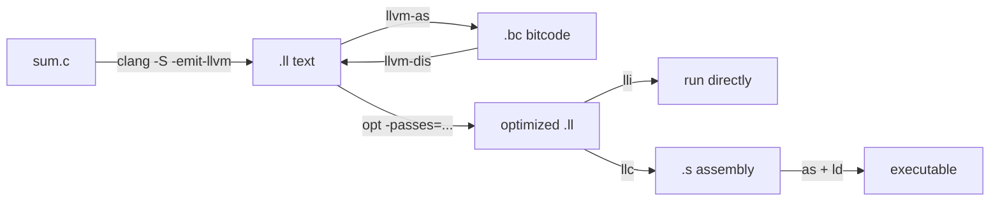

# 05 · LLVM IR, hands-on

> Level: intermediate · Time: ~3 h · Prereqs: lesson 04 (SSA, φ, dominance); C pointers and structs

## 1. Why this exists

LLVM IR is the lingua franca of modern compilers: Clang (C/C++/Objective-C), Rust, Swift, Julia, Zig, many GPU and ML compilers, and NVIDIA's own CUDA compiler front end (NVVM IR is based on LLVM IR) all produce it. If you can read and write LLVM IR, you can (a) see what *any* of these front ends really asked for, (b) test optimization passes in isolation, (c) write reduced bug reports that compiler developers accept, and (d) generate test programs at the IR level. Lessons 06–07 (dataflow, optimizations) use it as their lab bench.

## 2. Intuition: a portable, strictly-typed assembly language with infinite registers

Think of LLVM IR as assembly language for an imaginary RISC machine that has: unlimited registers (each assigned exactly once — SSA), explicit types on everything, real functions with parameters instead of calling conventions, and a guarantee that a checker (the **verifier**) rejects nonsense. It is low-level enough that a back end can turn it into x86-64, AArch64, RISC-V or NVIDIA PTX, yet high-level enough to keep information optimizations need (types, "no signed wrap" promises, aliasing hints).

## 3. Precise definitions (LLVM 18 / LangRef)

* "LLVM is a Static Single Assignment (SSA) based representation that provides type safety, low-level operations, flexibility, and the capability of representing 'all' high-level languages cleanly."
* Three equivalent forms: "an in-memory compiler IR, as an on-disk bitcode representation (suitable for fast loading by a Just-In-Time compiler), and as a human readable assembly language representation." Files: `.ll` (text), `.bc` (bitcode).
* **Module** → global variables + functions; **function** → basic blocks; **basic block** → instructions ending in exactly one **terminator** (`br`, `ret`, `switch`, `unreachable`…).
* **Identifiers**: "Global identifiers (functions, global variables) begin with the '@' character." "Local identifiers (register names, types) begin with the '%' character." Unnamed values are numbered `%0, %1, …`.
* **Types**: integers of any width `i1, i8, i32, i64, i128`; `float`, `double`; `ptr` (an **opaque pointer** — since LLVM 17 "Only opaque pointers are supported"; the pointee type lives on each `load`/`store`/`getelementptr`); arrays `[N x T]`; structs `{T1, T2}`; vectors `<4 x i32>`; `void`; `label`.
* Key instructions:
  * arithmetic `add/sub/mul/sdiv/udiv/shl/lshr/ashr/and/or/xor` with optional flags: on `add`, if `nuw`/`nsw` are present, "the result value of the add is a poison value if unsigned and/or signed overflow, respectively, occurs";
  * `icmp <pred>` (`eq ne slt sle sgt sge ult ule ugt uge`) → `i1`;
  * `br i1 %c, label %t, label %f` / `br label %x`; `ret`; `phi`;
  * memory: `alloca` "allocates memory on the stack frame of the currently executing function", `load`, `store`;
  * `getelementptr` (GEP) "is used to get the address of a subelement of an aggregate data structure… It performs address calculation only and does not access memory";
  * conversions `sext/zext/trunc/sitofp/bitcast/ptrtoint`; `call`; `select`.
* **Signedness lives in operations, not types**: there is one `i32`; `sdiv` vs `udiv`, `icmp slt` vs `icmp ult` decide signedness.

The toolbox (all from LLVM 18.1.3 in this sandbox):

| Tool | Does |
|---|---|
| `clang -S -emit-llvm` | C → `.ll` |
| `llvm-as` / `llvm-dis` | `.ll` ⇄ `.bc` (and runs the verifier) |
| `lli` | interpret/JIT-execute IR directly |
| `opt` | run optimization/analysis passes: `opt -passes=… ` |
| `llc` | IR → target assembly/object |
| `llvm-link` | link several IR modules |
| `llvm-reduce` | shrink a failing IR test case (04-pro/04) |

## 4. Step by step

### 4.1 Read what Clang emits

```c
// file: sum.c
// Signed vs unsigned arithmetic in C, as seen in LLVM IR flags.
int add_signed(int a, int b) { return a + b; }
unsigned add_unsigned(unsigned a, unsigned b) { return a + b; }
```

```text
$ clang -O1 -S -emit-llvm sum.c -o - | grep -E "define|add "
define dso_local i32 @add_signed(i32 noundef %0, i32 noundef %1) local_unnamed_addr #0 {
  %3 = add nsw i32 %1, %0
define dso_local noundef i32 @add_unsigned(i32 noundef %0, i32 noundef %1) local_unnamed_addr #0 {
  %3 = add i32 %1, %0
```

The *same* `add i32` — but the signed version carries `nsw`. Why? In C, signed overflow is undefined behaviour, so Clang may promise LLVM "this never overflows". Unsigned overflow is defined (wraps), so no promise. `noundef` says the argument is never an undefined/poison value. These flags are how source-language rules reach the optimizer — and how undefined behaviour becomes optimization fuel (03-advanced/04).

### 4.2 Write IR by hand

Dumbest approach: copy Clang's `-O0` output and edit it — you'll drown in `alloca`/`load`/`store`. Better: write the SSA directly, using φs for loop-carried values, exactly as in lesson 04.

```llvm
; file: fact.ll
; Hand-written LLVM IR: iterative factorial plus a main that prints it.
; Run directly with the interpreter/JIT:  lli fact.ll

@fmt = private constant [11 x i8] c"%d! = %ld\0A\00"   ; global constant string (C-style, NUL-terminated)

declare i32 @printf(ptr, ...)                           ; external variadic function

define i64 @fact(i32 %n) {
entry:
  %n64 = sext i32 %n to i64                    ; sign-extend the argument to 64 bits
  br label %loop

loop:                                          ; loop header: two predecessors
  %i   = phi i64 [ 1, %entry ], [ %i.next, %body ]
  %acc = phi i64 [ 1, %entry ], [ %acc.next, %body ]
  %done = icmp sgt i64 %i, %n64                ; signed greater-than -> i1 (a 1-bit boolean)
  br i1 %done, label %exit, label %body

body:
  %acc.next = mul i64 %acc, %i
  %i.next   = add nuw nsw i64 %i, 1            ; flags: promise no unsigned/signed wrap
  br label %loop                               ; back edge

exit:
  ret i64 %acc
}

define i32 @main() {
  %r = call i64 @fact(i32 20)
  %c = call i32 (ptr, ...) @printf(ptr @fmt, i32 20, i64 %r)   ; variadic calls spell out the type
  ret i32 0
}
```

Logic: `loop` is the header; `%i` and `%acc` are loop-carried values whose φs pick the initial value from `%entry` and the updated value from `%body` (the back edge). The string is `%d! = %ld` (9 bytes) + newline `\0A` + NUL `\00` = 11 bytes. My first draft said `[12 x i8]`; the IR parser refused it — "constant expression type mismatch: got type '[11 x i8]' but expected '[12 x i8]'" — a small taste of how strictly typed LLVM IR is.

```text
$ lli fact.ll
20! = 2432902008176640000
$ llvm-as fact.ll -o fact.bc      # binary bitcode, 1620 bytes
$ llc -O2 -relocation-model=pic fact.ll -o fact.s && gcc fact.s -o fact_native && ./fact_native
20! = 2432902008176640000
```

Without `-relocation-model=pic`, the link fails on Ubuntu with "relocation R_X86_64_32 against `.rodata' can not be used when making a PIE object" — GCC links position-independent executables by default, and `llc`'s default relocation model emitted an absolute 32-bit address. Lesson 03-advanced/03 explains relocations and PIE.

### 4.3 Watch the optimizer change your IR

```text
$ opt -S -O2 fact.ll | sed -n '/define i64 @fact/,/^}/p'
define i64 @fact(i32 %n) local_unnamed_addr #1 {
entry:
  %n64 = sext i32 %n to i64
  %done1 = icmp slt i32 %n, 1
  br i1 %done1, label %exit, label %body

body:                                             ; preds = %entry, %body
  %acc3 = phi i64 [ %acc.next, %body ], [ 1, %entry ]
  %i2 = phi i64 [ %i.next, %body ], [ 1, %entry ]
  %acc.next = mul i64 %acc3, %i2
  %i.next = add nuw nsw i64 %i2, 1
  %done.not = icmp slt i64 %i2, %n64
  br i1 %done.not, label %body, label %exit

exit:                                             ; preds = %body, %entry
  %acc.lcssa = phi i64 [ 1, %entry ], [ %acc.next, %body ]
  ret i64 %acc.lcssa
}
```

Three passes are visible: **loop rotation** (`loop-rotate`: the test moved to the bottom of `body`, plus a guard `icmp slt i32 %n, 1` in `entry` — the same transformation GCC did in lesson 03); **LCSSA** ("loop-closed SSA": the value leaving the loop goes through `%acc.lcssa`, a single-input-per-edge φ in the exit block, which simplifies loop passes); and **instcombine** rewriting `sgt` + branch into `slt` with swapped targets. The attribute group `#1` and `local_unnamed_addr` were added by attribute inference.

### 4.4 GEP: addresses without memory access

```llvm
; file: gep.ll
; getelementptr (GEP) computes addresses; it never touches memory.
; C equivalent:  struct Pt { int x; long y; };  long get_y(struct Pt *p, long k) { return p[k].y; }
%struct.Pt = type { i32, i64 }                 ; field 0: i32, field 1: i64 (padding before it)

define i64 @get_y(ptr %p, i64 %k) {
  ; index 1: step over k whole structs (p + k), index 2: pick field 1 (.y)
  %addr = getelementptr inbounds %struct.Pt, ptr %p, i64 %k, i32 1
  %v = load i64, ptr %addr                     ; only load/store actually access memory
  ret i64 %v
}
```

```text
$ llc -O2 gep.ll -o - (excerpt)
get_y:
	shlq	$4, %rsi              # k * 16   (sizeof(struct Pt) = 16 with padding)
	movq	8(%rdi,%rsi), %rax    # load from p + k*16 + 8  (offsetof(y) = 8)
	retq
```

The confusing first index is answered by LLVM's GEP FAQ: it is "the index stepping through the second operand" — the pointer itself is treated as pointing into an array of `%struct.Pt`, like C's `p[k]`; index `0` would mean "this struct". "The GetElementPtr instruction dereferences nothing."

### 4.5 The verifier: SSA rules are enforced

```llvm
; file: bad.ll
; Invalid IR: %x is used in a block that its definition does not dominate.
define i32 @f(i1 %c) {
entry:
  br i1 %c, label %then, label %join
then:
  %x = add i32 1, 2
  br label %join
join:
  ret i32 %x                                   ; on the path entry->join, %x was never defined
}
```

```text
$ llvm-as bad.ll -o /dev/null
llvm-as: assembly parsed, but does not verify as correct!
Instruction does not dominate all uses!
  %x = add i32 1, 2
  ret i32 %x
```

This is lesson 04's dominance property, enforced by tooling. The fix is a φ in `join`: `%r = phi i32 [ %x, %then ], [ 0, %entry ]`. In compiler testing, "the optimizer produced IR that fails the verifier" is a classic *crash-type* bug class; `opt -verify-each` checks after every pass.



## 5. Code

All code is inline above (`sum.c`, `fact.ll`, `gep.ll`, `bad.ll`). Every line is commented; LLVM IR comments start with `;`.

## 6. Common mistakes

* **Wrong array length on string constants** — count the `\0A` and the `\00`.
* **Using a value in a block its definition doesn't dominate** — use a φ (or an `alloca` + mem2reg).
* **φ not at the top of the block, or with an entry missing for some predecessor** — the verifier rejects both.
* **Running `opt` on `clang -O0` output** — the `optnone` attribute blocks passes; add `-Xclang -disable-O0-optnone`.
* **Linking `llc` output into a PIE without `-relocation-model=pic`.**
* **Assuming `i32` is signed.** Signedness is chosen per instruction (`sdiv`/`udiv`, `icmp slt`/`ult`).
* **Adding `nsw` "because the C was signed" when hand-writing tests.** `nsw` turns overflow into poison — if your test overflows, you've written a test with undefined behaviour and any output is "correct".
* **Using old tutorials with typed pointers (`i32*`)** — invalid since LLVM 17; write `ptr`.

## 7. Connections

* **C track**: struct layout and padding (`sizeof(struct Pt) == 16`), signed vs unsigned overflow.
* **Computer Architecture track**: `llc -march=riscv64` / `-march=aarch64` produce other ISAs from the same IR.
* **Rust track**: `rustc --emit=llvm-ir` shows Rust's IR. Checked in this sandbox with rustc 1.97.0: for `a + b` on `i32`, `rustc -O` emits a plain `add i32` with **no** `nsw` (overflow is not UB in Rust, so there is nothing to promise), while `-C opt-level=0` (overflow checks on) emits `@llvm.sadd.with.overflow.i32` and a panic branch.
* **Parallel/CUDA track**: `llc -march=nvptx64` turns the same IR into PTX (04-pro/05).
* **AI dev tools track**: ML compilers (XLA, Triton, MLIR-based stacks) bottom out in LLVM IR.

### Where this shows up in my projects

**compiler-fuzz** targets Clang; when a Clang miscompilation is found, the standard path to an LLVM bug report is `clang -emit-llvm` → `opt` pass bisection → `llvm-reduce` on the `.ll` file, because LLVM developers want the smallest IR plus the single `opt -passes=…` command that breaks it.

## 8. Self-check

1. What is the difference between `add` and `add nsw`, semantically?
2. Why does `fact.ll` need φs but Clang's `-O0` output does not?
3. In `getelementptr %struct.Pt, ptr %p, i64 %k, i32 1`, what does each index do?
4. Why did `ld` reject the first `llc` output?
5. What is LCSSA and where did it appear?

<details><summary>Answers</summary>

1. Both compute two's-complement addition, but with `nsw` the result is *poison* if signed overflow occurs, which lets optimizers assume it doesn't.
2. `fact.ll` keeps loop-carried values in SSA registers, which need φs at the loop header; `-O0` code keeps variables in `alloca` stack slots and uses loads/stores, so no φs are needed.
3. `%k` steps over `k` whole structs from `%p` (like `p[k]`); `1` selects field 1 (`y`) within that struct.
4. The default executable on Ubuntu is a PIE; the code contained an absolute 32-bit relocation (`R_X86_64_32`) to `.rodata`, which cannot be used in position-independent code. `-relocation-model=pic` makes `llc` emit RIP-relative addressing.
5. Loop-closed SSA: every value defined in a loop and used outside goes through a φ in the loop's exit block. It appeared as `%acc.lcssa` in `exit`.

</details>

## 9. Mnemonic (Tamil + English)

**"At-u veliyila, Percent-u veetla"** — *`@` is outside (global), `%` is at home (local)*. And for GEP: **"Mudhal index — evlo dhooram, rendaavadhu — endha arai"** — *first index: how far down the street; second: which room in the house*.

## Sources

* LLVM Language Reference Manual (SSA, forms, identifiers, `add` flags, `alloca`, `getelementptr`, `phi`, poison): https://llvm.org/docs/LangRef.html
* LLVM, "Opaque Pointers" (LLVM 15 default, LLVM 17 typed pointers removed): https://llvm.org/docs/OpaquePointers.html
* LLVM, "The Often Misunderstood GEP Instruction": https://llvm.org/docs/GetElementPtr.html
* LLVM Command Guide (`lli`, `llc`, `opt`, `llvm-as`): https://llvm.org/docs/CommandGuide/index.html
* LLVM Passes (`loop-rotate`, `instcombine`, `mem2reg`): https://llvm.org/docs/Passes.html
* LLVM Kaleidoscope tutorial ch. 3 "Code generation to LLVM IR": https://llvm.org/docs/tutorial/MyFirstLanguageFrontend/index.html
* NVIDIA NVVM IR Specification ("NVVM IR is a compiler IR (intermediate representation) based on the LLVM IR"): https://docs.nvidia.com/cuda/nvvm-ir-spec/index.html
* The Rust Reference, "Operator expressions" (overflow panics in debug mode): https://doc.rust-lang.org/reference/expressions/operator-expr.html

## Verify yourself

```bash
# file: verify-05i.sh
# Tested with LLVM/Clang 18.1.3 and GCC 13.3, Ubuntu 24.04, Nov 2026.
clang -O1 -S -emit-llvm sum.c -o - | grep -E "add "              # nsw only on the signed add
lli fact.ll                                                       # 20! = 2432902008176640000
llvm-as fact.ll -o fact.bc && llvm-dis fact.bc -o - | head -3
llc -O2 -relocation-model=pic fact.ll -o fact.s && gcc fact.s -o fact_native && ./fact_native
opt -S -O2 fact.ll | sed -n '/define i64 @fact/,/^}/p'            # rotated loop + %acc.lcssa
llc -O2 gep.ll -o - | grep -E "shlq|movq"                          # *16 and +8
llvm-as bad.ll -o /dev/null                                       # "Instruction does not dominate all uses!"
llc -O2 -march=riscv64 fact.ll -o - | grep -c "mul"                # same IR, RISC-V output
```

Check against sources: the `nuw`/`nsw` sentence and the GEP sentences against LangRef and the GEP FAQ; the typed-pointer removal against the Opaque Pointers page.
